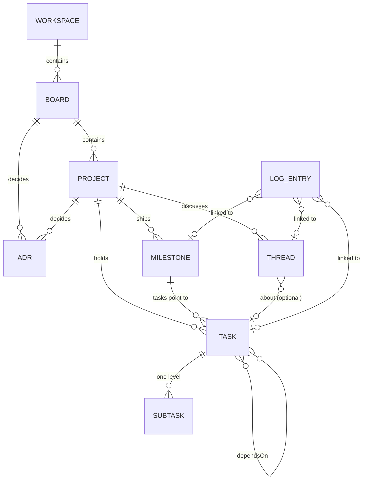

# Board entity model

> Historical context. The current requirements, specifications and program designs in this folder govern. This earlier document may describe superseded choices and does not authorize implementation.

*Working design from the owner and the board/Router Lead, settled in conversation on 2026-10-02. It feeds the formal design cycle for the Router build (owner rule: actual changes need a design first). The companion document on state transitions and orchestration is linked at the end. The decision record is a board post on the board-design thread.*

## In one picture

```text
 WORKSPACE                          repos · members · registries
 └─ BOARD   kind: initiative | area
    ├─ ADRs                         board-level decisions
    └─ PROJECT                      lead · status · plan · machine pin
       ├─ MILESTONE                 delivery checkpoint (one PR stack)
       ├─ TASK ──► SUBTASK          the work; dependsOn forms a DAG
       ├─ THREAD                    conversation only
       └─ ADRs                      project-level decisions
 LOG ENTRY (own store), linked from task · milestone · thread · trace
```



## Ground rules

1. **Keep the existing structure and rename two levels.**

   | Was | Now |
   |---|---|
   | project | **workspace** |
   | board | **board**, with a `kind` |
   | topic | **project** |
   | thread | **thread** (narrowed to conversation) |

   Nothing is restructured. The new things are small entities added alongside.
2. **An entity is anything with its own state, owner or reader. Everything else is a property.** Views (cards, the work view, the owner inbox, the Lead's load) come from statuses and tags and are never stored.
3. **Status changes only through a recorded move,** for project, milestone and task alike. Each move is a log entry, so history is never lost and can't be edited.
4. **Authority sits on entities, not on threads:**
   - the Lead on the project;
   - the implementer on the task (`assignee`);
   - the reviewer on the milestone.

   A thread's participants are just who's talking.
5. **One fact, one home.** Decisions are ADRs. A task's history is its linked log entries. "Owner" always means the human; agents are `lead`, `assignee` or `reviewer`.
6. **Logs are linked, not placed.** They live in their own append-only store, never wake anyone, and are referenced from tasks, threads and show-me-your-work traces.

## Entities

### Workspace (was "project")
Repos, members, and the shared registries (machine definitions, guards and question cards, all pinned by hash).

### Board
| Property | |
|---|---|
| `kind` | `initiative` (has a goal and an end) or `area` (ongoing) |
| `title`, `lead` | |
| `goal`, `doneWhen` | initiatives only |
| status | an initiative closes when done; an area never ends |

### ADR (architecture/decision record)
| Property | |
|---|---|
| `title`, `scope` | the board or the project it governs |
| `status` | proposed → accepted → superseded |
| `context`, `decision`, `consequences` | |
| `supersedes?` | a new decision supersedes the old one; ADRs are never edited |
| `refs[]` | e.g. the thread it came from |

### Project (was "topic")
| Property | |
|---|---|
| `title`, `goal`, `lead` | the lead is the accountable Lead agent (orchestrator seat) |
| `status` | orienting → (investigating \| designing \| planning) → plan_ready → delivering → delivered, plus the phase terminals and closed. Only through moves |
| `plan` | the published snapshot, identified by `planRevision` (a content hash); a new revision names the tasks it changed |
| `machine` | the frozen process version it runs under (name@version plus hash) |
| `repos[]`, `tags[]` | |

### Milestone, a delivery checkpoint (owner chose option B)
| Property | |
|---|---|
| `name`, `doneWhen` | doneWhen is the end-to-end check, proven on the top layer of the stack |
| `status` | open → in_review → approved → merged, plus **dropped** with a reason (recommended; awaiting the owner's yes). Only through moves |
| `reviewer` | seat granted by `commission_review` |
| `approvedHead` | the stack's top head when approved. A later head change sends it back to in_review |
| links | the review verdict and the owner's merge grant |

Derived, not stored: its **order** (from the task DAG), its **PR stack** (the PRs of its tasks, in base-chain order), and its **proof** (its tasks' VERIFY results). `merged` needs a grant naming every PR in the stack, plus a recorded merge for each.

### Task
| Property | |
|---|---|
| `title`, `project`, `milestone` | |
| `status` | commissioned → implementing → done_claimed → done, plus corrections and dropped. The Lead's assessment is the **move** `assess` (accepted → done, returned → implementing), not a state. `done` is a resting state; the task is final when its milestone merges. Only through moves |
| `assignee` | the implementer seat, granted by `commission`, with append-only seat events on the task |
| `goal`, `verify[]` | each VERIFY entry is a scenario, expected result, verifier, and `oracle_revision` pin with `oracle_paths` |
| `repo`, `writePaths[]` | disjoint across tasks open at the same time |
| `dependsOn[]` | forms a DAG. Router rejects cycles and missing targets (petgraph `toposort` at write) |
| `pr` | `{repo, number}`. Base and head arrive as recorded PR facts; Router never calls the forge |
| `brief` | link to the versioned **Brief** written at `commission`. It holds the outcome, acceptance, scope, stop and return conditions, the role row (role and model), and the VERIFY snapshot at its `planRevision`. A re-brief supersedes it (`staleBrief`). After a session dies, recovery uses the brief plus the current state, and `assess` judges against it |
| `links[]`, `tags[]` | |

Roughly one Sidekick stream. The L0 contract layer is a task every stream task depends on. `prLayer` is derived from the PR the task links to.

### Subtask (one level only)
`title`, `parent`, `status: todo | doing | done | failed`, `assignee` (usually a Worker), `check`, `result` link. Its proof rolls up into the task.

### Thread
`title`, `tags[]`, resolved or open, participants, and an optional link to a task, milestone or ADR. **Conversation only; it is never the home of state.**

### Log entry (own store)
Append-only, ordered by Router, and linked to its subjects. Kinds:
- moves;
- rejected moves;
- receipts;
- card answers and guard results;
- move suggestions;
- PR facts;
- hook facts;
- activity records (owner decision (b), pending);
- `ownerWords` (instruction, grant, correction or agreement; verbatim; first-hand or relayed; scope; `refs[]`).

## Open

| # | Question | Lean |
|---|---|---|
| 1 | Milestone `dropped` (with a reason) | yes (awaiting the owner) |
| 2 | Is Subtask an entity, or a `checks[]` list on the task? | open |
| 3 | Is the log one store with typed kinds, or several stores? | one store, typed kinds, retention per kind |
| 4 | Can a small project skip milestones? | open |
| 5 | Do the renames reach the API and CLI? | yes, folded into the Router design cycle |
| 6 | A new name for "codex-router" | owner |
| 7 | Workspace members (people and agents) | not modelled yet |

## Companion

**State transitions and how orchestration drives them**, kept in the owner's private work trail (by the process-definition lane, which owns the machine's semantics; it becomes `implementation-goal/4` after review). It covers the per-entity moves, seats and guards, the cross-entity rules X1–X8, and how the Lead, hooks, the Inspector and suggesters drive the moves. The record side (what each move writes, linked-fact checks, compose listings, views) lives in the Router spec and links back to it.
