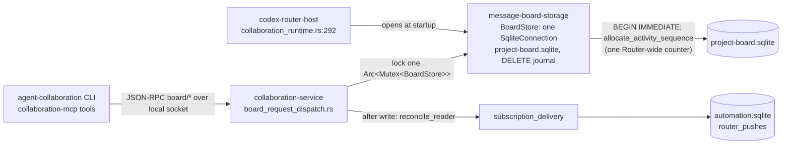
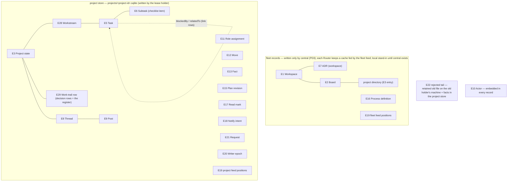
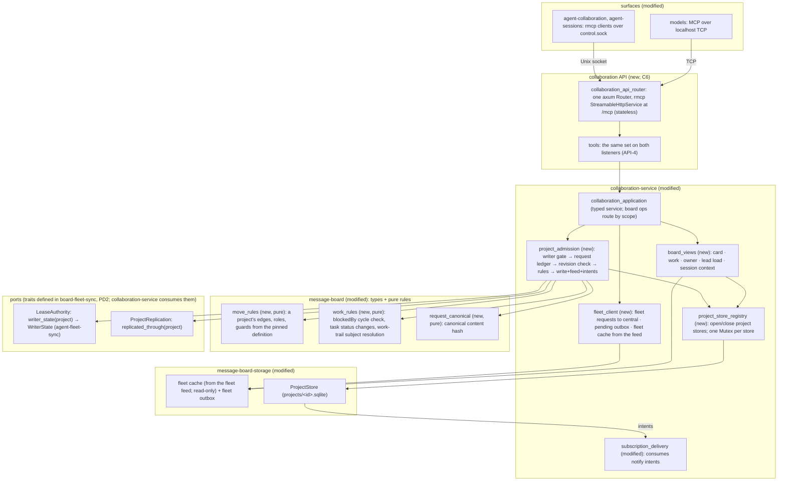

# Program design 1: the board and the collaboration API

> **0.1.102 cut (owner decision 1217, 2026-10-24).** E12 Move, `move_rules`, process definitions, pinning, the project stage and the three hook tools were removed before release. Rows here that name them no longer exist in code. Everything else stands.

**What this is:** how Router realizes [spec 1](spec-1-board-and-contracts.md), which traces to [requirements.md](requirements.md): the board's records and admission, and the collaboration API they're reached through. The spec's entity names (E1–E22, E28, E29) and obligation IDs are used unchanged; retired IDs (E4, E14, ST-2, ST-4, ST-7, MV-5, MV-6) have no realization here. Project storage and replication are in [program-design-2-project-storage.md](program-design-2-project-storage.md); the central server is in [program-design-3-central-fleet.md](program-design-3-central-fleet.md). Exact files, task order and test commands belong to the plan, not here.

```text
requirements.md (why) ──► spec 1 (what) ──► program design 1 (how) ──► plan (order, files, tests)
                          ├─► spec 2 ──► program design 2
                          └─► spec 3 ──► program design 3
```

## 1. Today

Checked against main `21a9b029`:



| Fact | Anchor |
|---|---|
| Types live in `message-board` (serde + schemars), exported through the control schema | `crates/message-board/Cargo.toml:12`; `collaboration_runtime.rs` `ControlSchema::generate` |
| One store and one mutex serialize every board write on the Router | `control_service_context.rs:9`; `board_request_dispatch.rs` `call!` |
| Schema comes from SQLx migrations with checked queries | `crates/message-board-storage/migrations/`; `board_schema_migrations.rs` |
| Writes that open subscription windows reconcile delivery after commit | `board_request_dispatch.rs` `call_with_subscription_now_and_reconcile!` |
| The Router installation and machine label exist | `collaboration-service/src/machine_identity.rs` (`service_id` + `MachineLabel`) |
| Control is hand-written newline-delimited JSON-RPC over `control.sock`, with its own initialization and version check | `collaboration-service/src/control_connection.rs` (framing at `:44`, `unsupportedVersion` at `:886`) |
| The MCP server is a raw hyper listener on localhost TCP in session mode. Most tool calls go back to the same Host over `control.sock` (a fresh connection and handshake per call); Codex conversation and observation tools use Control only to discover the carrier socket, then talk to it directly | `collaboration-mcp/src/mcp_http_listener.rs:6,87,96–107`; `collaboration-mcp/src/mcp_server.rs:127–134`; `collaboration-client/src/conversation_client.rs:333–375` |

**What stays:**
- checked queries (SQLx today; `sqlx-turso` for project stores, program design 2 §6 T1);
- one Tokio runtime;
- `message-board` as the type home;
- subscription delivery as the notifier until interactions (P3) take over.

**What changes:**
- one store becomes a fleet store plus one store per project;
- one mutex becomes one per store;
- the global counter becomes a feed per scope;
- new entities, an admission pipeline, a request ledger, writer epochs and views are added;
- Control and the MCP→`control.sock`→Host hop are replaced by one stateless MCP server that calls the service in-process (C6).

## 2. The crux and the choices

| Crux | Options | Selected | Why | Reopen if |
|---|---|---|---|---|
| **C2. Who admits a write** | (a) admission logic spread across storage methods, as today; (b) one admission pipeline per scope (fleet, project) | **(b)** | WA-2/3, RC-3/4 and MV-2 must run on every write in one order. One pipeline keeps that order in one place | — |
| **C6. The collaboration API** | (a) keep Control (JSON-RPC over `control.sock`) with MCP calling it; (b) Control on axum over a WebSocket; (c) **one stateless MCP server** (rmcp `StreamableHttpService`, stateless; a plain JSON reply for single results, SSE when a tool streams) mounted on one axum router, served on two listeners with the same tools: localhost TCP `/mcp` for models and `control.sock` `/mcp` for the CLIs; tools call `collaboration_application` in-process | **(c)** (owner, U26–U28) | One protocol and one tool set for models and CLIs. It deletes the hand-written framing, the raw hyper listener and the hop back through the socket. Each call stands alone, so no client state. The CLIs become rmcp clients over the Unix socket (rmcp opens one connection per request) | the hook path's latency budget (G6) isn't met over the socket |
| **C5. Notify intents versus today's subscription windows** | (a) rebuild delivery now; (b) record intents in the project store, and have today's subscription delivery consume them until P3's intent contract (M3.2) lands | **(b)** | NI-1 needs the board to stop delivering. P3 owns delivery and is mid-migration | when M3.2 lands |

**Owner constraints on SQLite (2026-10-05; also AGENTS.md):**
- **No database triggers.** Every rule, including epoch fencing, is enforced in Rust admission code.
- **SQLite holds relational integrity only:** primary keys, foreign keys, `NOT NULL` and unique indexes.
  - Foreign keys are switched on after migrations, as `board_schema_migrations.rs:90` does today.
  - `CHECK` is used only for boolean `0/1` columns.
  - Enum membership, lengths, ranges, cross-field rules, dense feed positions, epoch order and one-time ledger decisions are all checked in Rust: on write, and again when stored rows are decoded.

**In plain words:** the board's data splits into a small fleet store and one file per project. Each file has exactly one writer at a time and its own numbered feed. Every write goes through one gate per file, which checks four things in order:
1. Is this machine the current writer?
2. Have I seen this request before?
3. Is the subject still at the revision you expected?
4. Does the process definition allow this move?

The gate then writes the record, its feed entry and its notifications together.

**Kept the same:** the runtime and the delivery path. **Changed:** project stores move to the Turso engine (program design 2), and the socket protocol becomes MCP (C6).

**Costs:**
- a one-time upgrade script, run with downtime, outside the Router (U54);
- more store handles;
- views that span projects must read several files (the owner view, the lead load).

## 3. Entity homes



| E | Semantic owner | Code home | Schema / type home | Shape across boundaries | Stored |
|---|---|---|---|---|---|
| E1 Workspace | fleet admission (central, PD3; Routers send requests through `fleet_client`) | `message-board-storage` **modified** (from `project_records.rs`) | `message-board` `WorkspaceId`, `Workspace` (renamed from `ProjectId`/`Project`), which carries `repositories: Vec<RepositoryRef>`. Attach and detach emit the updated `Workspace` record in the same fleet transaction, so the accept reply, the feed, the snapshot and the Router's fleet cache all carry the attachments, and the cache serves the repository filter in `workspace_list`. `fleet_repositories` stays as the indexed table behind it, and the record and the table are written in the same transaction (M2.4 finding) | MCP `workspace_*` tools (camelCase, schemars) | persisted, fleet |
| E2 Board | fleet admission | `message-board-storage` **modified** | `message-board` `Board` + `BoardKind { Initiative{goal, done_when}, Area }` | `board/*` | persisted, fleet |
| E3 Project | directory entry: fleet admission; state: project admission | fleet: **modified** from `board_topic_records.rs`; project store **new** | `ProjectId` (from `TopicId`), `ProjectDirectoryEntry { id, board, title }` written by fleet admission, with the rest of the U46 metadata kept by central from the copy and registry sides (PD3 §6); the holder sends its `ProjectSummary{status, latest_record_at}` with pieces (PD2 §3); `ProjectState { status, pinned_definition, revision, closed_at }`. A new project has no workstream (WS-1) | `project/*` | persisted, both |
| E5 Task | project admission | **new** | `TaskId`, `Task { workstream: WorkstreamId, title: TaskTitle, body: String, status: TaskStatus{Todo, Doing, Done, Dropped}, revision }`; links are their own rows, `TaskLink { from: TaskId, kind: TaskLinkKind{BlockedBy, RelatedTo}, to: TaskId }`, unique on all three, so concurrent link edits never overwrite each other (TK-2). `TaskTitle` is a non-empty newtype. Dropping takes a caller reason: `task_set_status` carries `TaskStatusChange::{Todo, Doing, Done, Drop{reason: DropReason}}`, and the drop writes `LifecycleFact::Dropped{task, reason}` with the caller's text; no reason is invented. An actual link change also writes a `TaskLinkEvent { id: TaskLinkEventId, change: TaskLinkEventKind::{Added(TaskLink), Removed(TaskLink)} }` record (`RecordKind::TaskLinkEvent`) with its own feed position, in the same transaction (RC-5). The operation's answer stays `LinkChange::{Added, AlreadyPresent, Removed, NotPresent}`. A no-op (`AlreadyPresent`, `NotPresent`) and a request replay write no event (M2 review F8, F9; re-review F14) | `task_*` tools | persisted, project |
| E6 Subtask | project admission | **new** | `SubtaskId`, `Subtask { task: TaskId, text: String, checked: bool, place: SubtaskPlace, removed: bool }`; `SubtaskPlace` is a sortable key, so a reorder rewrites one row Removing a subtask sets `removed: true` on its record. That updated `Subtask` record is the removal's feed record (RC-5). List reads and checklist progress leave removed items out unless the caller passes `include_removed`. `subtask_show` returns the record with `removed: true`. Any later change to a removed item (check, uncheck, reorder, edit, remove) is `notFound` (TK-6) (M2 review F9; re-review F15) | `subtask_*` tools | persisted, project |
| E7 ADR | fleet admission (central, PD3) | **new**, fleet only | `AdrId`, `Adr { workspace: WorkspaceId, title, text: MarkdownText, status: AdrStatus{Proposed, Accepted, Superseded, Withdrawn}, supersedes: Option<AdrId>, made_in: Option<RecordRef>, repository_files: Vec<RepoFileRef> }`. `text` is the whole ADR as Markdown, held in the record and immutable from creation (U48, ST-5); only `status` changes, through lifecycle transitions. Export and import of Markdown files is the deferred helper (G25) | `adr_*` tools | persisted, fleet |
| E8 Thread | project admission | **modified**, moved from `thread_records.rs` into the project store | `ThreadId` (root post ID), `Thread { about: ThreadSubject, imported: bool, state }`, with the subject required (U65, TH-1; the shapes are in §3 Roles and thread subjects). `thread_resolve{thread, reason}` (the reason is required and nonempty) sets `Resolved` and writes `LifecycleFact::ThreadResolved` in the same transaction (RC-10). `thread_unresolve{thread}` is its own operation and restores `Open` (E8 stays reversible) (M2.4 finding). **Archived boards (M2.5b finding):** the `Archived` gate refuses every operation except reader opt-out (`ThreadUnwatch`, `ProjectUnwatch`, `ThreadUnsubscribe`) and reader state (the VW-6 mark entry, and inbox acknowledgement and initialization). Those still pass the lease, schema, key and stand-down gates. Joins, new subscriptions, renewals and all work writes stay `Archived`. **Thread references (U61).** Every thread operation (post, join, leave, resolve, show, participant list, renewals) takes `ThreadRef { thread: ThreadId, project: Option<ProjectId> }`. Routing a reference and `thread_leave`'s follow-up are below the table | `thread/*` | persisted, project |
| E9 Post | project admission | **modified** (`message_records.rs`) | `PostId` (from `MessageId`), `Post`. **Top-level post cooldown (M2.4 finding).** Today's rule refuses an actor's second top-level post on a board within the cooldown window, with the remaining time, to steer agents into threads. It narrows to **per project**. A board's projects are separate stores, possibly on different machines, so a board-wide check would need a new shared mechanism. Admission derives the check inside the project's write transaction from the actor's latest top-level post in that project's feed (by Router time; a clock that has stepped backwards is capped at the full window). There's no cooldown table. A refusal is a recorded `Decided(Rejected)` naming the remaining seconds, so a retry replays it. Thread replies are never refused by it. The window stays today's value. The legacy `actor_board_cooldowns` table isn't carried over by the upgrade | `thread/post` | persisted, project |
| E10 Actor | caller (declared); Router adds provenance | **modified** (`board_identity.rs`) | `RecordedActor::{Session{session: SessionRef}, Human{human: HumanId}, Router{component: RouterComponent, installation: ServiceId}}`, a closed shape. It's spec 1 E10's identity:
- **A session's key is its full `SessionRef`.** Its `endpoint.serviceId` is the session's home Router installation: the persisted service identity that `MachineIdentity` carries (`collaboration-protocol` `endpoint_identity.rs`; a Router publishes refs only under its own service ID). An installation runs on exactly one machine, so the ref names E10's installation and machine itself.
- **Nothing resolves an actor from context.** An explicit actor or reader (a read mark, watch or inbox read) names its full ref, home included. Nothing infers it from the receiving Router or the project's holder, so a project move never re-keys a session. Refs on different installations are different actors.
- **The label isn't part of any key.** The machine label (`MachineLabel`) is a mutable display name. It travels in each record's `origin: ActorOrigin{installation, machine}` (its provenance, below), so a relabelled enrollment doesn't split an actor or its reader state. A view that needs a label for reader state, which has no origin, shows the installation's current enrollment label.
- **A human** is its human ID alone.
- **A Router actor** is written only through the internal admission entry, so its installation is the writing Router's own.
- **Actors are declared, not authenticated** (§6). The holder that recorded a record isn't part of the actor; the record's epoch carries it (E20, PD2 §3a). A forwarded record's origin is the verified sender, never the admitting holder (PD2 §3c). `Router` is the recording actor for Router's own automated records, today only `RouterComponent::SubscriptionDelivery`'s intent claims, handoffs and refusal reports. It's set only through an internal admission entry, never by a public tool or the CLI. It holds no authority, never resolves as a role holder, and the stood-down gate doesn't apply to it; lease, schema, replay and the project lock still do (M2.4 finding). The fabric's machine UUIDv7 is a gap: the P1 registry | embedded in every record | persisted |
| E11 Role assignment | project admission | **new**; the thread-seat history from #121 stays for thread participation | `RoleAssignmentId`, `RoleAssignment { subject: RoleSubject{Project(ProjectId), Workstream(WorkstreamId)}, role: AuthorityRole{Lead, Advisor, Implementer, Verifier, Reviewer, Operator}, holder, granted_by, owner_grant: Option<OwnerGrantId>, model, lineage, ended: Option<RoleEnd{Released,Replaced,StoodDown{reason}}> }`. `owner_grant` links the owner grant that authorized this assignment (lead replacement, or a first lead naming someone else), and is unique when present. `Lead` and `Advisor` pair only with `Project`; `Implementer`, `Verifier`, `Reviewer` and `Operator` only with `Workstream`; the constructor refuses other pairs. Cardinality and grant rules are in §3 Roles and thread subjects | `role_*` tools | persisted, project |
| E12 Move | project admission | **new** | `MoveId`, `MoveRecord { project: ProjectId, move_name, endpoints: Option<MoveEndpoints{from: StatusName, to: StatusName}>, evidence: Vec<EvidenceRef>, reason, outcome: MoveOutcome{Accepted, Rejected{reasons: Vec<RejectReason>}} }`. Only a project's status moves (MV-1). `endpoints` is present whenever the pinned definition resolves `move_name` to an edge, which is always the case for an accepted move. It's absent for a rejection where no edge exists, including a project with no pinned definition (E3: no status moves). That rejection is still recorded, as `MoveNotAllowed{edge: move_name, required_role: None}` (MV-2, MV-3; M2.2 finding). A move request carries `addressees: Vec<NotifyTarget>`, the same role-or-actor shape posts use, as part of its canonical content. An accepted move emits intents to exactly those addressees, in the same transaction. A rejected move notifies only the project's lead, and repeats are suppressed (NI-3, MV-3; M2.4 finding) | `move_request`, `move_check` | persisted, project |
| E13 Fact | project admission (producer-declared) | **new** | `FactId`, `Fact { kind: FactKind, links, producer_time, anchor: Option<FeedCursor>, late: bool }`. `FactKind` is a closed enum: Receipt, EvaluatorResult, PrFact, HookFact, ScopeAcknowledgement, Lifecycle(LifecycleFact), OwnerWords (G3) | `fact/record` | persisted, project |
| E15 Plan revision | project admission | **new** | `PlanRevisionHash` (sha256), `PlanRevision { hash, document: DocumentRef, superseded_by: Option<PlanRevisionHash> }` | `project_publish_plan` | persisted, project |
| E16 Process definition | fleet admission | **new** | `ProcessDefinitionRef { name, version, source_hash }`, `ProcessDefinition` parsed into edges and guards. The source is strict JSON, `{ initialStatus, edges: [{ name, from, to, requiredRole, guards }] }`, parsed with unknown fields refused (MV-8). `name` and `version` come from the registration call, and `source_hash` is SHA-256 over the exact UTF-8 source bytes. Admission uses only what it parsed from that source, never caller-supplied edges (M2.4 finding). Because only a project's status moves (MV-1) and `lead` is the only project-level role (RL-1), an edge's `requiredRole` must be `lead`; registration refuses anything else as `invalidShape{field: requiredRole}`. `move_rules` is given only the project's active lead, so workstream roles never confer project-move authority (M2.4 finding). What a definition contains (statuses, edges, guards) is still the orchestration lane's (G7) | `process_register` | persisted, fleet |
| E17 Read mark | project admission | **modified** (`inbox_records.rs` bookmarks move into the project store) | `ReadMark { reader, scope: ReadScope{Thread,Project}, through: FeedCursor }`, stored and replicated with the project but never given a feed position (RC-5). A reader's inbox summary lists a workspace only when the reader has a read mark or a live watch on one of its projects. An acknowledgement creates a mark, so it counts; an unwatch alone creates nothing. There's no separate tracking-origin field (M2.5b finding) | returned on fetch | persisted, project |
| E18 Notify intent | project admission | **new** | `NotifyIntentId`, `NotifyIntent { cause: RecordRef, recipient: IntentRecipient, state: IntentState }`, where `IntentRecipient::{Resolved(ResolvedRecipient{actor, via_role: Option<(RoleSubject, AuthorityRole, AssignmentRevision)>}), NoHolder{subject: RoleSubject, role: AuthorityRole, assignment_revision}}` and `IntentState::{Emitted, HandedOff, Superseded, Refused{reason: IntentRefusal}}` with `IntentRefusal::{NoHolder, Delivery{detail}}`. A cause that addresses an unfilled role records a `NoHolder` recipient in state `Refused{NoHolder}`: no actor is invented and nobody is notified instead. `Delivery` is the existing path where interactions report an external refusal (NI-4; M2.4 finding) | consumed by subscription delivery today, P3 later | persisted, project |
| E19 Feed position | the store that owns the scope | **new** (replaces `allocate_activity_sequence`) | `FeedPosition(u64)`, `FeedCursor { epoch: EpochNumber, position: FeedPosition }`, `FeedEntry { position, epoch, record: RecordRef, request: Option<RequestId>, router_time, content: FeedContent }` with `FeedContent::{Shown(Record), Redacted}`: a redacted work-trail row keeps its entry, and its content is left out unless `include_redacted` (RC-5, review F12) | `feed_read { after: FeedCursor, limit, include_redacted } → FeedRead::{Entries{entries, covered_through: FeedCursor, high_water: FeedCursor}, CursorSuperseded{resume_from: FeedCursor}}`; filtered work-trail views return `TrailPage { rows: Vec<WorkTrailRow>, covered_through: FeedCursor, high_water: FeedCursor }`. Both are computed in one read transaction: scan feed positions `(after, after + limit]`, filter, and report `covered_through` as the last position scanned, even when every row was filtered out (WT-4). The read mark advances through `covered_through` via admission (VW-6), never through a high-water read after the query. That forward window serves `after` reads. The decision register is always newest first (WT-3; review F17). `work_trail_show{decisions: true, after: Option<FeedCursor>, before: Option<FeedCursor>, range_top: Option<FeedCursor>, limit}` reads the decision rows in the range `(after, before]` (`before` defaults to the high-water position) newest first, and returns `DecisionPage { rows: Vec<WorkTrailRow> (newest first), older_than: Option<FeedCursor>, range_top: FeedCursor, covered_through: Option<FeedCursor> }`. `older_than` continues downward toward `after` when the range holds more than `limit` rows; The first call omits `range_top`, and the server sets it to `before`, or to the high-water position when `before` is absent. A continuation sends the same `after`, `before = older_than` and the `range_top` the first page returned, so the bound survives stateless calls (API-2; review F21). `covered_through` is `Some(range_top)` only on the page that completes the range (`older_than` is `None`) and `None` on every earlier page, so a reader's mark (E17, VW-6) moves to `range_top` only once every matching decision in `(after, range_top]` has been returned; a partial page never marks a pending decision as read (review F19). Positions the filter genuinely excludes still count as covered once the range completes. So an `after` read of decisions at 41 and 42 returns 42, then 41. Following decisions in time order isn't a register read; a reader does that with the feed, or with a `TrailPage` filtered to the `decision` tag. All of these read the same rows, and nothing is stored twice | persisted |
| E20 Writer epoch | agent-fleet-sync's lease registry grants it (central); the holder's writer reports it through `writer_state`; the project store records the board's line boundary (U78) | **new** (`epoch_lines`, PD2 §3a) | `EpochLine { line_id: Uuidv7, epoch: Epoch, inherited_through: FeedPosition }`, recorded when the epoch is granted; every record envelope carries its accepting epoch | `LeaseAuthority` port, answered from `ReplicatedDatabase::writer_state` (PD2 §5) | persisted, project |
| E21 Request | the scope's admission pipeline | **new** | `RequestId`, `RequestLedgerEntry { canonical_hash, observed_epoch: Option<EpochNumber>, accepted_in: Option<EpochNumber>, decision: RequestDecision, resubmits: Option<RequestId> }`, where `RequestDecision::{Accepted{records, positions, change: ChangeOutcome}, Rejected{reasons: Vec<Refusal>}, Voided{cause: VoidCause}}` (§3b) and `VoidCause::{Takeover{epoch: EpochNumber}, ProjectRejected{creating_request: RequestId, reason: ProjectRegistrationRejection}}`. `ProjectRegistrationRejection { code: String, detail: String }` is central's directory-gate reason (the library's `GateReason`), copied losslessly at the library boundary and never parsed into a board `Refusal` (A3c finding). A fleet request waits in the Router's fleet outbox as `Pending` before any decision exists; `Pending` is outbox state, not a ledger decision. A retry the ledger doesn't know returns `Unresolved{takeover}` when its `observed_epoch` is older than the current epoch (RC-4) | request ID in every write; decision returned | persisted, per scope |
| E28 Workstream | project admission | **new** | `WorkstreamId`, `Workstream { name, goal, state: WorkstreamState{Open, Closed{reason: CloseReason{Done, Dropped}, note}}, revision }`; its pair lives in E11 | `workstream_*` tools | persisted, project |
| E29 Work-trail row | project admission | **new** | `WorkTrailRowId`, `WorkTrailRow { subject: TrailSubject{Project, Workstream(WorkstreamId), Task(TaskId)}, text: TrailText, tags: Vec<TrailTag>, links: Vec<EvidencePointer>, redacted: bool }` with `EvidencePointer::{Commit{repository, sha}, PullRequest{repository, number}, RepoPath{repository, path, commit: Option}, Url(Url), Record(RecordRef)}`. `TrailText` is non-empty; `TrailTag` is a free-form non-empty newtype, and `decision` is the one tag the register reads. Text, tags, links and subject are written once; `redacted` is the one updatable column, and each change is its own feed record (`TrailRedaction { row, redacted }`). The register is a query over unredacted rows tagged `decision` (WT-3) | `work_trail_add`, `work_trail_show`, `work_trail_redact` (CLI `work-trail add "…" [--tag …] [--link …]`, `work-trail show [--decisions] [--tag …] [--include-redacted]`, `work-trail redact <row> [--undo]`) | persisted, project |
| E22 Rejected tail | the old holder's machine keeps the file; the project store records facts | **new** | `LifecycleFact::Takeover{old, new, last_replicated}`, `LifecycleFact::RejectedTail{epoch, requests, digest}` | facts | persisted |

**E8 Thread, continued from the table: routing a thread reference.**
  - **With `project`,** the request routes straight to that project. Forwarding to another machine (WA-13) requires it.
  - **Without it,** the Router looks the thread up among this machine's open project stores: one primary-key query on `threads` per store, stopping at the first hit. Thread IDs are UUIDv7 and unique, so there's no ambiguity check. There's no thread index to maintain and no other store is opened.
  - **Not found locally** answers `notFound(thread)`, noting that a thread held elsewhere needs its project.
  - Reads always return each thread's `project_id`, so callers can pass it back.

`thread_leave` keeps its combined leave-and-follow-up write. `to: Option<Identity>` and `resolve: bool` are replaced by `after_leave: Option<LeaveFollowUp>`, where `LeaveFollowUp::{HandTo{to: Identity}, Resolve{reason}}`. The reason is the same required, nonempty type `thread_resolve` takes. A `Resolve` ends the seat, resolves the thread and writes `ThreadResolved` in one transaction. The CLI's `--resolve` takes the reason and conflicts with `--to`. It's a hard cutover, and the boolean is gone (M2.4 finding), and `ThreadSubject` is §3's required union, exactly E8's list.

**Type conventions:**
- IDs are UUIDv7 newtypes with fallible constructors, as in today's `MessageId`.
- Wire enums are serde-tagged `camelCase`.
- Results are closed enums; there are no open strings.
- Enum membership is validated in Rust, never with SQL `CHECK` (AGENTS.md).

### 3b. Shapes at the boundaries (F09)

Field lists use the repo's conventions: serde-tagged `camelCase`, `Option` means nullable, and every enum is closed. Owner-open meaning stays explicit (G3); none of it is invented here.

**Common envelope on every record:** `RecordEnvelope { id: Uuidv7, scope: Scope{workspace, board, project?}, actor: RecordedActor, request: Option<RequestId>, position: RecordPlacement, time: RecordTime }`. A sequenced record's position is its feed entry, and the entry carries `origin: ActorOrigin`, the Router installation and machine the record was written from (spec 1 RC-8): `RecordPlacement::{Project(ProjectFeedEntry{cursor: FeedCursor, origin}), Fleet(FleetFeedEntry{position: FleetPosition, origin}), Unsequenced}`. The type matches storage: a project record's one `project_feed` row holds its cursor and its origin (PD2 §3a), and a fleet record's row holds its fleet position and its origin. Reader state is `Unsequenced` and so has no origin, with no optional field and no placeholder value. The type is named `RecordPlacement` (it was `RecordPosition`) because it now holds an entry's provenance as well as its location. Ordering, uniqueness and lookup still use only `FeedCursor` or `FleetPosition`, never `origin`. Wire field names don't change for the rename. Stored `origin` values are returned as stored after a move or reopen, never re-derived from the current machine. A voided record kept readable in a rejected tail (E22, WA-5) keeps its original feed row, `origin` included. It's never restamped from the new holder or turned into `Unsequenced`, and its old cursor is shown only in a rejected-tail read, never as a live cursor. It's provenance, not identity: it's never part of `actors.canonical_identity`, so a human stays one actor wherever it writes. Admission sets it, and no caller supplies it:
- a local write: the admitting Router's own `MachineIdentity`;
- a forwarded post: the verified sender, central's `origin` and `sender_label` (PD2 §3c);
- a fleet record: the verified `FleetCall` installation and its enrolled machine label (PD3 `sender_label`);
- an imported record: the importing computer's `ImportProvenance`.

In live and internal admission, a `Router` actor's installation always equals its record's `origin.installation`, because the internal entry sets both; imported historical records may differ. A `Session` actor is declared: its home installation (in its ref) and the record's `origin` may differ, for example when one Router records a write naming a session that lives on another. Both are kept, and neither is inferred from the other. Imported records may differ, because their author wrote them before the import. Reader state (read marks, watch choices) isn't a record (RC-5). It stays `Unsequenced`, so it can't carry an `origin`.

`time` is a `RecordTime::{Router(DateTime<Utc>), LegacyUnknown}` (spec 1 RC-9). Live admission always writes `Router`. Only the one-time upgrade writes `LegacyUnknown`, for history with no stored time. It's stored as `router_time` plus `time_basis` (PD2 §3a). A time predicate never matches `LegacyUnknown`, where `RecordPlacement` is as above (`Unsequenced` marks reader state, read marks, which RC-5 gives no feed position; storage refuses to append one to the feed, and decoding requires `Project` for project activity; M2 corrections C1) (M2.2 finding). A project record's position is its epoch-qualified project feed cursor (E19, E20). A fleet record (workspace, board, ADR, process definition, directory entry) has a position in the fleet feed, `FleetPosition(u64)`, central's sequence, with no writer epoch, because the fleet has none. For a fleet record, the `Router` time is the time the fleet admission accepted it: central's, or the in-process stand-in's before central exists. `RequestDecision::Accepted.positions` is `Vec<RecordPlacement>` for both admissions.

**Every write's reply** is `WriteReply { result: RequestResult, reader: Option<ReaderState> }` (M2.4 finding). `ReaderState { subject: RecordRef, read_through: FeedCursor, unread_count: u64, unread: Vec<RecordRef> }` is computed from **feed metadata only**: position, epoch, record kind, record ID and subject, through the existing relations, never by decoding record bodies. `unread_count` is exact. `unread` lists the newest 50 unread references, and the caller pages the rest with a feed read. Body validation (canonical text and the domain decode) runs wherever a body is decoded for a reader, never to answer a count (M2 corrections K). It's computed fresh for the caller on every reply, including a replay (RC-4, VW-6), and is never stored. It's present for project writes by an identified reader, and `None` for fleet writes. `result` is one closed enum: `RequestResult::{Decided(RequestDecision), Unresolved{takeover: EpochNumber}, ConflictingRequest, NotWriter{current: Option<EpochNumber>}, LeaseExpired{expired_at: DateTime<Utc>}, NotHeld{project}, SchemaNotReady(SchemaRefusal), PendingUnreachable, Overloaded, ScopeUnavailable(ScopeRefusal)}`, with `ScopeRefusal::{ProjectNotFound{project}, BoardNotFound{board}, ProjectRejected{project, reason}, Refused{reason: Box<Refusal>}}`. `Refused` covers a definitive refusal found before any project scope resolves, for example an entry naming a thread no project has, or an entry too malformed to route. It's answered and nothing is recorded (M2 corrections H3). `ScopeUnavailable` is a gate result like `NotWriter`, not a decision: there's no writable project scope to record it in. Nothing records it, and the same request ID is evaluated again once the scope exists. A rejected (orphaned) project still replays the decisions in its read-only ledger, including `Voided{ProjectRejected}`, and answers a request ID it doesn't know with `ProjectRejected` (M2.4 finding) with `SchemaRefusal::{TooNew{store, supported}, Mismatch{version, expected, actual}}`, home `message-board` (review F9).
- `RequestDecision::{Accepted{records, positions, change: ChangeOutcome}, Rejected{reasons: Vec<Refusal>}, Voided{cause}}`. `ChangeOutcome::{Changed, AlreadySo}` keeps TK-2's link no-ops and WT-1's redaction no-ops as accepted, replayable decisions.
- `Refusal` composes every operation's refusals into one closed enum: `Refusal::{Move(RejectReason), Workstream(WorkstreamRefusal), Task(TaskRefusal), Trail(TrailRefusal), Role{RoleRequired{requirement: RoleRequirement}, PairNotDistinct{holder}, StandDownUnacknowledged, NoHolder{subject: RoleSubject, role: AuthorityRole}}, StaleRevision{current}, InvalidShape{field}, NotFound(RecordRef), NameConflict{name, existing: RecordRef}, AlreadyExists(RecordRef), Thread(ThreadRefusal), Closed{subject: RecordRef}, Archived, DefinitionConflict, ProjectRejected{reason}, TopLevelPostCooldown{retry_after_seconds: PostCooldownSeconds}}`, where `PostCooldownSeconds` is a bounded newtype (1 to the window); spec 1 §5's `postCooldown` (`NameConflict` and `AlreadyExists` keep today's board refusals; M2.3 finding). `ThreadRefusal` keeps today's thread-seat refusals as one closed family: `ParticipantRequired`, `OrchestratorRequired`, `OrchestratorAlreadyExists{holder}`, `ImplementerAlreadyExists{holder}`, `OrchestratorHandoverRequired`, `HandoverTargetNotParticipant{target}`, `StaleOrchestrator{holder, last_seen: FeedCursor}`, `StaleImplementer{holder, last_seen: FeedCursor}`, `SelfReplace` and `OrchestratorRoleChange`. Last-seen positions are epoch-qualified. It's kept separate from the authority `Role` refusals (M2.4 finding). `NoHolder` is RL-3's answer when an operation needs a role's holder and there is none; it never falls back to anyone (M2.4 finding). A post or move that merely addresses an unfilled role is still accepted. Its notify intent for that role is recorded as `Refused{noHolder}` (E18, NI-4), so the cause isn't lost and nobody else is notified in its place. The ledger stores `Rejected{reasons}` with these values, so a retry returns them unchanged (RC-4).
- `LeaseExpired` is the holder's own lease having expired with no holder change (WA-11). `NotWriter` means another machine holds the project, or this one was superseded. `NotHeld` means the fleet cache shows the project `unheld` (spec 3 FL-15): no machine holds it, and a claim must come first (FL-16). Like `NotWriter`, it's a gate result, not a decision; nothing is recorded and the request ID stays free (review F21). They are never confused (write path, §5).
- `RequestDecision` (§3 E21) is what the ledger stores.
- `Unresolved`, `ConflictingRequest`, `NotWriter`, `NotHeld`, `SchemaNotReady` and `PendingUnreachable` are replies only; they're never stored as decisions.

**Moves:**
- `MoveVerdict::{Allowed, Rejected{reasons: Vec<RejectReason>}}`
- `RejectReason::{StaleRevision{current}, MoveNotAllowed{edge, required_role}, GuardUnmet{guard, evaluator}, GuardUnavailable{guard, evaluator}, Closed, Archived}`

**Reads that span projects (M2.4 finding).** Board, workspace and all-projects post lists and inboxes used to page on one Router-wide number. With one feed per project they page on a set of per-project cursors instead. That's the same shape as the upgrade's translated cursors (§8).
- `AggregateCursor { per_project: BTreeMap<ProjectId, FeedCursor>, sweep: Option<MergeKey> }`, where `MergeKey { time: MergeTime, project_id, position }` orders records as the merge below does. `MergeTime::{Unknown, Known(DateTime<Utc>)}` maps `RecordTime::LegacyUnknown` to `Unknown`, which sorts before every known time (spec 1 RC-9). That's an ordering rule, never a time: every unknown-time record is imported history, and in each project it precedes the first live record, so this order stays consistent with each project's own order. `sweep` is the furthest point the browse has passed, and it never moves back (review F27). Each page sets it to the directional extreme of the previous sweep and every key the page returned: the minimum for a descending browse, the maximum for an ascending one. Router time can step backwards inside one project, so the last record returned isn't always the furthest. A project with an entry continues from its own position. **A project with no entry** (created later, or newly in scope, such as a thread the reader started watching mid-browse) is read from its start in page direction, but contributes only records whose merge key lies beyond `sweep` in that direction. A record that sorts before the browse's position was passed for this browse, and a fresh browse shows it (M2.8m finding). That keeps the released inbox continuation rule, which a single Router-wide sequence used to give, without a global counter. The sweep is a position in the existing merge order, not a new clock. An ascending (unread) browse therefore still shows a later project's records, and a descending (latest) browse doesn't show records newer than what it has already passed.
- An aggregate read runs each project's read in that project's own read transaction. It collects each project's records after its cursor in that project's position order. It then merges those ordered slices by repeatedly taking the next record from the project whose next record sorts first by `(time, project_id, position)`, until `limit`. Each project's records are never reordered among themselves. Router time is a wall clock and can step backwards between two positions in one project, so a plain sort by time could return position 7 before position 5 and skip 5 on the next page. The merge consumes only a prefix of each project's slice, so `next` never leaves a hole (M2.4 finding, with a permanent counterexample test). RC-2 promises no order across projects; this ordering is deterministic, follows time where each project's order allows, and isn't causal.
- Results are `AggregatePage { records, next: AggregateCursor, high_water: BTreeMap<ProjectId, FeedCursor>, unavailable: Vec<ProjectId> }`. `next` advances only the projects whose records were returned, up to the last one returned from each. Other projects keep their positions, so a continuation never skips anything.
- There is no global snapshot across projects. Each project's slice is consistent on its own (RC-5).
- Scalars become project-qualified:
  - `Post.activity_sequence` becomes `Post.position: RecordPlacement`;
  - project and thread selections take a `FeedCursor`;
  - aggregate selections take an `AggregateCursor`;
  - `InboxPage.upper_activity_sequence` becomes the page's `high_water` map;
  - subscription notice ranges are `FeedCursor` ranges inside the thread's project.
- Acknowledgement and read marks stay local to a thread or project (E17). An inbox acknowledgement across projects carries the `AggregateCursor` it covers and advances each project's mark separately, in that project's own admission. The shape is a batch of independent acknowledgements (M2.4 finding):
  - Request: `InboxAcknowledgeRequest { protocol_version, actor, acting_for, entries: Vec<AcknowledgementEntry> }`, with `AcknowledgementEntry { request_id, resubmits, observed_epoch, scope: ReadScope, through: FeedCursor }`. There must be at least one entry, the scopes must be distinct, and the count is capped at the aggregate page bound.
  - Reply: `InboxAcknowledgeReply { outcomes: Vec<AcknowledgementOutcome { request_id, outcome: ProjectWriteCallResult }> }`, in request order, with `ProjectWriteCallResult::{Replied{reply: WriteReply}, Unanswered{reason}}`. A definitive answer, including a refusal before admission such as an invalid entry or a missing thread, is `Replied` carrying that refusal. `Unanswered` is only for a genuinely unknown outcome: the project couldn't be reached, or storage failed after the write may have applied (M2 review O9).
  - Each entry goes through its own project's admission and request ledger, with a fresh reader state. Nothing records the batch as a whole and nothing makes it atomic: one project can accept while another refuses, and the reply shows both.
  - A retry sends the same entry IDs, and each entry replays its own answer.
  - Acknowledging one project or thread is a batch of one. There's no separate single-scope form (hard cutover).

**Closing a project (RC-10, RC-11; M2.4 finding).**
- `project_close { project, reason, expected_revision }` is the only way a project closes. The project's `lead` may do it; anyone else gets `RoleRequired{Holds(Lead)}`.
- In one transaction, project admission does four things: sets `ProjectState.closed_at` (separate from the process-definition status, which it leaves as it was); bumps the project revision; assigns the close feed position; and writes `LifecycleFact::Closed{position, reason}`. That position is admission's own, never a producer's.
- Producers can't submit **any** `LifecycleFact` through `fact_record`; each is refused `invalidShape`. Every lifecycle fact is written only by the operation that owns it: `Closed` (project close), `WorkstreamClosed`, `Dropped`, `ThreadResolved`, `PhaseCompleted`, `Takeover` and `RejectedTail` (holder changes), `ArchiveSeen` and `ProjectCreated`. So no view can be fed a forged takeover or rejected tail (M2 review O3). Closed is terminal, so a project never reopens.
- After it, RC-11 applies: later moves, role changes and work-record writes are refused `closed`, and only facts whose causal anchor is at or before the close position are accepted, marked late.

**Lead replacement (RL-4; M2.4 finding).** These shapes realize relayed owner words, settled for now by U51 (spec 1 G3). First-hand and captured are later provenance variants, so they need no migration.
- **Record kinds.** `OwnerGrant` and `StandDownAcknowledgement` are project records of their own (`RecordKind::OwnerGrant` and `RecordKind::StandDownAcknowledgement`). Each is admitted under the project lock, takes a feed position and is replayable by its request, like any other record. They aren't facts: they carry authority state, not producer reports.
- `OwnerGrant { id: OwnerGrantId, grant: GrantKind::ReplaceLead{project, new_holder: RecordedActor, reason}, provenance: OwnerWordsProvenance::Relayed{by: RecordedActor} }` is a project record written by `owner_grant_record`. Views show it as "relayed by", never as authenticated (spec 1 §6).
- `role_replace_lead { project, new_holder, owner_grant: OwnerGrantId, reason, expected_assignment_revision }` checks four things: the grant exists in this project, it names this `new_holder`, it hasn't been used, and the assignment revision matches. A unique index on `RoleAssignment.owner_grant` makes a grant single-use. The old holder's assignment ends `StoodDown{reason}`, and the new one becomes active, both in one transaction.
- Granting `lead` to anyone other than the project's current or most recent lead also requires an owner grant, so release-then-grant can't bypass RL-4.
- **The first lead (M2.4 finding).** A project that has never had a lead gets one through an explicit `role_grant{role: lead, holder, expected_assignment_revision: 0}`. If the holder is the requester itself, no owner grant is needed. Naming anyone else needs an owner grant for that holder: the same `GrantKind::ReplaceLead` record, which here assigns rather than replaces.
- Creating a project assigns no authority and creates no workstream. Pinning a process definition requires an active lead and never creates one.
- `role_acknowledge_current { project, read_through: FeedCursor }` is the stood-down actor recording that it has re-read the project. It writes `StandDownAcknowledgement { id, assignment: RoleAssignmentId, read_through }`. This operation is exempt from the `standDownUnacknowledged` refusal it ends; every other write by that actor stays refused until it's admitted.
- Until a stood-down actor has an acknowledgement whose `read_through` is at or after its stand-down record's position, admission refuses its writes on that project as `standDownUnacknowledged`.

**Roles and thread subjects (U64, U65; spec 1 RL-1, RL-3, RL-5…RL-8, TH-1…TH-4).**
- **Roles.** `AuthorityRole::{Lead, Advisor, Implementer, Verifier, Reviewer, Operator}`, and `AuthorityRole::cardinality() -> RoleCardinality::{One, Many}`: `One` for `Lead`, `Implementer` and `Verifier`, `Many` for the rest. The selector is `Assignment::{Lead(ProjectId), Advisor(ProjectId), Implementer(WorkstreamId), Verifier(WorkstreamId), Reviewer(WorkstreamId), Operator(WorkstreamId)}`, so a selector can't name a role on the wrong kind of subject. `NotifyTarget::{Actor(Identity), Role(Assignment)}` is unchanged.
- **`role_grant { subject, role, holder, expected_assignment_revision }`** checks, in `work_rules`, in this order:
  - **who may grant:** `Lead` follows RL-4 (above); `Implementer`, `Verifier`, `Reviewer` and `Advisor` need the project's active lead; `Operator` needs the lead or that workstream's active implementer;
  - **distinctness** (RL-5, RL-6), checked on every grant in the workstream, whichever role it grants: the implementer and verifier are different actors, and no reviewer is either of them. A grant that would break this is `PairNotDistinct{holder}`;
  - **cardinality:** an `Implementer` or `Verifier` with an active holder is moved, so the old assignment ends `Replaced`, in the same transaction (today's behavior). **`Lead` is the exception:**
    - an active lead is never moved by `role_grant`; it changes only through `role_replace_lead` (RL-4, above), whose old assignment ends `StoodDown{reason}` and starts the acknowledgement gate;
    - `role_grant{lead}` while a lead is active answers `AlreadySo` for the same holder, and is refused as `invalidShape{field: role}` for anyone else;
    - the first-lead and release-then-grant protections above are unchanged.

    A `Many` role adds a holder; granting it to an actor that already holds it answers `AlreadySo` and writes nothing.

  Every grant that changes an assignment advances the subject's assignment revision (RL-2). An `AlreadySo` answer gets its ledger decision but no revision change.
- **`role_release { subject, role, holder: Option<RecordedActorRef>, expected_assignment_revision }`:** the holder is required for a `Many` role and refused as `invalidShape{field: holder}` when absent. Authority is the same as for granting.
- **`RoleRequirement::{Holds(AuthorityRole), LeadOrWorkstreamImplementer, AnyProjectRole}`** names exactly what was missing: an operator grant answers `LeadOrWorkstreamImplementer`, and opening a project-wide thread answers `AnyProjectRole`.
- **Resolution (RL-3).** `board_views::resolve(selector) -> RoleResolution::{Holders{actors: BTreeSet<RecordedActorRef>, revision: AssignmentRevision}, NoHolder{revision}}`. The set holds exactly one actor for a `One` role. A cause's targets are resolved together: named actors first, then each role's holders not already named. Each actor gets one intent: `via_role: None` for a named actor, otherwise the selector and revision. An empty role gets one `NoHolder` intent. The claim's re-resolution is in §7 (NI-2).
- **Participants and watchers stay where they are** (RL-8): a participant is a thread seat (the #121 history) and a watcher is watch or subscription membership. No role operation creates, ends or forces either, and they never resolve as role holders.
- **Thread subjects.** `ThreadSubject::{Project{line: SubjectLine}, Workstream(WorkstreamId), Task(TaskId), WorkTrailRow(WorkTrailRowId), WorkspaceAdr(AdrId)}`, serde-tagged.
  - `SubjectLine` is a validated newtype: trimmed, one line, 1 to 120 characters (TH-1, TH-4).
  - `thread_create` requires `about`; a missing `about` is refused `invalidShape{field: about}`, and there's no default (hard cutover).
  - **`thread_create` is the only way to start a thread** (M2b finding). `thread_post` posts only into an existing thread (`ThreadRef`). `PostTarget::Project` is removed, so posting straight to a project no longer creates a subjectless root.
    - The CLI's project-placement `post` becomes `thread create --about …`.
    - Stored `Placement::Project` stays the root post's placement for reads and the inbox.
    - E9's top-level post cooldown applies to `thread_create`.
    - A forwarded thread creation (WA-13) carries its `about` like any other forwarded post.
  - **Scope checks** run under the project lock:
    - a workstream, task or row must be a record of this project, else `notFound`;
    - an ADR must be in the fleet cache with this project's workspace. An ADR from another workspace is `invalidShape{field: about}`; one the cache doesn't know yet is `notFound`. That decision is final for its request ID (RC-4): after the fleet feed catches up, the caller sends the action again under a **new** request ID, and the original ID keeps replaying `notFound`.
  - **TH-2:** a `Project` subject needs an active role holder of this project (any role on the project or one of its workstreams), else `RoleRequired{AnyProjectRole}`. The other variants are open to every actor.
- **Display.** Reads return `ThreadSubjectView { about: ThreadSubject, title: SubjectTitle::{Shown(String), Redacted, Unavailable} }`, computed on read and never stored:
  - the workstream's name, the task's title, the ADR's title, or the first line of the row's text;
  - `Redacted` for a redacted row, unless the reader asked for redacted content;
  - `Unavailable` for an ADR the cache doesn't hold.
- **Re-filing (TH-3).** `thread_refile { thread, about }` (lead or any role holder, else `RoleRequired{AnyProjectRole}`). It takes no expected revision: re-filing isn't one of RC-3's revision-checked changes, and the project lock serializes accepted re-files, each recording the actual `from` and `to`. A re-file to the current subject answers `AlreadySo` and writes nothing. The operation writes a `ThreadRefiled { thread, from: ThreadSubject, to: ThreadSubject }` record (`RecordKind::ThreadRefiled`), with its own feed position, and updates `Thread.about` in the same transaction. The feed keeps every earlier subject. The same scope checks apply.
- **Imported threads (TH-4):** the upgrade script sets `about: Project{line}` from the root post's first line, or `Imported thread <root ID>`, and `imported: true`. No operation sets or clears `imported`.

**Workstreams, tasks and the work trail** (§4.9–§4.10 of spec 1):
- `WorkstreamRefusal::{RoleRequired{requirement: RoleRequirement}, PairNotDistinct{holder}, Closed{workstream}, NotFound(RecordRef)}`
- `TaskRefusal::{DependencyCycle{path: Vec<TaskId>}, DependencyMissing(TaskId), DependencyDropped(TaskId), DependencyCrossesProject(TaskId), NotFound(RecordRef), Closed{subject: RecordRef}, StaleRevision{current}}`
- **Link targets name their project (M2.4 finding).** `task_link` and `task_create`'s initial links take `TaskLinkTarget { project: ProjectId, task: TaskId }`. Admission compares `target.project` with the request's project. If they differ, it refuses with `DependencyCrossesProject(task)` at once, for `blockedBy` and `relatedTo` alike, with no lookup. If they match, the task is checked in this project's own transaction (`DependencyMissing`, `DependencyDropped`, `DependencyCycle`). Admission never searches other projects' stores or central copies on the write path. The stored `TaskLink.to` stays a bare `TaskId`, because a stored link is always in the same project. The CLI fills in the current project for a bare task ID. Reads already return each task's `project_id`, so a caller holding another project's task has its project too.
- `LinkChange::{Added, AlreadyPresent, Removed, NotPresent}`: TK-2's answer for a link edit; `AlreadyPresent` and `NotPresent` change nothing.
- `TaskAction::{Duplicate{of: TaskId, note}, Replace{by: TaskId, note}}`: TK-5; one request writes the status change and its `WorkTrailRow` in one transaction.
- `TrailRefusal::{SubjectRequired{assignments: Vec<Assignment>}, NotFound(RecordRef), InvalidShape{field}}`; redaction answers `RedactionChange::{Changed, AlreadySo}`. `Assignment` is the one six-role selector (§3 Roles and thread subjects). WT-2's implicit subject still counts **only** a session's `Lead`, `Implementer` and `Verifier` assignments: `work_rules` filters to those before choosing, `SubjectRequired` lists only those, and an `Advisor`, `Reviewer` or `Operator` assignment never gives a work-trail row an implicit subject or counts as a second one.

**Facts (`FactKind` payloads):**
- `Receipt { task, obligation, head, tree: Option, contract_revision, verifier: RecordedActor, scenario_run, observed, outcome: ReceiptOutcome{Verified, NotVerified, Blocked}, commands: Vec<CommandRun{command, exit}>, artifacts: Vec<ArtifactRef>, commission: Option<MoveId>, executor: Option<SessionRef> }`. These fields come from the old spec §3.
- `EvaluatorResult { guard, subject: RecordRef, outcome: GuardOutcome{Met, Unmet, Unavailable}, evidence: Vec<EvidenceRef>, evaluator: EvaluatorRef{actor, engine: Option, calibration: Option}, executor: Option<SessionRef> }`
- `PrFact { repository, number, kind: PrFactKind{BaseRecorded{base}, HeadObserved{head}, Merged{merge_commit}}, recorded_by: RecordedActor }`
- `HookFact { hook: HookKind{SessionStart, PreEdit, PostShell, PreCommit}, session: SessionRef, targets: Vec<RepoPath> }`
- `ScopeAcknowledgement { session, subject: TrailSubject, paths: Vec<RepoPath>, reason }`
- `LifecycleFact::{Closed{position: FeedCursor, reason}, WorkstreamClosed{workstream, reason}, ThreadResolved{thread: ThreadId, reason}, Dropped{task, reason}, PhaseCompleted{phase}, Takeover{old: EpochNumber, new: EpochNumber, last_replicated: FeedCursor}, RejectedTail{epoch, requests: Vec<RequestId>, digest}, ArchiveSeen{board}, ProjectCreated{entry: ProjectDirectoryEntry, creating_request: RequestId, acting_for: Option<ActingForIdentity>}}`
- `ProjectCreated` is written once, by the creation path, in the same transaction as the initial `ProjectState`. The creator is in the record's `RecordedActor`. Producers can't submit it (`invalidShape`). It stores domain fields, not the API request type. That's enough to rebuild the fleet directory request after a crash: the entry, the creator, `acting_for`, and the creating request ID for the outbox key. The Router's own session protocol sends the requeued request (M2.4 finding)
- `OwnerWords`: open (G3).

**Subscription membership (review F17):**
- `SubscriptionMembership { envelope, reader: Identity, scope: SubscriptionScope::{Project{project_id}, Thread{thread_id}}, policy: SubscriptionPolicy, renewed_at: DateTime<Utc>, expires_at: DateTime<Utc>, generation: SubscriptionGeneration, activated_at: FeedCursor, ended: Option<MembershipEnd{reason: EndReason, position: FeedCursor, at: DateTime<Utc>}> }` is the project-record form of today's reader-and-scope membership. `message-board` owns the type, and `SubscriptionPolicy`, `SubscriptionGeneration` and the closed `EndReason` stay where they are; there is no second policy schema.
- **Identity:** the semantic key stays `(reader, scope)`, unique within the project. The record ID is a UUIDv7 minted on first subscribe and kept through every policy change, renewal and reactivation. It's referenced as `RecordRef{kind: SubscriptionMembership, id}`.
- **Envelope:** the common envelope with `RecordPlacement::Project(ProjectFeedEntry{cursor, origin})` and the declared caller as the recording actor. The scope belongs to the envelope's project. `project_admission` is the only writer.
- **Writes:** each actual subscribe, renewal, policy change, reactivation or declared ending writes the updated record and one feed entry through the same admission transaction and request decision. Resolution ends the thread's memberships in the resolution transaction. A replay repeats nothing. No `Project` or `Thread` record is re-appended to stand for a membership change. Expiry is derived from `expires_at`, so no automated write ends a membership.
- **Not in the record:** selected ranges, pending windows, hold and retry times, settlement, the last delivery outcome and the delivered-through position. They stay Router-local in the automation store (§4 `subscription_delivery`). Plain watch rows keep RC-5's exception: no feed position, no record kind.

**References:**
- `EvidenceRef::{Post(PostId), Fact(FactId), PrFact(FactId), Artifact{repository, path, commit}}`
- `RecordRef { kind: RecordKind, id }`, where `RecordKind::{Workspace, Board, Adr, ProcessDefinition, Project, Workstream, Task, Subtask, Thread, Post, RoleAssignment, Move, Fact, PlanRevision, ReadMark, NotifyIntent, SubscriptionMembership, Request, WorkTrailRow, TrailRedaction, OwnerGrant, StandDownAcknowledgement, TaskLinkEvent, ThreadRefiled}` lists every active referenceable kind. Retired E4 and E14 have none (review F11). `EvidencePointer::Record`, `Adr.made_in`, feed entries and `NotFound` use it.

**Ports:**
- **The write gate is the library's `begin_write`** (`replicated_database.rs:393–425`), and nothing else (review F1). It takes the writer's control lock, admits under it, and keeps that lock inside the `WriteTransaction` until commit or rollback (`write_transaction.rs:26–49`). So admission never asks for the writer state while a write transaction is open: `ReplicatedDatabase::writer_state` takes the same lock (`:426`), and the second acquisition would wait on itself.
  - **Refusals.** Admission maps `begin_write`'s typed `WriteRefusal`:
    - `LeaseExpired{epoch, expired_at}` → `leaseExpired{expired_at}` (WA-11);
    - `Draining{transfer}` → `transferInProgress`, naming the transfer (a move is releasing, WA-4);
    - `Released` and `NotWriter` → `notWriter`, with no current epoch known;
    - `Superseded{current}` → `notWriter{current}` (WA-6);
    - `Rejected{reason}` → `projectRejected`, naming the project, its creating request and central's `ProjectRegistrationRejection` (WA-10);
    - `Closed` and `Storage` → the store-unavailable answer;
    - `Provisional` and `Seeding` don't reach admission: a creating machine opens with provisional writes enabled (PD2 §6), and a seeding store isn't open for admission (PD2 §3b).
  - **The accepting epoch.** It comes from the open transaction, through agent-fleet-sync's `WriteTransaction::admitted_epoch()` (its §13a, W-C10): the epoch admitted under the held lock, which is epoch 1 for a provisional write (SO44). The library re-checks at every statement and at commit (`write_transaction.rs:88–96, 126–138`).
- `LeaseAuthority::writer_state(project) → Result<WriterState, StoreUnavailable>`, answered by `board-fleet-sync` from `ReplicatedDatabase::writer_state` (`replicated_database.rs:426`). It's for status reads outside any write transaction: views, the activity gate and hooks. It never calls central, and it carries no deadline, because the lease clock stays the library's.
- `ProjectReplication::replicated_through(project) → FeedCursor`, answered by `BoardCaptureBookkeeping` from the copy's acknowledged position (PD2 §2). There's no push call: `ReplicationSender` sends every committed captured transaction on its own

**Views and hooks:**
- `ContinuationCard { subject, plan_revision, process_definition, assignment: Option<Assignment>, pending_handbacks, pending_decisions, next_obligation, recent_trail: Vec<WorkTrailRow>, counts: BTreeMap<RecordKind, u64>, as_of: FeedCursor, replicated_through: FeedCursor, source: CardSource{Writer, ReadCopy}, silence_rule }`
- `HookResult::{Ok(HookPayload), Unavailable{reason: UnavailableReason}}`. `Unavailable` never allows anything. `UnavailableReason::{BoardUnreachable, StoreUnavailable{project}, SchemaNotReady{project}}`.
- `HookPayload::{Context{session: SessionRef, assignments: Vec<Assignment>, acknowledged_scopes: Vec<FactId>}, Check(MoveVerdict), Card(ContinuationCard)}`. Each one answers `context`, `check` and `card` respectively (VW-7). Per-path classes are deferred with task write paths (VW-5).
- `WorkView { project: ProjectId, as_of: FeedCursor, replicated_through: FeedCursor, workstreams: Vec<WorkstreamLane>, ready_queue: Vec<TaskId>, blocked: Vec<BlockedTask>, open_in_closed_workstreams: Vec<TaskId>, rejected_since_last_move: Vec<RejectedRow>, current_epoch: EpochNumber, rejected_tails: Vec<RejectedTailRef> }`, where:
  - `WorkstreamLane { id: WorkstreamId, name, state: WorkstreamState, implementer: Option<RecordedActor>, verifier: Option<RecordedActor>, tasks: Vec<WorkTask> }`, tasks in `blockedBy` order with creation time breaking ties (a petgraph topological sort; the graph is acyclic by TK-2)
  - `WorkTask { id: TaskId, title, status: TaskStatus, subtasks_checked: u32, subtasks_total: u32, revision: u64 }`
  - `BlockedTask { task: TaskId, blockers: Vec<TaskId>, by_dropped: bool }`
  - `RejectedRow { move_id: MoveId, reasons: Vec<RejectReason>, repeat_count: u32 }`
  - `RejectedTailRef { epoch: EpochNumber, fact: FactId }`
- `OwnerView { as_of: DateTime<Utc>, waiting: Vec<OwnerWait>, unavailable_projects: Vec<ProjectId> }`, with `OwnerWait { project: ProjectId, subject: RecordRef, blocks: Vec<RecordRef>, since: FeedCursor }`
- `LeadLoad { lead: RecordedActor, owed: Vec<LeadOwed>, unavailable_projects: Vec<ProjectId> }`, with `LeadOwed { project: ProjectId, subject: RecordRef, obligation: LeadObligation }` and `LeadObligation::{Assess, CloseOut, AnswerRejection}`
- `ContinuationCard`'s lists are `pending_handbacks: Vec<RecordRef>`, `pending_decisions: Vec<RecordRef>`, `next_obligation: Option<LeadOwed>`; `silence_rule` is a fixed text constant.
- **What's pending, and what settles it (M2.4/M2.5 finding).** Every rule below is derived from records that already exist. There's no pending table and no new record family; it extends the `decision` tag convention (WT-3, WT-6). Redacted rows never count.
  - **Pending handback:** an unredacted work-trail row tagged `handback`, with no later unredacted `decision` row by the project's lead that links to it (`EvidencePointer::Record`). "The project's lead" means the lead **at the feed position where the decision row was recorded**, read from the immutable role transitions in the feed. A settled handback stays settled when the lead is later replaced (M2.5 finding).
  - **Pending owner question:** an unredacted row tagged `owner-question`, with no later unredacted `decision` row linking to it. Until Q9, that decision row is written by whoever relays the owner's answer, and its `RecordedActor` shows who.
  - **`LeadObligation::Assess`:** each pending handback in the lead's projects.
  - **`LeadObligation::CloseOut`:** each open workstream with at least one task, all of them `done` or `dropped`. Closing the workstream settles it.
  - **`LeadObligation::AnswerRejection`:** each rejected move since the project's last accepted move, the same set VW-2 shows. The next accepted move settles it.
  - The card's lists:
    - for the lead, `pending_handbacks` is the subject's pending handbacks;
    - for an implementer or verifier, it's their own;
    - `pending_decisions` is the subject's pending owner questions;
    - `next_obligation` is the lead's oldest owed item by feed position, and `None` for other roles.
  - `OwnerView.waiting` is every pending owner question across projects. `blocks` is the row's `Record` links and `since` is its position. `LeadLoad.owed` is the three obligations across the lead's projects.
- All view types live in `message-board` (a views module) and are exported with schemars as the MCP tools' result schemas.

## 4. Components



| Component | Job | Reason to change | Consumers | Owns |
|---|---|---|---|---|
| `collaboration_api_router` (new, in `collaboration-mcp`) | build the one axum `Router` with rmcp's stateless `StreamableHttpService` at `/mcp` | tool list, rmcp version | Host | nothing stored |
| Host listeners (modified; owned by whatever owns the process) | localhost TCP and `control.sock` are bound by the process owner and handed to the collaboration runtime, which serves the same `collaboration_api_router` on both; the socket keeps its owner-only permissions. Today the owner is `codex-router-host`; under the host-controller design it is the keeper's `ListenerRegistry`, which grants the listeners to the services child (§4b, cross-lane seam) | listener config | — | the two listeners |
| `collaboration_application` (new, in `collaboration-service`) | the typed application service the tools call: one public async method per operation, grouped by family (board; messages; conversations; wakes, schedules, runs, instructions and automation; approvals and questions; endpoints, sessions, journal and address book; provider observation). Inputs and results are the existing typed `collaboration-protocol` and `message-board` structs; failures are a typed error per family carrying spec 1 §5's kinds. It replaces the dispatchers that `control_connection.rs` routes to (the inventory lists each one), and nothing wraps them. `native_message_dispatch.rs` and `scheduled_native_dispatch.rs` are not among them: the delivery routes call them, and they stay | operation contracts | MCP tool handlers | nothing new; it calls the existing stores and services |
| `collaboration-client` (modified) | the CLIs' MCP client over the Unix socket (rmcp's Unix-socket HTTP client); reads the v3 manifest; prints from typed results (API-3). `ControlClient`, the handshake and the Control frame decoder are removed. The carrier connections it opens after discovery (native websocket, ACP) are unchanged | client transport, manifest | the CLIs, the stdio bridges | — |
| `fleet_client` (new, in `collaboration-service`) | send fleet requests (workspace, board, project directory, process definitions) to central with their request IDs; keep unsent ones in a Router-local **fleet outbox** as `Pending` and replay them with the same IDs; read fleet records from a local fleet cache kept current by the fleet feed over the machine session (PD3 C10). It reads the feed after `Welcome`, on each `FleetFeedAdvanced` hint, and every 60 seconds while connected, so the cache never depends on a hint arriving (PD3 §6; review R15-1). A Router reads its own accepted fleet write from the accept reply, then from the feed. Until central exists, the same client talks to an in-process central: the Host links the shared `fleet-admission` crate and `message-board-storage`'s fleet store (PD3 §2) and runs them on a local fleet database | fleet request shapes | dispatch, `project_admission` (project create) | the fleet outbox (its own local database; never replicated) |
| `project_admission` | admit project requests in a fixed order | admission rules | dispatch | project feed, request ledger, notify-intent creation, revision bumps |
| `move_rules` (pure) | decide whether a project's move is allowed under its pinned definition | process-definition format | `project_admission`, `move_check` | nothing stored; returns `MoveVerdict` |
| `work_rules` (pure) | decide workstream, task, subtask and work-trail writes: the lead-only and distinct-pair checks (WS-1, RL-5), the `blockedBy` cycle check over the project's link rows (petgraph), the status change rule (TK-4), and which assignment a work-trail row attaches to (WT-2) | U40–U44 | `project_admission` | nothing stored; returns the refusals in §3b |
| `request_canonical` (pure) | hash a request's canonical content (E21) | request envelope changes | both admissions | — |
| `board_views` | derive VW-1…VW-8 from records | view contents | CLI, MCP, hooks | nothing stored. Cross-project views (owner, lead load) start from central project metadata (U24, U46) and read each project on demand through the machine session's `Read{scope: ProjectCopy}`, as position-labelled snapshot pages (PD2 §3, PD3 C19); nothing else talks to central (review F14) |
| `subscription_delivery` | turn **claimed** intents into pushes (stand-in for P3). It never writes a project store: it asks `project_admission` to claim an intent, which checks the assignment revision under the project lock and returns `Claimed{recipient}` or `Superseded{replacements}` (F05) | delivery | — | push records (automation store). **Intents with no thread (M2.4 finding):** a move, a role grant or another non-thread cause is delivered as a new push kind, `PushKind::BoardNotification`. Its header is `{project, intent: NotifyIntentId, cause: RecordRef, summary}` and its origin is `RouterOriginRef::BoardIntent{project, intent}`. It goes through the existing prepared-push delivery port, and the line renderer gets a board-notification form. The kind is additive and changes no existing push. A claim still moves the intent `Emitted → HandedOff` under the project lock (NI-2). **Only session recipients on this installation are claimed (M2.4 finding; extended for forwarded posts, WA-13).** The claim entry first re-checks the role assignment revision, which may answer `Superseded{replacements}`. If the current recipient isn't a session, or is a session on another installation, it answers `IntentClaim::Deferred{recipient, replacements}`. The claim records no handoff for that intent, which stays `Emitted` for P3/PD4. Any NI-2 re-resolution the claim performed is still committed, and delivery claims its `replacements` (§7; M2b finding). **(Superseded by spec 3 MS-5 and MS-11, 2026-10-15. The replacement structure comes in the next Program Design round.)** A person sees its cause through the inbox and the owner view, as today, because the Router pushes nothing to people. This component advances its local progress past a deferred intent and doesn't revisit it. **That progress is concrete (M2.8l finding).** Next to its consumed set, the automation store keeps one `intents_scanned_through: FeedCursor` per project. The consumed set is keyed `(project, intent, state_cursor)`, where `state_cursor` is the feed cursor of the intent state it handled (M2b finding). Consumption marks one version of an intent's state, never the identity. So an intent that NI-2 reinstates under its original ID, which appends a new feed entry above the scan cursor, is revisited after a restart even when the claim answer listing it was lost. Live delivery still claims every listed replacement at once (§7), and the scan then finds that version already consumed. Each pass selects intents after that cursor with an indexed keyset (`LIMIT page + 1`), probes the consumed set for the page in one batch, and decodes only the unconsumed intents. It then advances the cursor over the contiguous consumed prefix, so an intent whose handling failed transiently holds the cursor until it's consumed, and nothing behind the cursor is scanned again. **The cursor has a floor, taken from the project store (review F26).** The floor is `FeedCursor{epoch: E, position: start_position}` of the earliest epoch E in the unbroken run of epochs this installation holds now, read from `epoch_lines` (E20, PD2 §3a), where `start_position` is the first `FeedPosition` after that epoch's inherited boundary. First use, recovery after the cursor is lost, and a holder change all derive the cursor the same way: the floor, advanced over the contiguous consumed prefix above it, paging metadata and probing the consumed set without decoding consumed bodies. None of them samples the current head. So intents from before this installation began holding are never this consumer's work, whether it's new, restarted or recovering, and losing the cursor costs one bounded rescan above the floor, never correctness. A later epoch run, after the project moved away and back, has its own floor. So if a role later passes from a person to a session, P3 resolves that, not this stand-in. It never writes `Refused{Delivery}` for a recipient it can't reach. `Refused{Delivery}` is reserved for a definitive refusal from the push port about a session it claimed. It's a stand-in until the interactions lane's intent consumer (P3) replaces it, and the harness connections and Host operator socket are unchanged. **Subscription windows (M2.4 finding):** membership is a project record: reader, scope, mode, expiry, and how and at which `FeedCursor` it ended. A watch or subscription change never re-appends the `Project` or `Thread` record (M2 review O8). **Plain watches are reader state, like read marks** (spec 1 RC-5). The truth is the existing watch rows (`project_watches`, `thread_watches`, holding reader, scope, choice `Watching \| Unwatched` and the high-water position where watching started). They're written through admission under the project lock, replicated with the project, take no feed position and need no record kind. A keyed watch request still gets its ledger decision (`Accepted` with no records, `Changed` or `AlreadySo`), so a retry replays it. Subscription membership, with its policy, `activated_at` and generation, stays its own record: `SubscriptionMembership` (§3b), referenced as `RecordKind::SubscriptionMembership` (M2 F2 triad; review F17). Only declared caller requests write it: subscribe, unsubscribe, renew, and `thread_resolve` ending it in the same transaction. Delivery progress is this component's own Router-local state in the automation store, beside push records, keyed by project, subscription and feed range. That covers selections, in-flight batches, hold and retry times, settle and release outcomes, drain completion, and the delivered-through `FeedCursor`. It's never replicated and never goes through admission, so it needs no recording actor and no request ledger; the settlement retry loop stays as it is today. Expiry is derived on read from the stored expiry, so no automated write ends a subscription. **Activation versus policy change (M2.5b finding).** Membership carries `activated_at: FeedCursor`, the feed position of the request that last activated it, and `generation`, which advances on every policy change and every reactivation. Local delivery progress belongs to `(membership, activated_at)`:<br>• a policy change keeps `activated_at`, so the backlog of unread and pending ranges survives;<br>• a reactivation sets a new `activated_at`, so delivery starts at the feed head, as on a new holder.<br>`generation` still fences settlement. A window selected under an older generation is released back to pending, never settled against the new one. The project-store format is new in M2 and unreleased, so this field needs no migration. **Covered thread watches (M2.5b finding).** When a post lands in a thread, `project_admission` writes a thread-watch row, in the same transaction, for every reader whose project watch is live, unless that reader already has a row for the thread or explicitly unwatched it. Subscribing to a project writes no rows for existing threads. Ending a project watch leaves those rows, so the threads a reader was actually pulled into stay in their inbox with no further pushes, which is today's behaviour. The rows are effects of the post's own request, so a replay creates none. `Draining` stays in the public contract and is derived: membership ended with notices still owed through its end position, and local progress short of that position. After a holder change, the new holder has no local progress for the project and starts each live subscription at the feed head when it activates. **(Superseded by spec 3 MS-5 and MS-11, 2026-10-15. The replacement structure comes in the next Program Design round.)** A reader recovers anything missed through unread counts and the inbox (G16's recovery). Both are stand-ins until P3 owns delivery state |

**Dependency direction:** surfaces → API → service → (domain, storage, ports).
- Storage never calls the service.
- `move_rules`, `work_rules` and `request_canonical` do no IO.
- Nothing outside `project_admission` writes a project store. Views only read, apart from VW-6 read marks, which go through `project_admission`'s internal mark entry (M2.5 finding):
  - **No key.** A mark set by an identified read is forward-only (`through = max(current, covered)`) and carries no `RequestId`, no ledger entry and no canonical hash. Repeating a read is a new read, and marking what it covered is VW-6's obligation, not a repeated effect. RC-4 governs keyed requests.
  - **Explicit acknowledgements stay keyed.** Inbox acknowledgement and initialization keep their per-entry keys, as before.
  - **No feed position.** A mark change is the reader's state, written under the project lock with the reader as the `Declared` actor; it isn't activity, so it doesn't show up as unread.
  - **The read always answers.** When the store can't take writes (not the holder, lease expired, or schema not ready), the reply says so: `read_mark: ReadMarkOutcome::{Advanced{through}, Unchanged, NotAdvanced{reason: ReadMarkNotAdvanced}}` with `ReadMarkNotAdvanced::{NotWriter{current: Option<EpochNumber>}, LeaseExpired{expired_at}, SchemaNotReady(SchemaRefusal), StandDownUnacknowledged, Overloaded}`. A stood-down reader still gets the content; its mark stays put until `role_acknowledge_current` is admitted. Only **content reads** move marks (thread show, feed read, filtered work-trail pages), only through the positions the read actually returned or covered (a `thread_show` that returns no posts moves no mark; M2 review O4), and only the caller's own marks: the identified reader is always the request's caller, never a view's subject. Their results carry `read_mark: Option<ReadMarkOutcome>`, which is `None` only when the caller isn't identified. Summary views (the continuation card, the owner view, the lead load, session context) move no marks and carry no `read_mark` (M2 review F4).
  - **A partial decision-register page marks nothing**; only the completing page carries `covered_through`.

### 4b. The collaboration API (API-1…API-8)

- **One router, two listeners.** The Host builds one `collaboration_api_router` and serves it on both listeners with `axum::serve` (axum 0.8 accepts a `tokio::net::UnixListener`): a `TcpListener` on localhost and a `UnixListener` on `control.sock`. Both offer the same tools (API-4). The socket is owner-only, but every agent runs as the owner, so it is not a separate trust level.
- **Stateless.** rmcp's legacy session mode is off. A single-result tool replies with plain JSON; a tool that streams ("listen", "wait") replies as SSE, which rmcp 3.4 does when a handler emits notifications before its result. No call depends on an earlier one (API-2). Every listen or wait tool takes an `after` cursor and returns the cursor to resume from. A client disconnect cancels the call (rmcp gives each stateless request its own cancellation token). The CLIs use rmcp's Unix-socket HTTP client, which opens one connection per request.
- **In-process.** Tool handlers call `collaboration_application` directly (§4c). The MCP→`control.sock`→Host hop and `mcp_http_listener.rs` are deleted, along with `control_connection.rs`'s framing, initialization and the JSON-RPC dispatchers.
- **Typed results.** Every tool returns a typed structured result whose schema comes from the `message-board` and `collaboration-protocol` types (schemars). Rejections are the typed failures of spec 1 §5 (API-3).
- **Names.** Tool groups follow API-6; old names are removed with no aliases.
- **Cross-lane seam: the host controller.** The host-controller design (`docs/specs/2026-09-26-host-controller/`, on main; implementation held) restructures the Host: a keeper binds every listener and grants them to a services child; `CollaborationRuntime` moves to an `agent-collaboration-services` crate; stores open without migrating at Prepare and migrate at Activate; control-schema publication runs at Activate. This design is written to work in either landing order: the collaboration API serves on listeners it is handed, never binds them itself; project-store migrations run in whichever startup phase permits writes (the legacy upgrade is not a Router phase: U54); write surfaces follow `CollaborationRuntime` wherever it lives. Two things the host-controller lane must know, because this design changes them: Control and its schema document are retired (the keeper's Activate list names `control_schema_publication`), and `service.json` becomes version 3 (API-8). Coordination goes through the Chief of Staff to the host-controller Lead.
- **Out of scope.** `codex-router-proxy` and the harness connections (Codex app-server, ACP providers, Claude Code peer messaging) don't change (API-7).
- **The Host's operator socket is unchanged (U31; owner decision O1 = keep it, 2026-10-07).** It's the Host lifecycle channel (`codex-router-host/src/operator_messages.rs`: status, restart Host, restart app-server, update Codex, restart router). `RestartHost{executable}` is how a newly installed CLI asks the *still-running old* Host to replace itself, and the CLI then reconnects with `AwaitHostStart` for readiness (`lifecycle_owner/update_activation.rs:149–170`; `codex-router-cli/src/host_command/replacement_outcome.rs`). It also keeps working when the collaboration runtime fails (`lifecycle_owner.rs:395–413`). Host lifecycle controls are not MCP tools; separate Host work owns them. Evidence: unpublished working notes.

### 4c. Operations, and what replaces Control's per-connection state

Evidence: unpublished working notes (every Control method, MCP tool, push, CLI group and manifest reader, with file:line).

**The tool set already exists.** Control routes 108 methods. MCP registers 107 tools: 106 map one-to-one to Control methods, and one (`conversation_create_and_prompt`) composes two. Only the `control/initialize` handshake and `provider/sessionListen` have no tool. The new API is that tool set, served by the new server and backed by `collaboration_application`, with the board tools renamed per API-6. Each CLI command calls the tool for the Control method it calls today. No operation loses its home.

**Per-connection state, and its replacement:**

| Today (per Control connection) | Evidence | After the cut |
|---|---|---|
| `control/initialize` handshake; the client checks `serviceId`, `serviceEpoch` and the schema digest against the manifest; CLIs take `serviceId` from it to build SessionRefs; the stale-Host warning uses `serviceVersion` | `service_discovery.rs:46–54`; `collaboration-client/src/lib.rs:44–83` | no handshake. The CLI reads `serviceId`, `serviceEpoch`, `machineLabel` and `serviceVersion` from the v3 manifest it already reads (API-8), and warns on a version difference from there |
| `endpoint/changed` push, sequence restarting at 0 per connection, 32 subscriber slots | `endpoint_directory.rs:81–120`; only a debug example reads it | removed. `endpoints_list` returns the directory with a Host-wide sequence. `codex/*`, `lifecycleJournal/*` and `addressBook/list` read the directory in-process instead of a per-connection snapshot |
| `wake/subscribe` → `wake/changed`: one stateful subscription per connection, 50 ms polling, a cursor emitted but not accepted back, 16 concurrent waits | `control_connection.rs:91–143` (parses `WakeShowRequest{wakeupId}` only); `wakeup_subscription.rs` | `wake_wait_until_first_fire` becomes a bounded streaming tool taking `after` (the automation-events cursor it already emits) and a timeout, and returning the cursor to resume from (API-2). The 16-wait cap stays as a semaphore in the service |
| `provider/sessionListen` → `provider/sessionEvent`: unbounded, no request cursor, lag ends it with `resyncRequired` | `control_connection.rs:212–229` | removed. `provider/sessionObserve` already gives the bounded, cursored form (`afterSequence` + `epoch`); CLI `events listen` loops it |
| `board/threadWait` settles a batch as accepted when the in-process handoff succeeds, before the response is written; response size tied to Control's frame limit | `reader_wait_handoff.rs:66–90`; `thread_subscription_wait.rs` | same settle point (the handler returning); a lost response stays `WaitOutcomeUnknown` with today's recovery (subscriptions, then inbox fetch). The size bound becomes a constant owned by the wait contract. Settling on client acknowledgement instead would change delivery semantics, which P3 owns (gap G16) |
| per-connection admission: 64 in-flight requests, request-ID reuse checks; 32 connection permits shared with the carrier sockets | `request_admission.rs:19–52`; `collaboration_runtime.rs:506–526` | a tower concurrency limit and load shedding per listener, answering with the typed `overloaded` tool error. The carrier sockets keep their own budget. Business request IDs (the board ledger, conversation operation IDs) stay the idempotency keys |
| composite calls on one connection (create then wait; the picker's list then N inspects) | `conversation_client.rs:513–522`; `picker_runtime_inventory.rs:24–63` | compositions run inside one tool in the service (as the MCP tools already do); the picker makes several stateless calls |
| MCP tool schemas bound by reading the Control schema document and following `x-nativeSchemaDigest` | `mcp_server/schema_binding.rs:3–25` | tool schemas come from the typed structs (schemars); Codex native `$ref`s bind to the native schema bundle the Host already publishes, named by the manifest's `nativeSchemaDigest` (API-8). The Control schema document is retired |
| today's MCP server runs rmcp's session manager with `legacy_session_mode` on, over raw hyper | `mcp_http_listener.rs:96–107` | stateless rmcp on axum (C6) |

**The harness boundary, by file (API-7).** Unchanged: `codex-router-proxy`; `codex-native-integration`; `codex-acp-adapter`; `acp-client-runtime`; `claude-code-peer-messaging`; in `collaboration-service`, `native_channel_relay.rs`, `router_session_app_server.rs`, and the delivery routes into the harnesses (`session_delivery_router.rs`, `codex_app_server_delivery_route.rs`, `codex_app_server_scheduled_runs.rs`, `native_message_dispatch.rs`, `scheduled_native_dispatch.rs`, `provider_acp_*.rs`); in `codex-router-host`, `provider_acp_delivery_route.rs` and `provider_acp_delivery_route/`, `claude_code_peer_delivery_route.rs` and `session_message_route_composition.rs`; the carrier listeners `codex-native.sock` and `codex-acp.sock` with their own connection budget; in `collaboration-client`, the carrier connections after discovery (`native_transport_connection.rs`'s websocket, `acp_conversation.rs`); the pipe loops of the `native` and `acp` stdio bridges; the Host operator socket (U31). The one change in those paths is discovery: they look up the carrier socket with the `endpoints_list` tool over the Unix socket instead of Control's `endpoint/list`. Codex conversations and Codex native observation still run client-side on the carrier, now inside the Host when called as MCP tools; a Codex prompt stays uninspectable by operation ID, as today.

**Hooks.** The board hook API (`context`, `check`, `card`) isn't implemented yet; the pilot is an out-of-repo stand-in that spawns one CLI process per board read (150–180 ms per call; 1,054 ms for session start, two cards). After the cut a read costs one process spawn plus one HTTP request over the socket, with no handshake; G6's budget is measured under V8. The pilot matches on MCP tool names, so the API-6 renames require updating it with the cutover.

**Unverified:** whether the board write path does carrier I/O before replying (`subscription_service.rs:146–165`, `reconcile_reader`); callers of the `native` and `acp` bridges outside this repo.

## 5. The write path

Proposed. This replaces today's `call!` → `BoardStore` method → `allocate_activity_sequence`.

```mermaid
sequenceDiagram
  participant C as caller (MCP tool call, TCP or socket)
  participant D as dispatch
  participant A as project_admission
  participant W as ReplicatedDatabase (agent-fleet-sync writer)
  participant S as ProjectStore (the board's SQL over the write transaction)
  participant N as subscription_delivery
  C->>D: move_request {requestId, actor, project, expectedRevision, move, evidence}
  D->>A: ProjectRequest (typed; invalid shape → invalidShape)
  A->>W: begin_write (the writer's control lock is taken and kept until commit)
  W-->>A: WriteTransaction{admitted_epoch} | WriteRefusal
  alt NotWriter, Released or Superseded{current}
    A-->>C: notWriter (any machine but the holder is always refused: U23)
  else Draining{transfer}
    A-->>C: transferInProgress{transfer} (WA-4)
  else LeaseExpired{expired_at}
    A-->>C: leaseExpired{expired_at} (WA-11; resumes on renewal)
  else store not SchemaReady
    A-->>C: schemaTooNew / schemaMismatch, naming both versions (WA-7)
  end
  A->>S: ledger.get(requestId)
  alt seen, same hash
    S-->>A: stored decision
    A-->>C: stored decision (reader fields recomputed)
  else seen, different hash
    A-->>C: conflictingRequest
  else unknown, observed_epoch older than current, tail not yet reported
    A-->>C: unresolved{takeover} (not executed; RC-4)
  else unknown, older epoch, the reported tail holds it
    A-->>C: voided{takeover} (RC-4)
  else unknown, older epoch, the reported tail doesn't hold it
    A->>A: admit it fresh (RC-4)
  end
  A->>S: read subject (revision, status, pinned definition)
  A->>A: revision check → move_rules verdict
  alt accepted
    A->>S: write MoveRecord + status/revision + feed entry + intents + ledger(Accepted)
  else rejected
    A->>S: write MoveRecord(Rejected) or bump repeat count + feed entry + lead intent (unless a repeat) + ledger(Rejected)
  end
  A->>S: COMMIT
  A-->>C: decision {records, positions, unread on subject}
  A--)N: intents committed (activity signal)
```

| Edge | Today | Proposed |
|---|---|---|
| dispatch → store | one global mutex | per-scope mutex through `project_store_registry` |
| order allocation | `allocate_activity_sequence` (global) | feed position per store, allocated inside the write transaction |
| duplicate ID | `resource_already_exists` | request ledger returns the stored decision; an unknown retry from an older epoch is `unresolved` (RC-4) |
| writer check | none | lease grant checked under the project lock, in the write transaction (F06) |
| post → notification | `record_subscription_post` opens windows | `NotifyIntent` rows in the same transaction; delivery consumes them |
| actor | `Identity` as declared | `RecordedActor` adds installation and machine |

Posts, facts, role changes, plan publishes, workstream, task and subtask writes and work-trail rows follow the same path, with their own rule step (`work_rules` for the board's work records) instead of `move_rules`. TK-5's duplicate and replace write the task's status change and its work-trail row in the same transaction.

## 6. State

**Writer epoch (E20):** its lifecycle (current, draining, released, superseded; `released` is spec 1 E20's `ended`) is agent-fleet-sync's lease lifecycle as the holder sees it, in [program-design-2-project-storage.md](program-design-2-project-storage.md) §5.

**Request (E21):** `Pending → Accepted | Rejected | Voided`.
- Only fleet requests start at `Pending`, while central is unreachable. Project requests are decided on the holder at once (U23).
- `Voided` is derived, never written: every ledger row is insert-once and final. The takeover path derives it from the rejected-tail fact (RC-4). A rejected project creation derives it from the library's persisted registration rejection, which the retained file's read-only opener returns (program design 2 §6; spec 2 WA-10; agent-fleet-sync W-C16). The library refuses every write after a rejection, so nothing could rewrite the rows anyway (A3c finding).
- A retry the ledger doesn't know, whose `observed_epoch` is older than the current epoch, is answered `Unresolved` and not recorded. It becomes knowable when the old epoch's `RejectedTail` fact arrives: the request is then voided if the tail lists it, or admitted fresh if it isn't.

**Project, workstream, task, subtask:**
- A project's status comes only from accepted moves (MV-1). A workstream's state and a task's status change through their own operations (§4.9 of spec 1).
- `revision` goes up by one on every change RC-3 lists. That's what RC-3 compares.
- Task status: `Todo`, `Doing` and `Done` move freely among themselves; `Dropped` is terminal (TK-4).
- **Which writes check which revision (G9, F12):**

| Write | Kind | Expected revision checked | Revision bumped |
|---|---|---|---|
| project status move | update | the project's | the project's |
| role grant, release or replace (project or workstream) | update | the subject's **assignment** revision | the assignment revision |
| workstream rename or close | update | the workstream's | the workstream's |
| task status change, duplicate or replace | update | the task's | the task's |
| task title, body or workstream changed | update | the task's | the task's |
| task link added or removed | link row insert or delete; the answer says whether anything changed (TK-2) | none | — |
| subtask added, checked, unchecked, reordered or removed | row change on the checklist | none (TK-6: applied in acceptance order; the later reorder wins) | — |
| plan publish | update | the project's | the project's |
| workstream, task or subtask created | append | none (a new identity) | — |
| post, fact, work-trail row | append | none | — |
| read mark (VW-6 mark entry or keyed acknowledgement) | upsert of the reader's mark, forward only; no feed position (RC-5) | none | — |
| subscribe, renewal, policy change, reactivation, unsubscribe, or resolution ending a membership | insert of the `SubscriptionMembership` on first subscribe, then update of the same record (same ID), each with one feed entry | none (`generation` fences delivery, not requests) | — |
| plain watch or unwatch | upsert of the reader's watch row; no feed position (RC-5) | none | — |
| work-trail row redacted or un-redacted | update of `redacted` only, plus a feed record | none (last writer wins) | — |
| ADR (fleet) created; lifecycle transition (accept, withdraw, supersede) | append; update of lifecycle only, never content | the ADR's, for a transition | the ADR's |

**Schema identity (WA-7):** in program design 2 §3.

## 7. Failure, recovery and concurrency

| Failure | Detected by | Contained to | Recovery and owner |
|---|---|---|---|
| A crash mid-write | SQLite transaction | — | nothing is half-visible (RC-12); the caller retries with the same request ID and gets the stored decision (RC-4) |
| Delivery fails after an intent is claimed | `subscription_delivery` | that intent | the claim stays recorded; delivery retries per P3/today's rules; the board never re-emits a claimed intent |

**Concurrency:**
- Each store has one writer mutex. Within a project, writes are fully serialized, so feed positions are dense and revision checks are exact.
- Different projects write in parallel; today they all share one mutex.
- Fleet and project stores never share a transaction. Every cross-store operation has a defined order and an orphan rule:
  - project create: the sequence in program design 2 §4 (project file first, directory entry through the fleet client, pushes held until it's accepted);
  - board archive: across holders, in [program-design-3-central-fleet.md](program-design-3-central-fleet.md).
- Reads take a snapshot at one feed position (RC-5): a read transaction, plus a `high_water` read in the same transaction.
- **NI-2 race (F05):** delivery never decides on its own. It asks `project_admission` to claim the intent, and the claim runs under the project lock, in one transaction:
  - if the intent was addressed by name, or its recorded assignment revision equals the current one, there's no re-resolution;
  - otherwise the selector is resolved again to its current active holder set (spec 1 NI-2), in the same transaction:
    - if the intent's actor is still in the set, the intent records the current revision; if not, it's marked `Superseded`;
    - for every other actor in the set: a `Superseded` intent for the cause returns to `Emitted` with the current revision (the same ID); an actor with no intent at all gets a new one with a new UUIDv7, deduplicated by E18's key (cause, recipient); a `HandedOff` or `Refused` intent gets nothing;
    - an empty holder set records `noHolder`, and nothing is reinstated later for that cause.

  The re-resolution **always commits**, whatever the claimed intent's own outcome (M2b finding). Every answer carries `replacements`: the possibly empty list of intents reinstated or added. Delivery claims each of them in turn, because a reinstated intent sits behind the scan cursor and in the consumed set, so the scan alone would never reach it. The answers are:
  - **`Claimed{recipient, replacements}`:** a local session recipient, now `HandedOff`.
  - **`Superseded{replacements}`:** the intent's actor left the set.
  - **`Deferred{recipient, replacements}`:** the retained recipient isn't a session on this installation. It stays `Emitted` for P3/PD4, and its re-resolution writes are kept. The stand-in's "writes nothing" now applies only to the handoff, never to re-resolution.

  A role change, which also takes the project lock, can't interleave with a claim.

## 8. The upgrade (U54, G28)

The upgrade is a **separate one-time script**, run with downtime across the owner's computers. It is not part of the Router: the new Router never reads `project-board.sqlite` and has no startup split, generation directory or publish marker. Spec 1 §5's obligations still govern what the script must preserve (V4): IDs kept one-to-one, each project's records in their old relative order, bookmarks as read marks, subscription and watch membership, `kind: area` boards, and nothing invented.

**Settled (review F22):**
- imported projects go to central as unheld projects under the import epoch, and agents claim them (spec 3 FL-15 to FL-17; PD3 §5 Claim and Import);
- records are never merged by name (U62);
- old pagination cursors aren't carried: they're answered `cursorInvalid` (spec 1 §5);
- the script's build, validation, report and re-run rules, including how memberships, watches and bookmarks are converted, are in PD2 §3d.

**Open (owner, review F19):** what a same-name collision between two computers' records becomes. Until it's decided, the script renames nothing, reports each collision, and refuses a real run while one exists.

Control is retired in the same release (API-5); the CLI and Host install together, so there's no old-client path (U27). Delivery progress isn't carried: it starts at the feed head when a machine first holds a project, as on any holder change. **(Superseded by spec 3 MS-5 and MS-11, 2026-10-15. The replacement structure comes in the next Program Design round.)**

**Moving the local fleet stand-in to central (M4; review F14):** each Router's `fleet_client` submits the stand-in's fleet records to central as fleet requests through the fleet outbox, with their original request IDs, so a retry is deduplicated (their UUIDv7 IDs don't collide across machines). Once every outbox entry is decided, it switches its fleet cache to central's fleet feed over the machine session (`Read{scope: FleetRecords}` from the start, then pushed notices; PD3 C10). The stand-in's fleet database is renamed and kept, never deleted. There's no fleet database to pull and no gateway.

**Subscriptions and watches:** membership moves per project; window logic reads the project feed (C5). Window progress is Router-local delivery state and is never imported.

## 9. Cross-cutting

| Quality | Structural realization |
|---|---|
| Identity and security | `RecordedActor` stores what was declared plus the installation and machine; views label provenance. No authentication claim is made (P1) |
| Reliability | transactional admission, the request ledger, write-before-signal intents, per-project isolation |
| Freshness | each feed entry has a replicated flag derived from `ProjectReplication::replicated_through`; card and work view show `asOf` plus the replicated position |
| Performance | per-project mutexes remove cross-project contention. Views spanning projects (owner, lead load) start from central project metadata (U24, U46; PD3 §6) and read individual projects on demand through position-labelled snapshot reads over the machine session. No derived summary table is stored (U4, F08). The topology experiment measured an on-demand hub query at about 4–9 ms per project. Hook calls (`context`, `card`) read one or two stores. `context` finds its candidate projects from the fleet cache: the workspaces whose repositories include the session's worktree, then the projects on their boards. It reads only those projects' role assignments and acknowledged-scope facts, never whole feeds (M2 review F2). **Reads are scoped to what they answer:** a write's reader state and its rule context decode only the subject's records, through scoped native queries. Dense-position and current-epoch metadata are still checked across the scanned range, and full canonical validation still runs on every record actually read. A read never decodes unrelated records just to find corruption; a corrupt record is refused when a read that needs it reaches it (M2 corrections K). Release budget: one admitted write under 50 ms p95, including at the maximum-identity bound. **Every read is bounded by what it answers (owner concern 2026-10-14; measured in M2.8):**
- **Choose the scope first** from the smallest authoritative index. A workspace's projects come from the fleet cache plus this Router's pending outbox entries, so a new local project is listed before central accepts it. A creation this Router has seen rejected is excluded: its store is moved aside and it isn't a project (PD2 §6), so it never appears as `unavailable`, and a pending creation's board comes from its outbox request (M2 re-review R2-F1). Stores outside the scope are never opened. **An inbox's scope keeps today's rule (M2.8e finding):** main posts follow the selected workspace, board or project, while threads the reader watches keep their context wherever they are. So its scope is the selected projects plus this Router's local projects where the reader has an active thread watch or project watch. A project watch covers threads that have no thread-watch row, as the page query already treats it (R2-F3). That second set comes from one indexed probe of `thread_watches` and `project_watches` by reader per local store, bounded by this machine's projects; nothing else in those stores is read unless a watched thread has activity on the page. A watch held at another machine's project, such as one a forwarded post wrote at its holder (WA-13), isn't in this scope: that's G29. **A reader's memberships keep the same rule (M2.8m finding).** A write's reconcile is scoped to the written project, because a write can change only its own project's memberships and feed. The reader-wide paths are the subscription list, `board_thread_wait` and startup restoration. They find the reader's projects with one indexed probe of `thread_subscriptions` by reader per local store, and decode only the memberships that match. No derived reader-to-project index is kept: the project rows are the only truth, and a cache would need an owner, bootstrap and repair rules this design doesn't have. Revisit if the measured probe cost at this machine's project count exceeds the read budget.
- **Page in SQL.** Each project runs a keyset query with `LIMIT page + 1` on an indexed key, and projects are merged by key, the same merge aggregate reads use, so cursors don't change.
- **Batch the follow-up reads.** Data that depends on the page (participants, anchors) is fetched for the page's records in one query per project, never one per record.
- **Decode only what's returned.** Only returned records are decoded, plus at most one past the byte budget. Each one gets full canonical and domain validation.
- **Writes read their operands, not their kinds.** Rule context loads operands by ID. Change counts, unconsumed intents and memberships come from indexed metadata queries, never from decoding a whole kind or the feed from position 0.

`thread_participants` gets an index on `thread_id`; the project-store format hasn't shipped, so no data needs migrating. Budget: G6 |
| Data lifecycle | ledger and feed are kept for the project's life; retention per fact kind is G5 |
| Operability | `board/storeStatus` reports per store: schema identity, high-water, current epoch, replicated position |

## 10. Proof seams

| Seam | Real | Stand-in | Observes |
|---|---|---|---|
| `project_admission` on a real `ProjectStore` (temp dir) | **native Turso 0.8.1 through the `sqlx-turso` fork**, real migrations, rules | none | V1, V2: decisions, typed reasons, feed, intents, ledger |
| `move_rules` unit tests | pure | a fixture definition | MV-2 verdicts |
| `work_rules` unit tests | pure | none | WS, TK and WT refusals; cycle detection; attachment resolution |
| the one-time upgrade script on a copy of a real board store (U54; designed under G28) | real legacy data | none | V4 |
| `board_views` on recorded fixtures | real stores | none | V5 |
| Replay cases | real stores fed from extracted cases | none | V6 |

**Illegal states that can't be represented:**
- a status without a move (status fields are written only inside the move path);
- an open-string result (closed enums);
- a request decision changing after it's written. Ledger rows are insert-once with no exception; `Voided` is derived from a fact (§6).

**Rejected at the trusted entry:**
- `blockedBy` cycles (`work_rules`, petgraph, at link admission);
- a change to a work-trail row's text, tags, links or subject (no update path exists; only `redacted` has one);
- a role on the wrong subject (the `RoleAssignment` constructor);
- a definition conflict (MV-7, at registration).

## 11. Trace

What a dash means in each column:
- **State:** the obligation changes no lifecycle state.
- **E:** it constrains behaviour, not one entity.
- **Failure:** no typed failure applies beyond `invalidShape`.

Shapes named here are defined in §3 and §3b.

| U | R | E | Owner | Interface | Shape / home | State | Failure | Proof |
|---|---|---|---|---|---|---|---|---|
| U3,U4,U17,U40–U43 | ST-1 | E1–E3, E5–E9, E28, E29 | fleet + project admission | `workspace_*`…`work_trail_*` | §3 types in `message-board` | — | invalidShape | V1 |
| U9,U43 | ST-3 | E5 | `work_rules` | `task_link`, `task_create` | `TaskLink{BlockedBy}` | link rows | dependency* reasons | V1 |
| U12,U41,U42,U47,U48 | ST-5 | E7, E29 | fleet admission (ADR); `work_rules` (rows) | `adr_*`, `work_trail_add` | `Adr` (holds its text; content immutable; lifecycle separate); `WorkTrailRow` (content insert-only) | lifecycle only; `redacted` only | invalidShape | V1 |
| U4 | ST-6 | — | `board_views` | read-only views | — | — | — | V5 |
| U5,U40 | MV-1 | E12 | project admission | `move_request` | `MoveRecord` (project only) | project status only via move | moveNotAllowed | V1 |
| U5,U8 | MV-2 | E12,E16 | `move_rules` | `move/request` | `MoveVerdict` | — | guardUnmet / guardUnavailable | V1 |
| U2,U14 | MV-3 | E12,E18 | project admission | `move/request` | `MoveRecord{Rejected}`, repeat count | — | — | V1 |
| U5 | MV-4 | E12 | `move_rules` | `move/check` | `MoveVerdict` | no write | — | V1 |
| U8 | MV-7 | E16 | central `fleet_admission` (PD3), through `fleet_client` | `process/register` | `ProcessDefinitionRef` | — | definitionConflict | V1 |
| U8 | MV-8 | all | dispatch (serde) + admission | every method | `#[serde(deny_unknown_fields)]` types | — | invalidShape | V1 |
| U10 | RC-1 | all | admissions | every write | UUIDv7 newtypes + scope fields | — | invalidShape | V2 |
| U9 | RC-2 | E19 | store | feed | `FeedCursor{epoch, position}` per project database | — | — | V2 |
| U9,U21 | RC-3 | E3, E5, E11, E15, E28 | project admission | state-changing methods | `expected_revision: u64` (required) | revision | staleRevision | V2 |
| U9,U11 | RC-4 | E21 | admissions + `request_canonical` | every write | `RequestLedgerEntry` with `observed_epoch` | terminal decisions; `Voided` derived from the rejected-tail fact or the persisted registration rejection | conflictingRequest, unresolved | V2, V3 |
| U2,U9 | RC-5 | E19 | store | `feed/read` | `FeedRead::{Entries, CursorSuperseded}` with `FeedCursor` | — | cursorSuperseded | V2, V3 |
| U2,U9 | RC-5 (subscriptions kept: requirements Boundary, Preserve) | E8, E19 | project admission | `thread/subscribe`, `thread/unsubscribe`, `thread/resolve` | `SubscriptionMembership` as `RecordKind::SubscriptionMembership`, one feed entry per actual change; plain watch rows take none | active → ended{reason, position}; reactivation keeps the ID, sets `activated_at` and advances `generation` | invalidShape | V2, V3 |
| U9 | RC-6 | E12,E21 | admissions | every write | — | — | typed rejection | V2 |
| U9 | RC-7 | E5 | `work_rules` | `task_link` | `RecordRef` across projects | — | dependencyCrossesProject | V2 |
| U9,U10 | RC-8 | E10 | admissions | every write | `RecordedActor` | — | — | V2 |
| U2, U54 | RC-9 | all | admissions (clock); the upgrade (unknown time) | every write; the importer | `RecordTime::{Router, LegacyUnknown}` stored as `router_time` + `time_basis` (PD2 §3a); `producer_time` | — | — | V2; V4 (imported records and time filters) |
| U9,U11 | RC-10 | E13 | admissions | lifecycle methods | `LifecycleFact` | — | invalidShape | V2 |
| U9,U11 | RC-11 | E13,E3 | project admission | `fact/record` | `Fact.anchor`, `late` | closed | closed | V2 |
| U2,U14 | RC-12 | E18,E19 | project admission | every write | one transaction | — | crash → nothing visible | V2 |
| U7,U40,U64 | RL-1 | E11 | project admission | `role_*` | `RoleSubject` + `AuthorityRole{Lead, Advisor, Implementer, Verifier, Reviewer, Operator}`, `RoleCardinality` | — | invalidShape | V1 |
| U7,U9 | RL-2 | E11 | project admission | `role/*` | `RoleAssignment`, assignment revision | append-only | staleRevision | V1 |
| U9,U14,U64 | RL-3 | E11,E18 | `board_views` | role resolution | `RoleResolution::{Holders{actors, revision}, NoHolder}`, one intent per actor | — | noHolder | V1, V5 |
| U1,U7 | RL-4 | E11,E13 | project admission | `role/replaceLead` | `RoleEnd::StoodDown`; owner grant (G3) | — | standDownUnacknowledged | V1 |
| U7,U40,U44 | RL-5 | E11, E28 | `work_rules` | `role_grant` | `WorkstreamRefusal` | — | roleRequired, pairNotDistinct | V1 |
| U64 | RL-6, RL-7 | E11 | `work_rules` | `role_grant`, `role_release` | `RoleRequirement`, distinctness on every grant, `Many` roles | — | roleRequired, pairNotDistinct, invalidShape | V1 |
| U64 | RL-8 | E8, E17 | project admission | `thread_join`/`leave`, watch and subscribe | seats and memberships, self-service only | — | — | V1 |
| U65 | TH-1, TH-2 | E8 | project admission | `thread_create` | `ThreadSubject`, `SubjectLine`, `ThreadSubjectView` | — | invalidShape, notFound, roleRequired | V1 |
| U65 | TH-3 | E8 | project admission | `thread_refile` | `ThreadRefiled` (`RecordKind::ThreadRefiled`) | — | roleRequired, invalidShape, notFound | V1 |
| U65 | TH-4 | E8 | upgrade script | — | `Thread.imported`, derived `SubjectLine` | — | — | V4 |
| U14 | NI-1 | E18 | project admission | — | `NotifyIntent` | — | — | V1 |
| U14 | NI-2 | E18,E11 | project admission (claim under the project lock); `subscription_delivery` asks | `intent/claim` | `IntentClaim::{Claimed{recipient, replacements}, Superseded{replacements}, Deferred{recipient, replacements}}` | Emitted → HandedOff, or → Superseded; Superseded → Emitted when its actor returns before any handoff; re-resolution adds one intent per new holder (NI-2) | — | V5 |
| U2,U14 | NI-3 | E18 | project admission | moves, role grants, posts | `NotifyIntent` | — | — | V1 |
| U14 | NI-4 | E18 | project admission writes the state; `subscription_delivery` reports external refusal through a request | `intent/show`, `intent/claim` | `IntentState` | Emitted → HandedOff / Superseded / Refused | Refused | V1 |
| U2 | VW-1 | — | `board_views` | `view/card`, hook `card` | `ContinuationCard` | asOf + replicated position | unavailable | V5 |
| U2,U21,U40,U43 | VW-2 | E5, E28 | `board_views` | `view_work` | `WorkView` with `WorkstreamLane` | — | — | V5 |
| U1 | VW-3 | — | `board_views` | `view/owner` | `OwnerView` from central metadata plus on-demand project reads (§3b) | — | per-project unavailable | V5 |
| U2 | VW-4 | — | `board_views` | `view/leadLoad` | `LeadLoad` | — | — | V5 |
| U2,U40 | VW-5 | E11, E13 | `board_views` | `view_session_context`, hook `context` | `HookPayload::Context` with `Assignment`s | — | unavailable | V5 |
| U2 | VW-6 | E17 | project admission (internal mark entry for reads; keyed request for acknowledgement and initialization; no feed position, RC-5) | `thread/show`, `feed/read` | `ReadMark` | monotonic | — | V5 |
| U2 | VW-7 | — | dispatch | hook `context` / `check` / `card` | `HookResult{…, Unavailable}` | — | unavailable never allows | V5 |
| U2,U14 | VW-8 | E11,E18,E12 | `board_views` | card, work view | separate fields | — | — | V5 |
| U28 | API-1 | — | `collaboration_api_router` + Host listeners | `/mcp` on TCP and `control.sock` | one router, two listeners | — | — | V8 |
| U28 | API-2 | — | `collaboration_api_router` | every tool | stateless rmcp config | — | — | V8 |
| U8,U28 | API-3 | all | tool handlers | every tool | typed results (schemars) | — | §5 typed failures | V8 |
| U28 | API-4 | — | Host listeners | both listeners | same tools on both | — | — | V8 |
| U27,U28 | API-5 | — | upgrade | — | Control and its client removed | — | — | V8 |
| U17 | API-6 | — | tool handlers | tool names | — | — | — | V8 |
| U27,U28 | API-8 | — | Host manifest writer; `collaboration-client` | `service.json` v3 | `api`, `serviceVersion`, `nativeSchemaDigest` | — | — | V8 |
| U29,U31 | API-7 | — | — | — | proxy, harness and operator socket unchanged | — | — | V8 (diff scope) |
| U26,U30 | API-1 | — | `collaboration_api_router`; central server (PD3 C7/C8) | new and changed servers and clients | axum, reqwest, rmcp on axum; existing harness `tokio-tungstenite` use stays (U29) | — | — | V8 |
| U40 | WS-1…WS-3 | E28, E11 | `work_rules` | `workstream_create`, `workstream_rename`, `workstream_close` | `Workstream`, `WorkstreamRefusal` | Open → Closed{reason} | roleRequired, closed | V1 |
| U43,U44 | TK-1, TK-3, TK-4 | E5 | `work_rules` | `task_create`, `task_update`, `task_set_status`, `task_link` | `Task`, `TaskLink{RelatedTo}`, `TaskStatus` | Todo ⇄ Doing ⇄ Done; → Dropped (terminal) | notFound, closed, staleRevision | V1 |
| U43 | TK-2 | E5 | `work_rules` | `task_link`, `task_unlink` | answer `LinkChange`; event `TaskLinkEvent` on an actual change | link rows | — | V1 |
| U43 | TK-5 | E5, E29 | `work_rules` | `task_duplicate`, `task_replace` | `TaskAction` | → Dropped plus a work-trail row, one transaction | notFound | V1 |
| U43 | TK-6 | E6 | project admission | `subtask_add`, `subtask_check`, `subtask_uncheck`, `subtask_move`, `subtask_remove` | `Subtask{text, checked, place, removed}` | unchecked ⇄ checked; removed | notFound | V1 |
| U44 | TK-7 | E5, E6 | project admission | task and subtask tools | no role check; `RecordedActor` on every write | — | — | V1 |
| U42,U47 | WT-1 | E29 | `work_rules` | `work_trail_add`, `work_trail_redact` | `WorkTrailRow`, `TrailRedaction` | shown ⇄ redacted | invalidShape, notFound | V1 |
| U42 | WT-2 | E29, E11 | `work_rules` | `work_trail_add` | `TrailSubject`, `TrailRefusal::SubjectRequired` | — | subjectRequired | V1 |
| U41,U42,U47 | WT-3 | E29 | `board_views` | `work_trail_show --decisions` | query over unredacted rows tagged `decision`: `DecisionPage` newest first for every read, with `after`, `before`, `older_than` and `range_top`; the read mark advances only on the page that completes the range; time-ordered following uses the feed or a `decision`-tagged `TrailPage`, not the register | — | — | V1, V5 (more decisions than one page, in order across continuation) |
| U42,U47 | WT-4 | E29, E19 | store + `board_views` | `work_trail_show`, `feed_read` | rows and redactions are feed records with `FeedCursor`. Filtered views (`TrailPage`) omit redacted rows unless `include_redacted`; the complete feed keeps their entries with `FeedContent::Redacted` | — | cursorSuperseded | V1, V2 |
| U42 | WT-5 | E8, E29 | project admission | `thread_*` | `Thread.about: ThreadSubject` | — | — | V1 |
| U1, U2, U47 | WT-6 | E29, E11 | project admission (`work_trail_add`) + `board_views` | `work_trail_add`, `view/card`, `view/owner`, `view/leadLoad` | reserved tags `handback` and `owner-question`; settlement by a linked `decision` row (lead at the decision's feed position for handbacks) | pending → settled | `roleRequired`, `invalidShape` | V1, V5, V6 |

**Coverage:** U1–U14, U17 and U40–U44 are covered through these lines (U15 was removed by the owner-confirmed revision; U6 and U19 are superseded and U5, U13 and U18 relaxed, so their retired rows are gone); U16 and U20–U25 through program designs 2 and 3; U26–U31 through C6, §4b, §4c and the API rows. Open gaps G12 and G16 are listed in spec 1. Specification gaps G1, G3, G5, G6 and G8 carry over unchanged (G10 and G11 are closed by U48 and U46; G25, the ADR export helper, is deferred); G4 is the `LeaseAuthority` port; G9 is resolved in §6 and by TK-6.
