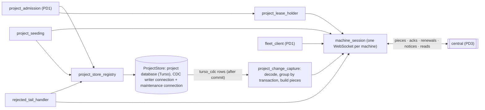
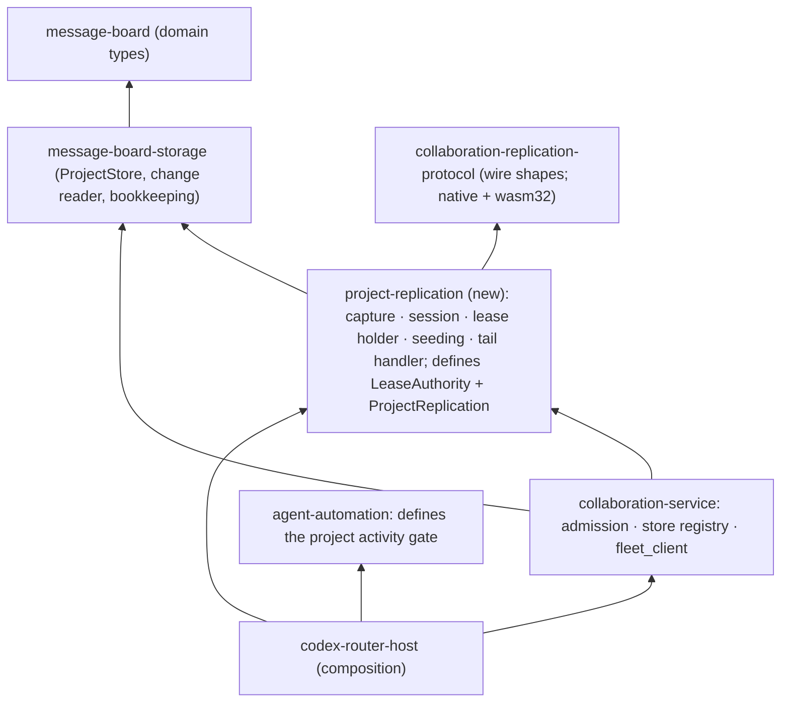

# Program design 2: project storage and replication

**What this is:** how Router realizes [spec 2](spec-2-project-storage.md) on the holder side:
- each project in its own Turso database, written only by its holder;
- the project's changes captured with Turso's change capture (CDC);
- those changes sent, as whole transactions, over one machine session to the project's central copy.

It uses spec 1's nouns and [program-design-1-board.md](program-design-1-board.md)'s admission pipeline unchanged. The database driver is our sqlx-turso fork (0.b, merged as #137). The central side (central copies, lease registry, admin endpoint, machine sessions) is in [program-design-3-central-fleet.md](program-design-3-central-fleet.md).

```text
requirements.md ──► spec 2 ──► program-design-2-project-storage.md (this) ──► plan
```

Evidence: CDC behaviour on Turso 0.8.1 (the unpublished Turso CDC verification); the local Durable Object atomicity test (the unpublished Durable Object atomicity results); the platform facts gathered for this rewrite (the unpublished platform-facts report).

## 1. The choices

| Crux | Options | Selected | Why | Reopen if |
|---|---|---|---|---|
| **C1. Where records live** | (a) one store; (b) one database per project; (c) one database per machine | **(b)** (owner, U25) | The project is the unit that has one writer and moves (U20, U21, U23). The topology experiment showed (c) can't fence one project | never, unless U25 changes |
| **C4. How changes leave the holder** | (a) Turso Sync push and pull (the old design); (b) Turso CDC read by Router and sent as pieces; (c) Router writes its own change log next to each admission | **(b)** (owner, U33) | Sync push isn't atomic: a failed step is skipped and the cursor moves on. CDC records committed transactions only, groups them by transaction id, and drops rolled-back work (verified on 0.8.1). Both (b) and (c) can tell where a transaction ends, but (c) would duplicate what the engine already records, and its own bookkeeping writes could drift from the data | CDC misses a write path we use, or decoding cost dominates |
| **C12. How central identifies a row, and which CDC mode** | (a) the hidden SQLite rowid, with capture mode `after`; (b) the table's declared primary key (our UUIDv7), with capture mode `full` | **(b)** (owner, 2026-10-11) | Capture keys changes by the hidden rowid, which can be renumbered (`VACUUM`) and would force a seeded holder to reproduce every rowid. Keying by the declared primary key lets each side number its own rows. Inserts and updates carry the key in the new row. A delete carries it only in the old row, so capture records both (`full`). The extra bytes are mostly on updates and deletes, and the board is mostly append-only | — |
| **C13. How schema changes travel** | (a) decode `sqlite_schema` changes and rebuild DDL at central; (b) send the migration's own SQL as a schema step, placed where the migration committed | **(b)** | Every schema change comes from Router's migration runner, which records its version in `_sqlx_migrations` inside the migration transaction. CDC captures that insert, and the piece builder replaces the transaction's schema changes with that migration's statements. Central runs the same SQL the holder ran, so view statements arrive even where capture skips them (spec 2 G19). A migration transaction replicates as its SQL only: its captured row changes aren't sent, so a data migration is replayed, not applied twice. Migrations must therefore be deterministic, with no `random()`, `randomblob()` or current-time functions. Central admits schema-step statements against the allowed forms and protected names (PD3 §4). The holder's migration runner applies the same admission check (in `collaboration-replication-protocol`) and a determinism check before running a migration, refusing it as `schemaUnsupported` (WA-7), and a test runs both checks over every migration in the repository (M3.4 finding). Decoding `sqlite_schema` would mean re-deriving `ALTER` from table text | a schema change happens outside the migration runner (it's refused, §4) |
| **C14. How other machines read a project** | (a) each keeps a continuously updated local replica; (b) central runs board views; (c) a read-only snapshot pulled from the central copy on demand, labelled with its position | **(c)** | Spec 2 only requires that others *only read*. (c) reuses seeding in read-only mode, so there's one way data leaves central, and central stays schema-agnostic. (a) would need a second replication path and its own freshness rules. (b) would put board view logic into central | read latency, or projects too large to snapshot, become a problem; then add incremental catch-up |
| **C15. How a new holder gets the data** | (a) copy the file from the old holder; (b) seed from the central copy at the epoch's start position | **(b)** | A takeover happens because the old holder is unreachable, so (a) only covers clean moves. One path for both keeps the start position exactly the central copy's acknowledged position | central copies grow large enough that seeding is too slow; then add (a) for clean moves |
| **C16. Session transport on the Router** | (a) a WebSocket client over reqwest; (b) HTTP requests plus polling; (c) tungstenite directly | **(a)**, with **`reqwest-websocket` 0.5.1** on the workspace's reqwest 0.12 (review F15) | One long-lived two-way session per machine (U34) lets central hibernate between frames. (c) breaks U30 (direct tungstenite only in the proxy and harness). (b) bills a request per piece and needs polling for notices. **Evidence (2026-10-12 experiment):** 0.5.1 is the newest release for reqwest 0.12 (0.6.0 needs 0.13). With reqwest 0.12.24 and 0.12.28, `RequestBuilderExt::upgrade()` sends the `Authorization` header on the upgrade request. A real axum 0.8.9 server and a local Cloudflare Worker (wrangler 4.148.0, workerd 1.20261006.1) both saw it: right token → 101 and text and binary echo; wrong or missing token → 401. Moving the workspace to reqwest 0.13 isn't needed, and wouldn't remove 0.12, because `opentelemetry-http`/`-otlp` 0.31 require 0.12. **Unverified:** TLS (`wss`) and HTTP/2 against the deployed edge, which is V9d (G18) | the deployed edge drops or rewrites the upgrade header (V9d) |
| **O1. Blocking IO and lock waits** | (a) leave the driver as it is; (b) in our `sqlx-turso` driver, open connections with `busy_timeout = 0` and retry "busy" with a Tokio timer backoff up to the same 5 s limit, retrying only the current statement. Multi-statement SQL is split with Turso's own parser and stepped statement by statement, because `execute_batch` can't resume (M2.1 finding; verified 2026-10-12, UW-1); (c) one OS thread per connection, driving Turso's engine crate directly | **(b)**; Turso itself is untouched (owner, 2026-10-11: no Turso rewrite, no upstream PR) | Verified on 2026-10-11, at Turso main `120511c` and in releases 0.8.1–0.8.3-pre.1: macOS disk IO is inline blocking syscalls, and the Rust binding spins while waiting on a lock (upstream issue #7211, open). Measured on this Mac: commits p50 44 µs, p99 1.2 ms, comparable to stock SQLite; a 2 s lock wait burns ~2.9 s of CPU with the spin and ~18 ms with (b). Every Router write starts with `BEGIN IMMEDIATE`, so "busy" arrives at the first statement, where a retry is safe. Evidence: the unpublished Turso IO measurements | real Router use shows disk IO stalling the Host; then (c) |

## 2. Components



| Component | Job | Reason to change | Consumers | Owns |
|---|---|---|---|---|
| `project_store_registry` | hold open project stores, open lazily, close idle ones. **The store opens every connection to a project database in one place, and each one switches capture on as it opens (`capture_data_changes_conn('full')`, through the pool's on-connect hook).** Only admission and the migration runner can write, under the store's writer mutex; the store hands out no other writable handle (structural rule; owner, 2026-10-11). The single exception is the **maintenance connection**, which has capture off, belongs to change capture, and writes only `_replication_*` and prunes `turso_cdc`. Each handle carries its verified schema identity | store lifecycle | admissions, views, change capture, seeding | the handles, their schema readiness, the two connections per store |
| `project_change_capture` | read `turso_cdc` after the acknowledged position; group rows by `change_txn_id` up to each commit marker; decode the captured rows into typed values, keyed by each table's declared primary key using the schema in force at that point in the stream; turn a migration transaction into a schema step (C13); cut pieces of whole transactions; mark which feed positions each transaction carries | CDC format, piece format | `machine_session` | the replication bookkeeping tables (§3), written only through the maintenance connection |
| `machine_session` | keep this installation's one session with central; send pieces and resend any that aren't acknowledged; carry renewals, fleet requests and reads; receive acks, refusals and notices; resume after any drop | session protocol | change capture, lease holder, fleet client, seeding, tail handler | the session ID and the per-project acknowledged positions it has seen |
| `project_lease_holder` | hold this installation's leases; renew each one every 15 minutes; keep a local deadline; switch a project to `Expired` and back; learn of supersession | lease contract | `project_admission`, the wake and schedule runner | each held lease: epoch, expiry in registry time, local monotonic deadline |
| `project_seeding` | build a new holder's database from the central copy at the epoch's start position: schema first, then rows by table and rowid page; verify the schema identity before the project becomes writable | snapshot format | admin-granted epochs and claims of unheld projects (spec 3 FL-16) | nothing durable beyond the store it builds |
| `rejected_tail_handler` | when a project is superseded: stop admission, move the file aside, void the tail's requests, report the tail through central (FL-8) | takeover rules | `project_lease_holder` | the moved-aside file |
| Project-unit placement (seam N01) | the board doesn't move sessions or folders; P1 places the unit and P5 recovers sessions. The board consumes only the writer grant. `project_admission` accepts project work requests only from actors on the grant holder's installation, with exactly WA-13's exception: a thread creation or reply forwarded through central is admitted on that same holder with the verified origin installation, machine label and declared posting actor (§3 Forwarded posts). The holder stays the only project-store writer, and the origin and session consistency check and every normal post gate, ledger and replay rule still apply. No other project operation is forwarded or gains authority from this exception (review F18) | placement owner (P1, P5) | `project_lease_holder` | nothing in the board |

**Where each component lives (crates).** Replication gets its own crate, because its reasons to change are the replication format, the session transport and the lease contract, not board rules. That also keeps `collaboration-service`, already about 47,000 lines, from taking on a network client.

| Crate | New or changed | Holds |
|---|---|---|
| `message-board-storage` | changed | `ProjectStore` on `sqlx-turso`, which opens every connection with capture on (C12). Two store-level handles for replication: a **change reader** (reads `turso_cdc` after a position, on a read connection) and **replication bookkeeping** (the maintenance connection: `_replication_*` tables and pruning). The seeded-store writer. Moving a file aside |
| `project-replication` | **new** (native) | `project_change_capture`, `machine_session` (the reqwest-based WebSocket client, U30), `project_lease_holder`, `project_seeding`, `rejected_tail_handler`. It defines the two ports admission uses, `LeaseAuthority` and `ProjectReplication`, plus local stand-ins for tests and for running without central (epoch 1, no expiry, no replication) |
| `collaboration-replication-protocol` | **new** (native and wasm32) | the wire shapes shared with central: `MachineFrame`, `CentralFrame`, `Piece`, `ReplicationPosition`, `LeaseStatus` |
| `collaboration-service` | changed | `project_admission`, `project_store_registry` and `fleet_client`, as in PD1. It consumes the two ports from `project-replication`. `fleet_client` sends fleet requests through `machine_session` |
| `agent-automation` | changed | a small **project activity gate** port, which the wake and schedule runner asks before firing a project-scoped occurrence |
| `codex-router-host` | changed | composition only: it builds `project-replication`, hands its ports to `collaboration-service`, and implements the automation activity gate by asking `project_lease_holder` |



On the central side (PD3 C20, §2a), `collaboration-central-core` holds central's rules with no platform dependency. Two adapters inject the same interface: `collaboration-central-cloudflare` for production and `collaboration-central-local` for running everything on one machine. Both use `collaboration-replication-protocol`, the same wire shapes as the holder.

Edges only point down. `project-replication` never depends on `collaboration-service`, and `agent-automation` never depends on replication: the Host connects them through the activity gate.

**Dependency direction:** `project_admission` → (`project_store_registry`, `project_lease_holder`). `project_change_capture`, `project_seeding` and `rejected_tail_handler` → `project_store_registry` and `machine_session`. Nothing but `machine_session` talks to central. Nothing writes project data except admission and migrations, through the CDC writer connection.

## 3. Bindings and shapes

| E | Semantic owner | Home | Schema / type home | Shape at each boundary | Kept as |
|---|---|---|---|---|---|
| E20 writer epoch | `project_lease_holder` | modified: Router project admission | `message-board` domain (`WriterEpoch`) | in pieces and renewals: `epoch: u64` | persisted (bookkeeping) |
| E23 lease (holder view) | `project_lease_holder` | new: `project-replication` | wire shape in `collaboration-replication-protocol` (shared with central, compiles for native and wasm32) | `LeaseStatus { project, epoch, holder, state: Held \| Expired, expires_at_registry, remaining_ms }`, where `remaining_ms` is measured by the registry when it decides; renewal answers are `SessionAnswer::Renewed{…, replayed, current}` or `Refused(StaleEpoch{current_epoch, epoch_ended_at} \| NotWriter)` (E26) | persisted (bookkeeping) |
| E24 central copy (holder view) | central (PD3) | — | `collaboration-replication-protocol` | `Ack { project, through: ReplicationPosition }` | the last ack is persisted (bookkeeping) |
| E25 replication piece | `project_change_capture` | new | `collaboration-replication-protocol` | `Piece { project, epoch, continues_from: ReplicationPosition, through: ReplicationPosition, transactions: Vec<ReplicatedTransaction>, part: Option<TransactionPart>, summary: Option<ProjectSummary>, digest: PieceDigest }`. `ProjectSummary { status, latest_record_at }` is the holder's small projection for central's directory (PD3 §6, U46). Every complete piece carries one, derived only from the piece's own captured prefix: the project's status as of the last transaction the piece carries, and the Router time of its last record. So rebuilding the same piece gives the same summary and the same digest (review F10). A part of a larger transaction carries none, and its final part carries the summary. `PieceDigest` is SHA-256 over the canonical serde_json encoding of `(project, epoch, continues_from, through, transactions, part, summary)`, computed by the sender and recomputed by the copy, which refuses a mismatch as `pieceConflict` (E25). `TransactionPart { transaction: TransactionKey{epoch, commit_id}, index, count, transaction_digest }`: every part of one transaction names the same key, count and digest of the whole transaction, so the copy can prove it holds all of them (PD3 §4). A part's E25 identity is `(project, epoch, continues_from, through, index)`; all parts share `continues_from` and `through`, the transaction's commit marker; `ReplicatedTransaction = Rows { commit_id, rows: Vec<RowChange> } \| SchemaStep { commit_id, migration_version, statements }`; `RowChange = Upsert { table, key: Vec<SqlValue>, values: Vec<SqlValue> } \| Delete { table, key: Vec<SqlValue> }` (`key` is the declared primary key, read from the new row for upserts and the old row for deletes); `SqlValue = Null \| Integer(i64) \| Real(f64) \| Text(String) \| Blob(bytes)`; JSON over binary WebSocket frames | derived from `turso_cdc`, never stored as pieces |
| E26 machine session | `machine_session` | new | `collaboration-replication-protocol` | Spec 3 FL-12, as two closed enums. **Machine → central:** `MachineFrame::{Hello{installation, session_id, schema_support: SchemaSupport{max_version}}, Request{frame_id: FrameId, body: SessionRequest}, ForwardAnswer{forward_id: ForwardId, reply: BoardPayload}}` (`schema_support` is the newest board schema this Router build can write; the registry keeps the last value per installation and checks it before granting, review F7); the machine credential travels in the WebSocket upgrade's `Authorization` header, not in a frame. `SessionRequest::{Piece(Piece), Renew{attempt: RequestId, project, epoch}, Release{project, epoch, transfer: TransferId, outcome: ReleaseOutcome}, ReserveFirstEpoch{project}, TailReport{project, epoch, request_ids, digest}, Fleet(FleetRequestEnvelope), Read{scope: ReadScope, after: Option<ReadCursor>}, ArchiveSeen{board: BoardId, project, position}, Forward{project, post: ForwardedPost}, Claim{attempt: RequestId, project}}`, with `ReadScope::{FleetRecords, Directory{query: FleetPayload}, ProjectCopy{project}, Notices}` and `ReadCursor::{Fleet(FleetPosition), Notices(NoticePosition), Snapshot(SnapshotCursor)}`, so a snapshot continuation travels losslessly (review F5). **Central → machine:** `CentralFrame::{Welcome{session_id, projects: Vec<ProjectSessionState{project, acked: ReplicationPosition, lease: LeaseStatus}>}, Answer{frame_id, body: SessionAnswer}, Notice{position: NoticePosition, kind: NoticeKind}, Forwarded{forward_id: ForwardId, origin: InstallationId, origin_label: MachineLabel, project, post: ForwardedPost}, Closed{reason: SessionCloseReason}}`. `SessionAnswer::{Acked{through}, PartStaged{transaction: TransactionKey, index, acked}` (a part of a larger transaction is durably staged; the replication position `acked` hasn't moved, PD3 §4),  Renewed{expires_at, transfer_in_progress: Option<TransferId>, replayed: bool, current: LeaseStatus}, Released{final_position}, FirstLease{epoch, expires_at}, TailStored, FleetDecision(RequestDecision), ReadPage{records, position, as_of: DateTime<Utc>, next: Option<ReadCursor>}, ReleaseRefused{transfer: TransferId, reason: ReleaseRefusal}, Forwarded(ForwardOutcome), Claimed{epoch, expires_at, start: ReplicationPosition}, Refused(SessionRefusal)}`, where `SessionRefusal` is the closed set of spec 1 §5 kinds FL-12's table names. `NoticeKind::{LeaseSuperseded{project, epoch}, LeaseGranted{project, epoch}, ReleaseRequested{project, transfer}, BoardArchiving{board}, RejectedTailReported{project, epoch}}`. `SessionCloseReason::{CredentialRejected(CredentialRejection{Unknown, Expired, Revoked, NotMachine}), ConnectionReplaced}`. A re-sent `Renew` already decided is answered with its recorded `Renewed` and `replayed: true`; the holder acts on `current`, so a takeover in between still stops its writes (FL-12). `ReleaseOutcome::{Final(ReplicationPosition), Refused(MigrationPending{migration, state: Pending | Failed})}`. Central answers a release with one of three things. `Released{final_position}` means the move completed. `positionGap` means the copy hasn't acknowledged `final` yet, and the holder re-sends. `ReleaseRefused{transfer, reason: ReleaseRefusal}` means the move won't complete, where `ReleaseRefusal::{MigrationPending{migration, state}, SchemaTooNew{store, supported}}`. `MigrationPending` is the holder's own refusal, recorded; `SchemaTooNew` is the copy's fence refusing the target after the holder released (M3.3 finding). On `ReleaseRefused` the holder returns to `Current`, and the registry records the transfer as refused with that reason; a re-sent release replays the same answer. The release outcome: the holder answers a release request with its final position once everything is replicated and no migration is pending, or refuses because a migration is pending or failed; only the holder knows that (M3.3 finding). `FrameId` is a UUIDv7: it correlates an answer within a connection, and re-sends rely on each request's own identity (FL-12), so no frame counter is persisted. **Who owns which payload:** the protocol crate owns replication, leases, holder changes, notices and copy reads, and stays free of board-crate dependencies (PD3 C22). Fleet content (fleet requests and decisions, fleet records, directory queries and entries) is owned by `fleet-admission`, so the protocol carries it as `FleetPayload`, a JSON envelope that `fleet-admission` classifies into its typed enums at the edge (the Rust rules allow a JSON value only at such a partial envelope). So: `FleetRequestEnvelope { request_id: RequestId, operation: FleetPayload }` with `RequestId` a UUIDv7 newtype; `SessionAnswer::FleetDecision { request_id, decision: FleetPayload }`; `ReadScope::Directory { query: FleetPayload }`; and `ReadPage::{FleetRecords{records: Vec<FleetPayload>, position: FleetPosition}, Directory{entries: Vec<FleetPayload>}, ProjectCopy(ProjectCopyRead), Notices{notices: Vec<Notice>}}`, each with `as_of`, where `ProjectCopyRead::{Page(SnapshotPage), Moved{position}}` (review F5). `SnapshotPage { project, position: ReplicationPosition, schema: SchemaIdentity, schema_steps, table, rows, next: Option<SnapshotCursor> }` with `SnapshotCursor { position, table, after_key }`: every page names the acknowledged position it was read at, and a continuation whose position no longer matches the copy is answered `ProjectCopyRead::Moved{position}`, so the reader restarts and never mixes positions (review F5). `SessionRefusal` is exactly FL-12's session kinds plus `SchemaUnsupported{form}` for a refused schema step (spec 1 §5's `schemaUnsupported`; M3.4 finding): `StaleEpoch{current_epoch, epoch_ended_at: ReplicationPosition}` (the sender's epoch's cutoff, review F3), `NotWriter{current: Option<Epoch>}`, `PositionGap{acked}`, `PieceConflict`, `NotInitialized`, `CentralCopyFull`, `ProjectRejected{reason}`, `CursorExpired`, `SchemaUnsupported{form}`, and for a claim (spec 3 FL-16) `AlreadyHeld{holder: InstallationId}`, `SchemaTooNew{store, supported}` and `NotFound`. There's no `Archived` piece refusal: an archived project's holder still replicates reader-state changes (spec 3 FL-5). Board refusals (tasks, roles, moves, guards) never cross the session; credential problems close it (`Closed`) instead of answering | the session ID is persisted |
| replication position (part of E25) | `project_change_capture` | new | `collaboration-replication-protocol` | `ReplicationPosition { epoch: u64, commit_id: u64 }`, ordered by epoch, then commit id. `commit_id` is the `change_id` of the transaction's CDC commit marker on this epoch's holder | — |

**Claiming an unheld project (spec 3 FL-15, FL-16; U54).**
- **Session frames:** `SessionRequest::Claim{attempt: RequestId, project}` is answered `SessionAnswer::Claimed{epoch, expires_at, start}`, or `Refused(AlreadyHeld{holder})`, `Refused(SchemaTooNew{store, supported})` or `Refused(NotFound)`. A re-sent attempt replays its recorded answer, with the same epoch. Central fences the copy before it grants (PD3 §5 Claim).
- **The Router's `project_claim{project}` tool** (MCP and CLI) sends the claim, runs `project_seeding` from the copy at the answer's `start`, verifies the schema identity, and only then opens the project for admission. From then on the project is an ordinary held project: its lease renews on the normal path and it appears in `Welcome`. A lost answer is handled by re-sending the same attempt. An agent that wants to work on an imported project claims it first.

**The one-time upgrade script (spec 1 §5 upgrade; U54, U60, U62).** A separate crate, `board-legacy-upgrade`, with the binary `codex-router-board-upgrade`. It isn't part of the Router.
1. **Refuses to run while a Router has the legacy store open,** checking the Host's singleton lock. It opens `project-board.sqlite` read-only through its own legacy reader module, written for the old schema; it doesn't reuse the removed store code.
2. **Builds each project's new store** in a scratch directory, using `message-board-storage`'s `ProjectStore` in an **import mode**. Records keep their original IDs and Router times. Their positions are dense in old activity order under the import epoch: `FeedCursor{epoch: 1, position}`. `request` is `None`, and the actor is the old author with the importing computer's installation. No ledger decisions or notify intents are written. **Position-bearing reader state (review F22):**
   - **Bookmarks** become read marks at the translated cursor of the record they pointed to. **Watches** keep their reader, scope and choice. A legacy watch start is a Router-wide cutoff (`starts_after_activity`, the global activity number when watching began), not a record in the watched project, so it's translated as a cutoff: the new start is the watched project's last imported record whose old activity number is at or below the cutoff, or `(1, 0)` when there's none (a zero cutoff or an empty prefix). Activity before the watch stays excluded and activity after it stays included. Both stay reader state with no feed position (spec 1 RC-5; review F22).
   - **Each legacy `thread_subscriptions` row becomes one `SubscriptionMembership` record** (PD1 §3b). The records are appended after the imported history in `(reader, scope)` order, so each one's position is deterministic. The policy (`mode`, `when_idle`, quiet, cap and lifetime), `renewed_at`, `expires_at` and `generation` are copied. `activated_at` is the record's own position, and the envelope's `router_time` is the row's latest legacy time (`ended_at` if ended, the import as-of time if draining, else `renewed_at`), so it too is fixed by the input; delivery progress isn't imported, so a claimant starts each live subscription at the feed head, as on any holder change. An ended row gets `MembershipEnd{reason: end_reason, position: its own position, at: ended_at}`. A **draining** row (state `draining`, no `end_reason` or `ended_at`) is one thread resolution ended with notices still owed; resolution is the only legacy writer of that state. It converts as ended, `MembershipEnd{reason: Resolved, position: its own position, at: the store's import as-of time}`, because the legacy store records no resolution time. The **import as-of time** is a property of the input, not of the run: the latest Router time recorded anywhere in the legacy store (message, subscription and watch times). The membership ended no later than that snapshot, and an unchanged store always gives the same value, across dry runs, retries and re-imports (review F22-B). The report states it and counts these rows under that name. The row itself is the evidence of the resolution, so the thread's current state doesn't matter: unresolving a thread never touched its subscriptions (`thread_records.rs` `unresolve_thread`), so a draining row on a reopened thread is valid, converts the same way, and stays ended. On the claimant the membership reads as ended: delivery progress isn't carried, as on any holder change, so nothing reactivates it, and the reader recovers missed notices through unread counts and the inbox (G16). `last_outcome` and `subscription_windows` are delivery progress and aren't imported.
   - **Stable identity:** a membership has no legacy ID, so its UUIDv7 is derived. The timestamp is the row's `renewed_at`, and the random bits come from a SHA-256 of `(project, reader, scope)`. An unchanged input therefore rebuilds the same records at the same positions, and gives the same digest. No mapping store is kept.
3. **Builds fleet records,** keyed by ID. Every name that must be unique is checked against central's fleet records and this run's other records. A collision renames nothing: the report names both records, and a real run refuses to upload while one exists. What a collision becomes is the owner's open decision (review F19). Only workspace names can collide across computers, because board and project names are unique only inside a workspace or board, and those IDs differ per computer.
4. **Validates** each built store: counts, density and schema identity. It then computes each project's `ImportDigest`, and its `ProjectSummary{status, latest_record_at}` for the imported prefix with the same builder the holder's change capture uses (§3), so central stays schema-agnostic (review F25).
   - **`ImportDigest` (M3.9 finding).** `collaboration-replication-protocol` owns one helper, which the script and the copy both call. It's a SHA-256 over the logical snapshot content, as a stream of length-prefixed items in the same typed canonical encoding as the piece digest (E25):
     1. the header `(project, head, schema identity, schema steps)`;
     2. every `(table, row)` in the canonical snapshot order (tables by name, rows by primary key);
     3. the `ProjectSummary`.

     Page boundaries, cursors and `as_of` aren't part of it, so the same content hashes the same however it's paged and whenever it's read.
5. **Uploads** through `/admin/v1/import/fleet`, then each project's snapshot pages through `/admin/v1/import/projects/{id}`, with the summary on the last page, using the owner's Access sign-in token (`cloudflared`).
6. **Writes a JSON report.** `--dry-run` stops after step 4 and writes only the report. A re-run skips `AlreadyImported` projects and reports `ImportConflict`.

**Forwarded posts (spec 2 WA-13, spec 3 FL-14; owner 2026-10-13).**
- **Payload ownership (PD3 C22).** The protocol crate stays free of board types. It carries `ForwardedPost { kind: ForwardedPostKind::{ThreadCreate, ThreadPost}, body: BoardPayload }`. `BoardPayload` is a JSON envelope whose schema `message-board` owns, the same pattern as `FleetPayload`.
  - The holder decodes `body` into `ThreadCreateRequest` or `ThreadPostRequest` for that `kind`, and refuses a mismatch as `invalidShape{field: post}`. The closed `kind` keeps "posts only" a type at the protocol layer.
  - The holder's answer is an encoded `WriteReply` in `BoardPayload`, which the sender's Router decodes. Central never decodes either payload.
- **Frames:**
  - machine → central: `SessionRequest::Forward{project, post}`;
  - central → holder: `CentralFrame::Forwarded{forward_id, origin, origin_label, project, post}`;
  - holder → central: `MachineFrame::ForwardAnswer{forward_id, reply}`;
  - central → sender: `SessionAnswer::Forwarded(ForwardOutcome)`, with `ForwardOutcome::{Answered{reply: BoardPayload}, SenderHolds, NotHeld, HolderUnreachable{last_seen: DateTime<Utc>}, Unanswered, Overloaded}`.
- **On the holder,** `project_admission` admits the post with `RecordedActor{actor: Declared(actor), installation: origin, machine: origin_label}`. `origin` and `origin_label` come from central's verified routing (the registry's enrollment record, PD3 §2a), never from the post body. A declared `Session` actor whose session names a different installation than `origin` is refused `invalidShape{field: actor}`, so a machine can't post as another machine's agent.
- **Limits:** the forwarding bound (30 s) and the per-sender in-flight cap (16) are constants owned by the session contract. Central's correlation, timeouts and answer authority are in PD3 §2a, "Forwarded posts".


Replication bookkeeping lives in the project database in tables named `_replication_*`, written only through the maintenance connection, so capture never sees them:
- `_replication_state`: epoch, start position, last acknowledged position, the schema version in force at that position;
- `_replication_feed_marks`: for each commit id, the highest feed position it carried, so views can show replicated against provisional.

The schema fingerprint (WA-7) leaves these tables out.

## 4. How a write reaches the central copy

```mermaid
sequenceDiagram
  participant A as project_admission
  participant DB as ProjectStore (CDC writer)
  participant CC as project_change_capture
  participant MS as machine_session
  participant C as central copy (PD3)
  A->>DB: transaction (records + ledger + feed entries) under the writer mutex
  DB-->>A: committed (CDC rows and a commit marker written in the same transaction)
  A-->>A: request accepted (provisional)
  CC->>DB: read turso_cdc after the acknowledged commit id (read connection)
  CC->>CC: group by change_txn_id; decode rows by primary key; migration → SchemaStep; cut pieces (≤ 1 MiB, whole transactions; a larger one in parts)
  CC->>MS: Piece{epoch, continues_from = acked, through}
  MS->>C: Piece
  alt applied
    C-->>MS: Ack{through}
    MS->>CC: record the ack
    CC->>DB: maintenance connection: update _replication_state, prune turso_cdc ≤ through
    CC-->>A: feed positions ≤ mark(through) now read as replicated
  else staleEpoch
    C-->>MS: Refused{staleEpoch}
    MS->>A: superseded (rejected_tail_handler takes over)
  else gap (continues_from ≠ copy's ack)
    C-->>MS: Refused{gap, acked}
    MS->>CC: restart from the copy's acked position
  else centralCopyFull
    C-->>MS: Refused{centralCopyFull}
    MS->>CC: hold the project's pieces; views show it backing up
  end
```

- **Unknown outcomes (FL-7).** A piece sent without an ack, because the session dropped or timed out, has an unknown outcome. On resume, central reports each project's acknowledged position, and the session resends from there. Resending is safe because the copy treats an applied piece as a no-op.
- **Retention (WA-3b).** `turso_cdc` is pruned only through the acknowledged commit id, by the maintenance connection. Nothing unacknowledged is ever pruned. Capture has no retention of its own, so the table grows while central is unreachable. The 4-hour lease bounds that growth, and writes pause after expiry.
- **A schema change outside the migration runner.** Capture finds `sqlite_schema` changes in a transaction without a `_sqlx_migrations` insert. It stops that project's replication and reports `schemaChangeUnknown`, failing closed. That can't happen on the normal path, because every write goes through admission or the migration runner. The test in §7 pins that down.

## 5. State

**A project on its holder (E20 and the lease, E23):**

```mermaid
stateDiagram-v2
  [*] --> Seeding: admin grants epoch N here\n(start = central copy's acked position;\nthe registry checked this machine's\nschema support before granting)
  Seeding --> Current: schema identity verified\n(SchemaReady)
  [*] --> Current: project created here (epoch 1, WA-10)\nreplicates once central accepts it
  Current --> Expired: local deadline passes\n(registry expiry − margin)
  Expired --> Current: renewal succeeds on epoch N
  Current --> Draining: admin move requested (notice)
  Draining --> Released: acked == last commit\nand no pending migration
  Current --> Superseded: staleEpoch, or renewal says superseded
  Expired --> Superseded: staleEpoch, or renewal says superseded
  Released --> [*]
  Superseded --> [*]: the file is moved aside and the tail voided (E22)
```



- **`Current`:** admission accepts writes.
- **`Expired`:** admission refuses `leaseExpired`, naming the registry expiry. Wakes and schedules for that project pause: the wake and schedule runner asks `project_lease_holder` before firing a project-scoped occurrence and holds it while the project is `Expired`. Reads keep working. Pieces already captured keep replicating.
- **`Draining`:** new requests are refused with `notWriter`, naming the incoming holder once it's known.
- **`Seeding`, `Released`, `Superseded`:** writes are refused with `notWriter` (WA-6).
- **The local deadline (review F8).** Before sending a renewal, the holder takes a monotonic `sent_at: Instant`. From the answer's `current.remaining_ms` (measured by the registry when it decided), the deadline is `sent_at + remaining_ms − 5 minutes`. The registry decided after `sent_at`, so the answer's age is always charged against the remaining time, however late it arrives: an answer that took longer than `remaining_ms − 5 minutes` to come back gives a deadline already in the past, and the project goes to `Expired` at once. A replayed answer (F27) is handled the same way through its `current`, never its historical expiry.
  - **Restart, sleep and resume:** an `Instant` isn't persisted. After a Router restart, or a wake from sleep that the holder detects as a jump between monotonic and wall-clock time, every held project starts `Expired` until a renewal answers. That pauses writes for one round trip and never extends them.
  - Renewal runs every 15 minutes on its own task, never on a write's path.

**Schema identity (WA-7):** checked when a store opens, after every migration and after seeding.

```text
read migration version V; compute fingerprint F = schema_fingerprint(schema entries)  (one shared function, below)
  V > supported                 → schemaTooNew   (reads allowed; not SchemaReady)
  F != expected_fingerprint(V)  → schemaMismatch (reads allowed; not SchemaReady)
  else                          → SchemaReady(V, F)
a store is writable, and a grant is used, only while SchemaReady
```

- **One reserved-namespace classifier (M3.6 finding).** `collaboration-replication-protocol::reserved_namespace(name)` is the single list of names that aren't project data. Every boundary uses it, compared ASCII case-insensitively, so no two disagree:
  - **The list:**
    - engine: `sqlite_*`, `turso_*`, `__turso_internal*`;
    - platform: `_cf_*` (Cloudflare; `_cf_KV` was observed under workerd on 2026-10-12) and `__miniflare_*` (the local runtime; `__miniflare_do_name` observed);
    - holder bookkeeping: `_replication_*`;
    - central bookkeeping: `_copy_*`;
    - migration history: exactly `_sqlx_migrations`.
  - **Where it applies:** the schema fingerprint leaves these out; central's snapshot and read enumeration leave them out; row admission refuses rows into them; schema-step admission refuses any statement that names them (PD3 §4).
  - **Holder consequence:** `_replication_*` tables are holder-local bookkeeping, so they're created by their own migration track on the maintenance connection with capture off. They are never part of the replicated project migrations, and their rows are never captured.
- **One schema fingerprint on both sides.** WA-7 requires the holder's schema identity and its central copy's to be equal once a schema step is acknowledged, so both compute it with the same function. `collaboration-replication-protocol::schema_fingerprint` is SHA-256 over the compact serde_json of the list of `(type, name, canonical_sql)` for every schema entry, sorted by `(type, name)`.
  - **`canonical_sql` comes from the parsed statement, not its stored text** (M2.3 finding). Turso re-renders DDL when it stores it (for example `t (a, b)` where SQLite keeps `t(a, b)`), so the stored text differs by engine.
  - Each stored statement is parsed as exactly one command with `turso_parser`, pinned at the workspace's 0.8.1. It's re-rendered through its `ToTokens` token writer, with every identifier decoded and re-quoted canonically (`Name::from_string`, then `Name::exact(..).as_ident()`). String literals are untouched.
  - Verified 2026-10-12: native Turso and SQLite agree on all 49 catalog entries of both migrations, deliberately different schemas still differ, and the parser builds and lints for `wasm32-unknown-unknown`.
  - The parser version is part of the algorithm: upgrading it means re-proving both sides together.
  - Engine and bookkeeping entries are left out: `sqlite_*`, `turso_*` (including `turso_cdc`), and `__turso_internal*`. That last one is Turso's sequence machinery: enabling full change capture creates `__turso_internal_seq___turso_internal_autoincrement_turso_cdc`, observed on Turso 0.8.1 by M2.3 on 2026-10-12, and the driver's scratch-store helper already excludes it. Also left out: `_cf_*`, the prefix Cloudflare reserves in Durable Object storage; that comes from Cloudflare's documentation and must be confirmed under workerd in M3.6. Then `_replication_*` on the holder and `_copy_*` on central. Also the exact table `_sqlx_migrations`, the migration runner's own history: central never creates it, and the migration version is already a separate part of the schema identity.
  - The conformance suite asserts that a fresh capture-enabled holder store and a fresh central copy both fingerprint as the empty schema, and that they stay equal after each migration replicates.
  - Central's core uses it from M3. M2's local check implements the same algorithm until M4 switches it to the shared function and adds a test that a holder store and its central copy fingerprint equal after a migration replicates.

Expected fingerprints are generated from the migrations on the native Turso engine at build time and checked in, like `.sqlx`. A migration is admitted to the runner only if every project table it creates declares a primary key, since rows are applied by key. Triggers are refused, because central would run them a second time over rows already captured, and so are virtual tables. These checks run when the migration is built. The existing migrations use none of these forms (checked 2026-10-11).

## 6. Failure, recovery and concurrency

| Failure | Detected by | Contained to | Recovery and owner |
|---|---|---|---|
| A project store fails to open (corrupt, too-new schema) | registry open | that project | it reads as `unavailable`; the owner or Lead repairs it. Owner: `project_store_registry` |
| The session drops, central deploys, or central objects lose their memory | `machine_session` read error, close frame or missed heartbeat | in-flight pieces become unknown outcomes | reconnect with backoff; `Hello` is answered with `Welcome`, which carries every project's acknowledged position; resend from there. Owner: `machine_session` |
| Takeover: the old holder returns | `staleEpoch` on a piece or renewal, or `Welcome` showing a newer epoch | the old holder's copy of that project | `rejected_tail_handler`: (1) stop admission; (2) move the file aside as `projects/<id>.epoch-<n>.rejected.sqlite`, never deleted; (3) get the old epoch's **cutoff**: `StaleEpoch` carries `epoch_ended_at`, the copy's acknowledged position when the takeover fenced that epoch, read from the copy's fence receipt (PD3 §5). A `Welcome` that reveals the takeover is followed by a renewal for the old epoch, whose `StaleEpoch` answer carries it (review F3). Until the cutoff is known, requests after the holder's own last ack stay `unresolved`, never voided; (4) mark requests at or before the cutoff as replicated, and each one after it `Voided`; (4) report `{project, epoch, request IDs, digest}` through the session (FL-8). The current holder's `project_admission` records the `RejectedTail` fact when the report reaches it. Retries see `voided` (RC-4) and resubmit with `resubmits` |
| The lease expires (holder asleep, or central unreachable for 4 hours) | `project_lease_holder` local deadline | that project's writes, wakes and schedules | `Expired` (§5); resumes on renewal |
| A piece leaves a gap | `Refused{gap, acked}` | that project | capture restarts from the copy's acked position. A gap can only come from a lost ack or a restart, and both are resolved by the copy's position |
| The central copy is full | `Refused{centralCopyFull}` | that project | pieces held; the project shows a growing backlog; the owner raises the plan limit or archives (spec 3 G21) |
| Seeding fails part-way | `project_seeding` | the new holder | the half-built file is discarded and seeding restarts from the same start position (the copy's position at the fence can't move: no one holds the project) |
| A machine that isn't the holder writes, or a left-behind session writes | `project_admission` | that request | `notWriter` |

**Creating a project (WA-10):**
1. The caller supplies the project ID (UUIDv7, minted by the CLI or the Router client, as `ProjectCreateRequest` already requires), so a retried create names the same project. The Router validates the ID, creates `projects/<id>.sqlite` with capture on, and admits `LifecycleFact::ProjectCreated` (PD1 §3b) with the creating request ID. This installation is provisionally the holder at epoch 1.
2. `fleet_client` sends the directory entry through the session. If central is unreachable, it waits in the fleet outbox as `Pending`.
3. Admissions continue locally under epoch 1. Capture builds pieces, but `machine_session` doesn't send them until central accepts the project.
4. Central accepts the entry, the lease registry records epoch 1 for this installation, and the project's central copy is initialized with fence 1 and start `(1, 0)` (PD3). Pieces flow from there.
5. If central rejects the entry: every accepted request is marked `Voided{ProjectRejected}`, and the file is moved aside as `projects/<id>.orphaned.sqlite`, never deleted and kept open read-only for ledger lookups. A new request to the project gets `projectRejected`.

A startup scan re-queues any project's creating request that's neither in the fleet outbox nor accepted. A crash between steps 1 and 2 loses nothing.

**No upserts on capturing connections (UW-2, M2.4 finding).** In turso_core 0.8.1 through 0.8.3, `INSERT … ON CONFLICT DO UPDATE` on a connection with capture `full` builds the before-image by reading the table cursor after the row has been rewritten (`translate/upsert.rs:1473-1478`).
- When the new row's length differs, the statement fails with `Corrupt` ("Invalid Text value" or "Payload too small for indicated header size"). The file stays intact.
- When the length is the same, the before-image silently shows the new value.
- Upstream: issue #9069; fix PR #9396 is open and unmerged.
- Project stores therefore never use `ON CONFLICT … DO UPDATE` on authoritative connections. Admission already reads the existing row under the writer mutex, so it issues `UPDATE … WHERE <key> = ?` when the row exists and `INSERT` otherwise. A plain `UPDATE` was verified on 0.8.1 to write correct before and after images.
- A source-scan test in `message-board-storage` fails if a project-store statement contains `DO UPDATE`.
- `INSERT OR REPLACE` stays unused unless a test first shows correct CDC images for it.
- Remove the workaround when the minimal repro passes, with a correct before-image, on a release that contains #9396.

**Moving a store file aside (M2.4 finding).** Committed data can still sit in the `-wal` file, and Turso's checkpoint on close isn't guaranteed. Renaming only the main file therefore loses committed tables. Every move uses one procedure: an orphaned project and a rejected tail.
1. Under the store's writer mutex, stop admission. The registry marks the store as moving, so new reads on the maintenance pool are refused with the store's unavailable result. Wait for in-flight reads to finish.
2. On the authoritative connection, which the writer mutex already holds, run `PRAGMA wal_checkpoint(TRUNCATE)`. Require `busy = 0` and `checkpointed = log`. Otherwise retry with a bounded backoff.
3. Close every connection and check that the `-wal` file is absent or empty.
4. Rename the main file, then fsync the directory.
5. Reopen the moved file read-only. Check `PRAGMA integrity_check` and that the store's own tables are present before it's published or used for ledger lookups.

**On failure.** A failure in steps 1–3 leaves the file unrenamed. A failure in step 4 after the rename, or in step 5, leaves it renamed but not yet validated. Either way the store stays closed for writes in a `MoveAsidePending` state that's reported. That state is held in memory, not persisted. Startup works it out again from facts that are already durable:
- for an orphan, the fleet outbox's rejected entry for the project;
- for a rejected tail, central's `StaleEpoch` answer on reconnect.

Then it **reconciles the two file names** and resumes from the right step:
- source present, destination absent: the move didn't happen, so restart from step 1;
- destination present, source absent: the rename happened, so resume at step 4's directory fsync and step 5's validation at the destination. Admission stays stopped and the outcome unresolved until validation passes;
- both present, or neither: refuse to touch either file and report it for the owner, because the move can't be finished safely without a person.

The move is retried from there, and the requests it affects stay as they were (a rejected tail's stay `unresolved`). There's no new persisted marker, no deletion of a `-wal` file and no raw copy.

**Concurrency.** One writer mutex per store, as today. Capture reads committed CDC rows on a read connection and never takes the writer mutex. Pruning and bookkeeping take the maintenance connection under the same mutex, so they never interleave with a migration. Pieces for one project are sent in order, one at a time. Different projects send in parallel over the same session.

**Migrations (F10)** keep Router's existing policy:
- foreign keys off before the migration transaction;
- the owned `BEGIN IMMEDIATE`;
- `foreign_key_check` and the fingerprint before commit;
- foreign keys back on afterwards.

They run on the CDC writer connection, so the `_sqlx_migrations` insert is captured. Known 0.8.1 migration failures stay as negative tests.

## 7. Proof seams

| Seam | Real | Stand-in | Observes |
|---|---|---|---|
| Two `ProjectStore`s and their sessions against `collaboration-central-local` (native), and again against `collaboration-central-cloudflare` under `wrangler dev` | native Turso 0.8.1 stores, Router capture and session code, the real central core on both adapters | lease length shortened by configuration | V3: clean move; takeover before expiry with the tail refused whole and reported; `leaseExpired` with wakes paused and resumed; a transaction larger than one piece seen whole; a repeated piece; a gap; the session dropped and workerd restarted mid-replication; a migration replicated with matching schema identity (every existing migration, applied at central); schema-too-new; `unresolved` retries; `cursorSuperseded`; creation while central is down, accepted and rejected |
| Every write path is captured | the store registry | — | a write through any admission method or migration produces CDC rows. The maintenance connection never touches project tables. A `sqlite_schema` change outside the runner stops replication |
| Deployed staging | a Cloudflare staging account | — | V3d (spec 2 G18) |
| Two machines | — | — | V7, including a whole-unit move. Unverified until P1 and P5 exist |

## 8. Trace

| U | R | E | Owner | Interface | Shape and home | State | Failure | Proof |
|---|---|---|---|---|---|---|---|---|
| U21, U23, U16 | WA-2 | E20 | `project_admission` + `project_lease_holder` | every project method | `LeaseStatus` checked under the writer mutex | §5 states | `notWriter` | V3, V7 |
| U21 | WA-3 | E19, E20, E24 | `project_change_capture` | `Ack` | `_replication_feed_marks`, `FeedEntry.epoch` | accepted → replicated / voided | — | V3 |
| U33 | WA-3a | E25 | `project_change_capture` | `Piece` | `ReplicatedTransaction`, `TransactionPart` | — | a part held back until all parts arrive (PD3) | V3, V3d |
| U33 | WA-3b | E24, E25 | `project_change_capture` + `machine_session` | `Piece`, `Ack`, `Refused{gap}` | `ReplicationPosition`; `_replication_state` | — | gap → resend; prune only ≤ ack | V3, V3d |
| U21, U39 | WA-4 | E20, E23 | `project_lease_holder` + `machine_session` | move notice, `Release{epoch, transfer, outcome}` | — | Draining → Released | not released while unacked or migrating | V3 |
| U21, U11, U39 | WA-5 | E20, E21, E22 | `rejected_tail_handler` | `staleEpoch`, tail report frame | `LifecycleFact::{Takeover, RejectedTail}` | Superseded; Voided | `staleEpoch` | V3 |
| U21 | WA-6 | E20 | `project_admission` | every project method | — | Seeding, Draining, Released, Superseded | `notWriter` | V3 |
| U38 | WA-11 | E23 | `project_lease_holder` + wake and schedule runner | renewal, admission | `LeaseStatus`; local deadline | Current ⇄ Expired | `leaseExpired` | V3 |
| U9, U21, U33 | WA-7 | — | `project_store_registry` + `project_change_capture` | store open, migration runner, `SchemaStep` | schema version + fingerprint | SchemaReady | `schemaTooNew`, `schemaMismatch`, `schemaChangeUnknown` | V3 |
| U25 | WA-8 | E3, E20, E24 | `project_store_registry` | project create, seeding | one file per project; one central copy per project | — | — | V3 |
| U22, U32 | WA-9 | E24 | `project_store_registry`; central (PD3) | all storage | `sqlx-turso` on Turso 0.8.1; Durable Object SQLite at central | — | — | V3, 0.b driver tests |
| U19, U20, U23 | WA-10 | E3, E20 | `project_store_registry` + `fleet_client` | `project/create` | creating request ID in `ProjectCreated`; fleet outbox | Pending → accepted / rejected (moved aside) | `projectRejected` | V3 |
| U35, U36 | WA-12 | E26 | `machine_session` | `Hello` → `Welcome` | `MachineFrame`, `CentralFrame` | connected · resuming · closed | unknown outcome → resend | V3, V3d |
| U56 | WA-13 | E26, E10 | sender `machine_session` → central (PD3 §2a) → holder `machine_session` + `project_admission` | `Forward`, `Forwarded`, `ForwardAnswer` | `ForwardedPost{kind, body: BoardPayload}`, `ForwardOutcome` | — | `senderHolds`, `notHeld`, `holderUnreachable`, `unanswered`, `overloaded`; holder refusals inside `Answered` | V7, V9 (spec 3) |

## 9. Open

- **Durability (owner, 2026-10-11):** project stores keep Turso's default FULL sync with plain `fsync`. The owner judged that power loss isn't expected and the data isn't critical yet. Full flush (`PRAGMA fullfsync=ON`, about 4 ms per commit) is the upgrade if that changes.
- **Deferred (owner, 2026-10-11):** a holder-to-central drift check isn't part of this design. It can be a standalone script later.
- **G17, G18, G19:** see spec 2.
- **Assumption, checked in V3:** every record shape stays under Cloudflare's 2 MB row limit. Admission already caps posts at 64 KiB. Planning confirms that every other record shape is bounded.
