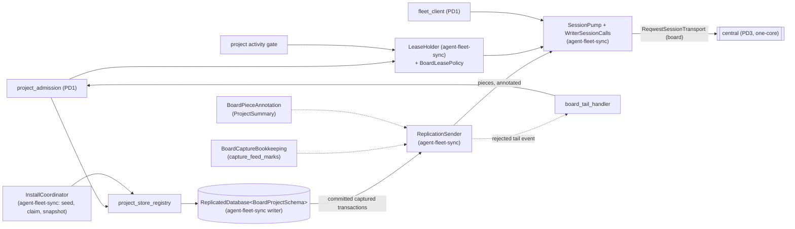

# Program design 2: project storage on agent-fleet-sync

> **0.1.102 cut (owner decision 1217, 2026-10-24).** Project moves (E12, `moves`), process definitions and their registration, pinning and the stored project status were removed before release. Rows, columns and summary fields here that name them no longer exist: `project_feed.project_status` and `project_state`'s status and pinned definition are gone. Everything else stands.

**What this is:** how Router realizes [spec 2](spec-2-project-storage.md) on the holder side now that agent-fleet-sync (`agent-collaboration/agent-fleet-sync`, U78) supplies replication, leases, sessions and delivery custody. The board keeps its own records, rules and views ([PD1](program-design-1-board.md)) and gets a **new schema** built for agent-fleet-sync (U79, §3a).

This is a hard-cutover rewrite of the 2026-10-09 PD2. The earlier version, with its own CDC capture, piece builder, session client and lease holder, is in git history.

```text
requirements.md (U78, U79) ──► spec 1, spec 2 (§4.1), spec 3 (§4.2) ──► this program design ──► verification design ──► plan
```

**Evidence this design rests on** (all in unpublished working notes):
- `schema-inventory.md`: every shipped, M2 and M3 table, checked against the replication key rules;
- `obligation-map.md`: 138 board and central obligations against agent-fleet-sync;
- `x2-import-fidelity-report.md`: deterministic import into a UUIDv7-keyed per-project schema;
- `x6-session-transport-report.md`: a reqwest `SessionTransport` adapter with Access headers plus the machine credential;
- `x7-copy-unavailable-report.md`: one project's copy failure on a shared connection;
- `advisor-picture.md` and `picture-comparison.md`;
- the dispositions in `spec-dispositions.md`, which are reflected in specs `7cbfc320` and `98d6c368`.

agent-fleet-sync is merged at `3a2153ec` and is pinned by tag (OC-8).

## 1. The choices

| Crux | Options | Selected | Why | Reopen if |
|---|---|---|---|---|
| **C1. Where records live** | one store; one database per project; one per machine | **one database per project** (owner, U25) | The project is the unit that has one writer and moves (U20, U21, U23) | never, unless U25 changes |
| **C17. Who owns replication mechanics** | the board's own capture, pieces, session and lease (the old PD2); agent-fleet-sync | **agent-fleet-sync** (owner, U78) | One generic system, shared with AgentStudio. Writer capture, pieces, statement replay, sessions, the lease registry, holder changes, snapshots and delivery custody are already built and proven there (`3a2153ec`). The board adds only its rules, at the library's seams | never; a library shortfall is fixed in the library (spec 3 §4.2) |
| **C18. The schema** | port M2's tables; a new schema | **a new schema** (owner, U79): typed tables, UUIDv7 primary keys only, business keys as UNIQUE (§3a) | M2's `(kind, id)`, `(reader, scope)`, ordinal and integer keys can't replicate: 1 of 44 M2 tables is key-eligible (inventory). The thread and root post share one ID (E8), so a generic identity table can't simply be re-keyed (Advisor P1) | a table needs a non-UUIDv7 key to replicate (then it stays local) |
| **C19. Actor identity in records** | the canonical identity string in every row; a per-project `actors` table referenced by `actor_id`; a fleet actor registry | **a per-project `actors` table** | Project records stay self-contained, so a copy needs no fleet record to read them (FL-2). X2 showed the importer can derive actor rows reproducibly | actor rows dominate project size |
| **C20. Legacy time** | invent a time; a nullable time with a basis | **`time_basis: router \| legacy_unknown`**; the time is set only for `router` (spec 1 RC-9) | Shipped stores recorded no general event time (X2). Order comes from feed position, never time | — |
| **C16. Session transport on the Router** | the shared tokio-tungstenite adapter; a board reqwest adapter at `SessionTransport` | **a board reqwest adapter** (`reqwest-websocket` 0.5.1 on reqwest 0.12; U30) | X6: Access id and secret plus the machine credential are carried on the upgrade, credential refusals are typed, the same session resumes after a cut, and takeover works. No tokio-tungstenite in the client graph | the deployed edge drops upgrade headers (V9d) |
| **C12, C13, C14, C15** | (as before) | rows keyed by declared primary key; schema changes by statement replay; read copies by snapshot; a new holder seeded from the central copy | Unchanged choices, now **realized by agent-fleet-sync**: declared-key capture, `SchemaStep` replay with its nondeterminism guard, snapshot install, `InstallCoordinator` | — |
| **O1. Blocking IO and lock waits** | (as before) | sqlx-turso with `busy_timeout = 0` and a Tokio retry, now in agent-fleet-sync's driver | The driver's one copy is agent-fleet-sync's (OC-8) | — |

## 2. Components



| Component | Job | Reason to change | Owns |
|---|---|---|---|
| `project_store_registry` (board, modified) | Opens each project database as `fleet_sync_writer::ReplicatedDatabase<BoardProjectSchema>`, lazily, and closes idle ones. Hands admission **only** the library's write transaction (`begin_write`), so every board write is captured and fenced. It hands out no other writable handle | project lifecycle | the open set |
| `BoardProjectSchema` (board, new) | Implements `ReplicatedSchema`. Its migrations are the §3a replicated tables, its local migrations are the §3a holder-local tables, and `replicated_tables()` names exactly §3a.1 | the schema | the board's migration sets |
| `BoardCaptureBookkeeping` (board, new) | Implements `CaptureBookkeeping::record`, which the library calls **after** commit (P2-2). Maps each captured transaction to the board feed positions and handoff marks it carried, and maps copy acknowledgements back (details below) | the feed-to-capture mapping | `capture_feed_marks` |
| `BoardPieceAnnotation` (board, new) | Implements the library's synchronous `PieceAnnotation::annotate(&[CapturedTransaction]) -> Option<BoardAnnotation>` (`sender_contract.rs:37–47`), using **only the rows in the captured transaction it's given** (details below) | the summary shape | nothing durable |
| `BoardConsumerProtocol` (board, new; lives in `board-sync-protocol`) | Implements agent-fleet-sync's `ConsumerProtocol`. It's in a runtime-neutral crate because central's portable core consumes it too (P2-1, OC-13). Its payload families are forwarded posts (WA-13, FL-14), fleet requests and reads (WA-1), rejected-tail reports (FL-8), board notices (FL-6), and the delivery body, sender, address and acceptance (MS) | the board's wire payloads | the payload types |
| `ReqwestSessionTransport` (board, new) | Implements `SessionTransport` and `TransportConnection` with reqwest-websocket. It carries the Access service token plus the machine credential on every upgrade (C16, X6) | transport and auth | nothing durable |
| `BoardLeasePolicy` (board config) | `LeasePolicy` with a 14,400 s lease and 900 s renewal (U38). The registry-side `move_needs_renewal_within = 1800 s` is central's configuration (FL-10, U45) | policy values | — |
| project activity gate (existing port, `agent-automation`) | The wake and schedule runner asks it before firing a project-scoped occurrence. The Host answers from `ReplicatedDatabase::writer_state`, so expiry pauses wakes and schedules and renewal resumes them (WA-11) | lease semantics | — |
| `board_tail_handler` (board, modified) | Has two halves, on two machines (P2-4): the old holder keeps its superseded file read-only and reports the tail; the current holder records the facts (details below) | takeover rules | the facts it writes |
| agent-fleet-sync runtime (used, not owned) | `ReplicationSender`, `SessionPump`, `WriterSessionCalls`, the writer's lease holder, `InstallCoordinator`, `fleet-sync-tokio-runner`'s native store and timers | — | its reserved `_fleet_sync_*` tables |

**`BoardCaptureBookkeeping` in detail.**
- **When it's called:** `replication_sender.rs:144–233` calls it in `sender.prepare`, on a capture-off maintenance transaction, after the library reads a committed captured transaction and before it builds the piece. It's called again before pruning (`sender_retention.rs:114`).
- **What it does:** it derives, from the captured rows themselves, the `project_feed` entries and handoff rows that transaction inserted. It records them in `capture_feed_marks`.
- **It's idempotent:** the same captured transaction always yields the same marks. A crash before `prepare` loses nothing, because the next `prepare` reads the same committed transaction and records it.
- **Acknowledgements:** it maps copy acknowledgements back to feed positions, so views show replicated versus provisional (WA-3).
- **Constraint:** it never writes replicated or engine tables, as the maintenance transaction forbids.
- **If the plan needs a commit-time hook,** that's a separate library change to raise, never an assumed one.

**`BoardPieceAnnotation` in detail.**
- **Where the summary comes from:** every `project_feed` row carries `project_status`, the project's status after that record. So the summary is `{status, latest_record_at}` read from the transaction's `project_feed` row with the **highest newly accepted board feed position**, not whichever row the capture traversal happens to list last: its `project_status`, and its `router_time`. A legacy unknown time is shown as unknown (RC-9). The summary's `status` is `Option<StatusName>`: a project with no pinned definition has no status (PD1 E3), and that row's `None` is authoritative, so it replaces central's earlier summary instead of leaving it stale (A3b finding).
- **A transaction with no feed row** (reader-only writes, such as read marks) returns `None`, and central keeps the summary it last applied.
- **It's correct anywhere:** it's pure, it survives a restart, and it's right for every copy position, because it never reads a previous mark, a cache or the live head (P2-2). Central's directory is fed without reading project tables (FL-1).

**`board_tail_handler` in detail.**
- **On the old holder:**
  - The library's rejected-tail event arrives, and its writer refuses every later `begin_write` (`write_transaction.rs:26–44`).
  - The handler stops and joins that project's runtime and **leaves the superseded file where it is, read-only**. Its records stay readable for the owner (WA-5); the library's `move_aside` is only for rejected registration.
  - Read-only, it inspects the tail past the cutoff: request IDs and a record digest.
  - It reports them through `BoardConsumerProtocol` to central (FL-8).
- **On the current holder:** admission records the takeover and rejected-tail facts naming those request IDs. The voided state is that fact (RC-4). A retry from the old epoch that the current ledger doesn't know follows RC-4's branch (review F2):
  - before the old epoch's tail is reported, it answers `unresolved{takeover}` and executes nothing;
  - once the report is recorded, an ID the tail holds answers `voided`, naming the takeover;
  - an ID the reported tail doesn't hold is admitted fresh.
  - Admission consults the recorded `RejectedTail` fact before its unknown-old-epoch gate; no second ledger is kept.
- **If this machine later holds the project again,** it's seeded into a **new** file named by its start epoch (`projects/<project-id>/e<epoch>.sqlite`). The superseded file is never reopened for writing.

**Crates.**

| Crate | New or changed | Holds |
|---|---|---|
| `board-sync-protocol` | **new** (runtime-neutral: native and `wasm32-unknown-unknown`, no Tokio) | `BoardConsumerProtocol` and its payload families, `BoardAnnotation`, and the board-name to wire-name mapping types (spec 3 §4.2). It's consumed by both `board-fleet-sync` and central's portable core. `message-board` stays domain-only, because wire and domain have different reasons to change |
| `board-fleet-sync` | **new** (native) | `BoardProjectSchema`, `BoardCaptureBookkeeping`, `BoardPieceAnnotation`, `ReqwestSessionTransport`, `BoardLeasePolicy`, `board_tail_handler`. Depends on agent-fleet-sync at its pinned tag, `board-sync-protocol` and `message-board`. Never on `collaboration-service` |
| `message-board-storage` | changed | the §3a typed record SQL (checked queries) over the library's write and read scopes; read views; the importer's import mode |
| `collaboration-service` | changed | `project_admission`, `project_store_registry`, `fleet_client`; consumes `board-fleet-sync` |
| `codex-router-host` | changed | composition: builds the agent-fleet-sync runtime and `board-fleet-sync`, hands admission its ports, and implements the activity gate |
| `project-replication`, `collaboration-replication-protocol` | **removed** | superseded by agent-fleet-sync and `BoardConsumerProtocol` |
| M2's `LocalLeaseAuthority`, raw writer pool and `_replication_*` bookkeeping | **removed** | leases come only from central (OC-3); the writer is the library's |

Edges only point down. `board-fleet-sync` depends on agent-fleet-sync and `message-board`. `collaboration-service` depends on `board-fleet-sync` and `message-board-storage`. Nothing but the session pump talks to central.

## 3. Bindings

**How to read this table.** "Board types" means PD1 §3's types in `message-board`: UUIDv7 newtypes with fallible constructors, as `MessageId`, and enums validated in Rust on write and on every read (AGENTS.md). PD1 §3 owns each record's fields. This table adds where each entity is stored, which boundary it crosses and in what shape. "Captured row" means the library's `CapturedTransaction` row for that table, which travels inside a `Piece<BoardAnnotation>` (E25). "Library" means agent-fleet-sync at its pinned tag; its types follow its own conventions (SO51).

| E | Semantic owner | Module home | Schema / type home | Shape at each boundary | Stored | Convention |
|---|---|---|---|---|---|---|
| E3 Project (state) | `project_admission` (PD1) | `message-board-storage` **modified** | `ProjectState` (PD1 §3); table `project_state` | API: `project/*` answers. Store: `project_state` row. Piece: captured row. To central's directory: `BoardAnnotation::ProjectSummary{status, latest_record_at}`, read from the transaction's highest new `project_feed` row (§2) | persisted, replicated | board types |
| E5 Task | `project_admission`; `work_rules` (links) | `message-board-storage` **modified** | `Task`, `TaskLink` (PD1 §3); `tasks`, `task_links`, `task_link_events` | API: `task_*`. Store: rows, each link its own row, unique on `(from_task, link_kind, to_task)`. Piece: captured rows | persisted, replicated | board types |
| E6 Subtask | `project_admission` | `message-board-storage` **modified** | `Subtask` (PD1 §3); `subtasks` | API: `subtask_*`. Store: row, `place` sortable. Piece: captured row | persisted, replicated | board types |
| E8 Thread | `project_admission` | `message-board-storage` **modified** | `Thread` (PD1 §3); `threads` keyed by the root post ID, `thread_refilings` | API: `thread_*`. Store: rows. Piece: captured rows. Forwarded create: `BoardConsumerProtocol::ForwardedPost{kind: ThreadCreate}` (§3c) | persisted, replicated | board types |
| E9 Post | `project_admission` | `message-board-storage` **modified**; `board-sync-protocol` **new** (forward family) | `Post` (PD1 §3); `posts`, `post_references` | API: `post`/`reply`. Store: immutable row plus ordered references. Piece: captured rows. Origin → central → holder: `ForwardedPost{kind: ThreadPost, body}`, answered by an encoded `WriteReply` (§3c) | persisted, replicated | board types; wire is serde camelCase with `deny_unknown_fields` |
| E10 Actor | caller declares; Router adds provenance (PD1 §3) | `message-board-storage` **modified** | `RecordedActor` (PD1 §3); tables `actors` (C19) and `thread_participation` | API: `RecordedActor`. Store: `actor_id` → `actors` row holding the full provenance, unique on `canonical_identity`. Piece: captured rows. Forwarded: `origin` comes only from central's routing (§3c) | persisted, replicated | board types |
| E11 Role assignment | `project_admission` (roles rules, PD1) | `message-board-storage` **modified** | PD1 §3 role types; `role_assignments`, `owner_grants`, `stand_down_acknowledgements` | API: `role_*`. Store: append-only rows, ending as a field. Piece: captured rows | persisted, replicated | board types |
| E12 Move | `project_admission`; `move_rules` | `message-board-storage` **modified** | `MoveRecord` (PD1 §3); `moves` | API: `move/*`. Store: append-only row, accepted or rejected. Piece: captured row | persisted, replicated | board types |
| E13 Fact | `project_admission` | `message-board-storage` **modified** | `LifecycleFact` and the fact types (PD1 §3); `facts` | API: facts in views. Store: append-only row, including takeover and rejected-tail facts (E22). Piece: captured row | persisted, replicated | board types |
| E15 Plan revision | `project_admission` | `message-board-storage` **modified** | PD1 §3; `plan_revisions`, unique on `content_hash` | API: `plan_*`. Store: row. Piece: captured row | persisted, replicated | board types |
| E17 Read mark (and watches, subscription membership) | `project_admission`, reader state (RC-5) | `message-board-storage` **modified** | PD1 §3; `read_marks`, `thread_watches`, `project_watches`, `subscription_memberships` | API: `read`/`watch`/`subscribe`. Store: rows with no feed position, except a membership change. Piece: captured rows. Delivery progress is never here; it's Router-local (§3a.3) | persisted, replicated | board types |
| E18 Notify intent | `project_admission`; PD4 for handoffs | `message-board-storage` **modified** | PD1 §3 and PD4; `notify_intents` (unique on `(cause, recipient)`), `mail_handoffs`, `handoff_frontier` | Store: rows. Piece: captured rows. Handoffs and the frontier map to acknowledged positions through `capture_feed_marks` (§3a.2) | persisted, replicated | board types |
| E19 Feed position | the project store | `message-board-storage` **modified** | `FeedPosition`, `FeedCursor` (PD1 §3); `project_feed`, unique on `(epoch, position)`, dense across epochs | API: `FeedCursor{epoch, position}`. Store: a `project_feed` row with `project_status`, `router_time` and `time_basis`. Piece: captured row. Acknowledgement: replication positions → feed positions through `BoardCaptureBookkeeping` | persisted, replicated; `capture_feed_marks` local | board types |
| E20 Writer epoch | agent-fleet-sync's registry grants it (central); the writer reports it on the holder through `writer_state`; the board records the line boundary | library (lease); `message-board-storage` **modified** (`epoch_lines`) | `EpochLine{line_id, epoch, inherited_through}` (PD1 §3); `epoch_lines`, unique on `epoch` | Library → board: `LeaseStatus` epoch. Store: the accepting epoch on every envelope and feed row, and the line boundary in board feed positions. Wire: library `Epoch` | persisted, replicated | board types; library `Epoch` |
| E21 Request | `project_admission`; `request_canonical` | `message-board-storage` **modified** | `RequestLedgerEntry` (PD1 §3); `request_decisions`, keyed by the requester-minted UUIDv7 | API: the caller's `request_id` and the decision. Store: row, insert-once; `voided` is derived from a fact, never written (§6). Piece: captured row. Rejected-tail report: request IDs (E22) | persisted, replicated | board types |
| E22 Rejected tail | `board_tail_handler` (old holder: the file; current holder: the facts) | `board-fleet-sync` **new** | the superseded file `projects/<project-id>/e<epoch>.sqlite`, read-only in place; `LifecycleFact::{Takeover, RejectedTail}` in `facts` | Old holder → central: `BoardConsumerProtocol::RejectedTailReport{project, epoch, requests, digest}`. Central → current holder: the same report. Store: facts | persisted: the file on the old holder; facts replicated | board types; wire is serde camelCase |
| E23 Lease (holder view) | agent-fleet-sync's writer (its lease holder is private to the writer) | library, used **existing**: `ReplicatedDatabase::writer_state` (`fleet-sync-writer` `replicated_database.rs:426`) | `fleet_sync_lease::WriterState`; `BoardLeasePolicy{lease_duration: 14_400 s, renew_interval: 900 s}` | Library → admission: `begin_write`'s `WriteRefusal`, mapped per variant, and `WriteTransaction::admitted_epoch()` for the accepting epoch (PD1 §3b). Library → status reads outside a write (views, the activity gate): `WriterState` through the `LeaseAuthority` port. No deadline crosses; the lease clock stays the library's | cached on the holder; authoritative at central | library |
| E24 Central copy (holder view) | central (agent-fleet-sync receiver) | library, used **existing** | library acknowledgement positions; `capture_feed_marks` | Central → holder: `Applied{through}` or a typed refusal, mapped to board names (spec 3 §4.2). Holder: acknowledged feed position through `BoardCaptureBookkeeping` | derived on the holder | library |
| E25 Replication piece | agent-fleet-sync `ReplicationSender` | library, used **existing**; `BoardPieceAnnotation` **new** in `board-fleet-sync`; `BoardAnnotation` **new** in `board-sync-protocol` | `Piece<BoardAnnotation>` | Holder → central: one commit per piece, split into parts only by size (`replication_sender.rs:213–223`). Annotation: `ProjectSummary` or none | transient; held in sender retention until acknowledged | library; annotation serde camelCase |
| E26 Machine session | agent-fleet-sync `SessionPump` | library, used **existing**; `ReqwestSessionTransport` **new** in `board-fleet-sync` | library session frames; `BoardConsumerProtocol` payload families | Router → central: WebSocket upgrade carrying Access plus the machine credential (C16, FL-12); then library frames with board payloads | the client's session ID locally; the session record at central | library; board payloads serde camelCase |
| E27 Holder change (holder view) | central's registry (agent-fleet-sync) | library, used **existing**; claim tool **modified** in `collaboration-service` | library `HolderChangeAnswer`; the board-name mapping types in `board-sync-protocol` | Router → central: claim with the board attempt ID (§3b). Central → holder: release request, answered at the final captured position. Answers map to board names (spec 3 §4.2) | at central | library |
| E28 Workstream | `project_admission` | `message-board-storage` **modified** | PD1 §3; `workstreams` | API: `workstream_*`. Store: row. Piece: captured row | persisted, replicated | board types |
| E29 Work-trail row | `project_admission`; `work_rules` | `message-board-storage` **modified** | `WorkTrailRow` (PD1 §3); `work_trail_rows`, `work_trail_tags`, `work_trail_links` | API: `work_trail_*`. Store: the row is insert-only except `redacted`; tags and links are written once. Piece: captured rows | persisted, replicated | board types |
| E30 Message item | PD4 (agent-fleet-sync delivery custody) | PD4 | PD4; the project side is `mail_handoffs` (E18 row) | PD4 | PD4 | PD4 |

Fleet entities (E1, E2, E7, E16, and E3's directory entry) are bound in the one-core program design §0a.

### 3a. The schema (U79)

**Rules every table follows:**
- Every replicated primary-key column is `TEXT NOT NULL` holding a canonical UUIDv7, and keys never change.
- Business uniqueness is a separate `UNIQUE` index: names, kinds, places, hashes, epochs and positions.
- Typed tables keep their own keys; a thread's ID is its root post's ID (E8).
- New physical row keys are UUIDv7: minted live, or derived reproducibly by the importer (§3d).
- Booleans get a CHECK of 0 or 1. Enum membership, lengths and ranges are validated in Rust on write and on every read, never in SQL (AGENTS.md).
- No singleton or counter tables. Feed positions are **dense along the project's accepted line, across epochs**; a new epoch never restarts at 1 (P2-3).
  - The next position is one more than the greater of the highest `project_feed` position on the line and the current epoch's `epoch_lines` inherited boundary.
  - That covers an empty, imported or just-granted epoch.
  - It's read from the `(epoch, position)` index and `epoch_lines`.
- Migrations contain no nondeterministic SQL (the library's guard refuses it).
- **No `INSERT … ON CONFLICT DO UPDATE` on capture-on connections.** Turso 0.8.1–0.8.3 builds the wrong before-image (UW-2). Admission writes an explicit `UPDATE`, or an `INSERT` after a read in the same transaction.

**3a.1 Replicated: in the project database**

| Table | Key | Unique | Holds |
|---|---|---|---|
| `project_state` | `project_id` | — | E3 state: status, pinned definition, revision, close |
| `workstreams` | `workstream_id` | — (spec 1 sets no unique-name rule for workstreams) | E28 |
| `tasks` | `task_id` | — | E5 (`workstream_id` references `workstreams`) |
| `task_links` | `link_id` | `(from_task, link_kind, to_task)` | E5 links |
| `task_link_events` | `event_id` | — | E5 link changes, each with a feed record |
| `subtasks` | `subtask_id` | — | E6 (`place` is a sortable non-key column) |
| `actors` | `actor_id` | `(canonical_identity)`, exactly spec 1 E10's identity (PD1 §3): a **session** is its full session ref, whose `endpoint.serviceId` is its home Router installation; a **human** is its human ID alone. The machine label isn't part of the key. It's provenance on each record's feed entry, so a relabelled enrollment doesn't split an actor, and nothing re-keys a session after a move. The holder that recorded a record is not part of the actor; it's the record's epoch, through `epoch_lines` | E10 recorded actors (C19). Provider session refs and human IDs are kept verbatim as data. They're declared, not authenticated (spec 1 §6). A forwarded post keeps its declared actor; its record's provenance is the verified sender (spec 3 FL-14), never the admitting holder. So one human, or one session ref, is one actor row across holder changes, and its reader state (`read_marks`, the watches, `subscription_memberships`) doesn't split after a move |
| `threads` | `thread_id` (= root post ID) | — | E8 state, `imported`, current subject |
| `thread_refilings` | `refiling_id` | — | E8 subject history |
| `posts` | `post_id` | — | E9 (immutable) |
| `post_references` | `reference_id` | `(source_post, place)` | E9 ordered references |
| `thread_participation` | `participation_id` | `(actor_id, thread_id, joined_epoch, joined_position)` | E10 participation intervals, including joins, leaves and replacements with no post |
| `role_assignments` | `assignment_id` | `(owner_grant)` where present | E11 (cardinality in Rust, spec 1 RL) |
| `owner_grants` | `grant_id` | — | E11 |
| `stand_down_acknowledgements` | `acknowledgement_id` | — | E11 |
| `work_trail_rows` | `row_id` | — | E29 (`redacted` 0 or 1 is the one updatable column) |
| `work_trail_tags` | `tag_id` | `(row_id, place)` | E29 |
| `work_trail_links` | `link_id` | `(row_id, place)` | E29 evidence pointers |
| `moves` | `move_id` | — | E12 |
| `facts` | `fact_id` | — | E13, including lifecycle facts |
| `plan_revisions` | `revision_id` | `(content_hash)` | E15 |
| `read_marks` | `mark_id` | `(reader_actor, scope_kind, scope_id)` | E17. Replicated, but with no feed position (RC-5); advances only on the holder (PD1 §4c) |
| `thread_watches` | `watch_id` | `(reader_actor, thread_id)` | E17 |
| `project_watches` | `watch_id` | `(reader_actor)` | E17 |
| `subscription_memberships` | `membership_id` | `(reader_actor, scope_kind, scope_id, generation)` | subscription policy, expiry, generation and ending |
| `notify_intents` | `intent_id` | `(cause, recipient)`: one intent per cause and recipient (NI dedup) | E18 |
| `mail_handoffs` | `item_id` (the item's own UUIDv7, decision 51) | `(handoff_seq)` | frozen handoffs (PD4 NI-4). `handoff_seq` is allocated as the project's highest plus one under the write transaction: unique, never reused, in commit order. It's an ordering column, not the key. Same-machine handoffs use the same rows (PD4 §4c–§4f) |
| `handoff_frontier` | `frontier_id` (one fixed UUIDv7 per project database) | — | PD4's `MailHandoffFrontier{settled_through: HandoffSeq}`: monotonic, and advanced only when every handoff at or below it is terminal and its consequences have settled. Generation-prevented batches wait for their replacement chain; resolve-ended memberships wait for their drain (PD4 §4c). A successor derives owed coverage from replicated records alone and never from the old holder's local progress (MS-11) |
| `request_decisions` | `request_id` (requester-minted) | — | E21 |
| `epoch_lines` | `line_id` | `(epoch)` | the board's line boundary for each writer epoch: the last board feed position the epoch inherits, in **board feed positions**, recorded when the epoch is granted, even if it never writes a record. Feed cursors and `cursorSuperseded` (RC-5) read it. The library's epoch start is in replication positions, so it isn't the same value; `BoardCaptureBookkeeping` relates the two |
| `project_feed` | `entry_id` | `(epoch, position)` | E19: record reference, request, the record's `origin` (PD1 §3: `origin_installation` and `origin_machine`, the Router installation and machine it was written from, spec 1 RC-8; every project record has exactly one feed row, RC-5, so this is its one home), `router_time` (NULL only when `time_basis = legacy_unknown`), `time_basis`, shown or redacted, and `project_status`, the project's status after this record, which feeds the piece annotation |

**3a.2 Local to the holder's project database**
- `capture_feed_marks`, keyed by `(epoch, captured_position)`: an ordinal bookkeeping key, decision 86's allowed exception. Each row records the board feed positions the captured transaction carried, its `max_handoff_seq` and its frontier value (PD4's handoff marks). The acknowledged handoff key and frontier are the highest values at or below the copy's acknowledged position.
- agent-fleet-sync's reserved `_fleet_sync_*` tables, under its own keys (SO51). They're never read or written as board records.

**3a.3 Router-local stores (never replicated)**
- the fleet cache, explicitly stale and fed by the fleet feed;
- the fleet outbox, for requests pending while central is unreachable;
- interaction custody: agent-fleet-sync delivery's outbox and inbox, plus carrier outcomes and the local push, with one owning transaction per receipt (PD4 C31);
- delivery timing: quiet windows, coalescing and retries, rebuilt from the replicated memberships and frontier.

**Dropped from M2:** `record_identities` and `fleet_records` (the `(kind, id)` tables), the singleton checkpoints, `writer_epochs` (replaced by the UUIDv7-keyed `epoch_lines`), `_replication_*` (replaced by `capture_feed_marks`), and the legacy cursor mapping. Old cursors are answered `cursorInvalid` by their format (spec 1 §5).

Central's fleet tables are in PD3 and the one-core program design.

### 3b. Claiming an unheld project (spec 3 FL-15, FL-16)
- The Router's `project_claim{project}` tool sends agent-fleet-sync's claim with the board attempt ID.
- On `Granted{epoch, expires_at, start}`, `InstallCoordinator` seeds the store from the copy at `start` and verifies the schema identity. Only then does `project_store_registry` open the project for admission.
- A refusal surfaces as `alreadyHeld` (the frozen holder, SO52), `schemaTooNew` (decided against this build's capability, SO53) or `notFound`.
- A lost answer re-sends the same attempt and replays.

### 3c. Forwarded posts (spec 2 WA-13, spec 3 FL-14)
- Payloads travel in `BoardConsumerProtocol`'s forward family:
  - `ForwardedPost { kind: ThreadCreate | ThreadPost, body: BoardPayload }`;
  - the holder's answer is an encoded `WriteReply`.
- Central routes them and never decodes them.
- The holder admits the post with its declared actor as E10 defines it (PD1 §3): a `Session` is its full ref, a `Human` its human ID. The record's `origin` (its feed row) is central's verified sender, `origin` and `origin_label`, never the admitting holder. So a forwarded post records where it was written, not where it was admitted, and its actor is never restamped.
- Central's fleet admission takes the record's `origin` from its verified carrier, the `FleetCall` installation and its enrolled label, never from the request. A `Router` actor's installation must equal that carrier, or the call is refused `invalidShape{field: fleetRequest}` with no effect. `Session` and `Human` actors are declared (spec 1 §6) and aren't bound to the carrier; the carrier is their record's provenance. This authenticates neither a session nor a human.
- Limits: a 30 s bound and 16 in flight per sender, owned by central's forwarding (PD3).

### 3d. The one-time upgrade (spec 1 §5; U54, U60, U62)
The separate binary `codex-router-board-upgrade` (crate `board-legacy-upgrade`) isn't part of the Router.
1. **It refuses to run while a Router has the legacy store open.** It opens `project-board.sqlite` read-only with its own legacy reader and doesn't replay the old DDL.
2. **It builds each project's new database** with `message-board-storage`'s import mode, directly in §3a's schema.
   - Public IDs are kept.
   - New row keys are derived reproducibly: the scope UUID's 6-byte prefix, plus SHA-256 of `["board-import-v1", kind, stable parts]`, with the v7 and variant bits set (X2). The validator accepts every one.
   - **Who derives what:** the importer (`board-legacy-upgrade`, D1a) owns this derivation policy. Storage owns where helper rows are created.
     - When storage needs a key for a storage-internal row (an interned actor, a link, a watch or another helper row), its import mode asks an importer-supplied `ImportRowKeys` for it, passing the row's kind and its stable business-key parts.
     - Storage checks that every returned key is a canonical UUIDv7 and refuses one that isn't.
     - Live admission always generates fresh UUIDv7 keys.
     - Import mode and its key source can be reached only through the privileged import constructor. A normal `ProjectRequest` can select neither.
   - Positions are dense in old activity order, under the import epoch.
   - Imported records get `time_basis = legacy_unknown` (RC-9).
   - Bookmarks and watch starts are translated as cutoffs, so the covered post sets are equal (X2).
   - Memberships keep their policy, expiry, generation and ending. A draining membership arrives ended at the last recorded store time, whether or not its thread was reopened since (spec 1 §5; X2's F-X2-1 and F-X2-2).
   - Events without a message, such as participation history and `posted_from_activity`, are kept.
3. **It builds fleet records**, keyed by ID. A name collision renames nothing: it's reported, and a real run refuses to upload (G28).
4. **It validates** counts, density, keys and schema identity. It computes each project's import digest with agent-fleet-sync's helper.
5. **It uploads** through central's admin import (spec 3 FL-17), using the owner's Access sign-in. Central's admin-import workflow completes each project (reserve, seed, publish, complete).
6. **It writes a JSON report.** `--dry-run` stops after step 4. A rerun's identical projects answer `alreadyImported` (SO55).

## 4. How a write reaches the central copy

```mermaid
sequenceDiagram
  participant A as project_admission
  participant W as ReplicatedDatabase (writer)
  participant B as BoardCaptureBookkeeping
  participant S as ReplicationSender
  participant P as SessionPump (reqwest transport)
  participant C as central copy
  A->>W: begin_write (fenced by the current epoch; refused when expired or superseded)
  A->>W: records + project_feed entry + request decision
  W-->>A: committed (provisional)
  S->>W: prepare: read the next committed captured transaction
  S->>B: record(captured transaction → feed positions and handoff marks), on a capture-off maintenance transaction, before the piece is built
  S->>S: cut one piece per commit; annotate from those captured rows only
  S->>P: send_piece
  P->>C: Piece
  C-->>P: Applied{through} | Refused(typed)
  P-->>S: acknowledgement
  S->>B: map the ack → feed positions now replicated
```

- **Refusals map to board names** (spec 3 §4.2):
  - a gap answers `positionGap`;
  - a superseded writer answers `notWriter{current}`;
  - a full copy answers `centralCopyFull`.
- **One project's damaged or uninitialized copy** gets a typed per-operation answer that the sender owner treats as wait-and-resume, not as a lost answer, while the other projects on the connection continue. This is SO57, being built in agent-fleet-sync (X7).

## 5. State

**A project on its holder.** These states come from `ReplicatedDatabase::writer_state` (`WriterState`):
- `Provisional` (created offline; writes allowed until registration decides, WA-10);
- `Seeding{epoch}` (granted, building the store from the copy; not open for admission, §3b);
- `Writing{epoch}` (writes allowed);
- `Paused{epoch, expired_at}` (writes refused `leaseExpired`, and wakes and schedules paused through the activity gate; reads continue; renewal on the same epoch resumes them);
- `Draining{epoch, transfer}` (a move is releasing; writes refused `transferInProgress`);
- `Released{epoch, final_position}` (after a completed move; writes refused `notWriter`);
- `Superseded{current}` (writes refused `notWriter{current}`; the board tail handler runs).

The library owns transitions; the board observes them.

**Schema identity (WA-7).**
- The library computes the live fingerprint after migrations and seeding.
- `BoardProjectSchema` carries the board's expected-fingerprint catalog per version.
- A mismatch is refused with both identities named (`schemaMismatch`). A store newer than this build understands is refused `schemaTooNew`.

**Cursor validity across epochs** (spec 1 E17, E19, RC-5; A2 finding). A cursor, read mark or anchor `(epoch, position)` names the record that `epoch` assigned at `position`:
- **Valid:** position 0 (the start of the feed, valid under any epoch), or a `project_feed` row at `position` whose assigning epoch is `epoch`. An accepted prefix keeps its rows' assigning epochs across later epoch lines, so cursors into it stay usable. Validity is never "the cursor's epoch is the current epoch".
- **Invalid:** a cursor whose epoch has no later epoch line and no row at its position, such as a future position, one past the head, or an unknown epoch. It's answered `cursorInvalid`, never superseded, because there's no authoritative boundary to resume from, and none is invented.
- **Superseded:** a cursor whose epoch is an older line with a later inherited boundary, whose row at that position no longer carries its epoch. It fell in a voided suffix, so the record now at that number isn't the one it named. The answer is `cursorSuperseded`, naming where to resume:
  - the position: the boundary where the cursor epoch's accepted prefix ends, the `inherited_through` of the first later epoch line;
  - the epoch: the assigning epoch of the row actually at that position, or the start-of-feed cursor when the boundary is 0.
- **Every cursor a producer emits** names a real row's own `(epoch, position)`: the high-water mark, covered-through marks, watch starts and anchors. The high-water mark is the last feed row's assigning epoch, not the current writer epoch. Right after a takeover, before the new epoch writes a feed row, it names an inherited row from an earlier epoch. The current writer's authority is a separate fact, and a valid lease accepts covered cursors from older-prefix epochs.
- **Read marks** (E17, VW-6):
  - A stored mark that's now in a voided suffix is first normalized to its resume cursor, before unread counting or any comparison.
  - A read then advances the mark to the greater valid covered position on the accepted line, keeping that row's epoch. A read over an older prefix never moves a later valid mark back.
  - A read that covers no new feed position changes nothing beyond that normalization.
  - A filtered read advances through every position it scanned, including filtered-out ones (WT-4), even when it returns nothing.
  - A reader with no mark yet starts at the start-of-feed cursor.
  - At position 0 the epoch is ignored for comparisons.
- Unread counts, marks and watches use the same validity rule: one internal `CursorValidity::{Valid, Superseded{resume}, Invalid}`, mapped to each response at its existing owner.

**Feed and time.** `project_feed` is dense along the accepted line, and each epoch continues from its `epoch_lines` boundary. `router_time` is set for every live record, and imported records carry `legacy_unknown` (§3d). Views order by feed position, and a time filter never matches an unknown-time record (spec 1 RC-9).

## 6. Failure, recovery and concurrency
- **Creating a project (WA-10):**
  - The creating machine opens the database with provisional writes enabled. Registration goes through central's lifecycle gate (directory acceptance).
  - `databaseRejected` maps to `projectRejected`. The library persists the rejection before the board sees it and refuses every later write, so the board writes nothing. It moves the database aside through the library. Every request the file had accepted then reads as `voided`, naming the rejected creation and central's reason. That's derived from the retained file's ledger plus the library's persisted `DatabaseRejected` reason, which the read-only retained opener returns (agent-fleet-sync W-C16), and it holds after a restart. Nothing is deleted or rewritten, and the board keeps no second copy of the outcome (A3c finding).
- **A move (WA-4):**
  - The library drives release, waiting for the copy, then fence and grant.
  - Admission stops at release.
  - A refusal for a migration the holder hasn't applied names the migration and the state the holder reports (SO52).
- **A takeover (WA-5):** the library supersedes the epoch and refuses the old holder's later pieces and writes. `board_tail_handler` on the old holder stops the runtime, keeps the file read-only in place and reports the tail. The voided records in that file keep their original `project_feed` rows, `origin` included (PD1 §3); the report itself still carries only its epoch, request IDs and digest. The current holder records the takeover and rejected-tail facts (FL-8, RC-4).
- **Interruptions.** Every library operation resumes from durable state under its original identity. A lost answer is re-sent, and the copy answers `AlreadyApplied` (X7's control). The board never treats `AnswerLost` as "no effect".
- **Concurrency:**
  - One writer per database, through the library's write transaction.
  - Views read through read connections.
  - Pieces for one project go in order.
  - Different projects send in parallel over one session.
- **Migrations (F10):** they go through `BoardProjectSchema` and are replayed on copies as schema steps. A move is refused while one is pending. A holder whose migration failed while it opened the project answers no release; agent-fleet-sync SO52 says what the move sees then.

## 7. Cross-cutting
- **Security:**
  - The transport carries Access plus the machine credential.
  - Machine credentials can't make admin requests (central refuses them).
  - Forwarded-post origin comes only from central's routing.
- **Exact values:** the library's exact SQL transport keeps INTEGER, REAL, TEXT, BLOB and NULL distinct (OC-10).
- **No `unsafe`,** and each repository has its own lint table (OC-14, OC-15).
- **Observability:** replication status per project (provisional, replicated or voided) is visible in views (WA-3), and the copy's state comes from the welcome and the operations view (PD3).

## 8. Proof seams

| Seam | What it exposes |
|---|---|
| the real `ReplicatedDatabase` plus `ReplicationSender` over the real session to a real central (Tokio and local workerd) | provisional to replicated, gaps, replays, moves, takeovers, expiry |
| `BoardCaptureBookkeeping` against real captured transactions | feed to capture mapping across splits, gaps, lost acks and snapshots (Advisor X3) |
| `BoardPieceAnnotation` over real pieces | the directory summary with two copies at different positions, across a Router restart, and for a transaction that doesn't change status |
| the importer over a real legacy store built by shipped code | IDs, cutoffs, memberships, time basis, determinism (X2's harness, extended) |
| `ReqwestSessionTransport` against central's real edge | credentials, resume and takeover (X6 locally; V9d on staging) |
| one project's failing copy on a shared session | containment, wait and resume (SO57, X7) |

## 9. Trace

One row per obligation this design realizes: spec 2's WA rows, the holder side of the spec 3 rows it shares, and spec 1 §5. What a dash means:
- **State:** the obligation changes no lifecycle state.
- **Failure:** no typed failure applies beyond `invalidShape`.

Board failure names are spec 1's. Proof names are the specs' V rows; the seams are §8's.

| U | R | E | Owner | Interface | Shape and home | State | Failure | Proof |
|---|---|---|---|---|---|---|---|---|
| U16, U21, U23 | WA-2 | E20, E3 | library writer fencing; `project_store_registry`; `project_admission` | `ReplicatedDatabase::begin_write` and its `WriteRefusal` (PD1 §3b) | the library's write transaction over §3a; one database per project (§3) | writer state (§5) | `notWriter{current}`, `leaseExpired` | V3: a real write on a non-holder |
| U21, U33 | WA-3 | E19, E20, E24 | `project_admission` (the epoch on every record); `BoardCaptureBookkeeping` (replicated or provisional) | `CaptureBookkeeping::record`; `ProjectReplication::replicated_through` | `project_feed.epoch`; `capture_feed_marks` (§3a.2) | provisional → replicated; accepted → voided (RC-4) | — | V3: bookkeeping over real captured transactions |
| U33 | WA-3a | E25 | library `ReplicationSender` | `send_piece` | `Piece<BoardAnnotation>`: one commit per piece, parts only by size (§3) | sent → applied, refused or unknown | the copy's typed refusal | V3, V3d: a transaction larger than one piece |
| U33, U38 | WA-3b | E25, E24 | library continuation, replay and retention | the copy's apply answer | library positions; the board name `positionGap` | — | `positionGap`, `pieceConflict`, `centralCopyFull` | V3, V3d: a repeated piece; a refused gap |
| U21, U39 | WA-4 | E27, E23, E24 | library holder-change workflow; admission stops at release | `ReleaseRequest`, answered by the writer's lease holder at the final captured position | `HolderChangeAnswer` → board names; `MigrationPending{migration, state}` (SO52) | Requested → Releasing → Released (waiting for the copy's acknowledgement) → Fencing → Ended. A move has no reservation step; only a claim does (FL-16) | `migrationPending`, `holderUnreachable`, `transferInProgress` | V3: a clean move with no gap and no duplicate, and one with a migration pending |
| U11, U21, U39 | WA-5 | E22, E21, E13 | library takeover; `board_tail_handler` | the rejected-tail event; `RejectedTailReport` | the superseded file, read-only in place; `LifecycleFact::{Takeover, RejectedTail}` in `facts` | epoch superseded; request accepted → voided | `unresolved{takeover}` until the tail is reported, then `voided` for a listed ID; an unlisted ID is admitted fresh | V3: a takeover with a tail, before and after its report |
| U21 | WA-6 | E20 | library superseded-writer refusal; `project_store_registry` | `begin_write`; reads | library `NotWriter{current}` → `notWriter{current}`; the read copy marked with its feed position | superseded | `notWriter{current}` | V3 |
| U9, U21, U33 | WA-7 | E24 | library fingerprints and migration order; `BoardProjectSchema`'s expected catalog | `ReplicatedSchema` | schema identity `{version, fingerprint}`; the catalog per version (§5) | a migration pending, applied or failed | `schemaMismatch`, `schemaTooNew` | V3: a schema change that replicates; a too-new store |
| U25 | WA-8 | E3, E24 | `project_store_registry` | open by project | `projects/<project-id>/e<epoch>.sqlite`; one authoritative copy per project | — | — | V3 |
| U22, U32 | WA-9 | E24 | library drivers: sqlx-turso on machines; sqlx-durable-object at central | — | Turso files; Durable Object storage | — | — | V3; the drivers' own suites |
| U20, U21, U40 | WA-10 | E3, E20 | library provisional writes and registration; voiding derived from the retained file and its persisted rejection | `LifecycleGate`; `move_aside` | `databaseRejected` → `projectRejected`; the database moved aside, never deleted | provisional → registered or rejected | `projectRejected` | V3: a project created offline, then rejected |
| U38 | WA-11 | E23 | the library writer's lease state (`writer_state`); the project activity gate | the activity gate port (`agent-automation`) | `WriterState::Paused{expired_at}`; wakes and schedules paused | writing ⇄ paused | `leaseExpired` | V3: expiry, then renewal on the same epoch |
| U35, U36 | WA-12 | E26 | library `SessionPump`; `ReqwestSessionTransport` | `SessionTransport`, `TransportConnection` | library frames; every project resumes from its acknowledged position | connected ⇄ disconnected → ended | — | V3, V3d: a dropped connection and a central restart mid-replication |
| U56 | WA-13 | E9, E8, E10, E26 | the `BoardConsumerProtocol` forward family; the holder's `project_admission` | `ForwardedPost{kind, body}` → `WriteReply` | §3c; `origin` only from central's routing | — | `holderUnreachable`, `unanswered` | V7, V9: an online and an offline holder |
| U63 | WA-14 | E30, E18 | PD4, over agent-fleet-sync delivery | PD4 | `mail_handoffs`, `handoff_frontier` (§3a.1); custody stores (§3a.3) | PD4 | PD4 | V10 |
| U11, U21 | FL-8 (holder side) | E22 | `board_tail_handler` | `RejectedTailReport{project, epoch, requests, digest}` | facts in the current holder's store | — | `tailConflict` | V9 |
| U34, U35, U36, U55 | FL-12, FL-13 (Router side) | E26 | `ReqwestSessionTransport` | the upgrade, carrying Access plus the machine credential | typed credential refusals | connection refused; the session survives | `credentialRejected` | X6 locally; V9d |
| U54, U57 | FL-15, FL-16 (holder side) | E27, E24 | the claim tool; `InstallCoordinator`; `project_store_registry` | `project_claim{project}` | `Granted{epoch, expires_at, start}`; the store seeded at `start` (§3b) | unheld → held | `alreadyHeld{holder}`, `schemaTooNew{store, supported}`, `notFound` | V4, V9 |
| U54, U60, U62 | spec 1 §5; FL-17 (upload side) | E1–E3, E8–E10, E17, E19, E21 | `board-legacy-upgrade` | `codex-router-board-upgrade`; central's admin import | §3a in import mode; derived keys; dense positions; `time_basis = legacy_unknown` (§3d) | reserved → published → complete (central's workflow) | `importConflict`, `alreadyImported` | V4, on X2's harness extended |
| U78, U79 | spec 2 §4.1; spec 3 §4.2 | E23–E27 | `board-fleet-sync` composition | the library seams in §2 | §3a | — | — | V3, V3d on the composed system |

## 10. Open
- **Library workstream W-C (spec 3 G33; agent-fleet-sync SO51–SO57).** This design depends on SO51–SO57 landing in agent-fleet-sync, plus the NotInitialized resumption defect X7 found. Until then, the board obligations they serve are unproven.
- **Owner gaps:** G28 (what a name collision becomes), G30 (where human-recipient notifications land), G5 (fact retention).
- **The mixed main and reply topic-bookmark case** in the importer isn't proven (X2 limit).
