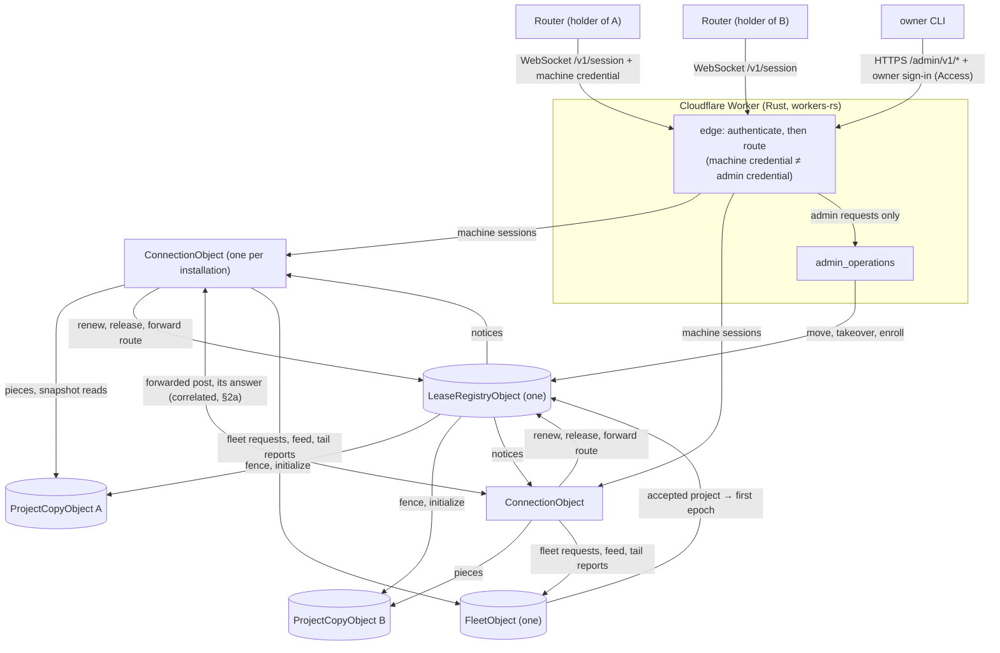
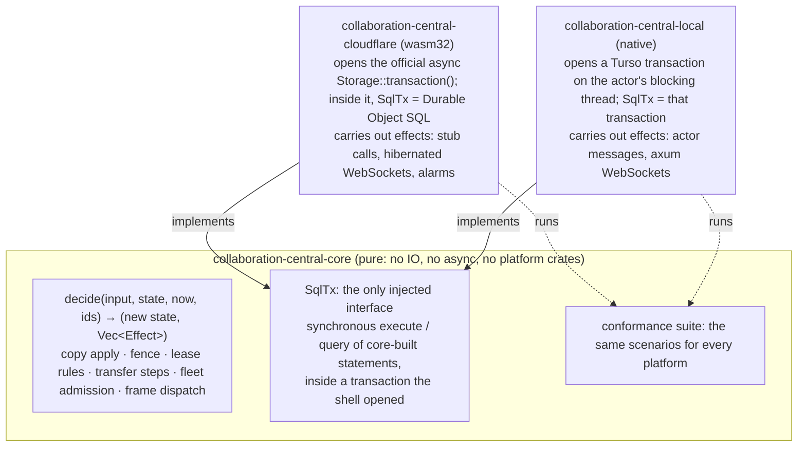

# Program design 3: the central fleet

**What this is:** how central realizes [spec 3](spec-3-central-fleet.md). Central is a Rust Cloudflare Worker (workers-rs) with four kinds of Durable Object:
- one connection object per machine;
- one central copy per project;
- one lease registry;
- one fleet object.

The Worker's edge also has a separate admin endpoint. The holder side of replication (capture, pieces, the session client, lease states) is in [program-design-2-project-storage.md](program-design-2-project-storage.md).

```text
requirements.md ──► spec 3 ──► program-design-3-central-fleet.md (this) ──► plan
```

Evidence:
- the platform facts for this rewrite (the unpublished platform-facts report), with Cloudflare limits as of 2026-10-09: 10 GB per object on Paid, 2 MB per row, 32 MiB per received WebSocket message, 30 s of CPU per event (configurable to 5 min), deploys disconnect every WebSocket;
- the workerd-local atomicity tests (2026-10-08 and 2026-10-11). The official workers-rs `Storage::transaction()` makes several SQL writes all-or-nothing: it commits on success and rolls back on a SQL error, a Rust `Err` or a fence mismatch, even across an `.await`. It blocks every other event to the object until it finishes, as the matching workerd source shows (`blockConcurrencyWhile`). Writes made outside a transaction aren't rolled back;
- the Advisor's lease memo (the unpublished lease memo).

Results from workerd-local runs are labelled local until a deployed check confirms them (spec 2 G18).

## 1. The choices

| Crux | Options | Selected | Why | Reopen if |
|---|---|---|---|---|
| **C7. Platform and process shape** | (a) a self-hosted axum server with a Turso hub (the old design); (b) one Cloudflare Worker with Durable Objects | **(b)** (owner, U32, U34) | The Turso hub's push isn't atomic and its server is dev/test only. Durable Objects give one single-threaded actor per project with private transactional storage | — |
| **C8. Applying a piece atomically** | (a) the official workers-rs `Storage::transaction()`, which binds Cloudflare's `ctx.storage.transaction()`; (b) `transactionSync`, reached through `as_raw()` and reflection because workers-rs doesn't wrap it; (c) a TypeScript shim | **(a)** (owner, 2026-10-11: use supported APIs only) | Cloudflare forbids `BEGIN` and `SAVEPOINT` through `exec`, and a multi-statement `exec` isn't atomic. Cloudflare documents that on SQLite-backed objects any `sql.exec()` inside `transaction()` is part of the transaction. Tested locally with workers-rs 0.8.7 and workerd 2026-10-06: it commits on success, rolls back on a SQL error, a Rust `Err` and a fence mismatch, and rolls back across an `.await`. Another request to the same object ran only after the transaction finished. (b) works too, but it's unsupported, so it isn't used | the deployed check (G18) disagrees with the local result |
| **C9. Keeping a fence from landing mid-apply** | (a) an in-memory per-project gate (the old gateway); (b) the central copy is the only place both apply and fence run, each as one synchronous transaction with no `await` inside | **(b)** | An object runs one event at a time, and a synchronous transaction can't be interleaved. A fence can only land between pieces (FL-3) with no lock to hold or lose | — |
| **C17. Where the lease registry lives** | (a) one global registry object; (b) registry shards; (c) D1 as the authority; (d) inside each project's copy (option A) | **(a)** | The owner chose a separate lease structure (U37), which rules out (d). (a) serializes every lease and transfer with no cross-shard protocol. At 15-minute renewals, a fleet of dozens of machines is a few requests a minute. D1's zero-row update is still a success, so it can't fence on its own | measured renewals and transfers approach one object's limit (a soft 1,000 requests/s) |
| **C10. Routers' copy of fleet records** | (a) Routers pull a whole fleet database (the old design); (b) the fleet object streams a fleet feed by cursor over the session | **(b)** | There's no hub to pull from. A cursor-based feed gives Routers a local fleet cache that keeps working while central is unreachable (WA-1) | — |
| **C11. Notices** | (a) server-sent events (the old design); (b) frames on the machine's session WebSocket | **(b)** | The session already exists for replication, and a hibernated WebSocket costs nothing while idle | — |
| **C18. The admin credential** | (a) a separate bearer token, its hash a Worker secret, held by the owner; (b) Cloudflare Access with the owner's sign-in | **(b)**, owner 2026-10-13 (U57) | The network is single-user. Moves and takeovers are rare and always done by the owner, so a short-lived sign-in beats a stored secret. Google is already the org's identity provider | more admins than the owner, or unattended admin automation |
| **C23. Keeping central off the open web (U55)** | (a) Cloudflare Access in front of a dedicated hostname; (b) central on a tailnet machine; (c) WARP-enrolled devices | **(a)**, owner 2026-10-13 | A Worker can't join a tailnet, and a self-hosted central is only as available as its machine, while leases renew every 15 minutes and cross-machine posts route through central. WARP is ruled out for now. Verified on the owner's account: an Access service token gates a WebSocket upgrade to a Workers Custom Domain (401 without, 101 with), and the client's `Authorization` header reaches the Worker unchanged (experiment 2026-10-13) | WARP becomes acceptable (add a device check), or the owner wants no public DNS name |
| **C19. Detail reads of a project from another machine** | (a) central runs board views; (b) a read-only snapshot pulled from the central copy, labelled with its position | **(b)** | It reuses seeding (PD2) in read-only mode, so central stays schema-agnostic: it never needs board view logic. Every page carries the copy's acknowledged position. If the position moves between the first and last page while the holder is writing, the reader starts again, so a snapshot is always one consistent position. Seeding a new holder needs no restart, because no one writes while a project is fenced without a holder | projects grow large enough that snapshots are slow, or a busy project keeps restarting them; then add incremental catch-up |
| **C20. Where central's logic lives** | (a) inside the Cloudflare objects; (b) a platform-independent core crate with storage and messaging ports, and thin platform adapters injected through one interface (§2a): Cloudflare for production, a native local server for testing | **(b)** (owner, 2026-10-11) | The rules must not be tied to Cloudflare: whether to apply or refuse a piece, how the fence moves, lease renewal and expiry, the transfer steps, and fleet admission. In a core crate they compile for native and wasm32, can be unit-tested natively against an in-memory SQLite stand-in for the storage port, and could run on another host later. Only storage, sockets, hibernation, alarms, credentials and the transaction call are Cloudflare-specific | — |
| **C21. Wall-clock times on the wire** (review F9) | (a) `DateTime<Utc>` serialized as RFC 3339; (b) epoch milliseconds as `u64` | **(a)** | It's what `collaboration-protocol` already sends (`push_record.rs`, `created_at`), and the Rust rules require timezone-aware UTC. Lease expiry, last-seen and acknowledgement times use it; elapsed amounts stay explicit durations (`remaining_ms`). The registry's clock is the only clock that decides expiry (FL-9). Checked 2026-10-11 on toolchain 1.98.1: `chrono` 0.4.45 with `default-features = false, features = ["serde", "alloc"]` builds for `wasm32-unknown-unknown`, and an RFC 3339 `DateTime<Utc>` round-trips through serde_json. The protocol crate never reads the clock, so it needs no `clock` feature | — |
| **C22. Board identity in `ArchiveSeen`** (review F9) | (a) a `String`; (b) a `BoardId` UUIDv7 newtype in `collaboration-replication-protocol`, the same identity as `message-board`'s `BoardId` (`board_identity.rs`), converted at the holder's boundary | **(b)** | Board IDs are UUIDv7 (U10) and get the same validation as the protocol's other IDs. The protocol crate stays free of board-crate dependencies, since it builds for wasm32 with serde, serde_json and thiserror only | — |

**Costs:**
- Central now depends on Cloudflare's availability. The 4-hour lease absorbs outages of up to about 4 hours with no loss.
- Rust on workers-rs means wasm32 constraints.
- Project data lives in Cloudflare storage (U32).

## 2. Components



| Component | Job | Reason to change | Consumers | Owns |
|---|---|---|---|---|
| `edge` (Worker fetch handler) | authenticate each request in two layers, then route.<br>**Layer 1, the Access gate:** verify `Cf-Access-Jwt-Assertion` (RS256 with the team's JWKS, cached and re-fetched on an unknown `kid`; `iss` is the team domain; `aud` is the AUD of the Access app that owns the path; `exp`/`nbf`).<br>**Layer 2, by route:** `/v1/session` needs a service-token assertion (`type: app`) whose `common_name` is the Access client ID that the `LeaseRegistryObject` recorded for an enrolled installation, **and** that same installation's machine credential in `Authorization`. If they name different installations, the request is refused. It forwards the WebSocket upgrade to that installation's `ConnectionObject`. `/admin/v1/*` needs the admin app's assertion naming the owner's identity and goes to `admin_operations`.<br>A service-token assertion never works on the admin route, and a sign-in assertion never works on the session route | the Access team domain, the two AUD tags and the owner identity, as Worker configuration from the private ops repo and never in the public repo. The client-ID-to-installation map is enrollment state in the registry, so adding a machine needs no redeploy | Routers, the owner's CLI | nothing stored; it never forwards a credential to an object, only a verified caller identity and class |
| `ConnectionObject` | one per installation. It accepts the session WebSocket with the hibernation API and keeps the socket's `{installation, session_id, connection_id}` as an attachment. It decodes each `MachineFrame` (PD2 §3) and dispatches it to the copy, registry or fleet object (a `Claim` goes to the registry, FL-16), then answers with the same `frame_id`. It answers `Hello` with `Welcome` (each project's acknowledged position and lease). It pushes notices to the socket. A newer connection's `Hello` for the same installation takes over the logical session and closes the older socket with `Closed{ConnectionReplaced}`; requests in flight on the older socket get no answer and are re-sent by the machine (FL-12, U49). A `Hello` with a different session ID replaces the session record; acknowledged positions live in the copies, so nothing is lost. It keeps the credential's expiry from the upgrade and refuses requests after it with `Closed{CredentialRejected(Expired)}`, with no registry call per request; a revocation closes the installation's session through the registry (`Closed{CredentialRejected(Revoked)}`) | session protocol | Routers | the session record (session ID, installation, credential expiry) and the forwarding correlation rows `pending_forwards` and `delivered_forwards` (§2a), in its own storage |
| `ProjectCopyObject` | one per project, addressed by project ID. It applies pieces (§4), fences and initializes, serves snapshot pages for seeding and read copies, and stages the parts of large transactions | replication format | `ConnectionObject`, `LeaseRegistryObject` | the replicated tables and `_copy_state` (fence epoch, start position, acknowledged position, initialized, archived), `_copy_staged_parts`, `_copy_transfers` (fence receipts by transfer ID) |
| `LeaseRegistryObject` | the only issuer of leases (E23). It renews, reserves first epochs, runs moves and takeovers as recorded transfers, keeps the epoch floor, and enrolls and revokes machines. It also records imported projects as `Unheld{import_epoch, imported_head, schema_version}` (FL-15) and runs claims (FL-16) as recorded transfers of kind `Claim`, fencing the copy before it grants (§5 Claim) | lease rules | `ConnectionObject`, `admin_operations`, `FleetObject` | `leases`, `transfers`, `epoch_floor`, `machines` (installation, credential hash, enrolled or revoked), `last_seen` |
| `FleetObject` | fleet admission (WA-1), the project directory and metadata (FL-1), the fleet feed and notice outbox (FL-6), rejected-tail reports (FL-8) and board archive (FL-5) | fleet entity rules | `ConnectionObject` | fleet records, the fleet request ledger, the feed, the outbox, tail reports, archive state |
| `admin_operations` | move, takeover (preview, then confirm), machine enrollment, and **admin import** (FL-17). `/admin/v1/import/fleet` installs fleet records with their original IDs through fleet admission's import path. `/admin/v1/import/projects/{id}` streams a project's snapshot pages, one `ProjectCopyObject::ImportSeed{project, digest, index, page, final_summary}` call per page (the last page carries the summary), which initializes an unheld copy at the imported head, then records it with the registry (§5 Import). Both are keyed by ID and digest: identical content answers `AlreadyImported`, whether or not the project has been claimed since; different content answers `ImportConflict{existing, offered}`, and a held or once-claimed copy is never touched. It only calls registry, fleet and copy methods marked admin | admin rules | `edge` | nothing stored |
| `storage_transaction` | the Cloudflare transaction shell: one function that runs one core `step` with a `SqlTx` inside the official `Storage::transaction()`. The core's synchronous work closure runs inside it with no `.await`. Every write in every object goes through it | workers-rs API | all objects | — |

**Logic and platform:** every component in the table above is a thin Cloudflare shell over `collaboration-central-core` (C20). The shell owns transport and storage, and the core owns every decision.

**Dependency direction:** `edge` → (`ConnectionObject`, `admin_operations`). `ConnectionObject` → (copy, registry, fleet). `admin_operations` → registry. Registry → copy (fence, initialize). Fleet → registry (first epoch). No object calls `edge`, and nothing but `admin_operations` reaches a registry admin method. Objects aren't publicly addressable: only the Worker's own code holds their stubs. Each object checks the caller class the edge stamped on the internal request.

**Crates** (C20). The core holds the rules; the Worker only adapts them to Cloudflare:
- `collaboration-replication-protocol` (native and wasm32): the wire shapes `MachineFrame`, `CentralFrame`, `Piece`, `ReplicationPosition`, `LeaseStatus` (PD2 §3).
- `fleet-admission` (native and wasm32): the fleet admission **rules**, pure, with no IO and no async (M2.3 finding: one storage port can't be both the Router's async `sqlx-turso` and central's synchronous `SqlTx`). It shares decisions, not storage:
  - `reads_for(&FleetRequest) -> FleetReads` is the closed list of keys the request needs: its ledger entry, the subject records and revisions it names, name-uniqueness keys, and process definitions by `name@version`;
  - `decide(&FleetRequest, &FleetSnapshot, accepted_at, ids) -> FleetDecision { decision: RequestDecision, writes: Vec<FleetWrite>, feed: Vec<FleetFeedEntry> }` decides from the snapshot of those keys.
  - Each side runs one transaction: read the keys, call `decide`, then apply the writes, the feed entries and the ledger entry. The Router's in-process stand-in does this on its fleet store through `sqlx-turso`, asynchronously, under `BEGIN IMMEDIATE`. Central's `FleetObject` does it through `SqlTx` inside its core step.
  - The same decision tables run against both adapters: M2 for the stand-in, M3.5 for central.
- **`collaboration-central-core`** (native and wasm32, no Cloudflare dependency): all of central's decisions.
  - **Copy rules:** given a piece and the copy's state, decide `Refuse(reason) | AlreadyApplied(acked) | StagePart | Apply(plan)`, and turn an apply plan into ordered SQL with parameters (upsert and delete by primary key, schema steps).
  - **Fence rules.**
  - **The lease registry state machine:** renew, expiry against a supplied clock, the epoch floor, one active transfer per project.
  - **The move and takeover steps:** fence, then grant; the repeat-safe transfer.
  - **Session frame dispatch.**
  - **One injected interface, `SqlTx`.** Everything else is returned as effects, or passed in as arguments (§2a).
  - The core's own unit tests need no IO: they call the decide functions with a state, a time and IDs, and check the new state and the effects. The conformance suite runs the same scenarios through both platforms (§2a).
- **`collaboration-central-cloudflare`** (wasm32 only, the Cloudflare adapter): it implements `SqlTx` over Durable Object SQL, inside the official `Storage::transaction()` it opens (`storage_transaction`). It also owns the Worker's routes, credential checks, the hibernation WebSocket handling, socket attachments, alarms and stub calls between objects. Each object is a thin shell: load its state, call the core, write through its storage port. It's built with `worker-build`, outside the native workspace build, with its own CI job. Its lints deny `unwrap`, `expect` and `panic!`: a panic hangs the request and leaves writes made outside a transaction (local test). The core's lints deny them too.

## 2a. One interface, two platforms (strict)

Central's rules live in one platform-free crate. **Only storage is injected**, because it's the one thing that genuinely differs between platforms. Anything else that touches the outside world is returned as data for the platform to carry out. Time and IDs are passed in as plain arguments. (Owner, 2026-10-11: "a common interface and inject", "very strict", "run it locally during testing", "not everything should be injected", "no unsafe, same standards".)



**The one interface (review F6: one contract, sync on the core side):**
- The core sees only `trait SqlTx { fn execute(&mut self, statement: BoundStatement) -> Result<u64, StoreError>; fn query(&mut self, statement: BoundStatement) -> Result<Vec<SqlRow>, StoreError>; }`. It's synchronous, and it's always an open transaction the shell started.
- `BoundStatement` has a constructor private to the core: the core builds every statement and maps the rows they return into typed records.
- **Exact numeric transport (M3.6 finding).** workers-rs binds and returns SQL numbers as JavaScript doubles (worker 0.8.7 `sql.rs`), which loses integers beyond 2^53 and can't tell `REAL 1.0` from `INTEGER 1`. So the core encodes every value it binds, and every column it reads, in a form both engines carry exactly.
  - Integers are bound as decimal text inside `CAST(? AS INTEGER)`; reals as numbers inside `CAST(? AS REAL)`; text and blobs as they are.
  - Reads select `typeof(col)`, with integers read as `CAST(col AS TEXT)`, so a value's storage class and its full i64 value are never inferred from a double.
  - The shells only bind the parameter kinds the core declares (`BoundValue::{IntegerText, Real, Text, Blob, Null}`) and return rows of those kinds; they never convert numbers themselves.
  - The shared numeric conformance scenario (minimum and maximum i64, the adjacent integers above 2^53, REAL 1.0) must pass on Turso and under workerd.
- The core's entry point is synchronous: `fn step(tx: &mut dyn SqlTx, input: CoreInput, now: RegistryTime, ids: IdBatch) -> Result<Vec<Effect>, CentralError>`. An `Err` makes the shell roll the transaction back.
- **The shell owns the transaction and everything async.**
  - Cloudflare: the object calls the official async `Storage::transaction()`. Inside its callback it wraps the object's SQL storage as a `SqlTx` and calls `step` once, with no `.await` between the first and last statement. This is the shape the 2026-10-08 probe ran: a synchronous body inside the official transaction, rolled back on `Err`.
  - Local: the actor runs `step` on its blocking thread, inside a Turso transaction it opened there. **Evidence (2026-10-12 experiment):** `turso_core` 0.8.1, with default features, opens a file and runs BEGIN, statements, then COMMIT or ROLLBACK synchronously, with no runtime: `Database::open(io, path, OpenOptions)`, `connect()`, `prepare()`, and a `step()` loop that drives `IO::step()`. The same function works inside `tokio::task::spawn_blocking` under one Tokio runtime. **Caveat:** a failed statement doesn't roll back its transaction by itself, so on any `Err` from `step` the local shell issues `ROLLBACK` explicitly before answering. `Busy` and `Interrupt` are errors. Unverified: contention, deferred IO, crash durability, and equivalence to Durable Object storage; the conformance suite covers behavior, not durability.
  - After commit, the shell carries out the effects and feeds each result back as the next `CoreInput`.
- The local shell's engine is not the holder's store path. Holders use Turso through `sqlx-turso` (U22). Central's local shell emulates Durable Object SQLite, which is synchronous, so it uses Turso's engine directly on a blocking thread, with one Tokio runtime and no nested runtime.

**Effects are returned, not injected.** A core step returns `Vec<Effect>`, with closed variants:
- `Send { to: ConnectionId, frame: CentralFrame }`: `Welcome` after a `Hello`, `Answer{frame_id, …}` after a request, `Notice`, or `Closed{reason}`, after which the shell closes that socket. The core decides every frame and its recipient; the shell only resolves the ID to a socket and writes it (review F6; M3.3 finding).
  - `ConnectionId` is a UUIDv7 the shell mints for each accepted WebSocket. It's passed in with `CoreInput::Hello` and every `CoreInput::Frame`, kept in the socket attachment `{installation, session_id, connection_id}`, and stored in the session record as the session's current connection.
  - On a newer `Hello`, the core sends `Closed{ConnectionReplaced}` to the previous `ConnectionId` and `Welcome` to the new one, and records the new one as current (U49).
  - An `Answer` goes only to the connection its request came on. If that connection has since been replaced, the answer is dropped: the machine re-sends on the new connection, and re-sending is safe by identity (FL-12).
- `Notify { installation, notice }`;
- `Dispatch { call_id, to: ObjectAddress, call: ObjectCall, carry: Option<DispatchCarry> }` (the carry is a transient, core-owned value the shell returns with the call's result and never persists; `DispatchCarry::{ForwardPost{post}, ForwardDelivery{holder_last_seen}}`), where `ObjectAddress::{Copy(ProjectId), Registry, Fleet, Connection(InstallationId)}` and `ObjectCall::{ApplyPiece{piece, sender: InstallationId}, Fence{transfer_id, new_epoch, holder: InstallationId, expect, target_schema_max}, Initialize{project, epoch, holder: InstallationId}, CopyStatus{project}, SnapshotPage{cursor}, Renew{attempt, project, epoch}, Release{…}, ReserveFirstEpoch{project}, TailReport{…}, Fleet(FleetRequestEnvelope), Read{scope, after}, ArchiveSeen{…}, DirectoryUpdate(DirectoryUpdate), ForwardRoute{project, sender: InstallationId}, DeliverForward{forward_id, origin, origin_label, project, post}, ForwardAnswered{forward_id, project, outcome: ForwardOutcome}, Claim{attempt, project, claimant: InstallationId}, ImportSeed{project, digest, index, page: SnapshotPage, final_summary: Option<ProjectSummary>}, RecordUnheld{project, import_epoch, imported_head, schema_version}}`. `ForwardRoute`, `DeliverForward` and `ForwardAnswered` are forwarded posts (below); `Claim`, `ImportSeed` and `RecordUnheld` are claims and imports (§5). Frame dispatch is a core decision: the connection object's core turns each frame into one `Dispatch`, and the shell only makes the stub call;
- `Return { call_id, result: ObjectCallResult }`: the target object's typed answer to an incoming `CoreInput::Call`. Every incoming call gets exactly one `Return` over its whole handling, which may span several steps (M3.3 finding). A call whose answer depends on another object, such as a registry `Release` that has to fence the copy before it can grant, returns `Dispatch` and no `Return` from its first step. It persists its continuation, for example the transfer in `Fencing`. The shell keeps driving that inbound call: it carries out the dispatch, feeds the `CallResult` back as the next input, and steps again until the call's `Return` appears. Each step is its own transaction. The conformance suite checks exactly one `Return` per inbound call across its handling: none at the end, or two, is an error. A crash mid-handling leaves the persisted continuation, and the caller's repeat of the same request (same identity) resumes it. The shell routes it back to the caller after commit. On Cloudflare it's the stub call's response; locally it's the actor's reply channel. The caller's core receives it as `CoreInput::CallResult` (implementation finding, M3.1);
- `SetAlarm { at }`.
The result of a `Dispatch` comes back as `CoreInput::CallResult { call_id, result: ObjectCallResult, carry: Option<DispatchCarry> }`: `result` is a closed enum with one variant per `ObjectCall`, and `carry` is the same transient value the `Dispatch` carried, handed back from the shell's working memory and never persisted (review F23). It's `None` for every call that wasn't dispatched with one. The core turns it into the `Send` of the matching `Answer`. Inputs are `CoreInput::{Frame{frame_id, request}, Hello{…}, CallResult{call_id, result, carry}, CallFailed{call_id, carry}, Call{from: ObjectAddress, call_id, call} (an incoming dispatch on the target object), Alarm, Admin(AdminRequest)}`. `CallFailed` reports a dispatch the target never answered (a stub error or unreachable object). Today it's fed only for forwarding dispatches, which turn it into `Forwarded(Unanswered)` and free the reserved slot (M3.8 finding). Other dispatch failures keep their existing handling. `from` is set by the calling shell; only this Worker's own objects make calls, so it's trusted.

**Forwarded posts (spec 3 FL-14).** Every decision is in the core; central keeps no post content and no outcome, only a short-lived correlation.
1. **Sender's `ConnectionObject`, `Frame{Forward}`.** In one transaction it counts this installation's `pending_forwards` rows, in any phase. At 16 it answers `Forwarded(Overloaded)`. Otherwise it **reserves the slot** by inserting `pending_forwards(forward_id, frame_id, connection_id, project, phase: Routing, deadline = now + 30 s)`, sets an alarm for the deadline, and dispatches `Registry: ForwardRoute{project, sender}`. Because the check and the reservation commit together, two forwards can't both take the last slot while their route lookups are pending.
2. **`LeaseRegistryObject`** answers `ForwardRouteResult::{Route{holder, sender_label, holder_last_seen}, SenderHolds, NotHeld}`. `sender_label` is the enrolled installation's machine label, the authoritative source for `origin_label`. `holder_last_seen` is the registry's last-seen time for the holder, the same source holder-change refusals use (FL-10).
   - **The post isn't stored while the route is looked up.** Step 1's `Dispatch` carries it as `carry: Some(DispatchCarry::ForwardPost{post})`. The shell holds that value in memory only for the duration of that call and hands it back as `CoreInput::CallResult{call_id, result, carry}`. A carry is never persisted. If the object restarts mid-call, the carry and the call are lost together, and step 7's deadline answers `Unanswered`.
3. **Sender, on the route.** It acts only if the matching `pending_forwards` row still exists in phase `Routing` and its deadline hasn't passed. A missing, expired or already-advanced row means the forward was already answered `Unanswered`, so the late result produces no answer, no delivery and no new slot.
   - `SenderHolds` or `NotHeld` is answered at once, and the reserved row is deleted. So is a failed registry call, which is answered `Unanswered`.
   - On `Route`, it updates the row to `phase: AwaitingHolder{expected_holder: holder}`, keeping the original deadline, and dispatches `Connection(holder): DeliverForward{…}`.
   - When `DeliverForward`'s own result comes back, `HolderUnreachable` is answered only if the row still exists in `AwaitingHolder` within its deadline. Otherwise it's ignored.
4. **Holder's `ConnectionObject`, `Call{DeliverForward}`.**
   - With no current connection, it returns `NoConnection`. The sender answers `HolderUnreachable{last_seen: holder_last_seen}` and deletes its row. Step 3's `DeliverForward` dispatch carries `DispatchCarry::ForwardDelivery{holder_last_seen}`, so the value survives that call without being stored; the row still holds only IDs, connections, phase and deadline.
   - Otherwise it inserts `delivered_forwards(forward_id, origin, project, deadline)`, sends `Forwarded{…}` to its current connection, and returns `Delivered`.
5. **Holder, `Frame{ForwardAnswer}` from its own machine.** It's accepted only for a `forward_id` in `delivered_forwards`; any other answer is dropped. The holder deletes the row and dispatches `Connection(origin): ForwardAnswered{forward_id, project, outcome: Answered{reply}}`.
6. **Sender, `Call{ForwardAnswered}`.** It's accepted only when `pending_forwards` holds that `forward_id` for that `project` in phase `AwaitingHolder{expected_holder}` and the call's `from` is `Connection(expected_holder)`.
   - The sender deletes the row, sends `Answer{frame_id, Forwarded(Answered)}` to the stored `connection_id`, and returns `Ack`.
   - If that connection has been replaced, the answer is dropped and the machine re-sends with the same `request_id`; the holder's ledger replays it.
   - A late, unknown or wrong-sender answer gets `Ack` with no send.
7. **Alarm.** An expired `pending_forwards` row, in either phase, becomes `Answer{Forwarded(Unanswered)}` on its stored connection and is deleted, which frees its slot. An expired `delivered_forwards` row is deleted.

A holder change during a forward needs no special case: the old holder's admission refuses the post (`NotWriter`), and that answer reaches the sender as `Answered`. The rows hold IDs, connections and deadlines only, never a post or a reply.

The platform shell carries them out after the transaction commits, and feeds any result back as the next input. A takeover is the stored transfer record moving through explicit steps (`Fencing` → `Granted`), not one async function. A crash between steps leaves a record the next step can resume.

**Time and IDs are arguments.** For example, `renew(lease, now: RegistryTime)` and `begin_takeover(request, transfer_id: TransferId, now)`. The shell reads the clock and makes the IDs; tests pass fixed values.

**Standards: the same as the rest of the workspace, with no exceptions for wasm.**
- `#![forbid(unsafe_code)]` in the core and in both platform crates. Only supported workers-rs APIs are used; there's no `as_raw()` or reflection.
- No `unwrap`, `expect`, `panic!`, `todo!` or `unimplemented!` outside tests, under the workspace lints.
- Closed enums with payloads for every state and result, newtype IDs (`ProjectId`, `TransferId`, `InstallationId`, `Epoch`), `thiserror` domain errors, Serde-tagged wire enums. Untrusted frames are validated once at the edge.
- Files under 1,000 lines; formatting and clippy with `-D warnings` on both targets.

| Rule | Enforced by |
|---|---|
| The core has no platform crates: no `worker`, `wasm-bindgen`, `js-sys`, `web-sys`, `tokio`, `axum`, `reqwest`, `sqlx`, `rusqlite`, and no Turso engine crate (`turso`, `turso_core` or any other `turso_*`). The only exceptions, allowed by exact name, are `turso_parser` and its compile-time `turso_macros`: pure parsing with no IO, needed for the schema fingerprint (PD2), and verified to build for wasm32 | a CI check on `cargo tree -p collaboration-central-core -e normal` |
| The core has no async, no `cfg(target_arch)` and no global state | a CI grep; the core builds for native and wasm32 with no platform features |
| Every decision is in the core; a shell only loads, calls, commits and carries out effects | the conformance suite runs on both platforms, so a shell that decides differently fails it |
| Replicated changes reach storage only as core-built statements | the private constructor |

**The two platforms:**
- **`collaboration-central-cloudflare`** (production): `SqlTx` is Durable Object SQL inside the official `Storage::transaction()`, which the shell opens. It carries out effects through stub calls between objects, hibernated WebSockets and alarms, and owns the Worker's routes and credential checks.
- **`collaboration-central-local`** (testing and development): a native axum server (U30) with the same `/v1/session` WebSocket and `/admin/v1/*` routes.
  - Each object is one actor, a Tokio task with one event at a time, as in a Durable Object.
  - Its `SqlTx` is a Turso transaction on the actor's blocking thread, one file per object, with explicit `ROLLBACK` on error (verified 2026-10-12; see §2a).
  - Routers and the debug Host point at it with one setting, so the whole system runs on one machine with no Cloudflare account.
  - It's what V3 and V9 run against natively. It isn't a production target unless the owner chooses that later.

## 3. Bindings and shapes

| E | Semantic owner | Home | Schema / type home | Shape at each boundary | Kept as |
|---|---|---|---|---|---|
| E23 lease | `LeaseRegistryObject` | new | registry storage `leases(project, holder, epoch, expires_at)`; wire `LeaseStatus` in `collaboration-replication-protocol` | renew → `Renewed{expires_at, transfer_in_progress, replayed, current}` (PD2 §3) or `Refused(StaleEpoch{current_epoch, epoch_ended_at} \| NotWriter{current})`; renewal attempts are kept by attempt ID so a re-send replays its recorded result; admin → `MoveResult = Moved{new_epoch, start} \| Pending{transfer_id} \| Refused{holderUnreachable \| migrationPending \| transferInProgress}`; a move completes asynchronously, so the admin's call answers `Pending` until the holder has released, and repeating the same request (same `transfer_id`) answers the final outcome``; `TakeoverPreview{holder, epoch, acked, last_seen, tail_estimate, confirm_token}` (the token is bound to holder, epoch and acked, §5); `TakeoverResult = Granted{new_epoch, start} \| Pending{transfer_id} \| Refused{previewStale \| schemaTooNew \| transferInProgress}`; `MoveResult` also refuses `schemaTooNew`; the registry keeps `machines(installation, credential hash, enrolled or revoked, schema_support, last_seen)` | persisted |
| E24 central copy | `ProjectCopyObject` | new | `_copy_state` (fence epoch, holder installation (none while unheld), start, acked, schema identity, initialized, archived, and `imported{digest, import_epoch}` for an imported copy), `_copy_receipts` and `_copy_part_receipts` (piece and part receipts, §4), `_copy_staged_parts`, `_copy_transfers` (fence receipts with each old epoch's cutoff and holder), `_copy_summary` (the projection for the directory, §6) in the object's storage | `Acked{through}`, `PartStaged{…}`, `Refused{staleEpoch{current_epoch, epoch_ended_at} \| positionGap{acked} \| pieceConflict \| notInitialized \| centralCopyFull}`; `SnapshotPage{project, position, schema, schema_steps, table, rows, next}` or `ProjectCopyRead::Moved{position}` (PD2 §3) | persisted |
| E25 replication piece | `ProjectCopyObject` (apply) | — | `collaboration-replication-protocol` (PD2 §3), with `digest` and `TransactionPart{transaction, index, count, transaction_digest}` | in from the session; stored only as staged parts and receipts | staged parts; receipts kept permanently (§4) |
| E26 machine session | `ConnectionObject` | new | session row in its storage; socket attachment `{installation, session_id, connection_id}` (well under the 16 KB limit) | `MachineFrame`, `CentralFrame` (PD2 §3) | persisted |
| E1, E2, E7, E16 fleet records | `FleetObject` | new store for existing entities | `fleet-admission` port; tables in the fleet object's storage. E7 holds its immutable Markdown text in the record (U48) | fleet requests and feed entries, as in PD1 | persisted |
| E3 directory entry and metadata (FL-1, U46) | `FleetObject` | new | `directory(project, name, workspace, board, created_by)` written by fleet admission; `directory_status(project, status, latest_record_at, position, acked_at)` from the copy side; `directory_lease(project, lease, as_of)` from the registry side, where `DirectoryLease::{Held{holder, state: LeaseState{Held, Expired}, expires_at}, Unheld}` (an unheld project has no holder or expiry; FL-1, FL-15) | `DirectoryQuery{text, workspace, board, status, holder}` → `DirectoryEntry{project, name, workspace, board, status, board_archive, lease: DirectoryLease, latest_record_at, status_as_of: {position, acked_at}, lease_as_of}`, both inside `FleetPayload` (§6) | persisted |
| E22 rejected-tail report | `FleetObject` | new | `tail_reports(project, epoch, request_ids, digest)` | `TailReport` frame in; `TailReported` notice out | persisted |
| E27 holder change | `LeaseRegistryObject` | new | `transfers(transfer_id, project, kind, requester, reason, old_epoch, new_epoch, to_installation, state, start, request_hash)`; `transfer_id` is the request ID the admin's client mints (UUIDv7), so a repeat after a lost answer names the same transfer; the same ID with a different `request_hash` is `conflictingRequest` | admin results above | persisted |

## 4. Applying a piece (FL-3, FL-4, FL-7, WA-3a/3b)

```mermaid
sequenceDiagram
  participant S as ConnectionObject
  participant P as ProjectCopyObject
  S->>P: apply(Piece)
  P->>P: transaction (official API; synchronous work) {
  alt not initialized
    P-->>S: Refused{notInitialized}
  else piece.epoch < fence, and sender = that epoch's holder (from its fence receipt)
    P-->>S: Refused{staleEpoch, current_epoch, epoch_ended_at (from the fence receipt)}
  else sender ≠ the holder of piece.epoch, or piece.epoch > fence
    P-->>S: Refused{notWriter, current epoch}
  else digest doesn't match the piece's content
    P-->>S: Refused{pieceConflict}
  else a part whose E25 identity (epoch, continues_from, through, index) has a part receipt
    P-->>S: same piece digest → Acked{its transaction's through}; different → Refused{pieceConflict}
  else a whole piece whose identity has a receipt
    P-->>S: same digest → the receipt's recorded answer; different digest → Refused{pieceConflict}
  else piece.through ≤ acked, and no receipt
    P-->>S: Refused{positionGap, acked} (resend from acked; never acknowledged blind)
  else piece.continues_from ≠ acked
    P-->>S: Refused{positionGap, acked}
  else a part of a larger transaction, not the last
    P->>P: stage it under (transaction key, index) with its piece digest; a staged index with a different piece digest → pieceConflict; check count and transaction digest against parts already staged
    P-->>S: PartStaged{transaction, index, acked} (acked unchanged)
  else the last part
    P->>P: assemble the staged parts plus this incoming part (each index once); require indices 0..count−1 all present, same count and transaction digest, and the digest recomputed over the ordered assembly equal to it
    alt any part missing or inconsistent
      P->>P: drop that transaction's staged parts
      P-->>S: Refused{positionGap, acked} (the sender restarts the whole transaction from part 0)
    else complete
      P->>P: apply the validated assembly once, in order; acked = through; move every part's (continues_from, through, index, piece digest) from staging into _copy_part_receipts; clear the staging
      P-->>S: Acked{through}
    end
  else whole transactions
    P->>P: for each transaction in order: SchemaStep → run its statements; Rows → upsert / delete by primary key
    P->>P: acked = through; record the receipt
    P-->>S: Acked{through}
  end
  P->>P: } (any error → the whole transaction rolls back → Refused with the mapped reason)
```

- **Schema-step admission (M3.4 finding: a schema step could otherwise forge central's bookkeeping).** Before running a `SchemaStep`, the core parses each statement with the pinned `turso_parser` (the same one the fingerprint uses) and admits it only if both conditions hold.
  - **Its form is allowed:** `CREATE TABLE`, `CREATE INDEX`, `CREATE VIEW`, `ALTER TABLE`, `DROP TABLE`, `DROP INDEX` or `DROP VIEW`, or `INSERT`, `UPDATE` or `DELETE` for data migrations.
  - **It names no reserved object anywhere** (targets, `FROM`, joins, subqueries, CTEs), as decided by the shared `reserved_namespace` classifier (PD2 §5). The same classifier filters central's snapshot and read enumeration and the row path.
  - Triggers, virtual tables, `ATTACH`, `DETACH`, `PRAGMA`, `VACUUM`, `REINDEX`, `ANALYZE` and transaction control are refused.
  - A refused statement refuses the whole piece as `schemaUnsupported{form}`, a session refusal kind. Nothing applies, and the holder stops that project's replication and reports it.
  - The row path's reserved-table check is also ASCII case-insensitive.
- **Receipts are checked against the fence state.** A fence receipt is trusted only if it agrees with `_copy_state`: its new epoch is the current fence, and its holder is the current holder. Otherwise the fence or release fails closed as an integrity error, the transfer stays where it was, and nothing is granted.
- **Only the holder writes (FL-2; M3.3 finding).** An epoch isn't a credential. The copy records the holder installation together with its fence, and each fence receipt keeps the holder of the epoch it ended, so the copy knows every epoch's holder. The registry sets both through `Initialize` and `Fence`. The epoch is checked first: a superseded holder sending a piece for its own old epoch gets `staleEpoch` with that epoch's cutoff (review F3), while any sender that wasn't the holder of the piece's epoch gets `notWriter`. Every `ApplyPiece` carries the sender's installation, which the connection object takes from the authenticated session, never from the frame. A piece from any other installation is refused `notWriter`. This needs no registry call per piece, so the write path stays off the registry.
- **No `await` inside a transaction's work.** Fetches, notices and logging happen after it returns. That is also why a fence can only land between pieces.
- **A storage-limit error** inside the transaction rolls back, and the copy answers `centralCopyFull` (FL-4).
- **Receipts (review F4).** Each applied piece leaves a receipt, `_copy_receipts(epoch, continues_from, through, digest)`, written in the same transaction as the apply. A re-sent piece is matched on its identity, `(epoch, continues_from, through)`: the same digest gets the acknowledgement it got then (`Acked{through}`, which the identity determines), not the current `acked`; a different digest gets `pieceConflict`. Parts of a larger transaction share one `(continues_from, through)`, and E25's identity includes the part's place, so a part's identity is `(epoch, continues_from, through, index)`. The transaction key `(epoch, commit_id)` names the same `through` (review F4, F20). When an assembly commits, each part's piece digest moves from staging into `_copy_part_receipts(epoch, continues_from, through, index, digest)`, keyed by exactly that identity. A repeated part is checked against its own receipt: unchanged gets `Acked{through}` for its transaction, changed gets `pieceConflict`. A part never meets another part's digest, and a whole piece (no part) uses `_copy_receipts` keyed by `(epoch, continues_from, through)`. Receipts of both kinds are never deleted, because E25 and WA-3b set no replay window. A receipt is about 80 bytes, so even years of pieces stay far below the object's limit. `positionGap` is reserved for a piece that truly doesn't continue from `acked`.
- **Staging (review F2).** A part is staged durably under its transaction key, and `PartStaged` only means "held, not replicated". The replication position moves only when the last part completes a whole, consistent transaction, so no reader ever sees part of one (WA-3a). Cleanup is never a correctness step: the alarm clears staged parts older than a day, or older than the fence's epoch, and a final part that then finds parts missing is refused, never applied short. Each staged part is stored with its own piece digest. A part repeated while staged replaces nothing: the same transaction key and index with the same **piece** digest is a no-op `PartStaged`; a different piece digest is `pieceConflict`, even if it declares the same whole-transaction digest (review F2). The whole-transaction digest is checked only when the assembly is validated. The holder keeps every captured change until it's acknowledged (WA-3b), so it can always restart the transaction.
- **Rows are applied by declared primary key** (PD2 C12): `INSERT … ON CONFLICT(key) DO UPDATE` for upserts and `DELETE … WHERE key = ?` for deletes. Hidden rowids at central are its own and never compared with the holder's. Column order comes from the copy's own schema, which the same migrations built (PD2 C13). Foreign-key checks are deferred to the end of the transaction: rows arrive in the holder's commit order, so constraints hold at commit.
- **The largest transaction** that one event can apply within the CPU limit is unmeasured (G17). A part that keeps failing the same way is reported by the Router as `pieceApplyFailed` and stops that project's replication, rather than retrying forever.

## 5. Takeover and move (FL-9, FL-10)

```mermaid
sequenceDiagram
  participant O as owner CLI
  participant E as edge (admin credential)
  participant L as LeaseRegistryObject
  participant P as ProjectCopyObject
  participant N as ConnectionObjects (old, new holder)
  O->>E: POST /admin/v1/projects/{id}/takeover/preview
  E->>L: preview(project)
  L->>P: status()
  P-->>L: fence epoch, acked, schema identity
  L-->>O: TakeoverPreview{holder, epoch, acked, last_seen, tail_estimate, confirm_token}
  O->>E: POST .../takeover {transfer_id, to_installation, reason, confirm_token}
  E->>L: takeover(...)
  L->>L: one active transfer per project; token's holder and epoch == current lease, else previewStale;<br/>target's last schema_support known, else schemaTooNew;<br/>new_epoch = max(epoch_floor, fence) + 1; transfer = Fencing
  L->>P: fence(transfer_id, new_epoch, expect{epoch, acked}, target_schema_max)
  P->>P: transaction (official API; synchronous work) {<br/>receipt for transfer_id → return it;<br/>fence epoch ≠ expect.epoch or acked ≠ expect.acked → PreviewStale{acked};<br/>schema version > target_schema_max → SchemaTooNew;<br/>else fence = new_epoch; start = acked; record receipt }
  P-->>L: Fenced{start} | PreviewStale{acked} | SchemaTooNew{store, supported}
  L->>L: Fenced → lease = {to_installation, new_epoch, now + 4 h}; epoch_floor = new_epoch; transfer = Granted<br/>otherwise → transfer = Refused(reason); lease unchanged
  L-->>O: Granted{new_epoch, start} | Refused{previewStale | schemaTooNew | transferInProgress}
  L->>N: on grant: notices LeaseSuperseded to the old holder, LeaseGranted to the new one
```

- **Preview binds the loss boundary (review F1).** The confirm token is bound to the holder, epoch and acknowledged position the preview showed. The registry checks holder and epoch, which it owns. The copy checks epoch and position inside the same transaction that would move the fence, so a piece that commits between confirmation and fencing makes the fence refuse (`PreviewStale`), and nothing changes: no fence, no grant. The admin sees the new position and decides again.
- **Schema checked before the grant (review F7, WA-7).** Every `Hello` reports the Router build's `schema_support`, and the registry keeps the last value per installation. A transfer to an installation whose support is unknown, or older than the copy's schema version, is refused `schemaTooNew`, naming both. The copy makes that comparison inside the fence transaction, against its own verified schema identity. The new holder's local `SchemaReady` check after seeding (PD2) is an additional admission check, not a substitute.
- **Fence before grant.** A crash after the fence and before the grant leaves the project fenced with no holder. The transfer stays `Fencing`. Repeating the same request carries the same `transfer_id`, gets the stored fence receipt, and completes. It never issues a second epoch (FL-10). The fence receipt also records the old epoch's cutoff (`start`), which the copy returns as `epoch_ended_at` in every later `staleEpoch` to that epoch (review F3).
- **Epoch floor after a restore.** If the registry is restored to an earlier state, the copy's fence is the second record of the highest epoch. A fence with `new_epoch ≤ fence` is refused with the current fence, and the registry retries once at `fence + 1`. If neither record can be read, the takeover is refused.
- **Move.** The registry records a `Draining` transfer and sends `ReleaseRequested` to the holder; the holder also sees it in every renewal answer (`transfer_in_progress`). The holder stops admitting, replicates everything, and answers with `Release{epoch, transfer, outcome}`. If a migration is pending or failed, the outcome is `Refused(MigrationPending{migration, state})`: the registry records the transfer as refused `migrationPending`, leaves the lease unchanged, and the holder returns to `Current`. Otherwise the outcome is `Final(final)`, and the registry fences with `expect{epoch, acked: final}` and the target's schema limit, then grants with `start = final` (M3.3 finding: only the holder knows its migration state). If the holder hasn't renewed in the last 30 minutes (U45) or has no connected session, the move is refused as `holderUnreachable`; the admin can then choose a takeover.
- **Renewal.** Each attempt is recorded by its attempt ID in `renewal_attempts(attempt, project, installation, epoch, answer, decided_at)`, kept for the project's life, because FL-12 sets no replay window (review F16). At one attempt per project every 15 minutes, that's about 3.5 MB a year per project in the registry. Compacting old attempts would need a spec change that bounds replay, so it isn't done. A re-sent attempt gets its recorded answer with `replayed: true` and the lease's current state (F27). A fresh attempt is checked against the current lease: same holder and epoch renews (an expired lease with no transfer renews on the same epoch); a superseded epoch gets `staleEpoch` with its cutoff. Expiry is computed when needed from `expires_at` against the registry's clock, with no timers.
- **Import (FL-17, FL-15).** `admin_operations` takes `/admin/v1/import/projects/{id}` only on the owner route (FL-13). It calls the copy first, then the registry:
  1. `Copy: ImportSeed{project, digest, index, page, final_summary}`, one call and one transaction per page. Pages arrive in index order and are staged under `(digest, index)`. A non-final page answers `Staged{digest, index}`, a re-sent page with the same content is a no-op with the same answer, and a page with any other index is refused, naming the expected one. Staged pages are invisible: the copy stays not initialized until the last page arrives. A different digest while an earlier import is still staged discards that staging, since nothing was initialized. The last page recomputes the `ImportDigest` over the staged rows with the shared helper (PD2 step 4), checks it against `digest` and checks the schema identity. It then answers `Imported{head}` and sets fence = 1 (the import epoch), holder = none, start = `(1, 0)`, acked = the imported head, and `imported{digest, import_epoch: 1}`, and stores the page's `final_summary` in `_copy_summary` in the same transaction. After commit it dispatches `DirectoryUpdate{project, summary, position: imported head, acked_at}` to `FleetObject`, on the same alarm-repaired path as a piece's summary (§6), so an unheld project's status and latest-record time are listed before any claim (review F25). A copy that's already imported with the same digest answers `AlreadyImported`. Any other existing copy answers `ImportConflict{existing: ExistingImport::{Imported(ImportDigest), NotImported}, offered}` and is untouched. `NotImported` covers a copy a holder created, which has no import digest to compare. Because the copy is one object, an import and a claim's fence never interleave.
  2. `Registry: RecordUnheld{project, import_epoch: 1, imported_head, schema_version}`. It writes the `Unheld` row, raises the project's `epoch_floor` to 1, and dispatches `DirectoryUpdate{project, lease: Unheld}`. It's idempotent, and a project the registry already has a lease or transfer for keeps it unchanged.

  A crash between the two leaves an imported copy the registry doesn't know: a claim answers `NotFound`, and re-running the import (the script's normal re-run) gets `AlreadyImported` from the copy and then completes step 2.
- **Claim (FL-16; review F20).** A claim is a recorded transfer of kind `Claim`, keyed by its attempt ID, on the same fence-then-grant path as a takeover:
  1. The claimant's `ConnectionObject` dispatches `Registry: Claim{attempt, project, claimant}`, where `claimant` comes from the authenticated session.
  2. The registry checks, in order:
     - a transfer recorded for this attempt resumes or replays it, so a re-sent attempt never issues a second epoch;
     - an active transfer of any kind answers `AlreadyHeld{holder: transfer.to}`, so of two racing claims the later gets the winner;
     - a lease row answers `AlreadyHeld{holder}`, including just after a claim's grant removed the `Unheld` row;
     - only then does a missing `Unheld` row answer `NotFound`: the registry knows no such project (review F24).

     Only the import creates `Unheld`, so a project with no holder because a takeover is still fencing is never claimable. Next, the claimant's last reported `schema_support` must be known and cover `schema_version`; otherwise `SchemaTooNew{store, supported}`. Then `new_epoch = max(epoch_floor, import_epoch) + 1`, and the transfer is recorded as `Fencing`.
  3. `Copy: Fence{transfer_id: attempt, new_epoch, holder: claimant, expect{epoch: import_epoch, acked: imported_head}, target_schema_max}`, the same fence as a takeover. Its transaction sets fence = `new_epoch`, holder = claimant and start = the imported head, and records the receipt. If the copy's fence is no longer the import epoch, because the project was claimed before a registry restore, it answers `PreviewStale` with the current fence. The registry reads that epoch's holder with `CopyStatus`, answers `AlreadyHeld{holder}`, records the transfer as refused and grants nothing.
  4. On `Fenced{start}`: lease = `{claimant, new_epoch, now + 4 h}`, `epoch_floor = new_epoch`, transfer = `Granted`, and the `Unheld` row is removed. The answer is `Claimed{epoch, expires_at, start}`, and `LeaseGranted` goes to the claimant. A crash after the fence and before the grant leaves the transfer `Fencing`; the re-sent attempt gets the stored fence receipt and completes the same grant.

  After the grant, the project is held like any other: renewals, `Welcome`, moves and takeovers follow the normal path. The claimant seeds from the copy at `start` before it admits anything (PD2).
- **Creation.** When `FleetObject` accepts a project's directory entry, it asks the registry to reserve epoch 1 for the creating installation. The registry initializes the copy with fence 1 and start `(1, 0)`. Until then the copy answers `notInitialized`, so central never holds data for a project it didn't accept (WA-10).

## 6. Other paths

- **Fleet requests (WA-1).** A Router sends a `FleetRequest` with its request ID over the session. `FleetObject` runs `fleet-admission`: ledger, revision, rules, then the write with its feed entry, in one transaction. Routers see the result in their fleet cache from the feed. While central is unreachable, the Router keeps the request `Pending` and answers `pendingUnreachable`.
- **The fleet feed and notices (FL-6, C10, C11).** Each feed and outbox row has `event_id` (UUIDv7), scope, kind, `central_sequence`, `as_of` and `expires_at`. Connected sessions get them pushed. After `Welcome`, a Router reads everything after its cursor (`Read{scope: Notices or FleetRecords, after}`). A cursor older than retention gets `cursorExpired`, and the Router re-reads the fleet records in full.
- **Rejected-tail reports (FL-8).** A superseded holder sends `TailReport{project, epoch, request_ids, digest}`. The registry checks that the epoch was this installation's. `FleetObject` stores the report and notifies the current holder. That holder's `project_admission` records the `RejectedTail` fact (PD2 §6).
- **Archive (FL-5).** `FleetObject` marks the board `archiving` and emits a notice. Each holder refuses work writes to the board's projects (the `Archived` gate, with spec 1 E2's reader exceptions still admitted), records `ArchiveSeen` in the project, and, once that fact is acknowledged, sends `ArchiveSeen{board, project, position}`. The board reads `archived` once every project has reported or has no holder. Fleet admission's "parent must be active" gate exempts exactly this report: `ArchiveSeen` is accepted while its board, or its board's workspace, is `archiving`, with all its board, project and report checks kept. When the last board of an archiving workspace becomes `archived`, the same fleet transaction marks the workspace `archived` (FL-5; M2 corrections I). No other operation gets the exemption. A restart resumes from the stored reports. `ProjectCopyObject` keeps applying an archived project's pieces under the normal fence, so allowed reader-state changes replicate; its `archived` flag is for reads and views, never a piece refusal.
- **Metadata (FL-1, FL-2, U46; review F10).** Each part has one source and its own freshness:
  - **Name, workspace and board:** fleet admission writes them with the directory entry, and renames are fleet requests. They're current as of the fleet feed.
  - **Status and latest record time:** central doesn't parse board rows; it stays schema-agnostic. Instead every complete piece carries `summary: ProjectSummary{status, latest_record_at}`, derived only from the piece's own captured prefix: status as of its last transaction, and the Router time of its last record. A part of a larger transaction carries none, and its final part carries it, so a rebuilt piece always has the same summary and digest (PD2 §3; review F10). The copy stores it in `_copy_summary` in the same transaction that applies the piece. An imported copy gets its first summary from the import's last page instead (§5 Import); an `AlreadyImported` answer touches neither the copy nor its summary. After commit, the copy dispatches `DirectoryUpdate{project, summary, position, acked_at}` to `FleetObject`.
  - **Holder and lease state:** the registry dispatches `DirectoryUpdate{project, lease}` after every lease change and renewal, with its own `as_of`.
  - `FleetObject` keeps the newest update per side, by position or by registry time, so a late or repeated update never moves a side backwards.
  - An interrupted update is repaired by the copy's alarm: if `_copy_summary` is newer than the last update `FleetObject` acknowledged, it sends it again. The registry does the same for the lease side.
  - Search filters on these columns, and each result carries both sides' freshness. Anything more is read from the copy (C19), as a read-only snapshot labelled with its position.

## 7. Failure, recovery and concurrency

| Failure | Detected by | Contained to | Recovery and owner |
|---|---|---|---|
| A Router can't reach central | Router session | that machine | pieces and fleet requests wait; writes continue until the local lease deadline, then pause (PD2 §5). Owner: Router |
| A deploy closes every WebSocket | Router session | in-flight frames become unknown outcomes | Routers reconnect and `Hello`; `Welcome` returns each project's acknowledged position; nothing in memory matters (FL-11). Owner: `machine_session` |
| An object loses its memory (hibernation, eviction, restart) | — | — | every object rebuilds from its storage on the next event; socket mapping comes from the attachment; lease expiry is computed from storage |
| A takeover interrupted between fence and grant | transfer state `Fencing` | that project: fenced, no holder | the admin repeats the request; the same `transfer_id` completes it. Owner: `LeaseRegistryObject` |
| Two transfers for one project at once | `transfers` (one active per project) | the second request | refused as `transferInProgress` |
| The registry restored to an earlier state | the copy refuses a fence at or below its own | that transfer | retry at `fence + 1`; refuse if neither record can be read |
| A central copy is full | storage-limit error inside the transaction | that project | `centralCopyFull`; the owner raises the plan limit or archives (G21) |
| A large transaction exceeds the CPU limit | the event fails; the Router sees an unknown outcome or error repeat | that project | the Router stops and reports `pieceApplyFailed` (G17) |
| A machine credential leaks | owner | that machine | the admin revokes the machine; its sessions are refused; its leases expire and can be taken over |
| An Access service token leaks | owner | that machine's network gate | revoke or rotate the token in Access. The machine credential is still required, so a leaked token alone opens nothing |
| The owner's sign-in is compromised | owner | moves and takeovers | revoke Access sessions for the owner and secure the Google account; there's no stored admin secret to rotate |
| A panic in an object | the request hangs; the instance restarts | that event | writes are only ever made inside a transaction; panics are denied by lint. A panic *inside* the callback is untested (G18) |

**Concurrency.**
- Each object runs one event at a time, so different projects proceed in parallel in different copy objects.
- While an object awaits a call to another object, other events may run. The Router sends one piece per project at a time and waits for its ack, so pieces don't overtake each other. The `gap` check catches it if they ever do.
- A renewal that arrives while a takeover awaits the fence can succeed for the old epoch. That does no harm: the copy is already fenced, so the old holder's next piece is refused and it learns it was superseded.

## 8. Proof seams

| Seam | Real | Stand-in | Observes |
|---|---|---|---|
| `collaboration-central-local` natively, with two Router stores (V3, V9) | the core and the local adapter: real Turso stores, real WebSocket sessions | lease length and staged-part age shortened by configuration; the same test-only fault hook | every FL check, fast and without Cloudflare |
| `wrangler dev` (workerd) with the real `collaboration-central-cloudflare` and two Router stores | all four object kinds, the edge, the wrapper, Router capture and session | lease length and staged-part age shortened by configuration; a test-only fault hook (compiled only in a test build) that stops the registry after the fence | V9: every FL check in spec 3, including a fence that survives a workerd restart, the interrupted takeover finished by repeating it, `adminRequired`, a refused fence at or below the copy's, and session resume |
| `collaboration-central-core` on its own, and its conformance suite on both platforms | the core's decide functions; then each platform's shell and `SqlTx` | fixed times and IDs passed as arguments | fast native tests of every apply decision, the fence, lease expiry and renewal, the epoch floor, and the transfer steps, including an interrupted takeover and its repeat |
| `storage_transaction` on the official `Storage::transaction()` (a real integration test, with no mocks; owner, 2026-10-11) | the compiled Worker (`worker-build`, wasm32) under real workerd (`wrangler dev`, local mode), with real Durable Object SQLite storage. Then the same test against a deployed staging account (V9d) | none: no mocked storage and no fake JavaScript API | each case runs through a real request, and the persisted state is read back through a **separate** request and again after **restarting workerd**: <br>• a SQL constraint error inside rolls back every write; <br>• a Rust `Err` inside rolls back every write; <br>• a fence mismatch rolls back the row and leaves the fence alone, while the matching epoch commits rows and position together; <br>• a panic inside the callback (records what happens; G18); <br>• no other request to the object can observe a half-applied transaction. <br>It's a permanent test in the repo with its own CI job, not a one-off probe |
| Deployed staging | a Cloudflare staging account | — | V9d: fence, takeover crash cases, and resume across a real deploy |
| Cross-machine | — | — | V7, unverified until P1 and P5 exist |

## 9. Trace

| U | R | E | Owner | Interface | Shape and home | State | Failure | Proof |
|---|---|---|---|---|---|---|---|---|
| U20 | WA-1 | E1, E2, E7, E16, E23 | `FleetObject` + `LeaseRegistryObject` | `FleetRequest` frame | `fleet-admission` port; fleet ledger | Pending on a Router while unreachable | `pendingUnreachable` | V7, V9 |
| U24 | FL-1 | E3 | `FleetObject` | directory and search frames | directory row with freshness | — | — | V9 |
| U21, U24 | FL-2 | E3, E19, E24 | `ProjectCopyObject` | `SnapshotPage` | read-only, with its position | — | — | V9 |
| U21, U25, U37 | FL-3 | E20, E24, E25 | `ProjectCopyObject` | `apply`, `fence` | `_copy_state` | fence only increases | `staleEpoch`, `gap` | V9, V9d |
| U32 | FL-4 | E24 | `ProjectCopyObject` | `apply` | — | — | `centralCopyFull` | V9 |
| U3, U20 | FL-5 | E2, E13 | `FleetObject` + holders | `ArchiveSeen` frame | archive reports | active → archiving → archived | — | V9 |
| U55, U57, U58 | FL-13 | E26 | `edge` + `LeaseRegistryObject` (enrollment client ID) | every request; `/v1/session`; `/admin/v1/*` | `AccessCaller::{Machine{client_id}, Owner{email}}` | — | refused at the edge; `Closed{CredentialRejected}` | V9, V9d |
| U56 | FL-14 | E26, E10 | sender and holder `ConnectionObject` + `LeaseRegistryObject` (`ForwardRoute`) | `Forward` → `ForwardRoute` → `DeliverForward` → `ForwardAnswered` | `pending_forwards`, `delivered_forwards` (transient) | pending → answered · unanswered · unreachable | `senderHolds`, `notHeld`, `holderUnreachable`, `unanswered`, `overloaded` | V7, V9 |
| U54 | FL-15 | E3, E23, E24 | `LeaseRegistryObject` (`Unheld`) + `ProjectCopyObject` | `Read{scope: ProjectCopy}`; writes and `Forward` | the registry's `Unheld` lease row; the copy at the imported head | unheld → held, by claim only | `notHeld` | V9 |
| U54 | FL-16 | E20, E23, E24 | `LeaseRegistryObject` (`Claim`) through `ConnectionObject`; the Router's `project_seeding` (PD2) | `SessionRequest::Claim{attempt, project}` → `Registry: Claim` → `Copy: Fence` → `Claimed{epoch, expires_at, start}` | `transfers` (kind `Claim`, keyed by attempt ID), the copy's fence receipt, then `leases` | unheld → fencing → held at `max(epoch_floor, import_epoch) + 1`; a crash while fencing resumes on the re-sent attempt | `AlreadyHeld{holder}`, `SchemaTooNew{store, supported}`, `NotFound` | V7, V9 |
| U54, U57 | FL-17 | E1, E2, E3, E24 | `admin_operations` + `FleetObject` (import path) + `ProjectCopyObject::ImportSeed` | `/admin/v1/import/fleet`, `/admin/v1/import/projects/{id}` | fleet records with their original IDs; an `Unheld` copy at the imported head | absent → unheld | `AlreadyImported`, `ImportConflict{existing, offered}`; owner-only at the edge (FL-13) | V4, V9 |
| U9 | FL-6 | — | `FleetObject` + `ConnectionObject` | notices, feed by cursor | outbox row, cursor | — | `cursorExpired` | V9 |
| U9 | FL-7 | E21, E25 | `ProjectCopyObject` + Router `machine_session` | `apply`, `Hello` → `Welcome` | acked position | — | unknown outcome → resend (no-op if applied) | V9 |
| U11, U21 | FL-8 | E22 | `FleetObject` + `LeaseRegistryObject` + holder `project_admission` | `TailReport` frame | `tail_reports`; `RejectedTail` fact | — | — | V9 |
| U37, U38 | FL-9 | E23 | `LeaseRegistryObject` | renew, reserve first epoch | `leases`, `epoch_floor` | held → expired → held \| superseded \| released | `NotHolder`, `Superseded` | V9 |
| U39 | FL-10 | E23 | `admin_operations` + `LeaseRegistryObject` + `ProjectCopyObject` | `/admin/v1/projects/{id}/move \| takeover` | `transfers`; `TakeoverPreview`; fence receipt | Requested → Draining/Fencing → Granted \| Refused | `adminRequired`, `holderUnreachable`, `migrationPending`, `transferInProgress` | V7, V9, V9d |
| U34, U35, U36 | FL-11 | E26 | `ConnectionObject` | `/v1/session` WebSocket | `MachineFrame`, `CentralFrame`; attachment | connected · resuming · closed | resume after a drop or deploy | V9, V9d |
| U34, U36–U39 | FL-12 | E26, E23, E27 | `edge` + `ConnectionObject` | `Hello`/`Welcome`, `Request`/`Answer`, `Notice`, `Closed` | PD2 §3 frame enums | connected · closed (`ConnectionReplaced`, `CredentialRejected`) | `credentialRejected`, `connectionReplaced`; lost answer → re-send | V9 |

## 10. Open

- **G4, settled (U53):** this lane builds the registry and admin endpoint, verified on real paths by a separate verification Sidekick (V9, V9d). P1 keeps session placement and routing roles to sessions. Machine identity is the installation. The Host's existing singleton lock (`host_singleton_authority`) means one Router runs per router root, so a separate process "incarnation" isn't needed. P1 can add one if it places several processes per installation.
- **G11:** closed by U46; the metadata path is in §6.
- **G17, G18:** see spec 2.
- **G20, settled (U57):** admin access is the owner's Google sign-in through a separate Access app covering `/admin/v1/*`. The CLI gets a short-lived Access token through `cloudflared`. There's no stored admin secret.
- **G21 (owner):** the Cloudflare plan (Free: 1 GB per object; Paid: 10 GB) and the account to deploy into.
- **Assumption, checked in V9:** Durable Object SQLite runs every project migration as written for Turso.
