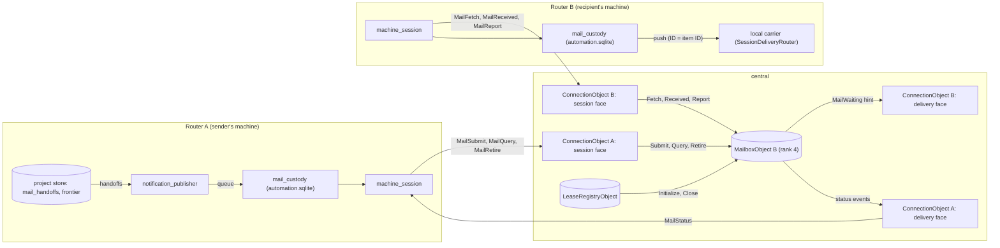

# Program design 4: messages and notifications across machines

**What this is:** how the Router and central realize U63 and U66. That covers:
- spec 3 E30 and MS-1…MS-12;
- spec 2 WA-14;
- spec 1 NI-2 and NI-4 at the handoff;
- the wake rules of MS-10.

It replaces two stand-ins:
- PD1's remote `Deferred` claim and its head-start follow recovery (PD1 `subscription_delivery`, both marked superseded);
- PD2's "as on any holder change" analogy.

The legacy upgrade keeps its own rule (spec 1 §5: delivery progress isn't carried, and a draining subscription arrives ended).


**Revised 2026-10-17 for agent-fleet-sync (U78, U79).** agent-fleet-sync's `fleet-sync-delivery` was generalized from this design (its SO34–SO43). Custody, identity, status order, caps and cancels are now the library's, and the meaning stays the board's (spec 2 §4.1 WA-14; spec 3 §4.2). Components map like this:

| Here | Now | Unchanged board meaning |
|---|---|---|
| `mail_custody` (Router) | the library's `Outbox` and `Inbox`, with the board's `DeliveryConsumer` supplying the body, sender, address and release gate (SO38) | carrier outcomes and the local push stay the board's, with one owning transaction per receipt (C31; PD2 §3a.3) |
| `MailboxObject` (central, rank 4) | the library's per-recipient `Mailbox`, hosted in this same `MailboxObject`, one per recipient installation. It stays separate from each connection object's delivery face (rank 5, a leaf) | the call DAG edges in §8 |
| the connection object's delivery face (status events) | the library's status stream (SO41) | — |
| `project_change_capture` and `_replication_handoff_marks` | `BoardCaptureBookkeeping` and `capture_feed_marks` (PD2 §2, §3a.2) | the acknowledged handoff key and frontier (§4b) |
| `notification_publisher`, `follow_batch_allocator`, admission's `MailHandoff` writes and the frontier | unchanged, as the board's; the release gate is the `DeliveryConsumer`'s | MS-5, MS-5a, MS-11, NI-2, NI-4 |
| the mail frames (`collaboration-mail-protocol`) | the library's delivery frames, with the board's payloads in `BoardConsumerProtocol` (`board-sync-protocol`) | status names map per spec 3 §4.2 (MS-3) |
| §7 wake rules | unchanged (Router-local) | MS-10 |

The trace (§11) keeps its rows; each component name there reads through this table.

```text
requirements U63, U66 ──► specs 1–3 (NI, WA-14, MS) ──► program-design-4-messaging.md (this) ──► plan
```

Evidence:
- the current-system map: unpublished working notes, with source anchors at main 461e787c, M2 9451e939 and M3's working tree;
- the storage comparison: `2026-10-15-messaging-storage-comparison.md`, which sets the Lead's position against the Advisor's independent §13;
- the Durable Object facts: `2026-10-15-durable-object-facts-research.md`, which give 10 GB per object, single-threaded execution and no count limit;
- review 1: unpublished working notes. Its findings F1–F13 are corrected here, apart from F13, which is the owner's.

**Status of the central storage choice (C30):** on 2026-10-16 the owner confirmed the flow (machine outbox → central ledger → recipient machine inbox) and that central removes a message's content once the recipient's inbox has it ("remove after receipt is fine"; no archive). The per-recipient split, option (b), is the **Lead's selected realization** of that ledger; no owner record confirms the partitioning itself (owner-alignment audit U1, 2026-10-17). The owner's outcome is the flow and the release, not the physical split.

## 1. The choices

| Crux | Options | Selected | Why | Reopen if |
|---|---|---|---|---|
| **C30. Where central keeps custody (the ledger)** | (a) one ledger object for the fleet; (b) one mailbox object per recipient installation; (c) the recipient's `ConnectionObject` storage; (d) hash shards by item | **(b)**, the Lead's selected realization of the owner-confirmed flow (2026-10-16) | A mailbox's custody identity matches its route and its reconnect cursor. Each installation gets its own 10 GB and its own event queue, so an offline or flooded recipient backs up alone. Session and lease traffic don't share its writes or migrations. (a) puts the whole fleet's mail into one queue and one blast radius. (c) couples custody to the session, and its delivery leaf can't publish status. (d) solves a scale problem nothing has measured | hosted measurement makes the second hop costly; one mailbox nears its capacity; G31 needs a single global ordered view |
| **C31. The Router's outbox and inbox** (**superseded by owner decision 30:** messages live with approvals in the interaction store, separate from automation. The board revision moves them, `router_pushes` included, and this row's `automation.sqlite` placement no longer governs) | (a) the existing per-installation `automation.sqlite`, behind one messaging owner; (b) a new per-installation store; (c) project stores | **(a)** | An inbox receipt, its cursor, its push and every later carrier outcome commit in the same transactions as the push record, because `router_pushes` lives there. (c) can't hold messages with no project, and a move would carry unrelated mail. The wake-specific `mailbox_deliveries` table isn't reused | messaging must stay up while the automation store is unhealthy, or automation transactions measurably block mail |
| **C32. The frozen handoff** | (a) a replicated project record; (b) Router-local state | **(a)** (MS-5) | A successor must be able to republish it, and only the replicated prefix survives a takeover | — |
| **C33. Status back to the sender** | (a) the custody mailbox owns the status: it commits an owed publication with it, publishes to the sender's delivery leaf, and answers routed queries; (b) the recipient's session writes into the sender's mailbox | **(a)** (from the Advisor) | One owner per status, with durable retry. (b) makes two writes from one request with no atomicity | — |
| **C34. Item identity** | (a) the sender mints a UUIDv7, and the recipient uses it as its local push ID; (b) each hop mints its own | **(a)** (MS-2) | One identity end to end makes retries replays. Today `message_send` mints a new push ID per call, so a lost answer duplicates the message (research §1) | — |
| **C35. Successor continuity** | (a) the successor rescans the replicated handoffs above a replicated settled frontier, re-submits each under its ID, and derives owed follow ranges from memberships, the feed and handoffs; (b) replicate every delivery state change | **(a)** | Central and the recipient deduplicate by item ID and return the recorded outcome. The frontier bounds the scan, and no delivery step writes the project | the handoff scan becomes measurably slow |
| **C36. When dedup evidence may be forgotten** | (a) central never forgets an item's identity: retirement compacts its row, and only the recipient forgets; (b) forget when the origin retires; (c) after a fixed age | **(a)** (reviews F1, R1, S1) | No barrier can prove that every already-issued submission has arrived: a replay dispatched before retirement can arrive after it, from the same epoch. A permanent compact row (ID, digest, final status, version) answers any such replay with its recorded result, as MS-2 requires. At about 100 bytes per item, a mailbox's 10 GB holds tens of millions of them | compacted rows measurably approach a mailbox's capacity: archive them through the operations view |

## 2. Components



| Component | Job | Reason to change | Consumers | Owns |
|---|---|---|---|---|
| `mail_custody` (Router, new; `automation-storage`, repository `mail_custody_records`) | the **one messaging owner** on a machine: outgoing items and their status, incoming items and their **outcome**, the receive, status and report obligations, and the link from an incoming item to its local push | messaging contract | `message_*` operations, `notification_publisher`, `machine_session`, wake admission | `mail_items`, `mail_cursors`, `mail_status_cursor`, `mail_reports_owed`, `mail_retirement_progress` (automation.sqlite). For a mail push, a push state change and its mail row change commit together (§4a step 4) |
| `notification_publisher` (Router, new; replaces `subscription_delivery`'s intent claims and follow pushes) | turns project handoffs into deliveries: local recipients now, remote ones once eligible (MS-5). After a holder change it continues inherited handoffs (MS-11), reconciles non-terminal items with their mailboxes, advances the settled frontier, and retires settled items | delivery rules | holder background tasks | its scan progress (local). The handoffs belong to the project |
| `follow_batch_allocator` (Router, modified `subscription_windows`) | selects a due follow batch and records its handoff through admission, instead of the local-only selected marker | follow policy | `notification_publisher` | windows and hold and retry timing (local). The allocated ranges are the handoffs |
| project admission (modified) | writes `MailHandoff` records in the same transaction as their cause: an intent claim, a batch allocation, a membership end or a generation change. It also writes the frontier (Router actor only) | board rules | the two components above | `mail_handoffs`, `mail_handoff_frontier` (replicated, no feed position, like read marks, RC-5) |
| `project_change_capture` (modified) | records, per captured transaction, the highest handoff key it committed (§4b) | replication format | `notification_publisher` | `_replication_handoff_marks` (holder bookkeeping in the reserved namespace, PD2 §5) |
| `machine_session` (Router, modified) | carries the mail requests and frames | session protocol | — | nothing new; it calls `mail_custody` |
| `MailboxObject` (central, **new kind, rank 4**) | custody for one recipient installation: accept, order, hold, release after the recipient's durable receipt, record reported outcomes, expire `validUntil`, publish status, answer routed queries, keep dedup rows until the origin retires them | mail custody rules | session faces, the registry | `mail_items` (live and compacted), `mail_seq` per stream, `mail_controls`, `mail_status_owed`, `mail_state` |
| `ConnectionObject` session face (modified) | the mail `SessionRequest`s, each a 1-hop call to a mailbox. On `MailStatusFetch` and `MailStatusAck` it reads or deletes its own stored status events, as a local transition with no self-call | session protocol | Routers | — |
| `ConnectionObject` delivery face (modified, still a leaf) | `MailWaiting` writes a hint to the socket. `MailStatus` stores events under a cursor and writes them to the socket. It makes no calls | session protocol | `MailboxObject` | `_mail_status_events(cursor, event)`, capped |
| `LeaseRegistryObject` (modified) | enrollment initializes the installation's mailbox; revocation closes it | lease rules | admin, sessions | — |

**Dependency direction** (added to PD3 §10):
- session → mailbox;
- registry → mailbox;
- mailbox → delivery.

The mailbox calls nothing else: not registry, copy, fleet or another mailbox. Fleet and mailbox share rank 4 with no edge between them. Every new edge goes up in rank, so `MayCall<To>` and the const assertion accept it, while mailbox → registry and mailbox → mailbox don't compile.

## 3. Bindings and shapes

The repository's conventions apply: serde-tagged `camelCase`, closed enums, validated newtypes, private row structs, and decoding that fails closed.

**Crate direction (M2c finding).** `collaboration-protocol` (the Router's RPC facade) depends on `collaboration-mail-protocol`, which depends only on `message-board`. The mail crate never depends on `collaboration-protocol` or `agent-automation`, so central can use it on wasm32.
- **Board types:** it uses the board's `SessionRef`, `Identity`, `ProjectId`, `ThreadId`, `FeedCursor` and `RecordRef`.
- **The mail crate owns its own wire vocabulary** (review R23-1). Where a Router type means the same thing, the facade converts at its boundary, the way it already converts its `SessionRef` to the board's (`codex-router-host`). Each conversion is total in both directions and fails closed, and a test proves the two JSON forms identical. Nothing moves out of the facade, and the mail crate defines no general identity type.
  - `MailDeliveryMode::{Auto, Queue, Steer}` corresponds to the facade's `MessageDelivery`, with the same tags and the same `Auto` default at the RPC field.
  - `GenerationGuard{service_epoch, generation}` corresponds to `CodexGeneration`: the same canonical lowercase UUID, the same positive JSON-safe integer bound, and `deny_unknown_fields`.
- **Wake types stay Router-local in M2c.** The local `WakeRefusal`, `WakeupId` and `WakeCreator` (§7) live in the facade and the automation side. A remote wake's refusal is mail-owned and converted the same way, settled with M4 together with the `Wake` variant (§12).

| Entity | Semantic owner | Home | Shape at its boundaries | Kind |
|---|---|---|---|---|
| E30 message item | the sender, for identity and content; then each hop for custody | new `collaboration-mail-protocol` (native and wasm32), shared by the Router and central | `MailItem { id: MailItemId, sender: MailSender, recipient: SessionRef, valid_until: Option<DateTime<Utc>>, body: MailBody, digest: MailDigest }`. `MailItemId` is a UUIDv7 newtype. `MailDigest` is SHA-256 over the canonical JSON of every other field, so every delivery input below is under it | persisted at each hop |
| item kind and body | E30 | same crate | `MailBody::{Message(MessageBody), Notification(NotificationBody), Cancel(CancelBody), Wake(WakeBody)}`; the variant is the E30 kind (`MailKind` derives from it) | persisted |
| message body (MS-8) | sender | same crate | `MessageBody { text: MessageText, delivery: MailDeliveryMode, guard: Option<GenerationGuard> }`, carrying today's delivery mode and generation guard in the mail crate's own types (crate direction, above). `MessageText` is 1 to 65,536 bytes | persisted |
| notification body (MS-6, MS-8) | the project, frozen at handoff | same crate | `NotificationBody { excerpt: Excerpt, pointer: RecordPointer, source: NotificationSource }` with `NotificationSource::{Intent{intent: NotifyIntentId}, FollowBatch{membership: MembershipId, activated_at: FeedCursor, generation, roots: Vec<RootRange>, policy: FollowDeliveryPolicy}}`. `FollowDeliveryPolicy` is today's typed subscription policy (deliver or poll mode, idle behavior), so the recipient applies it without the project. `RootRange { root: ThreadId, from: FeedCursor, through: FeedCursor }`. `RecordPointer { project, subject: RecordRef, position: FeedCursor }`. `Excerpt` is at most 280 characters | persisted |
| cancel body (MS-9) | the project | same crate | `CancelBody { target: CancelTarget, cause: CancelCause }`. Automatic board controls use `BoardDerived`; the stored `BySender` and `ByRequester{by: Identity}` variants remain decodable for existing rows. Public requested-cancel intake is retired. | persisted |
| wake body (MS-10) | the requester | same crate | `WakeBody { request: RemoteWakeRequest, requested_by: Identity }`. `RemoteWakeRequest` is owned by this crate, and the Router maps its `WakeSendRequest` into it, so the crate direction stays one-way. **Its fields are settled with M4's remote wake, together with the `Wake` variant.** M2c's crate has no `Wake` variant yet; adding a variant to an unreleased tagged enum changes no other variant's digest | persisted |
| sender | E30 | same crate | `MailSender::{Session(SessionRef), HumanUser{installation: InstallationId}, Project{project: ProjectId}}`.<br>• **`Session`:** a mailbox accepts it only when its ref's service ID is the submitting installation, meaning the verified peer's enrolled `service_id` (one-core §0a `machine_enrollments`). It's never compared with the `PeerId`'s bytes, so a Router whose service ID is v4 still matches. A recipient `SessionRef`'s home resolves to its enrolled `PeerId` for mailbox routing. This sender check is mail-specific and stays; board actors are declared and aren't bound this way.<br>• **`HumanUser`** (M2c finding): today's human-origin direct message, `MessageContent::HumanUser`, which the Router delivers with `PushOrigin::OwnerUnverified`. It names the installation where a person typed it. A mailbox accepts it only when that installation is the submitting one, the same check as `Session`. The recipient delivers it as unverified human-user input, as the local path does today. It sends messages. Public message cancellation is retired; stored sender attribution remains readable. A notification's sender is always `Project`.<br>• **`Project`:** declared by an enrolled installation, the same trust as a declared actor (spec 1 §6) | persisted |
| status (MS-3) | the custody owner (§5); a sender's view is a projection | same crate | `MailStatus::{Queued, Sent{seq: MailSeq}, AtMachine, Held, Delivered{acceptance: CarrierAcceptance}, Uncertain, Expired, Cancelled, Refused{reason: MailRefusal}}` with `MailRefusal::{MailboxFull, ItemConflict{existing: MailDigest}, RecipientUnknown, RecipientRevoked, RecipientUnsupported, DroppedByPolicy, CancelSenderMismatch{target: MailItemId}}`, plus a remote wake's refusal, added with M4's `Wake` variant (§12). A cancel item also carries `CancelResult::{Pending, Prevented, TooLate{at: TooLateAt::{Delivered, Uncertain}}}`; the original becomes `Cancelled` only on `Prevented` | persisted |
| status order | the mailbox, for the canonical status; the recipient, for its reports | same crate | Two counters, never compared with each other (review R2): `StatusVersion` from the mailbox and `ReportSeq` from the recipient, detailed below the table | persisted |
| NI-4 handoff | project admission, under the project lock | project store (replicated) | `MailHandoff { seq: HandoffSeq, item: MailItem }`, where `item` is the complete frozen item, its recipient included, and the intent's `HandedOff` state names `item.id`. `HandoffSeq` is an ordering column of `mail_handoffs`, not its key: the key is the item's UUIDv7 (decision 51). The sequence is allocated as the store's highest sequence plus one under the project lock, unique and never reused, so sequence order is commit order | persisted, project |
| settled frontier | project admission (Router actor only) | project store (replicated, no feed position) | `MailHandoffFrontier { settled_through: HandoffSeq }`, monotonic. Every handoff at or below it is terminal **and its consequences have settled**: a generation-prevented batch's ranges are covered by terminal, non-prevented handoffs, or are no longer owed because the membership ended by cancel, expiry or off. A membership ended by resolve still owes its drain, so its ranges must be covered (§4c, review T2) | persisted, project |
| handoff marks | `project_change_capture` | holder bookkeeping (`_replication_*`, not replicated, not in the fingerprint) | `_replication_handoff_marks(epoch, commit_id, max_handoff_seq: Option, frontier: Option<HandoffSeq>)`, one row per captured transaction that inserted handoffs or wrote the frontier. The **acknowledged handoff key** and the **acknowledged frontier** are the highest values among marks at or below the acknowledged position | local |
| WA-14 outbox and inbox | `mail_custody` | automation.sqlite | private rows `MailItemRow { item_json, direction: Direction::{Outgoing, Incoming, Local}, status_json, status_version, submit_attempted_at: Option, recipient_seq: Option<MailSeq>, hold: Option<HoldReason>, created_at }`. Also: `mail_cursors{stream, received_through: MailSeq, receipt_acknowledged_through: MailSeq}` (one row per stream) and `mail_status_cursor{through: StatusCursor}`; `mail_reports_owed(item, outcome_json, report_seq)`; `mail_retirement_progress(project, retired_through: HandoffSeq)` | persisted, installation |
| central custody | `MailboxObject` | its own SQLite | `mail_items(item_id, stream, seq, digest, item_json?, status_json, version, last_report_seq, origin: MailOrigin, status_target: StatusTarget, accepted_at, fetched: bool, released_at?)`. `item_json` is cleared once the recipient confirms its receipt, and `fetched` records that a Fetch has returned the item. Also `mail_controls(seq, entry_json)` for `Retired` entries until they're acknowledged. A retired item's row is compacted to its ID, digest, final status and version, and kept. `MailOrigin::{Session(InstallationId), Project{project, epoch}}`; `StatusTarget { installation, epoch: Option<EpochNumber> }`. Plus `mail_seq`, `mail_status_owed(item, target, version)`, and `mail_state{initialized, closed: Option<CloseReason>, payload_bytes, items, settlement_reserved}` | persisted, central |
| wire (session) | `collaboration-replication-protocol` (modified) | — | `SessionRequest::{MailSubmit{item: MailPayload, origin_epoch: Option<Epoch>}, MailFetch{stream: MailStream, after: MailSeq, limit}, MailReceived{stream: MailStream, through: MailSeq}, MailReport{reports: MailPayload}, MailQuery{mailbox: InstallationId, items: Vec<MailItemRef>}, MailRetire{mailbox: InstallationId, origin: MailOriginRef, items: Vec<MailItemRef>}, MailStatusFetch{after: StatusCursor}, MailStatusAck{through: StatusCursor}}`, with `MailStream::{Items, Controls}` and `MailOriginRef::{Session(InstallationId), Project{project: ProjectId, epoch: Epoch}}`. `CentralFrame::{MailWaiting{stream, through: MailSeq}, MailStatus{events: MailPayload, through: StatusCursor}}`, and Fetch answers carry each entry's `seq` with a `MailPayload`.<br>• **The protocol stays board-free (PD3 C22, review R24-1).** It owns only routing and correlation: `InstallationId`, `ProjectId`, `Epoch`, `MailStream`, `MailSeq`, `StatusCursor`, `MailItemRef` (its own UUIDv7 item reference) and `MailOriginRef`. It never depends on the mail crate.<br>• **Mail content is a `MailPayload`:** items, reports and status events. It's an owner-typed JSON envelope, like `FleetPayload` and `BoardPayload` (PD2 E26), whose schema `collaboration-mail-protocol` owns. The protocol checks its size and never interprets it.<br>• **The mail crate classifies each payload into its closed type** at two edges: the Router's session edge, and central's session face before the mailbox call, which uses the typed values below. Both happen before any custody mutation. `collaboration-central-core` already depends on `message-board`, so it can depend on the mail crate. A payload that doesn't decode, or whose kind and body don't match, is answered `invalidShape` and changes nothing (PD3).<br>• `MailItemRef` and `MailItemId`, and `MailOriginRef` and `MailOrigin`, convert at the same edges and fail closed.<br>• **Answers (review R24-1 residual).** Each mail request gets exactly one answer under its `frame_id` (FL-12), as a closed set of `SessionAnswer` variants, one per request:<br>&nbsp;&nbsp;– `MailSubmitted(MailPayload)`, carrying a `SubmitResult`;<br>&nbsp;&nbsp;– `MailFetched{stream, entries: Vec<(MailSeq, MailPayload)>, through: MailSeq}`;<br>&nbsp;&nbsp;– `MailReceivedAck{stream, released_through: MailSeq}`;<br>&nbsp;&nbsp;– `MailReported(MailPayload)`, carrying a `ReportResult`;<br>&nbsp;&nbsp;– `MailQueried(MailPayload)`, carrying a `QueryResult`;<br>&nbsp;&nbsp;– `MailRetired{retired: Vec<MailItemRef>, unknown: Vec<MailItemRef>}`;<br>&nbsp;&nbsp;– `MailStatusFetched{events: MailPayload, through: StatusCursor}`;<br>&nbsp;&nbsp;– `MailStatusAcked{through: StatusCursor}`.<br>&nbsp;&nbsp;The fields are protocol-owned except the payloads. `SubmitResult`, `ReportResult` and `QueryResult` (next row) are mail-crate types, which central-core's `MailboxResult` uses directly, so their statuses, versions and report acknowledgements cross the session intact.<br>&nbsp;&nbsp;The Router's mail edge checks that the answer variant matches its request's operation, then classifies the payload into the expected result before it changes custody, advances a cursor or retires owed work. A mismatched or undecodable answer changes nothing and leaves the outcome unknown, so the request is retried under the same item ID, and a replay answers from the recorded row (C36).<br>&nbsp;&nbsp;Sequence numbers inside a payload are the mail crate's own `MailSeq`, converted at the edge like the item references.<br>• The mail-owned value types carried inside payloads are `RecipientReport { item, outcome: RecipientOutcome, report_seq: ReportSeq }`, with `RecipientOutcome::{Held, Delivered{acceptance}, Uncertain, Expired, Prevented{cancel: MailItemId}, TooLate{cancel, at}, Dropped, Refused{reason}}`, and `MailStatusEvent` | wire |
| mailbox calls | `collaboration-central-core` | — | `MailboxCall::{Initialize, Close{reason}, Submit{item, origin: MailOrigin}, Fetch{stream, after, limit}, Received{stream, through}, Report{reports}, Query{items}, Retire{items, by: MailOrigin}}`. Results: `SubmitResult::{Accepted{seq, version}, Replayed{status, version}, Refused(MailRefusal)}`, `ReportResult` and `QueryResult` are defined in `collaboration-mail-protocol`, because they travel in answer payloads (wire row above); the other results are central-core's (`FetchResult{entries: Vec<FetchEntry>, through}` with `FetchEntry::{Item{seq, item}, Retired{seq, items: Vec<MailItemId>}}` (cancel items are `Item` entries on the `Controls` stream), `ReceivedResult{released_through}`, `ReportResult{acknowledged: Vec<(MailItemId, ReportSeq)>}`, `QueryResult{statuses: Vec<(MailItemId, Option<(MailStatus, StatusVersion)>)>}`, `RetireResult{retired, unknown}`. Effects: `MailboxEffect::{Return(MailboxResult), Dispatch(MailboxDispatch::{Waiting{to, through}, Status{to, events}}), SetAlarm{at}}`. Every call gets exactly one `Return` (PD3 §2a) | — |

**Status order, continued from the table.**
- `StatusVersion(u64)` is assigned **only by the mailbox**, increasing per item. Every carrier of the canonical status (event, Submit answer, Query answer) carries `(status, version)`, and every reader keeps the higher version.
- `ReportSeq(u64)` is assigned by the recipient's `mail_custody`, increasing per item. The mailbox applies a report only if its `ReportSeq` is higher than the last one it applied, and acknowledges `(item, ReportSeq)`.

The canonical status only moves forward, `Queued < Sent < AtMachine < Held < terminal`; `Held` may go to a terminal state, and a terminal state is final. A late `Received` for an item already past `AtMachine` releases its payload and changes no status.

**Installation identity.** A recipient's machine is its `SessionRef` service ID, which is the installation (spec 1 E10), so mailbox `B` is addressed `Mailbox(B)`.

**Caps and settlement room** (MS-7), the Lead's defaults, which the owner may adjust:

| Hop | Cap |
|---|---|
| mailbox | 1 GiB of unreleased payload and 200,000 unretired items |
| outbox | 256 MiB and 50,000 unsettled items |
| inbox | 256 MiB of received, unsettled payload |

- **Admission reserves settlement room.** Each new item reserves a fixed **settlement allowance** of 2 KiB, enough for its status rows, one report and one cancel, and it's admitted only if its payload and that allowance fit. So every admitted item can always be settled, reported and cancelled.
- **Cancels are bounded.** A cancel for an item that already has a cancel in custody returns that cancel's status and admits nothing (MS-9). Cancels are therefore never more numerous than the items they target.
- **A full inbox** stops fetching the `Items` stream only; the payload stays at central, which is still custody. It **always** drains the `Controls` stream (cancels and retirements, which are small and covered by the settlement allowance), so a cancel for a held item still reaches it (review R5).

**Dedup retention (C36, MS-2, MS-7).**
- A recipient's incoming row, and a holder's row for a locally delivered handoff, each stay until the item's **origin retires it**, never by age. Central only compacts its row (below). A `Local` message's row, which central never sees, is compacted, never deleted, once it's terminal:
  - a message's sender retires it once it holds the terminal status;
  - a project's holder retires a handoff item once the frontier covering it is acknowledged.
- **Central never forgets an identity (review S1).** Retirement compacts a mailbox row to `(item_id, digest, final status, version)`. It never deletes it, so any later Submit of that ID, from any epoch or outbox, even one dispatched before retirement, gets `Replayed` with the recorded result and creates no seq. Compacted rows don't count toward the item cap. There's no epoch floor: a known item is always answered from its row.
- **Retirement is a durable control.** `MailRetire{mailbox, origin, items}`: the mailbox checks `origin` against the item's origin, compacts the row, and appends `Retired{seq, items}` to the `Controls` stream. The recipient applies it on fetch, which drops its own rows, and acknowledges it with the cumulative `MailReceived{Controls}`. The mailbox drops the control entry on that acknowledgement.
- **Recovery.** The holder's `mail_retirement_progress` records how far it has retired. After a restart it re-sends retirements between that point and the acknowledged frontier; retiring is idempotent, and an unknown item answers `unknown`. A successor starts at the seeded frontier. A predecessor's unretired items keep their full rows: safe, just uncompacted, and bounded by the retirements in flight at the takeover.
- An outbox never ages an item into `uncertain` and never resets a retry horizon (the 25-day rule is gone): it keeps re-submitting until it gets an answer.
- Payload is released as soon as custody passes on. What's retained is the ID, the digest and the status.

## 4. Flows

### 4a. A message to a session on another machine (MS-1…MS-4, MS-6, MS-8)

1. **Send.** `message_send{item_id?, to, text, delivery, guard?}` takes an optional client-minted `item_id`. The CLI always mints one and prints it before sending.
   - **An omitted ID** (M2c finding): the Router mints the item ID once, at admission, and returns it in the answer. Every later hop reuses it, so outbox retries and central's dedup still see one identity.
     - The only case MS-2 can't cover is a lost answer on the local socket between a caller and its own Router. A retry without the ID is a new item, exactly as today.
     - A caller that needs replay safety supplies its own ID. MCP keeps the field optional, so an agent isn't required to mint a UUIDv7.
   - **A malformed ID** is refused as `invalidShape` before any storage or native effect.
   - **A recipient on this installation:** the local path, as today, except the push ID is the item ID.
     - **First, in the same transaction that prepares the push,** `mail_custody` writes a `Local` mail row (ID, digest, outcome), and later outcomes update it.
     - The lookup comes before any injection: the same ID and content returns the recorded result, and different content returns `itemConflict` (this replaces `PushAlreadyExists`).
     - **Held mail stays outside history pruning** (MS-3, MS-7; M2c finding). A held message keeps its carrier copy, its inventory entry and its link until it's delivered or reaches a terminal outcome. The decision lives on the push record itself, so it survives when its mail row is retired or compacted (review R29-1):
       - **The class.** `router_pushes` gains `retention: PushRetention::{CreationAge, MailTerminalAge}`, written when the push is prepared. A push prepared for a mail item, whether a Local message, an incoming item or a locally delivered handoff, is `MailTerminalAge`; every other push is `CreationAge`.
       - **The clock.** A `MailTerminalAge` push is pruned 30 days after its existing `settled_at`, and never while `settled_at` is empty (pending, held or attempted). `settled_at` is set once, by the outcome transaction of the first terminal outcome: delivered, uncertain (at restart recovery), prevented or cancelled, expired, dropped, or refused. A replay, a late cancel or status, a retirement or a compaction never changes it.
       - A `CreationAge` push keeps R7: it's pruned 30 days after `created_at`.
       - This supersedes C5 R7 ("including held or undelivered ones") for pushes that carry mail only; every other push kind keeps R7.
       - R7 already has an exception of this kind: `mailbox_deliveries` are kept while a wake still references them.
       - Held mail is bounded by the inbox cap (§3) and by `validUntil`.
     - The row outlives push history: once the push is pruned, the mail row is compacted, never deleted. That's the same rule as central's (C36, review T1).
   - **A recipient on another installation:** `mail_custody` writes `Outgoing{Queued}` (refusing `mailboxFull` at the outbox cap), and the answer is `queued{item}`.
2. **Submit.** `machine_session` records `submit_attempted_at`, then sends `MailSubmit`. Central's session face calls `Mailbox(B).Submit`, and the mailbox's single transaction does this:
   - checks `closed`, the caps with the settlement allowance, and `item_id`;
   - same digest: `Replayed{status, version}`; different digest: `itemConflict`;
   - otherwise stores the item at `seq = mail_seq + 1`, with origin and status target, and returns `Accepted{seq, version}`.

   It then dispatches `Waiting{to: B}` to B's delivery face, the second hop, which writes `MailWaiting` to B's socket only if B is connected. The answer makes the outgoing item `sent` (MS-4).
3. **Receive.** On `MailWaiting`, after every `Welcome`, and every 5 minutes while connected, B fetches both streams: `MailFetch{Controls, after}` always, and `MailFetch{Items, after}` while the inbox is under its cap. For each entry in seq order, `mail_custody` runs **one** transaction by kind:
   - **`Message`, or `Notification` with an `Intent` source:** insert `Incoming`, prepare the push (`push_id = item.id`, with the message's own delivery mode and guard, or `Auto` and loaded-only for an intent notification, as today), and advance `received_through`;
   - **`Notification` with a `FollowBatch` source:** insert it and apply its `FollowDeliveryPolicy` the way the existing subscription owner does. Deliver mode prepares a push. Poll mode keeps the batch for the next `board_thread_wait` hand-over, with no push. An idle drop records `Dropped`;
   - **`Cancel`** (on `Controls`): insert it with no push and no wake, and apply it at the injection owner (step 4). If its target hasn't arrived yet, it's kept as a pending cancel and applied when the target arrives;
   - **`Wake`:** insert it and admit the wake request (§7). Its outcome is `Delivered` once the wake is created, or `Refused` with the remote wake refusal (M4, §12);
   - **`Retired`** (on `Controls`): drop those items' incoming rows.

   Then B sends `MailReceived{stream, through}`, cumulative per stream. `receipt_acknowledged_through` advances only on its answer, and any gap is re-sent at every start and reconnect. The mailbox marks those items `AtMachine` (forward only, per §3's status order), clears their payload (MS-3), and owes the status.
4. **Deliver and report: one outcome authority.** The incoming mail row's outcome is authoritative. For a mail push, `router_pushes` is the carrier's working copy. **Every outcome commits with its owed report** (`mail_reports_owed`, with the next `ReportSeq`) in one automation-store transaction.
   - **Store-local effects** commit in that same transaction: a policy drop, a cancel's application, a wake's creation, and the push record's own state.
   - **External effects can't be in a transaction** (review S2): the carrier's I/O, and a poll hand-over to a waiting `board_thread_wait` caller. They keep today's boundary:
     1. attempt evidence commits first;
     2. the external effect happens;
     3. the outcome commits with its report.

     A crash between steps 1 and 3 is an interrupted attempt. The restart rule makes it `Uncertain`, with its report in the same transaction, and never repeats it. A poll hand-over keeps API-2's and G16's meaning: a lost response stays unknown.
   - An attempt without an outcome writes no report: it's evidence, not an outcome. MS-8's checks run before injection: a cancel for this item, `validUntil` passed, or superseded. Their outcomes map to `RecipientOutcome`:
   - not running: `Held`;
   - carrier acceptance: `Delivered`;
   - unknown: `Uncertain`, never re-injected blindly;
   - a cancel: `Prevented` or `TooLate`;
   - expiry: `Expired`;
   - a policy drop: `Dropped`.

   Owed reports go out in batches with `MailReport` and are retired when `ReportResult` acknowledges their `ReportSeq`. They're re-sent at every start and reconnect.
5. **Status.** The mailbox commits each recorded outcome together with a `mail_status_owed` row for its status target, then dispatches `Status{to: target}`.
   - The target's delivery face stores the events under a cursor and writes `MailStatus` to the socket.
   - The sender applies an event only if its version is newer, then sends `MailStatusAck{through}`.
   - The mailbox retires an owed publication by compare-and-retire on `(item, version, target)`, so an older publication's completion never clears a newer one. A failed dispatch stays owed and the alarm retries it with backoff.
   - **Catch-up after a gap:** after `Welcome` the sender sends `MailStatusFetch{after: status_through}`, which returns events stored while it was away.
   - **Canonical reconciliation:** the sender also sends `MailQuery{mailbox, items}` for each non-terminal outgoing item older than 10 minutes, every 10 minutes while connected. So a lost or redirected publication never strands an item. `mailbox` comes from the item's recipient.

### 4b. A board notification (MS-5, MS-5a, NI-2, NI-4)

1. **The cause.** An intent's claim under the project lock (PD1 §7, NI-2 re-resolution included) writes, in one transaction:
   - the intent's `HandedOff{item}`;
   - `MailHandoff{seq, item}`, with the item frozen: recipient, `MailSender::Project`, and `NotificationBody{source: Intent}`.
2. **A local recipient** is delivered at once through the local path, with the push ID being the item ID. The holder's `mail_custody` keeps that item's row until it retires it (§3), so a later re-submission of the same item to this machine is recognized (MS-5a).
3. **A remote recipient becomes eligible** once its handoff is in the acknowledged prefix (review F6):
   - `project_change_capture` writes a `_replication_handoff_marks` row for each captured transaction that inserted handoffs, keyed by that transaction's `ReplicationPosition`;
   - the **acknowledged handoff key** is the highest `max_handoff_seq` among marks at or below the acknowledged position;
   - a part staged as `PartStaged` never advances it: only the final part's acknowledgement acknowledges its transaction's position. An acknowledgement recovered through `Welcome` uses the same mapping, and so does a gap resend;
   - marks belong to the current store and epoch line;
   - after seeding, the baseline is the highest handoff key in the seeded store, because everything seeded came from the copy.

   Keys are allocated in commit order and transactions replicate whole and in order (WA-3a, WA-3b), so `seq ≤ acknowledged key` proves that the handoff and its cause are both in the prefix. `notification_publisher` then queues the outgoing item, `MailSubmit` carries `origin_epoch` (the holder's epoch), and §4a's steps 2–5 follow.
4. **The frontier and retirement.**
   - When every handoff up to `n` is terminal and its consequences are recorded (§4c), the publisher writes `MailHandoffFrontier{settled_through: n}` through admission.
   - Once the acknowledged frontier reaches `n` (the marks, §3), it sends `MailRetire` for those items to their mailboxes, drops its own rows for those it delivered locally, and advances `mail_retirement_progress` (§3).

### 4c. Follow batches and owed obligations (MS-8, MS-9, MS-11)

**Allocation is the handoff.** When a follow window is due, `follow_batch_allocator` asks admission to record `MailHandoff{item}` with `NotificationBody{source: FollowBatch{membership, activated_at, generation, roots, policy}}`. Admission checks, under the lock:
- the membership's activation and generation are current;
- every root range lies within that root's owed set (below) and overlaps no other range in the batch. A replacement batch can carry several disjoint ranges for one root, to fill holes.

Local and remote recipients both get a recorded handoff, so a move never loses an allocation. Quiet windows, coalescing, holds and retries stay local.

**Owed activity is derived from replicated records alone**, for each `(membership, activated_at)`:
- **The activation floor** is `activated_at`. A root first seen after activation starts there.
- **Coverage** of a root is a set of intervals: the union of its handed-off ranges for this activation, in any generation. There's **one exception**: a batch that a **generation-change** cancel prevented doesn't cover its ranges, because a policy change keeps the reader's interest, so that activity is still owed under the new generation. Every other outcome covers its ranges, `Dropped` and `Expired` included: they're terminal policy decisions, as today, where the owner settles a drop and moves past it (review R3). A batch prevented by a membership **end** covers nothing new, since nothing is owed after an end.
  - **Below the frontier**, the union of all ranges is exact, because of the frontier's rule for prevention (review S3). The frontier passes a generation-prevented batch only once its replacement chain has **settled**: every one of its ranges is covered by handoffs that are terminal and not generation-prevented, or its membership ended by cancel, expiry or off, which discards owed work. A membership ended by **resolve** still owes its drain, so the frontier waits for that coverage too (review T2). A replacement that is itself prevented later keeps the frontier behind the original, so the successor sees the whole chain above the frontier and learns every outcome in it.
  - **Above the frontier**, the successor learns each batch's outcome from re-submission (§4f) before it computes coverage.
- **Owed** is the followed activity in a root **not** in its coverage: the set difference, which can include holes. It runs from the activation floor up to the end that applies:
  - an active membership: the feed head;
  - one ended by **resolve**: its end cursor, the drain;
  - one ended by **cancel, expiry or off**: no new allocation, since unselected windows are discarded, as today.
- **A policy-generation change** keeps coverage. Batches of older generations that aren't terminal get the board-derived cancel (§4d); those it prevents leave their ranges owed for a replacement under the new generation. A receipt for an old generation updates only that batch, never the current generation's allocation.
- **Reactivation** is a new `activated_at`, with its own coverage.

**A successor** computes owed activity this way, so it never starts at the feed head, never needs the old holder's local progress, and never allocates a range twice (MS-11).

### 4d. Cancels (MS-9)

The public `message_cancel` and `project_notification_cancel` tools and their CLI commands are retired. Existing cancellation tables and serialized causes remain unchanged. Automatic board controls and SDK outbox withdrawal remain in use.

**Board-derived cancel.** An unsubscribe, a resolve that ends a membership, or a policy change that advances the generation writes, in the same transaction, a `MailHandoff` whose item is `Cancel{target: Membership{membership, activated_at, generation}, cause: BoardDerived}`, for each recipient with non-terminal batches of that generation.
- **Remote recipients** get it only once it's eligible (§4b, step 3).
- **At the recipient**, it matches batches by the `FollowBatch` source fields every received batch carries (§3).
- **A same-machine recipient** may hold those batches before the cancel is eligible: each held batch records `hold: ProvisionalCancel{cancel: MailItemId}`. The hold ends in one of three ways:
  - the cancel becomes eligible: the batches settle `prevented`;
  - a cancel with that ID arrives through the mailbox, from a successor that inherited it: the batches settle `prevented`;
  - this installation is superseded, and the cancel is proven discarded. It learns the takeover's start position, the same cutoff it uses to build its rejected tail (PD2 §6). If the cancel handoff's transaction lies **beyond** that cutoff, it was discarded with the tail, so the hold is released and the batches are delivered. If it lies at or before the cutoff, it survived, and the hold stays until the successor's copy of the cancel arrives.

  A batch's own re-submission is never taken as evidence about its cancel (review R4). A provisional hold never settles anything by itself (MS-9).

### 4e. A wake for a session on another machine (MS-10)

A `Wake` item travels by §4a. The recipient's Router admits its request into its own automation store under §7, since the target's machine is the authority. It reports:
- `Delivered`, with the wake created;
- `Refused` with the remote wake refusal (M4, §12), for example `wakeExists` naming the creator.

The item's `validUntil` is the latest end the limits allow, so a wake that arrives too late is `expired` and never created.

### 4f. After a takeover or a move (MS-5, MS-11)

The successor seeds from the copy (PD2). Then `notification_publisher` reads `mail_handoffs` above `settled_through`, in `seq` order:
- **A recipient on the successor's machine:** delivered locally, unless the successor's `mail_custody` already has an incoming or local row for that item ID.
- **Every other recipient:** re-submitted under the original item ID with `origin_epoch` set to the successor's epoch. The mailbox answers `Replayed{status, version}`, or `Accepted` for an item the old holder never submitted.
  - It moves the status target to the successor only when the submit's epoch is **higher** than the stored target's. A delayed replay from the predecessor's older epoch never takes the status target back (review F4).
  - At the recipient, an item it already received, or one it delivered locally while it was the holder (§4b step 2), is recognized by its retained row. It reports the recorded outcome, so there's no second injection.
- **Owed follow activity** is computed as in §4c, after these outcomes are known.

Handoffs from a rejected tail were never in the copy, so they don't exist here. The surviving cause is resolved again (NI-2).

## 5. States

**Outgoing item (sender's Router):**

```text
queued ──submit answered──► sent ──► atMachine ──► held ─┐
  │  └─(no submit attempt) cancel ──► cancelled           ├─► delivered | uncertain | expired | cancelled | refused
  └─submit refused──► refused{reason}                     │
                     sent | atMachine ────────────────────┘
```

**Mailbox item (central):**

```text
stored(seq) ──Received──► atMachine (payload released) ──Report──► held | terminal ──Retire──► forgotten
stored ──validUntil──► expired      stored ──Close──► refused{recipientRevoked}
```

**Incoming item (recipient's Router):**

```text
received ──injection check──► delivered | uncertain | prevented | expired | dropped | refused
received ──session not running──► held ──► (same checks when it runs)
terminal ──Retired──► forgotten
```

A terminal state is final at every hop. Any status with an older version than the stored one is ignored.

## 6. Failure, recovery and concurrency

| Failure | Detected by | Recovery and owner |
|---|---|---|
| The submit answer is lost | outbox: `submit_attempted_at` and no answer | re-submit until answered; the mailbox replays. No age limit (C36). Owner: `mail_custody` |
| A crash after an inbox commit and before `MailReceived`, or a lost `MailReceived` answer | `receipt_acknowledged_through < received_through` | re-send `MailReceived{through: received_through}` at start and reconnect; the mailbox's release is idempotent per seq. Owner: `mail_custody` |
| A crash after a carrier outcome and before its report | `mail_reports_owed` | written in the same transaction as the outcome, re-sent until acknowledged. Owner: `mail_custody` |
| An interrupted carrier attempt | the existing restart rule | the attempt becomes unknown, then `Uncertain`, with the report written in the same transaction and no re-injection |
| Status publication fails, or the sender is offline | `mail_status_owed` | the alarm retries; the sender catches up with `MailStatusFetch` and reconciles with `MailQuery`. Owner: `MailboxObject` |
| The sender's status-event store is full | the delivery face refuses | the publication stays owed; reconciliation covers it |
| The recipient installation is revoked | registry → `Close` | new submissions get `recipientRevoked`. Only items **no Fetch ever returned** become `refused{recipientRevoked}`: the recipient never had them, so no recipient effect can race the refusal. An item a Fetch returned stays at its last status, even if its `Received` was lost, because central never invents the recipient's outcome (review R5). The mailbox still accepts their reports if the installation is re-enrolled; otherwise they stay truthfully non-terminal |
| A takeover before a handoff replicates | rejected tail | the handoff never reaches a remote recipient. A local one may already have been told (MS-5a). The surviving cause is resolved again |
| A takeover after a handoff replicates | successor scan (§4f) | same item ID re-submitted, outcome replayed, owed follow derived |
| A cancel races its original | mailbox seq order; recipient injection check | the original always arrives first; only the recipient decides |
| Repeated cancels for one item | mailbox | the first cancel's status is returned for any later one |
| A replay of a retired item, from a predecessor's outbox or a same-epoch Submit dispatched before retirement | the compacted mailbox row | `Replayed` with the recorded result; no new seq and no delivery (C36) |
| A crash between the frontier's acknowledgement and `MailRetire` | `mail_retirement_progress` behind the acknowledged frontier | retirements re-sent after restart; idempotent |
| A full inbox with cancels pending | `Controls` drained regardless of the cap | held originals are still prevented |
| Two holders submit the same notification | mailbox, by digest and epoch | same digest: replay, with the higher epoch keeping the status target; different digest: `itemConflict` |

**Concurrency.**
- A mailbox runs one event at a time: seq allocation, caps, dedup and status versions commit together.
- On the Router, every `mail_custody` change is one automation-store transaction, and so is its push change when there is one.
- Handoffs are written under the project lock with their cause, so a role, membership or generation change can't interleave with one (PD1 §7).

## 7. Wake rules (MS-10, U66; Router-local)

- **Creator.** `wakeup_definitions` gains `created_by: WakeCreator::{Session(SessionRef), Owner, Router, Unrecorded}`. It's taken from the request's declared actor, which `wake_send` now carries as `requested_by` in its canonical input, so a replay compares it. `Unrecorded` exists only for wakes created before the release (today's records have no creator; research §5).
- **One wake per target session** (spec 3 MS-10): one unique index on the target session over the wakes that occupy the slot, active and paused (MS-10).
- **`wake_send{…, replace: bool}`:**
  - with a wake in the slot and `replace` false, the answer is `wakeExists{wakeup, creator}`;
  - `replace` true is allowed for that wake's creator, the target session itself, or the owner. Anyone else also gets `wakeExists{wakeup, creator}` (MS-10);
  - an `Unrecorded` creator can be replaced only by the target session or the owner;
  - the old wake ends `Cancelled{Replaced}` and the new one is created, in one transaction, under the create operation's ID, so a replayed replacement returns its first result and replaces nothing twice.
- **Limits** live in one `wake_limits` module (24 h, 7 days, 5 min by default; the owner may adjust):
  - a one-shot `At` or `After` is due at most 24 h ahead;
  - **a one-shot ends at most 24 h after it's due** (U66's lifetime for every wake; M2c findings). Measuring from creation made `--after 24h` due exactly at its end, and expiry wins at the end, so that wake could never fire (V-M2c):
    - a request with no expiry gets that end;
    - an earlier explicit expiry is kept;
    - a later one is refused as `LifetimeTooLong{max}`.
    So a paused one-shot still expires and releases its slot;
  - a repeating wake needs an expiry at most 7 days from creation;
  - **any** repeat, `Interval` or `Cron`, has a minimum gap of 5 minutes. For a `Cron` that's the smallest gap between consecutive occurrences within its lifetime, which is computable, since the lifetime is at most 7 days.

  Refusals: `WakeRefusal::{WakeExists{wakeup, creator}, TooFarAhead{max}, IntervalTooShort{min}, LifetimeTooLong{max}, ExpiryRequired}`.
- **Existing wakes at the release** follow spec 3 MS-10's upgrade rule, which is in the migration that adds the index:
  - each session's newest occupying wake is kept, and the others end `Expired{UpgradeDuplicate}` with an event;
  - a kept wake over the limits gets its expiry capped at the release time plus the limit;
  - a kept repeating wake whose gap is under the minimum ends `Expired{UpgradeLimit}` with an event, because capping its end doesn't make it obey the frequency limit (review R8);
  - existing creators are `Unrecorded`.

  So the index is created over data that satisfies it.
- **Schedules are unchanged.** A timed one-off for a session that already has a wake is a one-shot schedule.

## 8. The call DAG and depth (PD3 §10)

| Rank | Kind | May call |
|---:|---|---|
| 1 | session | registry, copy, fleet, **mailbox**, delivery |
| 2 | registry | copy, fleet, **mailbox**, delivery |
| 4 | **mailbox** (`MailboxObject`) | delivery |

The other rows stay as PD3 §10 has them.

Every mail path is at most 2 object hops:
- submit: `S_A → M_B → D_B`;
- fetch, query, retire and status fetch: 1 hop;
- received and report: `S_B → M_B → D_target`;
- enrollment: edge → registry → mailbox.

The mailbox's alarm publication is a later, separate event. PD3's rule still holds: staging measures every new path on Cloudflare before acceptance (V10).

## 9. Questions and approvals later (MS-12)

New `MailBody` variants will carry them. The transport identity stays separate from the interaction's request ID, which travels inside the body, and the interaction store stays their authority.

Two things today's broker is missing (research §3):
- a durable continuation (it's in memory and cancelled on restart);
- an answer that returns across machines.

Those belong to the interactions design. A mail `delivered` never means answered or approved.

## 10. Proof seams

| Seam | Proves | Where |
|---|---|---|
| `collaboration-mail-protocol` | digest canonicality over every delivery input, closed decoding, refusal of mismatched kind and body | unit |
| `MailboxObject` core | submit, replay and conflict, including a same-epoch replay delayed past retirement and a predecessor's replay of a compacted item; caps with the settlement allowance; one cancel per target; both streams' seq order; `Received` releasing the payload; forward-only status order; `ReportSeq` ordering; `Close` refusing only never-fetched items; `Retired` control entries; compare-and-retire of owed publications and the alarm retry; status target fenced by epoch; `validUntil`; `Close` refusing only centrally held items; `Retire` | native and workerd conformance |
| `mail_custody` | a local message's compact row surviving push pruning, with same-content replay, changed-content `itemConflict` and a new ID as the control; the one-transaction receive by kind; pending cancels that arrive before their originals; `Controls` drained at a full inbox; the receipt gap re-sent after a crash; an outcome and its owed report in one transaction for every kind, with store-local effects in the same transaction and external effects (carrier, poll hand-over) behind attempt evidence; a crash before the send, after the send but before the outcome, and after the outcome, with a disconnected waiter; status versions, `MailStatusFetch` and `MailQuery`; outbox withdrawal before the first submit; `Retired` markers; the inbox cap | integration (real SQLite) |
| handoffs and eligibility | the handoff written with its cause; marks only on final parts; recovery through `Welcome` and gaps; the seeded baseline; no remote submit before both commits are acknowledged; frontier and retirement | integration (real project store, real capture, central at the session seam) |
| owed follow derivation | §4c's cases: no prior handoff, a root first seen after activation, a resolve drain, cancel/expiry/off, a policy change with old batches delivered, held or prevented, a prevented batch next to a delivered one (only the hole replaced), two successive generation cancels of the same range with the frontier between the original and its first replacement, and a crash before and after the second replacement; a generation-prevented batch whose thread then resolves before the replacement (the drain still owed, unlike cancel, expiry and off), repeated idle drops and expiries creating nothing new, reactivation, an old-generation receipt; a local hold whose cancel was discarded and one whose cancel survived, with the successor paused between the batch's replay and the cancel's | integration |
| wakes | the slot (active and paused), replace authority (creator, target, owner, other, `Unrecorded`), every limit including a one-minute `Cron`, a replayed replacement, the upgrade rule over duplicates | integration |
| call-edge DAG | mailbox → registry, mailbox → mailbox, and delivery → mailbox are absent: checked in type review, and a forged caller is refused on the real wire (replaces the earlier compile-fail doc tests, per U74 and spec 3's U68 coverage) | review + wire refusal test |
| real path | V10 on staging with two installations, every bullet observed by its recipient, and the hosted depth of every mail path measured | staging |

## 11. Trace

| U | Spec | E | Owner | Surface | Shape | State | Refusal | Proof |
|---|---|---|---|---|---|---|---|---|
| U63 | MS-1, WA-14 | E30 | `mail_custody`, `MailboxObject` | `message_send`, session frames | `MailItem`, `MailStatus` | §5 | `mailboxFull`, `recipientUnknown` | V10 |
| U63 | MS-2 | E30 | every hop | — | `MailItemId`, `MailDigest`, retirement by origin | — | `itemConflict` | V10 |
| U63 | MS-3, MS-7 | E30 | the custody holder | — | caps, settlement allowance, retention | §5 | `mailboxFull` | V10 |
| U63 | MS-4 | E30 | `mail_custody` | `queued{item}` | `SubmitResult` | queued → sent | — | V10 |
| U63 | MS-5, MS-5a, NI-2, NI-4 | E18, E30 | project admission, `project_change_capture`, `notification_publisher` | intent claim | `MailHandoff`, handoff marks | emitted → handedOff | — | V5, V10 |
| U63 | MS-6 | E30 | sender | — | `Excerpt`, `RecordPointer` | — | unavailable | V10 |
| U63 | MS-8 | E30 | the recipient's `mail_custody` | receive by kind, injection check | `MessageBody`, `NotificationSource`, `RecipientOutcome` | — | — | V10 |
| U63 | MS-9 | E30 | the recipient's injection check; automatic membership and generation controls | `Cancel` items | `CancelBody`, `CancelResult`, provisional hold | §5 | cancellation outcome | V10 |
| U66 | MS-10 | — | wake admission | `wake_send{replace}` | `WakeCreator`, `WakeRefusal` | — | `wakeExists` | V10 |
| U63 | MS-11 | E30 | `notification_publisher` | — | `NotificationSource::FollowBatch`, `MailHandoffFrontier`, §4c derivation | — | — | V10 |
| U63 | MS-12 | — | — | — | `MailBody` open to additions | — | — | — |

## 12. Open

- **C30, the central storage choice:** (b), the Lead's selected realization of the owner-confirmed flow (2026-10-16; partitioning not owner-confirmed, audit U1). Content is removed once the recipient's receipt is confirmed, with no archive (owner, 2026-10-16), which is §3's payload release.
- **The MS-5a exception's scope:** pending owner confirmation (spec 1 NI-2).
- **G30, human recipients:** a human has no machine, so humans keep today's inbox and owner view, and a remote human recipient is `recipientUnsupported` until G30 is settled.
- **G31:** remote leads' cancels, the management view, sign-off and wake analytics.
- **Remote wake types:** `RemoteWakeRequest`'s fields, and a remote wake's mail-owned refusal (creator and wake reference), are settled with M4's remote wake (§3 wake body). Both are converted from the Router's local types at the boundary, in the same one-way direction.
