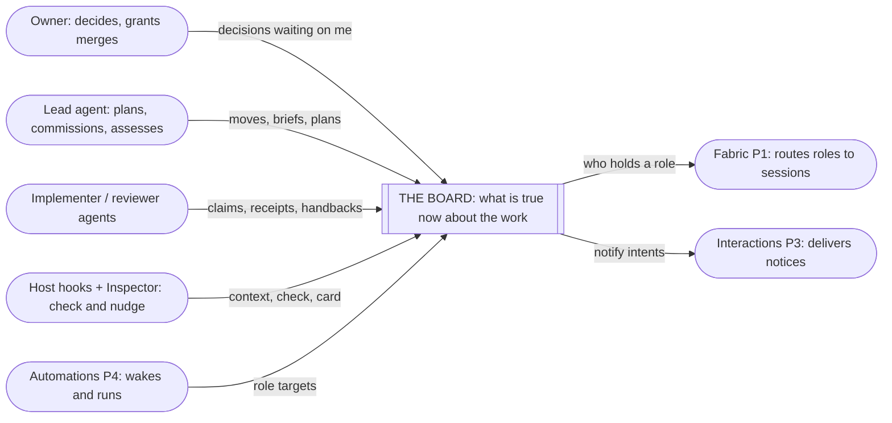

# Board requirements

**What this is:** the requirements (why, for whom, within what boundary) for the board changes in lane P2. It gathers settled owner meaning from several sources into one place and adds none of its own. The observable contract is in [spec 1](spec-1-board-and-contracts.md), [spec 2](spec-2-project-storage.md) and [spec 3](spec-3-central-fleet.md). How Router realizes it is in the matching program designs 1–3.

**Sources, each cited by row:**
- **S1** distributed agent collaboration (unpublished source) §2 R1–R14 and §4 ADRs (owner, 2026-10-04; merged to main as 21a9b029).
- **S2** The structure decision, a board post on the board-design thread (owner, 2026-10-02, relayed verbatim in substance). [entity-model.md](entity-model.md) holds the detail; the exact post is cited in the unpublished working notes.
- **S3** The co-design goal (owner, 2026-09-30), recorded in the owner's private work trail for the orchestration inspector (co-design §0).
- **S4** Owner answers on 2026-10-04: Q2 = A (Router owns shapes); Q6 (several replay cases); "the board that's fabric compatible" as this lane's scope.
- **S5** Owner decisions on replication and leases, 2026-10-08 and 2026-10-09, made in the board-design Lead's session after the Turso Sync push proved non-atomic and its server dev/test only. They're quoted per row and relayed on the board-design thread.
- **E** Observed evidence: the 2026-09-28 board dump (audit L4) and the process audit, Parts 1–2, kept in the unpublished working notes. This is evidence of the problem; it authorizes nothing.

**Authority states:** `authorized` means traceable to an owner statement. Rows citing S1–S4 carry the owner's authority through that source, which holds the owner's words. Rows from 2026-10-04 onward quote the owner directly. A row that a later row supersedes or relaxes says so in its authority cell, and the later row governs. `derived` means the Lead reasoned it from authorized rows; it's listed for the owner to confirm or correct. `open` means owner meaning is still missing.

## Who this is for

| Class | Job | Pain today (E) |
|---|---|---|
| Owner | spend attention on design; decide, grant merges | acts as the phase controller by hand; decisions arrive as agent relays (102 relayed "OWNER DECISION" posts; no new human posts since 09-28) |
| Lead agent | plan, commission, assess, recover after compaction | state lives in its context, and compaction rewrites it; it learns of rejected claims only from prose |
| Implementer, reviewer | know their assignment and what they may change | seats don't match roles (143 open `participant` seats mean anything from observer to worker) |
| Hooks, Inspector | check an action against recorded state | there's no recorded state to check against; every reader replays the log |
| Fabric, interactions, automations (other lanes) | consume board contracts across machines | the board is one store with one Router-wide counter and no complete change feed |

## Requirements

| U | Need and why it matters | Source | Authority |
|---|---|---|---|
| U1 | The environment proves the work, so the owner's attention goes to design rather than to phase control and relaying | S3 | authorized |
| U2 | Any agent or the owner can learn what is true now about a piece of work without replaying the log or trusting an agent's memory | S3; E | authorized (the lane's goal, assigned 09-30) |
| U3 | Keep the existing structure and rename two levels: workspace (was project) › board with `kind: initiative \| area` › project (was topic); threads are conversation only | S2 §1 | authorized |
| U4 | Milestones, tasks (with one level of subtasks) and ADRs are entities. Decisions are ADRs on a board or a project. Logs live in their own store, linked rather than placed. Views come from status and tags and are never stored | S2 §2 | authorized in part. **Superseded:** "Decisions are ADRs on a board or a project" by U41; "logs" by U42 (the work trail); milestones by U40. Still holds: tasks are entities; views come from status and tags and are never stored |
| U5 | A task's status changes only through a recorded move; `dependsOn` forms a DAG and cycles are rejected; a task carries a typed PR link and `links[]` | S2 §3 | **Relaxed by U40 and U43:** tasks carry only `blockedBy` (cycles rejected) and `relatedTo`. No typed PR link, no `links[]`, no move rules for now |
| U6 | A milestone is a thin delivery checkpoint (name, doneWhen, open → in_review → approved → merged, links to the verdict and the merge grant). Its order and PR stack are derived from the task DAG | S2 §4 | **superseded by U40** (milestones dropped for now) |
| U7 | Authority sits on entities: the Lead on the project, the implementer on the task, the reviewer on the milestone. Thread participants are only who's talking | [entity-model.md](entity-model.md) ground rule 4 (owner-settled 2026-10-02) | authorized in part. **Superseded by U40:** the implementer and verifier sit on the workstream, not on the task or milestone. Still holds: the Lead on the project, and thread participants are only who's talking |
| U8 | Router owns the record shapes, in Rust; skills and repos supply content validated against them | S1 R9; S4 Q2 | authorized |
| U9 | The board is fabric-compatible: it works on one machine today and splits across the fabric without a rewrite | S1 R12; S4 | authorized |
| U10 | Every identity Router mints is a UUIDv7; dedup uses business keys, never another UUID version | S1 R13 | authorized |
| U11 | Decisions are server-first; facts are local-first and shipped as appends; local-only state never leaves its machine | S1 ADR-1 | authorized |
| U12 | ADRs are immutable: a new ADR supersedes, and nothing edits one | S1 R4; S2 | authorized |
| U13 | Work items can be spikes or builds | S1 R11 | **Relaxed by U44:** tasks carry no `kind` for now |
| U14 | The board hands notices to interactions and never delivers itself; automations act through interactions | S1 R7, ADR-5 | derived (from R7 and ADR-5) |
| U16 | A project's Lead and helpers run on one machine | S1 R3 | authorized |
| U17 | The renames reach the API and CLI too, cut over in one release: `workspace`, `board`, `project`, `thread` | owner, 2026-10-04 (Q4: "yes to renames") | authorized |
| U18 | A subtask is its own record | owner, 2026-10-04 (Q5b) | **Relaxed by U40 and U43:** a subtask is an ordered checklist item inside one task, with no relationships |
| U19 | A project that doesn't need delivery checkpoints uses a default milestone instead of having none | owner, 2026-10-04 (Q5c: "we could just have a default milestone no?") | **superseded by U40** (no default milestone; no default workstream) |
| U20 | Fleet-level entities (workspace, board, registry, leases) are written only on the central fleet server | owner, 2026-10-05 ("some truly fleet level entities only written to against a central fleet server") | authorized |
| U21 | Each project's store has exactly one writer at a time, the machine holding its lease. The store is replicated to read copies elsewhere, and ownership switches by moving the lease. Machines never write the same store concurrently | owner, 2026-10-05 ("machine level servers that are replicated, which are gonna be switched"; "not multiple people and machines write in the same sqlite") | authorized; settles D1 as single-writer leased projects |
| U22 | Use Turso (R14). Don't use libSQL or `sqld` | owner, 2026-10-05 ("i asked for turso"; "i dont want to use sqld"; "i told you not to use libsql either") | authorized |
| U23 | A project is one unit: its Lead, helpers, folders and data, on ONE machine at a time. A machine can host several projects. No project is worked on from two machines; other machines may only read it. Its lease covers the whole unit | owner, 2026-10-06 (confirmed restatement) | authorized |
| U24 | The central server holds the project metadata needed to find, search and know what projects exist. It may also read any replicated project, read-only, for more detail | owner, 2026-10-06 | authorized; the fields are settled by U46 |
| U25 | One database per project. *(The second half, "many project databases share one hub", is superseded by U32–U33: there is no Turso hub.)* | owner, 2026-10-06 ("I like many databases per hub"); superseded in part by S5, 2026-10-08 | authorized (first half) |
| U26 | Stack rule. **The `codex-router-proxy` crate uses hyper and tungstenite directly, and that stays.** Its manifest: `hyper`, `hyper-util`, `hyper-rustls`, `hyper-tungstenite`, `tokio-tungstenite`, `http-body-util` (`crates/codex-router-proxy/Cargo.toml:22–35`). That crate is the only place direct hyper is allowed. The harness connections (U29) keep their existing direct `tokio-tungstenite` use. Every other server and client uses higher-level libraries: axum for servers, reqwest for HTTP clients, rmcp (mounted on axum) for MCP | owner, 2026-10-06/07 ("direct hyper or tungstenite use is for the proxy") | authorized |
| U27 | The CLI (`agent-collaboration`) and the Host are installed together, so a wire-format change ships as one cutover with no special old-client refusal path | owner, 2026-10-07 ("we install both at the same time, not a problem") | authorized; relaxes review fix F04 |
| U28 | One **stateless MCP server** (rmcp on axum) is the collaboration API. Models reach it over localhost TCP (`/mcp`), and the CLIs (`agent-collaboration`, `agent-sessions`) reach the same server over the private Unix socket as MCP clients. It replaces the hand-written Control server and frame format and the MCP-to-Control socket hop; the MCP server calls the application service directly | owner, 2026-10-07 ("yes this sounds good"); operator socket removed from scope by U31 | authorized |
| U31 | **The Host's operator socket stays separate and unchanged.** Host lifecycle controls (status, Host restart, app-server and Router restarts, Codex update) are not part of the collaboration API. A newly installed CLI uses that socket to make the still-running older Host replace itself. Separate Host work owns these controls; a note in `codex-router-host/src/operator_messages.rs` says so | owner, 2026-10-07 (decision O1: "lets do a … not host restart / status controls. there's another worktree on this. leave a note in code") | authorized |
| U29 | **Out of scope, unchanged:** the model API proxy (`codex-router-proxy`: Codex/Claude traffic to providers, OAuth/quota routing, direct hyper/tungstenite), and every harness connection (Codex app-server and native control, the ACP stdio providers for Claude and Cursor, Claude Code peer messaging). U28 changes only the collaboration surface | owner, 2026-10-07 ("this doesn't impact any proxy to an actual model and their harness, yes? I want this to be extremely clear") | authorized |
| U30 | Every new HTTP surface uses **axum** (servers) and **reqwest** (clients). Direct hyper/tungstenite stays only in the model proxy (U26, U29) | owner, 2026-10-07 | authorized |
| U32 | **Central runs on Cloudflare.** Project read copies and fleet records live in Cloudflare Durable Objects with SQLite storage, and the central code is Rust on workers-rs. U22 still holds: Turso on the machines, never libSQL or `sqld` | S5, 2026-10-08 ("we can use durable objects thats where d1 and databases live anyways"; answers: Cloudflare for central data, "Rust workers-rs" for the central language) | authorized |
| U33 | **Replication is Turso CDC, per project.** Each project's own database captures its changes, and they replicate from there. One database per project means no cross-project ordering (no Lamport clocks) | S5, 2026-10-08 ("we can use one db per project and not require lamport clocks, and we can use cdc for actual replication then since its per database") | authorized |
| U34 | **A Durable Object is each machine's connection**, and it calls the other Durable Objects, to keep cost down | S5, 2026-10-08 ("to conserve cost we can have a durable object as the connection and call other durable objects") | authorized |
| U35 | **Durable Object hibernation is designed for.** An object can lose its memory between events, so nothing correct may depend on it | S5, 2026-10-08 ("make sure design take into account durable object hybernation") | authorized |
| U36 | **A logical session is separate from the physical WebSocket.** A connection can drop (including on a Cloudflare deploy) and the session resumes where it left off | S5, 2026-10-08 (the owner's direction: "separating the logical session from the physical WebSocket connection") | authorized |
| U37 | **A lease structure, separate from project data, fences writers** (the Advisor's option B): a registry decides who holds each project, and each project's central copy refuses writes from a superseded holder | S5, 2026-10-08 ("there needs to be a lease structure"; "b makes more sense to me") | authorized |
| U38 | **Leases last 4 hours and are renewed every 15 minutes.** After expiry, with no change of holder, new writes to that project are refused and its wakes and schedules pause. Reads keep working, and everything resumes on its own once the lease renews. There is no draft state | S5, 2026-10-09 ("can we not make it b with 4 hour leases? … we should be refreshing the lease every 15min"). The Lead proposed refusing writes instead of keeping drafts; the owner rejected only the other proposal, the automatic release and takeover. Rationale from the owner: agents can't work without internet, and a 4-hour Cloudflare outage is unlikely | authorized |
| U39 | **Every change of a project's holder is an explicit request, by an admin or the owner, through a separate admin endpoint with its own credentials or authorization.** Nothing changes the holder automatically: no release on shutdown, no automatic takeover. Machine and agent credentials can't move or take over a project | S5, 2026-10-09 ("make it explicit request with admin takeover (or owner thats me)"; "a separate specific endpoint, separate creds etc or authorization or something like that") | authorized; that "admin" is an identity the owner grants, by default only the owner, is derived |
| U40 | **Workstreams, not milestones.** A project's work is grouped into workstreams: ordered lanes of related work, each carried by an implementer + verifier pair. **There is no default workstream: each one is defined explicitly.** Milestones are dropped for now and may return later as plain checkpoints. **Tasks and subtasks stay lightweight for now:** no fixed task = PR rule and no required gate fields; they're specified when we use them. This supersedes U6 and U19's default milestone, and relaxes U5 and U18 until then | owner, 2026-10-11 ("milestones not a good fit here, it's more project management not for agent management, can be added later"; "I don't want task and subtasks to be pedantic yet"; "no default workstream, it needs to be defined") | authorized; spec 1's entity model (E4–E6) is to be reworked to match |
| U41 | **Decisions by level.** A workspace holds ADRs, the durable architecture decisions. A project holds a decision register. There are no project ADRs and no board ADRs. This supersedes U4's "decisions are ADRs on a board or a project" | owner, 2026-10-11 ("workspace is ADR, project is decision-register"; "I want projects to only have decision-register") | authorized |
| U42 | **The work trail ("show me your work") is part of the board, separate from the message board.** It's an append-only trail per project, with one row shape: when, the workstream or task, the decision or action, why, an evidence pointer, and a result. A row can be marked as a decision, and then it appears in the project's decision register, so each decision has one home. The command is `work-trail` (MCP: `work_trail_*`), and a row attaches to the session's current assignment. Threads stay conversation only | owner, 2026-10-11 ("we want an actual message board and something for show me your work"; "show me your work already has work-trail, let's do it"; "say work-trail as command"). The row shape follows pstack's show-me-your-work decision trail | authorized; its row shape is replaced by U47. Measured on the real board on 2026-10-11 (400 sampled posts across all 188 threads): 86% of posts already serve as a work trace and about 2% are conversation. Labels and references in posts would fix most navigation problems, but not supersession links or a list of current decisions, and the decision register adds the second; U42's original `supersedes` field was later dropped by U47 (a changed decision is a new decision row) |
| U43 | **Task and subtask shape.** A task has a title, a body, a status, and two kinds of relationship: `blockedBy` (a dependency; cycles are rejected) and `relatedTo` (a plain link). A subtask is an ordered checklist item inside one task, with no relationships. "Duplicate" and "replace" are actions, not fields: they change status and write a note to the work trail. Still open: whether `relatedTo` may cross projects, and whether tasks get `links[]` for PRs and docs | owner, 2026-10-11 ("only thing task should have is dependency"; "api should allow blockedBy, relatedTo"; "subtasks shouldn't have those"; "duplicate is an action, we can add notes, same for replaces") | authorized |
| U44 | **Task defaults.** Every task is in exactly one workstream and can move between workstreams of its project. A task's status is todo, doing, done or dropped; `dropped` is final, and redoing one is the `replace` action. Tasks carry no spike/build `kind` for now. `relatedTo` stays within the project, and there's no `links[]`: PRs and docs are evidence pointers on work-trail rows. Any actor may write tasks and subtasks, recorded as declared. A workstream's implementer and verifier are different actors. This settles U43's open points and relaxes U13 | owner, 2026-10-11 ("for the workstreams etc ok", answering the Lead's list of task and workstream defaults 1–6) | authorized |
| U45 | **Holder unreachable after 30 minutes.** A clean move is refused once the holder has gone 30 minutes without renewing its lease (two missed renewals), by the registry's clock; the admin then chooses a takeover | owner, 2026-10-11 ("yes its fine", answering the 30-minute proposal) | authorized |
| U46 | **Project metadata stays small.** Central keeps only what's needed to find and list projects: name, workspace, board, status, holder machine and lease state, and the time of the latest replicated record, each result saying how current it is. Anything more is read from the project's replicated database when needed | owner, 2026-10-11 ("let's keep this simple for now … more information can be fetched from the replicated database") | authorized; settles U24's open part |
| U47 | **The work-trail row is simple.** The writer gives text and, optionally, free-form tags and evidence links; Router fills in when, who and the task, workstream or project from the writer's assignment. A row tagged `decision` is in the project's decision register. `redacted` is a filter for rows that turned out to be wrong: an agent sets it explicitly, and reads leave redacted rows out. It promises nothing more. Rows are records in the project's feed, any actor may write one, and a row whose subject is ambiguous is refused. This replaces U42's fixed row shape | owner, 2026-10-11/12 ("we don't need to make it pedantic as it's a log … simple fields (text, tags, redact true/false)"; "redacted is just wrong information … it just acts like a filter … an agent should explicitly filter things out"; "7 yes i like this idea") | authorized |
| U48 | **A workspace ADR's text lives in its workspace record, as Markdown**; a repository file may mirror it and link to it. A helper that exports a workspace's ADRs as Markdown files (and imports the six written so far) comes later | owner, 2026-10-12 ("for now its ADR's record"; "we should have a way to export the ADRs into markdown then as helper later? we keep markdown format") | authorized; the export helper is deferred |
| U49 | **One logical session per machine, separate from its WebSocket connection** (U36). A newer connection from the same machine takes over the session, the older connection is closed, and requests in flight on it are re-sent on the new one | owner, 2026-10-12 ("yes we want to have the practice of separating the logical session from websocket connection") | authorized |
| U50 | **Central is tested both locally and on Cloudflare, on the Workers Paid plan.** Local tests run the real central core on the local shell; a Cloudflare staging deployment runs the same core, and is set up early rather than at the end | owner, 2026-10-12 ("we want to test locally and with cloudflare as central"; "yeah 5$ is cheap") | authorized; settles spec 3 G21's plan choice (Paid: 10 GB per object) |
| U51 | **Owner words are relayed by agents for now.** An agent records what the owner said, marked "relayed by" that agent, never as signed by the owner. Capturing the owner's words automatically comes later. The first lead of a project that has never had one may name itself without an owner grant | owner, 2026-10-13 ("relayed by agent is what we use now"; "yes lets not be pendantic") | authorized |
| U52 | ~~**The owner holds the admin credential**~~ (superseded by U57) in 1Password and the macOS Keychain, and creates it. Central keeps only its hash | owner, 2026-10-13 | authorized |
| U53 | **This lane builds the lease registry and admin endpoint, with proof that it works.** A separate verification Sidekick proves behaviour on real paths: real central, real machines and real failures, not tautological tests. The owner will supply an updated testing skill | owner, 2026-10-13 | authorized |
| U54 | **The upgrade keeps all history, as a separate one-time script.** Several computers have boards today. The upgrade is a standalone script, run once with downtime, that moves every computer's boards into the new model. The new Router never reads the legacy store | owner, 2026-10-13 ("make a upgrade a seperate script ... run as one time with downtime to move from multiple computers") | authorized |
| U55 | **Central isn't exposed to the web.** Only the owner's computers can reach it, through Cloudflare Access. No WARP client install for now | owner, 2026-10-13 | authorized; mechanism open (G26) |
| U56 | **The projects a machine holds are separate from the projects it can message.** A machine replicates the projects it leases. Agents on it may still need to post into projects another machine holds | owner, 2026-10-13 ("separate the projects it leases from project it wants to send a message to ... needs thought and diagrams") | authorized need; design open (G27); refines U23 |
| U57 | **Admin is the owner's own sign-in.** Moves and takeovers use the owner's Google sign-in through Cloudflare Access, with a short-lived token and no stored admin secret. **Supersedes U52** | owner, 2026-10-13 ("yes this should be good") | authorized |
| U58 | **Central stays on Cloudflare, behind Access.** It's on a dedicated domain the owner bought for this system. Each machine has its own Access service token plus its machine credential. WARP may be added later | owner, 2026-10-13 | authorized |
| U59 | **Public and private repos are split.** The public repository holds code, generic design docs and deploy templates with placeholders. A private ops repository in the project's GitHub org holds the real deploy configuration, the Access configuration, the machine inventory and runbooks. Secrets live only in 1Password and the Keychain. Repos move to the org later, once central is live | owner, 2026-10-13 | authorized |
| U60 | **One release.** The board model (M2), central (M3) and replication (M4) merge and ship together in one release, followed by one downtime for the upgrade script. There's no interim local-only migration | owner, 2026-10-14 ("one release take your time. do a") | authorized |
| U61 | **Thread references may name their project.** A caller may give a thread's project with its ID; posting into a project another machine holds needs it. When it's left out, the Router looks the thread ID up in this machine's own projects | owner, 2026-10-14 ("assume default for local maybe? and look for thread id") | authorized |
| U62 | **IDs, not names.** Records are referred to by ID wherever possible, not by name. This system's own IDs are UUIDv7; IDs that Codex or another provider supplies are used exactly as given | owner, 2026-10-14 ("use ids as much as possible and uuidv7 as much as possible or whatever codex gives us") | authorized |

## Boundary

**In scope:** Router's board records, the rules checked when they're written, the views derived from them, and their CLI and MCP surface. It runs on one machine today, behind contracts the fabric can split.

**Out of scope:**
- the fabric itself (P1): machine registry, routing roles to sessions, session placement. The lease rules the board depends on (U37–U39) are specified here, and this lane builds the lease registry and the admin endpoint (U53, settling spec 3 G4). Session placement, routing roles to sessions and the broader machine registry stay with P1;
- interactions (P3): inbox, outbox, delivery;
- automations (P4);
- log shipping and session recovery (P5);
- the orchestration state machine's content, guard content and the Inspector (the process-definition lane);
- skills;
- hook implementations (the hook interface is in scope);
- choosing the storage engines: settled by U22 (Turso on machines) and U32 (Durable Objects centrally).

**Preserve:** board messages, threads, seats and subscriptions keep working, and their recorded history isn't lost. *(derived; owner to confirm)*

**Acceptable evidence:** each of the twelve guarantees holds with a test (S1 P2 card). That means on one machine, plus a holder change between two Router stores replicating to a project's central copy run locally (a clean move, and a takeover that leaves a rejected tail). The replay cases (M2.0) exercise the spec against real past work (S4 Q6). Cloudflare behaviour proved only locally is labelled as such until a deployed check confirms it.

## Open owner meaning

| # | Question | Blocks |
|---|---|---|
| Q4 (rest) | What the product is called | the binary and docs name only |
| Q9 | ~~How do the owner's words become records?~~ Relayed now (U51); captured later | the owner-words entity and the `waiting_on_owner` exit |
| — | The "preserve" line above (G1) | presented 2026-10-04; not yet confirmed |
| — | Which board things are events: only those that must be ordered and idempotent; the rest are entities | owner discussion (2026-10-05/06) |
| — | Which projects each machine keeps open and replicating. The outage backlog question is settled: the 4-hour lease bounds it, and the backlog is always pushed in pieces (U38) | owner (spike question Q4) |
