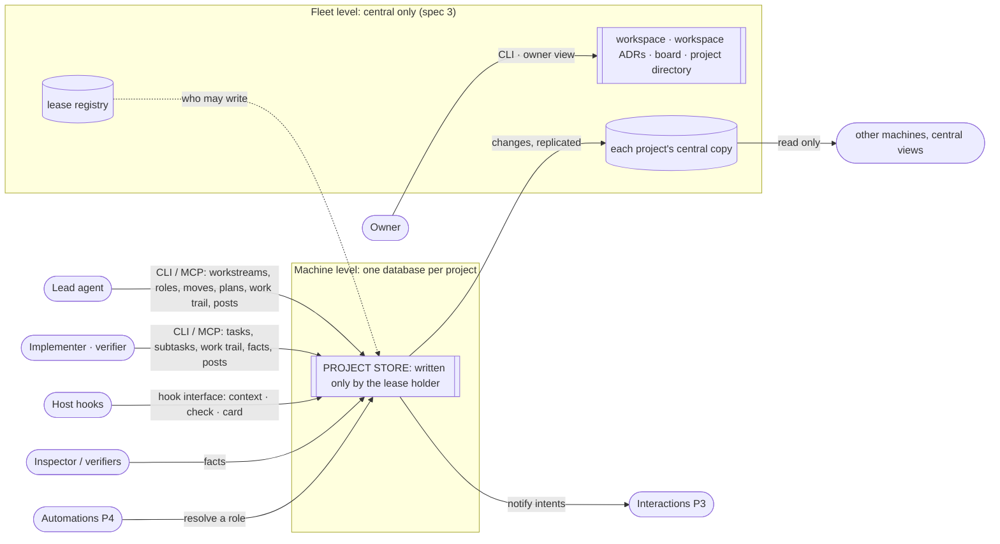
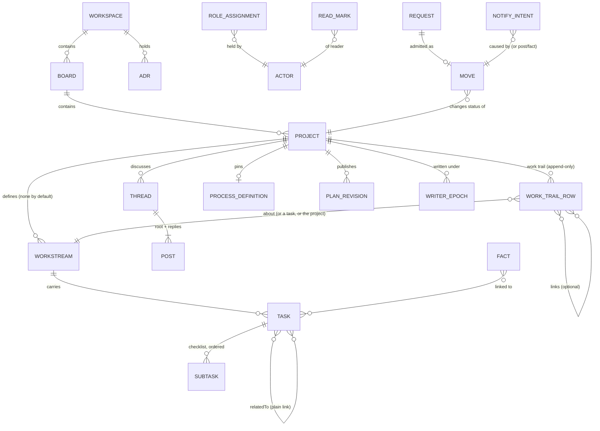

# Spec 1: shared contracts and the board model

**Cadence supersession (owner-settled, 2026-10-31; planned-but-unbuilt here).** Central-automations [R6n, R6g and R3](../2026-10-31-central-automations/specification.md) govern notification timing and wake periods. Earlier immediate-notification and 5-minute-repeat statements below are historical and superseded; the [publication inventory](publication-inventory.md) records the current contract and source/proof limits.

**What this is:** what must be observably true of the board itself, and the shared contracts every other part relies on: identities, requests and retries, feed order, writer epochs, the collaboration API. [Spec 2](spec-2-project-storage.md) (project storage and replication) and [spec 3](spec-3-central-fleet.md) (central fleet) depend on it. It traces to [requirements.md](requirements.md) (U rows), and [program-design-1-board.md](program-design-1-board.md) realizes it. It names no tables, types, files or transactions; those are design.

```text
requirements.md (why, U1–U43) ──► spec 1 (this) ──► spec 2 (project storage) ──► spec 3 (central fleet)
                                   └─► program-design-1-board.md (how)
```

**Reading guide:**
- §1 what's true today;
- §2 who uses the board and where things live;
- §3 the nouns;
- §4 the obligations: structure, moves, records, roles, notifications, views, the collaboration API, workstreams and tasks, and the work trail (writer authority is in specs 2 and 3);
- §5 failures and the upgrade;
- §6 qualities that cut across slices;
- §7 proof;
- §8 where the old spec's material went;
- §9 coverage and gaps.

**Identifiers that were retired keep their numbers** and are never reused: E4 (Milestone), ST-2 and ST-4 (default milestone, milestone order) are superseded by U40; E14 (Brief), ST-7, MV-5 and MV-6 are deferred with the task gate fields U40 relaxed.

## 1. Today and the gap

All of this was checked against main `21a9b029` on 2026-10-04.

| Today | Where | Gap (U) |
|---|---|---|
| Levels are project › board › topic › thread. Topics have a name and description, with no status, lead or plan | `crates/message-board-storage/migrations/202609120001_project_board.sql` | no workstreams, tasks, workspace ADRs, decision register, work trail or moves (U3, U40–U43) |
| Work state lives in agents' context and in free-text posts. The "show me your work" trace is posted as thread messages, mixed in with conversation | 09-28 board dump: 84 threads, 2,342 posts, 102 relayed "OWNER DECISION" posts | the board can't say what's true now (U2), and has no work trail separate from conversation (U42) |
| One store per Router holds every workspace. One sequence orders every record | `crates/message-board-storage/src/storage_support.rs:255` (`allocate_activity_sequence`, a singleton row) | per-project stores with one writer each (U20, U21) |
| Read acknowledgements move a bookmark but create no activity | `crates/message-board-storage/src/inbox_records.rs` `acknowledge_inbox` | no complete change feed (U9) |
| Records carry no time assigned by Router | the 202609120001 migration | ordering and "as of" depend on the host's clock |
| An actor is a Router service, endpoint and session, or a human ID. Nothing records the machine. Actors are self-declared, and a human actor skips the seat check | the `board_identities` table; `message_write_operations.rs` `post_message` | actor provenance (U9) |
| Seats live on threads. Since #121, every join, leave and replace is kept as activity history | migration `202610020001_participant_history.sql` | authority on entities (U7) |
| A duplicate caller-chosen message ID is refused | `message_write_operations.rs:36–39` | a retried request must return its first outcome (§4.4) |

## 2. Who uses the board, and where things live



- **Fleet level (U20, U24, U41):** workspace, its ADRs, board, and the project directory with the **project metadata** needed to find, search and know what projects exist. These are written only on central. Central may also read any project's central copy, read-only, for more detail (spec 3 FL-2).
- **Machine level (U21, U23, U25):** each project is one unit (its Lead, helpers, folders and data) on one machine at a time, and a machine can host several projects. Each project's records live in **that project's own database**, written only by the holder of the project's lease: workstreams, tasks, subtasks, the work trail (and so the decision register), threads, posts, moves, roles, facts and intents. Each project database replicates to its own central copy (spec 2). Other machines and central only read a project.
- **Not the board's job:**
  - delivering messages (interactions do that);
  - choosing which machine runs a session (the fabric does that), or granting leases (the lease registry does, spec 3);
  - judging code or repository truth (verifiers record those as facts).

## 3. Entities



`ROLE_ASSIGNMENT` attaches to one subject: a project (`lead`, `advisor`) or a workstream (`implementer`, `verifier`, `reviewer`, `operator`). `MOVE` attaches to a project. The **decision register** is not a separate record: it's the project's work-trail rows marked as decisions (WT-3), so each decision has one home.

| E | Entity | Same instance when | Belongs to / relates | Invariants | Observable states | Source |
|---|---|---|---|---|---|---|
| E1 | **Workspace** (was "project") | same UUIDv7; renaming keeps it | has boards, ADRs (E7), repositories and members | fleet level | active · archiving · archived (archiving a workspace archives each of its boards) | U3, U20, U41 |
| E2 | **Board** | same UUIDv7 | exactly one workspace | `kind` fixed at creation; `goal` and `doneWhen` only on an initiative; fleet level; holds no ADRs | initiative: open → closed; area: open; either: archiving → archived (read-only for work: spec 3 FL-5. A reader may still stop watching or unsubscribe, and its own read marks and acknowledgements still move; nothing else is accepted) | U3, U20, U41 |
| E3 | **Project** (was "topic") | same UUIDv7, kept through the upgrade; renaming keeps it | exactly one board, forever; listed in the fleet directory with its central metadata (U24); its records live in its own database (U25); has workstreams (E28), one work trail (E29) and so one decision register | at most one pinned process definition; a `lead` once a definition is pinned. Creating a project creates no workstream | its status, from the pinned definition, changed only by moves; closed. A project with no pinned definition has no status moves | U3, U5, U21, U40 |
| E4 | *Milestone: retired.* Superseded by U40; milestones may return later as plain checkpoints | — | — | — | — | U6, U19 (superseded) |
| E5 | **Task** | same UUIDv7; a retitle, body edit or change of workstream keeps it. A dropped task is never revived: work resumes as a new task (the `replace` action, TK-5) | exactly one project, and exactly one workstream of that project | carries a title (required), a body, a status, `blockedBy` and `relatedTo`, and nothing else for now: no PR link, no gate fields, no `kind` and no `links[]` (U44). `blockedBy` names tasks in the same project (any workstream), never forms a cycle, and never names a missing or dropped task when added. `relatedTo` names tasks in the same project (U44) and has no ordering meaning. Who may write it: see TK-7 | todo · doing · done · dropped. Any change among the first three is allowed; `dropped` is final | U40, U43, U44 (U5, U13 relaxed) |
| E6 | **Subtask** | same UUIDv7 | exactly one task | an ordered checklist item: its text, whether it's checked, and its place in the task's list. It has no relationships, roles or status beyond checked | unchecked ⇄ checked; removed | U43 (U18 relaxed) |
| E7 | **ADR** (architecture decision record) | same UUIDv7 | exactly one workspace (fleet level); holds its own text, as Markdown (U48); may link to the project or board where it was made, and to repository files | content never changes from creation, in any state; lifecycle transitions are recorded separately from content; a change of content is a new ADR that names what it supersedes. There are no board or project ADRs | proposed → accepted → superseded; proposed → withdrawn | U12, U41, U48 |
| E8 | **Thread** | the root post's UUIDv7 | exactly one project; exactly one **subject** (U65): `Project{subject line}`, or one workstream, task, work-trail row or workspace ADR, whose own name or text is the subject (TH-1). Imported legacy threads get a derived project-wide subject (TH-4) | conversation only: holds no status, authority or work-trail rows | open ⇄ resolved | U3, U7, U42, U65 |
| E9 | **Post** | same UUIDv7 | a thread | immutable | — | U3 |
| E10 | **Actor** | a session: its stable session ID, which includes its home Router installation (the machine it runs on); a human: its human ID. Where a record was written from is the record's provenance (RC-8), not part of the actor | writes every record | recorded as declared, never shown as authenticated (§6) | — | U9, U10 |
| E11 | **Role assignment** | same UUIDv7 | one subject (project → `lead`, `advisor`; workstream → `implementer`, `verifier`, `reviewer`, `operator`) and one actor (U64) | at most one active holder per (subject, role) for `lead`, `implementer` and `verifier`; one or more for `advisor`, `reviewer` and `operator`. A workstream's implementer and verifier are different actors, and its reviewers differ from both. Carries who granted it, plus the model and lineage when the holder is an agent. History is append-only. Each change advances the subject's **assignment revision**. Tasks and subtasks carry no roles: their workstream's pair carries the work | active → released \| replaced \| stoodDown (with a reason) | U7, U40 |
| E12 | **Move** | same UUIDv7 | one project; one request | carries the named move, result, evidence references, reason and requester, plus from and to whenever the named move resolves to an edge of the pinned definition: always for an accepted move. A rejection where no edge resolves (no pinned definition, or an unknown move) carries no from or to; nothing is invented. A rejected move changes nothing | accepted \| rejected (with typed reasons), final once recorded | U5, U8 |
| E13 | **Fact** | same UUIDv7, minted by its producer | linked to one or more subjects (project, workstream, task); one producer | append-only; never wakes anyone by itself. Kinds: receipt, evaluator result, PR fact, hook fact, scope acknowledgement, lifecycle fact, owner words (G3). None is a required gate for now (U40) | — | U4, U11 |
| E14 | *Brief: deferred.* It carried the task gate fields U40 relaxed; returns if tasks get gates | — | — | — | — | U5 (relaxed) |
| E15 | **Plan revision** | its content hash | exactly one project | a published plan for the project; the board records which revision is current and links to it | current \| superseded | U2 |
| E16 | **Process definition** (called "machine" in older docs) | `name@version` plus a hash of its exact source text | pinned by projects | the same `name@version` with different content is refused | registered | U8 |
| E17 | **Read mark** | (reader, scope) | one actor; one thread or project | a read mark is a feed position **together with the writer epoch line that assigned it**; it only moves forward within the current line | — | U2, U9 |
| E18 | **Notify intent** | same UUIDv7; dedup key (cause, recipient) | one causing record; one recipient, resolved at cause time, or at re-resolution for an intent added then (NI-2) | records the resolved holder and the assignment revision it read | emitted → handedOff \| superseded \| refused; superseded → emitted when re-resolution finds its actor back in the holder set before any handoff (NI-2) | U14 |
| E19 | **Feed position** | (scope, number) | one per accepted record | a project's positions are dense and increasing along its current line of writer epochs. A position always travels with the epoch that assigned it, so a position from a discarded suffix (writes a forced takeover didn't carry over, U80) is never mistaken for the different record that later holds the same number. Fleet-level records have their own feed | — | U9 |
| E20 | **Writer epoch** | (project, epoch number) | one project; one machine (the lease holder); issued with its lease (E23) by the lease registry (spec 3 FL-9) | at most one current epoch per project; numbers only increase; each epoch starts at a known feed position, the last replicated one | current (paused while its lease is expired, spec 2 WA-11) → ended (clean move) \| superseded (taken over) | U21 |
| E21 | **Request** | its request ID (UUIDv7, minted by the requester), distinct from the IDs of the records it creates | one requester; one target (a project or the fleet) | its canonical content is the complete *semantic* request: operation, actor, acting-for, subject or placement, references, payload, expected subject revision and protocol version. The writer epoch is **not** part of it: the epoch that accepts a request is recorded with its decision, and the writer's current authority is checked separately, so a retry after a clean switch matches its first decision instead of conflicting | pending → accepted (with the records it created) \| rejected (with reasons); both are terminal. A request accepted only in a suffix that a forced takeover didn't carry over was never replicated, so the new holder doesn't know it: a retry is evaluated fresh against the surviving state (RC-4, U80) | U9, U11, U21 |
| E22 | *Removed (U80, owner 2026-10-19).* A forced takeover starts from central's copy and doesn't carry over or report the old holder's unsent writes. The old file stays on disk, read-only, and is never served | — | — | — | — | U80 |
| E28 | **Workstream** | same UUIDv7; renaming keeps it | exactly one project; carries tasks (E5); has an `implementer` and a `verifier` role (E11) | created only explicitly, by the project's `lead`; a project has none until then. Carries a name and a goal | open → closed (with a reason: done or dropped). Closing leaves its tasks as they are | U40 |
| E29 | **Work-trail row** | same UUIDv7, minted by its writer | exactly one project; about one subject in it: the project, one workstream, or one task | the writer gives the **text** and, optionally, **tags** (free-form; `decision` puts the row in the decision register) and **links** (evidence: a commit, PR, path, URL or record ID, including another row). Router fills in when (RC-9), who (RC-8) and the subject (WT-2). The text, tags, links and subject never change, and no row is deleted. The one thing that changes is **redacted**: a filter flag any actor sets or clears explicitly, for rows that turned out to be wrong. It promises nothing more: a redacted row's text is still stored and replicated | shown ⇄ redacted | U42, U41, U47 |

**Role selector** (used by E18, automations and the fabric) is a reference such as "the `implementer` of workstream W". It resolves to the role's **active holder set**, plus the assignment revision it read (RL-3).

## 4. Obligations

Each obligation lists the U rows it serves. *MUST* means the board refuses or fails the observable check if it doesn't hold.

### 4.1 Structure (ST)

- **ST-1** The board MUST expose workspace › board › project › workstream › task › subtask, the workspace's ADRs, each project's work trail and decision register, and threads, with the cardinalities in §3. (U3, U4, U17, U40–U43)
- **ST-2** *Retired (default milestone; superseded by U40).* WS-1 says what a new project has.
- **ST-3** A task's `blockedBy` MUST name existing tasks in the same project; they may be in other workstreams. A write that would create a cycle, name a missing or dropped task, or cross a project MUST be rejected with a typed reason. A task whose blocker is later dropped is shown as **blocked by a dropped task** (VW-2) until its link is removed. Links to other projects' records are plain references by ID. (U9, U43)
- **ST-4** *Retired (milestone order and PR stack; superseded by U40).*
- **ST-5** A workspace ADR's content MUST NOT change after it's created, whatever its state. Proposing, accepting, withdrawing and superseding are recorded transitions; changing the content is a new ADR. A work-trail row's content is never edited either; only its redaction flag changes (WT-1). (U12, U41, U42, U47)
- **ST-6** Views (§4.7) MUST reflect only recorded state; there's no operation that writes a view. (U4)
- **ST-7** *Deferred with the task gate fields U40 relaxed (non-overlapping write paths at plan publish).*

### 4.2 Moves and state (MV)

> **Superseded for 0.1.102 (owner decision 1217, 2026-10-24).** Project moves, `move_check`, process definitions, pinning and the project stage were cut before release; they rested on an adherence premise that was never tested. MV-1 to MV-4 and MV-7, and their refusal kinds (`moveNotAllowed`, `guardUnmet`/`guardUnavailable`, `definitionConflict`), no longer apply. A project has no stored stage. MV-8 (validation of every record) still applies. Generic evaluator and guard facts stay as recorded facts.

- **MV-1** A project's status MUST change only through an accepted move. Workstreams, tasks and subtasks change state through their own operations (§4.9), each recorded in the feed with its actor; no process definition governs them for now. (U5, U40, U43)
- **MV-2** A move MUST be checked against the project's pinned process definition: the edge exists, the requester holds the role the edge requires, and the definition's board-checkable guards pass. A guard needing an evaluator result passes only when that result is recorded; a missing result is `unavailable` and never passes. (U5, U8)
- **MV-3** A rejected move MUST be visible in the project feed, with its typed reasons and requester, and MUST notify the project's `lead`. A repeat of the same rejection (same requester, subject, edge and reasons) MUST show as a repeat of the earlier one, not as a new item, and MUST NOT notify again. (U2, U14)
- **MV-4** A `check` request MUST return the verdict a move would get, and MUST leave nothing observable behind. (U5)
- **MV-5** *Deferred with E14 (Briefs at commission).*
- **MV-6** *Deferred with the task gate fields (a plan revision naming changed tasks, and facts needing revalidation).*
- **MV-7** Registering a process definition under an existing `name@version` with different content MUST be refused, and a pin never changes. (U8)
- **MV-8** Every record MUST be validated when written. Unknown fields, missing required fields and invalid values are rejected, naming the field. (U8)

### 4.3 Placement and writer authority: in specs 2 and 3

Where records are written and who may write them is defined in [spec 2](spec-2-project-storage.md) (project databases and replication: WA-2…WA-13) and [spec 3](spec-3-central-fleet.md) (fleet records, central copies, leases, the admin endpoint and machine sessions: WA-1, FL-1…FL-12). This spec defines the shared nouns they use: writer epoch (E20), request (E21), and the epoch-qualified feed cursor (E19, RC-5). Specs 2 and 3 add the lease (E23), the central copy (E24), the replication piece (E25), the machine session (E26) and the holder change (E27).

### 4.4 Fabric-neutral record contract (RC)

These carry the twelve guarantees in the [index](2026-10-04-board-orchestration-design.md). Guarantee 3 (admission context) is now WA-3 plus RC-3. Guarantee 7 (separate stores) is §2's placement plus Program Design. Guarantee 8 (schema version) is WA-7. Guarantee 9 (the board never delivers) is NI-1.

- **RC-1 Identity.** Every record MUST carry a UUIDv7 minted where it originates, plus its scope (workspace; board; project when it has one). The scope never changes. (U10)
- **RC-2 Order.** Every accepted record in a project MUST receive the next position in that project's feed. Fleet-level records get positions in the fleet feed. No order across projects is promised. (U9)
- **RC-3 Expected revision.** Every write that changes status (a project's, a workstream's or a task's), a role assignment, a task's title, body or workstream, or a plan MUST state the subject revision it expects. If the subject has moved on, the write is rejected as `staleRevision` and the current revision is returned. Posts, facts, work-trail rows and their redaction, task links and subtask changes don't carry one (TK-6). (U9, U21)
- **RC-4 Retried requests.** Each request carries a request ID (E21), separate from the IDs of the records it creates.
  - Resubmitting the same request ID with the same canonical content (E21) MUST return its recorded terminal decision, never a re-evaluation:
    - accepted, with the same record IDs and feed positions;
    - rejected, with the same reasons, even if the subject has changed since.
  - **A retry the current holder doesn't know is evaluated as new,** against the project's current state. That includes a request whose first attempt was accepted only in a suffix that a forced takeover didn't carry over (U80): it never reached central, so it isn't part of the project's history, and the retry runs fresh. It may now be rejected, for example `staleRevision`. There's no voided outcome, no unresolved wait and no check across past holders (owner, 2026-10-19: "yes this is all overengineered slop").
  - A retry MUST NOT repeat any effect: no new record, feed position, notify intent, read-mark change or unread notice.
  - Fields specific to the reader (unread counts, watch state) are computed fresh for the caller. They aren't replayed.
  - The same request ID with different content MUST be rejected as `conflictingRequest`.
  - Decisions are retrievable for at least the life of the project. (U9, U11)
  - A refusal that comes before a project scope exists isn't a decision. That covers a project or board that doesn't exist. Nothing records it, and the same request ID is evaluated again once the scope exists.
- **RC-5 Complete feed.** Every record accepted under the current line of epochs MUST appear in its scope's feed exactly once, and a recorded rejection is such a record. That includes posts, moves (accepted, and recorded rejections), workstream, task and subtask changes, work-trail rows, role changes, facts, thread resolution, and notify intents. A holder change isn't a project record: central's transfer record is its one record (spec 3 FL-10). **Reader state is not feed records:** a read mark, and a plain watch or unwatch choice, is one reader's own state. It's stored and replicated with its project, but it never takes a feed position, whether a read, an explicit acknowledgement or a watch request changed it. A mark isn't activity, and a read never creates a feed record; otherwise each read would cover the record the previous read created. Records in a suffix that a forced takeover didn't carry over are not in the feed (U80). A reader MUST be able to fetch everything after a position, and to learn the high-water position. A fetch is a consistent snapshot: it never shows a later position while missing an earlier one. A redacted work-trail row keeps its position in the feed and is returned marked redacted, with its text, tags and links left out unless the reader explicitly asks for them (WT-4). **Positions are given with their epoch:** a cursor, read mark or anchor taken on a suffix that a forced takeover later discarded MUST be answered with `cursorSuperseded`, naming the last replicated position to resume from. It MUST NOT be read as the different record that now holds that number. (U2, U9, U42, F02)
- **RC-6 No silent merges.** A request whose preconditions fail is rejected, never merged or reordered. The requester re-reads and decides again. (U9)
- **RC-7 Cross-project references** MUST be immutable IDs and MUST NOT be dependencies (ST-3). (U9)
- **RC-8 Actor provenance.** Every record MUST name its actor (E10) and, separately, the Router installation and machine it was written from: its provenance. A session's identity includes its home installation, which can differ from where a record naming it was written. A human's identity is its human ID alone. Neither identity is inferred from provenance, and provenance is never inferred from an identity. (U9, U10)
- **RC-9 Router time.** Every record MUST carry the time its accepting Router recorded it. Facts also carry the time their producer reports, labelled as producer-reported. (U2)
  - **The one exception: imported history** (§5, U54). A record the one-time upgrade imports from history that recorded no time carries an explicit **unknown** time. It's shown as unknown and never reconstructed from an ID, the import's own clock or a file time. Every record admitted after the upgrade carries its Router time.
  - **Order isn't time.** Within one project, an unknown-time record keeps its place by its translated feed position. That position is never reported as a time.
  - A time condition (older than, newer than, between) never matches an unknown-time record.
  - A "latest" time reported for a project or view either leaves unknown-time records out or says the time is unknown, and says which. *(Added 2026-10-17: shipped stores have no general event time, X2.)*
- **RC-10 Lifecycle facts are typed.** Closing a project, thread or workstream, dropping a task, and completing a phase MUST be typed facts with a reason, not free text. (U9, U11)
- **RC-11 After a close.** When a project closes, its closing feed position MUST be recorded. After that point:
  - moves, role changes, and new or changed workstreams, tasks, subtasks and work-trail rows are refused (`closed`);
  - thread posts, replies and thread resolution are still accepted: a close freezes the work, not the conversation;
  - a fact is accepted only if its producer names the feed position, with its epoch, that it had seen when producing it (its causal anchor), and that position is on the current line (not discarded by a forced takeover) and is at or before the close. It's then marked **late**;
  - late facts appear in the feed and in views marked as late, emit no notify intents, and may link to dropped tasks;
  - a fact without an anchor, or with one after the close, is refused `closed`.

  A producer-reported time alone never qualifies a fact as late. (U9, U11)
- **RC-12 Atomic outcome.** A write and everything it causes (its feed record, any notify intents, any role or read-mark change, and the work-trail row a task action writes, TK-5) MUST become visible together, or not at all. (U2, U14, U43)

### 4.5 Roles (RL)

- **RL-1** Authority roles MUST live on entities:
  - `lead` (one) and `advisor` (one or more) on a project;
  - `implementer` (one), `verifier` (one), `reviewer` (one or more) and `operator` (one or more) on a workstream.

  Tasks and subtasks carry no roles. A thread's participants and watchers carry no authority. (U7, U40, U64)
- **RL-2** Each role change MUST be an append-only record that advances the subject's assignment revision. History MUST show every holder and interval. (U7, U9)
- **RL-3** A role selector MUST resolve to the role's active holder set, together with the subject's assignment revision it read: exactly one actor for `lead`, `implementer` and `verifier`, and every active holder for `reviewer`, `advisor` and `operator`. An empty set resolves to `noHolder`; it never falls back to anyone. A cause addressed to a role emits one intent per resolved actor. An actor reached both by name and through a role gets one intent for that cause. (U9, U14, U64)
- **RL-4** Replacing the `lead` MUST require a recorded owner grant. The replaced holder is recorded as `stoodDown` with a reason. A stood-down holder's writes on that subject MUST be refused until it records that it has re-read the current state. (U1, U7)
- **RL-5** A workstream's `implementer` and `verifier` are granted and moved by the project's `lead`, and MUST be different actors; granting one to the actor already holding the other is refused as `pairNotDistinct`. Any other actor's attempt is refused as `roleRequired`, naming the role. (U7, U40, U44)
- **RL-6** The project's `lead` grants and moves `reviewer` and `advisor`. A `reviewer` MUST differ from that workstream's `implementer` and `verifier`; otherwise the grant is refused as `pairNotDistinct`, naming the holder. An `advisor` accepts nothing: no move, acceptance or close-out is admitted on its authority. (U64)
- **RL-7** The project's `lead`, or that workstream's `implementer`, grants an `operator`. An operator's authority is limited to the workstream's procedure work recorded in its work trail. (U64; the placement and grantor are the Lead's defaults, which the owner may adjust)
- **RL-8** `participant`, by joining a thread, and `watcher`, by watching or subscribing to a thread or project, are self-service. Only the actor itself creates or ends them, and no role can grant, end or force them. (U64)

### 4.6 Interaction boundary (NI)

- **NI-1** The board MUST NOT deliver anything. Anything that should reach an agent MUST be a notify intent (E18), recorded together with its cause (RC-12). (U14)
- **NI-2** Recipients are resolved when the cause is recorded. An intent reached through a role records the selector, the actor it resolved to and the assignment revision it read (RL-3). An intent addressed to an actor by name records only that actor; an actor reached both ways has one intent, recorded as addressed by name (RL-3).
  - **Re-resolution.** If the subject's assignment revision has changed by the time interactions take a role-reached intent, the selector is resolved again to its current active holder set, in the same transaction that checks the revision and records handoffs (MS-5 of spec 3). The result is compared actor by actor:
    - an actor still in the set keeps its intent, which now records the current revision;
    - an actor no longer in the set has its intent marked `superseded` and isn't notified through it;
    - an actor in the set whose intent for that cause is `superseded` gets **the same intent back** as `emitted`, recording the current revision. A superseded intent was never handed off, so this stays that actor's one notification for the cause;
    - an actor in the set with no intent for that cause gets one new intent. An actor whose intent is `handedOff` or `refused` gets nothing more. E18's key (cause, recipient) keeps one intent identity per actor, so no actor is notified twice;
    - an empty set supersedes the claimed intent and records `noHolder` for the role, as at cause time. Nothing falls back to another actor, and a holder granted later isn't notified for that cause.
  - Re-resolution never touches an intent addressed by name, even when the same actor is also reached through the role. It never changes a `handedOff` intent either: that intent keeps its frozen recipient and is delivered to that recipient even after later role changes (spec 3 MS-5).
  - **What this guarantees:** every handoff goes to an actor that, at that handoff, was addressed by name or held the role it was reached through. An actor that left the role before its intent was handed off isn't notified through it. **The one exception** is spec 3 MS-5a's same-machine takeover case: a local recipient told immediately before a takeover that discards its handoff, whether or not the cause itself survives. The owner accepted immediate local delivery (U63), and a forced takeover dropping a cause the old holder hadn't stored in central is accepted (U80, owner 2026-10-19). (U14, U63, U64, U80)
- **NI-3** Accepted moves, role grants, and posts that address roles or actors MUST emit intents to their addressees. A project's `lead` MUST receive intents for rejected moves and for posts addressed to it. Task, subtask and work-trail writes emit none by themselves. (U2, U14)
- **NI-4** Each intent MUST show its state: emitted, handedOff, superseded or refused. `handedOff` means a recoverable delivery responsibility exists, with a frozen recipient and item identity (spec 3 MS-5). It doesn't mean any hop has received the item. Delivery stages after handoff follow the message path (U63, spec 3 MS) and are linked. (U14, U63)

### 4.7 Views and the hook interface (VW)

> **Superseded for 0.1.102 (owner decision 1217).** The three hook tools (`hook_context`, `hook_card`, `hook_check`) were cut. The continuation card and session context remain as the ordinary `view_card` and `view_session_context`. The card no longer shows a process definition.

- **VW-1 Continuation card.** For an actor and a subject, the card MUST give:
  - the governing plan revision and process definition;
  - the actor's role (`lead` of the project, or `implementer` or `verifier` of which workstream), its pending handbacks and decisions, and its next obligation;
  - the subject's latest work-trail rows;
  - per-kind counts of what's recorded;
  - the `asOf` feed position, and whether the card was read from the writer or from a read copy;
  - the silence rule: a claim the board doesn't contradict is `unrecorded`, not false. (U2, U42)
- **VW-2 Work view.** For a project, the work view MUST show:
  - its workstreams, each with its implementer and verifier, its state, and its tasks in dependency order (`blockedBy`), with creation time breaking ties;
  - each task's status and subtask progress;
  - the ready queue: open tasks whose blockers are all `done`;
  - blocked tasks, naming their blockers, and tasks blocked by a dropped task;
  - open tasks in closed workstreams;
  - rejected requests since the project's last accepted move;
  - the current writer epoch. (U2, U21, U40, U43)
- **VW-3 Owner view.** Across projects: everything waiting on the owner, with what it blocks. (U1)
- **VW-4 Lead load.** Across a lead's projects: work owing that lead a close-out. (U2)
- **VW-5 Session context.** For a session, across every worktree of its projects' repositories:
  - its assignments (the projects it leads, and the workstreams where it's implementer or verifier);
  - its acknowledged scopes.

  Classifying each target path by owning task is deferred with task write paths (ST-7). (U2, U40)
- **VW-6 Read marks.** An identified reader that fetches a thread, the feed or a filtered view MUST have its read mark advanced through the positions that read covered, including positions a filter left out (WT-4), within the current epoch line. After an unclean takeover, read marks beyond the last replicated position fall back to it (RC-5). Every write by a role holder MUST return how many records on that subject it hasn't read, with references. Marking by a read only moves forward and isn't a retried request in RC-4's sense: a repeated read marks what it covers. (U2)
- **VW-7 Hook interface.** `context`, `check` and `card` MUST each return exactly one result. An unavailable board MUST return a distinct `unavailable` result, which a hook MUST never treat as allowed. (U2)
- **VW-8 Four facts kept apart.** Views MUST show these as different things, never inferred from one another:
  - a recorded assignment;
  - a notify intent's state;
  - a reported blocker (a blocked task, VW-2);
  - the session's running state, which comes from interactions or the host, not the board. (U2, U14)

### 4.8 The collaboration API (API)

- **API-1 One server, one protocol.** Every collaboration operation (board, conversations, wakes, schedules) MUST be available as a tool on **one stateless MCP server**. Models reach it over localhost TCP; the CLIs (`agent-collaboration`, `agent-sessions`) reach the same server over the private Unix socket. The same call MUST give the same result whichever way it arrives. (U28)
- **API-2 Each call stands alone.** No call depends on an earlier handshake or session. "Listen" and "wait" operations are single bounded calls that stream events until they finish or reach their bound. Each takes an `after` cursor and returns the cursor to resume from, so no event is lost between calls. Two exceptions, stated so callers don't assume otherwise: `board_thread_wait` settles a batch when the server hands it over (G16), and observing a Codex session's native events has no cursor, because that stream comes straight from the Codex carrier (U29). (U28)
- **API-3 Typed results.** Every tool returns a typed structured result: the record, the decision, or a typed rejection from §5. The CLI prints from that result, never by parsing text. Sequencing: M1 publishes each family's typed failure with its existing kinds; the §5 reason is added to every rejection with M2, together with the API-6 renames. (U8, U28)
- **API-4 Same tools on both listeners.** Both listeners offer the same tools. The Unix socket exists so the CLIs reach the server without a TCP port; it is owner-only (mode 0600), and every agent runs as the owner, so it is not a separate trust level. (U28)
- **API-5 One cutover.** The old Control protocol is removed in the same release. The CLI and Host install together, so no old-client refusal path is needed. (U27, U28)
- **API-6 Names.** Tool groups use the new terms: `workspace`, `adr` (workspace ADRs), `board`, `project`, `workstream`, `task`, `subtask`, `work-trail` (MCP tools `work_trail_*`; it also reads the decision register), `thread`, `move`, `fact`, `feed`, `role`. Old names (`board project`, `board topic`, `milestone`) are removed, with no aliases. (U17, U40–U43)
- **API-7 Out of scope.** Nothing here changes the model proxy, the harness connections, or the Host's operator socket and its lifecycle controls. (U29, U31)
- **API-8 The published manifest.** The Host publishes `service.json` version 3 for clients to find the server: `serviceId`, `serviceEpoch`, `machineLabel`, `serviceVersion`, `api` (MCP over the Unix socket, its path), `mcp` (the TCP URL), `nativeSchemaDigest`, and `routerProxyEndpoint` when the proxy runs. There is no connection handshake; clients take these values from the manifest. Version 2 is not read. (U27, U28)

### 4.9 Workstreams, tasks and subtasks (WS, TK)

- **WS-1 None by default.** A project MUST have no workstream until one is created explicitly; creating or upgrading a project creates none. Only the project's `lead` creates, renames and closes workstreams; anyone else is refused as `roleRequired`. (U40)
- **WS-2 The pair.** Each workstream has an `implementer` and a `verifier` role (RL-5). Either may be unheld; resolving an unheld one gives `noHolder` (RL-3). (U40)
- **WS-3 Closing.** Closing a workstream records its reason (done or dropped) and leaves its tasks as they are. A closed workstream accepts no new tasks (`closed`, naming the workstream). (U40)
- **TK-1 Creating a task** names its workstream, which MUST be an open workstream of the same project, and a title. It may give a body and its initial `blockedBy` and `relatedTo` links, each checked as in ST-3 and TK-3. Moving a task to another open workstream of the same project keeps it. (U43)
- **TK-2 Links are added and removed one at a time.** Each `blockedBy` or `relatedTo` link is added or removed by its own operation, so two writers changing links at once never overwrite each other. Adding a link that already exists, or removing one that doesn't, changes nothing and is answered as such. (U43)
- **TK-3 `relatedTo`** MUST name an existing task in the same project (U44). It carries no ordering and affects no readiness. (U43)
- **TK-4 Status.** A task's status is set directly, with its expected revision (RC-3): any change among `todo`, `doing` and `done` is allowed, and `dropped` is final; a change out of `dropped` is refused as `closed`, naming the task. (U43)
- **TK-5 Duplicate and replace are actions.** Marking a task a duplicate of another, or replaced by another, MUST set it to `dropped` and write a work-trail row about it, naming the other task and the caller's note, together (RC-12). The other task MUST exist in the same project (`notFound` otherwise). Neither is a stored field of the task. (U43)
- **TK-6 Subtasks.** A task's subtasks form one ordered checklist. Items can be added, checked, unchecked, reordered and removed; nothing else. A subtask has no links, roles or status beyond checked. Subtask changes carry no expected revision (RC-3): concurrent changes apply in the order they're accepted, so of two reorders the later one wins, and a change to an item another request already removed is `notFound`. (U43, U44)
- **TK-7 Who may write.** For now, any actor may create and change tasks and subtasks; every write records its actor (RC-8). No role is checked, keeping tasks lightweight (U40, U44). Workstream writes stay with the `lead` (WS-1). Role grants follow RL-4 to RL-7: the `lead` grants everything except that a workstream's `implementer` may also grant an `operator` on its own workstream, and nothing else (RL-7).

### 4.10 The work trail and decision register (WT)

- **WT-1 Append-only rows, with a redaction filter.** A project's work trail MUST accept rows of the shape in E29 and nothing else, MUST never change a row's text, tags, links or subject, and MUST never delete one. Redacting or un-redacting a row is an explicit request, recorded in the feed with its actor. A wrong row is redacted; its correction, if any, is a new row, which may link to it. A row with no text is refused (`invalidShape`); redacting a row that doesn't exist is `notFound`. (U42, U47)
- **WT-2 Attached to the current assignment.** A row names its subject explicitly, or else attaches to the writing session's current assignment: the project it leads, or the workstream where it's implementer or verifier. When the session has none, or more than one in that project, and names no subject, the row is refused as `subjectRequired`, naming the session's assignments. (U42)
- **WT-3 The decision register is the decision rows.** A project's decision register MUST list exactly its work-trail rows tagged `decision` that aren't redacted, newest first. It's a view over those rows, not a second record, so a decision row appears in the register and in its subject's timeline at the same moment, and nowhere else is written. A changed decision is a new decision row; it may link to the one it replaces. (U41, U42, U47)
- **WT-6 Reserved tags.** Three tags carry meaning that views read; any other tag is free-form.
  - `decision`: WT-3.
  - `handback`: an implementer or verifier hands work back to the lead. The row's subject MUST be a workstream or task where the writer holds that role, else `roleRequired`.
  - `owner-question`: something waits on the owner. The row MUST link to at least one record it blocks, else `invalidShape`.
  - A handback is settled by a later `decision` row by the project's lead that links to it. An owner question is settled by any later `decision` row that links to it.
  - Redacting a row removes it from pending. VW-1, VW-3 and VW-4 read these. (U1, U2, U47)
- **WT-4 Reading.** The work trail MUST be readable by project, by workstream, by task, by tag, and as the decision register, each with an `after` cursor (RC-5). These filtered views leave redacted rows out entirely unless the reader explicitly asks for them. The cursor a filtered page returns covers every feed position up to that page's high-water position, including the ones it left out, so a page where every row was filtered comes back empty with a cursor that has still moved on. The project feed itself never drops a position: there a redacted row appears marked redacted, with its content left out unless asked for (RC-5). Rows and redaction changes are both feed records. Redaction promises nothing more: the content is still stored and replicated. (U9, U42, U47)
- **WT-5 Separate from conversation.** A thread or post never holds a work-trail row; it may refer to one by ID (E8). (U42)

### 4.11 Thread subjects (TH)

- **TH-1** Every new thread MUST name exactly one subject:
  - `Project{subject line}`;
  - a workstream, task or work-trail row **of the thread's project**;
  - a workspace ADR **of the project's containing workspace** (E7).

  A subject line is one line of at most 120 characters, the same bound as TH-4. A missing subject, an empty or over-long subject line, or a reference outside those scopes is refused, naming the field. The thread shows the referenced record's current name as its subject: a workstream's name, a task's title, an ADR's title, or a work-trail row's text (first line), under the row's redaction rules (WT). It's a reference, not a copy. (U65)
- **TH-2** Only the project's `lead` and its role holders may open a project-wide thread; anyone else is refused as `roleRequired`. Threads about a workstream, task, row or ADR are open to every actor. (U65)
- **TH-3** A thread's subject MAY be changed by the lead or a role holder, as a recorded change in the feed. History keeps every earlier subject. (U65)
- **TH-4** Threads imported by the upgrade (§5) become `Project{subject line}` threads, marked imported. Legacy threads have no title, so the subject line is the root post's first line, trimmed and cut to 120 characters at a UTF-8 boundary, or `Imported thread <root ID>` when that line is empty. It's fixed by the input, so rebuilding unchanged input gives the same records and digests (§5). Only the upgrade sets the imported marker. (U65)

## 5. Failures and the upgrade

**Typed failures:** every rejection names its reason and the field or subject involved.

| Reason | When |
|---|---|
| `staleRevision` | RC-3; returns the current revision |
| `notWriter` | WA-2/WA-6: this machine doesn't hold the project's current writer epoch; names the current epoch if known. Also: a renewal for an epoch this installation never held (spec 3 FL-9, FL-12) |
| `staleEpoch` | WA-5: a replication piece or lease renewal from a superseded epoch; names the current epoch |
| `pendingUnreachable` | WA-1: a fleet request accepted as pending; the central server is unreachable (not a rejection) |
| `cursorSuperseded` | RC-5: a position taken on a suffix a forced takeover discarded; names the position to resume from |
| `moveNotAllowed` | MV-2: no such edge, or the requester lacks the role the edge requires |
| `roleRequired` | WS-1, RL-5: the requester doesn't hold the role the operation needs; names the role |
| `pairNotDistinct` | RL-5 and RL-6: the same actor would hold both a workstream's implementer and verifier roles, or a reviewer role there would go to its implementer or verifier |
| `guardUnmet` / `guardUnavailable` | MV-2: names each guard, its evaluator and its outcome |
| `dependencyCycle` / `dependencyMissing` / `dependencyDropped` / `dependencyCrossesProject` | ST-3 |
| `notFound` | TK-1, TK-3, TK-5: a named workstream, task or row doesn't exist in this project; names it. Also spec 3 FL-16: a claim names a project central doesn't know |
| `nameConflict` | a create or rename would reuse a name another record of the same kind already has in its scope (workspace names, board names in a workspace, project names on a board); names that record. Kept from today's board |
| `participantRequired`, `orchestratorRequired`, `orchestratorAlreadyExists`, `implementerAlreadyExists`, `orchestratorHandoverRequired`, `handoverTargetNotParticipant`, `staleOrchestrator`, `staleImplementer`, `selfReplace`, `orchestratorRoleChange` | thread participation (seats), kept from today's board with their holder and last-seen details. Seats are conversation only and carry no authority (RL-1) |
| `alreadyExists` | a create reuses the ID of a record that already exists; names it. Kept from today's board (a retry with the same request ID instead returns its first decision, RC-4) |
| `subjectRequired` | WT-2: a work-trail row with no subject, from a session with no single assignment; names its assignments |
| `conflictingRequest` | RC-4; also a repeated holder-change request with different content (spec 3 E27) |
| `invalidShape` | MV-8, WT-1; names the field |
| `definitionConflict` | MV-7 |
| `closed` | RC-11; also a closed workstream (WS-3) or a dropped task (TK-4); names the subject |
| `archived` | the board is archived. Also spec 3 FL-16: a claim on a project whose board is archiving or archived |
| `postCooldown` | E9: a second top-level post by the same actor in the same project within the cooldown window; names the seconds until a top-level post is accepted |
| `schemaTooNew` | WA-7; names both versions |
| `schemaMismatch` | WA-7; the actual schema doesn't match its version's fingerprint |
| `schemaUnsupported` | spec 2 WA-7: a schema change whose effect wouldn't replicate; names the statement form |
| `migrationPending` | spec 2 WA-4, spec 3 FL-10: a move while the holder has a migration it hasn't applied; names the migration and the state the holder reports |
| `positionGap` | spec 2 WA-3b: a piece that doesn't continue from the copy's acknowledged position; names that position. A release isn't refused this way: it answers at the holder's final captured position, and the registry waits for the copy before fence and grant (spec 2 WA-4) |
| `pieceConflict` | spec 2 E25: a piece with an applied piece's identity but a different digest; nothing changed |
| `notInitialized` | spec 2 E24: a piece for a project central hasn't accepted yet |
| `noHolder` | RL-3 |
| `standDownUnacknowledged` | RL-4 |
| `cursorInvalid` | upgrade: an old pagination cursor whose key or scope can't be verified |
| `upgradeFailed` | upgrade script (U54): the run didn't complete; its report names each workspace, board or project that wasn't imported |
| `centralCopyFull` | spec 3 FL-4: the project's central copy can't store more |
| `copyUnavailable` | spec 3 FL-12, U67: the project's central copy can't serve the request now. It names why: its own bookkeeping migration is pending or failed, or it's uninitialized or damaged. Nothing changed; repeat the request after the copy is migrated or repaired |
| `cursorExpired` | spec 3 FL-6, FL-12: a notice or feed cursor older than retention; the Router re-reads in full |
| `projectRejected` | spec 2 WA-10: central refused to create the project; names central's reason. Nothing is created on the machine |
| `leaseExpired` | spec 2 WA-11: the holder's lease expired and hasn't renewed yet; names when it expired. Writes resume on renewal |
| `adminRequired` | spec 3 FL-10: a move or takeover was requested without admin credentials; nothing changed |
| `transferInProgress` | spec 3 FL-10: another holder change for the project is in progress; names it |
| `holderUnreachable` | spec 3 FL-10: a move while the holder has no session or hasn't renewed recently; names its last-seen time. Also spec 3 FL-14: a forwarded post whose holder has no session |
| `previewStale` | spec 3 FL-10: a takeover confirmed against a preview whose holder, epoch or acknowledged position has changed |
| `registryEpochUnproven` | spec 3 FL-9: the registry can't prove the highest epoch it issued, so it issues none |
| `credentialRejected` | spec 3 FL-12: a session credential that's unknown, expired, revoked or not a machine credential; names which |
| `connectionReplaced` | spec 3 FL-12: a newer connection from the same machine took over its session, and this connection closed |
| `overloaded` | the API's concurrency limit is reached; nothing was done, and the call may be retried |
| `releaseRefused` | spec 3 FL-12: a release a holder change asked for is refused; names the holder change and its reason (`migrationPending` or `schemaTooNew`) |
| `senderHolds` | spec 3 FL-14: a post forwarded for a project the sending machine itself holds; the Router admits it locally (not a rejection) |
| `unanswered` | spec 3 FL-14: a forwarded post's holder didn't answer before the deadline; the outcome is unknown, and a retry with the same request ID replays the holder's decision |
| `notHeld` | spec 3 FL-15, FL-14: the project has no holder (imported and not yet claimed); a write or a forwarded post needs one. Claim it first (FL-16) |
| `alreadyHeld` | spec 3 FL-16: a claim on a project that has a holder; names the holder; nothing changed |
| `alreadyImported` | spec 3 FL-17: an import whose ID and digest match what central has; nothing changed (not a rejection) |
| `retired` | spec 3 FL-18: the project's copy was retired; nothing about it is accepted or returned, and its ID is never reused |
| `importConflict` | spec 3 FL-17: an import offering different content under an existing project ID, whether that project is unheld, held or once claimed; names both digests, or the offered one and that the existing project wasn't imported; nothing changed |

**Upgrade (one release, hard cutover; a separate one-time script run with downtime, U54, U60; G28):**
- **Names map to IDs one-to-one.** Every old ID is kept:
  - old project ID = workspace ID;
  - board ID = board ID;
  - topic ID = project ID;
  - thread and post IDs are unchanged;
  - read bookmarks and subscriptions keep their readers and scopes.
- **Feed positions are re-derived.** Each project's existing records get dense feed positions in their old relative order. They belong to the import epoch, epoch 1, which no machine holds (spec 3 FL-15). Each read bookmark becomes a read mark at the translated position of the record it pointed to, and each watch keeps its choice, with its start translated as a cutoff: activity in the watched project before the watch began stays excluded, and activity after it stays included. Each subscription keeps its reader, scope, policy, expiry, generation and ending as its own membership record; its delivery progress isn't carried. A subscription that a resolved thread left draining arrives ended, whether or not the thread has since been reopened, since its owed notices are delivery progress. Its end time is the store's **last recorded time**, because the old store didn't record when the thread was resolved. That's the latest event time the old store actually recorded; future deadlines (expiry and retry times), the script's own run time and file times don't count. Imported records whose history has no stored time carry an unknown time (RC-9). Pagination cursors held during the downtime aren't carried: after the upgrade they're answered `cursorInvalid`, and the caller reads again.
- **IDs, never names, decide identity (U62).** Records from different computers are never merged by name. Two workspaces, or two boards in one workspace, that share a name keep their own IDs. Where a name must be unique and records from two computers share it, **nothing is renamed**: the report names both records, and a real run refuses to upload while a collision exists. What a collision becomes is the owner's open decision (G28).
- **Imported projects arrive unheld** (spec 3 FL-15). The first machine whose agent claims one becomes its holder (FL-16). Nothing is assigned by the script.
- **The script never writes the old store, and refuses to run while a Router has it open.** Re-running it is safe: an identical project is skipped, and a different one with the same ID is refused with a report (FL-17).
- **Every run writes a report:** counts per workspace, board and project, name collisions, skips and refusals. Rebuilding unchanged input gives the same records, positions and digests. `--dry-run` writes only the report.
- **Defaults:** migrated boards get `kind: area`. Migrated projects get no workstream and no pinned process definition.
- **Nothing is invented.** No synthetic leads, statuses, moves, roles, workstreams, ADRs or work-trail rows are created. The old store has no milestones, tasks or ADRs to map (§1). Existing posts, including ones written as checkpoints or "ADR" threads, stay posts in their threads.
- **One cutover.** The CLI and Host install together (U27), so there's no old-client path to design.
- *(That history is preserved at all is derived; owner to confirm, G1.)*

## 6. Qualities that cut across slices

| Quality | Obligation |
|---|---|
| Identity and security | Actors are recorded as declared. The board MUST NOT present a declared actor as authenticated, and views show provenance (e.g. "relayed by"). Machine and admin credentials are central's (spec 3 FL-10, FL-12) |
| Reliability | WA-4/WA-5 (no loss on a clean switch; a bounded, visible loss on an unclean one), RC-4 (retries), RC-12 (atomic outcome), MV-3 (rejections recorded). The recovery-point gap of an unclean switch is the records after the last replicated position, and nothing else |
| Freshness | A read copy MUST say which feed position it reflects (VW-1, WA-6). Nothing promises a copy is current |
| Data lifecycle | Posts, moves, workspace ADRs, work-trail rows (and so the decision register), role history and request decisions are kept for the project's life. Retention per fact kind is open (G5) |
| Privacy | Owner words (G3), work-trail rows and hook facts can carry sensitive text. Which kinds are written, and where, is decided with Q9 and Q1 |
| Performance | Hook calls run on edits and commits. E2 measured 150–180 ms per call, CLI start included. No budget is authorized yet (G6) |
| Operability | Each store reports its schema version (WA-7), feed high-water position (RC-5) and current writer epoch (VW-2) |

## 7. Proof

| V | Proves | Evidence |
|---|---|---|
| V1 | ST, MV, RL, NI, WS, TK, WT, TH | integration tests through the board service against a real store: one passing and one rejected case per obligation, asserting the typed reason. Must include: a new project with no workstream; a workstream pair granted by the lead, `roleRequired` for anyone else and `pairNotDistinct`; a task created in a closed workstream refused; `blockedBy` cycle, missing, dropped and cross-project links refused; two concurrent link additions both kept; `dropped` final; duplicate and replace each dropping the task and writing their work-trail row in one outcome; subtasks added, checked, reordered and removed; a work-trail row attached to the session's single assignment, and `subjectRequired` with none or two; a redacted row left out of default reads and the register, shown when explicitly asked for, and shown again once un-redacted; a redacted row at position 41 followed by a task change at 42, where a filtered trail read returns neither row but a cursor past 42, and a feed read returns 41 marked redacted with no content and then 42; a filtered page whose rows are all redacted coming back empty with an advanced cursor; the decision register listing exactly the unredacted rows tagged `decision`; a workspace ADR's content unchangeable. Thread subjects (TH): each subject variant accepted; a missing or empty subject, a cross-project record and a foreign-workspace ADR each refused; a project-wide thread opened by a role holder and refused for a non-holder; a recorded re-file. Roles: a reviewer refused when it's the implementer or verifier; an operator granted by the workstream's implementer; a multi-holder role addressed with 0, 1 and 2 holders. |
| V2 | RC-1…RC-12 | one integration test each. Must include: retries of an accepted post, an accepted move and a rejected move, each returning the first decision with no duplicate intent, feed record or read-mark change; `conflictingRequest`; a feed snapshot under concurrent writes; a late fact with and without an anchor; work-trail rows in the project feed |
| V8 | API-1…API-8 | integration tests through the real axum app on both listeners: the same tool call over TCP and over the Unix socket returns the same structured result; every CLI command group runs against the new server (program design 1 §4c), including `workstream`, `task`, `subtask` and `work-trail`; a listen or wait call streams, ends at its bound and returns a cursor, and a second call from that cursor loses no event (except the two API-2 exceptions); no call needs a prior handshake; the CLI reads the v3 manifest; the `native` and `acp` bridges discover their carrier through `endpoints_list`; the files named as the harness boundary (program design 1 §4c) change only in their discovery call; a hook read's latency is measured against G6 |
| V4 | §5 upgrade | upgrade a copy of a real board store. Assert IDs, counts, per-project relative order, the old-position → (project, position) mapping under the import epoch, bookmarks; watch starts across interleaved projects, including a zero cutoff; subscriptions with their policy, expiry, generation and ending, including a draining one arriving ended; that an old pagination cursor is answered `cursorInvalid`; that a re-run over unchanged input gives the same digests; that a name collision is reported and refused, never renamed; and that no workstream, ADR or work-trail row was created. Imported threads: the TH-4 subject derivation, including an empty or multiline root, with an identical result when rebuilt with the clock advanced. |
| V5 | VW-1…VW-8, NI-2 | view tests over a recorded fixture: the work view's workstreams with their pairs, dependency order, ready queue, blocked and blocked-by-dropped tasks, and open tasks in closed workstreams; the card's latest work-trail rows; hook interface results including `unavailable`; NI-2 re-resolution between cause and handoff, asserting the exact recipient set with no fallback and no duplicate: one holder replaced by another (only the new holder is notified), one holder becoming two, two becoming one, a nonempty set becoming empty (`noHolder`), a revision change that keeps some holders, an actor addressed by name and also reached through the role (one intent, untouched by re-resolution), an already handed-off intent keeping its frozen recipient and still delivered to it after the role passes to another holder; a role going A → B → A between separate claims with no handoff in between, ending in exactly one handoff to A under A's original intent; the same with A already handed off, creating no second handoff; a nonempty set becoming empty and then the same holder returning (`noHolder`, nobody notified later); a revision change that keeps the only holder; and an actor addressed by name whose role is removed before handoff, still delivered through the named intent |
| V6 | the whole spec against real work | the replay cases (M2.0, #112 Messaging first). Each replays through the board, and the views answer what the case's owner and Lead needed, including "what was decided", "where did it stop" and "what proves it" from the work trail. The set includes one close-with-late-fact case and one role-replacement case |

## 8. Where the old spec's material went

| Old material (the superseded 2026-09-30 board-state working spec, not published) | Now |
|---|---|
| Milestone approved head, verdict, merge grant | dropped with milestones (U40); a PR, verdict or merge grant is an evidence pointer on a work-trail row |
| Task verify obligations, repository, write paths, PR link | dropped for now (U40, U43); ST-7 deferred |
| Brief contents; plan-ready projection; affected tasks | deferred (E14, MV-5, MV-6); E15 keeps only the current plan |
| Typed move fields; evidence references | E12 (evidence references are IDs of posts, facts, PR facts or artifacts) |
| Evaluator-result and receipt shapes | E13 kinds; their exact shapes are design, validated per MV-8 |
| Seat-event metadata | E11 |
| Assignment, wake, running turn and blocker kept apart | VW-8 |
| Transition and Brief writes open subscription windows | NI-3 (intents; windows are P3's mechanism) |
| Rejected-request rows in the effort view | MV-3, VW-2 |
| Session-context acknowledgement scopes | E13 (scope acknowledgement); VW-5 |
| Card provenance and silence rule | VW-1 |
| Lead succession | RL-4 |
| Guard registry content, oracle pins, pilot scoring, machine content | out of P2: the process-definition lane (G7) |

## 9. Coverage and gaps

| U | Entities | Obligations | Proof |
|---|---|---|---|
| U1 | E11 | RL-4, VW-3 | V1, V5 |
| U64 | E11 | RL-1, RL-5…RL-8 | V1, V5 |
| U65 | E8 | TH-1…TH-4 | V1, V4 (imported threads) |
| U2 | E12, E13, E15, E17–E19 | MV-3, RC-5, RC-9, RC-12, VW-1…VW-8 | V2, V5, V6 |
| U3 | E1–E3, E8, E9 | ST-1 | V1, V4 |
| U4 (the part that holds: tasks are entities; views are never stored) | E5, E13 | ST-1, ST-6 | V1, V5 |
| U5 (relaxed by U40, U43) | E3, E12 | MV-1, MV-2, MV-4 (project moves) | V1 |
| U6, U19 | — | superseded by U40; no obligation (E4, ST-2, ST-4 retired) | — |
| U7 | E8, E11 | RL-1…RL-5 | V1 |
| U8 | E16 | MV-2, MV-7, MV-8 | V1 |
| U9 | E10, E19, E21 | RC-1…RC-8, RC-10, RC-11, RL-2, RL-3, WA-7 | V2, V3 |
| U10 | all | RC-1, RC-8 | V2 |
| U11 | E13, E21 | RC-4, RC-10, RC-11, WA-5 | V2, V3 |
| U12 | E7 | ST-5 | V1 |
| U13 (relaxed by U44) | E5 | E5 carries no `kind` | V1 |
| U14 | E18 | MV-3, NI-1…NI-4, RL-3, RC-12, VW-8 | V1, V5 |
| U17 | all | API-6 names | V8 |
| U18 (relaxed by U43) | E6 | TK-6 | V1 |
| U40 | E3, E11, E28 | ST-1, MV-1, RL-1, RL-5, WS-1…WS-3, TK-7, VW-2, VW-5, upgrade defaults | V1, V4, V5 |
| U41, U48 | E1, E2, E7, E29 | ST-1, ST-5, WT-3; spec 3 WA-1 | V1 |
| U42, U47 | E8, E29 | RC-5, VW-1, WT-1…WT-6, API-6 | V1, V2, V5, V6, V8 |
| U43 | E5, E6 | ST-3, TK-1…TK-6, RC-12 | V1 |
| U44 | E5, E11 | E5 (one workstream, status set, no `kind`, no `links[]`), TK-1, TK-3, TK-4, TK-7, RL-5 | V1 |
| U26–U31 | — | API-1…API-8; collaboration API in program design 1 C6, §4b and §4c | V8 |
| U16, U20–U25, U32–U39 | E20–E27 | see spec 2 (WA-2…WA-13) and spec 3 (WA-1, FL-1…FL-14) | V3, V3d, V7, V9, V9d (in specs 2 and 3) |

**Gaps:**

| G | Gap | Owner |
|---|---|---|
| G1 | Upgrade preserves all existing history (§5). **Settled by U54:** yes, as a separate one-time script run with downtime across several computers. §5's in-Router split is superseded; the script's design is open (G28) | owner, 2026-10-13 |
| G3 | How owner words become records: A relayed, B first-hand, C captured. **A is settled for now (U51):** an agent records the owner's words marked "relayed by" itself. Owner grants are their own records (PD1), and an owner's answer that decides something is a decision row in the work trail (WT-3), settling an `owner-question` row (WT-6). C, capture, comes later; E13's `ownerWords` fact kind stays reserved for it | owner, 2026-10-13 (U51) |
| G4 | Who builds the lease registry and the admin endpoint. **Settled (U53):** this lane. Their contract is spec 3 FL-9, FL-10 and FL-12; the board consumes epochs (E20) and never grants them | owner, 2026-10-13 |
| G5 | Retention per fact kind | Lead, with Q1 |
| G6 | A latency budget for hook calls | Lead, from replay measurements |
| G7 | Process-definition content for project status: statuses, edges and guards | the process-definition lane; this spec checks only against what's pinned |
| G8 | *Closed by U80:* there are no rejected tails to dispose of | — |
| G12 | Which board things are events (ordered, idempotent) and which are entities. The owner: "certain things can be an event, but not everything" | owner discussion |
| G25 | Deferred (U48): a helper that exports a workspace's ADRs as Markdown files, and imports the six ADRs written in `docs/architecture/adr/` so far | Lead, with the board milestone |
| G16 | `board_thread_wait` settles a batch when the server hands it over, before the caller has it; a lost response stays `WaitOutcomeUnknown`, recovered through subscriptions and the inbox. Settling on the caller's acknowledgement (the next call's `after`) would close that window but changes delivery semantics | P3 (delivery) |
| G38 | *Closed by U80 (owner, 2026-10-19).* With no voided outcome, a retry the current holder doesn't know is simply evaluated fresh (RC-4) | — |
