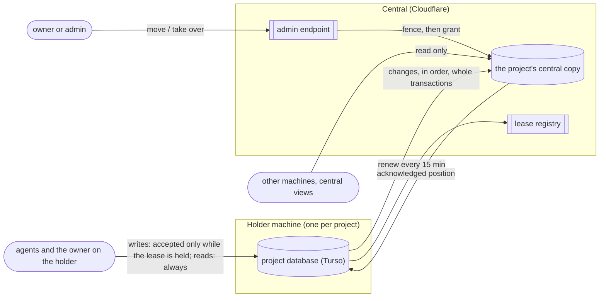
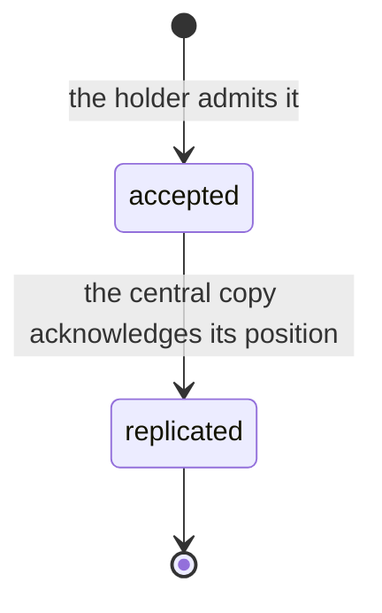

# Spec 2: project storage and replication

**What this is:** what must be observably true of how a project's data is stored, replicated and handed between machines. It depends on [spec 1](spec-1-board-and-contracts.md), which defines the nouns used here (writer epoch E20, request E21, the feed position E19 and RC-5), and on [spec 3](spec-3-central-fleet.md), which defines the lease (E23) and the admin endpoint. It traces to [requirements.md](requirements.md); [program-design-2-project-storage.md](program-design-2-project-storage.md) realizes it.

```text
requirements.md ──► spec 1 (shared contracts) ──► spec 2 (this) ──► program-design-2-project-storage.md
                                                  spec 3 (central fleet: leases, admin endpoint, central copies)
```

## 1. Scope

- **In:** one database per project (U25); the holder machine as its only writer (U21, U23); replication of each project's changes to its central copy (U33); clean moves and takeovers as the holder sees them; lease expiry as the holder sees it (U38); schema identity; what readers see.
- **Out:** the central side, which is the central copies, the lease registry, the admin endpoint and fleet records (spec 3); moving sessions and folders (P1/P5; the board consumes only the grant, N01).

## 2. How it fits



A record's states, as every view shows them:



## 3. Entities added here

| E | Entity | Same instance when | Belongs to / relates | Invariants | Observable states |
|---|---|---|---|---|---|
| E24 | **Central copy** | (project ID) | exactly one per project, for the project's whole life, which ends only by retirement (spec 3 FL-18); written only by applying that project's replicated changes, plus, once, an admin import's initial history while the project is unheld (spec 3 FL-17) | holds the project's replicated records, its schema identity, its fence (the highest epoch it accepts) and its acknowledged position. It never holds unreplicated holder state. Its schema identity equals the holder's once the change that set it is acknowledged | not initialized (refuses pieces until central accepts the project) · unheld (an import initialized it at the imported head under the import epoch, with no holder; refuses pieces until a claim fences it, spec 3 FL-15, FL-16) · live (a holder is granted) · fenced, with no lease for the new epoch (between a takeover's fence and its grant: the copy records the target as that epoch's holder and refuses the old holder's pieces) · full (refuses pieces with `centralCopyFull`) · archived (its board is archived: the holder admits only the reader-state exceptions of spec 1 E2, and the copy keeps applying the holder's pieces) · retired (its records are deleted; every piece, import, claim and read answers `retired`, and the ID is never reused; spec 3 FL-18) |
| E25 | **Replication piece** | (project, epoch, the position it continues from, the position it runs through, and, for one part of a larger transaction, the part's place in it), plus a digest of its content. Every part of one transaction shares the two positions, so the place is what tells them apart | one project; one epoch; sent by that epoch's holder | Holds only whole holder transactions, or one part of a transaction too large for one piece, with the part's place in that transaction. A replication position is the epoch plus a number that increases within that epoch; numbers may skip, and a piece continues from exactly the copy's acknowledged position. A piece repeated with the same identity and digest is a no-op. The same identity with a different digest is refused as `pieceConflict` and changes nothing | sent → applied \| refused (typed) \| unknown (until the acknowledged position is read) |
| E26 | **Machine session** | (machine installation, session ID) | one machine; carries every project that machine replicates | Outlives any one network connection. Its observable state includes, for each project it replicates, the last acknowledged position, and resuming starts every project from there. Only a credential for that installation can open it (spec 3 FL-12) | connected · disconnected (resuming; an expired or rejected credential closes only the connection) · ended (revoked, or replaced by a new session ID) |

## 4. Obligations: placement and writer authority (WA)

- **WA-2** A project's records MUST be accepted only on the machine holding the project's current writer epoch, where all of the project's work runs (U23). A write attempt from any other machine MUST be refused (`notWriter`). Other machines and central only read the project. (U21, U23, U16) The one exception is WA-13: posts forwarded to the holder, which the holder still admits itself.
- **WA-3** Every accepted project record MUST carry the writer epoch it was accepted under. A record is **accepted** when the holder admits it. It's **replicated** once its project's central copy (E24) has durably applied it under that epoch and acknowledged its position. Until then it's provisional. If a forced takeover happens first, it isn't carried over (WA-5, U80). Every view and read copy MUST show which records it reflects as replicated and which as provisional. (U21)
- **WA-3a Transactions replicate whole.** A central copy MUST show all of a holder transaction's records or none of them, in the holder's commit order. This holds even when one transaction is too large for one piece: no reader ever sees part of it. (U33; spec 1 RC)
- **WA-3b Order, repeats and gaps.** A central copy MUST apply a piece only if it continues from exactly the copy's acknowledged position. A piece it has already applied changes nothing and returns the same acknowledged position. A piece that would leave a gap is refused as `positionGap`, which names the acknowledged position, and the holder resends from there. The holder MUST keep every captured change until its central copy acknowledges it. A backlog is always sent in pieces; the lease's length bounds how large it can grow (U38). (U33)
- **WA-4** On a **clean move** (an admin request, spec 3 FL-10), no new holder MAY be granted, and no next writer MAY admit anything, until the project's central copy has acknowledged the old holder's final position.
  - The holder stops admitting and answers the release at its final *captured* position. The registry then waits for the copy's acknowledgement of that position before it fences and grants.
  - The next epoch starts at the next feed position, with no gap and no duplicate. Every record the old holder accepted is replicated before anyone else writes.
  - A move MUST NOT complete while the holder has a schema migration it hasn't applied. When the holder reports one, the move is refused as `migrationPending`, naming the migration and the state the holder reports. A holder whose migration failed while it opened the project answers no release; spec 3 FL-10 says what the move sees then.
  - (U21, U39) *Revised 2026-10-17 for agent-fleet-sync: the outcome is unchanged. Only the point at which the holder's own release answer is sent moved, to its final captured position, and the grant still waits for the copy.*
- **WA-5** On a **takeover** (an admin request, spec 3 FL-10, possible at any time, including before the lease expires), the new epoch MUST start from the central copy's last acknowledged position. Records the old holder accepted after that point **are not carried over** (U80, owner 2026-10-19). They aren't in central's copy at the takeover. Machines only work online and send right away, so this needs the holder to die in the moment between saving a write and central storing it.
  - When the old holder returns, it MUST stop writing that project, and any attempt to replicate its unsent records MUST be refused **as a whole** (`staleEpoch`). None of them may enter the project's feed.
  - The old holder's file stays on its disk, read-only, and the Router never deletes it. It's never served as board views and never reported.
  - Central's transfer record (spec 3 FL-10) is the one record of the takeover: the old and new epoch, the acknowledged position, the requester and the reason. The board writes no copy of it (one owner per truth, 2026-10-19).
  - A request that was only in the unsent part is unknown to the new holder, so a retry of it is evaluated fresh (RC-4). (U21, U39, U80)
- **WA-6** A machine that learns its epoch was superseded MUST refuse local writes to that project (`notWriter`, naming the current epoch). It MUST NOT serve board views from its leftover file. Views of that project come from central's copy (spec 3) or answer the existing unavailable result (owner, 2026-10-19). (U21)
- **WA-11 Lease expiry pauses writes, not reads.** When the holder's lease has expired and no holder change has happened:
  - new writes to that project MUST be refused as `leaseExpired`, naming when the lease expired;
  - reads keep working;
  - records accepted before expiry stay valid and replicate whenever central is reachable;
  - once the lease renews on the same epoch, writes MUST resume with no one acting.
  Automation isn't tied to projects: wakes and schedules keep running whatever a project's lease state (U38, owner 2026-10-19). There is no draft or "provisional after expiry" state. (U38)
- **WA-7** Each store has a **schema identity**: its version plus a fingerprint of its actual schema.
  - A Router MUST refuse to write a store whose version is newer than it understands, or whose actual schema doesn't match the fingerprint for its version. The typed error names both.
  - A migration counts as done only when the resulting schema matches the target fingerprint. A version number that advanced alone isn't enough: the Turso PoC's failed rename advanced the version while the column stayed unchanged.
  - A schema change MUST replicate in order with the project's data, and once it's replicated, the central copy's schema identity MUST equal the holder's.
  - A schema change whose effect wouldn't replicate MUST be refused before it's applied on the holder, as `schemaUnsupported`, which names the statement form.
  - A holder change MUST NOT grant a writer epoch to a machine that can't write the store's verified schema identity. (U9, U21, U33)
- **WA-8 One database per project.** Each project's records live in that project's own database on its holder, with one central copy (E24). A database never holds two projects, and moving a project never copies rows between projects: it hands the database's writer to another machine. (U25; topology experiment: a shared database can't fence one project)
- **WA-9 Engines.** Project databases on machines MUST use the Turso engine (U22). Central copies and fleet records live in Cloudflare Durable Object storage (U32). libSQL and `sqld` MUST NOT be used anywhere. (The driver is a program design choice.)
- **WA-10 Creating a project.** A project is created only through central (U80; owner, 2026-10-19: "you cannot make a project without central obviously"). Central accepts the project's directory entry and grants its first writer epoch before the creating machine writes anything. If central refuses, the answer is `projectRejected`, naming central's reason, and nothing is created on the machine. There are no provisional projects. Creating a project creates no workstream; workstreams are defined explicitly (U40). (U20, U23, U40, U80)
- **WA-13 Posting into a project another machine holds (U56).** An agent on a machine that doesn't hold a project MAY start a thread or reply in it. Nothing else: tasks, roles, moves, work-trail rows and facts stay with the holder (U23).
  - The post MUST travel through central to the current holder (spec 3 FL-14), and the holder MUST admit it like any other request, under the same gates, ledger and replay.
  - The record names the posting agent and the machine it came from.
  - When the holder isn't connected, the post MUST be refused at once as `holderUnreachable`, naming when the holder was last seen. Nothing is queued.
  - When the holder doesn't answer in time, the outcome is `unanswered`: the post may or may not have been admitted, and a retry with the same request ID returns the holder's recorded answer.
  - Notifications follow the normal rules and travel by WA-14 and spec 3 MS. A forwarded post itself is **not** queued: `holderUnreachable` still applies at once.
- **WA-14 Outbox and inbox (U63).** Each Router keeps a durable **outbox** of the items it sends, with each one's custody status. It also keeps a durable **inbox** of the items received for its sessions, taken in order from its ledger cursor. Both survive restarts. A board notification for a recipient on another machine leaves the outbox only under spec 3 MS-5. The full contract is spec 3 MS-1 to MS-11.
- **WA-12 Connections come and go; replication doesn't lose or repeat.** A dropped network connection, a Cloudflare deploy, or central objects losing their memory MUST NOT lose a replicated record or apply one twice. Replication resumes over the machine session (E26) from each project's last acknowledged position. (U35, U36)

## 4.1 Realized by agent-fleet-sync (U78, U79)

A project database's writer, its capture and pieces, the holder's lease, schema identity and normal migrations, clean moves, takeovers, and the machine session are realized by agent-fleet-sync. The board adds its own rules on top. The rules in spec 3 §4.2 apply here too:
- board names on board surfaces, mapped from the library's names on the wire;
- every obligation keeps its meaning;
- the wire changes once, at the release cutover.

| Obligation | agent-fleet-sync supplies | The board adds |
|---|---|---|
| WA-2 | writer admission and fencing (SO1, SO14) | project-to-database binding, the whole-project placement, posts forwarded to the holder (WA-13) |
| WA-3 | per-commit acknowledgements and tails (SO3, SO17) | record epochs; provisional and replicated labels; board feed positions mapped to captured commits |
| WA-3a, WA-12 | whole transactions; sessions that survive connections (SO2, SO20–SO24) | none |
| WA-3b | continuation, replay and retention (SO3, SO9); the authoritative copy retained until acknowledged | the surface name `positionGap` |
| WA-4 | the release, waiting for the copy, then fence and grant (SO16, SO31, SO48) | migration detail on the refusal, as the holder reports it (an agent-fleet-sync change) |
| WA-5 | the authoritative cutoff, refusal of the stale suffix, and the retained file (SO1, SO16, SO17) | central's transfer record only; no board takeover fact |
| WA-6 | the superseded-writer refusal (SO14, SO17) | the surface name `notWriter{current}`; no views from the leftover file |
| WA-7 | migration ordering, key guards, live fingerprints (SO5, SO6, SO10) | the expected-fingerprint catalog and mismatch diagnoses |
| WA-8, WA-9 | databases and drivers (SO1, SO11, SO28, SO29) | one database per project, with exactly one authoritative central copy |
| WA-10 | registration (SO44, SO45), completed before the first write | central-first creation and `projectRejected` |
| WA-11 | write pause and resume on expiry (SO14) | none |
| WA-13 | the consumer protocol (SO25, SO27, SO43) | posts-only authorization, `holderUnreachable` at once, `unanswered`, the bound |
| WA-14 | outbox, relay and inbox (SO34, SO38, SO42) | payloads, stores and the release gate after replication |

## 5. Proof

| V | Proves | Evidence |
|---|---|---|
| V3 | WA-2…WA-12 (WA-13 needs two installations: spec 3 V9, V7) | Two Router stores on one machine, replicating to a central run locally (the real Rust central objects under the local Cloudflare runtime), with the lease registry and the admin endpoint. It must include each of these: <br>• a clean move (no gap, no duplicate); <br>• a takeover before expiry, where the new holder starts from central's copy, the old holder's unsent records are refused whole and never enter the feed, its file stays on disk unread, central's transfer record is the only takeover record, and a retry of a request that was only in the unsent part runs fresh; <br>• `leaseExpired` refusals while wakes and schedules keep running, then writes resuming after renewal on the same epoch; <br>• a transaction larger than one piece that readers see whole or not at all; <br>• a repeated piece that changes nothing; <br>• a gap that's refused and then resent; <br>• a connection dropped, and central objects restarted, in the middle of replication, with nothing lost or applied twice; <br>• a schema change that replicates, with matching schema identity; <br>• a schema-too-new refusal; <br>• `cursorSuperseded`; <br>• a project created through central: created and written only after central accepts it and grants its first epoch, and refused as `projectRejected` with nothing created on the machine when central refuses. <br>Results from the local runtime are labelled local until V3d confirms them |
| V3d | WA-3a, WA-3b, WA-12 on Cloudflare | The same apply, fence and resume checks against a deployed staging account, including a deploy during replication. Until it runs, those three are proved only locally (G18) |

## 6. Coverage

| U | Entities | Obligations | Proof |
|---|---|---|---|
| U16, U23 | E20 | WA-2: all project work on the holder; other machines and central only read | V3 |
| U9 | E20 | WA-7 | V3 |
| U11 | E21 | WA-5 | V3 |
| U21 | E20, E21 | WA-2…WA-7, WA-10 | V3 |
| U25 | E3, E20, E24 | WA-8 | V3 |
| U22, U32 | E24 | WA-9 | V3; the driver's own tests |
| U20, U40 | E3, E20 | WA-10 | V3 |
| U33 | E24, E25 | WA-3, WA-3a, WA-3b, WA-7 | V3, V3d |
| U35, U36 | E26 | WA-12 | V3, V3d |
| U56 | E26, E10 | WA-13 (posts from another machine, forwarded to the holder) | V7, V9 (spec 3) |
| U38 | E23 (spec 3) | WA-3b (backlog bound), WA-11 | V3 |
| U39 | E23 (spec 3) | WA-4, WA-5 | V3 |
| U63 | E30, E18 (spec 3) | WA-14 (outbox, relay and inbox; spec 3 MS-1…MS-12) | V10 (spec 3) |
| U78, U79 | E23–E26 (spec 3, here) | §4.1: agent-fleet-sync realizes the mechanisms; board names on board surfaces; the new board schema; every obligation keeps its meaning | V3, V3d on the composed system |

## 7. Gaps

| G | Gap | Owner |
|---|---|---|
| G4 | Who builds the lease registry and the admin endpoint. **Settled (U53):** this lane, with a separate verification Sidekick proving it on real paths. Their contract is in spec 3 (FL-9, FL-10) | owner, 2026-10-13 |
| G8 | *Closed by U80:* there are no rejected tails to dispose of | — |
| G14 | Which projects each machine keeps open and replicating. **Settled:** every project it holds a lease for. Posting into a project another machine holds is a separate path (U56, G27) | owner, 2026-10-13 |
| G27 | Writing into a project another machine holds (U56). **Designed:** WA-13 and spec 3 FL-14, with posts only, forwarded through central, and refused when the holder is offline. The owner's confirmation of posts-only and refuse-when-offline is assumed and recorded in the brief | owner, 2026-10-13 |
| G28 | The one-time multi-computer upgrade script (U54). **Designed:** spec 1 §5 (upgrade), spec 3 FL-15 to FL-17, PD3 (registry `Unheld` and `Claim`, admin import) and PD2 (claim seeding and the script). Same-name records stay separate by ID (U62). **Open (owner, review F19):** what a name collision becomes. Until it's decided, the script renames nothing: it reports each collision, and a real run refuses to upload while one exists | Lead, 2026-10-14 |
| G29 | A reader's inbox keeps context from threads it watches in other workspaces (today's rule, PD1 §9), but only within this machine's projects. A watch that lives at another machine's holder, for example one a forwarded thread creation wrote there (WA-13), doesn't reach the origin machine's inbox. **Open for M4:** whether a forwarded post may carry a watch, and how the origin learns of that thread's activity (a read copy, or the holder's notification). | Lead, 2026-10-15 **Settled by U63:** the origin learns through the message path. Remote follows and their owed activity follow spec 3 MS-5 and MS-11 (2026-10-15). |
| G17 | The largest single transaction a central copy can apply at once. Cloudflare's per-event CPU limit (30 s, up to 5 min) and 2 MB row limit bound it; it isn't measured yet | Lead, measured in V3d |
| G18 | Behaviour proved only under the local Cloudflare runtime so far: the official transaction API applying a batch all-or-nothing (and a panic inside one), fencing, and resuming across a deploy and across objects restarting mid-apply. Local observation (workerd, 2026-10-12): a deliberate panic inside the transaction callback after a write left the request hanging; after a restart nothing from that transaction had persisted (fence, prefix and rows unchanged). Deployed behavior is still to confirm | Lead; closes with V3d |
| G19 | Schema forms that wouldn't replicate correctly: tables without a declared primary key, triggers (central would run them a second time) and virtual tables. WA-7 refuses them, and the board's schema uses none of them today | Lead; tested in V3 |
