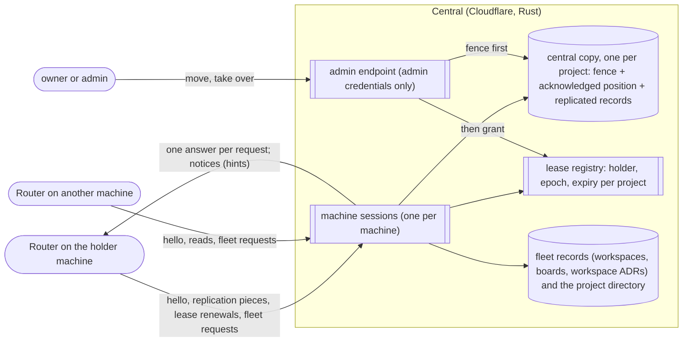

# Spec 3: the central fleet

**What this is:** what must be observably true of central:
- the fleet records it owns;
- the project metadata it keeps;
- each project's central copy and how it fences replication;
- the lease registry;
- the admin endpoint that moves and takes over projects;
- the one session each machine keeps with it, and what its frames carry.

It depends on [spec 1](spec-1-board-and-contracts.md) (nouns and contracts) and works alongside [spec 2](spec-2-project-storage.md) (project databases and replication as the holder sees it). It traces to [requirements.md](requirements.md); [program-design-3-central-fleet.md](program-design-3-central-fleet.md) realizes it. **How central is built and run** (one async core, SQLx with our own drivers, one axum Router, the same proof on every runtime) **is specified in [the central one-core spec](../2026-10-16-central-one-core/2026-10-16-central-one-core.md).** Every obligation in this spec holds unchanged under it (its OC-20).

```text
requirements.md ──► spec 1 (shared contracts) ──► spec 3 (this) ──► program-design-3-central-fleet.md
```

## 1. Scope

- **In:**
  - fleet records: workspaces, boards, workspace ADRs (U41), the project directory, process definitions;
  - project metadata for finding and searching projects;
  - each project's central copy (spec 2 E24): its fence, its acknowledged position, read-only reads;
  - the lease registry (E23);
  - the admin endpoint for moves and takeovers;
  - machine sessions (spec 2 E26) as central sees them, and the frames they carry (FL-12);
  - board archive across holders;
  - notices from central to Routers.
- **Out:**
  - project records, including each project's work trail and decision register (spec 1 U42, U41). They're written on the holder and reach central only as replicated state in the project's central copy (FL-2);
  - routing roles to sessions and placing sessions on machines (fabric lane P1);
  - moving sessions and folders (P1/P5);
  - the model proxy and harness connections (U29).

## 2. How it fits



## 3. Entities added here

| E | Entity | Same instance when | Belongs to / relates | Invariants | Observable states |
|---|---|---|---|---|---|
| E23 | **Lease** | (project ID, epoch) | one project; one holder, a machine installation; issued only by the lease registry: as a new project's first epoch, by a holder change (E27), or by a claim of an unheld project (FL-16) | at most one lease per project is current; epochs per project only increase, including after a restore; expiry is decided by the registry's clock; an expired lease stays with its holder until an admin changes the holder. A Router restart on the holder installation is the same holder: nothing changes the holder automatically (U39) | unheld (an imported project: no lease, no holder, no expiry; FL-15) → held by a claim (FL-16) · held → expired (the holder's writes, wakes and schedules for the project pause; reads continue) → held again on renewal (same epoch) \| superseded (by a takeover) \| released (by a move) |
| E27 | **Holder change** (a move, a takeover or a claim) | its request ID, minted by the requester's client (U10) | one project. A move or a takeover is requested by an admin (FL-10); a claim is requested by a machine with its machine credential (FL-16). It names the epoch it ends, if any (a claim of an imported project ends none and has no old holder), and the epoch it grants | at most one holder change per project is in progress, with one exception: an explicit takeover supersedes a move in progress (FL-10; owner, 2026-10-17). Repeating the same request ID returns its recorded outcome and the same new epoch, and never issues another; the same ID with different content is refused as `conflictingRequest`. Recorded for the project's life with its kind, requester, reason, old and new epoch, new holder, start position and outcome. A **claim's** settlement owed to its reservation gate is recorded and shown separately from the outcome (agent-fleet-sync decision 77). A **move's** outstanding release withdrawal or follow-up is a different, separately shown obligation. Neither invents an old holder | its **phase** is one of requested, releasing, released, reserved, fencing, cancelling or ended. The phases a move, takeover or claim passes through are agent-fleet-sync's shared workflow's (its SO48, SU20 and decision 75), and a takeover starts from its confirmed preview. Once ended, it has exactly one **outcome**: granted, refused, failed, cancelled or superseded. Released never means the central copy has everything; only the grant does (FL-10). A crash during fencing leaves it fencing, with the copy fenced to the new epoch and no lease for that epoch granted, until it's repeated (FL-10) |
| E30 | **Message item** (U63) | its UUIDv7 item ID, minted once by its sender. A board notification's semantic identity is (project, intent) | one sender: a session actor; the human user at a machine, for a direct message typed by a person (today's human-user input; M2c finding); or a project, for a notification; one recipient: a session, which carries its machine (spec 1 E10), resolved before handoff; one kind: `message`, `notification`, `cancel` or `wake` (a wake for a session on another machine, MS-10), with questions and approvals added later | content is immutable. The same ID with different content is a conflict. Each hop keeps custody until the next hop confirms a durable receipt or the item reaches a terminal outcome | queued (sender's outbox) → sent (ledger custody) → at machine (recipient's inbox) → held (the session isn't running; still in inbox custody, never history) → delivered (accepted by the local carrier; an unknown carrier outcome stays `uncertain` and is never re-injected blindly) \| expired \| cancelled \| refused{reason} |

## 4. Obligations (FL, plus WA-1)

- **WA-1** Fleet-level records MUST be written only by central. They are:
  - E1 and E2;
  - workspace ADRs (spec 1 E7, U41);
  - the project directory;
  - process definitions (E16);
  - leases (E23);
  - stored rejected-tail reports (FL-8).

  From a machine, these are requests that wait as pending while central is unreachable. (U20, U41; E16 is derived: MV-7's fleet-wide `name@version` uniqueness needs one writer)
- **FL-1 Project metadata.** Central MUST hold, for every project, the metadata needed to find, search and know what projects exist. Accepting a new project's directory entry is what lets its changes replicate (spec 2 WA-10). (U24)
  - The fields are the project's name, workspace and board; its status (spec 1 E3: its pinned-definition status, or closed) and its board's archive state; its holder machine and lease state (held or expired, with the expiry), or `unheld`, with no holder and no expiry (FL-15); and the time of its latest replicated record. Anything more is read from the project's central copy when needed (FL-2). (U46)
  - Search MUST find projects by text in their name and filter them by workspace, board, status and holder.
  - Every metadata result MUST say how current it is: the time each part was last updated from its source (the project's latest replicated record, or the lease registry). An offline holder's project shows its last replicated state with that time. (U46)
- **FL-2 Central reads, never writes, projects.** Central MAY read any project's central copy, read-only, for more detail. What it reads is replicated state, labelled with its feed position, never unreplicated holder state. Only the project's own replication writes its central copy, with one exception: an admin import (FL-17) writes an unheld project's initial history once, before any machine holds it, and never afterwards. That includes the project's work trail and decision register: central shows them read-only and never writes them. (U21, U24, U41, U42)
- **FL-3 Each central copy fences its project.**
  - A central copy MUST refuse, as a whole and before any of it applies, a piece from an epoch older than its fence (`staleEpoch`).
  - A fence only moves forward, and it survives restarts and objects losing their memory.
  - One project's refusal MUST NOT affect the same machine's other projects.
  - A new epoch takes effect at a central copy only between pieces, never while one is being applied. Its start position is the copy's acknowledged position at that moment.
  - Accepting a piece doesn't depend on reaching the lease registry: the fence is the check. (U21, U25, U37; spec 2 WA-3b, WA-5)
- **FL-4 A full central copy is a distinct failure.** When a project's central copy can't store more, its refusal MUST be typed `centralCopyFull`, distinct from `notWriter` and `staleEpoch`. (U32; Cloudflare's per-object storage limit)
- **FL-5 Archive is all-or-nothing to readers.** While a board is being archived, it reads as `archiving`. It reads as `archived` only once no project on it accepts work writes. Archiving freezes work, not readers: the reader opt-outs and reader state that spec 1 E2 allows (unwatch, unsubscribe, read marks and acknowledgements) are still admitted by each project's holder and still replicate. Central keeps accepting the holder's pieces for an archived project, because the holder enforces what is allowed and central can't tell one change from another. A restart resumes the archive; it never shows `archived` early. Archiving a workspace archives each of its boards this way, and the workspace reads as `archived` once all of them do. (U3, U20; review fix F13)
- **FL-6 Notices are hints.** Central MAY notify Routers that a lease was superseded or a board is archiving. Correctness never depends on a notice arriving: fencing (FL-3) and admission checks still decide. A Router that missed notices catches up from a cursor. A cursor older than retention is refused as a typed `cursorExpired`, and the Router re-reads in full. (U9)
- **FL-7 Unknown outcomes stay unknown until read.** A piece whose acknowledgement is lost has an unknown outcome until the holder reads its central copy's acknowledged position. Resending the same piece is safe (spec 2 WA-3b). A business request is never re-sent as a new request. (spec 1 RC-4)
- **FL-8 Rejected-tail reports pass through central.** A superseded holder MUST be able to report its rejected tail (project, epoch, request IDs, digest) to central. Central MUST make the report available to the project's current holder, which records the `RejectedTail` fact (spec 2 WA-5). Holders never talk to each other directly. (U11, U21)
- **FL-9 The lease registry.** The registry is the only source of project leases (E23). A lease names the project, the holder installation, the epoch and when it expires.
  - Leases last 4 hours. The holder renews every 15 minutes, and renewal is never on a write's path.
  - Expiry is decided by the registry's clock. An expired lease pauses its holder's writes, wakes and schedules for that project, and reads continue (spec 2 WA-11). It is not a holder change.
  - Renewing on the same epoch resumes the holder, unless an admin changed the holder in between. A fresh renewal attempt for an epoch that's been superseded is refused as `staleEpoch`, naming the current epoch (a re-sent attempt replays its recorded answer instead, FL-12); one from an installation that never held the project is refused as `notWriter`.
  - Epoch numbers per project only increase, including after the registry is restored from a backup. If the registry can't prove the highest epoch it has issued, it MUST refuse to issue a new one, as `registryEpochUnproven`, and change nothing.
  - A machine credential can renew its own leases, release a project when a move asks it to, reserve a new project's first epoch (spec 2 WA-10), and claim an unheld project (FL-16). It can do nothing else to a lease. (U37, U38)
- **FL-10 Moves and takeovers only through the admin endpoint.**
  - **Who:** moving or taking over a project is possible only through a separate admin endpoint, with admin credentials distinct from every machine and agent credential (the owner's own sign-in, U57). Any other credential is refused as `adminRequired` and changes nothing. By default only the owner is an admin; anyone else becomes one only when the owner grants it (derived).
  - **One at a time:** a holder change (E27) requested while another is in progress for the same project is refused as `transferInProgress`, naming the one in progress. **The one exception** (owner, 2026-10-17): an explicit takeover supersedes a move in progress, including one that's cancelling. The move then ends `superseded` and grants nothing, so a holder that disappears mid-drain never leaves its project unwritable. Nothing supersedes a move on its own (U39).
  - **Move:** the holder is asked to release; it stops admitting and releases at its final captured position (spec 2 WA-4). The new holder is granted only after the project's central copy acknowledges that final position.
    - A move is refused as `holderUnreachable` when the holder has no connected session, or hasn't renewed in the last 30 minutes (U45). The refusal names the observation that decided it: the holder's last-seen time (session presence) when it has no session, or its last renewal (the lease) when that is too old. They're distinct observations, and neither is ever reported as the other. The takeover preview shows the last-seen time either way. It's this request's recorded outcome, so a repeat returns it. The admin may then choose a takeover.
    - It's refused as `migrationPending` when the holder reports a migration it hasn't applied, naming the migration and the state the holder reports. A holder whose migration failed while it opened the project has no writer, so it answers no release. If the library's durable record shows the release never left central, the move is refused `holderUnreachable`. Otherwise, including a release interrupted mid-send by a restart, it may have arrived, so the move keeps waiting until the admin cancels it or takes over, even if the holder disconnects (agent-fleet-sync SO52 has the exact rule). Once the holder's last renewal is 30 minutes old, a new move is refused `holderUnreachable` (agent-fleet-sync SO52).
    - When it completes, nothing has been lost.
  - **Takeover:** allowed at any time, including before the lease expires. A preview first shows the holder's last-seen time, the last replicated position and what will be voided. The takeover then needs the admin's confirmation naming that preview. If the holder, epoch or acknowledged position has changed since the preview, it's refused as `previewStale` and nothing changes. The project's central copy is fenced at the new epoch before the new holder is granted.
  - **Crash safety:** a holder change interrupted between fencing and granting leaves the copy fenced to the new epoch, with the target recorded and no lease for that epoch granted. The target admits nothing at the new epoch until the grant. The old holder may still admit writes locally until it learns it was superseded or its lease expires; its pieces are refused, and what it admitted after the cutoff becomes its rejected tail (spec 2 WA-5). It never leaves two holders. Repeating the same request finishes it with the same epoch; it never issues another.
  - **Record:** every move and takeover is recorded as in E27. (U39)
- **FL-11 One session per machine, surviving connections.**
  - Each machine keeps one session (spec 2 E26) with central for all its projects (U34).
  - A dropped connection, a Cloudflare deploy, or central objects losing their memory MUST NOT lose or repeat anything. The session resumes from each project's acknowledged position.
  - Nothing correct depends on what a central object held in memory (U35, U36).
- **FL-13 Not on the open web (U55, U58).** Central MUST be reachable only through the owner's Access gate. It MUST refuse any request whose Access assertion fails verification, even if a credential is valid. It MUST expose no other address: no `workers.dev`, no preview URLs. A machine's session needs both its own Access service token and its machine credential. The admin endpoint needs the owner's own sign-in.
- **FL-14 Forwarding posts to the holder (U56).** A machine MAY send a post for a project it doesn't hold over its session.
  - Central MUST look up the project's current holder in the lease registry. If that holder has an open session, central MUST forward the post with the sender's verified installation, and return the holder's answer to the sender.
  - Central MUST answer `holderUnreachable` (with the holder's last-seen time) when the holder has no open session, `notHeld` when no machine holds the project, and `unanswered` when the holder doesn't answer within the forwarding bound.
  - Central keeps no post content and no outcome. It holds only a short-lived correlation (forward ID, the sender's connection and frame, the expected holder and a deadline), so the answer reaches the right sender and only from that holder. It drops the correlation at the answer or the deadline. The holder's ledger is the only record of the post, so a retry is safe.
  - When the sender itself holds the project, central answers `senderHolds` and the post is admitted locally.
  - Central MUST forward posts only. Every other project write from a non-holder is refused `notWriter` without being forwarded.
  - A machine has a bounded number of forwards in flight; beyond that, it's answered `overloaded`.
- **FL-15 Unheld projects (U54).** A project can exist with a central copy and no holder: `unheld`. Only an admin import (FL-17) creates one. Its copy is readable (read copies, directory and metadata). A write needs a holder: it's refused `notHeld`, and a post forwarded to it is answered `notHeld` (FL-14).
- **FL-16 Claiming an unheld project.** A machine MAY claim an unheld project with its machine credential; no admin is needed. A claim on a project whose board is archiving or archived is refused `archived`, because a claim exists to write and an archiving board is read-only for work (FL-5; the Lead's default, which the owner may adjust). The registry MUST grant the claimant the next epoch, after the epoch floor. The machine builds its store from the copy at the copy's acknowledged position before admitting anything, as a moved project's new holder does (spec 2 WA-4). A claim on a held project is refused `alreadyHeld`, naming the holder at the moment the refusal was recorded, and changes nothing. A repeat of that claim returns the same answer and the same named holder, even after the holder has since changed; moves and takeovers stay admin-only (FL-10). Of two racing claims, exactly one wins; the other gets `alreadyHeld`. A re-sent claim with the same attempt ID gets its recorded answer and the same epoch, never a second one, including after a crash between the copy's fence and the grant. A claim from a machine whose Router build can't support the copy's schema is refused `schemaTooNew`, naming both, and changes nothing. That's decided against the claiming machine's own supported schema, never a fleet-wide setting. A copy whose fence has moved past its import (it was claimed before, even if the registry has since been restored) is never granted again by a claim: the answer is `alreadyHeld`, naming that epoch's holder.
- **FL-17 Admin import (U54).** Only the owner's admin sign-in (U57) may import.
  - An import installs fleet records (workspaces, boards and directory entries) with their original IDs and creation times, plus each project's complete history as an `unheld` copy whose acknowledged position is the imported head.
  - Re-importing an identical project, by ID and digest, is answered `alreadyImported` and changes nothing, whether or not it has been claimed since. Different content under an existing ID is refused `importConflict`, naming both digests, or naming the offered one and saying the existing project wasn't created by an import.
  - An import never touches a project that is held or has ever been claimed.
  - **Completion.** An import is complete only once its project's copy is published and the import is recorded as complete; reserving its identity alone isn't completion. A repeat of an interrupted import, before or after publication, finishes it under the same identity. It never publishes twice, and it never reports an unfinished import as complete. A retired copy's answer comes before any import replay (FL-18).
  - Imported history belongs to the import epoch, epoch 1, which has no holder. The first claim gets the next epoch (FL-16).
- **FL-18 Retiring a project's copy (U67).** Only the owner's admin sign-in may retire a copy, and only when all of these hold:
  - the project has no lease in any state;
  - no holder change or claim is in progress;
  - its board is archived;
  - the copy's fence and acknowledged position still match what the owner last read.

  Retiring deletes the copy's records. Central keeps the project's ID as retired forever: every later piece, import, claim and read answers `retired`, and the ID is never reused. **Once retired, `retired` takes precedence** over FL-16's replay of an earlier claim and FL-17's `alreadyImported`. While a retirement is in progress, a new claim answers `transferInProgress`, and a repeated earlier claim attempt still replays its recorded answer, which can only be a refusal then. A repeated retire returns its first outcome, and an interrupted one resumes where it stopped.
- **FL-12 What a session carries.** These are the observable rules for every frame on a machine session. The concrete frame types, their encoding and the transport are Program Design.
  - **Opening and credentials.** A machine credential proves one machine installation and nothing more. It's checked when a connection is **admitted**, before any session frame, together with the Access assertion (FL-13). A hello on an admitted connection then opens or resumes the machine's session.
    - Central MUST admit a connection only while its machine credential is current for that installation. Otherwise it refuses the connection as `credentialRejected`, naming why (unknown, expired, revoked, or not a machine credential), and no session frame is exchanged. An expired credential never ends the session: the next connection with a current credential resumes it. Only a revocation or a new session ID ends a session (U77; agent-fleet-sync SU12, SO20–SO25). Agent and admin credentials can't open a session.
    - A credential that stops being current mid-session gets `credentialRejected` on its next request, and the **connection** closes. The session survives and resumes on a new connection with a current credential (U77). Only a revocation or a new session ID ends it.
    - **A request is always answered.** A frame whose `frame_id` can be read but whose body doesn't decode is answered `invalidShape`, naming the field. A malformed frame whose request can't be identified closes the connection with a typed reason, `malformedFrame`. Frames that carry no `frame_id` by design, such as the hello, aren't malformed. It's never dropped in silence (M3.10 finding).
    - An accepted hello is answered with, for each project the machine holds or replicates, its acknowledged position and its lease (epoch, expiry, held or expired), so resuming starts from there. **A project whose copy can't be read is reported `copyUnavailable` for that project alone;** the session opens, and every other project resumes normally (M3.10 finding: one damaged copy must not stop a machine's other projects).
    - The logical session is not the connection (U36). A newer connection from the same installation takes over its session; the older connection is closed as `connectionReplaced`, and requests in flight on it are re-sent on the new one. A hello naming a different session ID starts a new logical session for that installation and ends the old one; nothing is lost, because acknowledged positions belong to each project's central copy. (U34, U49)
  - **What a machine credential may do:** send replication pieces (the fence decides, FL-3), renew its own leases, release a project a move asked it to, reserve a new project's first epoch, claim an unheld project (FL-16), report its own rejected tails, and send fleet requests and reads naming declared actors (spec 1 §6). Central records that machine as each such record's provenance (RC-8), whatever installation a named session calls home. It can't move or take over a project (`adminRequired`, FL-10). Admin credentials are used only at the admin endpoint, never on a session.
  - **Requests and answers.** Every frame a machine sends that expects an answer carries an ID unique within its session. Central answers each one exactly once, naming that ID, with the result or a typed failure from spec 1 §5. Answers may arrive in any order.
    - **Any request a project's central copy serves** can instead be answered `copyUnavailable`, naming why (U67; M3.12 finding): the copy's own bookkeeping migration is pending or failed, or the copy is uninitialized or damaged.
      - **Two answers take precedence** (review 31): a retired copy answers `retired` (FL-18), and a copy that can't store more answers `centralCopyFull` (FL-4), even when that happens during its migration.
      - **`copyUnavailable` means the blocked step had no new effect:** no piece applies, no fence moves, and no epoch is issued. Effects that earlier steps committed stay.
      - **Operations resume.** A holder change, claim, creation or retirement resumes from its recorded step, under the same request and epoch, when it's repeated after the copy is migrated or repaired (FL-10, FL-16, FL-18).
      - **A Router** keeps its unacknowledged pieces and sends them again later.
    - An answer lost with its connection leaves the outcome unknown. After resuming, the machine re-sends the request, and re-sending never repeats an effect: a piece is matched by its identity and digest (spec 2 E25), a renewal by its attempt ID (each scheduled renewal is a new attempt with a new ID, and a re-sent attempt keeps its ID and doesn't renew again), a release by the holder change it answers, a fleet request by its request ID (spec 1 E21, RC-4), and a read has no effect.

    | Request | Names | Its answer carries |
    |---|---|---|
    | Replication piece | its identity and digest (E25) | the acknowledged position, or `staleEpoch`, `positionGap` (naming the acknowledged position), `pieceConflict`, `notInitialized` or `centralCopyFull` |
    | Lease renewal | its attempt ID, project, epoch | `renewed` with the new expiry (a re-sent attempt gets its recorded result, marked as a replay, plus the lease's current state), and any holder change in progress for the project; or `staleEpoch` or `notWriter` |
    | Release | project, epoch, the holder change asking for it | released, with the holder's final **captured** position. The registry then waits for the copy to acknowledge that position before it fences and grants (spec 2 WA-4, FL-10), so no grant happens before the copy has everything. Alternatively `releaseRefused` naming the holder change and its reason: `migrationPending` (a migration the holder hasn't applied) or `schemaTooNew` (the copy's fence refusing the target schema). A re-sent release gets the same answer |
    | First-epoch reservation | the new project | its first lease, or `projectRejected` naming central's reason |
    | Claim | its attempt ID and the project | `claimed` with the granted epoch, its expiry and the copy's acknowledged position to seed from (a re-sent attempt gets its recorded answer), `alreadyHeld` naming the holder, `schemaTooNew` naming both versions, `notFound`, `transferInProgress` while a retirement is in progress, `archived` when the board is archiving or archived (FL-16), or `retired` (FL-18) |
    | Rejected-tail report | project, epoch, request IDs, digest | stored (a repeat with the same digest replays `stored`); `notWriter` if that epoch wasn't this installation's; or `tailConflict`, naming the stored digest, when a report for that project and epoch already exists with a different digest. The first report is never replaced |
    | Forwarded post | project, post kind and the post itself (its own request ID inside) | the holder's answer, or `senderHolds`, `notHeld`, `holderUnreachable` (with the holder's last-seen time), `unanswered` or `overloaded` |
    | Fleet request | its request (E21) | its decision (spec 1 RC-4): accepted with the records and their fleet feed positions, or rejected with reasons |
    | Read | a scope (fleet records, the project directory and metadata, one project's central copy, or the machine's notices) and an optional cursor | the records, the position they reflect (a fleet feed position, a project's acknowledged replication position, or a notice position) and when that position was current; `cursorExpired` for a cursor older than retention |

  - **The renewal answer is authoritative.** A holder learns that its lease renewed, expired or was superseded from the answer to its renewal, never from a notice. A re-sent attempt that was already decided gets its recorded result again, marked as a replay, together with the lease's state now. The replay never renews again and never restores authority: the holder acts on the current state, so if a takeover happened in between, it learns it's superseded and stops writing. That answer also names any holder change in progress, so a holder that missed the notice asking it to release learns of the move at its next renewal (derived from FL-6).
  - **Notices.** A notice names its kind (lease superseded, lease granted, release requested, board archiving, rejected tail reported), its scope (a project with its epoch, or a board) and its position in that machine's notice feed. A notice changes nothing by itself; the machine acts only on the answer to a request (FL-6). It catches up by reading its notices after the last position it has. (U9, U34, U36, U39)

## 4.1 Messages across machines (MS) (U63, U66)

- **MS-1 One path.** A message or notification for a recipient on another machine travels through:
  1. the sender's Router, which writes it to a durable **outbox**;
  2. the **central ledger**, which takes custody;
  3. the recipient machine's durable **inbox**;
  4. that Router's existing local delivery to the session.

  A recipient on the same machine is delivered locally under the same item identity. The ledger routes by the recipient's machine. It never resolves board roles and never interprets board content.
- **MS-2 Identity.** Each hop records an item under its sender-minted ID. Repeating the same ID with the same content returns the recorded result and creates nothing new. The same ID with different content is refused as `itemConflict`. A receiver reuses the item's identity in its local delivery, rather than minting a new delivery for each retry.
- **MS-3 Custody, never silent loss.** A hop releases its copy only after the next hop confirms a durable receipt, or the item reaches a terminal outcome. The sender can see the item's status: queued, sent, at machine, held, delivered, uncertain, expired, cancelled, or refused with a reason. A held item stays in custody, outside history pruning, until it's delivered or reaches a terminal outcome. Central accepting an item doesn't make it delivered, and delivery doesn't mean the reader has read it (spec 1 VW-6).
- **MS-4 When "sent".** A send returns "queued" once the sender's outbox has it, and becomes "sent" once the ledger has custody. While central is unreachable, items stay queued and drain later under the same IDs. Local board work never waits on the ledger.
- **MS-5 A notification leaves only after replication.** A notification for a recipient on another machine becomes eligible only once its cause and its **frozen handoff** are in the project's acknowledged replicated prefix. The handoff, recorded in the project under the lock that checks the role revision (NI-2), holds the recipient, the item ID and the payload. Then:
  - a successor holder publishes the same item for any replicated, unfinished handoff;
  - a handoff discarded with a rejected tail never escapes, and the new holder resolves the surviving cause again.
- **MS-5a Same-machine notifications** are delivered immediately. **The exception:** a recipient on the old holder's machine may have been told before a takeover that discards its handoff, **whether or not the cause survives**. If the cause survives, the new holder resolves it again and may notify the then-current holder too (spec 1 NI-2's exception). Remote notifications never escape this way (MS-5). The owner accepted immediate local delivery with this exception; its exact scope is the Lead's interpretation, pending owner confirmation.
- **MS-6 Content.** A message carries its own text. A notification carries a short excerpt plus a pointer: project, subject, record and an epoch-qualified position. Full context is read through the normal board read path. Content that can't be read is reported as unavailable; a record from another epoch line is never returned in its place.
- **MS-7 Retention.**
  - Undelivered items are held until delivered.
  - The outbox, the ledger and inboxes enforce a size cap by **refusing new items before taking custody** (`mailboxFull`), never by dropping accepted ones.
  - A sender may set `validUntil`. When it passes, the item becomes `expired` and the sender can see that.
  - Delivered history is kept under the existing history policy, which is separate from custody.
  - Duplicate-detection records outlive every retry window.
- **MS-8 Checks before injection.** Before a session receives an item, the recipient's Router skips it if it's cancelled, expired or superseded. Activity in a followed thread is coalesced into one delivery per thread. The existing delivery modes (`auto`, `queue`, `steer`) apply.
- **MS-9 Cancellation.** A cancel is an item that names the exact original, and travels the same path behind it.
  - **Accepted versus effective.** Accepting a cancel is not the same as preventing the original. **Only the recipient's Router, at its injection check (MS-8), decides the effective outcome:** `prevented`, or `tooLate{delivered | uncertain}`. Earlier hops forward the cancel and may mark their copy, but report only `cancelPending` until that outcome returns to the sender. A predecessor's stale copy never attests prevention.
  - **Already delivered:** the recipient sees "cancelled" without a new wake. A cancel never undoes work already started.
  - **Board-derived cancels.** Subscription ends and generation changes reach already-sent follow batches as a cancel keyed by (membership, generation), ordered after them. A batch from an old generation is never settled against the current one. Such a cancel is an outgoing effect of a project record, so it follows the same eligibility as a notification (MS-5):
    - it's frozen with the membership change as a handoff, under that cancel's identity, and leaves for a recipient on another machine only once the change and the handoff are in the acknowledged replicated prefix;
    - a change discarded by a takeover never sends its cancel. The successor continues the batches owed under the surviving membership (MS-11), under their original identities;
    - a successor that inherits the replicated change publishes the same cancel, and replaying the batch and its cancel after lost receipts returns their recorded outcomes: a prevented batch stays prevented;
    - before the change is replicated, a same-machine recipient's injection check may hold a batch of the ended or changed membership (its MS-8 skip is a hold until then), but never settles it as `prevented`. A provisional change suppresses; it never settles.
  - **Requested cancels.** A cancel asked for by someone allowed to cancel (below) is a request, not a project record. It isn't gated on replication, and the recipient's injection check decides it as above. **One exception:** an item the sender's outbox has never tried to submit is still in the sender's sole custody, so it's withdrawn there and becomes `cancelled`. Once a submission has been attempted, even one whose answer was lost, the cancel travels like any item.
  - **One cancel per item:** a second cancel for an item that already has one in custody returns the first cancel's status and admits nothing.
  - **Who may cancel:** the sender, the lead of the item's project, and the owner.
- **MS-10 Wakes (U66).**
  - Each wake records who set it (U66).
  - A paused wake still occupies its session's slot, because it can resume.
  - **At the release** (owner, 2026-10-16: "add creator", "one wake and expire the others"):
    - a session with more than one active or paused wake keeps only its newest, and the others end as expired, with an event saying why;
    - a kept wake beyond the limits has its end capped at the release time plus the limit;
    - a kept repeating wake that repeats more often than the minimum gap ends as expired, with an event saying why;
    - wakes from before the release have no recorded creator, so only the target session or the owner may replace them.
  - A target session has **at most one active wake**. Setting another needs `replace: true`. Only the existing wake's creator, the session itself or the owner may replace it; anyone else is refused as `wakeExists`, naming the creator. The owner's identity is declared, not authenticated (spec 1 §6), so this rule is a guard against accidents, not a security boundary.
  - Every wake has a lifetime. Defaults, which the owner may adjust: a one-shot is due at most 24 h ahead and ends within 24 h of being due, a repeating wake ends within 7 days, and repeats come at most every 5 min.
  - A timed one-off for a session that already has a wake is a **one-shot schedule** (`at` or `after`) or a message. Longer-lived timing is a schedule.
  - A wake for another machine travels by MS-1, carrying its deadline.
- **MS-11 Owed follow notifications survive holder changes.** Subscription activity that's owed and not yet delivered survives a clean move or a takeover. A successor continues the owed obligations recorded in the replicated prefix; it doesn't restart at the feed head.
- **MS-12 Deferred kinds.** Questions and approval or access requests will later travel this path as their own item kinds, with the interaction store as their authority. Nothing in MS-1 to MS-11 assumes there will only ever be messages and notifications.

## 4.2 Realized by agent-fleet-sync (U78, U79)

Central's copies, the lease registry and its holder changes, machine sessions, and message custody are realized by agent-fleet-sync (`agent-collaboration/agent-fleet-sync`, its spec `docs/specs/2026-10-16-agent-fleet-sync/`). Central composes those mechanisms in its one core (central one-core spec OC-1) and adds the board's rules on top. Three rules govern every obligation above.

- **Board names on board surfaces; the library's names on the wire.**
  - Admin HTTP answers, MCP and CLI answers, and views keep the names and fields this spec and spec 1 §5 give.
  - The machine session's frames use agent-fleet-sync's protocol, each name mapped to its board meaning with every field carried. The table below lists the names that differ.
- **Every obligation keeps its meaning.** Where agent-fleet-sync behaves the same, it realizes the obligation. Where the board adds a rule, central adds it at a named seam (Program Design). Where agent-fleet-sync falls short of an obligation kept here, the fix goes into agent-fleet-sync at its owning boundary. Those fixes are listed in its own spec, never worked around in central.
- **The wire changes once.** The concrete session frames change at the release cutover (U27, U60). The one behavior change is FL-10's takeover superseding a running move (owner, 2026-10-17).

**Names that differ between board surfaces and the wire**

| Board name (surface) | agent-fleet-sync on the wire | Notes |
|---|---|---|
| `positionGap` | piece refusal `gap{acked}` | same behavior |
| `notWriter{current}` | `NotWriter`, or the writer's `Superseded{current}` | the current epoch is carried |
| `centralCopyFull` | piece refusal `copyFull` | same behavior |
| `registryEpochUnproven` | `epochUnprovable` | same behavior |
| `holderUnreachable` | `holderUnreachable{lastSeen}` for presence, `holderStale{lastRenewedAt}` for renewal age | both observations carried, neither relabelled (FL-10) |
| `alreadyHeld` | `alreadyHeld` | carries the holder frozen at refusal (FL-16; an agent-fleet-sync change) |
| `migrationPending` | `migrationPending` | carries the migration and the state the holder reports (FL-10; an agent-fleet-sync change) |
| `credentialRejected` | a connection-admission refusal with the reason, then the `credentialRejected` close reason mid-session | FL-12 |
| `invalidShape` | a correlated answer to an identified frame whose body doesn't decode | FL-12; an agent-fleet-sync change |
| `copyUnavailable` | per project in the welcome; per operation, a typed no-new-effect answer | FL-12; the per-operation answer is an agent-fleet-sync change |
| `alreadyImported` | `alreadyImported` | kept after a claim (FL-17; an agent-fleet-sync change) |
| `projectRejected` | registration refusal `databaseRejected{reason}` | spec 2 WA-10 |
| `claimed` | `granted{epoch, expiresAt, start}` | FL-16 |
| at machine (status) | `atRecipient` | MS-3; same custody |
| cancel pending | cancel result `pending` | MS-9 |

**Who realizes what**

| Obligation | agent-fleet-sync supplies | The board adds |
|---|---|---|
| FL-1, FL-2 | receiver hook and copies (SO7, SO10–SO12) | directory metadata, search and freshness; read-only project APIs |
| FL-3, FL-7 | fencing and replay (SO1, SO3, SO16, SO23) | none |
| FL-4 | the full-copy refusal (SO11) | the surface name |
| FL-5, FL-18 | lifecycle gate, durable work and retirement (SO12, SO31, SO47) | archive states, reader exceptions, all-project acknowledgements; claim replay before retirement's blanket answer |
| FL-6 | notices as hints (SO24) | notice kinds, seven-day retention and `cursorExpired` across session replacement |
| FL-8 | the rejected-tail event (SO17) | request IDs, the digest report, `tailConflict` |
| FL-9 | the registry and renewals (SO13, SO14, SO18, SO19, SO50) | the four-hour and 15-minute policy; machine credentials; wake and schedule pauses |
| FL-10 | holder-change workflows (SO15, SO16, SO48–SO50) | the admin endpoint and Access; presence; the recorded refusal; the 30-minute bound |
| FL-11 | sessions (SO20–SO24) | one installation per machine credential |
| FL-12 | session rules and frames (SO18, SO20–SO26) | Access and machine binding at admission; `copyUnavailable` per operation |
| FL-13 | the peer authenticator (SO25) | Access verification and the admin/machine split |
| FL-14 | the consumer protocol (SO27, SO43) | forwarding, its bounds and its answers |
| FL-15, FL-16, FL-17 | import, claim, fence and seed (SO16, SO18, SO46, SO48) | the admin import workflow and its completion, the archive gate, and per-claimant schema support |
| MS-1 to MS-12 | outbox, relay and inbox custody (SO34–SO43) | payloads, the release gate after replication, same-machine delivery, coalescing, cancel authority, wakes and owed follows |

## 5. Proof

| V | Proves | Evidence |
|---|---|---|
| V7 | WA-1, FL-3, FL-10, whole-unit moves across machines | Integration gates before the fleet counts as done: <br>• fleet requests from a second machine while central is unreachable, and then once it's back; <br>• a second machine's write into a project refused, except a post, which is forwarded to the holder and admitted there (WA-13); <br>• a post forwarded between two real machines through central, answered from its holder; <br>• admin credentials required for a move and for a takeover; <br>• a takeover while a piece is in flight; <br>• moving a whole project unit between real machines. <br>Unverified until P1 and P5 exist |
| V9 | FL-1…FL-17 on one machine | The real Rust central under the local Cloudflare runtime, with two holder stores. Each of these must be shown: <br>• a takeover that fences between pieces and starts the new epoch at the acknowledged position; <br>• a stale piece refused for one project while another project's piece from the same machine applies; <br>• a fence that survives an object restart; <br>• a typed `centralCopyFull`; <br>• a superseded holder's rejected-tail report reaching the current holder through central; <br>• metadata listing and searching projects with their freshness; <br>• read-only reads returning replicated state; <br>• archive showing `archiving` until every project has stopped writing, including across a restart; <br>• a missed notice recovered from its cursor; <br>• a piece with a lost acknowledgement, reconciled and safely resent; <br>• expiry and renewal on the registry's clock; <br>• `adminRequired` for a machine credential; <br>• a takeover interrupted between fencing and granting, finished by repeating it, with no second epoch; <br>• a refused grant when the registry can't prove its highest epoch; <br>• the session resuming after a dropped connection and after objects lose their memory; <br>• `transferInProgress`, `holderUnreachable`, `migrationPending` and `previewStale` for holder changes, and a repeated holder-change request returning the same epoch; <br>• `credentialRejected` for an unknown, expired, revoked, agent or admin credential at hello, and mid-session; <br>• `connectionReplaced` for the older of two connections from one installation, with its in-flight requests re-sent on the newer one; <br>• a renewal R1 accepted with its answer lost, re-sent after a connection replacement (no second renewal; same expiry returned), then the next scheduled renewal R2 renewing again; <br>• R1 renewed with its answer lost, then a takeover to a new epoch, then R1 re-sent (its recorded success marked as a replay, with the current state showing the lease superseded, and no writes resumed), then a fresh R2 for the old epoch refused as `staleEpoch`; <br>• every request kind answered once with its ID, including a lost answer re-sent after resuming with no repeated effect; <br>• a holder that missed the release notice learning of the move from its renewal answer; <br>• workspace ADRs written only through central, and a project's work trail and decision register readable from its central copy and never written there; <br>• **FL-13:** a request with no Access assertion, a bad signature, the wrong `aud` or issuer, or an expired one, refused at the edge even with a valid machine credential; a session whose Access client ID and machine credential name different installations refused; a session assertion refused on the admin route and an owner assertion on the session route; a revoked installation's open session closed; <br>• **FL-14:** a forwarded post admitted by its holder and answered to the sender; an answer from a peer that wasn't sent the post dropped; `holderUnreachable` with no holder session; `senderHolds`; `notHeld`; the deadline giving `unanswered`, with a retry by the same request ID replaying the holder's decision; the in-flight cap giving `overloaded`, including two forwards racing for the last slot while their route lookups are pending, and slots freed on `senderHolds`, `notHeld`, an answer and the deadline; a sender object restart giving `unanswered`; <br>• **FL-15 to FL-17:** an imported project is unheld: its copy is readable, a write is refused `notHeld` and a forwarded post is answered `notHeld`; a claim grants the epoch after the floor, and the claimant's store is built from the copy at its acknowledged position before anything is admitted; of two racing claims exactly one wins and the other gets `alreadyHeld`; a re-sent claim replays its answer, including after a crash between the copy's fence and the grant, with the same epoch; a claim after the registry is restored behind an already claimed copy gets `alreadyHeld` and no new epoch; a claim from a build that can't support the copy's schema gets `schemaTooNew`; the claimant's first piece applies at the imported head; a claim on a held project is refused `alreadyHeld` and changes nothing; an import with a machine credential is refused at the edge; a re-import with the same digest is answered `alreadyImported`, and different content `importConflict` naming both digests; an import over a held or once-claimed project is refused |
| V9d | FL-3, FL-10, FL-11, FL-13 on Cloudflare | The fence, the takeover crash cases and session resume against a deployed staging account, including a deploy mid-session. For FL-13: real Access-issued assertions verified by signature (a decoded-only assertion doesn't count), service tokens on the WebSocket upgrade, the owner's sign-in on the admin route, and no reachable `workers.dev` or preview address. Until it runs, these are proved only locally (spec 2 G18) |
| V10 | MS-1…MS-11, WA-14, U63 | A real run with two independent machine installations on staging central, with recipients observing each message:<br>• every agent messages every agent across machines, in both directions, as messages and notifications;<br>• a send while central is unreachable stays `queued` and drains later under the same ID;<br>• a recipient machine that's offline receives everything on reconnect, exactly once;<br>• a notification waits for its cause and handoff to replicate;<br>• a holder that dies after the handoff replicates, with the successor publishing the same item once;<br>• a takeover in each replication case, with a recipient on the old holder's machine and one on another machine: **neither** the cause nor its handoff replicated (both discarded; nothing reaches the remote recipient; the local one may already have been told, MS-5a); **only the cause** replicated (the cause is kept and its handoff discarded; the successor resolves it again and notifies the then-current holder; nothing from the lost handoff reaches the remote recipient; a local recipient told before the takeover is MS-5a's pending exception); **both** replicated (the successor publishes the same item once, to its frozen recipient). A remote recipient never receives an item before its cause and handoff are in the replicated prefix;<br>• board-derived cancels (MS-9): a follow batch held at a remote inbox, then a subscription end not yet replicated, then a takeover: the batch stays owed under the surviving membership and is delivered; the same with the end replicated: the successor sends the same cancel and the batch is prevented; lost receipts with both replayed: no prevented batch comes back, and an old generation's receipt never settles the new one;<br>• a cancel that wins before delivery, and one after (shown as cancelled, with no wake);<br>• `validUntil` expiry visible to the sender;<br>• a full mailbox refusing before custody;<br>• `itemConflict` for the same ID with different content;<br>• a duplicate retry at every hop;<br>• owed follow notifications across a clean move and a takeover;<br>• the wake rules: a second wake refused `wakeExists`, `replace` by its creator, and the lifetime limits enforced. Also: a crash after the handoff commits but before the outbox write recovers the **same** item; held items survive past history retention; a lost carrier receipt stays `uncertain`; a cancel racing a lost custody receipt reports `cancelPending` until the recipient decides. |

## 6. Coverage

| U | Entities | Obligations | Proof |
|---|---|---|---|
| U20, U41 | E1, E2, E7 (workspace ADRs), E16, E23 | WA-1 | V7, V9 |
| U63, U66 | E30, E10, E18, E24 | MS-1…MS-12 (spec 2 WA-14) | V10 |
| U67 | E24 | FL-18; the operations view and migration sweep (structure in PD3 §11); re-seed is G32 | V9, V9d (PD3 §11's cases) |
| U78, U79 | E23, E24, E26, E27, E30 | §4.2: agent-fleet-sync realizes the mechanisms; board names on board surfaces; the one behavior change is FL-10 by owner decision | V9, V9d, V10 on the composed central; the per-requirement plan is the Verification Design |
| U68 | — | structural rule (PD3 constraints): the typed, ranked call DAG | *(Proof route changed 2026-10-16 by U74: no compile-fail tests.)* The compiler gate, checked in review, plus a forged caller refused on the wire; see the central one-core spec, OC-21 and V-OC3. V9d rerun |
| U24, U41, U42, U46 | E3, E24, E29 (held in E24 as replicated project records) | FL-1, FL-2 | V9 |
| U21, U25, U37 | E20, E24 | FL-3, FL-4 | V9, V9d |
| U3 | E2 | FL-5 | V9 |
| U9 | — | FL-6, FL-7 | V9 |
| U11 | E22 | FL-8 | V9 |
| U37, U38 | E23 | FL-9 | V9 |
| U39, U45 | E23, E27 | FL-10 | V7, V9, V9d |
| U34, U35, U36, U49 | E26 | FL-11, FL-12 (session, frames, answers, notices) | V9, V9d |
| U37, U38, U39 | E23, E27 | FL-12 (renewal answer, release, first-epoch reservation, rejected-tail report, machine versus admin credentials) | V9 |
| U32 | E24, E23 | central runs on Cloudflare (WA-9 in spec 2) | V9, V9d |
| U55, U57, U58 | E26 | FL-13 (Access gate, machine and owner routes) | V9, V9d |
| U56 | E26, E10 | FL-14 (forwarded posts) | V7, V9 |
| U54, U57 | E1, E2, E3, E23, E24 | FL-15, FL-16, FL-17 (unheld projects, claim, admin import) | V4, V9 |

## 7. Gaps

| G | Gap | Owner |
|---|---|---|
| G33 | **agent-fleet-sync changes these obligations need** (2026-10-17), specified as agent-fleet-sync SO51–SO57. They're designed and built in agent-fleet-sync, not in central:
• `migrationPending` detail;
• `invalidShape` for an identified frame;
• `Released` never meaning copy-complete;
• `alreadyImported` kept across a claim;
• a typed per-operation `copyUnavailable`;
• `alreadyHeld` naming the frozen holder;
• per-claimant schema support;
• UUIDv7 engine keys (decision 86).
Until each lands and is proven, the obligation it serves is unproven | Lead, agent-fleet-sync workstream |
| G34 | **Per-operation `copyUnavailable` (FL-12):** whether a failed apply can be answered with no new effect without breaking the machine's session. An error after a committed apply must not become a refusal. Being measured as experiment X7 | Lead; X7, then Verification Design |
| G35 | **Admin import completion (FL-17):** central's import workflow composes agent-fleet-sync's seed receipts. Same-identity recovery on both sides of publication is designed but unproven | Lead; Program Design, then Verification Design |
| G4 | Who builds the lease registry and the admin endpoint. **Settled by U53:** this lane, with a separate verification Sidekick proving it on real paths | owner, 2026-10-13 |
| G30 | Where a **human** recipient's messages and notifications land. A human actor has no machine (spec 1 E10). Options: one owner inbox readable from any machine, one chosen device, or a notification on every device | owner |
| G32 | Re-seeding a held project's central copy (U67): rebuilding a damaged copy needs a path that uploads the current holder's snapshot, because the holder prunes its change capture at the acknowledged position. Until it exists, the operations view reports a damaged copy but can't rebuild it | **owner, 2026-10-16: later** ("lets do this later, not over-engineer"). Until then, `health` reports damage and nothing rebuilds it |
| G31 | The lead's **management view** (list and cancel pending items per domain, with authority from roles), **agent sign-off** (end one's own interest in a domain in one call), and **wake analytics** (who sets wakes, resumes caused, abuse) | owner, later |
| G20 | Where the admin credential lives. **Settled (U57):** there's no stored admin secret; admin is the owner's Google sign-in through Access | owner, 2026-10-13 |
| G26 | How only the owner's computers reach central (U55). **Settled (U58):** Cloudflare Access on a dedicated hostname. Each machine has its own Access service token plus its machine credential, and central verifies the Access assertion itself (FL-13). Verified on the owner's account on 2026-10-13 | owner, 2026-10-13 |
| G21 | Settled by U50: the Workers Paid plan (10 GB per object bounds `centralCopyFull`, FL-4). Still needed from the owner: the staging account and a deploy token in 1Password | owner (account and token) |
