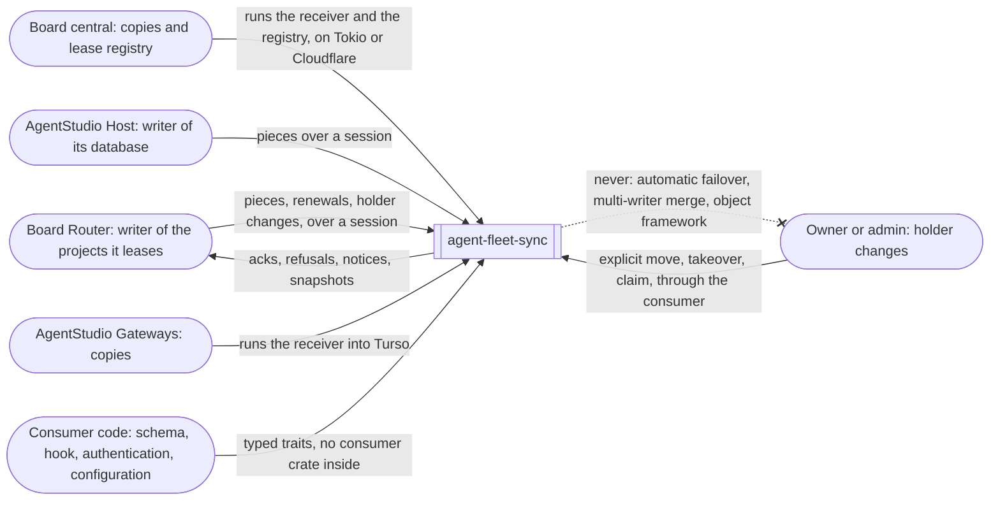
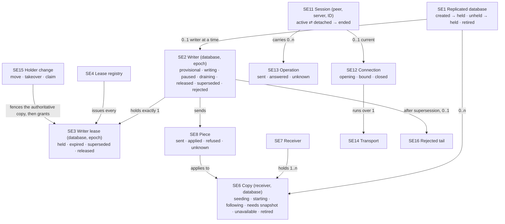

# Spec: agent-fleet-sync

**What this is:** what must be observably true of `agent-collaboration/agent-fleet-sync`. It's a set of crates that replicates a database one way, from the one writer that holds its lease to any number of read-only copies, over sessions that survive any disconnect. Any project can embed it. The board and AgentStudio's daemon are its first consumers.

```text
requirements.md (SU1–SU21) ──► this spec ──► program design ──► plan
                                  │
              consumed by: board specs 2 and 3, the central one-core design;
                           AgentStudio's daemon design
```

Requirements: [requirements.md](requirements.md). The board's [requirements](../2026-10-04-board-orchestration-design/requirements.md) U36, U37, U38, U39, U49, U70–U78 and C12 are its sources.

## 1. The problem

**Today** (board M3 at `9cc19dd2`; the board's PD2 and PD3):
- **P1. Replication is board-shaped.** The wire protocol mixes session control with board payloads: forwarded posts, fleet requests, archive reports. A complete piece is invalid without the board's directory summary. The planned writer-side client depends on the board's storage crate. A second project would have to copy board code.
- **P2. A dropped connection deletes the session.** Central's session record holds one connection, and closing that connection deletes the record. Reconnecting only looks like a resume, because positions live in the copies. This breaks the owner's U36 and U49.
- **P3. The session is tied to WebSocket.** Central's entry point takes an HTTP upgrade. The writer-side session component owns the WebSocket client.
- **P4. A primary-key change would leave a stale row.** The board's planned capture keys an update by the row's new key. Turso 0.8.1 records a primary-key change as a single update, with the old key before it and the new key after it (probe, 2026-10-16). Replaying that as an upsert of the new key leaves the old row at the copy.

**Desired outcomes:**
- **O1.** One set of crates, with no consumer types, used by both projects (SU1, SU10, SU14).
- **O2.** Correct copies, however many there are, whatever the keys, whether or not they lag (SU2–SU6, SU11).
- **O3.** One writer at a time, moved only on request, with one history for every copy (SU7–SU9).
- **O4.** Sessions that survive every disconnect, over any transport (SU12, SU13).

## 2. Who relies on it



- **Writers** (a board Router; an AgentStudio Host) send their database's changes. They learn when to pause, resume or stop being the writer.
- **Receivers** (board central; AgentStudio Gateways) keep copies that their consumers read as ordinary read-only databases.
- **The owner or an admin** changes holders only by explicit request, through the consumer's own admin surface.
- **Consumer code** supplies:
  - the schema and the tables to replicate;
  - an optional receiver hook, and an optional annotation the writer adds to each piece;
  - its own bookkeeping per captured transaction, if it keeps any;
  - an authenticator, and where a client keeps its session state;
  - gates on registration, holder changes and retirement, where it has rules of its own;
  - for delivery, its item bodies, addresses and release gate;
  - retention and lease configuration.

## 3. Entities

The board's entities keep their meaning. Board E25 (piece) and E27 (holder change) are reused here without their board-only parts.

| E | Entity | Same instance when | Relationships | Invariants | Observable states |
|---|---|---|---|---|---|
| SE1 | **Replicated database** | it has the same database ID, which its consumer issues, across every writer change and every copy. **Hardest case:** a writer's file restored from a backup, or re-created under the same ID, is an open question (SG2) | has one lease history at one lease registry (SE4), and zero or more copies (SE6); belongs to one consumer (SE17) | at most one writer at a time; its ID is never reused for another database, and a retired ID stays retired | created (known only to its first writer) → held (registered at epoch 1, SO44) · unheld (imported with no holder, SO46) → held (by a claim) · held ⇄ held at a later epoch (a holder change) · unheld or held with no lease → retired (SO47) |
| SE2 | **Writer** | (database, epoch). Renewing on the same epoch keeps the same writer. Regaining a lease at a new epoch is a new writer | holds exactly one lease (SE3); runs on one peer (SE10) | writes only while its lease is valid, or before registration when its consumer allows it (SO44); every write it commits on a replicated table is captured | provisional (created, not yet registered) → writing · paused (its lease has lapsed locally; it resumes on renewal of the same epoch) · draining (a move asked it to release) → released · superseded (a newer epoch exists) · rejected (its registration was refused) |
| SE3 | **Writer lease** | (database, epoch). A renewal keeps the instance; a new grant is a new one | issued by exactly one registry (SE4); held by one peer | epochs strictly increase per database; at most one unexpired lease per database by the registry's clock; length and renewal interval are consumer configuration | held → expired (not renewed in time; renews on the same epoch if the holder hasn't changed) · superseded (a newer epoch was granted) · released (a clean move completed) |
| SE4 | **Lease registry** | the one registry a consumer deployment designates for a set of databases | issues every lease for its databases; fences the authoritative copy before a grant | the only issuer; a database's highest epoch survives restarts | — |
| SE5 | **Replication position** | equal epoch and sequence | every piece names two; every copy holds one acknowledged position; every superseded epoch has one end position | ordered by epoch, then sequence; within an epoch the sequence increases and may skip numbers | — |
| SE6 | **Copy** | (receiver, database) | belongs to one receiver (SE7) and one database. A database with a registry has exactly one **authoritative copy**: the one its registry fences, which decides each epoch's end position. Every other copy is a **follower** | read-only to every reader; changes only by applying pieces, or by starting from a snapshot; its readers see whole writer transactions only; its fence epoch only increases | seeding (from its writer or an import, SO45) → following · starting (from a snapshot) → following → needs snapshot (the changes it needs are no longer kept) → starting · unavailable (damaged or full, reported per database) · retired (SO47) |
| SE7 | **Receiver** | its consumer-issued receiver identity | holds copies of one or more databases; is a peer (SE10) | the only writer of its copies | — |
| SE8 | **Piece** | (database, epoch, the position it continues from, the position it runs through, and its place in a split transaction), plus a digest of its content | sent by one writer; applies to the copies of one database | holds whole transactions, or one part of a transaction too large for one piece; carries an optional consumer annotation inside its digest | sent → applied · refused (typed) · unknown (until the acknowledged position is read) |
| SE9 | **Snapshot** | (database, position) | read from the writer or a copy; starts a new copy, or seeds a new writer | consistent at exactly one position; a read that spans a change of position restarts rather than mixing positions | — |
| SE10 | **Peer** | a consumer-issued peer identity, verified by the consumer's authenticator | has sessions (SE11) with the receivers or registries it talks to | a revoked peer opens no new connection | enrolled · revoked |
| SE11 | **Session** | (peer, server, session ID). The same session ID from the same peer resumes the same session | between one peer and one server; carries operations (SE13); has at most one current connection (SE12) | persists at both ends; outlives every connection | active (has a current connection) ⇄ detached (has none) → ended (the peer started a new session ID, or the peer was revoked) |
| SE12 | **Connection** | the connection ID minted when it's accepted. Its **attachment** to a session is its `Hello`, and an attachment belongs to exactly one connection | bound to exactly one session once attached; runs over one transport (SE14); carries a verified peer identity, its credential's expiry, and what the peer declared in that `Hello` (its supported schema) | closing it never ends its session; a newer connection for the same session replaces it; the latest attachment's declaration is the peer's current one | opening → bound → closed: dropped · replaced · credential rejected or expired · malformed frame · peer revoked |
| SE13 | **Operation** | its own identity, never the frame or connection that carried it: a piece's identity; a renewal's, holder change's or claim's attempt ID; a snapshot read's cursor; a consumer request's ID | carried by one session, possibly across several connections; answered by the engine or by the consumer | takes effect at most once; a repeat gets the recorded answer | sent → answered · unknown (its connection closed before the answer) → answered on a repeat |
| SE14 | **Transport** | its kind: WebSocket in this release, QUIC later | carries connections | delivers a connection's frames reliably and in order, or closes the connection; owns framing and I/O only | — |
| SE15 | **Holder change** | its request identity | one database; moves the lease from one epoch to the next. Kinds: **move** (the holder releases, then the next is granted); **takeover** (fence, then grant, without the old holder); **claim** (grant an unheld database). A database's first epoch isn't a holder change: it comes from registration (SO44) or import (SO46) | explicit request only (SU8); fences before granting; phases only go forward; cancellable before `fencing` (SU20) | per kind, SO48: requested → (releasing → released \| reserved) → fencing → granted · (a move) cancelling → cancelled · cancelled · refused (typed) · superseded (a move) · failed; a claim's settlement is owed beside its outcome |
| SE16 | **Rejected tail** | (database, the epoch it was written under): a superseded epoch, or epoch 1 when the database's registration was refused (SO44) | belongs to one superseded or rejected writer | the writer's changes after its epoch's end position; refused whole by every copy; stays readable at the old writer | refused → reported to the consumer |
| SE17 | **Consumer** | the application that embeds the crates: the board, or AgentStudio's daemon | supplies one replicated schema (SE18), its receiver hook, its authenticator, and its retention (SE19) and lease configuration | the crates contain none of its types | — |
| SE18 | **Replicated schema** | (consumer, schema version) | the consumer's migrations, plus the set of tables it replicates | every primary-key column of a replicated table is `TEXT NOT NULL` holding a UUIDv7, and keys never change (decision 51); no triggers or virtual tables on replicated tables | — |
| SE19 | **Retention policy** | (consumer, database) | decides how long a writer keeps changes for copies that haven't acknowledged them | a change is discarded only when every copy has acknowledged it, or the policy releases it | — |
| SE20 | **Durable operation** | its operation ID: the identity of the request that started it (a holder change's attempt ID, a piece's identity, a delivery item's ID), or one minted when the runner starts it | runs on one object; has ordered steps (SE21); started by a request, a commit or an alarm | has exactly one result. A restart continues it from its first unfinished step. It calls its steps in the same order, with the same names, every time it runs | running → completed (result) · failed (typed reason, reported) |
| SE21 | **Step** | (operation, step name) | belongs to one operation. Either local (one transaction on its own object) or a call (to another object or machine) | its output is saved with its effects, in the same transaction for a local step, or as soon as the call answers for a call step. A step whose output is saved never runs again. A call step passes (operation, step name) as the call's identity | pending → done (output saved) |
| SE22 | **Delivery item** | its sender-minted item ID. The same ID with the same content is the same item at every hop; the same ID with different content is a conflict, never a second item | one sender, one recipient (a peer, plus the consumer's address within it); carries the consumer's body | its content (body, recipient, expiry) is fixed when it's created, and a digest covers all of it; a final status is final | queued → sent → at recipient → held → delivered · uncertain · expired · cancelled · refused (typed) |
| SE23 | **Mailbox** | its recipient peer: one mailbox per recipient at the relay | holds that recipient's items; belongs to the **relay**, the server a consumer designates to take custody between peers (the board: central; Tokio consumers: `fleet-sync-service`), which owns each item's canonical status (SO41) | releases an item's payload only after the recipient's durable receipt; keeps every item's identity, digest and final status for good, so any repeat is answered; refuses a new item before taking custody when full | open → closed (the recipient was revoked) |
| SE24 | **Hop** | (item, which hop: sender's outbox, relay mailbox, recipient's inbox) | belongs to one item | custody passes only when the next hop's receipt is saved; each hop is a durable operation (SE20) | holding → passed on · final |
| SE25 | **Cancel** | an item (SE22) whose body names exactly one original | travels behind its original on the same path | only the recipient decides its effect: the original was prevented, or it was too late (delivered or uncertain). Earlier hops report it pending. One cancel per original | pending → prevented · too late |



## 4. Obligations

### Replication

- **SO1 One writer.** A copy applies pieces only from the writer of the newest epoch it knows. The authoritative copy always knows the current epoch, because its registry fences it before every grant (SO16). If a piece names an older epoch than the copy knows, the copy refuses it as `staleEpoch`, naming the newer epoch and the old epoch's end position, and changes nothing. (SU2, SU7; SE2, SE6, SE8)
- **SO2 Whole transactions.** A copy's readers see each writer transaction wholly or not at all, including one too large for a single piece. (SU2; SE6, SE8)
- **SO3 Exact continuation.**
  - A copy applies a piece only when it continues from the copy's acknowledged position.
  - If a piece doesn't continue from there, it's refused as a `gap` naming that position, and the writer resends from it.
  - A repeated piece (same identity, same digest) changes nothing and is answered as applied.
  - The same identity with a different digest is refused as a `pieceConflict`.

  (SU2; SE5, SE6, SE8)
- **SO4 Exact values.** Every value reaches every copy exactly as committed: its storage class and its value, including integers beyond ±2^53, reals (positive and negative infinity among them; SQLite stores NaN as NULL), text, blobs and NULL. (SU15 via U76; SE8)
- **SO5 Rows by UUIDv7 primary key.** A replicated row is identified by its table's primary key, and every key column is `TEXT NOT NULL` holding a UUIDv7 (a composite key of UUIDv7 columns is allowed). Keys never change. A statement that would change a key is refused when it runs. A write whose key isn't a canonical UUIDv7 is refused before it commits, and a copy refuses a piece whose key isn't one. (SU11; SE18; P4; decision 51)
- **SO6 Schema replicates as itself.**
  - A migration the writer runs reaches each copy as that migration, and applies there exactly once, in order with the rows around it.
  - A copy that can't support a schema step refuses it as `schemaUnsupported` and applies nothing after it.
  - Some schemas can never replicate: a replicated table with a primary-key column that isn't `TEXT NOT NULL` holding UUIDv7s (no key, integer, rowid-only and `AUTOINCREMENT` keys included), a trigger, a virtual table, or a foreign key with an action (`ON DELETE` or `ON UPDATE` anything but `NO ACTION` or `RESTRICT`), because a copy applies the writer's row changes and never re-derives them. A consumer's local tables are unrestricted. Such a schema is refused before it reaches any copy, and the consumer learns of it before deploying.
  - Statements that would change a primary key are refused when they run: an `UPDATE` that assigns the key column, and an upsert whose `DO UPDATE` assigns it. Keys never change (decision 51). `REPLACE` and `INSERT OR REPLACE` delete and insert whole rows, capture correctly, and are allowed.

  (SU2, SU10, SU11; SE18)
- **SO7 Only declared tables travel.** Only the tables the consumer declares reach a copy. The engine's own bookkeeping and undeclared tables never appear there. (SU2, SU10; SE18)
- **SO8 Independent copies.** Each copy advances on its own. A slow, absent or refusing copy delays neither the writer's writes nor any other copy. (SU4, SU5; SE6)
- **SO9 Retention without silent loss.**
  - A writer keeps each captured change until every copy has acknowledged it, or until the consumer's retention policy releases it.
  - A retention policy releases changes only for followers. The authoritative copy always keeps the changes it hasn't acknowledged, because it decides where each epoch ends.
  - If a copy needs changes that are no longer kept, it's told `needsSnapshot`. It then restarts from a snapshot and continues.
  - A copy never skips a change silently.

  (SU5, SU6; SE6, SE9, SE19)
- **SO10 Snapshots are consistent.** A snapshot reads every replicated table and the schema at exactly one position. A copy or writer started from it continues from that position, with no gap and no repeat. (SU2, SU7; SE9)
- **SO11 Copies are ordinary databases.**
  - On Tokio, a receiver keeps each copy in a Turso database, through the SQLx drivers we own.
  - On Cloudflare, the board's receiver keeps it in Durable Object SQLite.
  - A consumer reads its copy as a read-only SQL database.

  (SU3, SU15; SE6)
- **SO12 The consumer hook is atomic.** When a consumer registers a receiver hook, it runs inside the copy's apply:
  - the applied transaction, the hook's own writes and the new acknowledged position commit together, or not at all;
  - if the hook fails, the copy, its position and the hook's state are unchanged, and the piece is refused with the hook's typed reason;
  - work the hook schedules for after commit is recorded in that same commit, then carried out at least once afterwards, under its recorded identity.
  - when a copy starts from a snapshot (a seed, an import or a restart), the hook runs inside the commit that makes the copy follow, so the state it derives from the replicated tables catches up; work it schedules there is recorded the same way. Restarting from a snapshot keeps the copy's own state: work already scheduled and the hook's local tables.

  (SU1, SU10; SE6, SE17. **Derived** from atomic apply plus the board's directory projection, which must not be lost in a crash)

### The writer lease

- **SO13 One issuer, rising epochs.** For each database, exactly one registry issues leases.
  - Every grant's epoch is higher than every earlier grant's for that database, across registry restarts. A registry that can't prove that refuses to grant.
  - At most one lease per database is unexpired at any time, by the registry's clock.

  (SU7; SE3, SE4)
- **SO14 Renewal and expiry.**
  - A holder renews on the same epoch. The lease's length and renewal interval are consumer configuration; the board uses 4 hours and 15 minutes.
  - When the holder can no longer show an unexpired lease, by its own conservative bound, its writer stops accepting writes.
  - When the same epoch renews, writes resume with no one acting.

  (SU7; board U38; SE2, SE3)
- **SO15 Explicit holder changes only.** A holder changes only on an explicit move, takeover or claim request. The crates never change a holder on their own: no automatic takeover, and no release on shutdown. At most one holder change per database is in progress. While a move or claim is in progress, any other holder change is refused `transferInProgress` (renewals continue), with one exception: an explicit takeover supersedes a move in progress, including one that's `cancelling` (SO49). The move then ends `superseded` and grants nothing, so a holder that disappears while draining never leaves the database unwritable. (SU8; SE15)
- **SO16 Fence before grant.** Before a new epoch is granted after an existing one, the authoritative copy is fenced at the old epoch: it records that epoch's end position and refuses later pieces from it. The new writer starts from a snapshot at that position. (SU7; SE6, SE15)
- **SO17 One history.** A superseded writer's changes after its epoch's end position are its rejected tail. The authoritative copy never applies a rejected tail. The tail stays readable at the old writer, and the consumer is told, once per (database, epoch). What follower copies do on a holder change is decided later, with AgentStudio's lease semantics (SG9). (SU7; SE6, SE16)
- **SO18 Repeats replay.** A repeated renewal, holder change or claim returns its recorded answer, marked as a replay. It never issues a second epoch or a second renewal. (SU7; SE13, SE15)
- **SO19 Revocation leaves leases alone.** Revoking a peer ends its sessions (SO22) and changes none of its leases. They expire, or are moved explicitly. (SU9; SE3, SE10)
- **SO44 The first epoch belongs to the database's creator.** A database created by its first writer is that writer's at epoch 1 from creation, because no other peer can know an ID it just minted.
  - The writer registers it with the registry. Registration is idempotent per (database, writer), and the consumer's registration gate may refuse it.
  - Until registration succeeds, nothing replicates. A consumer may let the writer accept writes meanwhile (the board does, spec 2 WA-10); SO14's lease rules apply from registration on.
  - If registration is refused (`databaseRejected`), every write the writer accepted becomes its rejected tail (SO17), and the database is moved aside on that peer, never deleted.
  - A registration by any other peer, for a database the registry knows, is refused `notWriter`.

  (SU7; board spec 2 WA-10, spec 3 E23; SE1, SE3)
- **SO45 A copy is seeded from its writer.** A database created empty needs no seed: its authoritative copy follows from position zero. A database registered with data from before capture began, or imported (SO46), seeds its authoritative copy from a snapshot pushed to it at one position: the pages are staged, the whole snapshot is verified, and it's published at once. Pieces then continue from that position. A repeated page changes nothing; a different page under the same identity is a conflict. (SU2, SU7; SE6, SE9)
- **SO46 Import makes an unheld database.** A consumer's admin may import a database that has no holder.
  - Its authoritative copy is seeded (SO45) at the import epoch, epoch 1, which has no holder. The first claim gets the next epoch.
  - Re-importing identical content, by ID and digest, is answered `alreadyImported` and changes nothing. Different content under an existing ID is refused `importConflict`, naming both digests.
  - An import never touches a database that is held or has ever been claimed.

  (SU7; board spec 3 FL-15 to FL-17; SE1)
- **SO47 Retirement.** A consumer's admin may retire a database only when it has no lease in any state, no holder change is in progress, the consumer's retirement gate allows it, and the copy's fence and acknowledged position still match what the admin last read.
  - Retiring deletes the copy's records, and the registry keeps the ID as retired forever. Every later piece, registration, import, claim and read answers `retired`, ahead of any replay of an earlier answer.
  - A repeated retire returns its first outcome. An interrupted one resumes where it stopped.
- **SO48 A holder change is a workflow an admin can follow.** Each move, takeover and claim goes forward through its phases and ends in exactly one final outcome.
  - A move: `requested` → `releasing` (the holder is asked to stop) → `released` (the holder stopped writing at its final captured position; this alone doesn't mean the copy has everything, SO54) → the registry waits for the copy to acknowledge that position → `fencing` → `granted`. No grant happens before that acknowledgement.
  - A takeover: `requested` → `fencing` → `granted`.
  - A claim: `requested` → `reserved` (the consumer's gate reserved it) → `fencing` → `granted`. Whatever a claim's outcome, the gate is told it afterwards, and the read shows that settlement as owed until the gate answers. A granted claim stays granted whatever happens to its settlement.
  - Before `fencing`, a cancel ends a takeover or claim `cancelled`, and takes a move through `cancelling` to `cancelled` (SO49). Any phase can end `refused` or `failed`, and a move can end `superseded` (SO15).

  A phase never goes back to an earlier one, and a final outcome never changes. A consumer's admin can read any holder change by its attempt ID, while it runs and after it ends. The read shows:
  - its kind, who requested it, its phase, and its phase history with times;
  - what it's waiting on and since when: which machine, when that machine was last seen, and whether the call may have reached it;
  - whether a claim's settlement is still owed;
  - who cancelled it, and why;
  - its final outcome.

  The history keeps phases and times, never step data. (SU20; SE15)
- **SO49 A holder change can be cancelled until it can't be withdrawn.** A consumer's admin may cancel a holder change by its attempt ID, giving a reason. The answer is one of:
  - `accepted`, before `fencing`. The change grants nothing, and its reserved epoch is never used.
    - A takeover or a claim ends `cancelled` at once. A claim's gate is then told, and its settlement shows as owed until the gate answers. A settlement that reaches the gate before the claim's reservation closes the attempt, so the late reservation is refused.
    - A move whose release may have reached its holder is `cancelling` until the holder is told the release is withdrawn. The holder goes back to writing at its same epoch, and the move ends `cancelled`. Until then the move still counts as the database's holder change in progress (SO15). A holder that can't be reached keeps the move `cancelling`, visibly, until it answers or an explicit takeover supersedes the move;
  - `tooLate{phase}`, at or after `fencing`, because the fence may already have reached the copy. The change runs to its end;
  - `ended{outcome}` once it has ended, or `notFound`.

  A repeated cancel returns the first cancel's record. A cancel takes effect at the change's next step or retry. The read shows when that retry is scheduled; a call already in flight finishes first, so this is a schedule, not a deadline. Nothing times out on its own once an effect may have reached another machine: a holder change ends by its own steps, by a cancel, or, for a move, by a takeover. (SU20; SE15)
- **SO50 A move needs a recently renewed holder.** A move is refused `holderStale{lastRenewedAt}` when the holder's last renewal is older than the consumer's bound, by the registry's clock. The board's bound is 30 minutes. The admin then chooses a takeover. This is checked when the move starts. A release that has already been sent is governed by SO15 and SO49. (SU21; SE15)

  (SU7; board spec 3 FL-18; SE1, SE6)

### Sessions, connections and transports

- **SO20 A session outlives its connections.** If a connection closes for any reason, its session continues. The reasons include: a drop, a replacement, a deploy, an expired credential, or a malformed frame. The peer resumes the session on a new connection, with every operation's outcome intact. (SU12; SE11, SE12)
- **SO21 One current connection.** A newer connection for a session replaces the older one, which is closed as `connectionReplaced`. Operations in flight on the older connection are re-sent on the newer one, and each takes effect once (SO23). (SU12 via U49; SE11, SE12)
- **SO22 How a session ends.** A session ends only when its peer starts a new session ID, or when its peer is revoked. A revoked peer's connections are closed. If the peer is later allowed back, it starts a new session. (SU9, SU12; SE10, SE11)
- **SO23 Once per operation.** An operation takes effect at most once, whichever connection carried it and however often it's re-sent. A re-send after a lost answer gets the recorded answer. (SU12; SE13)
- **SO24 Resume reports where things stand.**
  - Each new attachment of a session gets a fresh report of each database the peer writes or follows: its acknowledged position and its lease state **as of that attachment**, never as of an earlier one. The peer continues from there.
  - A session is created once per (peer, session ID). A `Hello` with that session ID on a new connection attaches to the existing session and never creates a second one.
  - A `Hello` repeated on the **same** connection changes nothing (no new session, no new attachment), and is answered with a fresh status. Effects happen once; a status is a read, and reads are always fresh.
  - A copy that can't be read is reported for that database alone. Every other database resumes normally.

  (SU12; board spec 3 FL-12; SE6, SE11)
- **SO25 Authenticated binding.** A connection is bound to a session only with a peer identity the consumer's authenticator verified. The credential's expiry is enforced on the connection, which closes when it passes. The session survives that close (SO20). (SU12, SU15; SE10, SE12)
- **SO26 Any transport.** The session's frames, its operations and their answers are the same over every transport.
  - WebSocket is the transport in this release, on Tokio and on Cloudflare.
  - Adding QUIC on Tokio changes neither the session nor the engines.

  (SU13; SE14)

### Delivery across machines

- **SO34 One path.**
  - An item for a recipient on another peer travels: the sender's durable outbox → the relay's mailbox for that recipient → the recipient's durable inbox → the consumer's local delivery.
  - A recipient on the same peer is delivered locally, under the same item identity.
  - The relay routes by recipient peer and never interprets the body.

  (SU16; SE22, SE23, SE24)
- **SO35 Item identity.** Every hop records an item under its ID. A repeat with the same ID and content returns the recorded result and creates nothing; the same ID with different content is refused as `itemConflict`. The recipient's local delivery reuses the item ID. (SU16, SU18; SE22)
- **SO36 Custody, never silent loss.**
  - A hop releases its copy only after the next hop's durable receipt, or once the item is final.
  - The sender can see the item's status: queued, sent, at recipient, held, delivered, uncertain, expired, cancelled, or refused with a reason.
  - The relay accepting an item doesn't make it delivered, and delivery doesn't mean it was read.

  (SU16; SE22, SE24)
- **SO37 Queued, then sent.** A send answers `queued` once the outbox has the item, and the item becomes `sent` once the relay has custody. While the relay is unreachable, items stay queued and drain later under the same IDs. The consumer's local work never waits on the relay. (SU16; SE22)
- **SO38 The consumer's release gate.** A consumer may hold an item in its outbox until its own condition holds. For the board, that's a notification whose cause and handoff have replicated (spec 3 MS-5). An item leaves only once the gate has released it. (SU16; SE22)
- **SO39 Retention and limits.**
  - Undelivered items are held until delivered or final.
  - Each hop refuses a new item before taking custody when it's full (`mailboxFull`), and never drops one it accepted. Every accepted item keeps room for its status, one report and one cancel.
  - An item past its `validUntil` becomes `expired`, and the sender sees it.
  - Delivered history follows the consumer's policy. The relay keeps each item's identity and final status permanently in compact form.

  (SU16, SU18; SE22, SE23)
- **SO40 Cancellation.**
  - A cancel travels behind its original, and only the recipient's consumer check decides its effect: `prevented`, or `tooLate` (delivered or uncertain). Earlier hops report `cancelPending`.
  - A second cancel for the same original returns the first one's status.
  - An item the outbox has never tried to submit is withdrawn there, as `cancelled`.
  - Who may cancel is the consumer's rule.

  (SU16; SE25)
- **SO41 Status comes back, in order.** The relay owns each item's canonical status, with a version that only increases; a reader keeps the highest version it has seen. The recipient's reports carry a sequence number, and each is applied once. A sender that was away catches up from a cursor, and reconciles anything still open. (SU16; SE22, SE23)
- **SO42 Every hop survives a crash.** Each hop is a durable operation (SO31): a crash at any hop continues from its saved steps, and a resend after a lost answer gets the recorded result. (SU16, SU17, SU19; SE24)
- **SO43 The body is the consumer's.**
  - Item bodies, sender kinds and the recipient's address within a peer are the consumer's typed generics. So are local delivery, injection checks, coalescing and wakes.
  - The crates never interpret them.
  - Work done after a commit inside a consumer is a durable operation too (SO31, SU17). Delivery uses the same mechanism for its hops.

  (SU16, SU17; SE22)

### Idempotence

- **SO30 Everything is idempotent.** Repeating an operation with the same identity has its effect at most once and returns the recorded result.
  - A multi-step operation gets this from its durable steps (SO31).
  - A single request gets it from its own identity: a piece, a lease request, or a consumer request. A session's creation is once per (peer, session ID), and an attachment is once per connection (SO24). A new attachment's status is fresh, not replayed.
  - A repeat with the same identity but different content is refused as a conflict, never applied.

  (SU18; SE8, SE13, SE20)
- **SO31 Durable steps.** A multi-step operation saves each step's output together with that step's effects. After a crash or restart it continues from its first unfinished step; finished steps return their saved output and don't run again. The multi-step operations are:
  - a holder change (reserve → fence → grant);
  - the consumer's work after a copy applies a piece;
  - each hop of a delivery item;
  - a copy restarting from a snapshot.

  (SU19; SE20, SE21)
- **SO32 The runner finishes what it started.** An unfinished durable operation is continued by its runner on start-up and on its alarm, with bounded backoff, until it completes or fails. No caller has to re-send for it to finish. A failed operation is reported with its typed reason. (SU19; SE20)
- **SO33 IDs only at the boundary.** A step that calls another object or machine passes (operation, step name) as the call's identity, and the receiver records it, so a repeat of the call has its effect once. A step that only touches its own object needs nothing beyond its saved output. (SU18, SU19; SE21)

### Reuse, runtimes and home

- **SO27 No consumer types.** The crates build and run with neither the board's nor AgentStudio's crates present. A consumer supplies its schema, receiver hook, authenticator, retention and lease configuration through typed generic interfaces. (SU1, SU10; SE17)
- **SO28 Both runtimes, one implementation.**
  - The receiver, the lease registry and the server half of the session run unchanged on Tokio and inside the board's Cloudflare Durable Object runtime.
  - None of them starts an async runtime.
  - The writer side runs on Tokio.

  (SU3, SU15 via U71 and U75; SE4, SE7, SE11)
- **SO29 Home and standards** (constraint).
  - The crates and the SQLx drivers we own live in `agent-collaboration/agent-fleet-sync`, and consumers depend on Git tags.
  - One lint table, no `unsafe`, exact integers, and no pedantic or tautological tests.

  (SU14, SU15)

### Consumer fit (2026-10-17)

These obligations come from the board, agent-fleet-sync's first consumer, adopting the library (board spec 3 §4.2; decisions 99–105). The board's obligations stay its own; where the library falls short of one, the fix belongs here. Each one is unbuilt until its workstream lands.

- **SO51 Engine keys are UUIDv7** (owner decision 86). Every engine table keyed by an entity identity, whether a database, peer, session, transfer, operation or item, keys on `TEXT NOT NULL` canonical UUIDv7 columns.
  - The entity identity constructors (`DatabaseId`, `PeerId`, `SessionId`, `TransferId`, `OperationId`, the takeover preview token and their siblings) refuse anything that isn't a canonical UUIDv7, when constructed, decoded or read from storage, and nothing persists one. Correlation identities that never key a row (a connection, a frame) only have to be non-nil.
  - Every engine key column is NOT NULL.
  - Bookkeeping keyed by a UUIDv7 plus an ordinal or a name keeps that key.
  - An external identity that isn't a UUIDv7 is never forced into a key. It's mapped to a UUIDv7 row identity, and the original is kept as data. (SO5 covers replicated rows; this covers the engine's own.)
- **SO52 Refusals carry what their consumer must show.**
  - A move the holder refuses for a migration names the migration and the state the holder reports. Today's writer reports only `pending`, for a declared migration it hasn't applied. A migration that fails while the writer opens fails the open, so that holder has no writer to answer the release. What the move sees then depends on whether the release can reach the holder:
    - if the release's durable record shows it never left the registry, the move is refused `holderUnreachable` once that has lasted past the move's unsent bound. That needs every attempt to have ended not sent, and none to have been interrupted mid-dispatch. A missing session for the holder is one way an attempt ends not sent; an overloaded or closed call path is another;
    - otherwise the release may have reached the holder, so it's never treated as having no effect. That covers an attempt that had an attached session, and one interrupted mid-dispatch, which recovers as possibly reached even if the holder was offline throughout. The move stays releasing and retries until it's answered, its cancellation completes, or a takeover supersedes it, even if the holder disconnects later.
  - Either way, once the holder's last renewal is older than the registry's move bound, a new move is refused `holderStale{lastRenewedAt}` (SO50); a consumer may show that as its own name, as the board does. That doesn't settle a move already in progress. The registry carries the protocol's `failed` state unchanged, though no writer produces it.
  - A claim refused because the database is already held names the holder **as recorded with that refusal**. A repeat returns the same holder, even after the holder has since changed.
- **SO53 A holder change is fenced against its target's own schema support.** For a claim the target is the claimant; for a move or takeover it's the receiving installation. Its support is that installation's latest accepted declaration, ordered by the session's accepted attaches, never by time, and never one registry-wide setting. A declaration is accepted once the registry holds it, and a session is welcomed only after that, so no welcomed session's declaration is missing when a change is decided. It's frozen when the change is admitted, so a repeat decides the same way. A target with no accepted declaration is refused `schemaTooNew`.
- **SO54 A released holder isn't a complete copy.** A holder change's `released` phase means only that the old holder stopped writing at its final captured position. Nothing reads it as the copy having everything; only the grant, which waits for the copy's acknowledgement, does (SO16, SO48).
- **SO55 Identical re-import stays identical after a claim.** SO46's same-content answer holds after a claim: an import offering the same database ID and digest answers `alreadyImported`, because the registry keeps the import's origin and digest across the claim. A retired database's answer comes first (SO47).
- **SO56 A frame that can be identified is always answered.** A session frame whose ID can be read but whose body doesn't decode gets a typed answer naming that ID and the field, and the connection stays open. Only a frame that can't be identified closes the connection as malformed.
- **SO57 One copy's failure stays with that copy.** When a database's copy can't serve a replication operation, because it's uninitialized, damaged, full or failing, that operation gets a typed answer saying so, and the session's other databases continue.
  - The answer means no new effect only when the step provably didn't commit.
  - An error after a committed step (such as a wake failing after an apply) preserves and reconciles the committed outcome. It's never reported as a refusal.
  - The sender's operation owner treats the typed answer as a refusal, not a lost answer.
  - **Copy-dependent registry steps too.** When a claim, move or takeover step needs the copy (its status, the wait for its acknowledgement, the fence) and finds it transiently unavailable, the holder change stays in progress. It's resumable under its original attempt, chosen epoch and reservation, with a typed availability result, never a final refusal. A repeat after the copy is repaired continues from the recorded step. Legitimate final refusals stay final, and an ended record is never reopened (board spec 3 FL-12 "Operations resume").

- **SO58 A write knows the epoch that admitted it.** An open write transaction tells its consumer the epoch it was admitted under: epoch 1 for a provisional write (SO44), and otherwise the epoch the writer held when it admitted. The consumer doesn't ask the writer again, and the value never changes for that transaction.
  - The writer refuses at begin or at commit only what it can know locally: a supersession it has learned of, or a lease its own clock says has expired.
  - A takeover the writer hasn't learned of doesn't stop the write. It's admitted under the old epoch, and its records become that epoch's rejected tail, as SO17 and board spec 3 FL-10 allow.
  - (SU7, SU10; board WA-3)

## 5. What this does not do

- No framework for arbitrary server objects (SU1; the owner chose crates and a service).
- **No multi-writer replication or conflict merging.** No automatic takeover or failover (SO15).
- **No Turso Sync API** (board ADR 0001).
- **Copies stay faithful.** A consumer's projections are its own separate state (SO12). Captured changes aren't domain events or commands.
- **No QUIC transport in this release** (SO26). No transport other than WebSocket on Cloudflare.
- **No crates.io publishing in this release** (SO29).
- **No presence** (which machines are connected, and when each was last seen) in this release (SG1).
- **Not built into the crates:** authentication, enrollment and credentials belong to each consumer (SO25). So do admin surfaces for holder changes and the meaning of replicated data.

## 6. Proof

Every proof runs on real paths (U53): a real Turso capture, the real session over a real WebSocket, a real receiver, and real failures. Each proof checks behavior. None scans source text or restates the implementation (U74).

| V | Obligations | Evidence |
|---|---|---|
| SV1 | SO1–SO7, SO10–SO12, SO20, SO23, SO24, SO27 | **A second consumer on Tokio**, a non-board database keyed by UUIDv7, replicated into a Turso copy. It covers: insert, update and delete; a single and a composite UUIDv7 key; each refused key form (an integer key schema, an `UPDATE` or upsert that sets a key column, a key value that isn't a UUIDv7); exact values (integers beyond 2^53, blobs, reals at full precision with subnormals and both infinities among them, NULL); a migration; a split transaction with a restart before its last part; a lost answer followed by a reconnect, plus process restarts under the same session; a hook failure; and a crash before after-commit delivery. State is inspected: copy rows and storage classes, positions, receipts, session records |
| SV2 | SO8, SO9, SO10 | **Two copies.** One is stalled while the other advances, and the writer keeps writing. The stalled copy passes retention, is told `needsSnapshot`, restarts from a snapshot and catches up with no gap or repeat |
| SV3 | SO13–SO19, SO22, SO44–SO50 | **Leases and lifecycle**, with the registry on Tokio: a database created empty, registered and followed from zero; one registered with earlier data, seeded and then followed; a refused registration, whose writes become a rejected tail; an import, re-import and conflicting import, then a claim; a retirement, after which every request answers `retired`; expiry pauses writes and renewal resumes them; a move; a takeover, with a rejected tail refused by the authoritative copy; a claim; repeats replay; a registry restart keeps epochs rising; a revocation ends the session and leaves the leases. **Holder-change workflows:** a cancel accepted in every cancellable phase of each kind, and `tooLate` once `fencing`, including after a fence repair; a claim's reservation that arrives after its cancel's settlement refused; a granted claim staying granted when its settlement or the engine fails afterwards; a cancelled move's holder writing again at its same epoch; a takeover superseding a `cancelling` move; the read during an unanswered call, after a restart, while a claim's settlement is owed, after supersession and after the end; a move refused for a holder whose last renewal is just past the bound, and admitted just inside it |
| SV4 | all, preserved for the board | **The board's scenarios on these crates:** spec 2 V3 and spec 3 V9 on Tokio and under local workerd, and V9d on staging |
| SV5 | SO20, SO21, SO25, SO26, SO28 | **Cloudflare hibernation:** a hibernated WebSocket restores its verified binding; replaced and expired connections are refused; the session resumes after a reconnect and after the object loses its memory |
| SV7 | SO34–SO43 | **Delivery with a second consumer on Tokio:** a send while the relay is down that drains later; a recipient that's offline, then receives everything exactly once; a lost receipt at each hop, and a process kill at each hop; a cancel that prevents and one that's too late; `validUntil` expiry; a full mailbox refused before custody; `itemConflict`; status versions that only increase, and catch-up after a gap. State is inspected at every hop |
| SV6 | SO27, SO29 | **The repository builds and runs its tests on its own,** with no consumer crate in its workspace |
| SV8 | SO51–SO58 | **Consumer fit**, one row per obligation in [the consumer-fit Verification Design](verification-design.md): engine-key refusals at every decode boundary, frozen refusal detail, per-target schema support across the publication barrier and the admission window, Released before the copy's acknowledgement, re-import after a claim, correlated `invalidShape`, and one copy's failure contained on a shared connection, including unknown outcomes and the post-commit wake fault |

## 7. Coverage

| SU | SE | SO | SV |
|---|---|---|---|
| SU1 reusable, no consumer types | SE17 | SO12, SO27 | SV1, SV6 |
| SU2 one way, whole database | SE1, SE2, SE6, SE8, SE9 | SO1–SO3, SO6, SO7, SO10 | SV1 |
| SU3 copies in Turso | SE6, SE7 | SO11, SO28 | SV1, SV4 |
| SU4 several copies | SE6 | SO8 | SV2; follower behaviour on a holder change is SG9 |
| SU5 a slow copy never stops the writer | SE6 | SO8, SO9 | SV2 |
| SU6 configurable retention | SE19 | SO9 | SV2 |
| SU7 shared lease logic | SE1, SE3, SE4, SE15, SE16 | SO13, SO14, SO16–SO18, SO44–SO47, SO58 | SV3, SV4, SV8 |
| SU8 explicit holder changes | SE15 | SO15, SO52, SO53 | SV3, SV8 |
| SU9 revocation is separate from leases | SE10 | SO19, SO22 | SV3 |
| SU10 tables through traits | SE17, SE18 | SO6, SO7, SO27 | SV1 |
| SU11 UUIDv7 primary keys that never change | SE18 | SO5, SO6, SO51 | SV1, SV8 |
| SU12 session outlives connection | SE11, SE12, SE13 | SO20–SO25, SO56, SO57 | SV1, SV5, SV8 |
| SU13 any transport | SE14 | SO26 | SV5; QUIC is SG5 |
| SU14 own repository | — | SO29 | SV6 |
| SU15 same standards | SE6 | SO4, SO11, SO28, SO29 | SV1, SV4, SV6 |
| SU16 delivery, SU17 durable after-commit work | SE22–SE25 | SO34–SO43 | SV7; the board's spec 3 V10 on central later |
| SU18 everything idempotent | SE8, SE13, SE20 | SO30 (with SO3, SO18, SO23), SO55, SO57 | SV1, SV3, SV8; a repeat of every operation kind |
| SU19 durable steps | SE20, SE21 | SO31, SO32, SO33 | SV1, SV3: crash between the steps of each multi-step operation |
| SU20 holder changes as visible, cancellable workflows | SE15 | SO15, SO48, SO49, SO52, SO54 | SV3, SV8 |
| SU21 a move needs a recently renewed holder | SE15 | SO50 | SV3 |

## 8. Gaps

| G | Gap | Owner | Effect |
|---|---|---|---|
| SG1 | **Presence** is a candidate for later. Durable delivery is in this release (SU16) | owner, later | nothing here |
| SG2 | **Incarnation.** A writer's database restored from a backup, or re-created under the same ID: are its positions valid? Is it a holder change? | Lead, in program design; owner if it changes behavior | SO1 and SO3 hold only for a database that keeps one incarnation |
| SG3 | **AgentStudio tables with a primary-key column that isn't a UUIDv7** can't replicate. Every key column must be `TEXT NOT NULL` holding UUIDv7s (composite UUIDv7 keys are fine), or the table stays out (decision 51) | AgentStudio's Lead | AgentStudio's adoption only |
| SG4 | **Closed by decision 51.** Turso 0.8.1 records an `INTEGER PRIMARY KEY` change as a delete, then an insert whose row is in `before` (probe, 2026-10-16). Replicated tables can't have integer keys, and keys never change, so capture never meets it | Lead | none |
| SG5 | **QUIC is unproved until it's built.** SO26 is shown across the Tokio and Cloudflare WebSocket server sides only | later | SO26's QUIC half |
| SG6 | **Turso's manual labels change capture an early preview.** The engine version is pinned and every capture behavior is tested against it | Lead | SO2–SO7 on a version bump |
| SG7 | **SO12's hook-failure rule** stops a copy's progress until the consumer fixes its hook. That follows from atomic apply, and the owner hasn't confirmed it | owner, if it should differ | SO12 |
| SG8 | **Where AgentStudio runs its lease registry,** and its lease configuration | AgentStudio's Lead | AgentStudio's adoption only |
| SG9 | **Follower copies on a holder change** are decided later, with AgentStudio's lease semantics (owner, 2026-10-16: "the lease semantics will be different for agentstudio … we don't worry about old copies, the service prevents writes"). The board has one copy, which is authoritative | owner, later | followers only |
| SG10 | **Delivery caps per consumer.** The board keeps PD4's values: a mailbox holds 1 GiB of unreleased payload and 200,000 unretired items; the outbox holds 256 MiB and 50,000 unsettled items; the inbox holds 256 MiB; each item keeps 2 KiB of settlement room | the consumer | SO39's numbers only |
| SG11 | **Implicit row changes, probed 2026-10-16 (24 cases, real Turso files):** `REPLACE INTO` and `INSERT OR REPLACE` capture every implicit delete (18 of 18). A key-changing upsert loses the old key in capture (2 cases). That form is refused with every other key change (decision 51) | Lead; upstream Turso | none for supported statements |
