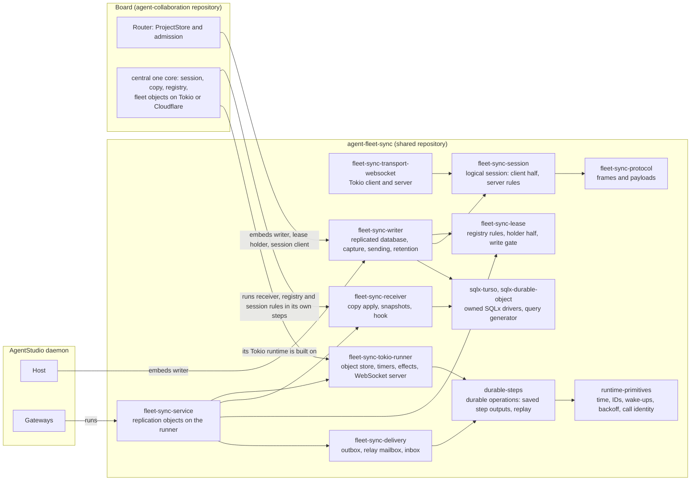
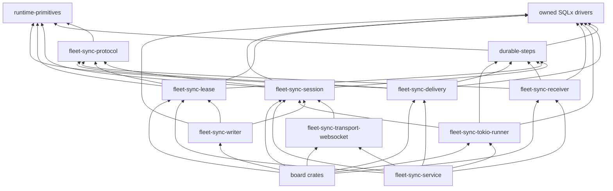
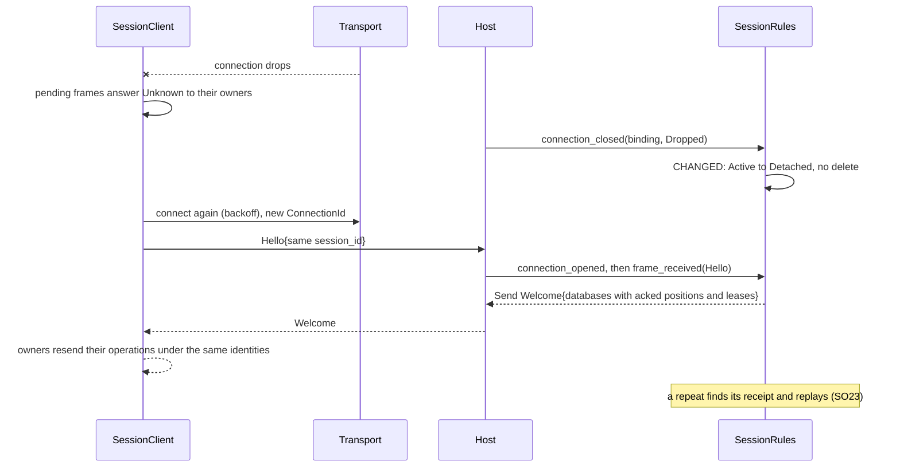
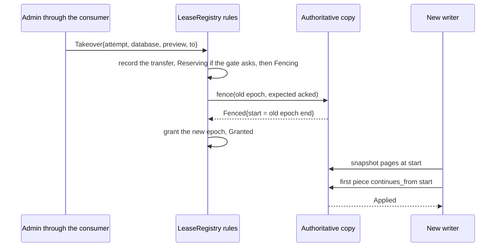
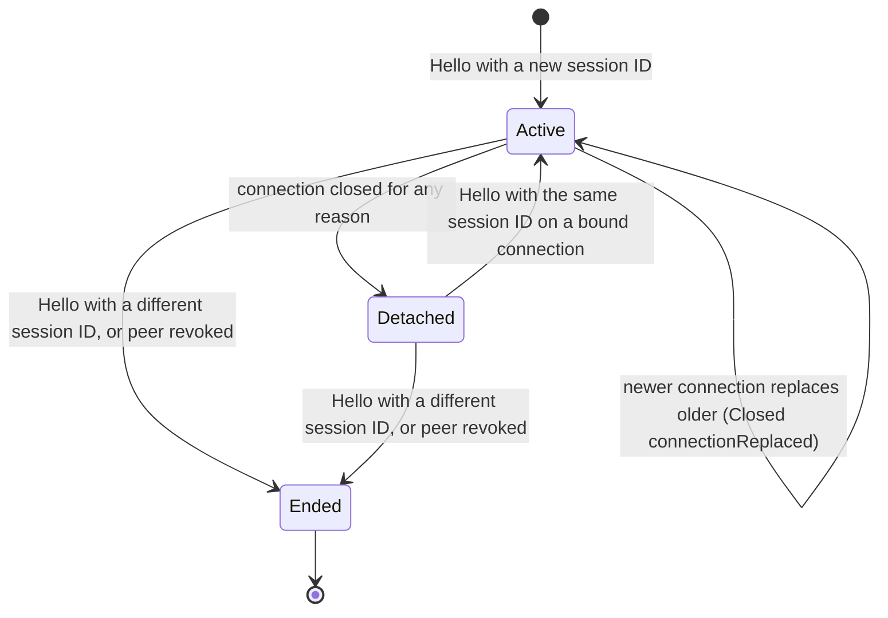

# Program design: agent-fleet-sync

**What this is:** how the crates in `agent-collaboration/agent-fleet-sync` satisfy [the specification](2026-10-16-agent-fleet-sync.md) (SO1–SO50), and how the board becomes their first consumer. Requirements: [requirements.md](requirements.md).

## 1. How it works



- **Multi-step work is durable steps** (`durable-steps`, its own library in this repository; owner, 2026-10-16: "this would be a great library to have. you can have local durable storage and cloud right?"), as with Inngest. The same code and tables run on both backends through SQLx: locally a Turso file through sqlx-turso, and in the cloud each Durable Object's SQLite storage through our Durable Object driver.
  - an operation's steps save their outputs locally: Durable Object storage on Cloudflare, Turso on Tokio;
  - a restart replays the operation, so finished steps return their saved output and the first unfinished step runs;
  - the runner continues unfinished operations on start-up and on its alarm;
  - only a step that calls another object or machine carries an ID, (operation, step name), which the receiver records;
  - holder changes, the work after a copy applies a piece, each delivery hop and a copy restarting from a snapshot are all durable operations. Pending work lives in the operation journal, admitted in the same commit as the change that creates it. There are no hand-written phase records.
  - **Its shape** (owner decision 28; the Advisor's experiments): a typed task definition; one execution core with no Tokio, which compiles for wasm; an atomic store trait (a SQLx transaction scope, so the journal commits with the application's own writes); and a host trait (time, IDs, call dispatch, durable wake-up through a Tokio timer or a Durable Object alarm). One conformance suite runs against every store.
- **Rules decide; hosts carry out.** The receiver, the registry and the session's server side are **rules**. Each runs inside a transaction its host provides, and returns a closed list of effects: an answer to send, a call to another object, an alarm, or consumer work to do after the commit. This is the same shape as M3's `copy_rules` and `registry_rules` today.
- **One Tokio runner.** `fleet-sync-tokio-runner` locks one object at a time, runs a rule in a sqlx-turso transaction, commits, carries out the effects, keeps alarm timers, and hands WebSocket connections to the session rules.
  - `fleet-sync-service` is that runner plus the replication objects, for any consumer.
  - Central's Tokio runtime is built on the same runner, and keeps its own object model.
  - On Cloudflare, central's own Durable Object host runs the rules.
  - Central's one core decides for the board on both runtimes.
- **The writer side is a library on Tokio.** It owns the replicated database's connections, captures changes, sends pieces over a session, and gates writes on the lease.
- **A consumer plugs in through typed traits:**
  - its schema and replicated tables (`ReplicatedSchema`);
  - an optional piece annotation (`PieceAnnotation`);
  - an optional receiver hook (`ReceiverHook`);
  - an optional holder-change gate (`HolderChangeGate`) and lifecycle gate (`LifecycleGate`);
  - its own bookkeeping per captured transaction (`CaptureBookkeeping`);
  - its authenticator (`PeerAuthenticator`), and where a client keeps its session state (`SessionClientStore`);
  - its frame payloads (`ConsumerProtocol`), and for delivery its bodies, addresses and gate (`DeliveryConsumer`);
  - its retention and lease configuration (`Retention`, `LeasePolicy`).

## 2. Today, the choice, and what it costs

**Today** (anchors at M3 `9cc19dd2`, M2 `1e0b5529`):
- **Copy apply** is `copy_rules::apply_piece` (`collaboration-central-core/src/copy_rules.rs:48`). It checks the epoch, the holder, the digest, the receipt and the continuation, then applies the rows (`row_apply.rs:160`).
  - It ends by requiring the board's summary and calling `directory_producer::summary` (`copy_rules.rs:190-196`).
  - The directory update is already a durable outbox: it's saved in the apply transaction, then dispatched and retried on an alarm (`directory_producer.rs:11-98`).
- **Fencing** is `fence_rules::fence` (`fence_rules.rs:9`).
- **The registry** (`registry_rules.rs`, `transfer_rules.rs`, `claim_rules.rs`) also holds machine enrollment and credentials (`registry_rules.rs:187-245`).
- **A claim reserves through Fleet** as a durable phase (`claim_rules.rs:182`).
- **The session record** is `{installation, session_id, connection, expires_at}`, and a disconnect deletes it (`session_rules.rs:11-16`, `:260-293`).
- **The wire** mixes session control with board payloads: `SessionRequest` has `Forward`, `Fleet` and `ArchiveSeen` (`collaboration-replication-protocol/src/session_frame.rs:360`). `Piece` carries the board's `ProjectSummary` (`replication_piece.rs:278-288`).
- **The writer side isn't built.** M2's `ProjectStore` already has one capture-on admission writer guarded by a mutex, and a capture-off maintenance pool (`message-board-storage/src/project_store.rs:18-45`, `:183-184`). Its bookkeeping holds **one** acknowledged position (`project_bookkeeping_migrations/202610120001_holder_bookkeeping.sql`).

**The constraint degree:** both the board's M2/M3 code and the one-core design are unreleased (U60: one release). So this is a hard cutover with no live data to migrate. The constraints are the owner's decisions SU1–SU15, and the platforms (Turso 0.8.1 capture; workers-rs Durable Objects; Cloudflare's inbound protocols).

**The crux** was who runs the rules. The options, with the owner's choice (2026-10-16: "a' is good"):

| | A. Rules shared; each host has its own Tokio runner | **A'. Rules and the Tokio runner shared (selected)** | B. Rules, runner and object model shared |
|---|---|---|---|
| Shape | central's Tokio runtime and `fleet-sync-service` each lock, transact, commit and carry out effects | `fleet-sync-tokio-runner` does that once. The service is the runner plus the replication objects; central's Tokio runtime is the runner plus central's object model. Central's Cloudflare host stays central's | central's step runtime, object kinds, call DAG and caller identity all move to the shared repository |
| Gains | the shared repository stays the smallest | one Tokio runner. Central's one core stays the board's only orchestrator (U69) | one runtime everywhere |
| Costs | the same mechanics code exists twice on Tokio | central's Tokio runtime depends on a crate from another repository, pinned by tag | a framework for arbitrary objects, which the owner declined (decision 22) |

**How A' keeps the one-core seal:** the shared object store runs a closure it's given. It defines no callback trait of its own. Central's sealed `TransactionCallback`, which only central's `StepDriver` constructs, is implemented on top of that store, so the seal stays inside central. The retries, fences and positions stay in the rules, decided once.

**Durable operations on central keep the same seal** (Opus O6). Central runs holder changes, apply follow-ups, delivery hops, seeding and retirement as `durable-steps` operations:
- Central's **core** crate implements `AtomicStore` and `Host` for its object storage, on the same object transaction its `TransactionStore` uses, and owns its `Engine`. It registers the tasks it runs: its own and the shared crates'.
- The engine passes only its wrappers of registered tasks' callbacks into that transaction, and central's `StepDriver` calls the engine (`start`, `drive_due`) as one more step kind.
- Central's **runtime** crates (the Worker glue and the Tokio runtime) inject capabilities: storage, clock, alarm and sockets. They call the core's entry points. They never hold the store, register a task or call `transaction`.

So the seal's guarantee, restated: only code in central's core dependency graph (central's core, plus the shared rules and tasks it registers) runs inside central's transactions.

## 3. Where each entity lives

**Conventions:** the repository's `AGENTS.md` and the owner's Rust rules:
- closed enums with payloads, and Serde-tagged unions on the wire;
- newtype IDs with fallible constructors;
- `thiserror` errors;
- SQLx, with private row structs decoded into domain types;
- no `unsafe`;
- exact integers (U76).

| SE | Semantic owner | Package home | Schema/type home | Shape at each boundary | Disposition |
|---|---|---|---|---|---|
| SE1 Replicated database | `ReplicatedDatabase` (writer side); `CopyState` (receiver side); `LeaseRegistry` (lifecycle) | `fleet-sync-writer` (new); `fleet-sync-receiver` (new; from M3 `copy_storage`); `fleet-sync-lease` | `fleet-sync-protocol::DatabaseId` (new; generalizes `ProjectId`'s role); the registry's `_fleet_sync_databases(database, lifecycle, origin, import_digest, retired_at)` | `DatabaseId(Uuid)`, a consumer-issued UUID newtype, on every piece, lease and snapshot. The board passes `ProjectId`'s UUID. `DatabaseLifecycle::{Registered{origin: Origin::{Empty, Seeded{position}}}, Unheld{import_digest}, Retiring{attempt}, Retired{at}}` (spec SO44–SO47) | persisted |
| SE2 Writer | `LeaseHolder` | `fleet-sync-lease` (holder half) | `fleet-sync-lease::WriterState`; the holder's release record `_fleet_sync_release(database, transfer, call, state: Draining \| Released{final} \| Refused{reason})` in the writer's own file | `WriterState::{Provisional, Seeding{epoch}, Writing{epoch}, Paused{epoch, expired_at}, Draining{epoch, transfer}, Released{epoch, final_position}, Superseded{current}}`. `Provisional` is a created database before registration (SO44): `begin_write` admits it only if the consumer allows writes before registration. Otherwise the board's admission reads the state through `ReplicatedDatabase::begin_write`, which admits only `Writing` | derived from the lease, the clock and the release record; the release record persists, so a restart resumes a drain (Opus O5) |
| SE3 Writer lease | `LeaseRegistry` rules | `fleet-sync-lease` (from M3 `registry_rules`, `lease_incarnation`) | `fleet-sync-protocol::LeaseStatus` (existing; moved) | `LeaseStatus{database, epoch, holder: PeerId, state: Held \| Expired, expires_at: SyncTime, remaining_ms}` | persisted at the registry; cached by the holder |
| SE4 Lease registry | `LeaseRegistry` rules | `fleet-sync-lease` | registry tables `_fleet_sync_databases` (lifecycle), `_fleet_sync_leases`, `_fleet_sync_transfers`, `_fleet_sync_epoch_floor`, and from M3's `0002_registry_storage.sql` (Opus O7): `_fleet_sync_renewal_attempts(database, attempt, holder, request_digest, answer)` for renewal replay (SO18), `_fleet_sync_epoch_history(database, epoch, holder, granted_at, ended_at: Option<ReplicationPosition>)` for `StaleEpoch`'s end position, holder checks and tail verification, and `_fleet_sync_takeover_previews(database, token, request_digest, fence, acked, holder)` for a takeover's confirm token | requests `LeaseRequest` and answers `LeaseAnswer` (§5), including `PreviewTakeover{database} → TakeoverPreview{token, fence: Epoch, acked: ReplicationPosition, holder: PeerId, last_seen: Option<SyncTime>}` | persisted |
| SE5 Replication position | protocol | `fleet-sync-protocol` (existing `ReplicationPosition`, moved) | `ReplicationPosition{epoch: Epoch, sequence: CommitSequence}` | inside pieces, acks, refusals, snapshots; stored as exact integers | value |
| SE6 Copy | `CopyRules` | `fleet-sync-receiver` (from M3 `copy_rules`, `row_apply`, `bound_sql`, `copy_receipts`, `fence_rules`) | `_fleet_sync_copy` (renamed from `_copy_state`), `_fleet_sync_receipts`, `_fleet_sync_staged_parts`, `_fleet_sync_fence_receipts`, and for seeding (SO45) `_fleet_sync_seed(seed_id, database, position, digest, state)` and `_fleet_sync_seed_pages(seed_id, page, digest)` beside staging tables | `CopyRole::{Authoritative, Follower}`; `CopyStatus{database, role, fence: Epoch, holder: Option<PeerId>, start, acked, schema: SchemaIdentity}` | persisted |
| SE7 Receiver | the host: central's copy object, or `fleet-sync-service` | central (board); `fleet-sync-service` (new) | `ReceiverId(Uuid)` in `fleet-sync-protocol` | names a copy in writer bookkeeping and in session status | config |
| SE8 Piece | `ReplicationSender` (sends); `CopyRules` (applies) | `fleet-sync-writer`; `fleet-sync-receiver` | `fleet-sync-protocol::Piece<TAnnotation>` (from `replication_piece.rs`; the summary field becomes a generic annotation) | `Piece{database, epoch, continues_from, through, transactions: Vec<ReplicatedTransaction>, part: Option<TransactionPart>, annotation: Option<TAnnotation>, digest: PieceDigest}`; `RowChange::{Upsert{table, key: Vec<SqlValue>, values}, Delete{table, key}}`; `SqlValue::{Null, Integer(i64), Real(f64), Text(String), Blob(bytes)}` | transient (derived from capture) |
| SE9 Snapshot | `SnapshotReader` (copy side; from M3 `snapshot_reads`); `ReplicatedDatabase::snapshot` (writer side) | `fleet-sync-receiver`; `fleet-sync-writer` | `fleet-sync-protocol::SnapshotPage` (existing; moved) | `SnapshotPage{database, position, schema, schema_steps, table, rows, next: Option<SnapshotCursor>}`; `SnapshotRead::{Page(SnapshotPage), Moved{position}}`. Installing one is the `InstallSnapshot` durable operation (§5), which writes into a staging store and publishes it in one step | staging persisted until published |
| SE10 Peer | the consumer's `PeerAuthenticator` | consumer (board: central's Access and machine-credential check) | `fleet-sync-protocol::PeerId(Uuid)` | a `VerifiedPeer{peer, expires_at: SyncTime}` from the authenticator to the session rules | consumer-owned |
| SE11 Session | `SessionRules` (server); `SessionClient` (client) | `fleet-sync-session` (new; from M3 `session_rules`, `session_notices`) | `_fleet_sync_sessions`, `_fleet_sync_notices` (server); the consumer's `SessionClientStore` (client) | `SessionRecord{peer, session_id, state: Active{connection} \| Detached{since} \| Ended{reason}, notice_head}` | persisted at both ends |
| SE12 Connection | the host's transport adapter, bound by `SessionRules` | `fleet-sync-transport-websocket` (Tokio); the board's Cloudflare runtime (hibernated WebSocket) | `fleet-sync-session::ConnectionBinding` | `ConnectionBinding{connection: ConnectionId, peer, session_id, expires_at}`, kept in the WebSocket task or in the Durable Object's socket attachment | transient (the attachment survives hibernation) |
| SE13 Operation | the owner of each operation: `ReplicationSender`, `LeaseHolder`, or the consumer | per owner | `fleet-sync-protocol::OperationRequest<TConsumer>` | `Request{frame: FrameId, body: OperationRequest<P>}`; `OperationRequest::{Replication(ReplicationRequest), Lease(LeaseRequest), Delivery(DeliveryRequest), Consumer(P::Request)}`; server to client, `ServerRequest::{Crate(ServerCall), Consumer(P::ServerRequest)}` (§5 "Calls across a session"); each body carries its own identity | the identities are persisted by their owners |
| SE14 Transport | `SessionTransport` / `TransportConnection` | `fleet-sync-session` (traits); `fleet-sync-transport-websocket` (impl) | traits (§5) | opaque frames as `Bytes` | — |
| SE15 Holder change | `LeaseRegistry` transfer rules | `fleet-sync-lease` (from `transfer_rules`, `transfer_completion`, `claim_rules`) | `HolderChangeRequest`, `TransferRecord` | `HolderChangeRequest::{Move{attempt, database, from_epoch, to: PeerId}, Takeover{attempt, database, preview, to}, Claim{attempt, database, claimant}}`. `_fleet_sync_transfer_admissions(attempt, operation, request, requested_by, admitted_at, follow_up)` binds the attempt to B's minted operation IDs and says what was asked, by whom (decision 76). `_fleet_sync_transfers(attempt, database, kind, from_epoch, to, phase, phase_history, outcome: Option<HolderChangeAnswer>)` is the domain record: identity, target, the workflow's phase with its compact history (one `(phase, entered_at)` per phase entered), and the final outcome. `_fleet_sync_transfer_cancels(attempt, cancelled_by, reason, at)` holds an admin's cancel under the change's attempt ID, so a cancel that arrives before the change's first step still lands (decision 75). **The phase is domain state**, written in the local step that enters it. `Fencing` is the point of no return, and a cancel checks it in its own transaction. **Retries and pending calls stay in the operation's journal** (FS9), and the admin read joins the two (`holder_change_view`, SO48). **An active transfer is a transfer record with no outcome.** Every way a transfer ends writes the outcome in the transaction that ends it: the task's final local step, its cancel follow-up's last step, or the task's `on_failed` when the engine fails it (Opus O10). So the record and the journal never disagree, and the rules read only the record and the cancel | persisted |
| SE16 Rejected tail | `ReplicationSender` (detects); the consumer (handles) | `fleet-sync-writer` | `RejectedTail{database, epoch, ended_at, last_commit}` | reported once through `ReplicationEvents::rejected_tail` | persisted until the consumer acknowledges it |
| SE17 Consumer | — | the consumer's crates | the traits in §5 | — | code |
| SE18 Replicated schema | the consumer's `ReplicatedSchema` impl | the consumer | `fleet-sync-writer::ReplicatedSchema` | migrations as SQL text with versions; replicated table names; checked when the database opens and before a migration runs | code plus persisted schema identity |
| SE19 Retention policy | `ReplicationSender` | `fleet-sync-writer` | `Retention::{UntilAcknowledged, Bounded{max_age: Duration, max_changes: u64}}` | configuration | config |
| SE20 Durable operation | `DurableSteps` | `durable-steps` (new) | `_fleet_sync_operations(operation_id, kind, kind_version, request_key, input, input_digest, state, result, next_attempt_at, drive_token, drive_until)` with `UNIQUE(kind, request_key)` | `OperationId(Uuid)`, minted once. When the operation ends, its input and step outputs are deleted and a compact row stays (kind, request key, input digest, result), unless the task sets `KEEP_RESULT = false` (§5 "What the journal keeps"). The caller's **request key** binds to it uniquely: an attempt ID, a piece's identity tuple encoded canonically, or an item ID. Starting with an existing key and the same `input_digest` returns the same operation; with a different digest it's refused `RequestConflict` (FS5). `OperationState::{Running, Completed{result}, Failed{reason}}` | persisted |
| SE21 Step | `DurableSteps` | `durable-steps` | `_fleet_sync_steps(operation_id, position, step_name, output, first_attempt_at, may_have_reached)`; the last two are a call step's attempt record. Before each dispatch the engine commits `may_have_reached = true`; a `NotSent` answer commits it back to false only when no earlier attempt could have arrived. So a crash or a Durable Object reset during a dispatch replays as possibly delivered (Opus O5) | `StepName` (static per call site; a loop names steps with their index, e.g. `page:3`). Replay checks the name at each position and fails the operation `Nondeterministic{position, expected, found}` on a mismatch. A call step's identity at the receiver is `CallId{operation, step}`, built from the stable `OperationId` | persisted |
| SE22 Delivery item | the hop holding custody: the sender's `Outbox`, the relay's `Mailbox`, the recipient's `Inbox` | `fleet-sync-delivery` (new; generalized from the board's PD4 and `collaboration-mail-protocol`) | `fleet-sync-protocol::DeliveryItem<D: DeliveryTypes>` (wire types live with the other frames; decision 47) | `DeliveryItem{id: ItemId(Uuid v7), sender: D::Sender, recipient: Recipient{peer: PeerId, address: D::Address}, valid_until: Option<SyncTime>, body: D::Body, digest: ItemDigest}`; `DeliveryStatus::{Queued, Sent{seq}, AtRecipient, Held, Delivered{acceptance: D::Acceptance}, Uncertain, Expired, Cancelled, Refused{reason: DeliveryRefusal::{MailboxFull, ItemConflict{existing}, RecipientUnknown, RecipientRevoked, DroppedByPolicy, CancelSenderMismatch}}}` with `StatusVersion(u64)` | persisted at each hop |
| SE23 Mailbox | `Mailbox` rules | `fleet-sync-delivery` | relay tables `_fleet_sync_mail_items(item_id, stream, seq, digest, payload?, status, version, last_report_seq, origin, accepted_at, fetched, released_at?)`, `_fleet_sync_mail_controls(seq, entry)`, `_fleet_sync_mail_state` | streams `Items` and `Controls`; a compacted row keeps (item, digest, final status, version) for good | persisted at the relay |
| SE24 Hop | each hop's durable operation (`SubmitItem`, `ReceiveItems`, `DeliverLocally`, `ReportOutcome`, `PublishStatus`) | `fleet-sync-delivery` + `durable-steps` | operation kinds | each hop's call carries its `CallId`. Request keys are per operation (§5 "Each hop is a durable operation"): `SubmitItem` and `DeliverLocally` by item ID, `ReceiveItems` by (stream, receive cycle), `ReportOutcome` by (item, `ReportSeq`), `PublishStatus` by (item, `StatusVersion`, status target) | persisted (journal) |
| SE25 Cancel | the recipient's `Inbox` decides; the relay forwards | `fleet-sync-delivery` | `CancelBody{target: ItemId}` as an item on the `Controls` stream | `CancelResult::{Pending, Prevented, TooLate{at: Delivered \| Uncertain}}` | persisted |

## 4. Components and what may depend on what

| Component | Crate | Job | Owns | Consumers | Changes when |
|---|---|---|---|---|---|
| `ReplicatedDatabase` | `fleet-sync-writer` | opens and holds the replicated Turso file: a capture-on writer behind one guard, a capture-off maintenance pool and read pools; runs the consumer's migrations; takes snapshots; moves a file aside | the connections and their capture mode; the engine bookkeeping tables `_fleet_sync_*` | the consumer's store (the board's `ProjectStore`) | Turso or capture changes |
| `ReplicationSender` | `fleet-sync-writer` | reads capture after each copy's position, normalizes rows (§7), cuts pieces, sends them through the session, handles answers, prunes by retention, detects a rejected tail | per-copy positions `_fleet_sync_copies`; retention | `ReplicatedDatabase` | the piece format or retention changes |
| `LeaseHolder` | `fleet-sync-lease` | renews on a schedule; keeps `WriterState`; is the write gate | the cached lease and its local deadline | `ReplicatedDatabase::begin_write`; `ReplicationSender` | the lease contract changes |
| `LeaseRegistry` rules | `fleet-sync-lease` | register, import, renew, grant, fence orchestration, move, takeover, claim, retire, epoch floor, replay | the registry tables of SE4 | hosts | the lease contract changes |
| `CopyRules` | `fleet-sync-receiver` | apply a piece; fence; stage and publish a seed; take a snapshot; run the consumer hook inside the apply; return the consumer's follow-ups, which the host admits as durable operations in the same transaction | copy state, receipts, staged parts, fence receipts, seed staging | hosts | the apply contract changes |
| Runtime primitives | `runtime-primitives` (new; owner, decision 31) | the scheduling and runtime primitives every crate shares: `SyncTime`, `Clock`, `IdSource`, `WakeScheduler` and `Backoff`, with a Tokio adapter (system clock, UUIDv7, a timer) and a Durable Object adapter (the object's alarm owner) behind features | nothing durable; the alarm itself is the platform's | `durable-steps`, `fleet-sync-protocol`, `fleet-sync-session`, `fleet-sync-lease`, `fleet-sync-tokio-runner`; later the board's existing scheduler as one more `WakeScheduler` | a runtime's time, ID or wake mechanics change |
| `DurableSteps` | `durable-steps` | run a durable operation: save each step's output (a local step saves it in the step's own transaction; a call step saves it as soon as the call answers), replay finished steps, record the result, and tell the host when to retry | `_fleet_sync_operations`, `_fleet_sync_steps` | the hosts (`TokioRunner`, central's Durable Object host); every multi-step operation | the step contract changes |
| `SessionRules` | `fleet-sync-session` | server half: hello and resume, binding a connection, replacement, detach, end, notices, decoding the envelope and routing operations | `_fleet_sync_sessions`, `_fleet_sync_notices` | hosts | the session contract changes |
| `SessionClient` | `fleet-sync-session` | client half: connect, hello, keep the current connection, correlate frames, reconnect with backoff, report `Unknown` to callers when a connection closes | the session ID and notice cursor, through `SessionClientStore` | `ReplicationSender`, `LeaseHolder`, consumer clients | the session contract changes |
| WebSocket transport | `fleet-sync-transport-websocket` | Tokio client (tokio-tungstenite) and Tokio server (axum WebSocket); one WebSocket message is one frame | nothing durable | `SessionClient`; `fleet-sync-service`; central's Tokio runtime | WebSocket libraries change |
| `TokioRunner` | `fleet-sync-tokio-runner` | the Tokio object store (one async lock per object around a sqlx-turso transaction, with a closure-taking `transaction`), alarm timers, effect execution after commit, a WebSocket server that hands each connection to the session rules, and for snapshot installs the host's control store and `StagingStore` (staging files, written with page receipts) | the control store's journal and the staging files; no replication truth of its own | `fleet-sync-service`; central's Tokio runtime | Tokio, sqlx-turso or WebSocket mechanics change |
| Delivery | `fleet-sync-delivery` (new; generalized from PD4 and `collaboration-mail-protocol`) | the sender's `Outbox`, the relay's per-recipient `Mailbox` and the recipient's `Inbox`, as rules over a borrowed scope; the hop tasks; `DeliveryConsumer` | the delivery tables at each hop (SE22–SE25) | the consumer's sender and recipient (the board's Router); the relay host (`fleet-sync-service` on Tokio, central on Cloudflare) | the delivery contract changes |
| `fleet-sync-service` | `fleet-sync-service` | the replication objects (copies, a registry, sessions) and the relay (one `Mailbox` object per recipient peer) on `TokioRunner`, with a per-copy Turso file, routing between registry, copy and mailbox, and the consumer's plugins | nothing beyond what the rules own | consumers that aren't the board | the service's object set or configuration changes |
| Owned drivers and generator | `sqlx-turso*`, `sqlx-durable-object`, and `fleet-sync-query-gen` (a host tool, delivered in PR C; the one-core design's K4(b), from its probe's `probe-query-gen`) | SQLx over Turso and over Durable Object SQL; exact transport; the generator applies a crate's migrations to a scratch Turso store, describes each statement in the crate's `sql/*.sql` corpus through sqlx-turso, refuses any result type it can't name, and writes the crate's typed statements, which run on both drivers, with a freshness record CI checks. Expression result types aren't described by the driver, so the generator names a closed set itself from the `turso_parser` AST: `typeof(x)` is TEXT and `CAST(x AS INTEGER \| REAL \| TEXT \| BLOB)` is that class; anything else it can't name is refused. The crates' own integer reads use `typeof(col), CAST(col AS TEXT)` so exact integers survive the Durable Object driver's JavaScript numbers (SO4, U76; Opus R2). It's built in PR C, with a negative case per family | driver mechanics | every crate above; the board's central core | Turso, workers-rs or SQLx change |



**Forbidden edges:**
- **No agent-fleet-sync crate depends on a consumer crate** (SO27). SV6 proves it: the repository builds alone.
- **Rules crates perform no I/O and start no runtime.** `fleet-sync-receiver`, `fleet-sync-lease`'s registry rules, `fleet-sync-session`'s server rules and `fleet-sync-delivery`'s rules take a borrowed SQLx scope and return effects (SO28). Review holds the rule, and the Worker build proves it: the board's Cloudflare runtime compiles and runs them under workerd (SV4, SV5).
- **Only `ReplicatedDatabase` opens connections to a replicated file,** so no write can bypass capture or the write gate.
- **Only `CopyRules` writes a copy** (SE7's invariant).

## 5. Interfaces

**The consumer's traits** (`fleet-sync-writer`, `fleet-sync-receiver`, `fleet-sync-lease`, `fleet-sync-session`):

```rust
pub trait ReplicatedSchema: Send + Sync + 'static {
    /// Ordered migrations; each runs once, in its own captured transaction (SO6). They may touch only
    /// declared replicated tables, because the copy runs the same statements: a statement that names any other
    /// table (to create, alter or read it) is refused as `SchemaForm::UndeclaredTable{table}` (PR D2's question).
    /// One exception keeps a table rebuild expressible: a table the same migration creates and, by its last
    /// statement, has dropped or renamed to a declared name (`tasks_rebuilt` → `tasks`). The guard walks the
    /// migration's statements in order, tracking names created, renamed and dropped; at the end every table that
    /// exists and that the migration created or changed must be declared.
    /// Views are allowed, with no primary-key rule because they hold no rows, when every table or view they read
    /// is declared or itself an allowed view. The copy runs the same `CREATE VIEW`. A view that reads an undeclared
    /// table is refused as `UndeclaredTable` (PR D2's question).
    fn migrations(&self) -> &'static [Migration];
    /// The consumer's local tables in the same file (the board's feed marks, say): run on the capture-off
    /// maintenance path, never captured, never sent (SO7). They create and change local tables only; a view
    /// in a local migration is refused, so a view's membership stays decided by what it reads (PR D2's question).
    fn local_migrations(&self) -> &'static [Migration] { &[] }
    /// The tables that replicate. Each must declare a primary key (SO5, SO6).
    fn replicated_tables(&self) -> &'static [TableName];
}

pub trait PieceAnnotation: Send + Sync + 'static {
    type Protocol: ConsumerProtocol;          // the annotation type is `ConsumerProtocol::Annotation` (§5 "Frames")
    /// Computed only from the piece's own transactions, so a rebuilt piece has the same digest.
    fn annotate(&self, transactions: &[CapturedTransaction<'_>]) -> Option<<Self::Protocol as ConsumerProtocol>::Annotation>;
}

/// Generic over the scope, so a consumer adds the SQL codec bounds its own writes need in its impl,
/// or implements it for the concrete Turso and Durable Object scopes (D1's question).
pub trait ReceiverHook<S: TransactionScope>: Send + Sync + 'static {
    type Protocol: ConsumerProtocol;          // the same annotation type as the writer's (Serialize too: digests, staged parts)
    type FollowUp: Serialize + DeserializeOwned + Send + Sync;
    /// Runs inside the apply transaction; Err refuses the piece and changes nothing (SO12).
    /// Only small local bookkeeping goes here. Slow or remote work is a FollowUp.
    fn on_applied(&self, scope: &mut S, applied: &AppliedPiece<'_, <Self::Protocol as ConsumerProtocol>::Annotation>)
        -> impl Future<Output = Result<Vec<Self::FollowUp>, HookRefusal>> + Send;
    /// The hook's own local tables in the copy's file (the board's directory projection, say). Run once on the
    /// receiver, never part of the replicated schema. The copy records its replicated table set from the seed's
    /// schema and each applied `SchemaStep` (`_fleet_sync_copy_tables`), and snapshots, schema fingerprints and
    /// digests read only that set, so a hook's table never enters a snapshot (SO7, SO10; PR D2's finding).
    fn local_migrations(&self) -> &'static [Migration] { &[] }
    /// Each FollowUp is its own durable operation (`ApplyFollowUp`), admitted in the apply's transaction,
    /// keyed (database, epoch, the piece's `through` position, index). Its one call step runs this (SO12, SO31).
    fn follow_up(&self, item: &Self::FollowUp, call: CallId)
        -> impl Future<Output = Result<FollowUpDone, FollowUpFailure>> + Send;
    /// Runs inside the commit that makes a copy follow after it starts from a snapshot: `seed_complete`, or
    /// `InstallSnapshot`'s `ready`. The replicated tables now hold the snapshot at `installed.position`, and
    /// `on_applied` never saw the transactions before it, so the hook rebuilds what it derives from them here.
    /// Its follow-ups are admitted in that commit, keyed (database, the snapshot's position, index), apart from
    /// piece keys. Err changes nothing and fails that publish or `ready` with the hook's reason, so the copy
    /// doesn't follow. The default does nothing, for a hook that keeps no state derived from replicated rows
    /// (decision 38; PR D2's finding).
    fn on_snapshot_installed(&self, scope: &mut S, installed: &InstalledSnapshot)   // {database, position, schema}
        -> impl Future<Output = Result<Vec<Self::FollowUp>, HookRefusal>> + Send { async { Ok(Vec::new()) } }
}

/// The consumer's rules on a database's lifecycle (SO44, SO47). The board: registration needs central's
/// directory acceptance (spec 3 FL-1); retirement needs an archived board (FL-18). Each is a call with CallId.
pub trait LifecycleGate: Send + Sync + 'static {
    fn admit_registration(&self, database: &DatabaseId, writer: &PeerId, call: CallId)
        -> impl Future<Output = Result<GateAnswer, GateFailure>> + Send;   // Admitted | Refused{reason}
    fn admit_retirement(&self, database: &DatabaseId, call: CallId)
        -> impl Future<Output = Result<GateAnswer, GateFailure>> + Send;
}

pub trait HolderChangeGate: Send + Sync + 'static {
    /// Reserve before fencing (the board's archive gate on claims). The call carries CallId.
    fn reserve(&self, change: &HolderChangeRequest, call: CallId)
        -> impl Future<Output = Result<GateAnswer, GateFailure>> + Send;   // Reserved | Refused{reason}
    /// Settle a reservation exactly once: Granted{epoch}, Refused{reason} after any later refusal (FS2), or
    /// Cancelled (SO49). **A settle closes the attempt even when no reservation exists yet** (decision 77, the
    /// Advisor's C75-1): it records a terminal receipt for the attempt, and a later `reserve` for that attempt answers
    /// Refused. A cancel's settlement can overtake a delayed reserve, and same-CallId deduplication can't order two
    /// different calls. A repeat answers the receipt; a different outcome for a settled attempt is a conflict. The
    /// conformance suite proves it with a delayed reserve that arrives after the settlement.
    fn settle(&self, change: &HolderChangeRequest, outcome: SettleOutcome, call: CallId)
        -> impl Future<Output = Result<(), GateFailure>> + Send;
}

pub trait SessionClientStore: Send + Sync + 'static {
    /// The client half's only durable state: its session ID and notice cursor.
    fn load(&self) -> impl Future<Output = Result<Option<ClientSessionState>, StoreError>> + Send;
    fn save(&self, state: &ClientSessionState) -> impl Future<Output = Result<(), StoreError>> + Send;
}

pub trait PeerAuthenticator: Send + Sync + 'static {
    type Material: Send;
    fn verify(&self, material: Self::Material)
        -> impl Future<Output = Result<VerifiedPeer, AuthRefusal>> + Send;
}
```

`HookRefusal` is a closed reason that the consumer names with its own code (`HookRefusal{code: HookRefusalCode, detail}`). It's reported as `PieceRefusal::Hook`. `AuthRefusal::{Unknown, Expired, Revoked, WrongKind}` reuses today's `CredentialRejection` variants.

**The writer side** (`fleet-sync-writer`):

```rust
impl<TSchema: ReplicatedSchema> ReplicatedDatabase<TSchema> {
    pub async fn open(path: &Path, database: DatabaseId, schema: TSchema, gate: LeaseHolder)
        -> Result<Self, OpenError>;
    /// Takes the writer guard and checks the write gate (SO14).
    pub async fn begin_write(&self) -> Result<WriteTransaction<'_>, WriteRefusal>;
    /// A guarded read pool: its executor admits only reads (below). The owned driver has no read-only mode.
    pub fn reader(&self) -> &ReadPool;
}
pub enum WriteRefusal { Provisional, Rejected { reason: GateReason }, StatementRefused { form: StatementForm }, Seeding, LeaseExpired { epoch: Epoch, expired_at: SyncTime }, Draining { transfer: TransferId }, Released, Superseded { current: Epoch }, NotWriter, Closed }
// `Provisional`: a created database before registration, when the consumer doesn't allow writes yet (SO44).

/// The consumer's own bookkeeping per captured transaction (the board's feed marks, FS8).
/// Called by the sender in the capture-off maintenance transaction that assigns the transaction
/// to a piece, before the piece is sent. Capture is pruned only after the copy acknowledges the
/// piece and this record exists. Annotation stays pure; this is the only consumer write here.
pub trait CaptureBookkeeping: Send + Sync + 'static {
    /// The maintenance transaction is the writer's own capture-off Turso transaction (the writer is Tokio-only),
    /// so this is a concrete type, not a scope trait (Opus O14).
    fn record(&self, scope: &mut MaintenanceTransaction<'_>, captured: &CapturedTransaction<'_>)
        -> impl Future<Output = Result<(), BookkeepingError>> + Send;
}
pub enum OpenError { SchemaUnsupported { form: SchemaForm }, ReservedTableName { table: TableName }, Storage(StoreError) }
pub enum SchemaForm { KeyNotUuidV7 { table: TableName, column: Option<String> },   // no key, or a key column that isn't TEXT NOT NULL UUIDv7 (decision 51)
 Trigger { name: String }, VirtualTable { table: TableName }, ForeignKeyAction { table: TableName, constraint: String }, NonDeterministicMigration { statement: u32, function: String }, UndeclaredTable { table: TableName } }
// Checked when the database opens and before each migration (SO6).
// At execution: one statement guard, which parses each statement once (turso_parser, cached by SQL text), with
// two admission profiles, so nothing reaches the replicated file around capture or the write gate (§4's forbidden
// edge; PR D2's question). `WriteTransaction` and `ReadPool` implement SQLx's `Executor` by checking, then
// delegating.
//   - Read (`ReadPool`): `SELECT` and `WITH … SELECT`, and read-only PRAGMAs (`table_info`, `foreign_key_list`,
//     `index_list` and the like). Anything else is `StatementRefused{form: WriteOnReader}`.
//   - Write (`WriteTransaction`): reads plus `INSERT`, `UPDATE`, `DELETE`, `REPLACE` and upserts, except an `UPDATE`
//     or an upsert's `DO UPDATE` that assigns a replicated table's key column (`KeyChange{table}`; keys never
//     change, decision 51). Before commit, every replicated row the transaction wrote must have a canonical
//     UUIDv7 key, or the transaction is refused (`WriteRefusal::InvalidKey{table}`) and nothing commits. Schema statements (`CREATE`, `ALTER`, `DROP`) are refused (`SchemaOutsideMigrate`):
//     schema changes go through `migrate`. So are PRAGMA writes, which would change capture or foreign-key
//     enforcement, `ATTACH` and `DETACH`, and transaction control (`BEGIN`, `COMMIT`, `SAVEPOINT`, `RELEASE`),
//     because the transaction is owned (`StatementRefused{form}`).
//   - `migrate` and the maintenance pool are the engine's own paths and don't take consumer SQL.
```

`ReplicationSender::run` is a task the consumer spawns for each database. It reports `ReplicationEvents`, a stream:
- `Acknowledged{copy, through}`;
- `CopyNeedsSnapshot{copy}`;
- `RejectedTail(RejectedTail)`;
- `LeaseChanged(WriterState)`.

**Bringing a database under replication** (spec SO44, SO45; Opus O1). `ReplicatedDatabase::create` mints the database ID and starts `Provisional`. The writer then runs a `RegisterDatabase` operation:
1. `register` (call: the registry's `register`, with `Origin::Empty` for a new file, or `Seeded{position}` for one with data from before capture);
   A file with data from before capture is adopted first. `ReplicatedDatabase` accepts it only when its `_sqlx_migrations` history is an exact prefix of the consumer's bundle (versions and checksums match, every row succeeded). It validates the schema forms, then marks that prefix managed with capture off, so only later migrations are captured as `SchemaStep`s. The seed carries the live schema, so the copy never replays the prefix's DML. A missing or non-prefix history is a typed `OpenError`, with nothing written (decision 44; PR D2's question).
2. for `Seeded`, a `SeedCopy` loop. The writer opens one read transaction at `position` and keeps it for the whole seed. `seed:n` (call: `SeedPage{seed, page: n, rows, digest}`) runs for each page, then `complete` (call: `SeedComplete`). Each page's receipt at the copy answers a repeat. A writer restart loses the read transaction, so it begins again under a new `SeedId`;
3. `ready` (local): `Writing{1}`, and the sender starts after `position` (or from zero).

An admin's import tool runs the same seed loop against an `import`ed database, from the file it uploads (SO46).

**Receiver rules** (`fleet-sync-receiver`). They're called by a host inside its transaction:

```rust
pub async fn apply_piece<S: TransactionScope, H: ReceiverHook<S>>(
    scope: &mut S, piece: &Piece<<H::Protocol as ConsumerProtocol>::Annotation>, sender: &PeerId, hook: &H, now: SyncTime,
) -> Result<ApplyDecision<H::FollowUp>, ApplyFailure>;

pub enum ApplyDecision<TAfter> {
    Applied { through: ReplicationPosition, follow_ups: Vec<TAfter> },
    PartStaged { transaction: TransactionKey, index: u32, acked: ReplicationPosition },
    AlreadyApplied { through: ReplicationPosition },
}
/// A refusal is an `Err`, so the host's transaction rolls back every row the apply already wrote (a hook
/// refusal or `CopyFull` comes after mutation), and the host then answers `Refused` (D1's question; M3
/// does the same, `core_steps.rs:150`). No refusal writes anything, apart from the staged-part discard below.
pub enum ApplyFailure {
    Refused(PieceRefusal),
    /// The one refusal that cleans up (M3 `copy_rules.rs:176`, kept; D1's question): a final part whose assembled
    /// transaction leaves a gap or doesn't match its digest can never complete. After rolling back, the host runs
    /// `discard_staged_parts` for that transaction in its own transaction, then answers the refusal, so the
    /// resend starts the transaction cleanly. Rows, receipts and the acknowledged position still don't move.
    RefusedDiscardingParts { refusal: PieceRefusal, transaction: TransactionKey },
    Storage(StoreError),
}
pub async fn discard_staged_parts<S: TransactionScope>(scope: &mut S, transaction: &TransactionKey) -> Result<(), ReceiverError>;
// **The apply is a host transaction, not a durable operation** (Opus O8). The host opens one
// `AtomicStore` transaction, calls `apply_piece`, and on `Applied` admits each follow-up as an
// `ApplyFollowUp` operation with `JournalScope::admit`, before commit. On `Err` it rolls back and
// answers the refusal, and nothing is recorded, so a refusal that's later fixed (a hook, `CopyFull`,
// `NotInitialized`, `SchemaUnsupported` after an upgrade) applies on the next send. Only an applied
// piece leaves a receipt, as in M3 (`copy_receipts.rs`).

/// Seeding the authoritative copy from its writer or an import (SO45, SO46): pages are staged with
/// receipts, then the whole seed is verified and published in one transaction.
pub async fn seed_page<S: TransactionScope>(scope: &mut S, page: &SeedPage) -> Result<SeedPageAnswer, ReceiverError>;
//   Every seed call takes the authenticated sender, never a frame field, as `SeedAuthority::{Writer(PeerId), Admin}`.
//   `Writer(p)` is accepted only when the copy's recorded holder (from `CreateCopy`) is `p`; `Admin` only for a copy
//   created by import, through the consumer's admin surface. Anything else is `NotWriter`, and nothing is staged
//   (decision 43; PR D2's finding).
//   A seed starts with SeedBegin{database, attempt: Uuid}: the copy issues SeedId{generation}, one higher
//   than any it has issued for the database, and discards older staging. The same attempt gets the same
//   seed back (a lost answer), so the writer or import tool needs no clock or counter of its own (D1's
//   question). SeedPage{seed, page: u32, contents: SnapshotPage, digest}: the same (seed, page, digest)
//   answers AlreadyStaged; another digest is SeedConflict; an older generation is StaleSeed. Refused
//   Retired, or NotSeedable once the copy follows.
//   Digests are `fleet-sync-protocol`'s, so the writer and the copy hash the same bytes: PageDigest is
//   SHA-256 over the page's canonical encoding (the encoding PieceDigest uses), and TableDigest is
//   SHA-256 over the table's rows in declared-primary-key order, each row's values in declared column
//   order, canonically encoded (`TableDigestBuilder::push_row`). Snapshot and seed pages are read in
//   primary-key order.
pub async fn seed_complete<S: TransactionScope>(scope: &mut S, done: &SeedComplete) -> Result<SeedAnswer, ReceiverError>;
//   SeedComplete{database, seed, position, pages, schema, table_digests}: verifies the page count, schema
//   and each table's digest, moves the staged rows into the live tables, sets acked = position and
//   `following`, and runs the hook's `on_snapshot_installed`, in one transaction. A repeat answers Published{position}. Refusals found before any write
//   (Incomplete, StaleSeed, PositionMismatch) are answers. One found after the publish began (the replayed
//   schema's fingerprint, a table digest) is `Err(ReceiverError::SeedRefused{answer})`: the host rolls back,
//   then answers it, as M3's `import_rules.rs::publish_snapshot` does (D1's question).
pub async fn retire_copy<S: TransactionScope>(scope: &mut S, request: &RetireCopy, now: SyncTime) -> Result<RetireCopyAnswer, ReceiverError>;
//   checks the expected fence and acknowledged position, then deletes every copy record in one transaction:
//   replicated rows, receipts, staged parts, seed staging and pages, the copy's schema steps (their SQL can carry
//   data literals) and its table set. It keeps only a retired marker (database, retired_at). A repeat answers
//   Retired, and so does any later request, CreateCopy included (SO47; D1's question).
pub enum PieceRefusal {
    StaleEpoch { newer: Epoch, ended_at: ReplicationPosition },
    NotWriter { current: Option<Epoch> },
    Gap { acked: ReplicationPosition },
    PieceConflict,
    SchemaUnsupported { form: SchemaForm },
    NeedsSnapshot { acked: ReplicationPosition },
    NotInitialized,
    CopyFull,
    Retired,
    Hook(HookRefusal),
}
pub async fn fence<S: TransactionScope>(scope: &mut S, request: &FenceRequest) -> Result<FenceResult, ReceiverError>;
pub async fn snapshot_page<S: TransactionScope>(scope: &mut S, cursor: Option<SnapshotCursor>) -> Result<SnapshotRead, ReceiverError>;
```

`FenceResult` keeps today's closed set (`fence_rules.rs`): `Fenced{old_epoch, new_epoch, start}`, `FenceNotAdvanced`, `PreviewStale`, `SchemaTooNew`, `NotInitialized`, plus `Retired`.

**Registry rules** (`fleet-sync-lease`):

```rust
pub async fn renew<S: TransactionScope>(scope: &mut S, request: &RenewRequest, holder: &PeerId, now: SyncTime, policy: &LeasePolicy) -> Result<RenewAnswer, LeaseError>;
//   A renewal attempt is recorded in `_fleet_sync_renewal_attempts` with its answer; a repeat returns it,
//   marked replayed (SO18). `Retired` comes before any replay (SO47).
pub async fn preview_takeover<C>(ctx: &mut C, request: &PreviewTakeover, config: &RegistryConfig) -> Result<TakeoverPreview, LeaseError>
    where C: OperationContext, for<'t> <C::Store as AtomicStore>::Scope<'t>: TransactionScope;
//   A durable operation (D1's question): check (local: the database is held; Retired → Retired) → copy_status
//   (call: CopyStatus to the authoritative copy, outside any transaction, for its fresh fence and acked) → save
//   (local: the preview, its token the operation ID) → done. A preview has no clock expiry, as in M3: it goes stale
//   when the copy's fence or acked moves, which the takeover's fence detects (`PreviewStale`).

/// `Retired` comes before any replay (SO47; D1's finding): a repeated request for a completed operation gets the
/// engine's saved result without running a step, so the check can't live only in a task's first step. The
/// registry host's entry point reads `database_lifecycle(scope, database)` before it starts or replays any
/// lifecycle, holder-change or renewal operation, and answers `Retiring` or `Retired` as that request's typed
/// retirement answer. Task results stay readable (`KEEP_RESULT` true) for the replays that do proceed.
/// The database's lifecycle (SO44–SO47; Opus O1). Each is a durable operation keyed by its attempt ID, with a
/// domain record `_fleet_sync_lifecycle_attempts(attempt, database, kind, outcome: Option<..>)` like a transfer's:
/// a record without an outcome is the attempt in progress, and every ending writes the outcome, the final local
/// step or `on_failed` (`Failed{reason}`) (Opus N3).
pub async fn register<C>(ctx: &mut C, request: &Registration, config: &RegistryConfig)
    -> Result<RegistrationAnswer, LeaseError>
    where C: OperationContext, for<'t> <C::Store as AtomicStore>::Scope<'t>: TransactionScope;
//   Registration{attempt, database, writer, origin: Origin::{Empty, Seeded{position}}}.
//   Steps: check (local: unknown → continue; Registered to this writer → its recorded answer; held by
//   another → NotWriter; Retired → Retired) → admit (call: gate.admit_registration) → create_copy (call:
//   the authoritative copy starts empty, `following` from zero for Empty, or awaiting the seed for Seeded;
//   AlreadyCreated on a repeat; CreateCopy carries CopyOrigin::{Empty, AwaitingSeed{expected_position:
//   Some(position)}}, and SeedComplete must match that position) → register (local: `_fleet_sync_databases` Registered{origin}, epoch 1 to
//   `writer` in `_fleet_sync_leases` and `_fleet_sync_epoch_history`, lease from now) → done. The copy comes
//   first, so a failure never leaves a Registered database without one; a copy left by a failed attempt is
//   picked up by the next attempt's create_copy. A refused gate answers
//   DatabaseRejected{reason}; the writer then reports its accepted writes as a rejected tail (SO44).
pub async fn import<C>(ctx: &mut C, request: &Import, config: &RegistryConfig) -> Result<ImportAnswer, LeaseError>
    where C: OperationContext, for<'t> <C::Store as AtomicStore>::Scope<'t>: TransactionScope;
//   Import{attempt, database, digest}. Steps: check (local: unknown → continue; Unheld with the same
//   digest → AlreadyImported; anything else → ImportConflict{existing, offered} or, if ever held,
//   ImportConflict{existing: None}; Retired → Retired) → create_copy (call: CreateCopy{epoch: 1, holder:
//   None, origin: CopyOrigin::AwaitingSeed{expected_position: None}}, the authoritative copy awaiting its seed; its position comes later from
//   SeedComplete; AlreadyCreated on a repeat) → reserve (local: Unheld{digest} at epoch 1 with no holder,
//   pending its seed) → done. As in `register`, the copy comes first, and SeedBegin never creates a copy. The consumer's admin surface then pushes the seed pages to the
//   copy (`seed_page`, `seed_complete`), exactly as a writer seeds; the database becomes readable when the
//   seed publishes. The first claim gets epoch 2.
pub async fn retire<C>(ctx: &mut C, request: &Retirement, config: &RegistryConfig) -> Result<RetirementAnswer, LeaseError>
    where C: OperationContext, for<'t> <C::Store as AtomicStore>::Scope<'t>: TransactionScope;
//   Retirement{attempt, database, expect: (fence, acked)}. Steps: check (local: no lease in any state,
//   no transfer record without an outcome; Retired → its recorded answer) → admit (call:
//   gate.admit_retirement) → retiring (local: `_fleet_sync_databases` Retiring{attempt}, which every rule
//   reads: a claim answers TransferInProgress, an import or registration Retired) → retire_copy (call: the
//   copy checks `expect`, deletes its records) → retire (local: Retired{at}) → done. `on_failed` leaves
//   Retiring in place, and the next retire attempt continues from it (SO47: an interrupted one resumes).
/// A holder change is a durable operation whose request key is its attempt ID (SO31); B mints the operation ID.
/// The consumer starts one only through `admit_holder_change` (below), which binds the attempt to that operation
/// (decision 76). Replaying it returns the saved steps, so a repeated request never issues a second epoch (SO18).
pub async fn holder_change<C>(ctx: &mut C, request: &HolderChangeRequest, config: &RegistryConfig)
    -> Result<HolderChangeAnswer, LeaseError>
    where C: OperationContext, for<'t> <C::Store as AtomicStore>::Scope<'t>: TransactionScope;
// Step order by kind. Every local step re-reads current lease state in its own transaction
// (decision 17); an earlier step's output is input, never authority.
//   Move:     check → request_release (call: the current holder stops admission, drains, and
//             answers Released{final}, ReleaseRefused{MigrationPending | SchemaTooNew | Superseded{current}},
//             or RequestConflict for the same CallId with a different request (SO30); Opus O5:
//             `request_release` is `call_or_give_up` with the consumer's bound: NeverSent{last_seen} means
//             nothing reached the holder, so the move ends Refused{HolderUnreachable{last_seen}} with the
//             holder untouched. Once the call
//             may have reached the holder (AnswerLost, or any answer), the move never gives up on its own:
//             it retries under the same CallId, which the holder's release record answers. The admin's
//             way out is an explicit takeover, which supersedes the move (§6, Opus N1); the old holder then
//             learns Superseded at its next renewal) →
//             await_acked (call: the authoritative copy confirms it acknowledged `final`) →
//             fence (call) → grant to `to` (local) → done
//   Takeover: check (supersedes a running move, below) → fence (call) → grant (local) → done
//   **Floor repair from the copy, kept from M3** (D1's question; `fence_floor_repair`,
//   `transfer_rules::restored_registry_never_issues_epoch_at_or_below_copy_fence` and
//   `fence_not_advanced_retries_once_from_authoritative_copy_floor`). A registry restored from an older backup can
//   hold a floor below the authoritative copy's fence. When a fence answers FenceNotAdvanced{copy_fence}, the next
//   local step raises `_fleet_sync_epoch_floor` to that fence, the copy's proof of the highest epoch (SO13), and
//   reserves a new epoch above it, and the operation fences once more (steps `repair` and `fence:2`). A second
//   FenceNotAdvanced ends it EpochUnprovable. A takeover whose preview shows a fence above the stored floor takes the
//   same repair before it fences. So a restored registry never issues an epoch at or below the copy's fence.
//   Every holder change reserves its new epoch in its check step by raising `_fleet_sync_epoch_floor`, so
//   epochs are unique per attempt. A superseded move's reserved epoch is never granted: if its in-flight
//   fence lands first, the fence rule is unchanged: the takeover's fence expects the epoch and acked its
//   preview showed, so it answers PreviewStale and the takeover ends refused with nothing granted. The copy
//   stays fenced at the move's ungranted epoch; the admin previews again (which now shows it) and repeats,
//   and that takeover fences from there (Opus R1). If the takeover's fence lands first, the move's fence
//   answers FenceNotAdvanced. Nothing is ever granted twice, and a rare race costs one more admin preview.
//   Claim:    check → reserve (call: gate) → copy_status (call: the authoritative copy's fresh fence and acked,
//             because an imported database records no seed position) → fence (call) → grant (local: the lease,
//             the epoch history and the transfer's outcome Granted, together) → settle (call: gate, Granted)
//             and on any terminal refusal after reserve: settle (call: gate, Refused) → done.
//             A claim's on_failed (D1's question) keeps an outcome that's already Granted and admits
//             SettleReservation{Granted{epoch}}; otherwise it records Failed and admits SettleReservation{Refused}.
//             The gate is told what really happened.
//   **Phases** (SO48; decision 75). The admission row says what was asked, by whom and when (decision 76). Each
//   local step writes the phase it enters into the transfer record, with its time, in the step's own transaction.
//   Steps read `ctx.now()`; `before_resume` and `on_failed` read the task's own `runtime_primitives::Clock` once per
//   transaction, given at the task's construction (decision 78). Times stay monotonic per transfer.
//   A phase never goes back, and `Ended` is written with the outcome. Before `check` commits there is no transfer
//   record, and the read reports `Requested` from the admission row.
//     Move:     check writes Requested and Releasing → after_release: Released{final} → before_fence: Fencing → grant: Ended
//     Takeover: check: Requested → before_fence: Fencing → grant: Ended
//     Claim:    check: Requested → after_reserve: Reserved → before_fence: Fencing → grant: Ended (Granted)
//   **An outcome is written when it's decided; a claim's settlement is a debt beside it** (decision 77, the Advisor's
//   C75-3). A claim's Granted is written in the grant transaction with the lease, as before, and a refusal or a
//   cancel writes its outcome when it's decided. The gate's settlement then follows: the `settle` step, or a
//   `SettleReservation` follow-up recorded in the admission row. The read reports `settlement_owed` while that
//   operation runs. Active stays "no outcome", so a committed grant never becomes Failed or Refused because its
//   settlement or the engine failed afterwards.
//   **`before_fence` is the point of no return.** It is the last local step before the first fence may be sent. It and
//   `cancel_holder_change` are both transactions on the registry store, so exactly one of them commits first. `Fencing`
//   then never reopens: `repair` and `fence:2` stay in it, a first `FenceNotAdvanced` doesn't restore
//   cancellability, and a replay never appends a phase twice.
//   **The stale-holder gate** (SO50; board U45). A move's `check` refuses `HolderStale{last_renewed_at}` when
//   `now - lease.renewed_at` exceeds `RegistryConfig::move_needs_renewal_within`. `now` is read right before the step,
//   so a replay reuses the saved answer. This is separate from `release_unsent_for`: a holder that renewed recently
//   but can't be sent the release still ends `HolderUnreachable`.
//   **Cancellation** (SO49). Every local step reads `_fleet_sync_transfer_cancels` with the transfer record
//   (decision 17), and so does `before_resume`. So a change that waits on an unanswered call sees a cancel at its
//   next drive, before it re-sends the call. When that is depends on the engine's schedule, and a call already in
//   flight finishes first (the Host bounds no dispatch), so the read reports the scheduled `next_attempt_at`, never
//   a promised deadline. A cancel found before `Fencing` ends the change by what it owes:
//     - nothing owed (before `check`, or a takeover at `Requested`): that transaction writes the outcome
//       Cancelled{by}, and `check` writes a transfer record with it when none exists yet. A reserved epoch is never
//       granted, exactly as for a superseded move;
//     - a claim after `check` (the reservation may have reached the gate): the transaction writes the outcome
//       Cancelled{by} and admits `SettleReservation{Cancelled}`, recording its ID in the admission row. The gate's
//       contract makes a settle that arrives before its reserve close the attempt (below);
//     - a move at Releasing or Released (the release may have reached its holder): the transaction writes
//       Cancelling and admits `HolderChangeCancelTask{attempt}`, recording its ID in the admission row. The
//       holder-change operation then finishes `Pending`. The follow-up's one call is `WithdrawRelease` to the
//       holder, and its last local step writes Ended with Cancelled{by}. Its `before_resume` finishes when a takeover
//       has superseded the move meanwhile. The move stays active (no outcome) until then (SO15), because the holder's
//       state decides the next change.
//   A repeated holder-change request answers from the transfer record, never from the operation's compact
//   result, so it sees `Pending` while Cancelling and `Cancelled` after.
//   **A follow-up that fails permanently** (engine `VersionMismatch`, `Nondeterministic`, a step's `Failed`) is
//   visible, and is never taken as done (decision 80, the Advisor's A8). `HolderChangeCancelTask::on_failed`
//   records `cleanup_failed{reason, at}` on the transfer, which stays `Cancelling` and active. The holder may
//   still be draining, so nothing is inferred; the admin's way out is a takeover, which supersedes it (SO15). A
//   failed `SettleReservation` leaves the claim's outcome as it was (Granted stays Granted), and the read shows
//   the settlement still owed, with the failure. Engine-permanent failures are defects that need a code fix:
//   nothing retries them automatically. The read decodes every saved call answer through its exact stored
//   type, B's `CallResult<Answer>`, and rejects anything else as corrupt (the Advisor's A7).
/// Configurable per consumer (the board: 4-hour leases renewed every 15 minutes; AgentStudio its own).
pub struct LeasePolicy { pub lease_duration: Duration, pub renew_interval: Duration }
/// The registry's consumer configuration, held by its tasks and passed to its rule entry points (D1's
/// question). The authoritative copy of a database is (authoritative_receiver, database): the board's central
/// receiver holds every project's authoritative copy. `holder_change`, `register`, `import` and `retire` take
/// `&RegistryConfig` in place of `&LeasePolicy`.
pub struct RegistryConfig {
    pub lease: LeasePolicy,
    pub authoritative_receiver: ReceiverId,
    // target_schema_max is removed (§13a SO53): the fence uses the target's recorded support from the transfer intent
    pub release_unsent_for: Duration,       // call_or_give_up's bound for a move's request_release
    pub move_needs_renewal_within: Option<Duration>, // SO50: the board's is 30 minutes; None admits any renewal age
}
/// The workflow phase of a holder change (SO48; decision 75), on the transfer record.
pub enum HolderChangePhase {
    Requested,
    Releasing,                                         // a move: the release is due or unanswered
    Released { final_position: ReplicationPosition },  // a move: the holder drained; the copy's acknowledgement is due
    Reserved,                                          // a claim: the gate reserved it; the copy's status is due
    Fencing,                                           // the fence may reach the copy; a cancel answers TooLate from here
    Cancelling,                                        // a move withdraws its release (a claim never waits here)
    Ended,                                             // written with the outcome
}
pub struct PhaseEntry { pub phase: HolderChangePhase, pub entered_at: SyncTime }
/// Who acted, as the consumer's admin surface authenticated them (the board: the admin's Access subject).
/// Opaque and bounded (256 bytes); the crates never interpret it. `CancelReason` is bounded text (512 bytes).
pub struct ActorRef(String);
/// The one way a consumer starts a holder change (decision 76). One transaction on the registry store:
/// B's public `JournalScope::admit::<HolderChangeTask>(attempt, request)`, which mints the operation ID (or returns
/// the existing one for a repeat), then the admission row `_fleet_sync_transfer_admissions(attempt, operation,
/// request, requested_by, admitted_at, follow_up)` written once (a repeat keeps the first requester), then
/// `ensure_wake`, which only persists the deadline. After the transaction commits, the caller signals the host's
/// `WakeScheduler::wake_at`, as `InstallCoordinator::start` does, and so does a caller of `cancel_holder_change`
/// (D2's integration finding). The host drives it as usual. The row is the attempt → operation binding that the cancel and the
/// read use, and it holds the request once; the transfer record keeps only what `check` adds. A follow-up
/// (`HolderChangeCancelTask`, or the claim's `SettleReservation`) records its operation ID in `follow_up` in the
/// transaction that admits it.
pub async fn admit_holder_change<S>(scope: &mut S, request: &HolderChangeRequest, requested_by: &ActorRef, now: SyncTime)
    -> Result<Admitted, LeaseError>
    where S: TransactionScope + JournalScope;
pub struct CancelHolderChange { pub attempt: TransferId, pub by: ActorRef, pub reason: CancelReason }
pub struct CancelRecord { pub by: ActorRef, pub reason: CancelReason, pub at: SyncTime }
pub enum CancelAnswer {
    Accepted { recorded: CancelRecord, phase: HolderChangePhase }, // a repeat returns the first cancel's record
    TooLate { phase: HolderChangePhase },
    Ended(HolderChangeAnswer),
    NotFound,
}
/// One local transaction and no calls: read the admission row (none: NotFound), then the transfer's phase and
/// outcome when `check` has run, write the cancel, and ensure the registry's wake. Admin surface only, like a move (§5).
pub async fn cancel_holder_change<S>(scope: &mut S, cancel: &CancelHolderChange, now: SyncTime)
    -> Result<CancelAnswer, LeaseError>
    where S: TransactionScope + JournalScope;
/// The admin read (SO48), read-only. It joins the admission row, the transfer record and the cancel with the
/// journals of the bound operation and its follow-up, through B's public `JournalStorage::{operation, step_count,
/// step}` keyed by the row's operation IDs, never a private table and never an assumed ID equality.
pub async fn holder_change_view<S>(scope: &mut S, attempt: TransferId) -> Result<Option<HolderChangeView>, LeaseError>
    where S: TransactionScope + JournalStorage;
pub struct HolderChangeView {
    pub request: HolderChangeRequest,
    pub requested_by: ActorRef,
    pub phase: HolderChangePhase,
    pub history: Vec<PhaseEntry>,
    pub waiting: Option<Waiting>,              // the pending call of the change or its follow-up; None when none is
    pub settlement_owed: bool,                 // a claim with an outcome whose settlement isn't answered: its own
                                               // `settle` step or its recorded `SettleReservation` is still running, or
                                               // that operation Failed (decision 80); never inferred from Failed
    pub follow_up_failure: Option<FailureCode>, // a follow-up that failed permanently (decision 80)
    pub cancel: Option<CancelRecord>,
    pub outcome: Option<HolderChangeAnswer>,
}
pub struct Waiting {
    pub on: WaitingOn,                         // Holder(PeerId) | Copy(ReceiverId) | Gate, from the pending step's target
    pub since: SyncTime,                       // CallAttempt::first_attempt_at
    pub last_seen: Option<SyncTime>,
    pub reach: CallReach,                      // NeverSent | Dispatching | MayHaveReached
    pub attempt: u32,
    pub next_attempt_at: SyncTime,             // when a cancel recorded now takes effect
}
/// The calls a holder change makes, each a `CallTarget` that the host's `dispatch` routes: the current
/// holder through its session (a server request), and the authoritative copy as another object.
/// The consumer's gates are calls too (D1's question): a rule can't hold `&G` across durable steps, so the
/// host owns the configured `LifecycleGate` and `HolderChangeGate` and routes the typed targets
/// `RegistrationAdmission`, `RetirementAdmission`, `ClaimReservation` and `ClaimSettlement` to them with
/// their `CallId`. A gate's refusal is an answer. A gate's transient failure is `AnswerLost` to the engine,
/// so the step retries under the same `CallId`, which the gate deduplicates.
/// Every copy call answers its terminal refusals as values (C's and D1's audit): `CreateCopyAnswer::{CopyCreated,
/// AlreadyCreated, CreationConflict{existing}, Retired}` (the copy keeps the request that created it: the same epoch,
/// holder and origin is AlreadyCreated; anything else is CreationConflict, which a registration answers as NotWriter
/// and an import as ImportConflict, so a copy left by another writer's failed attempt can't authorize a new one;
/// D1's question), `AwaitAckedAnswer::{Acked{through}, NotInitialized, Retired}`,
/// `CopyStatusAnswer::{Status(CopyStatus), NotInitialized, Retired}` (also the peer's `ReplicationAnswer::CopyStatus`),
/// `RetireCopyAnswer::{Retired, Mismatch{fence, acked}, NotInitialized}`, and `FenceResult` as it is.
/// The targets live here; their request and answer shapes cross objects and machines, so they're wire types in
/// `fleet-sync-protocol` (`ReleaseRequest`, `ReleaseAnswer`, `AwaitAcked`, `Acked`, `FenceRequest`, `FenceResult`),
/// shared by the receiver's `fence` and the registry without a crate cycle (D1's question).
pub struct HolderRelease { pub holder: PeerId, pub database: DatabaseId }   // Request: ReleaseRequest; Answer: Released{final} | ReleaseRefused{..}
pub struct CopyAcknowledged { pub copy: ReceiverId }                          // Request: AwaitAcked{through}; Answer: Acked{through}
pub struct CopyFence { pub copy: ReceiverId }                                // Request: FenceRequest; Answer: FenceResult
pub enum RenewAnswer {
    Renewed { recorded: RenewResult, current: LeaseStatus, transfer_in_progress: Option<TransferId>, replayed: bool },
    Refused(LeaseRefusal),
}
pub struct RenewResult { pub epoch: Epoch, pub expires_at: SyncTime }  // what this attempt was granted
// `LeaseHolder` takes authority and its deadline only from `current` (FS3).
pub enum LeaseRefusal { StaleEpoch { current_epoch: Epoch, epoch_ended_at: ReplicationPosition }, NotWriter { current: Option<Epoch> }, NoAuthoritativeCopy, EpochUnprovable, NotRegistered, Retired }
// The holder's half of a move (Opus O5). When a release call arrives, the holder writes
// `_fleet_sync_release{transfer, call, Draining}` and stops admission in the same transaction. It sends until
// the authoritative copy acknowledges every accepted commit through `final`, then writes Released{final}. A
// repeat under the same CallId returns the record; a restart with Draining resumes the drain; a refusal
// (MigrationPending, SchemaTooNew) writes Refused and returns to Writing; a takeover meanwhile ends in Superseded.
// A withdrawal (SO49; decision 75), `WithdrawRelease{database, epoch, transfer}` under its own CallId: Draining or
// Released for that transfer → Withdrawn, and the writer returns to Writing at the same epoch in the same
// transaction (to Paused if its local deadline has passed). The writer keeps its epoch, capture stream and
// per-copy acknowledgement and retention cursors, and resumes after its capture head. Its lease deadline is the
// original one, restored from its durable authority record, never a fresh time (the Advisor's Q3). With no record
// for the transfer yet, it writes Withdrawn, so a release that arrives late answers ReleaseRefused{Withdrawn}. The
// Withdrawn tombstone stays, and on reopen it dominates that transfer's old release. It never touches a known
// Superseded or Retired state, or another transfer's drain. A writer already Superseded answers NotHolder. This
// transfer sent no fence, but a concurrent takeover may have fenced (SO15 lets it supersede a Cancelling move),
// so the copy's epoch check and the old writer's rejected tail still apply. Answers:
// `WithdrawAnswer::{Withdrawn, NotHolder}`; a repeat returns the record.
```

The commented body shows the step order; planning writes it. `HolderChangeAnswer` keeps today's variants and adds the ones the lifecycle and failures need: `Granted`, `Pending`, `Refused{TransferInProgress | PreviewStale | MigrationPending | SchemaTooNew | AlreadyHeld | NotFound | Unavailable | HolderUnreachable{last_seen} | HolderStale{last_renewed_at} | Retired | Superseded{by: AttemptId}}` (the last for a move a takeover superseded), `Cancelled{by: ActorRef}` (SO49), and `Failed{reason: FailureCode}` when the engine fails the operation (`on_failed`, below). A claim's `on_failed` admits a `SettleReservation` operation, whose one call settles the gate's reservation Refused, so FS2's always-settled promise holds.

**Runtime primitives** (`runtime-primitives`; owner, decision 31: "scheduling etc should be common primitives in a crate"):

```rust
/// UTC wall-clock time in milliseconds since the Unix epoch; the one time type every crate uses.
pub struct SyncTime(i64);
pub trait Clock: Send + Sync { fn now(&self) -> SyncTime; }
pub trait IdSource: Send + Sync { fn new_id(&self) -> Uuid; }            // UUIDv7
/// Make sure the owner is woken at or before `at`. It never moves an earlier wake later, and a repeat is
/// harmless. Implemented by a Tokio timer, by a Durable Object's alarm owner, and later by the board's
/// existing scheduler. The wake is only a trigger: the work and its deadline live in the owner's own store,
/// so a lost wake delays work and never loses it.
pub trait WakeScheduler: Send + Sync {
    fn wake_at(&self, at: SyncTime) -> impl Future<Output = Result<(), WakeFailure>> + Send;
}
/// A call's identity, shared by the wire (`fleet-sync-protocol`) and the journal (`durable-steps`), so neither
/// depends on the other (PR C's question). `durable-steps` re-exports them.
pub struct OperationId(Uuid);
pub struct StepName(String);
pub struct CallId { pub operation: OperationId, pub step: StepName }
/// Retry delays: durable-steps' retries, the session client's reconnects, the lease holder's renewals.
pub struct Backoff { pub initial: Duration, pub max: Duration, pub factor: u32 }
impl Backoff { pub fn delay(&self, attempt: u32) -> Duration { /* initial × factor^attempt, capped at max */ } }
```

Adapters, behind features so the core crates stay runtime-free:
- **`tokio`:** `SystemClock`, `UuidV7Ids`, and `TokioWakeTimer`, one timer per owner that keeps only the earliest requested time.
- **`durable-object`:** `AlarmOwner`. An object has one alarm, so the object host owns it. `wake_at` reads the alarm and moves it only earlier, and it's called inside the storage transaction when the deadline is written, so both commit or roll back together. When `alarm()` fires, the host runs every owner's due work (the engine's `drive_due` and the object's own timers), and each owner asks for its next deadline again. Alarm times are absolute, because workers-rs treats an integer as a relative delay.

A transaction primitive isn't here: the runner, the rules and `durable-steps` each take a borrowed SQLx scope, and only `durable-steps` needs a store trait (`AtomicStore`). Calls stay in `durable-steps`' `Host::dispatch`, because `CallId` is its concept.

**Durable steps** (`durable-steps`):

```rust
/// A typed operation kind: the consumer writes one of these per multi-step operation.
pub trait Task: Send + Sync + 'static {
    const KIND: &'static str;
    const VERSION: u32;                       // a running operation of another version fails `VersionMismatch`
    /// The store this task runs on. A task written once for every store is generic over it and bounds
    /// the store's scope with the consumer's own capability trait (see below).
    type Store: AtomicStore;
    type Input: Serialize + DeserializeOwned + Send + Sync;
    type Output: Serialize + DeserializeOwned + Send;
    fn run<C: OperationContext<Store = Self::Store>>(&self, ctx: &mut C, input: &Self::Input)
        -> impl Future<Output = Result<Self::Output, OperationFailure>> + Send;
    /// Runs in the transaction that records an engine failure (`VersionMismatch`, `Nondeterministic`, a
    /// step's `Failed`), so the task's domain record gets its terminal state and anything owed is admitted
    /// with it (Opus O10). It gets the request key, not the input, because a mismatched version's input may
    /// not decode. The default writes nothing. Compile-checked by the Lead (rustc 1.98.1).
    fn on_failed<'s, 't>(&'s self, scope: &'s mut <Self::Store as AtomicStore>::Scope<'t>, request_key: &'s RequestKey, failure: &'s OperationFailure)
        -> BoxFuture<'s, Result<(), StoreError>> { Box::pin(async { Ok(()) }) }
    /// Runs whenever a running operation resumes (after a `Retry`, a restart or an alarm), in a local transaction
    /// with the drive-token check, before any step is replayed or any call is re-sent. `Finish(output)` ends the
    /// operation with that output, as if `run` had returned it, so a domain record another operation wrote can stop
    /// this one even while a call is unanswered: a move superseded by a takeover ends `Superseded` instead of
    /// re-sending its release forever (decision 33; D1's finding). The default continues. It reads the domain
    /// record, never the journal.
    fn before_resume<'s, 't>(&'s self, scope: &'s mut <Self::Store as AtomicStore>::Scope<'t>, request_key: &'s RequestKey)
        -> BoxFuture<'s, Result<Resume<Self::Output>, StoreError>> { Box::pin(async { Ok(Resume::Continue) }) }
    /// Whether a finished operation's compact row stays answerable for the store's life (SO30). An
    /// `ApplyFollowUp` sets it false: the copy's piece receipts already answer a repeated piece.
    const KEEP_RESULT: bool = true;
}

/// What operation code sees. Implemented by the core; hosts and stores are behind it.
pub trait OperationContext: Send {
    type Store: AtomicStore;
    fn id(&self) -> &OperationId;
    /// The host clock. Read it right before a step and move the value into that step's callback: on
    /// replay the saved output returns and the callback doesn't run, so the new reading is unused. Never
    /// branch on it outside a step.
    fn now(&self) -> SyncTime;
    /// One transaction on this object's store: the step's writes, its saved output and any new
    /// operations it starts all commit together. The callback gets the store's own scope, so it can
    /// make the consumer's business writes and admit child work (`JournalScope::admit`) together.
    /// On replay the saved output returns without running.
    fn local<T, F>(&mut self, step: StepName, run: F) -> impl Future<Output = Result<T, StepError>> + Send
        where T: Serialize + DeserializeOwned + Send + 'static,
              F: for<'s, 't> FnOnce(&'s mut <Self::Store as AtomicStore>::Scope<'t>) -> BoxFuture<'s, Result<T, StepError>> + Send + 'static;
    /// A call to another object or machine, outside any transaction, with CallId{operation, step}.
    /// Its answer is saved as soon as it arrives; on replay it's returned without calling. Until then
    /// every `CallFailure` is retried with backoff (the engine reschedules the operation).
    fn call<C: CallTarget>(&mut self, step: StepName, target: C, request: C::Request)
        -> impl Future<Output = Result<C::Answer, StepError>> + Send;
    /// The same call, except that it gives up while nothing could have reached the receiver (PR B's
    /// question; Opus O5). The engine records, on the step's row, when the first attempt was made and
    /// whether any attempt may have reached the receiver (an `AnswerLost`). It returns
    /// `NeverSent{last_seen}`, saved as the step's output so replay agrees, only when every attempt was
    /// `NotSent` and the first is older than `unsent_for`. Once an attempt may have arrived, it behaves
    /// like `call` and retries until answered. Each dispatch is recorded as started before it's sent, so a
    /// crash with a dispatch in flight counts as may-have-reached on replay (and `Uncertain` for a target that
    /// doesn't deduplicate): a give-up is never reported after the receiver could have acted (PR B).
    fn call_or_give_up<C: CallTarget>(&mut self, step: StepName, target: C, request: C::Request, unsent_for: Duration)
        -> impl Future<Output = Result<CallResult<C::Answer>, StepError>> + Send;
}

/// Storage: the journal through a borrowed SQLx transaction (Turso locally, Durable Object SQL in the cloud).
pub trait AtomicStore: Send + Sync + 'static {
    /// `JournalScope` is what operation code and host hooks use; `JournalStorage` is the store adapter's
    /// journal SQL, which only the core calls.
    type Scope<'t>: JournalScope + JournalStorage + Send;
    fn transaction<T, F>(&self, run: F) -> impl Future<Output = Result<T, StoreError>> + Send
        where T: Send + 'static,
              F: for<'s, 't> FnOnce(&'s mut Self::Scope<'t>) -> BoxFuture<'s, Result<T, StoreError>> + Send + 'static;
}
/// `BoxFuture<'a, T> = Pin<Box<dyn Future<Output = T> + Send + 'a>>`. This is SQLx's own callback shape
/// (`Connection::transaction`). `F: AsyncFnOnce(..) + Send` doesn't compile with a `Send` future on
/// stable Rust 1.98.1, because the closure's produced future can't be bounded (PR B's finding). Callers write
/// `|db| Box::pin(async move { … })`. **Callbacks own what they capture** (`F: 'static`, `T: 'static`): the
/// core wraps every `local` callback in its own transaction callback (check the drive token and the step
/// name, return a saved output, run the callback, save its output), and a wrapper that captures a borrowing
/// `F` can't return a future valid for every scope lifetime (E0310/E0311 on rustc 1.98.1; `'static` compiles,
/// checked by the Lead). So task code moves owned values in, cloning from `&Input` what it needs; SQLx
/// callbacks are written the same way in practice. The core pins its wrapper closure to the higher-ranked
/// signature with a small identity helper, because a closure bound to a variable otherwise isn't inferred
/// as general enough. On a Durable Object the driver's futures are made `Send` with
/// workers-rs's `SendWrapper` and `SendFuture`, as in the one-core probe.
///
/// A store-generic task names the capability it needs as a bound on the store's scope (FS10; checked
/// on rustc 1.98.1 with two stores, a business write plus a child admission in one local step):
///
///     pub trait InstallScope: JournalScope { /* the consumer's business writes */ }
///     impl<S> Task for InstallSnapshot<S> where S: AtomicStore, for<'t> S::Scope<'t>: InstallScope {
///         type Store = S;
///         async fn run<C: OperationContext<Store = S>>(&self, ctx: &mut C, input: &Install) -> … {
///             ctx.local(step, move |scope| Box::pin(async move {
///                 scope.write_marker(…).await?;                       // business write
///                 scope.admit::<FollowUp<S>>(&key, &next).await?;      // child work, same transaction
///                 Ok(…)
///             })).await
///         }
///     }
///
/// Each store's scope implements the consumer's trait, and `Engine<S, H>` drives the tasks whose
/// `Store = S`. Rules in the shared crates take the same shape (`holder_change` above).

/// What a borrowed transaction offers the core and the consumer (FS10, FS11).
pub trait JournalScope: Send {
    /// Admit a new operation inside this transaction: it commits or rolls back with the caller's own writes.
    /// The same key and input digest return the existing operation; a different digest is `RequestConflict`.
    /// This is the only admission primitive; `Engine::start` wraps it in its own transaction.
    fn admit<T: Task>(&mut self, request_key: &RequestKey, input: &T::Input)
        -> impl Future<Output = Result<Admitted, StartRefusal>> + Send;
    /// Make sure a wake-up exists at or before `at`, in this transaction. On a Durable Object the alarm is
    /// set inside the storage transaction, so the deadline and its alarm commit or roll back together, and
    /// the alarm is only ever moved earlier (the core passes the earliest pending `next_attempt_at`). On
    /// Tokio this records nothing extra: the journal is the source of truth (see the drive rules).
    fn ensure_wake(&mut self, at: SyncTime) -> impl Future<Output = Result<(), StoreError>> + Send;
}
pub enum Admitted { New(OperationId), Existing(OperationId) }

/// The store-adapter surface (module `storage`), called only by the core: operation read, due scan, claim
/// (`drive_token`, `drive_until`), state update (finish, fail, retry with `next_attempt_at`), step read and
/// append, and the earliest pending deadline. Public so another host can bring its own store; not in the
/// crate's prelude, and task code never calls it, so operation code can't rewrite its own journal.
pub trait JournalStorage: Send { /* the primitives above, each taking `&mut self` inside the open transaction */ }

/// The SQL a rule runs inside the borrowed transaction (module `storage`; the central one-core design's
/// probe-compiled shape). The Turso and Durable Object store scopes implement it; the volatile store
/// doesn't, so rules run on real SQL stores. The receiver's and the registry's rules take
/// `S: TransactionScope`, and a task that calls them bounds its store's scope the same way (D1's question).
pub trait TransactionScope: Send {
    type Database: sqlx_core::database::Database;
    type Executor<'query>: sqlx_core::executor::Executor<'query, Database = Self::Database> where Self: 'query;
    fn executor(&mut self) -> Self::Executor<'_>;
}

/// A call's target (Opus O3). The host routes it by value: another object through the host's object
/// call (an in-process call on Tokio, a stub fetch on Cloudflare), or a peer through that peer's current
/// session as a crate server request ("Calls across a session", below).
pub trait CallTarget: Serialize + DeserializeOwned + Send + Sync + 'static {
    const KIND: &'static str;
    /// Whether the receiver remembers `CallId`s. If not, a lost answer records `Uncertain`, never a repeat.
    const DEDUPLICATES: bool = true;
    type Request: Serialize + DeserializeOwned + Send;
    type Answer: Serialize + DeserializeOwned + Send;   // typed refusals are answers, not failures
}
/// Why a call has no answer. Closed:
/// - `NotSent`: nothing reached the receiver (no current connection or object, or it shed load), so a
///   retry is safe;
/// - `AnswerLost`: it may have reached the receiver (a deadline passed, the connection closed, or the
///   object lost its memory while waiting), so the retry uses the same `CallId`, or records `Uncertain`
///   for a target that doesn't deduplicate.
/// The engine maps both to `Retry` with the step's backoff. A late answer for a call nobody awaits is
/// dropped; the retry gets the receiver's recorded answer.
pub enum CallFailure { NotSent { reason: NotSentReason }, AnswerLost }
pub enum CallResult<TAnswer> { Answered(TAnswer), NeverSent { last_seen: Option<SyncTime> } }
pub enum Resume<TOutput> { Continue, Finish(TOutput) }
pub enum NotSentReason { Unreachable { last_seen: Option<SyncTime> }, Overloaded }

/// Host capabilities: the runtime primitives plus calls, and nothing that decides.
/// After a commit that wrote a deadline, the core calls `wake_at` with the earliest one: on Tokio that's
/// the timer (a failure is retried by the timer task, and start-up rebuilds the timer from the journal);
/// on a Durable Object the alarm was already set inside the transaction (`ensure_wake`), so the repeat is
/// harmless.
pub trait Host: Clock + IdSource + WakeScheduler + Send + Sync + 'static {
    fn dispatch<C: CallTarget>(&self, target: C, request: C::Request, call: CallId)
        -> impl Future<Output = Result<C::Answer, CallFailure>> + Send;
}

pub struct Engine<S: AtomicStore, H: Host> { /* registered tasks */ }
impl<S: AtomicStore, H: Host> Engine<S, H> {
    pub async fn start<T: Task>(&self, request_key: &RequestKey, input: T::Input) -> Result<OperationId, StartRefusal>;
    pub async fn status(&self, id: &OperationId) -> Result<OperationStatus, StoreError>;
    /// Drive every due operation: on start-up, on the wake-up, and right after `start`.
    pub async fn drive_due(&self) -> Result<DriveReport, StoreError>;
}
pub enum StepError { Retry { after: Duration }, Failed(OperationFailure), Storage(StoreError) }
pub enum StartRefusal { RequestConflict { existing: OperationId }, UnknownKind, Storage(StoreError) }
```

**The rules for operation code and for drives:**
- **Same steps, same order, same names on every run.** Anything that isn't deterministic (time, IDs, I/O) happens inside a step. Replay fails an operation that asks for a different step name than its history recorded.
- **One drive at a time.** A drive claims the operation by writing `drive_token` and `drive_until` in a local transaction. Every local step's transaction checks the token, so a second drive can't run a local step twice. A call step that a stale drive repeats is deduplicated by its `CallId` at the receiver.
- **Re-read, don't trust.** Between steps other events run (decision 17). A local step re-reads the state it decides on; an earlier step's output is an input, not authority. Pi Durable's commit gate does the same.
- **What the journal keeps** (Opus O2). The transaction that ends an operation (Completed or Failed) deletes its input and every step output. It keeps a compact row, (kind, request key, input digest, result or failure, finished at), so a repeat is answered for the store's life (SO30), unless the task sets `KEEP_RESULT = false` because its owner already answers repeats. Inputs carry identities, never bodies: a hop's input is its item ID and revision, and the body lives in the hop's custody table, so SO36's release and SO39's caps count what's really stored. While it runs, an operation holds only its step outputs: an install on Tokio saves each page's receipt, never its rows (below), and a receive cycle holds one fetched batch, bounded by the fetch size.
- **Failures reach the domain.** When the engine fails an operation, the same transaction runs the task's `on_failed`. A holder change records `Failed{reason}` as its transfer's outcome, and a claim also admits `SettleReservation`. A hop records the item's status. An install records `Failed{reason}` on its own install record, which lives with its journal: the control store on Tokio, the object's storage in a Durable Object. The copy itself is unchanged by a failed install, so its readers keep the data they had. The host reports that database as `DatabaseStatus::NeedsSnapshot{database, acked}` from the failed record until a later install under a new install ID reaches `ready`, which supersedes it (decision 50; PR D2's question). No domain record is left looking in progress (Opus O10).
- **Start-up and wake-up finish the work.** `drive_due` runs on start-up and on every wake-up. Every transaction that writes a `next_attempt_at` (an admission, a `Retry`, a step that waits) also calls `ensure_wake` with the earliest pending time, in the same transaction (FS11):
  - **On a Durable Object,** the deadline and its alarm commit or roll back together. No committed deadline exists without an alarm, and an alarm is never moved later past an earlier deadline.
    The DO store's `ensure_wake` calls the object's `AlarmOwner` (`runtime-primitives`), so the engine never replaces an alarm it didn't set.
    The alarm handler doesn't consume its wake before the work is safe: it re-arms the earliest remaining deadline before it returns, and a handler that fails throws, so the platform retries the alarm (celld keeps the same safety net; Advisor, celld section).
  - **On Tokio,** the journal is the source of truth. After a commit the core calls `Host::wake_at` for the timer, retrying a failure in its timer task. Start-up rebuilds the timer from the earliest `next_attempt_at`.
  `Failed` records the typed reason and reports it.
- **Admission before the first external effect.** Work a change creates (a copy's follow-ups, a lease publication, a notice, a mail hop, a child operation) is admitted with `JournalScope::admit` inside that change's own transaction (FS10). A host-owned apply transaction passes its scope to the receiver hook for the same reason. So the work can't be lost between the commit and the call, and it can't survive a rolled-back cause.
- **Uncertain stays uncertain.** A call whose receiver can't deduplicate (a provider injection, an external tool) records `Uncertain` when its answer is lost, and is never repeated blindly.
- **One conformance suite** covers, through the public API: rollback of mixed application writes plus a newly admitted operation; read-after-commit; duplicate keys and content conflicts; a stale drive token being refused; a deadline committed with its wake (and rolled back with it); two pending deadlines keeping the earlier wake; restart with no resend; and one store-generic task that makes a business write and admits a child in the same local step using only the public bounds, rolled back together and then committed and restarted. It runs against the Turso store, the Durable Object store and the volatile in-memory store (the last one doesn't prove durability).

On Tokio the journal lives in the object's Turso file, and on Cloudflare in the Durable Object's storage.

**Snapshot install** (`InstallSnapshot`, a `Task`; FS4). Its journal never lives in the file being replaced: on Tokio it lives in the host's **control store**, a separate Turso file per host that holds the journal for operations that replace files; in a Durable Object it lives in the object's storage as usual. Each install has an **install ID**, written into the staging store's `_fleet_sync_install` marker.

A local step is one transaction on the journal's own store. So in a Durable Object every write below is a local step, because staging tables, the copy and the journal share one storage. On Tokio, staging and the copy are other files: each write into them is a **call to that file's owner** (the host's `StagingStore`), which commits the write together with its receipt in that file, and the control journal saves the answer. A replay repeats the call with the same `CallId`, and the receipt answers it. The steps:
1. `start` (local): record the source, the position and the install ID.
2. Each page, `n` from 0 until the source says there's no next cursor:
   - **On Tokio,** one call `page:n` to `StagingStore::fetch_page{install_id, page: n, cursor, source}`. The staging owner fetches the page from the source (a `snapshot_page` request over the session) and writes its rows with the receipt `_fleet_sync_install_pages(install_id, page, digest)` in one staging transaction. The journal saves only the answer `{digest, rows, next}`, never the rows (Opus O2). A repeat with the same digest answers `AlreadyApplied`; another digest is `PageConflict`, which fails the install. A crash after the staging commit and before the journal saves the answer replays the call and finds the receipt, so the page lands once and none is skipped.
   - **In a Durable Object,** `fetch:n` (call) then `apply:n` (local) into the staging tables. The fetched rows sit in the journal until the operation ends, and only followers install this way (SG9).
   - A `Moved` answer restarts the operation from a fresh staging store at the new position.
3. `verify`: check the schema identity and each table's row count and digest against the source's manifest (`ReplicationRequest::SnapshotManifest{database, position}` → `SnapshotManifest{database, position, schema, tables: Vec<TableManifest{table, row_count, digest: TableDigest}>}`, pinned to the install's position; `Moved` restarts the install like a moved page; PR D2's question), and record `verified{position}` in the staging marker, in one transaction on staging (a local step in a Durable Object, a `StagingStore::verify` call on Tokio). A repeat returns the recorded verification.
4. `publish`:
   - **In a Durable Object,** a local step renames the staging tables over the live ones in one transaction, and sets the copy's position. Only replicated tables are renamed, so the journal and the hook's local tables stay where they are.
   - **On Tokio,** it's an idempotent host operation, not a SQL step. It drains readers, checkpoints the WAL and closes connections, as M2's `project_store_move.rs:84-147` does. Then it carries the copy's own state into the verified staging file, in one staging transaction: every table outside the copy's replicated set and outside the replication state the snapshot replaces (position, piece receipts, staged parts, schema steps). That is the durable-steps journal, whose pending `ApplyFollowUp` operations continue after the reopen under their `CallId`s; the hook's local tables, with their indexes and migration history; and the copy's fence record, which only rises (SE6). Hidden rowids are kept wherever an alias (`rowid`, `_rowid_` or `oid`) is still addressable. A local table without an `INTEGER PRIMARY KEY` that shadows all three aliases with its own columns is carried by content with new rowids. That's the guarantee SQLite gives such tables anyway: `VACUUM` may renumber them (decision 46). Then it renames the staging file over the copy, syncs the parent directory, reopens, and checks that the opened file carries this install ID. On replay, a live file that already carries the install ID means the rename happened, so it goes straight to the reopen and check. A staging file still present means the rename hasn't happened yet, so it drains again and carries the copy's state again, replacing the earlier carry, because the copy's journal may have moved after the restart. The copy's position comes with the file, from the verified marker.
5. `ready`: mark the copy `following`, or a new writer `Writing`, and run the hook's `on_snapshot_installed` in the same transaction (a local step in a Durable Object; on Tokio a `mark_ready{install_id}` call to the live copy, which changes its state only if its marker carries this install ID, so a repeat finds it already ready).

**Installs are ordered per copy** (decision 52). A copy has at most one current install. Its target-owned record holds the current install ID and a generation that only rises. Starting an install supersedes the older one durably. `publish` and `ready` proceed only for the current install; a superseded install answers a typed `Superseded`, and its operation ends with that outcome. A replay of an install that published and was later superseded answers from its recorded outcome.

Until `publish`, readers see the old copy. From `publish` they see the verified snapshot, which is consistent at its one position, and nothing keeps the old copy readable after the rename. A new writer stays `Seeding` until `ready`, so `begin_write` refuses. A crash at any step continues from the journal, and an unverified staging store is never visible.

**Sessions** (`fleet-sync-session`):

```rust
pub trait SessionTransport: Send + Sync + 'static {
    type Connection: TransportConnection;
    fn connect(&self, endpoint: &Endpoint, credential: &PeerCredential)
        -> impl Future<Output = Result<Self::Connection, ConnectFailure>> + Send;
}
pub trait TransportConnection: Send + 'static {
    fn send(&mut self, frame: Bytes) -> impl Future<Output = Result<(), ConnectionClosed>> + Send;
    /// None once the connection is closed.
    fn receive(&mut self) -> impl Future<Output = Option<Result<Bytes, ConnectionClosed>>> + Send;
    fn close(self, reason: CloseReason) -> impl Future<Output = ()> + Send;
}

// Server rules, called by the host inside its transaction:
pub async fn connection_opened<S: SessionScope, TConsumer: ConsumerProtocol>(scope: &mut S, binding: &ConnectionBinding, now: SyncTime) -> Result<Vec<SessionEffect<TConsumer>>, SessionError>;
pub async fn frame_received<S: SessionScope, TConsumer: ConsumerProtocol>(scope: &mut S, binding: &ConnectionBinding, frame: &[u8], now: SyncTime) -> Result<Vec<SessionEffect<TConsumer>>, SessionError>;
pub async fn connection_closed<S: SessionScope, TConsumer: ConsumerProtocol>(scope: &mut S, binding: &ConnectionBinding, cause: CloseCause, now: SyncTime) -> Result<Vec<SessionEffect<TConsumer>>, SessionError>;
pub async fn end_sessions<S: SessionScope, TConsumer: ConsumerProtocol>(scope: &mut S, peer: &PeerId, reason: EndReason, now: SyncTime) -> Result<Vec<SessionEffect<TConsumer>>, SessionError>;
// Like every rule, the session rules take the event time from the host as an argument; they never read a clock.

pub enum SessionEffect<TConsumer: ConsumerProtocol> {
    Send { connection: ConnectionId, frame: ServerFrame<TConsumer> },
    Close { connection: ConnectionId, reason: CloseReason },
    Route { session: SessionKey, frame: FrameId, operation: OperationRequest<TConsumer> },
    /// A client's answer to a server request (`ClientFrame::Answer`), routed to the owner that asked.
    RouteAnswer { session: SessionKey, frame: FrameId, answer: ClientAnswer<TConsumer> },
    /// Build and send this attachment's Welcome (Opus O9). The host reads, at that moment, the registry's
    /// databases for the peer with their lease state, and each one's copy status, and sends
    /// `ServerFrame::Welcome`. Nothing is cached, so the status is as of this attachment (SO24). A database
    /// whose copy can't be read is reported `Unavailable` alone. It's a read, not a durable operation: if
    /// the host fails midway it closes the connection, and the client's next Hello reads again.
    Welcome { connection: ConnectionId, peer: PeerId, session_id: SessionId },
}
/// The session rules' scope (Opus O14): the session tables through SQL, plus the host-owned registration
/// of each connection, which isn't SQL.
pub trait SessionScope: TransactionScope {
    fn registration(&self, connection: &ConnectionId) -> Option<ConnectionRegistration>;
    fn set_registration(&mut self, connection: &ConnectionId, registration: ConnectionRegistration);
}
// Each connection has a host-owned `ConnectionRegistration::{Opening, Attached{session_id, schema_support},
// Closed}`, read and written through `SessionScope` in the same transaction as the session (PR C's question).
// It's connection state, not a second session truth: on Tokio it lives with the connection task, on a
// Durable Object in the hibernatable WebSocket's attachment, and it goes away with the socket. A Hello on
// a `Closed` (replaced) connection is ignored; a Hello with another session ID on an `Attached` connection
// is refused, so a connection attaches once (SE12).
// `connection_opened` registers the authenticated connection only. `frame_received(Hello)` attaches it:
// it creates the session once per (peer, session ID), replaces an older connection, and returns
// `SessionEffect::Welcome`; a repeated Hello on the same connection changes nothing and gets a fresh one (SO24, FS6).
pub enum CloseCause { Dropped, Replaced, CredentialExpired, MalformedFrame, PeerRevoked }
pub enum EndReason { NewSession, PeerRevoked }
```

**Frames** (`fleet-sync-protocol`, JSON in binary frames, the same on every transport):

The consumer's payload families come in through one protocol-only trait (PR C's question):

```rust
pub trait ConsumerProtocol: Send + Sync + 'static {
    type Request: Serialize + DeserializeOwned + Send + Sync;        // OperationRequest::Consumer(P::Request)
    type Answer: Serialize + DeserializeOwned + Send + Sync;         // in OperationAnswer
    type ServerRequest: Serialize + DeserializeOwned + Send + Sync;  // the server asks the client (forwarded posts)
    type ClientAnswer: Serialize + DeserializeOwned + Send + Sync;
    type Notice: Serialize + DeserializeOwned + Send + Sync;
    type Annotation: Serialize + DeserializeOwned + Send + Sync;     // Piece<P::Annotation>; the consumer's
                                                                     // PieceAnnotation and ReceiverHook use this type
    type Delivery: DeliveryTypes;                                    // NoDelivery for a consumer without delivery
}
/// The consumer's delivery payload types, carried by the delivery wire types in this crate (decision 47).
pub trait DeliveryTypes: Send + Sync + 'static {
    type Body: Serialize + DeserializeOwned + Send + Sync;       // the board: message, notification, wake
    type Sender: Serialize + DeserializeOwned + Send + Sync;     // the board: Session | HumanUser | Project
    type Address: Serialize + DeserializeOwned + Send + Sync;    // within the recipient peer (the board: a SessionRef)
    type Acceptance: Serialize + DeserializeOwned + Send + Sync; // in Delivered{acceptance} (the board: CarrierAcceptance)
    // Maximum canonical encoded sizes. Admission refuses larger values as TooLarge, and DeliveryLimits derives
    // its minimum settlement reserve from them, so one cancel always fits (decision 65).
    const MAX_SENDER_BYTES: usize;
    const MAX_ADDRESS_BYTES: usize;
    const MAX_ACCEPTANCE_BYTES: usize;
}
```

- `ClientFrame<TConsumer: ConsumerProtocol>::{Hello{session_id, schema_support}, Request{frame, body: OperationRequest<TConsumer>}, Answer{frame, body: ClientAnswer<TConsumer>}}`;
- `ServerFrame<TConsumer: ConsumerProtocol>::{Welcome{session_id, databases: Vec<DatabaseStatus>}, Answer{frame, body: OperationAnswer<TConsumer>}, Request{frame, body: ServerRequest<TConsumer>}, Notice{position, body: Notice<TConsumer>}, Closed{reason: CloseReason}}`.

The peer's identity comes from the authenticated binding, never from a frame. Requests run in both directions: the board's forwarded posts reach the holder that way, and so do the crates' own server calls.

**Calls across a session** (Opus O3). Every crate call that crosses a session has a variant, so nothing rides in a consumer payload:
- **Client to server,** `OperationRequest<P>::{Replication(ReplicationRequest), Lease(LeaseRequest), Delivery(DeliveryRequest), Consumer(P::Request)}`, answered by the matching `OperationAnswer<P>` variant:
  - `ReplicationRequest::{Piece, SeedBegin, SeedPage, SeedComplete, SnapshotPage{cursor}, SnapshotManifest, CopyStatus}`;
  - `LeaseRequest::{Register, Renew, Claim}`: a peer's own requests. Moves, takeovers, their previews, holder-change cancels and reads, imports and retirements never travel on a peer's session; the consumer's admin surface calls those rules directly after its own authentication (§11; board U39, machine credentials can't move or take over) (Opus N4);
  - `DeliveryRequest<D>::{Submit, Fetch{stream, after}, Received{stream, through}, Report, StatusFetch{after}, Query, Retire{mailbox, items}}`, each answered by its `DeliveryAnswer<D>` variant; `D` is the consumer's `ConsumerProtocol::Delivery`. `Retire` comes from the items' origin, the authenticated submitting peer. Items it didn't submit answer `unknown`, so their existence isn't revealed. Retiring compacts each row and appends `Retired{seq, items}` to `Controls`, as PD4's `MailRetire` did (decision 47; PR E's question).
- **Server to client,** `ServerRequest<P>::{Crate(ServerCall), Consumer(P::ServerRequest)}`, answered by `ClientAnswer<P>::{Crate(ServerCallAnswer), Consumer(P::ClientAnswer)}`:
  - `ServerCall::{Release(ReleaseRequest), WithdrawRelease(WithdrawRelease), PublishStatus(StatusPublication)}`, each carrying its `CallId`.
- **Seeding pushes,** a snapshot is never pulled from a writer. A writer seeds its copy with `SeedPage` and `SeedComplete` requests (SO45). A new writer or a follower reads from a copy with `SnapshotPage`, also client to server.
- **Routing:**
  - `Host::dispatch` for a peer target sends `ServerFrame::Request` on the peer's current connection and waits for the `RouteAnswer` with that frame ID until a deadline.
  - No current connection is `NotSent{Unreachable{last_seen}}`. A deadline, a close, or a Durable Object losing its memory is `AnswerLost`. The retry is driven by the alarm or timer, under the same `CallId`, and the peer answers it from its record (the holder's release record; the sender's status sink compares and retires).

`DatabaseStatus::{Ready{database, acked, lease}, Unavailable{database, lease, reason}, NeedsSnapshot{database, acked}}` keeps today's per-database containment (spec 3 FL-12).

**Delivery** (`fleet-sync-delivery`; spec SO34–SO43). It generalizes the board's PD4 mail design: custody, identity, status order, caps and cancels are common, and the meaning stays with the consumer. The types that cross the wire live in `fleet-sync-protocol`, generic over the consumer's `DeliveryTypes`, as `Piece` does: `DeliveryItem`, `DeliveryStatus`, `DeliveryRefusal`, `CancelResult`, `RecipientReport`, `RecipientOutcome`, the request and answer bodies and `StatusPublication`. `fleet-sync-delivery` owns the rules, the tables, the hop operations and `DeliveryConsumer` (decision 47).

```rust
/// Generic over the sender's scope, like `ReceiverHook`, so the gate reads the consumer's own tables with
/// the codec bounds it needs (Opus O4).
pub trait DeliveryConsumer<S: TransactionScope>: Send + Sync + 'static {
    type Body: Serialize + DeserializeOwned + Send + Sync;
    type Sender: Serialize + DeserializeOwned + Send + Sync;     // the board: Session | HumanUser | Project
    type Address: Serialize + DeserializeOwned + Send + Sync;    // within the recipient peer (the board: a SessionRef)
    /// May this item leave the outbox yet? The board waits for a notification's cause to replicate (MS-5).
    fn release_gate(&self, scope: &mut S, item: &DeliveryItem<Self::Body, Self::Sender, Self::Address>)
        -> impl Future<Output = Result<GateDecision, DeliveryError>> + Send;           // Release | Hold{until?}
    /// Deliver at the recipient: inject into a session, hand to a waiting reader, and so on.
    fn deliver_locally(&self, item: &DeliveryItem<Self::Body, Self::Sender, Self::Address>, call: CallId)
        -> impl Future<Output = LocalOutcome> + Send;   // Held | Delivered{acceptance} | Uncertain | Expired | Dropped | Refused{reason}
    /// Who may cancel an item: the consumer's rule, judged on identity, never the body, so terminal items can
    /// release their bodies (decision 69).
    fn may_cancel(&self, requester: &Self::Sender, header: &DeliveryHeader<Self::Sender, Self::Address>) -> bool;
}
pub struct DeliveryLimits { pub mailbox_payload_bytes: u64, pub mailbox_items: u64, pub outbox_bytes: u64, pub outbox_items: u64, pub inbox_bytes: u64, pub settlement_allowance: u32 }
// The board's defaults are PD4's: mailbox 1 GiB and 200,000 items; outbox 256 MiB and 50,000 unsettled items (FS13);
// inbox 256 MiB; 2 KiB of settlement room per item. Counts and bytes are checked independently.
```

**Each hop is a durable operation.** Submission is keyed by the item ID. A report is keyed by `(item, ReportSeq)`, and a publication by `(item, StatusVersion, status target)`. Each new revision is admitted in the same transaction as the outcome or status change that creates it, and only that revision is retired when it's acknowledged (FS12):

| Operation | Runs at | Steps |
|---|---|---|
| `SubmitItem` | sender | admitted with `JournalScope::admit` in the transaction that writes the outbox row (the sender's own transaction when a change creates the item), so it isn't a step (Opus O8); its input is the item ID → `gate` (local, repeated with backoff while held) → `submit` (call: the relay's `Mailbox.submit`; answered `Accepted{seq, version}`, `Replayed{status, version}` or `Refused`) → `mark_sent` (local) |
| `ReceiveItems` (key `(stream, receive cycle)`) | recipient | `fetch` (call: `Controls` always, `Items` while under the cap) → `store` (local: inbox rows, cumulative receipt position) → `acknowledge` (call: `Received{stream, through}`, which releases the payload at the relay) → `finish` (local). Each trigger (`Welcome`, a mail-waiting hint, the periodic poll) starts a **new cycle**: in one local transaction the inbox takes its per-stream `next_cycle` as the key and increments it, so a retry or restart continues the same cycle, and a fetch after an empty cycle is a fresh fetch (FS14). At most one cycle per stream runs: a trigger while one runs sets `rerun_requested` instead, and `finish` clears it and admits the next cycle in its own transaction. The receipt position is the cycle's input, not its identity |
| `DeliverLocally` (key `(item, attempt)`) | recipient | `check` (local: cancelled, expired or superseded?) → `deliver` (call: `deliver_locally`; a lost answer from a receiver that can't deduplicate records `Uncertain`, never a blind repeat) → `outcome` (local: record the outcome and owe the report, together). `Held` is a saved answer that ends this attempt. Its `outcome` step records `Held` and owes that report. The next attempt is admitted with `attempt + 1`: in the same transaction, not before `until`, when the consumer gave `Held{until}`; otherwise when the consumer calls `Inbox::release_held(scope, item)` (the board: a session becomes free). So a held item is tried again without replaying the old answer (decision 49; PR E's question). A `release_held` that arrives while an attempt is active sets a durable `release_requested` on the inbox row. The Held `outcome` reads it, admits the next attempt and clears it, atomically, so the release is never lost (decision 53) |
| `ReportOutcome` (key `(item, ReportSeq)`) | recipient | `report` (call: `Report{item, outcome, report_seq}`; the relay applies each `ReportSeq` once, so a delayed old report after a newer one changes nothing) |
| `PublishStatus` (key `(item, StatusVersion, target)`) | relay | `publish` (call: the sender's status sink, compare-and-retire on `(item, version)`, so an older publication's completion never clears a newer one). A sender that was away catches up with `StatusFetch{after}` and reconciles open items with `Query` |

**Bodies stay in custody, out of the journal** (decision 48; PR E's question). A call that sends an item carries its identity, `{item, digest}`, never its body. The host's dispatch resolves the body from the hop's custody row in a read-only transaction, checks the digest, and sends the full request. That's `Outbox::resolve_submit` for `submit`, and `Inbox::resolve_delivery` for `deliver`, which passes the item to `deliver_locally`. The body is immutable under its ID, so a replay resolves the same bytes. A missing row or a digest mismatch is permanent: the call answers `Unresolvable`, which is saved, and the hop ends `ProcessingFailed` (decision 57). Before answering that for a submit, the dispatch asks the relay about the item by ID. If the relay holds it under the same digest, the answer is `Replayed`. If it holds a different digest, the answer is `ItemConflict`. Only an unknown item is `Unresolvable`. While the relay can't be reached, the call retries without sending a body (decision 59). The terminal step is `Settle{mailbox, item, digest}`, not the read-only `Query`. In one mailbox transaction, `Settle` answers an existing item's status or `ItemConflict`. For an unknown item it records a permanent compact row whose final status is `Refused{ProcessingFailed}`, so a late Submit of that ID replays the refusal and is never accepted. Only `Settled` lets the sender record `ProcessingFailed`. Every pre-dispatch guard treats undecodable or inconsistent custody as corruption and reconciles from the immutable input. Genuine storage outages still retry (decision 63). `StagingStore` does the same for snapshot pages. So the caps count what's really stored. The one exception stays bounded: a receive cycle's `fetch` answer holds one fetched batch until the cycle ends.

**Three delivery rules settled during PR E** (decisions 54–56):
- **Counts are of original items.** `mailbox_items` and `outbox_items` count original items. Each original's slot also covers its one cancel, whose bytes come from that original's settlement allowance, so an accepted item's cancel is never refused for space. A cancel whose target isn't in custody is admitted under the ordinary limits.
- **A sender's status comes from one stream.** The relay keeps a per-sender `StatusStream`, keyed by the authenticated submitting peer. It holds the durable events `(cursor, item, status, version, cancel)`, appended idempotently by `(item, version)`. A mailbox's `PublishStatus` appends to the sender's stream. The stream pushes to a connected sender through `ServerCall::PublishStatus`, and answers `StatusFetch{after}` across every mailbox the sender used, routed by the session binding. This is PD4's sender delivery face; the wire is unchanged.
- **A cancel waits for a delivery already under way.** `DeliverLocally::check` marks the inbox row `Attempting` in its own transaction before `deliver` runs.
  - A cancel before that is `Prevented` at once.
  - A cancel while the row is `Attempting` stays `Pending` until the outcome: `Held` resolves it `Prevented`; `Delivered` or `Uncertain` resolves it `TooLate`.
  - The original's report and the cancel's are written in one transaction.

**Three delivery rules settled from PR E's review** (decision 81):
- **Inbox pressure is a wait, never a refusal.** A valid fetched batch that no longer fits keeps its cycle runnable, because a same-peer local admission can take the room between `fetch`'s budget and `store`. The batch is saved, and `store` waits with backoff until there's space. A `ReceiveItems` that does fail terminally clears its stream's `active` cycle in `on_failed`, so the next trigger admits a new cycle. No stream is left pointing at an operation that no longer exists.
- **The relay owns each never-fetched item's deadline.** Expiry runs even if the recipient never fetches.
  - The mailbox keeps a durable wake at the earliest `validUntil` of its live, never-fetched rows, through the host's `WakeScheduler`, and re-derives it at startup.
  - On the wake, `Mailbox::expire_due(now)` marks each due row `Expired`, releases its payload and owes its `PublishStatus`, all in one transaction. So the sender, `Query` and `StatusFetch` converge on `Expired` with no recipient fetch.
  - A row already fetched is left to its receipt and report, as before.
- **Mailbox rows decode strictly, both ways.** A live, unreleased, non-terminal row must carry its payload, just as a released row must not. A `Fetch` never filters out a row before it is validated. Corruption is reported, never answered as `Sent` or skipped.
- **A damaged mailbox fails alone** (decisions 82 and 83; the board Advisor's A9 and A10). This is the same containment a copy has (§8: "`unavailable` on damage, reported for that database alone").
  - **Quarantine:** only **checked** corruption quarantines a mailbox, meaning a `DeliveryError::Corrupt` raised by a strict decoder or validator. Its runner stops, it is reported once through the service's events, and the bad row is kept for repair. Every other mailbox, session, registry and copy keeps running, and a restart leaves only that mailbox unavailable. One owner's error never ends the service.
  - **Operational failures:** a storage, transaction, wake or migration failure is operational. The runner retries it with backoff, still contained, and a request meeting it gets the existing retryable backend failure.
  - **What a quarantined mailbox answers:** every delivery request that touches it is answered `DeliveryAnswer::MailboxUnavailable{reason}`. **That is not a refusal of any item** (decision 83, E's composition check): the item's fate is unknown until repair. A durable caller's dispatch adapter (`SubmitItem`, `ReportOutcome`, and `ReceiveItems`' Fetch and Received) maps it to `CallFailure::AnswerLost`, so the step retries under the same `CallId` with backoff. Its custody, outcome and journal stay as they are, and its pending call shows the wait. Nothing is recorded as refused, released or acknowledged because of it, and an earlier `store` commit stands. A non-durable caller (`Query`, `StatusFetch`, the admin surface) receives the answer as it is.
  - **Real refusals:** item refusals keep their existing results (`SubmitResult::Refused{MailboxFull}`, and so on).
  - **Acquiring one owner never waits on another's storage** (decision 85, the board Advisor's A11). The Tokio object store's map lock is held only to find or insert an entry. Each key initializes in its own coalesced slot: the connection, `BEGIN IMMEDIATE`, the journal migration and the commit. Concurrent callers for that key share one initialization and one native owner. A failure or cancellation leaves the slot retryable, and the options check holds. So a slow or locked key never delays another key's acquisition or a cached lookup.
  - `Attempting` is the inbox's domain fact; the journal keeps call progress.

**A consumer host's local-delivery output passes one validated boundary** (decision 70). The host's dispatch turns the consumer's `deliver_locally` outcome into the call answer through `DeliverCall::validated_answer`, before the engine saves it. A `Delivered` receipt over `MAX_ACCEPTANCE_BYTES`, or otherwise invalid, becomes `Uncertain`: the effect may have happened, and it's never re-sent. Every consumer host must use this boundary and prove it on its real path, as PR E's process-restart journey does.

The relay's mailbox rules keep PD4's semantics:
- caps with a settlement allowance, checked before custody;
- per-stream sequence numbers;
- a canonical status that only moves forward, with versions only the relay assigns;
- a compacted row per item, kept for good;
- retirement as a control on the `Controls` stream;
- a full inbox still drains `Controls`, so a cancel for a held item still arrives.

The board supplies its item kinds (message, notification, cancel, wake), its senders and addresses, the MS-5 replication gate, injection checks, coalescing and wakes.

## 6. Main paths

**A write reaching its copies** (SO1–SO4, SO8). Current: designed only (PD2 §4), with one copy. Proposed:

```mermaid
sequenceDiagram
  participant APP as Consumer admission
  participant DB as ReplicatedDatabase
  participant SND as ReplicationSender
  participant SC as SessionClient
  participant H as Host (central or fleet-sync-service)
  participant CR as CopyRules (authoritative)
  participant FR as CopyRules (follower)
  APP->>DB: begin_write() [write gate checks WriterState]
  DB-->>APP: WriteTransaction, or WriteRefusal
  APP->>DB: commit (capture records the transaction)
  SND->>DB: read capture after min(copy positions)
  SND->>SND: group by transaction, normalize keys (§7), cut pieces, annotate
  SND->>SC: Request{Replication(Piece)} for the authoritative copy
  SND->>SC: Request{Replication(Piece)} for the follower (independent, SO8)
  SC->>H: frames over the current connection
  H->>CR: apply_piece inside a transaction [hook runs inside]
  CR-->>H: Applied{through, follow_ups}
  H->>H: admit each follow-up as an ApplyFollowUp operation, commit, send the answer; the engine then runs the follow-ups
  H-->>SC: Answer{Acked{through}}
  SC-->>SND: acknowledged
  SND->>DB: record the copy's position, prune by retention
```

**A dropped connection** (SO20–SO24):
- **Current:** `SessionInput::Disconnected` deletes `_session_state` (`session_rules.rs:262-293`).
- **Proposed:** the record detaches and keeps every operation's identity.



**A takeover** (SO15–SO17). Current: the registry fences the board's one copy (`transfer_rules.rs:307`). Proposed: the same fence, on the authoritative copy. Follower copies wait for AgentStudio's lease semantics (spec SG9).



**A clean move** (SO15, SO16; board WA-4, FL-10; FS1). Current: M3's `transfer_rules.rs` release path and `transfer_completion.rs`. Proposed: the same path as one durable operation, whose ID is the move's attempt ID:

```mermaid
sequenceDiagram
  participant ADM as Admin through the consumer
  participant REG as LeaseRegistry (holder_change)
  participant W1 as Current holder
  participant AC as Authoritative copy
  participant W2 as Target holder
  ADM->>REG: Move{attempt, database, from_epoch, to}
  REG->>REG: check (local): no other running holder change, record the transfer
  REG->>W1: request_release (call, CallId = attempt + step)
  W1->>W1: Writing to Draining: stop admission, send every captured change
  W1-->>REG: Released{final} or ReleaseRefused{MigrationPending}
  REG->>AC: await_acked(final) (call, retried until acked; no bound, because the holder has stopped)
  REG->>AC: fence (call)
  AC-->>REG: Fenced{start = final}
  REG->>REG: grant the next epoch to `to` (local), record the outcome
  W2->>AC: InstallSnapshot at start, then Writing
```

- **The holder can't be reached before any release is sent:** the call is `NotSent{Unreachable}` and retried within the consumer's bound. Past the bound, the move ends `Refused{HolderUnreachable{last_seen}}`; the holder was never told, so it keeps writing.
- **The release may have reached the holder,** or the copy hasn't acknowledged `final` yet: the move keeps retrying under the same `CallId` with no bound, because the holder may already have stopped. If the admin doesn't want to wait (the holder is partitioned while draining, say), an explicit takeover supersedes the move (below).
- **A takeover supersedes a running move** (Opus N1), in whichever phase it is, because the rules see only the transfer record, not the journal's progress. A takeover is the one holder change admitted while a move runs. Its `check` step writes the move's transfer outcome `Superseded{by: takeover attempt}` and opens its own record in one transaction, so at most one transfer record lacks an outcome (board E27). The move re-reads its record at its next local step (decision 17), finds the outcome, and ends with it, without fencing or granting. The takeover then fences and grants as usual. The draining holder learns `Superseded` at its next renewal, and its release record ends `Superseded`. Every other holder change is refused `TransferInProgress` while a move or claim runs.
- **A release is refused** (a pending migration): the move ends with that refusal, and the holder returns to `Writing`.
- **A crash at any arrow:** the journal continues from the last saved step, and every call repeats under its `CallId`.
- **An admin cancels the move** (SO49; decision 75). Before `before_fence` commits, the cancel is accepted. The move becomes `Cancelling`, and its follow-up tells the holder `WithdrawRelease`; the holder goes back to `Writing` at its same epoch, and the move ends `Cancelled`. If the holder can't be reached, the move stays `Cancelling`, and the read shows "waiting on the holder since T". An explicit takeover may supersede it there, as in any phase. Once `before_fence` has committed, the cancel answers `TooLate{Fencing}`, and the move runs to its end.
- **The holder hasn't renewed within the consumer's bound** (SO50; board U45): `check` refuses `HolderStale{last_renewed_at}` before anything is sent, and the admin chooses a takeover.

**A claim** keeps the same shape as a takeover, wrapped in the gate's `reserve` and `settle` calls (FS2). If anything is refused after a successful `reserve`, the operation runs `settle{Refused}` before it ends. So the board's archive reservation is always settled, granted or refused.

## 7. Capture, keys and retention

- **Grouping:** capture rows are grouped by `change_txn_id` up to their commit marker (`change_type` 2). A transaction too large for one piece travels in parts (today's `TransactionPart`).
- **Keys (SO5).** A row's key is its table's primary key, every column of it a UUIDv7, decoded from the image with the schema in force at that point in the stream. Keys never change, so each change maps to one row operation:

  | Capture shows | Becomes |
  |---|---|
  | insert, or update with the same key before and after | `Upsert{key, values}` |
  | delete | `Delete{key}` from the before image |
  | anything else: before and after keys that differ, or an image without a valid key | capture fails closed with a typed error. It never translates it (decision 51) |
- **Excluded from capture (SO7):** the engine's own tables are written only through the capture-off maintenance pool, with one named exception, the migration record. Changes to tables the consumer didn't declare are dropped when pieces are cut.
- **A migration's own transaction** (PR D2's question). `migrate` runs each migration on the capture-on writer connection, under the writer guard, in one transaction. That transaction holds:
  - the consumer's statements;
  - SQLx's `_sqlx_migrations` row;
  - the engine's record `_fleet_sync_schema_steps(version, statements, schema_layout)`.

  Because they're one capture-on commit, the version, the statements, the data changes and the layout used to decode later rows commit together, or not at all. When the sender cuts pieces, it drops both bookkeeping tables' rows like any undeclared table. It turns the `_fleet_sync_schema_steps` row into the `SchemaStep{migration_version, statements}` at that commit's position, and decodes the rows after it with that layout.
  - **The copy runs the migration's statements, and the commit's captured rows don't travel** (PR D2's question). Those rows are the statements' own effects, so sending both would apply the data twice. Splitting the statements into schema and data can't keep their order, because a table rebuild interleaves them. So a migration's commit is exactly one `SchemaStep`, and the copy runs its statements in order, in one transaction, on rows it already holds identically (SO6: "reaches each copy as that migration").
  - That requires deterministic migrations. `migrate` refuses a statement that calls `random()`, `randomblob()`, `changes()`, `last_insert_rowid()`, or a date or time function with `'now'` (`CURRENT_TIMESTAMP` included), with `OpenError::SchemaUnsupported{form: NonDeterministicMigration}`. The closed list is checked by the turso_parser guard.
- **Foreign keys** (decision 34; PR C's and D1's finding): Turso 0.8.1 has no `PRAGMA foreign_key_check`. It ignores an unknown PRAGMA without an error, so M3's copy-side check and the board's migration check were no-ops on Tokio.
  - The writer owns integrity: it runs with foreign keys enforced, and every replicated transaction passed that check when it committed.
  - A copy applies whole writer transactions with enforcement off and has no foreign-key check of its own, on both runtimes (SO28's one implementation).
  - A migration that turns enforcement off is followed, before commit, by an orphan check built from the schema's `PRAGMA foreign_key_list`. If the writer milestone's probe finds that PRAGMA unsupported too, such migrations are refused.
- **Schema (SO6):** `ReplicatedDatabase` runs each migration in one captured transaction and records its version. That transaction travels as `SchemaStep{migration_version, statements}`, and the copy runs the same SQL once. When the database opens and before a migration runs, it's refused if a replicated table lacks a declared primary key, or uses a trigger, a virtual table, a foreign key with an action, `AUTOINCREMENT` (`SchemaForm::Autoincrement`; its `sqlite_sequence` is neither captured nor snapshotted, decision 45), or the reserved `_fleet_sync_` prefix (`OpenError`, `SchemaForm`). SG11's probe found one capture gap, refused at execution by the statement guard (§5).
- **Retention (SO9):**
  - `_fleet_sync_copies(copy, role, acked, needs_snapshot)` holds one position per copy.
  - Capture is pruned up to the lowest position among the copies that still need it.
  - Under `Retention::Bounded`, a copy whose position falls outside the bound is marked `needs_snapshot` and stops holding pruning back. Its next contact is answered `NeedsSnapshot`.
  - The bound applies to followers only. The authoritative copy always holds pruning back, at every retention setting. It decides each epoch's end position, and a writer never serves snapshots, so an authoritative copy outside retained capture would have no way back, and a takeover would silently reject every write after its position (decision 43; PR D2's finding). The cost: an unreachable authoritative copy grows the writer's capture until it returns. The writer keeps writing (SU5), and the consumer watches the backlog.
  - The board uses `UntilAcknowledged`. Its one copy is authoritative, and the 4-hour lease bounds the backlog (board U38).
- **Snapshots (SO10):**
  - A copy snapshot is today's paged read at the copy's acknowledged position (`snapshot_reads.rs`), restarting when the position moves.
  - A writer snapshot is read in one read transaction, together with the highest captured commit, so the rows and the position agree.

## 8. State

**Session and connection** (owner: `SessionRules`; persisted in `_fleet_sync_sessions`):



**Illegal transitions:**
- A frame from a connection that isn't the session's current one is ignored. A late close from a replaced connection doesn't detach the newer one.
- An `Ended` session never resumes. A `Hello` naming an ended session ID is answered `Closed{SessionEnded}`, and the peer starts a new session.

**Database** (owner: `LeaseRegistry`, in `_fleet_sync_databases`; spec SO44–SO47):
- created (known only to its writer) → `Registered` when `register` succeeds, or rejected (`DatabaseRejected`; nothing recorded);
- unknown → `Unheld{digest}` when `import` succeeds; `Unheld` → held by a claim;
- `Registered` or `Unheld`, with no lease in any state and no open transfer → `Retiring{attempt}` once the gate admits it → `Retired` when the copy is retired. A failed attempt leaves `Retiring`, and the next one continues. `Retired` is final, and it answers before any replay.

**Copy** (owner: `CopyRules`):
- created by registration: `following` from zero (`Origin::Empty`), or `seeding` until `seed_complete` publishes (`Origin::Seeded`, or an import) → `following`;
- `starting` → `following` when `InstallSnapshot` reaches `ready`, after verification and publication, never on the last page (FS4);
- `following` → `needs snapshot` on `NeedsSnapshot`;
- `needs snapshot` → `starting`;
- any state → `unavailable` on damage or a full store, reported for that database alone;
- any state → retired by `retire_copy`: its records are deleted and a retired marker stays.

The fence epoch only increases. Each time it's checked inside the apply transaction.

**Writer** (owner: `LeaseHolder`):
- `Provisional` (a created database before registration) → `Writing{1}` when `register` succeeds, after the seed publishes for a `Seeded` origin; or → rejected, its accepted writes becoming the rejected tail (SO44);
- `Seeding` → `Writing` when `InstallSnapshot` reaches `ready`, after it publishes;
- `Writing` → `Paused` when the local deadline passes, and `Paused` → `Writing` on a renewal of the same epoch;
- `Writing` → `Draining` when the registry's release request arrives (a move), recorded in `_fleet_sync_release` in the same transaction that stops admission. The sender drains, then `Draining` → `Released{final}` once the copy acknowledges everything. A release refused for a pending migration goes back to `Writing`. A restart in `Draining` resumes the drain from the record (Opus O5);
- `Writing`, `Paused` or `Draining` → `Superseded` only from an **answer**: a renewal answer's `current`, or an authoritative refusal (`StaleEpoch`). **A notice never changes the writer's state**; it only prompts a renewal (FS7, board FL-6 and FL-12).

- `Draining` or `Released` → `Writing` at the same epoch when the registry withdraws that transfer's release (`WithdrawRelease`; SO49), because no fence was sent for it.

`Superseded` is final for that writer. `Released` is final once the registry fences the epoch, which the writer learns as `Superseded` from an answer.

## 9. Failure, recovery and concurrency

| What fails | Detected by | Contained to | Recovery and owner |
|---|---|---|---|
| A connection drops, a deploy happens, or a Durable Object loses its memory | the transport closes; the host calls `connection_closed` | the in-flight operations on that connection | the client reconnects with backoff and sends `Hello` with the same session ID; owners resend under their identities, and receipts replay. Owner: `SessionClient` and each operation's owner |
| An answer is lost after the copy committed | the operation stays `Unknown` | that operation | the resend finds the receipt and is answered `AlreadyApplied` (SO23). Owner: `CopyRules` |
| A split transaction is interrupted before its last part | no `Applied` answer | that transaction; readers see none of it | the staged parts persist, and the resend continues them. Owner: `CopyRules` |
| A consumer hook fails | `HookRefusal` | that piece; the copy is unchanged | the piece is refused with the reason, and the copy stops there until the consumer fixes the hook (spec SG7). Owner: the consumer |
| A crash happens after the apply commits, before its follow-ups run | each `ApplyFollowUp` admitted in the apply's commit is `Running` | the consumer's projection | the engine drives them on start-up or its alarm; each follow-up is called with its `CallId`, so the receiver applies it once. Owner: `DurableSteps` and the host |
| A refused piece, later fixed (a hook, `CopyFull`, `NotInitialized`, an upgraded schema) | `ApplyFailure::Refused` | that piece | the apply rolled back and recorded nothing, so the next send applies it (Opus O8). Owner: `CopyRules` and the host |
| A follower is offline past retention | the sender's retention check | that follower | it's marked `needs_snapshot` and answered `NeedsSnapshot` on return, then restarts from a snapshot. Owner: `ReplicationSender` |
| A takeover happens while the old writer is partitioned | the old writer's renewal is refused, or its local deadline passes | the old writer's tail | the authoritative copy refuses it (`StaleEpoch`), and the tail is reported once. Owner: `LeaseRegistry`, `CopyRules`, `ReplicationSender` |
| The registry restarts mid-transfer | the holder-change operation is `Running` | that transfer | the runner replays it: saved steps return their output, the first unfinished step runs, and calls repeat with the same `CallId`, which the copy's fence receipt, the holder's release record and the gate's reservation recognize. There's no second epoch (SO18). Owner: `DurableSteps`, `LeaseRegistry` |
| A move's release answer is lost | `request_release` has no saved output | that move | the call repeats with its `CallId`; the holder answers from its release record (`Draining` until the drain finishes, then `Released{final}`). The move never abandons a call that may have arrived (Opus O5). Owner: `DurableSteps` and the holder's `LeaseHolder` |
| A move's holder is unreachable before any release was sent | `NotSent{Unreachable}` past the consumer's bound | that move | it ends `Refused{HolderUnreachable{last_seen}}`; the holder was never told, so it keeps writing. Owner: `LeaseRegistry` |
| The engine fails an operation (`VersionMismatch`, `Nondeterministic`, a step's `Failed`) | `OperationState::Failed` | that operation's domain record | the same transaction runs `on_failed`: a transfer records `Failed{reason}` (a claim also admits `SettleReservation`), a hop records the item's status, an install records `Failed{reason}` on its install record, and the host reports the database `NeedsSnapshot` from it (decision 50). Nothing stays "in progress" (Opus O10). Owner: `DurableSteps` and each task |
| Seeding a copy is interrupted | the copy's `_fleet_sync_seed` is staging | that database's replication | the writer's seed operation continues page by page; each `SeedPage` is answered from its receipt. If the writer process restarted, its snapshot's read transaction is gone, so it starts a new seed (a new `SeedId`) and the copy discards the older staging. Owner: `CopyRules` and the writer |
| A registration is refused | the gate answers `Refused{reason}` | that database | `DatabaseRejected{reason}`: the writer reports its accepted writes as a rejected tail, and the consumer moves the file aside (SO44) with `ReplicatedDatabase::move_aside(destination)` after stopping the writer runtime. It's terminal and idempotent, never overwrites, and a retry by (database ID, source, destination) after a crash on either side of the rename completes it (decision 79). Owner: `LeaseRegistry`, the consumer |
| A claim is refused after its reservation | `fence` returns `SchemaTooNew` or another terminal refusal | that claim | the operation runs `settle{Refused}` before ending, so the archive isn't blocked. Owner: `LeaseRegistry`, with the board's gate |
| A crash during snapshot install | `InstallSnapshot` is `Running` | that copy or new writer | it continues from the journal; the staging store isn't visible until `publish`. A page whose staging commit landed but whose answer was lost replays to its receipt, so it lands once. A `Moved` position starts a fresh staging store. Owner: `DurableSteps`, `CopyRules` or `ReplicatedDatabase` |
| A copy with pending follow-ups or hook state restarts from a snapshot | its journal and local tables are in the copy's own file | that copy | they survive the install: a Durable Object renames only replicated tables, and on Tokio `publish` carries them into the staging file before the rename; pending follow-ups continue under their `CallId`s, and the hook rebuilds its derived state in `ready`. Owner: `InstallSnapshot`, `CopyRules` |
| Two drives of one operation at once | the drive token check in each local step | that operation | the second drive's local step is refused and it yields; a repeated call is deduplicated by `CallId`. Owner: `DurableSteps` |
| The registry can't prove its highest epoch | `EpochUnprovable` | grants for that database | it refuses until an admin repairs it. Owner: `LeaseRegistry` |

**Concurrency:**
- Each copy, registry and session record is changed by one atomic storage step at a time. Central gets this from `Storage::transaction` on Cloudflare and a per-object async lock on Tokio (the board's decision 17). `fleet-sync-service` uses a per-database async lock around each sqlx-turso transaction.
- Operations on different databases interleave freely.
- On the writer, the single capture-on writer guard orders commits. The sender reads with a separate read connection.
- Duplicate or out-of-order pieces are settled by the receipt check and SO3's continuation rule. Duplicate lease operations are settled by attempt IDs.

## 10. The board as first consumer

| Board part today | Becomes |
|---|---|
| `collaboration-replication-protocol` | `fleet-sync-protocol` (pieces, positions, leases, snapshots, envelope), plus a board payload crate: `Forward`, `Fleet`, `ArchiveSeen`, `TailReport`, fleet reads, directory reads, board notices, `ProjectSummary` as the piece annotation |
| M3 `copy_rules`, `row_apply`, `bound_sql`, `copy_storage`, `copy_receipts`, `copy_operations`, `snapshot_reads`, `fence_rules` | `fleet-sync-receiver`. `directory_producer` becomes the board's `ReceiverHook`, and its pending rows become `ApplyFollowUp` operations admitted in the apply's transaction |
| M3 `import_rules` (`_copy_import_pages` at import epoch 1) and `copy_retirement` | `fleet-sync-lease`'s `import` and `retire`, with the receiver's `seed_page`, `seed_complete` and `retire_copy` (SO45–SO47). The board's admin surface calls them; its retirement gate checks the archived board (FL-18) |
| M3 `registry_rules` (renew, reserve), `lease_incarnation`, `transfer_rules`, `transfer_completion`, `claim_rules`, `claim_cleanup` | `fleet-sync-lease`. M3's `reserve` (first epoch on directory acceptance, `ReserveFirstEpoch`/`FirstLease`) becomes `register`, with the board's directory acceptance as its `LifecycleGate`. The release-and-drain path and claim settlement become steps of the holder-change operation, so `claim_cleanup`'s separate debt rows go. The board keeps enrollment and credentials (`register`, `authenticate`), and keeps the archive reservation rows behind its `HolderChangeGate` (`reserve`, `settle`). `lease_publication` stays the board's directory side, started as an operation in the lease change's own commit |
| M3 `session_rules`, `session_notices` | `fleet-sync-session` server rules. The board keeps dispatching its own payloads, and forwarded posts |
| central's `ConnectionObject` | renamed **`SessionObject`**. It holds the session record and knows its current connection; the hibernated socket attachment holds the `ConnectionBinding` |
| M2 `ProjectStore` connections, bookkeeping, seeding | `ReplicatedDatabase` underneath `ProjectStore`. `_replication_state` becomes `_fleet_sync_copies`; `_replication_feed_marks` stays board bookkeeping, written by the board's `CaptureBookkeeping` in the maintenance transaction that assigns each captured transaction to a piece, before the piece is sent (FS8). `PieceAnnotation` stays pure and only computes `ProjectSummary` |
| PD2's planned `project-replication` | a thin board crate: the `LeaseAuthority` and `ProjectReplication` ports for admission, built on `fleet-sync-writer` and `fleet-sync-lease` |
| `sqlx-turso*` crates in this workspace | move to agent-fleet-sync with the Durable Object driver and the generator. The board depends on Git tags |

**Cutover:** a hard cutover inside the board's one release (U60). Nothing is released, so there's no coexistence phase and no stored data to migrate. The table renames happen in the unreleased migrations.

## 11. Trust, exactness, platform and observation

- **Trust:**
  - The consumer's `PeerAuthenticator` is the one place a peer's identity is verified. Central's is the Access check plus the machine credential (one-core OC-13 and FL-13).
  - Frames never carry identity.
  - `CopyRules` checks that the sender is the copy's recorded holder for the epoch.
  - Holder changes come only from the consumer's admin surface; the crates expose rules, not routes (SO15).
- **Exactness:** every integer crosses both drivers through the one exact transport (the one-core E37 and U76), the crates' own bookkeeping included.
- **Platform:**
  - The rules crates compile to `wasm32` and run in the board's Worker.
  - The writer side, the Tokio transport and `fleet-sync-service` are Tokio-only.
  - QUIC would be a new `fleet-sync-transport-quic` crate implementing the same traits, with length-prefixed frames on one ordered stream (spec SG5).
- **Observation:** hosts log the session transitions, refusals and retention decisions as closed events, which decide nothing. The board reuses its `CentralObservation`.

## 12. Proof seams

- **SV1, SV2 and SV3** run against `fleet-sync-service` and a real `ReplicatedDatabase` on Tokio:
  - real Turso files with capture on;
  - a real WebSocket on localhost;
  - a test consumer crate in the shared repository, with a non-board schema, a hook that can be told to fail, and an after-commit sink;
  - induced failures by killing processes and closing sockets, not by mocking.
  The observations are copy rows with their storage classes, `_fleet_sync_*` rows, session records and the hook sink.
- **SV4** is the board's conformance scenarios (spec 3 V9, spec 2 V3) on central's runtimes, through the shared crates.
- **SV5** is local workerd and staging, with the board's hibernated `SessionObject`.
- **SV6** is the shared repository's own build and test run, with no consumer crate in its workspace.
- **SV7** runs two test-consumer processes (sender and recipient, each with its own Turso store) and `fleet-sync-service` as the relay, over real WebSockets on localhost. Failures are induced by killing processes at each hop and dropping answers at the socket. The observations are the outbox, mailbox and inbox rows at every hop, the journal's compact rows, and the consumer's delivery sink (Opus O4).

## 13. How each obligation works, and how it's proved

| U | R | E | Owner | Interface | Shape and home | State | Failure | Proof |
|---|---|---|---|---|---|---|---|---|
| SU2, SU7 | SO1 one writer: newest known epoch; `staleEpoch` with its end position | SE2, SE6, SE8 | `CopyRules` | `apply_piece` → `Refused(StaleEpoch{newer, ended_at})` | `PieceRefusal`, `fleet-sync-receiver` | copy fence only rises | refusal changes nothing | SV1, SV3 |
| SU2 | SO2 whole transactions, including split ones | SE6, SE8 | `CopyRules` | `apply_piece` → `PartStaged` / `Applied` | `TransactionPart`, `fleet-sync-protocol`; `_fleet_sync_staged_parts` | staged → applied | restart mid-parts resumes | SV1 |
| SU2 | SO3 exact continuation; `gap`; repeat no-op; `pieceConflict` | SE5, SE6, SE8 | `CopyRules` | `apply_piece` → `Gap{acked}` / `AlreadyApplied` / `PieceConflict` | `_fleet_sync_receipts` | acked advances | resend from `acked` | SV1 |
| SU15 | SO4 exact values | SE8 | owned drivers and `CopyRules` | the exact transport (one-core E37) | `SqlValue`, `fleet-sync-protocol` | none: no lifecycle of its own | out-of-range never narrows | SV1 (beyond ±2^53, blobs, reals, NULL) |
| SU11 | SO5 one UUIDv7 key per row, never changed | SE18 | `ReplicatedDatabase` (schema admission, statement guard, key check before commit); `CopyRules` (refuses a non-UUIDv7 key) | capture → `RowChange` (§7) | `RowChange`, `fleet-sync-protocol` | none: no lifecycle of its own | a key change or a bad key is refused; capture fails closed | SV1 (each refused key form) |
| SU2, SU10, SU11 | SO6 schema replicates as itself; unsupported forms refused before any copy | SE18 | `ReplicatedDatabase` (refuses); `CopyRules` (applies) | `migrate`, `OpenError`; `SchemaStep` | `SchemaStep`, `fleet-sync-protocol` | schema version rises | `schemaUnsupported` stops at the step | SV1 |
| SU2, SU10 | SO7 only declared tables travel | SE18 | `ReplicatedDatabase`, `ReplicationSender` | capture-off maintenance pool; declared-table filter | `ReplicatedSchema::replicated_tables` | none: no lifecycle of its own | none: it adds no failure path; the owner's failures cover it | SV1 (an undeclared table and bookkeeping are absent at the copy) |
| SU4, SU5 | SO8 independent copies | SE6 | `ReplicationSender` | a separate send per copy; no copy waits on another | `_fleet_sync_copies` | per-copy position | a stalled copy doesn't hold up others | SV2 |
| SU5, SU6 | SO9 retention without silent loss | SE6, SE9, SE19, SE20 | `ReplicationSender`; `InstallSnapshot` | `Retention`; `NeedsSnapshot`; `InstallSnapshot` task | `Retention`, `fleet-sync-writer`; staging store | following → needs snapshot → starting → following (on `publish`) | never skips; a crash during install continues from the journal | SV2 (a copy with a since-deleted row restarts; kill during pages and during publish) |
| SU2, SU7 | SO10 consistent snapshots, installed atomically | SE9, SE20 | `CopyRules` / `ReplicatedDatabase` (read); `InstallSnapshot` (install) | `snapshot_page` / `SnapshotRead::Moved`; `start` → `page:n` (on Tokio one `StagingStore::fetch_page` call per page, saving only its receipt; in a Durable Object `fetch:n` then `apply:n`) → `verify` → `publish` → `ready` | `SnapshotPage`, `fleet-sync-protocol`; staging file or tables | starting → following; writer `Seeding` → `Writing` | a moved position restarts with fresh staging; nothing is visible before `publish` | SV1, SV2, SV3 (a seeded writer can't admit before `publish`) |
| SU3, SU15 | SO11 copies are ordinary databases (Turso on Tokio; DO SQLite on Cloudflare) | SE6 | the hosts | the per-copy Turso file (`fleet-sync-service`); central's copy object | owned drivers | following → unavailable | a damaged or full copy goes `unavailable` for that database alone and answers `CopyFull` (§8) | SV1, SV4 |
| SU1, SU10 | SO12 atomic consumer hook; follow-ups at least once | SE6, SE17, SE20 | `CopyRules`, `DurableSteps` | `ReceiverHook::on_applied`, `follow_up`; call steps | `_fleet_sync_steps`, `durable-steps` | Running → Completed | hook failure refuses the piece; a crash continues the follow-ups | SV1 |
| SU7 | SO13 one issuer; rising epochs; at most one unexpired lease | SE3, SE4 | `LeaseRegistry` rules | `renew`, `holder_change`, `register`, `import` | `_fleet_sync_leases`, `_fleet_sync_epoch_floor` | none: no lifecycle of its own | `EpochUnprovable` | SV3 |
| SU7 | SO14 renewal and expiry; the write gate | SE2, SE3 | `LeaseHolder` | `begin_write` admits only `Writing`; `RenewAnswer::Renewed{recorded, current, transfer_in_progress}`. Authority comes from `current` only | `WriterState`, `RenewResult`, `_fleet_sync_release`, `fleet-sync-lease` | Provisional → Writing{1}; Seeding → Writing ⇄ Paused; Writing → Draining → Released · Superseded | resumes on renewal; a notice only prompts a renewal; a restart in Draining resumes the drain | SV3 |
| SU8 | SO15 explicit holder changes only | SE15 | `LeaseRegistry` rules | `holder_change` for `Move{…, to}`, `Takeover`, `Claim`, only on request; no timer-driven transfer | `HolderChangeRequest`, `_fleet_sync_transfers` (domain record) | none: no lifecycle of its own | none: it adds no failure path; the owner's failures cover it | SV3 (lease expiry moves nothing; a clean move keeps every accepted row and grants `to`) |
| SU20 | SO48 a holder change is a workflow an admin can follow | SE15 | `LeaseRegistry` rules | `holder_change` writes each phase in the local step that enters it; `holder_change_view(attempt)` | `HolderChangePhase`, `PhaseEntry`, `HolderChangeView`, `Waiting`; `admit_holder_change` and `_fleet_sync_transfer_admissions` (decision 76); `_fleet_sync_transfers.{phase, phase_history}`; B's `JournalStorage` reads by the bound operation IDs | per kind, SO48; forward only; `Ended` with the outcome | the read survives restarts: every part is persisted (the record, the journal) | SV3: the read during an unanswered call, after a restart, while a claim's settlement is owed, after supersession and after the end |
| SU20 | SO49 cancellable until it can't be withdrawn | SE15, SE2 | `LeaseRegistry` rules; `LeaseHolder` (withdrawal) | `cancel_holder_change`; every local step and `before_resume` read the cancel; a move's `HolderChangeCancelTask` calls `WithdrawRelease`; a claim's cancel admits `SettleReservation{Cancelled}`, and the gate's settle closes the attempt before any late reserve (decision 77) | `CancelHolderChange`, `CancelAnswer`, `_fleet_sync_transfer_cancels`, `ServerCall::WithdrawRelease`, `_fleet_sync_release` Withdrawn | before `Fencing`: → Cancelling → Ended(Cancelled), or straight to Ended; at or after: TooLate | an unreachable holder keeps it `Cancelling`, visibly; a takeover may supersede it | SV3: an accepted cancel in each cancellable phase of each kind; `TooLate` once `Fencing`, kept through `repair`/`fence:2` and replay; the holder writing again at its same epoch with its original lease deadline; a late release after withdrawal refused; a delayed reserve after a cancel's settlement refused; a takeover superseding a `Cancelling` move |
| SU21 | SO50 a move needs a recently renewed holder | SE15, SE3 | `LeaseRegistry` rules | a move's `check` compares `now - renewed_at` with `move_needs_renewal_within` | `RegistryConfig::move_needs_renewal_within`, the lease's `renewed_at`, `HolderChangeRefusal::HolderStale{last_renewed_at}` | none: refused before anything is sent | none | SV3: refused just past the bound, admitted just inside it |
| SU7 | SO16 fence before grant | SE6, SE15, SE20 | `LeaseRegistry` rules (`holder_change`) + `CopyRules::fence` | Move: `request_release` → `await_acked` → `fence` → `grant`; Takeover: `fence` → `grant`; Claim: `reserve` → `fence` → `grant` → `settle` | `_fleet_sync_steps`, `_fleet_sync_fence_receipts`, the gate's reservation | the operation journal | replay continues; every call is recognized by its `CallId`; a claim refused after reserve settles `Refused` | SV3, SV4 |
| SU7 | SO17 one history at the authoritative copy (followers: spec SG9) | SE6, SE16 | `CopyRules` (refuses); `ReplicationSender` (detects and reports the tail) | `StaleEpoch`; `ReplicationEvents::RejectedTail` | `RejectedTail`, `fleet-sync-writer` | Superseded writer | the tail is kept readable at the old writer | SV3 |
| SU7 | SO18 repeats replay | SE13, SE15, SE20 | `LeaseRegistry` rules; `DurableSteps` | `RenewAnswer::Renewed{recorded, current, replayed: true}`; a repeated holder change finds its operation by request key | `_fleet_sync_operations` (`UNIQUE(kind, request_key)`), `_fleet_sync_transfers` | none: no lifecycle of its own | no second epoch or renewal; a replay never restores authority | SV3 (replay after a later renewal and after a takeover) |
| SU9 | SO19 revocation leaves leases alone | SE3, SE10 | `SessionRules` (`end_sessions`); `LeaseRegistry` rules untouched | `end_sessions(peer, PeerRevoked)` | `EndReason` | Ended | none: it adds no failure path; the owner's failures cover it | SV3 |
| SU7 | SO44 the first epoch belongs to the creator | SE1, SE2, SE3 | `LeaseRegistry` (`register`), `LeaseHolder` | `register` with the consumer's `LifecycleGate`; `WriterState::Provisional` | `_fleet_sync_databases`, `_fleet_sync_leases`, `_fleet_sync_epoch_history` | created → Registered; Provisional → Writing{1} | a refused gate: `DatabaseRejected`, the writes become a rejected tail | SV3 |
| SU2, SU7 | SO45 a copy is seeded from its writer | SE6, SE9 | `CopyRules` (`seed_page`, `seed_complete`), the writer's seed operation | `ReplicationRequest::{SeedPage, SeedComplete}` | `_fleet_sync_seed`, `_fleet_sync_seed_pages`, staging tables | seeding → following | an interrupted seed continues from its page receipts; a restarted writer starts a new seed | SV3 |
| SU7 | SO46 import makes an unheld database | SE1, SE6 | `LeaseRegistry` (`import`), `CopyRules` (seeding) | `import`, then the seed requests from the consumer's admin surface | `_fleet_sync_databases` `Unheld{digest}` | unknown → Unheld → held by a claim | `AlreadyImported`, `ImportConflict` | SV3 |
| SU7 | SO47 retirement | SE1, SE6 | `LeaseRegistry` (`retire`), `CopyRules` (`retire_copy`) | `retire` with the consumer's `LifecycleGate` | `_fleet_sync_databases` `Retired{at}`; the copy's retired marker | Registered or Unheld → Retired | refused while a lease or a transfer is open; an interrupted retire resumes | SV3 |
| SU12 | SO20 a session outlives its connections | SE11, SE12 | `SessionRules` | `connection_closed` → Detached | `_fleet_sync_sessions` | Active ⇄ Detached | no delete on close | SV1, SV5 |
| SU12 | SO21 one current connection; replacement | SE11, SE12 | `SessionRules` | `connection_opened` → `Close{old, Replaced}` | `ConnectionBinding` | Active → Active | a late close of the old connection is ignored | SV5 |
| SU9, SU12 | SO22 how a session ends | SE10, SE11 | `SessionRules` | `Hello` with a new ID; `end_sessions` | `EndReason` | → Ended | an ended ID is refused | SV3, SV5 |
| SU12 | SO23 once per operation | SE13 | each operation's owner (`CopyRules`, `LeaseRegistry`, the consumer) | receipts and attempt IDs | per owner | Unknown → answered | resend replays | SV1 |
| SU12 | SO24 each attachment reports where things stand now; one session per (peer, session ID) | SE6, SE11, SE12 | `SessionRules` | `Hello` attaches: creates the session once, then a fresh `Welcome{databases: Vec<DatabaseStatus>}` per attachment | `DatabaseStatus`, `fleet-sync-protocol`; the attachment in `ConnectionBinding` | none: no lifecycle of its own | one unreadable copy reported alone; a repeated `Hello` on one connection changes nothing | SV1, SV4, SV5 (a resume after progress and a lease change reports the new state) |
| SU12, SU15 | SO25 authenticated binding; expiry closes the connection only | SE10, SE12 | the consumer's `PeerAuthenticator`; `SessionRules` | `VerifiedPeer` → `ConnectionBinding` | `fleet-sync-session` | none: no lifecycle of its own | `CloseCause::CredentialExpired` → Detached | SV5 |
| SU13 | SO26 any transport | SE14 | `SessionTransport` / `TransportConnection` | the frames are bytes; the envelope is the same | `fleet-sync-session` traits | none: no lifecycle of its own | none: it adds no failure path; the owner's failures cover it | SV5 (Tokio and Cloudflare WebSocket server sides); QUIC is spec SG5 |
| SU18 | SO30 everything idempotent: a repeat with the same identity has its effect once; the same identity with other content is refused | SE8, SE13, SE20 | each owner: `CopyRules` (receipts), `LeaseRegistry` (attempts), `SessionRules` (session created once per ID; attachment once per connection), `ReplicatedDatabase` (migration version), `DurableSteps` (request key → operation) | the identity in each request shape (§5); `AlreadyApplied`, `replayed: true`, `RequestConflict` | `_fleet_sync_receipts`, `_fleet_sync_operations`, `_fleet_sync_sessions`, the migration version | none: no lifecycle of its own | conflict refusals (`PieceConflict`, `itemConflict`, `RequestConflict`) | SV1, SV3: each operation kind repeated, including after a lost answer and a restart |
| SU19 | SO31 durable steps: each step's output saved with its effects; a restart continues from the first unfinished step | SE20, SE21 | `DurableSteps` (`Engine`) | `Task::run` with `OperationContext::local` / `call`; replay checks step names | `_fleet_sync_operations`, `_fleet_sync_steps`, `durable-steps` | Running → Completed · Failed (`Nondeterministic`, `VersionMismatch`, typed failures) | a crash between any two steps is continued | SV1, SV3, and the conformance suite on every store |
| SU19 | SO32 the runner finishes what it started | SE20 | `Engine::drive_due` with the `Host` (`TokioRunner`, central's Durable Object host) | start-up scan; `JournalScope::ensure_wake` in the transaction that writes a deadline (the DO alarm); `WakeScheduler::wake_at` after commit (`runtime-primitives`; the Tokio timer, rebuilt from the journal at start-up); drive token | `_fleet_sync_operations` (`next_attempt_at`, `drive_token`, `drive_until`) | Running → Completed · Failed | bounded backoff; on a DO a deadline and its alarm commit together; on Tokio a crash before `wake_at` is covered by the start-up scan; a duplicate drive yields | SV1, SV3 (restart with unfinished operations, no resend; a duplicate concurrent drive) |
| SU18, SU19 | SO33 IDs only at the boundary | SE21 | `DurableSteps`; each receiver (copy fence receipts, the holder's release record, the gate's reservation, delivery item IDs) | `CallId{operation, step}` from the stable `OperationId` on every call step | `durable-steps` | none: no lifecycle of its own | a repeated call has its effect once; a receiver that can't deduplicate records `Uncertain` | SV1, SV3 |
| SU16 | SO34 one path: outbox → mailbox → inbox → local delivery; same-peer delivery under the same ID | SE22, SE23, SE24 | `Outbox`, `Mailbox`, `Inbox` | `SubmitItem`, `ReceiveItems`, `DeliverLocally` | `DeliveryItem`, `fleet-sync-delivery` | queued → sent → at recipient → … | the relay never reads the body | SV7 |
| SU16, SU18 | SO35 item identity; `itemConflict`; local delivery reuses the ID | SE22 | each hop | `Mailbox.submit` → `Replayed` / `ItemConflict` | `ItemDigest`; compacted relay rows | none: no lifecycle of its own | a conflict changes nothing | SV7 |
| SU16 | SO36 custody, never silent loss; status visible | SE22, SE24 | each hop | release only after the next hop's receipt (`Received`) | `_fleet_sync_mail_items` (`payload` cleared on receipt) | `DeliveryStatus` forward-only | a lost receipt is repeated by its `CallId` | SV7 (a lost receipt at each hop) |
| SU16 | SO37 queued, then sent; drains later under the same IDs | SE22 | `Outbox` | `SubmitItem` retries `submit` with backoff | outbox rows | Queued → Sent | the relay down: stays queued | SV7 (relay down, then up) |
| SU16 | SO38 the consumer's release gate | SE22 | `Outbox` with the consumer | `DeliveryConsumer::release_gate` | `GateDecision` | Queued (held) | a held item never leaves | SV7; the board's V10 on central |
| SU16, SU18 | SO39 retention and limits; `mailboxFull` before custody; `validUntil` | SE22, SE23 | `Mailbox`, `Outbox`, `Inbox` | `DeliveryLimits`; settlement allowance | relay state | → Expired | refused before custody, never dropped after | SV7 |
| SU16 | SO40 cancellation decided at the recipient | SE25 | `Inbox` decides; `Mailbox` forwards | the `Controls` stream; `DeliverLocally::check` | `CancelResult` | Pending → Prevented · TooLate | one cancel per item | SV7 (a cancel before and after delivery) |
| SU16 | SO41 status comes back in order | SE22, SE23 | `Mailbox` | `PublishStatus`; `StatusFetch`; `Query`; `ReportSeq` | `StatusVersion`, `ReportSeq` | versions only rise | an older version is ignored | SV7 (catch-up after a gap) |
| SU16, SU17, SU19 | SO42 every hop survives a crash | SE24 | `DurableSteps` | the hop operations above | `_fleet_sync_operations`, `_fleet_sync_steps` | Running → Completed | a kill at each hop continues | SV7 (a process kill at each hop) |
| SU16, SU17 | SO43 the body is the consumer's | SE22 | the consumer | `DeliveryConsumer` generics | `DeliveryItem<TBody, TSender, TAddress>` | none: no lifecycle of its own | none: it adds no failure path; the owner's failures cover it | SV6, SV7 |
| SU1, SU10 | SO27 no consumer types | SE17 | every agent-fleet-sync crate | the traits in §5 | §5 | none: no lifecycle of its own | none: it adds no failure path; the owner's failures cover it | SV6 |
| SU3, SU15 | SO28 both runtimes, one implementation | SE4, SE7, SE11 | the rules crates | rules over a borrowed scope that return effects | `fleet-sync-receiver`, `fleet-sync-lease`, `fleet-sync-session` | none: no lifecycle of its own | none: it adds no failure path; the owner's failures cover it | SV4, SV5 |
| SU14, SU15 | SO29 home and standards | none: a constraint | the repository's workspace manifest | one `[workspace.lints]`; Git tags | `agent-fleet-sync/Cargo.toml` | none: no lifecycle of its own | none: it adds no failure path; the owner's failures cover it | SV6; review |
| SU11 | SO51 engine keys are UUIDv7 | SE18 and every engine entity | the identity types in `runtime-primitives`, `fleet-sync-protocol` and their owning crates | constructors, text serde, stored-row decoders, the host-mint admission | §13a SO51 | none: no lifecycle of its own | a non-v7 or non-canonical key is refused as corrupt, never coerced | SV8 (consumer-fit VD SO51) |
| SU8, SU20 | SO52 refusals carry what the consumer shows | SE15 | `holder_change_rules`, `change_checks` | `HolderChangeRefusal::{MigrationPending, AlreadyHeld}` | `lease_message.rs`; the recorded outcome | a refusal is frozen when recorded | a replay returns the recorded detail | SV8 (SO52) |
| SU8 | SO53 per-target schema support | SE10–SE12, SE15 | the session's `PublishSchemaSupport`; the registry projection; `admit_holder_change` | `ReportSchemaSupport`; `TransferAdmission.target_schema` | §13a SO53 | `Attaching` → `Attached`; frozen at admission | `schemaTooNew{store, supported}` | SV8 (SO53) |
| SU20 | SO54 Released isn't copy-complete | SE15 | `holder_change_rules` | `HolderChangePhase::Released` | the transfer record | Released → waiting on the copy → Fencing | none: wording only | SV8 (SO54) |
| SU18 | SO55 identical re-import after a claim | SE1, SE15 | `import_rules`, `change_completion` | `ImportAnswer::{AlreadyImported, ImportConflict}` | `Registered.imported_from` | the import origin survives a claim | a retired answer comes first | SV8 (SO55) |
| SU12 | SO56 an identified frame is always answered | SE13 | `session_rules` | two-stage decode; `OperationAnswer::InvalidShape{field}` | `session_frame.rs` | none: the connection stays open | only an unreadable envelope closes | SV8 (SO56) |
| SU12, SU18 | SO57 one copy's failure stays with that copy | SE6, SE8, SE13, SE20 | the replication host; `WriterSessionCalls`; `ReplicationSender`; the durable-call engine | `ReplicationAnswer::{CopyUnavailable, OutcomeUnknown}`; `CallFailure::{Retryable, AnswerLost}` | §13a SO57 | pending, never `CallDone`, while the copy is unavailable | no-effect only after a proven rollback; unknown reconciles by receipt | SV8 (SO57) |
| SU7, SU10 | SO58 a write knows the epoch that admitted it | SE2, SE6 | `WriteTransaction` | `admitted_epoch(&self) -> Epoch` | `fleet-sync-writer` `write_transaction.rs` | captured once at successful admission; immutable | refused at begin for a supersession already learned, and at commit for local expiry; a takeover not yet learned commits under the old epoch, and its piece is fenced into the rejected tail (SO17) | SV8 (SO58) |

## 13a. Consumer fit (SO51–SO58, 2026-10-17; workstream W-C)

These changes come from the board adopting the library (the spec's "Consumer fit"; board spec 3 G33). Each is fixed at its owning crate, so every consumer gets it. The anchors are at `3a2153ec`; X1 and X7 and the Advisor's validations observed the current behavior.

**SO51: engine keys are UUIDv7** (owner decision 86).
- **Both predicates, in the lowest crate.** `runtime-primitives` holds the semantic check over a `Uuid` (version 7, RFC 4122 variant) and the canonical-text check over a `&str` (lowercase hyphenated, then the semantic check). `fleet-sync-protocol` already depends on `runtime-primitives`. Its `canonical_uuid_v7` (`replicated_key.rs:8`) becomes a re-export of the text check, so `OperationId`'s text decoder needs no upward or cyclic dependency. Every identity below validates through these two.
- **Entity identities validate v7.** The `uuid_id!` macro (`replication_ids.rs:10`, which today checks only non-nil) splits in two:
  - **entity identities**, stored as keys or carried as durable identities: `DatabaseId`, `PeerId`, `ReceiverId`, `SessionId`, `RequestId` and `TransferId`. Their constructor refuses anything that isn't v7. Their serde already goes through the constructor (`try_from = "Uuid"`), so a decoded frame, record or stored row is refused, never coerced;
  - **correlation identities**: `ConnectionId` (host-created for one transport and never decoded from a frame, `session_contract.rs`) and `FrameId` (one frame's correlation). They're not keys, so they stay non-nil only (Lead decision, reversible: decision 86 governs entity keys).
- **Text is checked as text.** `uuid` 1.26.0's parser accepts uppercase, braced, URN and unhyphenated spellings and normalizes them (`parser.rs:76–80, 147–160`, used by its serde at `serde_support.rs:149–151`). A check after parsing can't see the stored spelling. So every identity decoded from text, whether a stored row or serde, first passes `canonical_uuid_v7(&str)` (`replicated_key.rs:8`: lowercase hyphenated, v7, RFC 4122), then parses. An identity serde becomes `try_from = "String"`. Its wire form is unchanged, and non-canonical spellings are refused. `new(Uuid)` keeps the semantic predicate for IDs that are already typed, such as host mints. The session store already compares raw keys this way (`session_storage.rs:21–32`).
- **`OperationId`** (`runtime-primitives` `call_identity.rs:43`, today `pub Uuid` with transparent serde) gets a private field, a validating constructor and text `try_from` serde. Both stored-row decoders (`durable-steps` `sql_rows.rs:49, 301`, which today parse with `Uuid::parse_str` before constructing) check the raw `operation_id` text first. At admission (`sql_journal.rs:87`), a host-minted ID that isn't v7 is refused as a host fault before anything is written. That checks `IdSource::new_id`'s documented contract (`runtime-primitives` `lib.rs:50`) at its one consumer.
- **Raw keys outside the macro (review F2).** Three engine entity keys are plain `Uuid` today, checked only for nil. Each becomes a validated entity identity at its ingress, its persisted record and its stored key:
  - the seed attempt: `ReplicationRequest::SeedBegin{attempt}` (`session_frame.rs:80–83`), checked in `seed_rules.rs:47–78` and stored as `_fleet_sync_seed_attempts.attempt` (`seed_storage.rs:65–79`), becomes `SeedAttemptId`;
  - the install identity becomes one `InstallId`, carried through the runner and the receiver alike:
    - in the runner: `InstallRecord.install_id` and `InstallStatus::Superseded{by}` (`install_contract.rs:83–103`), saved and decoded in `install_records.rs:59–65, 161–172`;
    - in the receiver, where a direct consumer reaches it without the runner: `SnapshotInstall.install_id` and `InstallPageReceipt.install_id` (`snapshot_install_contract.rs:9–18`); the `CopyRecord::Starting{install_id}` marker (`copy_contract.rs:27–29, 53–54`) and its stored decode (`snapshot_install_storage.rs:40–55`); `SnapshotInstallRules::prepare` (`snapshot_install.rs:31–74`); and `stage_page` (`:179–188`) into `_fleet_sync_install_pages(install_id, page)` (`snapshot_install_storage.rs:83–92`);
  - the install attempt: `InstallRequest.attempt` (`install_contract.rs:9–14`) becomes `InstallAttemptId`.
  - `SeedAttemptId`, `InstallId` and `InstallAttemptId` are defined once in `fleet-sync-protocol`, beside the other entity identities. The receiver and the runner both depend on it already.
  - `ItemId` (`delivery_identity.rs:10`) already checks v7 semantically, but its serde goes through `Uuid`. It gets the same text check as the others.
  - Every other table-A key is already typed: `DatabaseId`, `TransferId`, `RequestId`, `PeerId`, `SessionId`, `OperationId`, `PreviewToken`, and the copy identity, which `sender_storage.rs:32–38` compares with its stored text.
- **`PreviewToken`** leaves `validated_text!` (`lifecycle_message.rs:29`, which checks only non-empty) and becomes its own type. It's canonical UUIDv7 text, validated by its constructor, its serde and stored decoding. Its wire form stays a string. `preview_rules.rs:76` derives it from the now-validated `OperationId`.
- **Peers:** the session store (`session_storage.rs:54`) persists only validated IDs. A consumer whose external peer identity isn't v7 maps it to a v7 `PeerId` and keeps the original as data.
- **NOT NULL:** every engine key column in the engine-key audit (unpublished working notes, tables A to C) gets NOT NULL.
  - **How (Lead decision, reversible):** the library has no deployed database (neither consumer has adopted it yet). So the engine's initial migrations are **amended in place**, a hard cutover with no rebuild migrations.
  - **Reopen if:** any deployed store exists. Then this becomes a rebuild migration.
- **The audit's four "check" keys, resolved from the code at `3a2153ec`.** Each keeps its actual encoding. None is re-keyed just to make its description tidier.
  - `_fleet_sync_receipts.identity` is the encoded piece identity (`copy_storage.rs:56`: database UUIDv7, epoch, positions, part index). It's bookkeeping keyed by an entity's UUIDv7 plus ordinals. It keeps its key and gets NOT NULL.
  - `_fleet_sync_staged_parts.transaction_key` is the encoded `TransactionKey{epoch, commit_id}` (`fleet-sync-protocol` `transaction_part.rs:8`, encoded at `copy_storage.rs:188, 236`). It holds no database field: the database is the copy file that contains the table. So it's bookkeeping inside one file, keyed by ordinals (the audit's table C, not B). It keeps its encoding and gets NOT NULL.
  - `_fleet_sync_status_owed.target` is the encoded tagged `PublicationTarget`, either `StatusStream{sender}` or `Peer{peer}` (`status_stream.rs:18`; the whole enum is encoded at `status_publication.rs:22, 64`). `(item_id, target)` is bookkeeping keyed by the item's UUIDv7 plus a tagged target. It isn't two UUIDv7 columns. It keeps its encoding and gets NOT NULL. The `PeerId` inside decodes through its validating serde, so a stored target holding a non-v7 peer is refused on read.
  - `_fleet_sync_takeover_previews.token` is the preview's entity identity, a validated `PreviewToken` (above).
- **Proof:**
  - constructor refusals that can fail (v4, nil, non-canonical) for each entity identity, `OperationId` and `PreviewToken`;
  - a test `IdSource` that mints a v4 is refused at admission, with nothing written;
  - stored rows refused on read: a non-v7 `operation_id`, an uppercase and an unhyphenated v7 `operation_id`, a non-v7 preview token, and a `status_owed.target` holding a v4 peer;
  - a `SeedBegin` with a v4 attempt is refused before any seed receipt is written, and an install record holding a non-canonical `install_id` is refused on read, never normalized;
  - at the receiver's own entry, without the runner: a `SnapshotInstall` with a v4 install identity is refused before any marker or page effect, and a non-canonical stored `Starting` marker or page receipt is refused without normalization;
  - each audited `TEXT` key: a NULL insert is refused by the schema;
  - each audited `INTEGER PRIMARY KEY` (a rowid alias: `_fleet_sync_schema.version`, the delivery `seq` and `cursor`, the writer's schema-step `version`): SQLite can't store NULL there, and a NULL insert is assigned a rowid instead (the engine-key audit's note; observed on Turso 0.8.1). So the check is that every engine write binds the key explicitly from a Rust-validated value, plus a readback showing the stored key is the value the engine chose. A NULL insert isn't expected to be refused.

**SO52: refusals carry what the consumer shows.**
- `HolderChangeRefusal::MigrationPending` (`lease_message.rs:136`) carries `{migration, state: Pending | Failed}`. Today `holder_change_rules.rs:100–105` drops the writer's detail; it now passes it through, both states alike.
- **Who produces each state.** `Pending` comes from the writer's release check (`writer_release.rs:76–107`): on a transfer's first release it reads the applied migrations and refuses for the first declared up-migration that isn't applied. Nothing produces `Failed`. A migration that fails to apply rolls back and records nothing (`migration_execution.rs:209–258`). When that happens while the writer opens, the error fails `ReplicatedDatabase::open` (`replicated_database.rs:349–366`), so the holder has no writer, no `NativeWriterRuntime` to answer releases, and no renewals. (`migrate` is public; a later failing call on an already-open writer leaves the migration unapplied, and that writer's release check then answers `Pending`.)
  - What a move to a holder whose open failed sees depends on reach (`session_peer_call.rs:19–79`, `call_execution.rs:132–152`):
    - **The durable reach stayed `NeverSent`:** every dispatched attempt has a recorded `NotSent` result, with no unreconciled `Dispatching` or `MayHaveReached` history. Session absence is one producer (`session_peer_call.rs:21–44`). Another comes before any session lookup: `ServiceCalls::dispatch` answers `NotSent{Overloaded}` when its bounded carrier is full, and `NotSent{Unreachable}` when the carrier is closed (`fleet-sync-service/call_router.rs:25–33, 40–43`); `HolderRelease` reaches `request_peer` only after that (`routed_calls.rs:96–110`). `call_execution.rs:138–149` settles `NeverSent` for any `NotSent` reason while the prior reach is still `NeverSent`. Once that has lasted past `release_unsent_for`, `call_or_give_up` settles `NeverSent`, and the move is refused `HolderUnreachable`.
    - **Otherwise:** there are two ways out of `NeverSent`. A send that fails, or an answer that doesn't arrive in time, is `AnswerLost`. And a step recorded `Dispatching` before its dispatch (`call_execution.rs:85–103`) is recovered as `MayHaveReached` after a crash (`:63–65`), even if the holder was offline throughout. Either way the step is `MayHaveReached`, and the mark survives retries and disconnection: the unsent timeout applies only while `attempt.reach == NeverSent` (`:141`). So later `NotSent` attempts never settle it as unreachable or as having no effect. Socket absence is never a no-effect receipt. The move stays `releasing` and retries until it's answered, its cancellation completes, or a takeover supersedes it (FL-10).
  - Separately, once the holder's last renewal is older than `move_needs_renewal_within` (`change_checks.rs:70`), a **new** move is refused `HolderStale{last_renewed_at}` (`change_checks.rs:207–217`, SO50). That's distinct from `HolderUnreachable{last_seen}`; the board maps both to its one surface name (spec 3's refusal mapping). That check doesn't settle a move already in progress.
  - `MigrationState::Failed` stays in the protocol unchanged (`holder_change_message.rs:75`), and the registry carries it like `Pending`. Removing it changes the wire contract, and producing it needs a durable failed-migration state with an open that survives it; neither belongs to this change. It's a follow-up decision (decisions log 132).
- `HolderChangeRefusal::AlreadyHeld` (`lease_message.rs:141`) carries `{holder: PeerId}`, frozen in the refusal's own recorded outcome (`change_checks.rs:254–265`). Replay (`change_completion.rs:323+`) returns the recorded value, never a fresh lookup.

**SO53: per-target schema support.**
- **The fence decides for every target.** One fence serves moves, takeovers and claims (`holder_change_rules.rs:282, 312`), and its target is `change_checks::target` (`change_checks.rs:32`): `to` for a move or takeover, `claimant` for a claim. `RegistryConfig.target_schema_max` (`lease_values.rs:49–57`), the one global setting, is removed.
- **The durable source: the registry's own projection** of each installation's latest accepted schema support (PD3:289 already requires it). It's registry storage, not a consumer trait, and not a synchronous call.
  - **Write:** the session object handles a Hello inside its transaction (`session_rules.rs:117–209`). For an attach it would accept (new, resumed or replacing a connection), that transaction:
    - gives the attach the peer's next **attach sequence**, from a per-peer counter in session storage keyed by the peer's UUIDv7;
    - ends the peer's other sessions, as today;
    - marks the connection `Attaching{session_id, schema_support, attach_seq}`, a new `ConnectionRegistration` state between `Opening` and `Attached`;
    - admits a durable session-object task, `PublishSchemaSupport`, under the identity `(peer, attach_seq)`.
  - **The barrier: a session is welcomed only after the registry has its declaration.**
    - The task's first step calls the registry with `ReportSchemaSupport{peer, session_id, attach_seq, support}`. That's session → registry, which the call DAG allows.
    - Its next step, in the session object, checks that this connection is still `Attaching` with the same `attach_seq`. If so, it marks it `Attached` and emits `Welcome`. If the connection has gone, it does nothing; a later attach publishes its own.
    - So "accepted" means the registry has applied the declaration. A welcomed session's support can never be missing from the projection.
    - A frame other than Hello on an `Attaching` connection is treated as on an unattached one, as today. A repeated Hello waits.
    - **The native host's step scope (C3 finding).** On the Tokio host, tasks run on a bare `TursoScope`, while registrations live in `SessionHost.runtime`. Only an input's `SessionTransaction` stages them (`session_host.rs:95–116, 260–285`): a copy is edited in the transaction, written back on commit, and its effects are dispatched after it.
      - So `PublishSchemaSupport`'s finalizing step runs through a narrow `AtomicStore` adapter at the same owner. It lends the step `SessionScope` over the **same** underlying journal and SQL transaction: `SessionTransaction` also forwards `JournalScope` and `JournalStorage` to its inner scope. There's no duplicate journal SQL and no second registration map.
      - **Order (Advisor, from `session_host.rs:91–116, 218–287, 290–375`):**
        - Acquire the runtime lock **before** entering the object transaction, as the input path does. Acquiring it inside an open transaction would invert input's runtime → connection order.
        - Stage the registration edit and the effects in that scope, and save the local step in the same transaction.
        - On commit, publish the staged map while still holding the lock. Then drop the lock and the connection guard **before** dispatching `Welcome`, because `send` and `close_socket` reacquire the lock (`:302–308, 320–323`). Rollback discards both.
        - Never reacquire the runner's `engine_work` lock inside a store transaction, since `TokioRunner` already holds it.
        - Hello admits the task through its already-borrowed `JournalScope`. It never calls `Engine::start` while holding these guards.
      - **The registry call stays outside every guard.** `ReportSchemaSupport` is the call step, and `call_execution` dispatches it after its preparation transaction returns. Finalization runs only after that call has established acceptance, and only for the same still-`Attaching` connection, session and `attach_seq`.
      - **`Welcome` is a host effect, not a step output.** Step outputs are journaled and replayed (`operation_context.rs:109–129`), so `Welcome` isn't serialized into the step result. A failure after commit uses the existing socket close and error handling. It's never reported as a rolled-back transaction, and it never triggers a second attach.
      - **A runner at the session owner.** `FleetService` has no session-object runner today. So the session `Engine` is wired to this adapter, and `PublishSchemaSupport` is registered, driven and joined there. A scope type alone wouldn't make the admitted task progress.
      - It adds no second attach path, no new durable state owner, and no new call edge. A connection that's gone, including after a restart, has no `Attaching` entry, so the step does nothing and can't resurrect it.
    - **The host contract every session host implements (C3; central's `ConnectionObject` in workstream B too).** `SessionScope` gains two operations, so the generic session rules reach the barrier on any host. Their exact signatures are in the library at C3's head.
      - `publish_schema_support(input, now)`: the session rule asks for one canonical `PublishSchemaSupport` admission, and each host's scope binds it to its own store. The rules never see a concrete engine or store.
      - `welcome_after_commit(connection, peer, session_id)`: finalization returns a journaled `()`, so the transient `Welcome` goes into a scope-owned effect buffer, never into replayed step output.
      - Neither operation is a generic runtime or engine handle, and `SessionScope` gets no separate wake method.
      - **The portable promise, in three phases (Advisor):**
        1. **Inside the Hello-accepting transaction:** admit the task, and ensure its durable deadline through the borrowed journal. If the transaction rolls back, nothing is admitted.
        2. **After a successful commit:** publish the staged registration and expose the committed effects. Release transaction and registration exclusion before any external effect.
        3. **Then the runtime supplies its own activation.** Natively that's the timer hint below; on Cloudflare, the existing `AlarmOwner` and `on_alarm` path.
      - **The durable wake never leaves phase 1.** On Cloudflare, `DurableObjectScope::ensure_alarm` delegates to the object's one `AlarmOwner` inside the transaction. There's no second alarm writer, and no `Engine::start` inside the transaction.
      - **The barrier's ordering:** registry acceptance comes before finalization, and effects come only after commit. Finalization checks connection, session and `attach_seq` inside its own transaction; that's the identity the barrier relies on. The later send is by connection ID after awaits (`session_host.rs:299–305, 329–342`). That isn't a fresh dispatch-time identity check, and the design doesn't claim one.
      - **Native realization:**
        - `SessionTransaction` implements both operations (`session_store.rs`), and `JournalScope`/`JournalStorage` forward to its inner scope (`session_journal_scope.rs`).
        - Turso's `ensure_alarm` is a deliberate no-op (`turso_store.rs:276–278`), so the durable journal needs a post-commit `TokioWakeTimer` signal (`tokio_adapters.rs:58–103`). The host gives the runner that hint after the input commit, outside the guards.
        - A durable wake alone left the native runner asleep until C3 added the hint. The runtime mutex, connection guards and hint order are native details, not part of the portable contract.
    - **The client's readiness point is `Welcome` (C3 finding).** Before C3, `SessionClient::connect` returned after Hello and `send_request` checked only that a connection existed. `SessionPump` turned every send error into `AnswerLost`. A client could send before `Welcome`, the barrier made the server answer it as unattached, and the caller recorded a possibly delivered call. The delivery-containment journey caught it after a relay restart.
      - `connect` keeps its meaning: it activates the transport after Hello. It doesn't wait for `Welcome`, because the pump has to keep receiving and answering server calls, such as the delivery handshake, before `Welcome` (`client_pump.rs:129–157`).
      - `send_request` sends nothing before the matching `Welcome`. Refusing a request for readiness or connection before dispatch returns `NotSent`, so a durable call can stay `NeverSent` and retry or time out under SO52's rule.
      - A timeout or uncertain dispatch stays `AnswerLost`. That includes the pump's other pre-send failures, such as encoding and a frame already in flight, and `SessionRequests`' local reply timeout. Those are conservative uncertainty, never a no-effect claim. Only a durably settled `NotSent` with no earlier uncertain reach preserves `NeverSent`; a crash after a durable `Dispatching` still recovers `MayHaveReached`.
      - There's no new public method. Consumers (the board's Router in PD2, central in the one-core design) take readiness from `Welcome`.
    - **Cost:** attach waits one cross-object call before `Welcome`.
  - **Ordering:** the registry keeps one row per peer, `(attach_seq, session_id, support)`. A report replaces the row only when its `attach_seq` is higher. An equal one is an idempotent replay, and a lower one is a superseded attach, ignored. So a delayed report from an older attach never overwrites a newer one. The order comes from the session store's accepted attaches, never from a clock, a TTL or UUID time.
  - **Linearization:** a holder change admitted while a newer attach is still `Attaching` is ordered before that attach. It freezes the last accepted declaration, which is what SO53 promises. A claim can't be in that window for its own claimant, because the claimant's requests start only after `Welcome`. A build that changes after the decision is outside SO53: the grant stands, and the writer's open refuses the store (the backstop below).
  - **Both hosts keep them apart.** `FleetService` uses the `sessions` and `registry` objects (`service_runtime.rs:71, 121`). Central uses `ConnectionObject` and `LeaseRegistryObject` (one-core PD §5). So the report always crosses objects, and the ordering rule is what makes it safe.
- **Read and freeze at admission (review F1).** The freeze belongs to the transaction that admits the change, not to the later `check` step. `admit_holder_change` (`transfer_admission.rs:8–50`) commits the admission and its wake, and `check` (`change_checks.rs:71–135`) runs in a later transaction once the engine drives the task. A projection read in `check` could see a report published in between.
  - So `admit_holder_change` reads the target's projection row through its own borrowed scope and records `target_schema: Option<SchemaSupport>` in the `TransferAdmission` it writes, absence included. That's the transaction the linearization above refers to.
  - `check` copies the admission's recorded value into the transfer intent and never reads the projection.
  - Both fence calls (`fence`, and `fence:2` after floor repair) send the recorded value.
  - A replay, a repeat of the same attempt, or a restart before `check` uses the recorded admission and never reads the projection again.
- **Unknown support:** a target with no accepted report is `None`. The fence answers `SchemaTooNew{store, supported: None}` (`fence_rules.rs:55`), so `supported` becomes `Option<SchemaVersion>`, never a sentinel. There's no global maximum and no expiry.
- **The backstop:** a target whose build changed after its last accepted Hello still can't write a store newer than it supports. The writer's open refuses it (`migration_execution.rs:91`, `SchemaTooNew`). That check is additional; it doesn't replace the fence's.

**SO54: Released isn't copy-complete.** Code needs no change. `holder_change_rules.rs:60–76` already commits Released before waiting on the acknowledgement (`:138`), which matches the corrected SO48. Two things change instead:
- every view and doc comment that reads Released as complete is corrected;
- the existing `turso_workflow_tests.rs:152–200` assertion (Released while waiting on the copy) stays, as the guard.

**SO55: identical re-import after a claim.**
- `Registered` (`registry_records.rs:11`) keeps `imported_from: Option<ImportOrigin{digest}>` across the claim's Unheld-to-Registered change (`change_completion.rs:294`).
- `import_rules.rs:14–29` answers `AlreadyImported` when the digest matches, and `ImportConflict{existing: Some(digest), offered}` otherwise.
- A retired database's answer comes first (SO47).

**SO56: an identified frame is always answered.**
- `session_rules.rs:66` decodes in two stages: first the envelope (frame ID and kind), then the body.
- A body that fails to decode on a readable frame gets a new `OperationAnswer::InvalidShape{field}` for that frame ID, and the connection stays open.
- Only an unreadable envelope closes as `MalformedFrame`.

**SO57: one copy's failure stays with that copy** (X7, validated). The change has four parts: the carrier, the post-commit path, unknown outcomes, and the session and sender.
1. **The carrier.** A typed replication-family answer, `ReplicationAnswer::CopyUnavailable{reason}`, is used **only** when the failed step is known not to have committed: a pre-apply refusal, or a successful rollback. The producer is the replication host's apply path (`replication_host.rs:195–212`).
   - **Where the certainty comes from.** "Known not committed" is only ever a typed failure from the rule's own callback, surfaced after its writes were discarded. A store-boundary failure is never enough:
     - **Native `FleetService`:** `TokioObject::rule_transaction` (`native_object.rs:184–221`) returns the callback's typed `CopyRuleError` only after `rollback()` succeeds. A begin, commit or rollback failure becomes its `Storage` variant. So `CopyRuleError::Apply` and the `Receiver` refusals may produce `CopyUnavailable`, and `CopyRuleError::Storage` never does.
     - **Hosts on the shared `AtomicStore`** (central's core): the callback returns `Result<T, StoreError>`, and `Backend` can mean a callback, commit or rollback failure (`turso_store.rs:105–126`). The copy rule therefore rolls back through the existing `StoreError::StepRollback{failure}` carrier (`operation_model.rs:94`, already used for local steps at `operation_engine.rs:52, 244`). Its `OperationFailure::Refused{code, detail}` is written and read by one closed `CopyUnavailableReason` codec, as `FailureCode::from(DeliveryFailureKind)` already does (`lifecycle_message.rs:37`). The codec rules:
       - the codec owns both directions, and every variant's whole payload round-trips (for example, `Damaged{detail}` through `detail`);
       - an unknown, malformed or unrelated code is corruption, never no-effect;
       - the replication host and its callers match the decoded enum, never the string;
       - the certainty comes from `StepRollback` surfacing from the callback after rollback. A recognised code alone never proves no-effect.

       This keeps `durable-steps` free of the copy domain, and no new transaction abstraction is needed.
     - **What each adapter guarantees about `StepRollback`.** `TursoStore` awaits the rollback, and a rollback failure replaces the callback's error with `Backend` (`turso_store.rs:118–124`), so `StepRollback` surfaces only after a successful rollback. `DurableObjectStore` delegates to the driver, which rejects the storage transaction to roll back and then returns the callback's error (`sqlx-durable-object/src/transaction.rs:66–110`). Its certainty is the platform's rule that a rejected transaction is rolled back, evidenced by the existing `transaction_rolls_back_when_the_callback_fails` worker scenario. That basis is named, not proven by the adapter.
     - **Everything else is unknown:** `Backend`, `Aborted` and `Corrupt` from the boundary never become `CopyUnavailable` or `CallFailure::Retryable`.
2. **The post-commit path.** An error after a committed apply (`replication_host.rs:214–223`, a wake failure) answers the committed result. The follow-ups that the apply transaction admitted are driven by the alarm owner's next wake or start-up recovery, once. It's never `CopyUnavailable`, and it's never an error answer.
   - **The observation seam (review F4):** the service host's `WakeScheduler` gets a test-only failing wrapper, built only with the library's test-fault feature. It fails the wake that follows a committed apply. The observation is required, not optional.
2a. **Unknown outcomes (review F3).** A boundary failure where commit certainty is unavailable is neither no-effect nor a session error. That's a commit or rollback failure: native `CopyRuleError::Storage`, or `Backend` or `Aborted` on the shared store.
   - The replication host answers it as `ReplicationAnswer::OutcomeUnknown{reason}`, correlated to the frame, and the connection stays open. Other databases on the same connection keep their operations and progress.
   - **The reason's wire shape (review F6).** `reason` is `OutcomeUnknownReason`, a closed enum in `fleet-sync-protocol`. It follows the protocol's frame convention (`session_frame.rs:138–167`): serde `tag = "kind"`, `content = "value"`, camelCase, `deny_unknown_fields`.
     ```rust
     pub enum OutcomeUnknownReason {
         /// The store couldn't say whether the operation committed: a begin, commit or rollback
         /// failure, native `CopyRuleError::Storage`, or shared-store `Backend` / `Aborted`.
         StoreBoundary { detail: DiagnosticText },
     }
     ```
     - `DiagnosticText` is bounded human-readable text, validated in Rust and never matched on. Callers branch only on the variant.
     - The one variant is enough, because every unknown cause leads to the same handling: reconcile by receipt under the same identity.
     - A reason a receiver can't decode, such as an unknown `kind`, makes that answer undecodable. The caller treats it as `AnswerLost`, which is the same reconcile path, and never as no-effect.
   - Each owning caller maps it onto the engine's existing "may have reached" path, never onto `Retryable` or `CopyUnavailable`:
     - `WriterSessionCalls` returns `CallFailure::AnswerLost`;
     - the sender keeps the piece and resends the same identity after backoff. The copy's receipt then answers `AlreadyApplied` if the first attempt committed, or applies it once if it didn't;
     - registry copy calls (status, fence) stay `CallPending` with `MayHaveReached`, and are retried under the same `CallId` against their deduplicating target (`call_execution.rs:134–195`). A non-deduplicating target fails `Uncertain`, as today.
   - Transport and authentication failures, and an unreadable envelope, still end the connection as they do now.
3. **The session and the sender.**
   - `session_handler.rs:37–41, 103–107` and `session_socket.rs:125–137` keep the connection open for a typed answer: `CopyUnavailable` or `OutcomeUnknown`. An operation's storage failure no longer ends the socket loop or aborts its other route tasks.
   - **Carrier homes (F-PD3).**
     - The answer is `ReplicationAnswer::CopyUnavailable{reason}`, in `fleet-sync-protocol`.
     - `writer_session_calls.rs:145–157`, which returns `Result<ReplicationAnswer, CallFailure>`, **passes it through** as an answer. It no longer maps a non-replication answer to `AnswerLost`.
     - Each owning caller maps it into its own typed wait:
       - `ReplicationSender` (`fleet-sync-writer`) turns it into its `CopyUnavailable` wait state, retaining the piece;
       - the seed and snapshot install paths map it in `InstallCoordinator`'s calls (`fleet-sync-tokio-runner` install calls). The Implementer names each seed answer it handles.
     - The Tokio transport never owns `SenderError`.
   - The sender's runner (`sender_runner.rs:87–134`) retains the piece and waits with backoff, then resumes the same piece identity.

**Proof:** a damaged copy and a healthy copy on one connection. The healthy copy keeps applying, and the damaged one gets the typed answer. After repair, the same piece applies once. A committed-but-answer-lost control replays `AlreadyApplied`. A certainty and containment control: a test-only store wrapper reports `Backend` after A's callback, standing for a commit or rollback failure. A gets `OutcomeUnknown`, never `CopyUnavailable` or `Retryable`. B on the same connection keeps acknowledging, and A's resent piece reconciles to `AlreadyApplied` or applies once. The post-commit wake fault is injected through the failing `WakeScheduler` wrapper. The answer is the committed `Applied`, and the follow-ups run once later.

**SO57's registry part** (the Advisor's evidence: unpublished working notes).
- **Today:** a claim whose copy is unavailable goes Requested, then Reserved, then Ended with `Refused(Unavailable)`. After repair, the same attempt replays that refusal.
- **The cause:** `holder_change_rules` maps `CopyStatus::NotInitialized` and the copy's unavailable answers to a terminal refusal and settles the gate, and `change_checks` and `holder_change_answer` replay it. The move's wait-for-acknowledgement and fence branches map the same way.
- **The change starts at the durable-call boundary (F-PD1).**
  - **Why the view alone isn't enough:** today `ctx.call(copy_status)` stores any `Ok(answer)` as `CallDone` (`call_execution.rs:56–57, 133, 156–161`), and the engine completes any task that returns `Ok` (`operation_engine.rs:264`). Changing only the holder-change view would cache the unavailable answer for ever.
  - **The new carrier:** a **typed retryable result.** `durable_steps` gains `CallFailure::Retryable{reason}`, returned by `Host::dispatch` when the receiver proves the step had **no new effect** and the cause is transient (copy uninitialized, damaged or unavailable).
  - **The engine:** a retryable failure isn't stored as `CallDone`. The step stays pending, and the engine retries it with backoff, under the same `CallId`. The task stays in progress, keeping its attempt, chosen epoch and reservation, and the gate isn't settled.
  - **The receiver:** it records no receipt for a transient no-effect answer, so a retry is evaluated fresh.
  - **What the pending attempt records (C6 finding).** `CallAttempt` stores only `first_attempt_at`, `last_seen` and `reach`, and `CallReach` is `NeverSent | Dispatching | MayHaveReached` (`storage.rs:113–129`). Neither existing value is honest after `Retryable`:
    - `NeverSent` would claim the call never left. SO52's unsent timeout could then settle a release that reached the holder as `HolderUnreachable`.
    - `MayHaveReached` would make a non-deduplicating call fail `Uncertain` on its next preparation (`call_execution.rs:63–68`), even though the receiver proved no effect.
    - So `CallReach` gains **`NoEffect`**: the call reached the receiver, and its **history** has no unresolved possible effect, after an explicit retryable, no-new-effect answer. A receiver's 'my latest attempt had no new effect' isn't history-wide proof, so the transitions below keep it from claiming more.
      - **The complete joins:**
        - prior `NeverSent` or `NoEffect`, then `Retryable` → `NoEffect`;
        - prior `MayHaveReached`, including a recovered `Dispatching`, then `Retryable` → stays `MayHaveReached`;
        - `NoEffect`, then `NotSent` → stays `NoEffect`, and it's never eligible for the unsent timeout, which needs `NeverSent`;
        - every retry from `NoEffect` first durably records `Dispatching`, and a lost or interrupted dispatch becomes `MayHaveReached`.
      - `NoEffect` may retry whether or not the target deduplicates. A non-deduplicating target whose history is `MayHaveReached` stays `Uncertain` and isn't sent again. A deduplicating one reconciles under the same `CallId`.
      - `Retryable` comes only from the production known-no-commit classifier. `Backend`, commit or rollback uncertainty, and post-commit wake failures never qualify.
    - `CallAttempt` also gains a generic retry reason: a code plus a detail, owned by durable-steps and with no copy-specific type. It's the **latest** retry information, never evidence that an earlier effect didn't happen. It survives restart, so the holder-change view can show **waiting on copy** with its reason. The lease view decodes the code through its closed copy-reason codec and refuses an unknown code explicitly; the detail is diagnostic, never the discriminator.
    - **The stored codec.** `CallAttempt` isn't serialized whole. `StoredCallIntent` holds `reach` and `last_seen` in the intent JSON (`sql_rows.rs:210–215`), and `may_have_reached` is a boolean projection of `reach != NeverSent`, checked on decode (`:241, 276`).
      - `NoEffect` and the reason go into `StoredCallIntent`'s JSON. The boolean keeps its meaning (`NoEffect` projects to 1) and its boolean CHECK. No SQL table changes.
    - **Authority.** This is a necessary structural correction inside C6, which plan r3 already authorizes: `Retryable`, with the step pending across restart. The state-machine counterexamples above force it, and SO51's in-place note isn't a blanket licence for format changes.
      - Existing rows keep their meaning: `NeverSent`, `Dispatching` and `MayHaveReached` decode as before.
      - The library has no adopted consumer store; only proof and scratch stores exist. If a supported consumer's stored journal ever needs reinterpreting, this reopens at that boundary.
  - **What's never retryable:** an unknown or committed fence result. A repeat after repair continues from the recorded step, and the holder-change view shows **waiting on copy** with the reason.
- Final refusals (`alreadyHeld`, `archived`, `schemaTooNew`, `previewStale`) stay terminal.
- **Proof:** an unavailable copy at the claim's copy step, then repair, then a repeat of the same attempt grants. That includes a restart in between, so the stored call state is seen to be pending, not `CallDone`. The same at a move's acknowledgement wait and at its fence. A positive control shows a final refusal still replays.

**SO58 (W-C10): the epoch a write transaction was admitted under** (the board review's F1, 2026-10-18).
- **Why:** a consumer must stamp every record with the epoch that accepted it (board WA-3). `WriteTransaction` keeps the writer's control lock from `begin_write` to commit (`write_transaction.rs:26–49`), so the consumer can't call `ReplicatedDatabase::writer_state` (`replicated_database.rs:426`) while the transaction is open: it takes the same lock.
- **The change:** `WriteTransaction::admitted_epoch(&self) -> Epoch` returns the epoch that admitted the transaction.
  - The value is captured once, when admission succeeds in `WriteTransaction::begin` (`write_transaction.rs:65–85`), and stored as an immutable field. It's `Writing{epoch}`'s epoch, or epoch 1 for a provisional write. Provisional creation selects `Epoch::new(1)` (`replicated_database.rs:263–280`), and registration creates the copy at epoch 1 (`registration_rules.rs:139–148`), matching SO44.
  - Reading it takes no clock, no I/O and no lock. It doesn't re-ask `writer_state(now)`, whose answer changes as time passes (`lease_holder.rs:133–160`).
- **What it doesn't promise (review F7).** Commit re-checks only local authority: a learned supersession, or expiry by the writer's clock (`write_transaction.rs:95–138`). A central takeover the writer hasn't heard of can't be seen there. Such a write commits under the old epoch and becomes that epoch's rejected tail (SO17; board FL-10).
- **Proof:**
  - a write admitted while writing at epoch e reports e;
  - a provisional write reports 1;
  - the accessor stays e while the lease expires by the clock mid-transaction, and the commit is refused `LeaseExpired`;
  - a supersession the writer has already learned before `begin_write` is refused there. Learning one needs the control lock, so it can't land between begin and commit;
  - a takeover not yet learned lets the write commit under the old epoch, and the copy refuses its piece, which becomes the rejected tail.

**W-C11: portable query-generator freshness keys** (Implementer B's finding at C `3353db74`, 2026-10-18; confirmed in source by the Lead).
- **Today:** `input_hashes` (`fleet-sync-query-gen/src/source_freshness.rs:79–123`) keys every input by its path relative to the consumer corpus root (`relative_path`, `:125–144`). That covers the consumer's manifest, migrations, queries and output, and also the generator's own inputs: its workspace `Cargo.lock` and `rust-toolchain.toml`, and the sources of `fleet-sync-query-gen`, `sqlx-turso`, `sqlx-turso-core` and `sqlx-durable-object-core`, found through the generator's compile-time `CARGO_MANIFEST_DIR`. `verify_manifest` (`:51–77`) and the emitted metadata (`native_generation.rs:195`) compare those exact keys.
- **The failure:** for a consumer outside the library's workspace, such as codex-router's central or board corpus, the generator's files live in Cargo's git checkout. Their keys become machine-specific paths (`../…/.cargo/git/checkouts/<hash>/<rev>/crates/…`). So one committed freshness record can't verify on another machine or in CI, even with identical pinned sources. **Reproduced through the public verifier** (the Advisor's probe, unpublished working notes): an external corpus verified at location A with 52 source keys. The identical corpus moved independently to B failed `Stale("../../../library/Cargo.lock")`, and A passed again unchanged. Native SQL generation wasn't part of that probe.
- **The change:** consumer-owned inputs keep their corpus-relative keys. Generator-owned inputs get portable logical keys: `generator:<package>/<path within that package>`, plus `generator:workspace/Cargo.lock` and `generator:workspace/rust-toolchain.toml`, with normalized package-relative spelling. Their content hashes are unchanged, so a generator, driver, lock or toolchain change still forces regeneration. Neither excluding generator inputs nor keying by package version is acceptable: the first drops an existing freshness guarantee, and the second misses changes made under the same version.
  - **The key isn't the watch path.** Each input carries its logical key, used in the metadata and the comparison, and its real physical path, used for reading and for `cargo:rerun-if-changed`. Today `verify_manifest` emits watches from `root.join(key)` (`source_freshness.rs:70–71`), which for a `generator:` key would watch a path that doesn't exist.
  - The emitter and the verifier share one classification and key-mapping function.
  - **Collisions (Advisor):** several references to the **same** canonical input coalesce; distinct query names may legally share one SQL file today. **Different** physical inputs or origins that map to one logical key are refused, even when their current bytes match. The check also covers the generated-output insertion (`verify_manifest:66–69`, `native_generation.rs:196`), so a legal consumer output named `generator:workspace/Cargo.lock` can't overwrite an input entry. It's never a silent `BTreeMap` overwrite.
  - It's a hard cutover: every existing library corpus is regenerated once, and `--check` and freshness pass on the new scheme only, never both.
- **Proof (test-first):** a real external consumer corpus, with the generator as a dependency outside its workspace.
  - It really **generates** at location A and **verifies** the committed artifacts at B, at a different absolute path, with independent relocations of the generator and of the consumer. Moving both together with an unchanged relative layout would hide the bug. Today's build fails that.
  - The negative controls stay: an SQL, migration or generated-output change, and a generator, driver, lock or toolchain change, are each still refused.
  - The Cargo watch paths emitted are the real files.
  - A corpus where two queries share one SQL file still verifies (the positive control). Two different inputs, or an input and the output, mapping to one key are refused.
  - The library's own corpora regenerate once and pass `--check`.
- **Who:** workstream C, as slice C9. It's scheduled after C6 for build-slot reasons, not because it depends on C6. B1a's generator gate waits for C9's head; B's other core modules don't. It's an R-B consumer-fit defect fixed in the shared generator: no central-specific remapping and no bypass.

**W-C12: a consistent read transaction on the reader pool** (Implementer A's finding at A2, at C `3353db74`, 2026-10-18; confirmed in source by the Lead).
- **Today:** `ReplicatedDatabase::reader()` returns `ReadPool`, whose only public access is an `Executor` per query; its pool and pin are private (`read_pool.rs:21–69`). `StatementGuard` refuses `BEGIN` and `COMMIT` on readers (`statement_guard.rs:220+`). `snapshot()` returns `WriterSnapshot`, whose pinned transaction is private and exposes only replication pages, the manifest and `close()` (`writer_snapshot.rs:15–181`).
- **The failure:** a consumer can't read several statements from one consistent snapshot. The board needs that for its reads: spec 1 RC-5 and PD1 §3b's consistent read, the high-water and covered-through marks, and a feed batch with its range metadata. M2's `ProjectStore::snapshot()` pins a transaction for exactly this (`project_store.rs:117–128, 235+`). Separate `reader()` queries lose it, and a raw pool or a second connection would bypass the reader guard.
- **The change:** `ReadPool::begin_read(&self) -> Result<ReadTransaction, …>`, following the pattern `WriterSnapshot` already uses (`readers.pin()`, then `begin()`):
  - it holds the pinned pool, the reader-generation guard and one private Turso read transaction for its lifetime;
  - `&mut ReadTransaction` implements `Executor`, guarding all four entry points (`fetch_many`, `fetch_optional`, `prepare_with`, `describe`) the way the write wrapper does. Every statement passes `check_read`: no writes, no transaction control, no schema change. There's no raw connection, `Deref` or other escape;
  - `close()` rolls back, and so does drop; nothing is ever committed;
  - it never takes the writer's control lock;
  - **maintenance keeps its existing fail-fast contract.** `with_drained_snapshot` and `move_aside` use `try_write_owned` and answer `PublishError::ActiveReaders` while any reader is held (`native_file.rs:142–157`, `writer_move.rs:62–73`, as `native_file_tests.rs` expects). An open `ReadTransaction` gets the same refusal; a retry succeeds after it closes. Nothing queues or waits, because a waiter would be a separate behavior change with its own cancellation, starvation and lock-order questions.
  - The board anchors its high-water mark and every related query in the same read transaction. Pinning the pool alone doesn't fix the snapshot instant.
- **Proof (test-first, on real Turso through `ReplicatedDatabase`):**
  - two reads in one `ReadTransaction` see the same state while the real writer commits between them, and separate `reader()` queries see the change (the positive control);
  - a write, transaction control and DDL are refused through the new `Executor` surface;
  - maintenance answers `ActiveReaders` while a read transaction is open and succeeds on a retry after it closes;
  - explicit `close()`, drop and a cancelled close each release the transaction for later reads and publication. `TursoTransactionManager::start_rollback` only marks a pending rollback (`transaction.rs:66–68`), so a drop isn't evidence that synchronous cleanup already happened. The existing pool and driver cleanup is reused, with no new task.
- **Who:** workstream C, as slice C10, scheduled before C9 because A2 waits on it. A's other slices (A4, A8) don't wait.

**W-C13: the upgrade refusal carries its typed reason** (Verifier A's finding at the board's A4, at C `3353db74`, 2026-10-18; confirmed in source by the Lead).
- **Today:** the protocol already has `AuthRefusal::{Unknown, Expired, Revoked, WrongKind}` (`session_frame.rs:218`), but the HTTP upgrade loses it.
  - The service's upgrade handler maps every `authenticate` error to a bare `401` (`fleet-sync-service/src/websocket_server.rs:70–72`).
  - The client maps any `401` or `403` to `ConnectFailure::CredentialRejected(AuthRefusal::Unknown)` (`client_socket.rs:55–68`).
  - The board's reqwest transport copies that mapping.
  - So a consumer can't show the board's `credentialRejected` naming why: unknown, expired, revoked or wrong kind (board spec 3, FL-12).
- **The change:** an upgrade refusal answers `401` (or `403` for `WrongKind`) with **one small typed response header** carrying only the existing `AuthRefusal` value, strictly encoded and decoded at the transport boundary. There's no new type.
  - **Why a header, not a body** (the Advisor's reproduction, unpublished working notes): tungstenite 0.29's HTTP error body is only what was buffered while it parsed the headers. Four coalesced refusals exposed their full JSON bodies, and four split refusals came back with an empty body despite a nonzero `Content-Length`. The status and the header survived in all eight.
  - A missing, malformed, unrecognized or ambiguous header means `Unknown`. A bare `403` never becomes `WrongKind`. There's no body fallback.
  - The library's server writes the header from the authenticator's typed refusal.
  - The library's client decodes it. A missing or undecodable header still means `Unknown`; it's never guessed.
  - Every consumer transport decodes the same header. That's the board's reqwest transport (A4), and central's `ConnectionObject` upgrade, which produces it (B2b).
  - Mid-session refusals keep their existing typed `Closed{CredentialRejected(reason)}` frames.
- **Proof (test-first):** against the real `FleetService`, a native client that's unknown, expired, revoked or the wrong kind each gets its exact `AuthRefusal`, and a header-less or malformed `401`, and a bare `403`, get `Unknown`. A split refusal, with the response written in parts, still carries its reason. Today's build answers `Unknown` for all four.
- **Who:** workstream C, as slice C11. A4's reason decoding and B2b's typed upgrade refusal consume it, and A4's current Unknown-only floor stays as tested until then.

**W-C14: a store can lend a shortened view of its transaction scope** (Implementer B's finding at central's K10, at C `f6a00edc`, 2026-10-18; the Advisor's independent check agreed; confirmed in source by the Lead).
- **Today:** `AtomicStore::transaction` lends `for<'s, 't> &'s mut Self::Scope<'t>`, where `Scope<'t>` is a one-lifetime GAT (`operation_contract.rs:75–83`). Every library composition builds a concrete scope rather than wrapping an opaque one:
  - `SessionStore` builds `SessionTransaction::new(inner.executor(), host, registrations)` (`fleet-sync-tokio-runner/src/session_store.rs`);
  - `WriterJournalStore` and `TokioObject` do the same.
  - `TursoScope::new` is public. `DurableObjectScope` holds only `&'t DoTransaction`, `&'t H` and `&'t AlarmOwner`, with private fields and no constructor.
- **The failure:** central's core needs one portable `SessionScope` adapter over whichever shared store its runtime uses (one-core PD K10). A generic wrapper store can't turn the loan into its own `Scope<'t>`: `&mut` is invariant in the scope type, so `&'s mut S::Scope<'t>` can't become a `&mut S::Scope<'s>`. rustc reports opposing outlives requirements (B's probe, and the Advisor's equivalent control). The simple by-value callback `FnOnce(S::Scope<'t>) -> BoxFuture<'t, …>` fails with E0582. A callback with an explicit lifetime witness compiles, but it changes the public callback, and that doesn't show every by-value design is impossible.
- **The change:** an optional capability, separate from `AtomicStore`:
  `pub trait ReborrowScope: AtomicStore { fn reborrow<'s, 't: 's>(scope: &'s mut Self::Scope<'t>) -> Self::Scope<'s>; }`
  - It's implemented explicitly for `TursoStore`, `TokioObject` (delegating to Turso) and `DurableObjectStore`. There's no blanket or default implementation, and stores that can't reborrow faithfully don't implement it.
  - `AtomicStore`'s GAT and callbacks don't change, so no existing implementor or caller changes.
  - Only the composition that needs it carries the bound. Central's `CoreSessionStore<S: ReborrowScope>` keeps `S::Scope<'t>` by value plus its staged effects.
  - B's probe: five library files, +31/−1. It compiled the generic `CoreSessionStore`, its `SessionScope`, `Engine` registration and `PublishSchemaSupport` admission on native and wasm32, with an unchanged external `AtomicStore` wrapper alongside.
- **Its laws:**
  - **Same transaction.** The shortened view uses the same transaction, journal state, host and wake owner. No new connection, `BEGIN`, commit or second lock, and no reset or copied transaction-local state.
  - **The parent stays borrowed.** The parent scope stays mutably borrowed while the view lives, so it can't be used concurrently. No `unsafe`, `Clone` or escape past the callback.
  - **Same alarm owner.** On a Durable Object, the view keeps the same `&AlarmOwner`. Building a new `AlarmOwner` over the same storage would make a second mutex and break earliest-wake arbitration.
  - **Publication is unchanged.** Journal and business writes, and the durable wake, stay in the one transaction. Registration edits and `Welcome` stay staged until commit, through the existing `StepDriver` → `CommittedEffects` → `EffectDriver` path.
- **Rejected:**
  - **a two-lifetime GAT on `AtomicStore`:** it changes the shared contract for every implementor and generic caller. B measured it: the minimal edit alone fails with 10 E0107 lifetime-arity errors and 2 E0195 impl-signature errors, with 10 `AtomicStore` implementors and 113 scope-projection lines in 50 files to adapt, plus every external implementor. That's ripple, not proof a finished design is impossible;
  - **per-runtime concrete compositions:** they work today, but duplicate central's session policy in each runtime crate (OC-13, K10);
  - **a generic library `SessionStore`:** it needs the same capability and adds public policy hooks, for no second consumer.
- **Proof:**
  - **Unit:** each concrete `reborrow` compiles on its owning target, native and Worker. A negative control shows the parent can't be used while the view is live.
  - **The library, on real Turso and workerd:**
    - a write through the view commits and rolls back with its parent;
    - journal admission through the view lands in the parent's transaction;
    - on a Durable Object, a callback or SQL error after a wake request leaves no SQL change, and the durable alarm reads back equal to its value before the transaction. A SQL rollback alone doesn't show that the alarm write took part;
    - the view's `AlarmOwner` is the parent's own owner, observed directly rather than inferred from wake order. A sequential earlier-then-later pair would pass even with two owners. Where the parent's exclusive loan allows it, the overlapping read-compare-set case runs against that one owner, and the existing `AlarmOwner` race proof is reused. No illegal parent/view alias is forced to build the test.
  - **Real composed paths**, on each runtime. These belong to the consumer's adapter (central's B2b), not the library:
    - frame and `Engine` publication succeed;
    - a callback or SQL rollback leaks no registration or `Welcome`;
    - an interrupted then recovered journal keeps its identity;
    - the wake: on a Durable Object the durable alarm write takes part in the transaction; on Tokio the journal deadline is transactional and timer activation happens after commit (`TursoScope::ensure_alarm` is a no-op). The native timer never moves into SQL or waits under the transaction lock;
    - on a Durable Object, competing deadlines pick the earliest through the one `AlarmOwner`.
  - The portable compile checks are type evidence only.
- **Who:** workstream C, as slice C12, in PR C. Central's K10 adapter (B) consumes it.

**W-C15: the freshness gate binds the query descriptions** (Implementer B's finding while preparing central's B1a, at C `19dbd9c7`, 2026-10-18; the Advisor reproduced it independently; confirmed in source by the Lead).
- **Today:** the public `verify_manifest` reads `CorpusMetadata` but compares only `metadata.sources` (`source_freshness.rs`).
  - So a metadata-only edit passes. B's probe changed only `queries[0].columns[0].rust_type`. The Advisor's probe tried eight mutants: Rust type, SQL type, column name, nullable, type source, query name, bind slots, and `queries = []`. All eight passed, while SQL and output byte changes still failed `Stale`.
  - The CLI's `--check`, a full regeneration, does catch them. Central's build gate uses `verify_manifest` (one-core OC-9).
- **The failure:** OC-9 says the build fails for "metadata that no longer matches the statement". The descriptions can drift from the generated result without the gate noticing.
- **The change:** the emitter records `queries_digest`, a SHA-256 over the typed serialization of the complete, ordered `queries` vector, beside `sources`. `verify_manifest` recomputes it and refuses a mismatch as `Stale`.
  - It's one shared serialization and digest helper for the emitter and the verifier.
  - The field is required, with no default and no legacy fallback.
  - It preserves vector order and every metadata field.
  - It's a hard cutover: the corpora are regenerated once, after the final generator change.
  - The digest is a generation receipt. It doesn't re-describe SQL or prove the producer correct. Native generation already builds the code and the metadata from the same `queries` vector (`native_generation.rs:194–201`).
- **Rejected:**
  - deriving the descriptions from the generated Rust: `query_render.rs` drops `sql_type`, `type_source`, `nullable`, `bind_slots` and the metadata name, so it's lossy, and it runs rustfmt;
  - re-rendering or re-describing at the build gate: that needs describe at build time on both targets;
  - a second digest inside the Rust output: an extra representation with no extra proof.
- **Proof:** through the actual public consumer build gate, on native and wasm:
  - each metadata-only mutant is refused, including a field absent from the Rust output;
  - deleted and reordered descriptions are refused;
  - a missing or wrong digest is refused;
  - JSON whitespace and key-order changes are accepted;
  - the existing source and output controls still fail;
  - the library's corpora regenerate and pass `--check`.
  B's `rust_type` mutant is the acceptance control.
- **Who:** workstream C, as slice C9b, after C12. B1a's gate counts as metadata-integrity proven only from C9b's head.

**W-C16: a read-only opener for a retained file** (Implementer A's finding at A2, at C `f6a00edc`, 2026-10-18; confirmed in source by the Lead).
- **Today:** there's no supported way to read a project file the library no longer writes, without writing to it.
  - `ReplicatedDatabase::open`/`open_with` always open the maintenance pool and run the writer's bookkeeping migrations (`replicated_database.rs:143–230`).
  - `ReadPool::from_native_pool` is crate-private (`read_pool.rs:37`).
  - `move_aside` makes the owner terminal (`writer_move.rs:63–81`), so a reader kept from before can't serve the moved file after a restart.
- **The failure:** the board must keep a rejected or retained file readable on its old machine (board spec 2 WA-5, E22): a rejected registration's moved-aside file, and a superseded tail after a restart. Without a library opener, the consumer would need a raw pool. That bypasses the reader guard and the file-format owner, or worse, opening the file normally would migrate it.
- **The change:** `RetainedFile::open_read_only(path, schema) -> Result<ReadPool, OpenError>`, a library-owned opener for a file no writer owns:
  - It opens read-only connections. It runs no migration and no bookkeeping, takes no writer guard and starts no capture.
  - It returns the existing guarded `ReadPool`, so the consumer gets `begin_read` (W-C12) and the same statement guard as any reader.
  - It reads the file's library bookkeeping version without writing. A version it doesn't know, older or newer than it can read, is refused.
  - **The driver opens it truly read-only.** Turso 0.8.1 has `Builder::read_only(true)`, but the owned `sqlx-turso` refuses `mode=ro` and never passes that flag (`connection_url.rs:56`, `engine_connection.rs:51–55`). So `sqlx-turso` gets a typed read-only connect mode that passes it. It isn't approximated with `create_if_missing(false)`, or with `open_with`'s maintenance recovery.
  - **The in-process exclusion is load-bearing.** Turso caches a database by file identity and ignores the read-only flag when a writable instance is alive (`database.rs:1032–1072, 1128–1148`). The Advisor's probe showed an `UPDATE` and a `CREATE TABLE` succeeding through a "read-only" open, and through a hard-link alias. So the opener refuses before the driver opens, by **physical file identity** (device and inode), not the path string. The check is coordinated with writer opens in both directions, and holds for the life of every `ReadPool` and `ReadTransaction` it hands out, so a writer can't open the file while a retained reader is live either.
  - **Cross-process exclusion is a precondition, not a guarantee.** The engine doesn't prevent a writer in another process from having the file open. The opener requires that no other process writes the file (external quiescence, one owner per machine) and doesn't claim more. A stronger guarantee would need a separately proven lifetime lock shared with every writer open; that isn't part of this.
  - **The retained pool is passive:** no `NativeFileOwner` writable recovery, migration or capture. The version and schema checks only read, and refuse an unsupported format.
  - A committed WAL left by a crash is read without checkpointing (the probe: main and WAL bytes and mtimes unchanged). A normal `move_aside` already checkpoints, and requires an empty WAL before linking.
  - **The retained open also returns the file's persisted `WriterRegistrationOutcome`** (board A3c finding, 2026-10-18), read once at open from the writer's own file record with the same strict decoding. An unknown or invalid stored authority is refused, never coerced. A consumer learns why a moved-aside file was rejected, including after a restart, without SQL over reserved writer tables and without keeping a second copy. It's typed and read-only, it uses the existing public outcome type, and it adds no write path.
- **Proof (test-first, real Turso):**
  - after a real `move_aside` and a restart, the moved file opens read-only and serves a consistent `begin_read`;
  - every file in the set (main, WAL, other sidecars) and the directory entries are unchanged after open, read and close: sizes, hashes and mtimes, on 0444 files in a 0555 directory;
  - a committed WAL from an abrupt exit is read, and the same file without that WAL gives the older contents (the sensitivity control);
  - a missing file is refused without being created;
  - a live writable instance in this process, at the same path or through a hard-link alias, makes the read-only open refuse; and a writer open is refused while a retained `ReadPool` or `ReadTransaction` is live;
  - a write, DDL or transaction control through the reader is refused;
  - an unknown bookkeeping version is refused;
  - a live writer's path is refused;
  - after a real registration rejection, `move_aside` and a restart, the retained open reports `Refused{DatabaseRejected{reason}}` with central's exact reason; a granted file reports `Ready`; a stored authority record with an unknown kind is refused.
- **Who:** workstream C, as slice C13. The board's `ProjectStoreRegistry::rejected_reader` and `recover_rejection` consume it (A2/A5).
  - **Stop if** the driver can't open a connection truly read-only, meaning with no write, no journal, no WAL checkpoint and no bookkeeping, or if the identity exclusion can't cover both directions. Report what it does instead, and don't approximate. The Advisor's feasibility probe is in unpublished working notes.

**Recorded limit, not fixed here (W-C9):** an authoritative copy refused NotInitialized is marked as needing a snapshot, and the sender's next attempt fails with `Invalid(authoritative.capture_floor)` (`sender_retention.rs:48–52`). This belongs to the deferred held-copy reseed (G32). It isn't a clean resumable wait, and SO57 doesn't claim it.

## 14. Open and accepted debt

- **Central's Tokio runtime depends on `fleet-sync-tokio-runner`** from another repository, pinned by Git tag (§2, A'). A change to the runner needs a tag and a bump in the board.
- **`HookRefusal` stops a copy** until its consumer fixes the hook (spec SG7).
- **Incarnation** (spec SG2): a restored or re-created writer file is not designed here, and planning must not invent a recovery for it. The open question is whether a copy that reports an acknowledged position beyond the writer's own history means a holder change or a refusal. It goes to the owner with the review.
- **QUIC and presence** are not designed (spec SG1 and SG5). Delivery is (§5).
