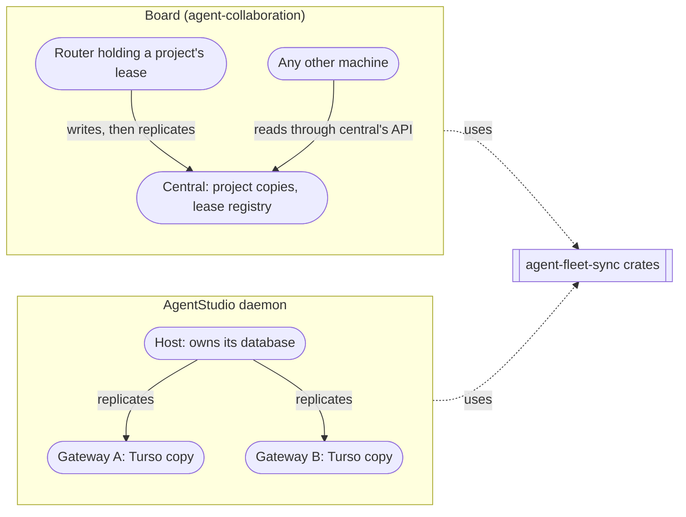

# Requirements: agent-fleet-sync

**What this is:** why `agent-collaboration/agent-fleet-sync` exists, who it's for, and what its first release must do. **agent-fleet-sync keeps state consistent across a fleet of machines running agents:**
- one writer per unit, chosen by a lease;
- read copies everywhere else;
- sessions that survive any disconnect.

The [specification](2026-10-16-agent-fleet-sync.md) turns these needs into observable obligations.

These rows normalize decisions the owner has already made, on 2026-10-11 and 2026-10-16. They don't add any. Each row quotes the owner or names the decision that settled it, and marks what the Lead derived from it.

## Who it's for and why

- **The board's builders** need each project's database replicated from the machine holding its lease to central's copy. The leases must move only on explicit request. The machine session must survive every disconnect.
  - **Today:** that replication is built into the board. The protocol mixes session control with board payloads. The planned client depends on the board's storage crate.
  - **Today:** central deletes a machine's session when its connection drops. This breaks U36 and U49 ([board requirements](../2026-10-04-board-orchestration-design/requirements.md)).
- **AgentStudio's builders** need a Host's database replicated into one or more Gateway copies, so clients can read it near the UI. Today they would have to copy board code to get that.
- **The owner** wants one implementation that both projects use, and that further projects can use the same way.

## Rows

| ID | Need | Authority and evidence | State |
|---|---|---|---|
| SU1 | **Reusable crates for database replication.** A library any project embeds, with a receiver it can run as its own service. Nothing in the crates depends on the board or on AgentStudio | owner, 2026-10-16: "i only wanted the crates for turso replication to any client with its own as a service so another project of mine can use it"; "lets use the decoupled system so its generic and reusable" (board U78) | authorized |
| SU2 | **One-way replication of a whole database, from its one writer to its copies.** The writer is whoever holds the database's lease. The copies are read-only | owner, 2026-10-16: "basically we replicating an entire database … and its one way replication with lease?" (U78); board U21 and U23 (owner, 2026-10-05 and 2026-10-06) | authorized. **Derived:** "whole database" means every application table the consumer replicates, plus its schema. The engine's own bookkeeping is excluded |
| SU3 | **A receiver writes its copy directly into a Turso database** on Tokio. Central's copies on Cloudflare live in Durable Object SQLite (board U32) | owner, 2026-10-16: "the other service should be putting them into turso db directly, replicating to another turso db"; board U32 | authorized |
| SU4 | **A database can have several copies,** each kept up to date independently. AgentStudio replicates one Host to Gateway A and Gateway B | the owner forwarded AgentStudio's arrangement on 2026-10-16 ("this is the other project"): one Host database replicated to Gateway A and Gateway B | authorized |
| SU5 | **A copy that is slow or absent never stops the writer.** The writer keeps working, and the copy catches up when it returns | AgentStudio's own requirement that a Gateway may disconnect without ending Host work (its U15); board U38 (writes continue until the lease expires) | authorized, by each consumer's requirements |
| SU6 | **Retention is configurable** for each consumer: how long the writer keeps changes for a copy that hasn't caught up | owner, 2026-10-16: "same for retention that's configurable" | authorized |
| SU7 | **The writer lease is part of the crates, with the same logic for every consumer.** It covers: a registry issues leases; the holder renews; an old writer is fenced; the holder changes by move, takeover or claim; a new writer is seeded from a copy | owner, 2026-10-16: "the lease logic is the same we have, we need that too for agent studio in the crates"; "the lease code without cloudflare can be in the common crates or a new crate yes?" (the Lead: yes); board U37 | authorized. **Derived:** each consumer configures the lease's length and renewal interval. The board uses 4 hours and 15 minutes (U38) |
| SU8 | **A holder changes only on an explicit request.** The crates never move a lease by themselves: no automatic takeover, and no release on shutdown | board U39 (owner, 2026-10-09) | authorized for the board. **Derived:** the crates provide no automatic failover for any consumer, and a consumer that wants it would need a new decision |
| SU9 | **A lease is separate from a peer's permission.** Revoking a peer ends its session and doesn't move its leases. They expire, or an admin moves them | owner, 2026-10-16: "end it", and "but 3 is different from lease for project" (the Lead confirmed) | authorized |
| SU10 | **Each consumer passes its tables in through generics or traits.** That covers which tables replicate and its schema | owner, 2026-10-16: "the types of data tables are passed in via generics or traits" | authorized. **Derived:** the data travels as each row's key and values. The engine doesn't need a Rust type per table to replicate it |
| SU11 | **Every primary-key column of a replicated table holds a UUIDv7, and keys never change.** A composite key is allowed when each of its columns is a UUIDv7. | owner, 2026-10-11 ("why is the uuidv7 not the primary row id") and 2026-10-17 ("every pk to be uuidv7"; "we do not allow pk to change"); decision 51. This replaces the earlier "any columns" wording, which recorded a Lead recommendation as the owner's | authorized. The board re-keys its non-UUID project tables in its revision (task 23); AgentStudio's tables must be keyed the same way or stay out of replication (spec gap SG3) |
| SU12 | **A session is separate from its connection.** A connection closing, for any reason, never ends the session. A session ends only when its peer starts a new one, or when the peer is revoked | owner, 2026-10-16: "session and client are not to be tied together, a break in connection should not break the session"; "end it" (board U36, U49, U77) | authorized |
| SU13 | **The session doesn't depend on its transport.** WebSocket now; QUIC can be added later without changing the session or the engines | owner, 2026-10-16: "i want websocket and transport not coupled so i can use classic websocket and later write quic" (U77) | authorized. **Derived:** QUIC would serve Tokio deployments only, because Cloudflare accepts only HTTP and WebSocket inbound |
| SU14 | **The crates live in their own repository, `agent-collaboration/agent-fleet-sync`,** together with the SQLx drivers we own | owner, 2026-10-16: "yes separate repo is good"; "put it in the agent collaboration org"; the name "agent-fleet-sync" | authorized. **The Lead's recommendation, not contradicted:** consumers depend on Git tags first, and crates.io comes later (the name `sqlx-turso` is already taken there) |
| SU15 | **The same standards as all our code:** SQLx with drivers we own; async code that starts no runtime of its own wherever the Worker runs it; no `unsafe`; one lint table; exact integers; no pedantic or tautological tests; proof on real paths | board U70–U76 and U53 (owner, 2026-10-11 to 2026-10-16: "same linting and standards requirements … for all our forks and all our code") | authorized |
| SU16 | **Durable delivery across machines is part of the crates.** It's a standard path any consumer can use: a durable outbox on the sender, a relay that takes custody, and a durable inbox on the recipient. Nothing is missed, and each hop keeps an item until the next hop has it. What an item means stays with the consumer. For the board, that's messages, notifications, wakes and their rules | owner, 2026-10-16: "is delivery a standard system? should it be standard? i think delivery is a standard system can be common with specific for collaboration"; "yes this round"; board U63 | authorized. **Derived:** the board's mail path (spec 3 MS-1 to MS-12; PD4) is split. Custody, item identity, status, retention, cancels, expiry and caps are common. Item kinds, the gate that waits for replication before a notification leaves, injection checks, wakes and owed follows are the board's |
| SU17 | **Work done after a commit is a durable state machine.** The work is recorded in the same commit as the change. It's sent, and resent under the same identity until the receiver confirms. The receiver applies it once. Its status survives crashes | owner, 2026-10-16: "we need durable state machine for this" | authorized. **Derived; the Lead decided it under the owner's "you can actually start implementing" (decision 24):** central's three hand-written after-commit outboxes (the directory update from a copy, the lease publication, machine notices) become uses of the same state machine as delivery |
| SU18 | **Everything is idempotent.** Repeating any operation with the same identity has its effect once and returns the recorded result | owner, 2026-10-16: "make things idempotent" | authorized |
| SU19 | **Multi-step work runs as durable steps, kept simple.** Each step's output is saved in local durable state: Durable Object storage on Cloudflare, a local store on Tokio. A retry or restart continues where it stopped, and finished steps aren't run again, as with Inngest. Only a step that calls another machine or object passes an ID the receiver remembers. Not everything is a distributed protocol | owner, 2026-10-16: "you can have durable state for example in cloudflare … but in rust just a local state and steps output saved there so they are idempotent"; "then continue or retry like inngest etc, i dont think this needs to be complex"; "not every distributed operations"; "then lets get to actual development" | authorized. On Cloudflare the steps live in Durable Object storage, because Cloudflare Workflows isn't supported from Rust (owner, 2026-10-16: "in rust cloudflare workflows are not supported") |
| SU20 | **A holder change is a durable workflow an admin can follow and cancel.** Its phases only move forward, and it ends in one final outcome. Its progress is visible: the current phase, what it's waiting on and since when, and its phase history after it ends. It has a cancellation policy | owner, 2026-10-17: "takeover should be a durable workflow that follows progress, no hidden state"; "with cancellation policy, that are a non-cyclic state machine; it's a workflow" | authorized. **Derived (Lead, decision 75):** it covers moves and claims as well as takeovers, because all three run as one operation over one record. A change can be cancelled until it has done something to another machine that can't be withdrawn; after that it runs to its end |
| SU21 | **A clean move is refused once the holder has gone too long without renewing,** by the registry's clock. The admin then chooses a takeover | board U45 (owner, 2026-10-11: "yes its fine", to 30 minutes without a renewal) | authorized for the board, whose bound is 30 minutes. **Derived:** the crates take the bound from each consumer, and AgentStudio sets its own |

## Goal boundary

**Confirmed with corrections** (owner, 2026-10-16; the board's decisions 20–22).

**In:**
- the replication engine, for a writer and for receivers;
- durable delivery across machines, and the durable state machine for work done after a commit (SU16, SU17);
- `durable-steps`, the durable-steps library (SU19; decisions 25–29), and `runtime-primitives`, the shared clock, ID, wake and backoff primitives (decision 31);
- the writer lease;
- configurable retention;
- the logical session;
- the transports;
- the SQLx drivers we own;
- the board and AgentStudio's daemon as the first two consumers.

**The first release** is replication, leases, sessions and transports, durable delivery, and the drivers. The owner's statement of what the repo is for is broader: state across a fleet of agent machines. **Presence,** meaning which machines are connected and when each was last seen, waits for its own decision.

**Out:**
- **A framework for arbitrary server objects.** The owner chose crates and a service over Option 2.
- **Multi-writer replication or conflict merging.**
- **Automatic takeover or failover.**
- **Turso's own Sync feature** (the board's ADR 0001).
- **Copies transformed into another shape.** A consumer's projections are its own separate state.
- **Treating captured changes as domain events or commands.**
- **A QUIC transport in this release.**
- **Workflow features beyond durable steps:** sleeping, waiting for events, fan-out, cron and workflow versioning (decision 25, under the owner's "i dont think this needs to be complex"). A version mismatch is refused, never migrated.
- **Any transport other than WebSocket on Cloudflare.**
- **Publishing to crates.io in this release.**

**Each consumer still owns:**
- its schema and migrations;
- what replicated data means to it;
- its authentication (the board: Cloudflare Access plus the machine credential);
- where it runs the receiver and the lease registry;
- its retention and lease configuration.

## Open

| Question | Owner | Blocks |
|---|---|---|
| AgentStudio's exact replicated tables and retention policy | AgentStudio's Lead | AgentStudio's adoption, not the crates |
