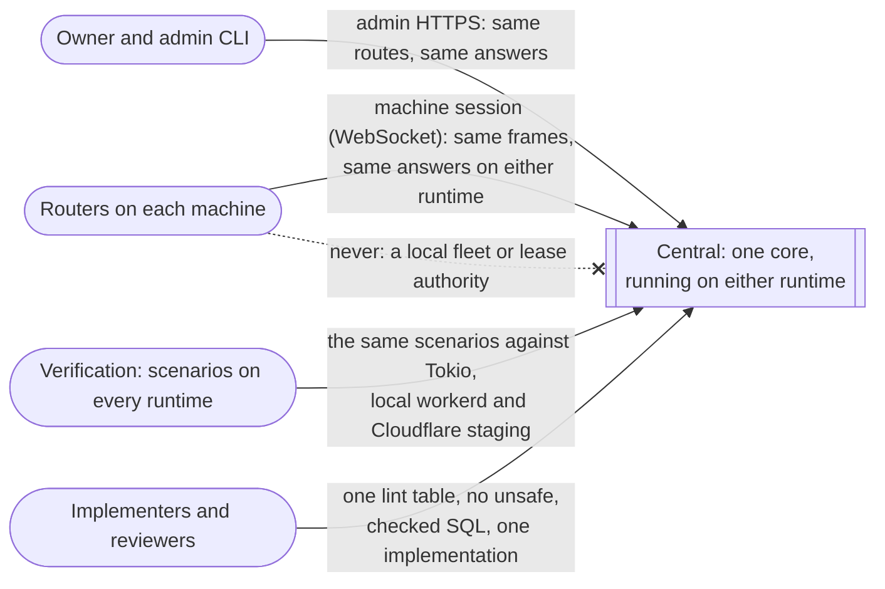
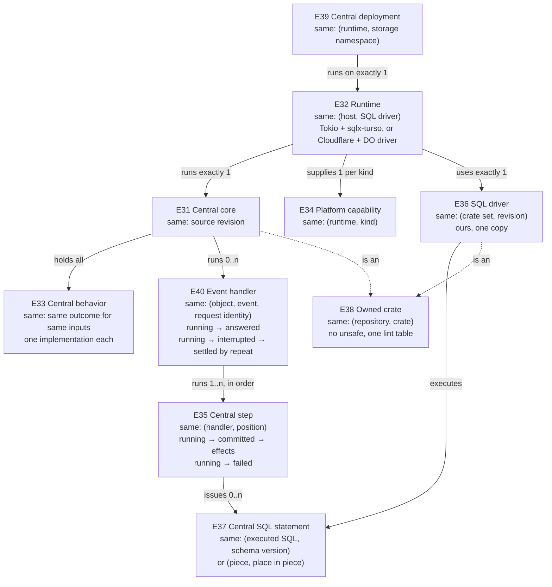

# Spec: central's one core

**What this is:** what must be observably true of how central is built and run. Central's behavior has one implementation, which each runtime runs. SQL goes through SQLx with drivers we own. The same proof runs everywhere central runs.

This spec doesn't change *what* central does. Spec 2 and spec 3 define that, and every contract in them holds unchanged (OC-20). It replaces how that behavior was realized: a synchronous core with two runtime-specific application drivers on three SQL engines. [What went wrong](what-went-wrong.md) records that realization, why it violated the owner's requirements, and what it cost.

```text
requirements.md (U69–U75) ──► this spec ──► program-design.md (this folder) ──► plan
                               ▲
          spec 2, spec 3 (unchanged contracts)
```

Requirements: [board requirements](../2026-10-04-board-orchestration-design/requirements.md), rows U20, U22, U30, U32, U33, U50, U53, U68 and U69–U76. Program design: [program-design.md](program-design.md).

## 1. The problem

**Today** (the M3 branch at `1b90cb35`, the M2 branch at `96ec71d2`):
- **The core is synchronous** and receives only storage. Each runtime has its own application around it, with routes, the Access check, effect dispatch, failure handling, alarms and the transaction sequence: 1,814 lines of behavior written twice, and 344 lines that exist in only one runtime.
- **The copies have already drifted.** The two runtimes cache Access signing keys for different lengths of time.
- **Three SQL engines** are in use: Durable Object SQLite through a custom statement interface, Turso's engine called directly, and rusqlite in tests.
- **The Worker routes requests by hand** instead of through axum.
- **The Router carries a third copy** of fleet admission, plus a local lease authority.
- **The Worker crate copies the lint table.**

**Desired:** one implementation of every central behavior, injected into each runtime through one common trait. Requests are async end to end. SQL goes through SQLx with our own drivers. One axum Router serves every runtime. The same proof runs on every runtime.

## 2. Who relies on it



- **Routers** see one central contract whichever runtime serves it. They never fall back to a second central.
- **The owner** can choose either runtime for a deployment (U75). The choice changes no answer a Router or admin observes.
- **Verification** runs one scenario set against every runtime (U50, U53).
- **Implementers and reviewers** get a build boundary that makes a second implementation hard to write and easy to see.

## 3. Entities

Spec 2 and spec 3 entities (E23 lease, E24 central copy, E26 machine session and the rest) keep their meaning. This spec adds:

| E | Entity | Same instance when | Relationships | Invariants | Observable states |
|---|---|---|---|---|---|
| E31 | **Central core** | same source revision. A native build and a wasm build of one revision are the same core | runs inside exactly one runtime (E32) per deployment (E39); holds every central behavior (E33); issues every statement (E37) through SQLx | contains no runtime-specific code and starts no async runtime; no behavior depends on which runtime runs it, except through what a capability (E34) returns | — (code at a revision has no lifecycle) |
| E32 | **Runtime** | (host platform, SQL driver). There are exactly two: Tokio with our sqlx-turso, and Cloudflare (Worker plus Durable Objects) with our Durable Object driver. Local workerd, staging and production are the Cloudflare runtime; a native test process and a native production deployment are the Tokio runtime | supplies exactly one set of capabilities (E34); uses exactly one SQL driver (E36) | supplies capabilities only; adding or changing a runtime adds capabilities, never behavior | — |
| E33 | **Central behavior** | a decision about what to store, answer, call, notify, schedule, retry or refuse, given the inputs and stored state. Two pieces of code are the same behavior when they decide the same outcome for the same inputs. **Hardest cases:** fetching Access signing keys is a capability, but how long to trust a cached key is a behavior. Turning a JS number into an `i64` is a capability's mechanics, but what happens when it can't be done exactly is a behavior | each has exactly one implementation: central's own policy in the central core (E31), and the mechanisms agent-fleet-sync supplies in agent-fleet-sync, which the core uses at its pinned version (OC-1, U78) | no runtime and no Router-side component implements a central behavior, and the core never copies one agent-fleet-sync implements | — |
| E34 | **Platform capability** | (runtime, kind). The kinds: a transaction scope over the runtime's SQL driver; the session connection upgrade; socket send, close and hibernation; alarms; observation (logs and metrics); calls between objects; the clock; minting IDs; signature-verification primitives and key fetching; storage usage | each runtime supplies each kind once; only the core uses them | returns a result or a typed platform error; decides nothing an E33 behavior decides; has the same contract on both runtimes | — |
| E35 | **Central step** | (event handler E40, its position among the handler's steps). One step is one transaction on one object | belongs to one event handler (E40) and one object; runs inside one transaction scope; produces zero or more effects (frames, notices, calls, alarms) | its writes commit together or not at all. Its effects happen only after commit. No call, fetch or socket write happens inside its transaction, so a step never waits on another object | running → committed → effects carried out · running → failed (no writes, no effects) |
| E40 | **Event handler** | (object, the inbound event, that event's request identity). Events are frames, calls between objects, alarms and admin requests. A repeat of the same request identity is the same handler | belongs to one object; runs one or more steps (E35) in order; may wait on another object between steps; answers its caller exactly once over its whole handling | before it waits on another object, the step before the wait has committed whatever a repeat needs to resume. While it waits, other events for the object may run (owner decision 17), so its next step re-reads durable state | running → answered · running → interrupted (the caller can't know the outcome) → settled by a repeat of the same request identity, from the recorded receipt or the persisted continuation |
| E36 | **SQL driver** | (crate set, revision), in agent-fleet-sync's workspace (U78) | exactly one per runtime; implements the SQLx surface the core uses | ours, with agent-fleet-sync as its only copy (OC-8); no `unsafe`; its owning workspace's lint table; never narrows, rounds or reclassifies a value, including in its own bookkeeping reads | — |
| E37 | **Central SQL statement** | **static:** (SQL text as executed, schema version). **Replicated:** (replication piece, its place in the piece) | central's static statements live in the core's SQL corpus; agent-fleet-sync's live in its own corpus, checked by its own build gate (`fleet-sync-query-gen`); replicated statements come from a piece (spec 2 E25) | a static statement is checked at build time, in the repository that owns it, against the schema for both drivers. A replicated statement is validated at run time by the admission rules of spec 2 and spec 3 | — |
| E38 | **Owned crate** | (repository, crate name). **Hardest case:** a crate imported from upstream and changed here, such as the Durable Object driver, is owned. An unchanged registry dependency, such as `sqlx-core` or workers-rs, isn't | every member of its owning repository's workspace: central's crates, including the Worker crate, in this repository; both driver crate sets and the other agent-fleet-sync crates in agent-fleet-sync (U78) | contains no `unsafe`; takes its owning repository's one lint table; formatting and clippy pass for every target it builds for | — |
| E39 | **Central deployment** | (runtime, durable storage namespace) | serves the Routers configured with it; one deployment holds the fleet truth for a fleet | a Router is configured with exactly one deployment and never falls back to another | — |



## 4. Obligations

### One core

- **OC-1 One implementation** (U69; E31, E33). Every central behavior MUST have exactly one implementation, in the central core. That covers:
  - routing HTTP requests and WebSocket upgrades;
  - the Access verification sequence and its key-cache policy;
  - frame dispatch;
  - the step and effect drivers;
  - alarm handling;
  - admin and import flows;
  - HTTP status and error-body mapping;
  - retry and failure policy;
  - which work runs inside a transaction and which after it.

  **If two code paths decide the same behavior, the obligation fails,** even when both give the same answer today.

  The mechanisms agent-fleet-sync supplies have their one implementation there (U78): applying and fencing replicated changes, the lease registry and holder changes, sessions, delivery custody, durable execution, and both SQLx drivers. Central uses them and MUST NOT reimplement or copy any of them. Central's own behaviors are the ones listed above, plus the board rules spec 2 and spec 3 add on top of those mechanisms.
- **OC-2 Capabilities only** (U69; E32, E34). A runtime MUST supply only platform capabilities, through one common trait whose contract is the same on both runtimes. A capability that retries, chooses a status, routes, authorizes, or sets a cache lifetime fails this obligation.
- **OC-3 No central behavior on the Router** (U69, U20; E33, E39). The Router MUST reach central behavior only over its machine session to its one central deployment. It MUST NOT admit fleet requests or grant leases itself. While central is unreachable, fleet writes stay pending (spec 3 WA-1) and leases follow spec 3. The Router keeps its own durable outbox, cache, pending requests and replay of a lost answer.

### Async requests and steps

- **OC-4 Async end to end** (U69; E31, E35). Central's request handling MUST be async: storage, calls between objects, key fetches and socket writes are awaited. No central work runs on a per-object blocking thread or a nested runtime. **On the Tokio runtime, a slow storage operation on one object MUST NOT delay a request to another object.**
- **OC-5 Steps are atomic, and effects follow commit** (U69, spec 3 FL-3, FL-10; E35). A step's writes MUST commit together or not at all, on both runtimes. Its effects MUST happen only after commit. **If a step fails, none of its writes is visible and none of its effects happens.** No call, fetch or socket write happens inside a step's transaction. Before an event handler (E40) waits on another object, the step before the wait MUST commit whatever a repeat needs to resume.
- **OC-6 Interruption is settled by durable state** (U69; E35, E40). If an event handler is interrupted (its caller goes away, its connection drops or its process ends), whether inside a step or between two steps, then its outcome MUST be settled only by durable state and by a repeat of its request identity. A call to another object carries the request identity its step recorded, unchanged on every attempt. Nothing relies on a runtime rolling back a dropped request: on Cloudflare, a dropped request can still commit. Durable work that was already admitted MUST also be driven to completion on its own, at start-up and by alarm, under its original identities. That drive never starts new work, such as a new takeover.

### SQL

- **OC-7 SQLx only** (U70; E36, E37). All central SQL MUST go through SQLx and its runtime's driver. No other SQL engine or database API appears in central's code or tests: not Turso's engine called directly, not rusqlite, not SQLx's SQLite driver, and not a custom statement interface.
- **OC-8 Drivers are ours, with one copy** (U70, U78; E36, E38). Each driver MUST have exactly one source copy, in agent-fleet-sync (`agent-collaboration/agent-fleet-sync`, U78), which central depends on at a pinned tag. No other copy exists in this repository. Upstream code enters only by a deliberate import that keeps its license notice.
- **OC-9 Static SQL is checked** (U73; E37). Every static statement MUST be checked at build time against central's schema for both drivers. **The build fails for a missing table or column, a wrong result type, the wrong number of bound values, or metadata that no longer matches the statement.** The statement checked is the statement executed, casts and projections included. Under workerd, proof executes those same statements. Replicated statements are validated at run time by admission (spec 2, spec 3).
- **OC-10 Exact values** (U76, U33 and spec 2 E24; E24, E36, E37). Every integer central stores or reads MUST cross both runtimes exactly:
  - **SQL INTEGER cells:** i64 MIN and MAX, integers beyond 2^53, rowids, counts, and the driver's own bookkeeping reads;
  - **unsigned values stored as decimal TEXT today** (epochs and replication positions): they keep that storage and their full u64 range.

   REAL stays distinct from INTEGER (REAL 1.0 isn't INTEGER 1), and NULL, text and blob keep their storage class.
  - **If a value can't cross exactly, the step fails visibly.** It never rounds, narrows or reclassifies.
  - Integers are validated before they're bound.
  - A read checks the storage class before it parses the value.
- **OC-11 Stored values are validated** (U73; E37). A stored value MUST decode into a validated domain value or be refused as corrupt. A boolean other than 0 or 1 is refused, never read as true.

### HTTP and the build

- **OC-12 One Router** (U71, U30; E31). One axum Router, in the core, MUST serve every central HTTP route and WebSocket upgrade on both runtimes: with `axum::serve` on Tokio, and with `router.call(req)` in the Worker. **For the same request and the same stored state, both runtimes return the same status and body.**
- **OC-13 No runtime in the core** (U71; E31). The core MUST have no Tokio dependency and start no async runtime, and it MUST compile for native targets and `wasm32-unknown-unknown`. The Worker build enables no Tokio runtime. JS-backed futures that aren't `Send` are wrapped only with workers-rs's `SendFuture`, `SendWrapper` or `#[worker::send]`, at the Worker runtime. *(workers-rs's own `tokio` dependency, which has no runtime features, is outside this obligation.)*
- **OC-14 No unsafe** (U72; E38). No owned crate contains `unsafe` code, and every owned crate forbids it at compile time.
- **OC-15 One lint table per owning repository** (U73, U78; E38). Every owned crate MUST take its lints from its own repository's one workspace table: central's crates, including the Worker crate, from this repository's table; agent-fleet-sync's crates, including both drivers, from agent-fleet-sync's. No crate copies or relaxes its table. Formatting and clippy with `-D warnings` pass for every owned crate on every target it builds for.

### Runtimes and proof

- **OC-16 The Tokio runtime gives the same guarantees** (U75; E32, E34). The Tokio runtime's capabilities MUST give the same guarantees as the Cloudflare runtime's:
  - one atomic storage step per object at a time. Events may interleave while a handler awaits another object, and resumed work re-reads durable state (owner decision 17, option a);
  - durable per-object storage;
  - alarms that survive a restart;
  - session resume after a restart.

  It is a deployment option, not a test-only stand-in.
- **OC-17 One deployment holds fleet truth** (U20, U75; E39). The fleet truth a set of machines uses MUST live in exactly one central deployment. A Router MUST NOT fall back to another deployment.
- **OC-18 The same proof on every runtime** (U50, U53; E31, E32). The same central scenarios MUST pass against the one core on the Tokio runtime, under local workerd, and on Cloudflare staging. Tests specific to one runtime cover only its capabilities: value transport, transactions, hibernation, cryptography, storage limits and deploys. Every spec 3 V9 scenario runs on the Tokio runtime and under local workerd. Cloudflare staging runs V9d, and every other result is labelled local until staging runs it (spec 2 G18).
- **OC-19 No pedantic or tautological tests** (U74, U53). The proof of these obligations MUST NOT rest on tests that scan source text, or on tests that only restate the implementation, such as asserting that a constructor is private or that a type won't compile. Build gates (`forbid` lints, checked SQL, dependency graphs per target) and behavior on real paths carry it.
- **OC-20 Contracts hold** (accepted requirements; spec 2, spec 3; U27, U60, U78). Every observable contract in spec 2 and spec 3 MUST hold, as revised for agent-fleet-sync: routes, admin requests and answers, refusals, notices, and what a central copy holds. The names and meanings the board shows its agents and its owner don't change. The machine session's concrete frames are agent-fleet-sync's, each mapped to its board meaning by spec 3's mapping table, and they change once, at the release cutover (U27, U60). The one changed behavior is spec 3 FL-10's takeover superseding a running move, by owner decision (2026-10-17). This is not a waiver: every other obligation in spec 2 and spec 3, and its proof, stands.
- **OC-21 The typed call DAG stays enforced** (U68; E33, E34). Calls between objects MUST follow U68's ranked DAG, from a caller identity the core binds; the compiler gate is the enforcement. Per U74 and decision 19, its proof is the gate checked in review, plus V-OC3's wire refusal of a forged caller. Spec 3's "compile-fail tests" route for U68 is replaced.

## 5. What this does not do

- **No third runtime.** No Emscripten Tokio inside the Worker, and no other host.
- **No change to the model proxy or the harness connections** (U26, U29).
- **No automatic failover** between central deployments, and no local fallback in a Router.
- **No emulation inside the Durable Object driver** of what Durable Objects don't offer: no SQL `BEGIN`, no connection pool.
- **No weaker proof.** U50's two-target proof stays, and so do the numeric cases and the platform-specific tests.
- **No change to persisted meaning.** Integers stay INTEGER in storage. Exact transport changes how values cross the driver, not what's stored.

## 6. Proof

| V | Proves | Evidence |
|---|---|---|
| V-OC1 | OC-1, OC-2, OC-3 | **Structure, at implementation review:** each class of central policy in OC-1 lives only in the core, and each mechanism agent-fleet-sync supplies is used from it, never copied. Runtime crates contain only capability implementations and the entrypoints that call the core. The Router has no fleet-admission or lease-granting code. A reviewer establishes this by reading, not by a source-text scan |
| V-OC2 | OC-18, OC-20 | Spec 3's V9 scenarios pass against the one core on the Tokio runtime and under local workerd, and V9d passes on Cloudflare staging |
| V-OC3 | OC-5, OC-6 | On both runtimes, inspecting durable state: commit, rollback after a callback error and after an SQL error, read-your-own-writes, two overlapping steps kept apart, an interrupted step settled by repeating its request identity, and no effect before commit or after a rollback. Also on both runtimes:
<br>• a statement error raised mid-step leaves no partial writes;
<br>• a call whose envelope claims another object's identity or class is refused by its receiver;
<br>• a failure between commit and effect, or between effect and acknowledgement, is recovered through the existing receipts and continuations under the original request identity |
| V-OC4 | OC-10, OC-11 | On both runtimes: i64 MIN and MAX, 2^53−1, 2^53 and 2^53+1, REAL 1.0, NULL, text and blob. Also a rowid beyond 2^53 through the driver's own execute result, counts and RETURNING. Unsigned values stored as TEXT, at and above i64::MAX up to the largest value their constructor allows, stay exact and stay TEXT. A corrupt storage class and a stored boolean 2 are both refused |
| V-OC5 | OC-12 | The same HTTP and WebSocket requests to both runtimes give the same statuses and bodies. That includes the `/v1/session` upgrade: Hello and Welcome, a request and its answer, rejected credentials, and reconnect. Hibernation and attachment recovery are shown on a real Worker |
| V-OC6 | OC-7, OC-8, OC-9, OC-13, OC-14, OC-15 | **Build gates on both targets, in each owning repository.** Every owned crate passes clippy `-D warnings` under its owning repository's table. Central's build pins agent-fleet-sync at one version, and that version's own gates (clippy, `forbid(unsafe_code)`, the checked-query gate) are part of the evidence, recorded with the version. The compiler enforces `forbid(unsafe_code)`. Per target, the dependency graph shows no SQL engine but the runtime's driver, no `tokio` in the core, and no Tokio runtime feature in the Worker build. A missing column, a wrong result type, a wrong number of bound values and stale metadata each fail the build on both targets |
| V-OC7 | OC-4 | On the Tokio runtime, while one object's storage operation is held, a request to another object completes. Its boundary: the hold is an awaited test wrapper, so it doesn't observe Turso's blocking file IO, which is bounded to one system call on one worker thread (G-OC8) |
| V-OC8 | OC-16, OC-17 | On the Tokio runtime: storage survives a restart, an alarm fires after a restart, and a session resumes after a restart. A Router configured with one deployment never reaches another |
| V-OC9 | OC-3 | A real Router talks to central over the real session. Cases: disconnect before send, a commit whose answer is lost, reconnect and replay, feed catch-up and Router restart. No local admission or lease grant appears |

## 7. Coverage

| U | Entities | Obligations | Proof |
|---|---|---|---|
| U69 | E31, E32, E33, E34, E35, E40 | OC-1–OC-6 | V-OC1, V-OC3, V-OC7, V-OC9 |
| U20 | E33, E39 | OC-3, OC-17 | V-OC8, V-OC9 |
| U70 | E36, E37, E38 | OC-7, OC-8 | V-OC6 |
| U22 | E32, E36 | OC-7 (Turso on the Tokio runtime is ours, through sqlx-turso; never libSQL or sqld) | V-OC6 |
| U32 | E32 | OC-16, OC-18. U75 adds the Tokio deployment option; it doesn't replace Cloudflare | V-OC2 |
| U68 | E33, E34 | OC-21 | review of the compiler gate; V-OC3 |
| U76, U33 (spec 2 E24) | E24, E36, E37 | OC-10 | V-OC4 |
| U71, U30 | E31 | OC-12, OC-13 | V-OC5, V-OC6 |
| U72 | E38 | OC-14 | V-OC6 |
| U73 | E37, E38 | OC-9, OC-11, OC-15 | V-OC4, V-OC6 |
| U74 | — | OC-19 | how V-OC1–V-OC9 are carried out |
| U75 | E32, E34, E39 | OC-16, OC-17 | V-OC8 |
| U50, U53 | E31, E32 | OC-18 | V-OC2 |
| spec 2, spec 3 | their entities | OC-20 | V-OC2 |

## 8. Gaps

| G | Gap | Owner |
|---|---|---|
| G-OC1 | **Checked SQL beyond one query.** The 2026-10-16 probe proved one static query, typed for both drivers from Turso's description with negatives, but not binds, expressions, joins, aggregates or RETURNING. OC-9 needs the general generator | program design, then implementation |
| G-OC2 | **Bind slots and nullability.** Turso 0.8.1's public `turso::Statement` exposes no parameter count, so the generator must read bind slots from the `turso_parser` AST to check how many values are bound (OC-9). Nullability stays unknown and becomes optional | implementation (generator) |
| G-OC3 | **Resolved 2026-10-16.** The owner chose the concurrency unit (decision 17) and confirmed the rest of OC-16 in review (decision 18) | — |
| G-OC4 | **The Router's local lease authority** (`LocalLeaseAuthority`, M2) is removed under OC-3. The workstream that owns its cutover is set in the plan | plan |
| G-OC5 | **Hosted behavior of the new core,** including eviction, hibernation and deploys, is unproven until V9d runs on staging | verification |
| G-OC6 | **The session upgrade** is designed but unproved: a core-decided upgrade performed by each runtime (V-OC5) | probe, then implementation |
| G-OC8 | **Turso's blocking file IO on Tokio.** Turso 0.8.1 performs file IO as blocking system calls inside the poll. On a multi-threaded runtime that blocks one worker per call. V-OC7 doesn't observe it; the bound and the revisit signal are in the program design | program design (bound), implementation (measurement) |
| G-OC9 | **An inherited alarm-ordering question.** A delayed alarm replacement from an older handler could land after a newer one's. It exists in today's code; the program design records the proof case | program design, then implementation |
| G-OC7 | **Crash-safe effects.** A dropped Worker step can commit after its caller stops driving effects. Recovery through receipts, continuations and the original identity must be shown (V-OC3), not inferred from commit-before-effect ordering | implementation |
