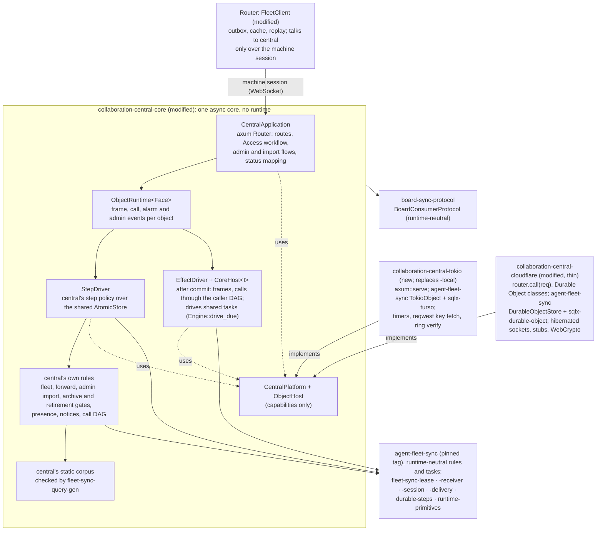
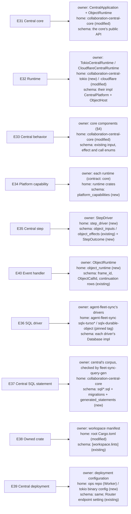
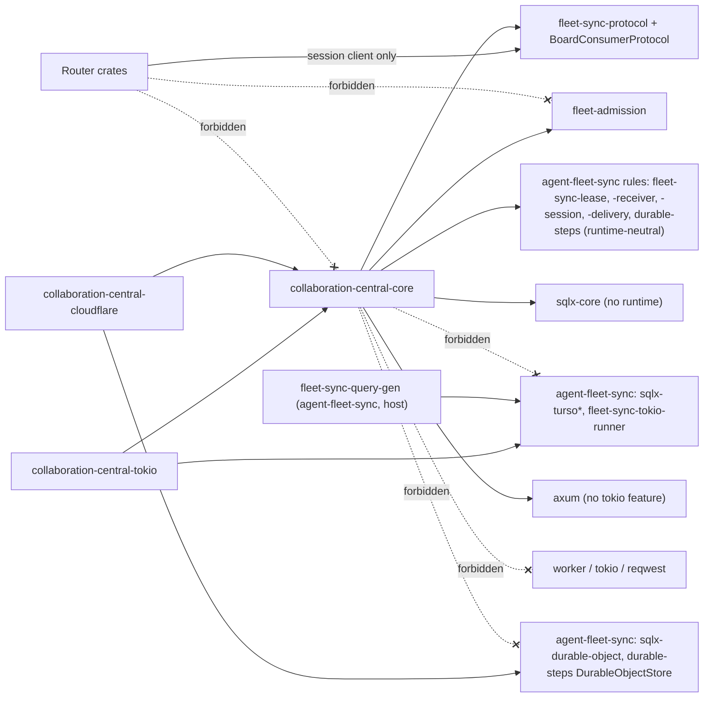
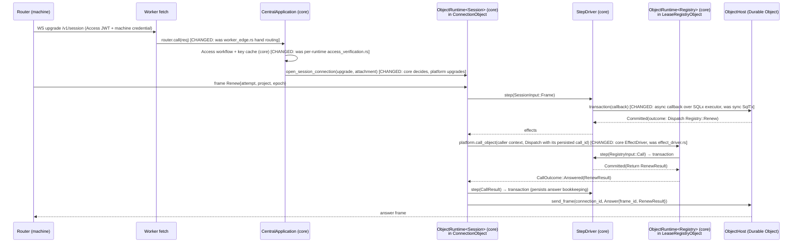
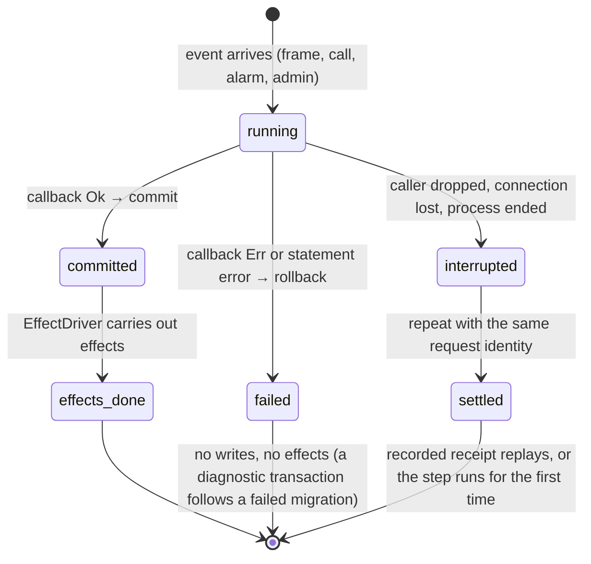
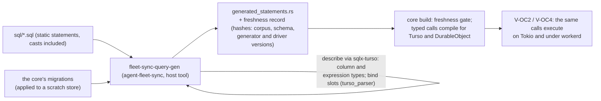
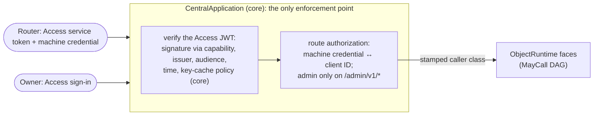

# Program design: central's one core

**What this is:** how central's code is structured so that [the central one-core spec](2026-10-16-central-one-core.md) holds. Central's behavior runs once, in one async core. Each runtime injects only platform capabilities, and SQL goes through SQLx with drivers we own. This replaces program design 3's §2a, C20, its `storage_transaction` component and its crate list. PD3's domain design (copies, fences, leases, transfers, sessions, fleet, forwarding, imports, operations) stands unchanged. [What went wrong](what-went-wrong.md) says why the old structure is being replaced.

```text
requirements.md (U68–U76) ──► spec (OC-1–OC-21) ──► this program design ──► plan
```

**Evidence this design rests on:**
- the 2026-10-16 feasibility probe, unpublished working notes. The callback transaction, one checked query, exact numbers and one axum Router were built and run on Tokio with sqlx-turso and under workerd with the Durable Object driver;
- the M3 source at `1b90cb35` and the M2 source at `96ec71d2`, surveyed in unpublished working notes;
- workers-rs at `b171cb4` (worker 0.8.7), SQLx 0.9.0, and `sqlx-cloudflare-do` at `35e5219`.

**What the probe left open, and this design carries:**
- checked SQL beyond one query (spec G-OC1);
- bind slots and expression result types in our Turso describe (G-OC2, review finding SOL-3);
- the session upgrade (G-OC6) and crash-safe effects (G-OC7);
- Turso's blocking file IO on Tokio (G-OC8) and an inherited alarm-ordering question (G-OC9);
- hosted behavior (G-OC5).

## 0. Revision 2026-10-17: central composes agent-fleet-sync

Its proof plan is the board's [Verification Design](../2026-10-04-board-orchestration-design/verification-design.md) (§5c and §5d), which shares this design's requirements file.

agent-fleet-sync (`agent-collaboration/agent-fleet-sync`, merged at `3a2153ec`, pinned by tag) now supplies most of what this design first planned to build inside the core (U78; one-core spec OC-1, OC-8). This section is the revision, and the sections below are corrected to match it. Evidence: X1 (unpublished working notes, validated), plus X6 and X7.

**Reused from agent-fleet-sync, never copied** (OC-1):

| Mechanism | agent-fleet-sync owner | Replaces here |
|---|---|---|
| copy apply, fence, seed, snapshot | `fleet-sync-receiver` | `copy_rules`, `fence_rules`, the copy half of `import_rules` |
| the registry, renewals, holder changes (move, takeover, claim), import reservation | `fleet-sync-lease` (`HolderChangeTask`, `admit_holder_change`, import rules) | `registry_dispatch`, `transfer_rules` |
| sessions and frames | `fleet-sync-session`, `fleet-sync-protocol` | `session_rules`, `collaboration-replication-protocol` |
| message custody (relay mailbox) | `fleet-sync-delivery` | central's mail relay rules |
| durable operations, receipts, retries, one alarm owner | `durable-steps`, `runtime-primitives` (`AlarmOwner`) | central's ad hoc post-commit outboxes and per-face alarm writers |
| the transaction scope | `durable-steps` `AtomicStore::transaction`, `TransactionScope`, `JournalScope` | K2's own `TransactionStore` |
| Durable Object storage | `durable-steps` `DurableObjectStore` and `DurableObjectScope` over `sqlx-durable-object` | a central Durable Object store |
| Tokio storage and per-object locking | `fleet-sync-tokio-runner` `TokioObject` and `TursoScope` | K6's own per-object lock |
| both SQLx drivers; exact values; checked SQL | `sqlx-turso*`, `sqlx-durable-object`; the exact SQL transport; `fleet-sync-query-gen` | `TursoSqlDriver`, `DurableObjectSqlDriver`, `CentralQueryGenerator` here |

**Still central's own, in the core:**
- the axum application: routes, the Access verification sequence and its key cache, admin and import flows, status mapping;
- fleet records and the fleet feed: workspaces, boards, ADRs, definitions, the directory and its metadata;
- forwarding posts to holders;
- the archive and retirement gates (`LifecycleGate`, `HolderChangeGate` implementations);
- the admin-import completion workflow (spec 3 FL-17);
- no new capability for per-target schema support (SO53). agent-fleet-sync's session task publishes each attach's declaration to its registry before `Welcome` (its §13a). Central's part is the `ConnectionObject` `SessionScope` adapter in the session edge below, built from existing core paths;
- presence (last-seen) for `holderUnreachable`;
- board notices with seven-day retention;
- the typed caller DAG;
- the operations view and migration sweep;
- per-operation `copyUnavailable` handling, once SO57 lands.

**The composition (K8, from X1).**
- The core holds one portable `CoreHost<I>`, which implements agent-fleet-sync's `durable_steps::Host` once and registers every shared task in `CentralCore::new`.
- Runtimes supply only `CentralPlatform` capabilities (`PlatformIo`, `Clock`, `IdSource`, `WakeScheduler`, object calls, sockets, key fetch, crypto) and the shared stores: `TokioObject` natively, `DurableObjectStore` on Cloudflare.
- A request handler does its business write, its receipt and its shared-task admission (`admit_holder_change` and siblings) on **one borrowed transaction scope**. The engine drives the task only **after** commit. `Engine::start` is never nested in a transaction, because it owns admission and drives immediately.
- One `AlarmOwner` per object arbitrates every deadline.

**The caller DAG (K9).** `Host::dispatch<C: CallTarget>` types the request and answer, but it doesn't bind central's caller class. A private central adapter keeps the core-built `CallerContext` and the `MayCall<To>` edge while it dispatches registered shared task calls, and receivers still validate the envelope (OC-21). Object resolution is by kind and target, never a runtime-side string switch.

**The session edge (K10).** Central's session handler composes agent-fleet-sync's session rules with central's own decisions:
- connection admission, which verifies Access and the machine credential (spec 3 FL-12);
- welcome containment per database;
- per-operation `copyUnavailable`, through SO57 once it lands. Until then this is unproven (X7, G34).
- **the schema-support barrier (SO53, agent-fleet-sync §13a's host contract).** A core-owned `ConnectionObject` `SessionScope` adapter, `CoreSessionStore<S: ReborrowScope>`, implements `publish_schema_support` and `welcome_after_commit`. It holds the shared store's shortened scope by value, which agent-fleet-sync's W-C14 lends (`ReborrowScope`). A wrapper can't hold the borrowed loan itself (W-C14's failure):
  - journal admission and its wake are delegated to the borrowed scope. On Cloudflare, its `ensure_alarm` goes to the object's one `AlarmOwner`, inside the transaction. On Tokio, Turso's `ensure_alarm` is a no-op, and activation uses the journal plus `TokioWakeTimer` (§5);
  - `Welcome` is staged into the existing `StepDriver` → `CommittedEffects` → `EffectDriver` path;
  - `PublishSchemaSupport` is registered with the shared engine and driven through `on_alarm`.
  Runtime crates supply capabilities and attachment I/O only. They supply no session-publication policy and no second transaction driver.

The standalone `FleetService` is native-only, and it isn't used in the core.

**Protocol (K11).** The machine session's frames are agent-fleet-sync's, with the board's payloads in `BoardConsumerProtocol`, which lives in the runtime-neutral `board-sync-protocol` crate (PD2). Both the Router's native integration and this portable core consume that crate. The core never depends on the native `board-fleet-sync` (OC-13). Board names map from wire names per spec 3 §4.2. This is a one-time cutover (U27, U60).

**Unchanged from the first version:** K1 (the core owns orchestration), K3 (the core is generic over the platform's SQLx `Database`), the step contract (OC-5) and effects only after commit, the per-object concurrency unit (owner decision 17), and the proof architecture (V-OC1 to V-OC9). Those proofs now run against the composed core.

### 0a. Central's fleet schema (U79)

These are the Fleet object's own tables, written only by central (U20). They aren't replicated by agent-fleet-sync. Routers keep a stale cache fed by the fleet feed.
- Every key is a `TEXT NOT NULL` UUIDv7 (U62; decision 86's spirit).
- Names, versions and hashes are business keys.
- Every fleet record row stores its `RecordTime` as `router_time` (NULL only when `time_basis = legacy_unknown`) and `time_basis` (`router` or `legacy_unknown`), as project records do (PD2 §3a). Only the admin fleet import writes `legacy_unknown` (PD3 §5, fleet import).
- Every fleet record row also stores its `origin` (PD1 §3) as `origin_installation` and `origin_machine` (spec 1 RC-8). Live, that's the verified `FleetCall` installation and its enrolled machine label. The label's one owner is the registry's enrollment record. It's read when the connection is admitted, kept with that connection's central-owned admission state, and passed in each `FleetCall` beside the verified installation. A frame never supplies it. An import uses its `ImportProvenance`. A `Human` actor's fleet record gets its provenance only here, never from the actor.
- The registry, copy, session, delivery and journal state are agent-fleet-sync's own tables (SO51), never a second Fleet implementation.

| Table | Key | Unique | Holds |
|---|---|---|---|
| `workspaces` | `workspace_id` | `(name)` | E1. Live names are unique (spec 1 `nameConflict`). An imported collision is reported and its upload refused, never renamed (G28) |
| `repository_attachments` | `attachment_id` | `(workspace_id, repository_reference)` | E1 repositories |
| `boards` | `board_id` | `(workspace_id, name)` | E2 |
| `workspace_adrs` | `adr_id` | — | E7, with immutable text |
| `process_definitions` | `definition_id` | `(name, version)` **fleet-wide** (MV-7; spec 3 WA-1) | E16. `source_hash` is immutable, and a conflicting registration is `definitionConflict`. The registering workspace is association data, not part of the key |
| `project_directory` | `project_id` | `(board_id, name)` | E3's directory entry (project names are unique on a board, spec 1 `nameConflict`), plus its metadata projection with source position and freshness |
| `claim_reservations` | `attempt_id` (the claim attempt's UUIDv7) | — | central's per-attempt reservation (PD3 §5, step 2a): `Active`, or `Settled{Granted \| Refused}`. A settle that arrives before its reserve records a settled tombstone. A grant settles its attempt in the **same** Fleet transaction as the directory update, so archive finalization never sees a holderless, unreserved project mid-claim (PD3 §5, FL-5) |
| `archive_reports` | `report_id` | `(board_id, project_id)` | archive acknowledgements. Finalization's test combines this, the lease side and `claim_reservations` atomically |
| `admin_imports` | `import_id` | `(project_id, digest)` | the admin-import completion workflow (spec 3 FL-17): reserved, then seeded and published, then complete. Same-identity recovery works on both sides of publication |
| `fleet_request_decisions` | `request_id` | — | E21 for fleet requests |
| `fleet_feed` | `entry_id` | `(position)` | the fleet feed, kept 30 days (PD3) |
| `tail_reports` | `report_id` | `(project_id, epoch)` | rejected-tail reports (spec 3 FL-8): request IDs and digest. The first report stands; the same digest replays it, and a different one answers `tailConflict`. Kept for the project's life, so every later holder can retrieve it (PD3 §6; spec 1 §6 data lifecycle) |

**The registry object's own table.** It's core-owned, in the existing registry object's store, so it's fleet-wide unique and readable at authentication, before the upgrade is routed to a connection object (§5, step 1):

| Table | Key | Unique | Holds |
|---|---|---|---|
| `machine_enrollments` | `peer_id` (a UUIDv7 minted at enrollment) | `(service_id)`, `(access_client_id)`, `(credential_hash)` | E26 and FL-13: one enrolled installation, the one source of enrollment fleet-wide, with its Router `ServiceId`, machine label, Access client ID, credential hash, state and expiry. The Router's `ServiceId` is kept verbatim, and existing installations mint it as v4, so it isn't the key. The library's `PeerId` is v7-only, and the consumer maps its non-v7 peer identity to a v7 `PeerId`, keeping the original as data (agent-fleet-sync §13a SO51). Authentication, the label, routing and revocation all go through this row. Provenance's installation is this row's `service_id`, never a cast of the `PeerId`. A Router's identity is never regenerated. **Lifecycle:** a `PeerId` is minted only on a `ServiceId`'s first enrollment. A repeated, concurrent or later admin enrollment of the same `ServiceId` updates this row and keeps its `PeerId`, including after revocation; the row is never deleted and recreated. A revoked machine readmitted keeps its `PeerId` and starts a new `SessionId` (U77), and the library's ended-session and `PeerRevoked` rows are never reset. A conflicting Access client ID or credential hash is refused, atomically and explicitly. **Handoff:** the enrollment response returns the `PeerId` with the machine credential. The Router stores the `PeerId` in its central connection configuration, which is Router-owned state and isn't secret, and the credential in its secret store (B5). Board writers take the `PeerId` as a typed input from there, never by casting the `ServiceId` or minting their own. Until a Router is enrolled, it has no `PeerId`, and board writer construction is refused with a typed not-enrolled answer |

**Each connection object's own table** (one object per installation, PD3 §6). A connection keeps its own snapshot of the provenance resolved at admission, separate from the registry's enrollment row. It's separate from agent-fleet-sync's per-session notices (`_fleet_sync_notices`), because board notices outlive a session replacement (spec 3 FL-6):

| Table | Key | Unique | Holds |
|---|---|---|---|
| `machine_notices` | `notice_id` | `(position)` | board notices for this installation, including fleet-feed hints, kept seven days, with `cursorExpired` and a full reread (spec 3 FL-6) |

## 1. The structure



**In plain words:** today each runtime has its own application wrapped around a synchronous rules crate. After this change:
- the core holds central's own application: routes, the Access check, per-object event handling, the step policy and the effect loop;
- it uses agent-fleet-sync's runtime-neutral rules and tasks for copies, the registry, holder changes, sessions and delivery;
- it's all async, and none of it knows which runtime it's on.

Each runtime shrinks to the capabilities only it can supply, plus the shared store agent-fleet-sync already ships for it:
- Cloudflare supplies Durable Object classes, sockets, stub calls, WebCrypto and `DurableObjectStore`;
- Tokio supplies `TokioObject` over sqlx-turso, timers, reqwest and ring.

**What it costs:**
- a broad port of the core's 204 `&mut dyn SqlTx` call sites to the shared transaction scope;
- the composition of agent-fleet-sync's tasks, which X1 proved feasible.

**What it removes:**
- the second application;
- three SQL engines;
- central's own replication, registry and session rules;
- its generator and driver copies;
- the Router's third copy;
- the source-text guard;
- the duplicated test launchers.

**The evidence that would justify more structure:** a third runtime, or a behavior that one runtime truly can't express through a capability. Either would be a new owner decision (U69).

## 2. The choices

| Crux | Options | Selected | Why | Reopen if |
|---|---|---|---|---|
| **K1 Where application orchestration lives** | (a) each runtime owns routing, the Access workflow, the effect loop and status mapping (the M3 build); (b) the core owns all of it, and runtimes supply capabilities | **(b)** | U69 and OC-1. (a) produced 1,814 duplicated lines and drift in the Access key cache | a behavior can't be expressed through a capability (then an owner decision) |
| **K2 The transaction contract** | (a) `sqlx::Transaction` and `begin()`; (b) an async copy of `SqlTx` over raw statements; (c) a callback transaction scope that lends a SQLx executor | **(c), realized by agent-fleet-sync's `AtomicStore::transaction` and `TransactionScope` (§0)** | Durable Objects refuse `BEGIN`, and the probe showed `begin()` failing. (b) leaves runtimes free to own orchestration and drops checked queries. (c) compiled and ran on both runtimes in the probe, with commit, rollback, read-own-writes and exclusion | — |
| **K3 How one core spans two drivers** | (a) the core is generic over the platform, which names its SQLx `Database`; (b) a feature or `cfg`-selected type alias inside the core; (c) `dyn` erasure | **(a)** | (b) puts runtime selection inside the core (OC-1, OC-13). (c) can't work, because SQLx's `Executor` is `Sized` and generic over lifetimes. The probe compiled (a) | — |
| **K4 Checked SQL** | (a) SQLx macros per driver; (b) our generator: describe the corpus through sqlx-turso, emit typed calls for both drivers, gate on freshness; (c) host-side SQLx SQLite | **(b), realized by agent-fleet-sync's `fleet-sync-query-gen`** over central's own corpus (§0) | (a) has no `describe` for Durable Objects. (c) means owning FFI `unsafe` (decisions 10, 13). The probe proved (b) for one query, with negatives | call-site ergonomics prove poor; then the same generator moves behind a macro |
| **K5 Exact integers** | (a) native integers per driver, with the DO driver refusing beyond ±2^53; (b) one transport owned once | **(b)** | Owner decision 9: one runtime must never refuse what the other accepts | — |
| **K6 One storage step at a time per object, on Tokio** | (a) a blocking thread per object (the M3 build); (b) an async task per object with a mailbox; (c) a per-object async lock held for the duration of the step's transaction | **(c), realized by agent-fleet-sync's `TokioObject`** (§0) | (a) violates OC-4. Durable Objects make a step's *transaction* exclusive, and they let other events in while an object awaits a call. (c) gives exactly that guarantee with no actor loop, and the core must already survive interleaving at awaits (E35). **The owner confirmed this concurrency unit (decision 17, option a).** The runtime is the multi-threaded Tokio runtime, because Turso blocks a worker during file IO (§8) | measured lock contention on one object, or measured fsync stalls |
| **K7 The Durable Object driver's shape** | (a) two crates as upstream ships them (`-core` shared with D1, plus `-do`); (b) one crate holding what DO needs | **owned by agent-fleet-sync** (`sqlx-durable-object-core` and `sqlx-durable-object`, OC-8); not decided here any more | We have no D1 consumer. One crate gives one place for the exact codec and the no-`unsafe` connection | a D1 consumer appears |

## 3. Where each entity lives

| E | Semantic owner | Package or module home | Schema/type home | Shape at each boundary | Disposition | Convention |
|---|---|---|---|---|---|---|
| E31 Central core | `CentralApplication` (HTTP) and `ObjectRuntime` (object events) | `crates/collaboration-central-core` (modified) | the same crate's public API: `central_router`, `ObjectRuntime` entrypoints, `CentralPlatform`, `ObjectHost` | Runtime → core: `central_router::<P>(platform: P) -> axum::Router`, plus `ObjectRuntime::<Face, H>::on_frame / on_call / on_alarm / on_socket_closed` (§5) | code at a revision | Rust rules in `AGENTS.md` and the workspace lints: closed enums with payloads, newtype IDs, `thiserror` errors |
| E32 Runtime | `TokioCentralRuntime`, `CloudflareCentralRuntime` | `crates/collaboration-central-tokio` (new; replaces `collaboration-central-local`); `crates/collaboration-central-cloudflare` (modified) | each runtime's `impl CentralPlatform` and `impl ObjectHost` | the trait methods in §5 | code | as above |
| E33 Central behavior | the core component listed per behavior class in §4 | `crates/collaboration-central-core` | — | none: behavior is code. Its inputs and outputs are closed types: central's own (`ObjectInput<Call, Reply>`, `KindEffect`, fleet and forward calls; existing), and agent-fleet-sync's for the mechanisms it supplies (`ReplicationAnswer`, `HolderChangeAnswer` and siblings) | code | as above |
| E34 Platform capability | the runtime that implements it; the contract is owned by the core | trait in `collaboration-central-core::platform_capabilities` (new module); implementations in the two runtime crates | `platform_capabilities` | §5: `CentralPlatform` (deployment-wide) and `ObjectHost` (per object) | code | as above |
| E35 Central step | `StepDriver` | `collaboration-central-core::step_driver` (new) | the existing `object_inputs`, `object_effects` and `object_calls` modules (existing); `StepOutcome`, `CommittedEffects` (new) in `step_driver` | inside: the core-private `StepCallback`, run by `StepDriver` through the shared `AtomicStore::transaction` (§5). Identity: (handler, position), with no stored ID of its own | inputs and effects transient | as above |
| E40 Event handler | `ObjectRuntime<Face>` | `collaboration-central-core::object_runtime` (new) | request identity: the existing `frame_id` and `ObjectCallId` (`object_effects.rs` `Dispatch<To>`). Continuations are persisted: agent-fleet-sync's durable operations for its tasks (holder changes, imports, delivery), and central's own rows (`pending_forwards`, `admin_imports`, `claim_reservations`, receipts) | a handler runs steps, waits on other objects between them, and answers once. A repeat with the same identity resumes from the receipt or the continuation | request identity and continuations persisted; the in-flight handler is transient | as above |
| E36 SQL driver | agent-fleet-sync's drivers | agent-fleet-sync `crates/sqlx-turso*` and `crates/sqlx-durable-object*`, pinned by tag (OC-8); no copy here | each driver's SQLx `Database` impl (`Turso`, existing; `DurableObject`, new) | SQLx `Executor<'_, Database = …>` lent through `TransactionScope` | code | SQLx 0.9 driver traits; workspace lints |
| E37 Central SQL statement | central's static corpus, checked by agent-fleet-sync's `fleet-sync-query-gen`; replicated statements are applied by agent-fleet-sync's receiver | static: `crates/collaboration-central-core/sql/*.sql` (new corpus) and the generated `generated_statements` module (new). Replicated statements: none in central; agent-fleet-sync's receiver binds them through its `sql_transport` (`row_apply.rs` and `bound_sql.rs` are deleted, §14) | the corpus. The schema is the core's existing migrations, which the generator applies to a scratch store; there is no second copy of it | the generated typed function per statement, for example `fn read_workspace(scope: &mut S::Scope<'_>, workspace: WorkspaceId) -> impl Future<Output = Result<Option<WorkspaceRow>, StoreError>>`, with private row structs and domain decoding after | static statements are code; their rows are persisted | SQLx-style typed query results into private rows (rust rules) |
| E38 Owned crate | each owning repository's workspace manifest | this repository's root `Cargo.toml` for central's crates; agent-fleet-sync's for its crates (OC-15) | each repository's `[workspace.lints]` | every crate's `[lints] workspace = true` in its own repository | config | U73 |
| E39 Central deployment | the operator's deployment configuration | Cloudflare: the Worker configuration in the private ops repo (U59); Tokio: the `collaboration-central-tokio` binary's configuration (new: listen address, data directory, Access policy); Router: its one central endpoint setting (existing) | the same | Router → deployment: the machine session URL (existing) | config | — |


**The board's entities on central** (spec 1, spec 2, spec 3). Shapes follow the board types (PD1 §3) and agent-fleet-sync's own conventions (SO51). Wire payloads are `BoardConsumerProtocol` (`board-sync-protocol`), mapped to board names per spec 3 §4.2.

| E | Semantic owner | Package or module home | Schema/type home | Shape at each boundary | Disposition | Convention |
|---|---|---|---|---|---|---|
| E1 Workspace | `fleet_rules` in the Fleet object | `collaboration-central-core` (modified); `fleet-admission` rules (existing) | `Workspace` (PD1 §3); `workspaces`, `repository_attachments` (§0a) | Router → central: a fleet request over the session. Central → Routers: a fleet feed entry. Owner: the admin fleet import | persisted, Fleet object | board types |
| E2 Board | `fleet_rules` | as E1 | `Board` (PD1 §3); `boards` (§0a) | as E1 | persisted, Fleet object | board types |
| E3 Project (directory entry and metadata) | `fleet_rules`; the directory acceptance `LifecycleGate` | as E1 | `ProjectDirectoryEntry` (PD1 §3); `project_directory` (§0a) | Router → central: directory registration through agent-fleet-sync's lifecycle gate. Holder pieces → central: `BoardAnnotation::ProjectSummary` (PD2). Central → Routers: fleet feed | persisted, Fleet object | board types |
| E7 ADR | `fleet_rules` | as E1 | `Adr` (PD1 §3); `workspace_adrs` (§0a) | as E1 | persisted, Fleet object | board types |
| E16 Process definition | `fleet_rules` | as E1 | PD1 §3; `process_definitions`, unique on `(name, version)` fleet-wide (§0a) | as E1 | persisted, Fleet object | board types |
| E19 Feed position (the fleet feed) | `fleet_rules` | as E1 | `FleetPosition` (PD1 §3); `fleet_feed`, unique on `position` (§0a) | Central → Routers: `Read{scope: FleetRecords}` pages, then pushed notices | persisted, 30 days | board types |
| E21 Request (fleet requests) | `fleet_rules` | as E1 | `RequestLedgerEntry` (PD1 §3); `fleet_request_decisions` (§0a) | Router → central: request ID and body. Central → Router: the decision, replayed on repeat | persisted, Fleet object | board types |
| E22 Rejected tail (the report) | the tail-report rule in `fleet_rules` | as E1 | `RejectedTailReport` (`board-sync-protocol`); `tail_reports` (§0a) | Old holder → central; central → every later holder, on request (spec 3 FL-8) | persisted for the project's life; first report wins | board types; wire camelCase |
| E23 Lease | agent-fleet-sync `fleet-sync-lease`, in the registry object | agent-fleet-sync (used, pinned tag) | the library's lease tables (`_fleet_sync_leases`, epoch floor, renewal attempts) | Holder ↔ registry: the library's renew and lease answers, board names mapped (spec 3 §4.2) | persisted, registry object | library |
| E24 Central copy | agent-fleet-sync `fleet-sync-receiver`, in one copy object per project | agent-fleet-sync (used) | the library's copy tables plus the board's replicated tables (PD2 §3a.1) | Holder → copy: `Piece<BoardAnnotation>`. Copy → holder: `Applied{through}`, a typed refusal, or `CopyUnavailable{reason}` (SO57) | persisted, copy object | library; board schema |
| E25 Replication piece | agent-fleet-sync receiver (apply) | agent-fleet-sync (used) | `Piece<BoardAnnotation>` | in from the session; never stored except staged parts | transient; staged parts persisted | library |
| E26 Machine session | agent-fleet-sync `fleet-sync-session`, in one connection object per installation; central's connection admission (Access plus the machine credential) | agent-fleet-sync (used); `CentralApplication` (admission) | the library's session tables; the adapter-local `BindingAttachment{connection, peer, expires_at, registration, admission_origin}` codec (§5) | Router → central: the WebSocket upgrade, then library frames with board payloads | persisted, connection object | library |
| E27 Holder change | agent-fleet-sync `HolderChangeTask` in the registry; central's admin routes, archive gate and `claim_reservations` | agent-fleet-sync (used); `collaboration-central-core` (admin routes, gates) | the library's transfer records; `claim_reservations` (§0a) | Owner → central: admin move, takeover preview and confirm. Router → central: claim. Answers map to board names, phases and outcomes (spec 3 E27) | persisted, registry object; reservations in the Fleet object | library; board types |
| E30 Message item | agent-fleet-sync `fleet-sync-delivery`'s per-recipient `Mailbox`, hosted in one `MailboxObject` per recipient installation (rank 4, PD4 §8). It's separate from each connection object's delivery face (rank 5, a leaf that calls nothing) | agent-fleet-sync (used) | the library's mailbox tables | PD4: the library's delivery frames with board payloads (body, sender, address, acceptance) | content until the recipient's durable receipt; the item's identity, digest and final status are kept (PD4 C36) | library; PD4 |



## 4. Components, owners and what may depend on what

| Component | Job | Owns | Consumers | Changes when |
|---|---|---|---|---|
| `CentralApplication` | the axum Router for every central HTTP route and WebSocket upgrade | route table; request validation; the Access verification sequence and **the Access key cache** (one policy; see §5 for its home); machine-credential check and caller narrowing; admin and import flows; status and error-body mapping | `TokioCentralRuntime` (`axum::serve`), `CloudflareCentralRuntime` (`router.call`) | the HTTP or admin contract changes |
| `ObjectRuntime<Face>` | one object's event handling, for each face (session, registry, copy, fleet, mailbox, delivery) | how a frame, call, alarm or socket event becomes a step; exactly one `Return` per inbound call; **dispatch-failure classification** (formerly duplicated `is_forward`); alarm re-arm from the core's alarm plan; ID allocation per step | runtimes' object entrypoints; `EffectDriver` (for in-process delivery of results) | object event semantics change |
| `StepDriver` | run one step: one transaction callback with owned inputs, returning the outcome and effects | the transaction boundary; what runs inside versus after; the post-rollback diagnostic transaction; health specialization | `ObjectRuntime` | the step contract changes |
| `EffectDriver` | after commit, carry out effects through capabilities and feed results back | effect order; carry preservation; turning a call's result into the next step's input | `ObjectRuntime` | effect kinds change |
| central's domain rules (`fleet_rules`, `forward_rules`, the admin-import workflow, the archive and retirement gates, presence, notices, `call_graph`) plus **agent-fleet-sync's rules, used and not copied** (copy, fence, registry, holder change, session, delivery; §0) | decisions | central's own domain decisions; the shared ones stay in agent-fleet-sync | `StepDriver` | central's domain rules change |
| `ExactSqlTransport` | the one integer and storage-class contract for central's own SQL, following agent-fleet-sync's convention (integer cells cross as validated decimal text); the static SQL corpus; the generated typed calls. Replicated statements are bound by agent-fleet-sync's receiver, not here | how integers, reals and classes cross both drivers | domain rules' storage modules | the value contract or schema changes |
| central's checked-query manifest | central's static corpus, verified at build time by agent-fleet-sync's `fleet-sync-query-gen` (`verify_manifest`) | the manifest and its freshness record | the core's build gate | the corpus or the generator changes |
| `TokioCentralRuntime` | Tokio capabilities, and process start and stop, on the **multi-threaded** Tokio runtime | per-object connection and lock; timers for alarms (start-up calls `on_alarm` once per object); in-process call transport; the WebSocket registry; reqwest key fetch; ring verification; keeping the core's `AccessKeyCache` value alive for the process | operator (native deployment) | Tokio, sqlx-turso or host APIs change |
| `CloudflareCentralRuntime` | Cloudflare capabilities, and the Worker and Durable Object bindings | Durable Object classes per face; hibernated sockets and attachments; the alarm API; stub calls; WebCrypto; storage measurement | Cloudflare | workers-rs or platform APIs change |
| agent-fleet-sync `sqlx-turso` (used) | SQLx over Turso | the Turso connection and transaction mechanics; describe, including **expression result types** derived from the `turso_parser` AST over a closed set of families, and fail-closed on anything else (§9) | Tokio runtime; generator | Turso or SQLx changes |
| agent-fleet-sync `sqlx-durable-object` (used) | SQLx over Durable Object SQL | the callback transaction; exact bookkeeping reads (`changes()`, `last_insert_rowid()` projected exactly); error-returning binds; `SendWrapper<Storage>` with no `unsafe` | Cloudflare runtime | workers-rs, SQLx or Durable Object SQL changes |
| `ConformanceHarness` (`collaboration-central-conformance`, modified) | runs spec 3's scenarios against the one core on each runtime | one scenario set, driven through `central_router` and the `ObjectRuntime` entrypoints; a fault wrapper around the real shared store (`TokioObject` or `DurableObjectStore`) and `ObjectHost`, behind the `conformance` feature (storage full, forced overlaps, held storage) | verification (V-OC2, V-OC3, V-OC7) | the scenarios or the entrypoints change |
| `FleetClient` (Router, existing, modified) | the Router's side of fleet requests | durable outbox; cache and cursors; pending requests; replay after a lost answer | Router services | the fleet session contract changes |

**Dependency direction and forbidden edges:**



- **The core** depends on no runtime crate, no driver, no `worker`, no `tokio` and no `reqwest`. *How it's enforced:* the core's manifest doesn't declare them, so code using them can't compile. Root dependencies carry no runtime features: `axum` without `tokio`, and `sqlx-core` instead of `sqlx` with `runtime-tokio`. The runtime crates add those features. A per-target dependency graph is a CI gate.
- **Runtime crates** reach the core only through its public API: `central_router`, the `ObjectRuntime` entrypoints and the capability traits. Core internals are `pub(crate)`. *Enforced by visibility.*
- **Router crates** reach central only through the session protocol. `collaboration-service` loses its dependency on `fleet-admission`, and `message-board-storage` loses FleetStore admission. *Enforced by the manifests.*
- **The calls between objects** stay inside the typed `MayCall<To>` DAG (`call_graph.rs`, existing; U68).

## 5. Interfaces

**The transaction contract is agent-fleet-sync's** (§0). It's `durable_steps::AtomicStore` and its scope, at `3a2153ec`:

```rust
pub trait AtomicStore: Send + Sync + 'static {
    type Scope<'t>: JournalScope + JournalStorage + Send;          // and TransactionScope (storage.rs:16)
    fn transaction<T, F>(&self, run: F) -> impl Future<Output = Result<T, StoreError>> + Send
    where T: Send + 'static,
          F: for<'s, 't> FnOnce(&'s mut Self::Scope<'t>) -> BoxFuture<'s, Result<T, StoreError>> + Send + 'static;
}
```

**Runtimes implement no transaction protocol.**
- Tokio uses `TokioObject` (`fleet-sync-tokio-runner/src/native_object.rs:225`).
- Cloudflare uses `DurableObjectStore` (`durable-steps/src/durable_object_store.rs:80`), whose `DurableObjectScope` borrows the Durable Object's async `Storage.transaction`.

**Guarantees on both runtimes:**
- the callback's writes commit together on `Ok` and roll back on `Err`;
- one transaction per object at a time (owner decision 17);
- no promise about a dropped future. OC-6 settles that by repeating the request identity.

Step code never catches a `StoreError` and carries on. Review holds that rule, and V-OC3 injects a statement error mid-step on both runtimes.

**Central's step policy: one core-private wrapper over the shared store.**
- `StepDriver` is the only core code that calls `AtomicStore::transaction`.
- Its closure is built only from owned `StepInput` data: request, time, IDs. `StepCallback` is a core-private type, so runtime crates can't define step code.
- Inside the borrowed scope, it runs central's rules and the shared admissions together. Admissions are `admit_holder_change` and its siblings, plus `JournalScope::admit` for durable follow-ups, so business state and durable admission commit together.
- After `Ok`, it returns `StepOutcome` and `CommittedEffects`. `CommittedEffects` has a private constructor, and `EffectDriver` accepts nothing else.
- Shared tasks are driven only after commit, through the engine's `drive_due`. **`Engine::start` is never called inside a transaction**, because it owns admission and drives immediately (X1).
- **What the types don't stop:** core code adding a platform handle to `StepCallback`'s fields. Review holds that rule, and V-OC3 proves its behavior: no effect before commit or after a rollback.

**Alarms have one owner per object.**
- Each object has exactly one wake owner behind the portable `WakeScheduler` bound: `runtime_primitives::AlarmOwner` on Cloudflare (`alarm_owner.rs:16`, Worker-only) and the one `TokioWakeTimer` on Tokio. The core sees only `WakeScheduler::wake_at(at)`, meaning "wake at or before `at`". The concrete owner lives in each runtime adapter, so the portable interface pulls in no Worker type.
- Core code asks for deadlines only through `JournalScope::ensure_wake` and `CoreHost::wake_at`.
- **There's no `replace_alarm` capability, and no other alarm writer.**
- `on_alarm` runs `Engine::drive_due`, then central's own due handlers from durable state, and the owner arms the earliest remaining deadline.

**The capabilities.** These live in the core module `platform_capabilities`, and each runtime implements them once.

```rust
/// Deployment-wide: the Worker's env, or the Tokio process.
pub trait CentralPlatform: Clone + Send + Sync + 'static {
    type Host: ObjectHost;
    fn clock(&self) -> &dyn runtime_primitives::Clock;
    fn ids(&self) -> &dyn runtime_primitives::IdSource;
    fn call_object<From, To>(&self, caller: &CallerContext<From>, dispatch: Dispatch<To>)
        -> impl Future<Output = CallOutcome<To::Result>> + Send
    where From: ObjectKind + MayCall<To>, To: ObjectKind;            // the caller DAG adapter's transport (K9)
    fn upgrade_session(&self, request: http::request::Parts, binding: fleet_sync_session::ConnectionBinding)
        -> impl Future<Output = Result<http::Response<axum::body::Body>, UpgradeFailure>> + Send; // physical upgrade only
    fn fetch_access_keys(&self) -> impl Future<Output = Result<RawJwks, KeyFetchFailure>> + Send;
    fn verify_rs256(&self, key: &AccessJwk, signed: &[u8], signature: &[u8])
        -> impl Future<Output = Result<SignatureValidity, VerifyFailure>> + Send;
    fn observe(&self, observation: CentralObservation);              // decides nothing
}

/// One object instance.
pub trait ObjectHost: Send + Sync + 'static {
    type Database: sqlx_core::database::Database;
    type Store: durable_steps::AtomicStore;                          // the shared AtomicStore, unchanged
    type Wake: runtime_primitives::WakeScheduler;                    // the object's one alarm owner
    fn store(&self) -> &Arc<Self::Store>;                         // TokioObject or DurableObjectStore; the shared Engine clones this handle (Engine::new takes Arc<S>)
    fn wake(&self) -> &Self::Wake;                                   // AlarmOwner (Worker) or the one TokioWakeTimer (Tokio)
    fn send_frame(&self, to: ConnectionId, frame: bytes::Bytes)
        -> impl Future<Output = Result<(), SocketFailure>> + Send;
    fn close_connection(&self, to: ConnectionId, reason: CloseReason)
        -> impl Future<Output = Result<(), SocketFailure>> + Send;
    fn storage_usage(&self) -> impl Future<Output = Result<StorageUsage, StoreError>> + Send;
    fn registrations(&self) -> impl Future<Output = Result<RegistrationSnapshot, SocketFailure>> + Send;
    fn publish_registrations(&self, edits: RegistrationEdits)
        -> impl Future<Output = Vec<(ConnectionId, SocketFailure)>> + Send;  // post-commit; per-socket failures
}
```

**Connection registrations (K10; the library's `SessionScope` contract, `session_contract.rs`).** A connection's `ConnectionRegistration` (`Opening`, `Attaching{session_id, schema_support, attach_seq}`, `Attached{..}`, `Closed`) is per-socket transport state, not session truth. The library's session tables keep the sessions. Its home is the one the library contract names for each runtime:
- **Tokio:** a map beside the socket tasks, owned by the object's runtime under its exclusion guard. A process restart drops every socket, so it starts empty.
- **Cloudflare:** each socket's hibernatable attachment. `BindingAttachment` grows to `{connection, peer, expires_at, registration, admission_origin}`, where `admission_origin` is the provenance snapshot resolved at admission (§0a). `SchemaSupport` is one `u64`, so the attachment stays far under the platform's attachment size limit.

How the core uses them:
- **Read:** at the start of each session transaction, `registrations()` returns the live set. On Cloudflare it deserializes the attachment of every socket that `getWebSockets()` lists, so it survives hibernation.
- **Stage:** `CoreSessionScope` stages `set_registration` edits beside its staged `Welcome` effects.
- **Publish:** after the transaction commits, the `StepDriver` → `CommittedEffects` → `EffectDriver` path publishes the edits first (attachments, or the map), then sends `Welcome`.
- **Rollback** discards both.
- **One bounded local critical section** (Advisor's workerd probe). On a Durable Object it's `blockConcurrencyWhile`; on Tokio, the object guard. It covers the snapshot, the transaction, the committed publication of registrations, and invalidating any failed socket, for frame, open and close inputs and for schema-publication tasks alike.
  - The ordinary input gate isn't enough: the probe showed a second event seeing `attached` in SQL while the attachment still said `opening`.
  - The section is released before cross-object calls, task driving and `Welcome` transport. It isn't whole-event serialization, and it's never held across a network wait.
  - Per-socket errors inside it are returned as values. An escaping `Err` resets the whole Durable Object (workers-rs `durable.rs:302–360`), so that's reserved for being unable to identify the affected connection.
  - Publishing before commit would break rollback isolation, so it's never done.
- **Post-commit failure:** the commit stands. It's never rolled back, re-executed or silently retried. A socket whose attachment write fails, or that's no longer `OPEN`, is quarantined at once:
  - every later snapshot, read, frame and finalization treats it as `Closed`;
  - its `Welcome` is suppressed;
  - then it's closed physically.
  - `close()` isn't instant removal: the probe saw `getWebSockets()` still return a closing socket with its old attachment. So quarantine is checked by `readyState` and an in-memory quarantine set, not by a second attachment write after the first one failed.
  - The peer reconnects and registers afresh. That's the library's native precedent, where a failed `Welcome` closes its socket and can't turn into a rollback.
- **The attachment codec is exact.** workers-rs serializes attachments with `serde_wasm_bindgen`'s default serializer, which refuses integers beyond the JavaScript safe range. `SchemaSupport` and `AttachSequence` are full `u64`, so the codec carries them as decimal text. It's proven at 2^53+1 and at the extremes, and the domain isn't narrowed. `admission_origin` is kept exactly through hibernation.
- **Eviction:** attachments carry only a healthy socket's transport state. Sessions, notices and schema-report jobs stay in SQL and the journal, and `complete_schema_publication`'s attach, active-connection and expiry checks are kept.
  - **Not designed, by owner decision (2026-10-18):** no extra recovery is built for a Durable Object that loses its heap mid-event while its sockets stay open. That covers lost-publication reconciliation, an in-flight table, a durable "Welcome owed" record and a durable revocation generation. It hasn't been observed, local aborts dropped the sockets, and hibernation only happens when the object is idle. The code rule above (nothing fallible between commit and publication; a failed socket is quarantined and closed) is what's built. Revisit only on a real observation.
  - **If an experiment proves it happens** (owner): the fallback is a small central-owned in-flight table in the ConnectionObject's own SQLite. It's written in the same transaction that stages the publication, cleared after the attachment write and the `Welcome`, and read on the next snapshot so a fresh instance finishes publishing. It sits inside that one object, with no library change. Other options get evaluated against it then, not before.

**The SQL scope bound sits where it's used.** `StepDriver<H>` and central's generated query functions carry the call-site bound `for<'t> <H::Store as AtomicStore>::Scope<'t>: TransactionScope<Database = H::Database>`, as X1 did.
- The Advisor's compiler probe (unpublished working notes) showed the bound can't sit on the associated type (E0277). On the consumer, it compiles.
- The final interface is part of the native and wasm compilation proof (V-OC6).

**`CoreHost<I>`** (in the core) implements `durable_steps::Host` once over these capabilities: `Clock`, `IdSource` and `WakeScheduler` through the object's `Wake`, plus `dispatch`, which routes through the caller-DAG adapter (K9). That's X1's validated shape.

These are closed result variants. A capability reports what happened and never decides what to do about it; the core decides:
- `CallOutcome<R>`: `Answered(R) | Failed(CallFailure)`;
- `SocketFailure`: `NotConnected | Closed`;
- `KeyFetchFailure`: `Unreachable | BadResponse { status }`;
- `VerifyFailure`: `UnsupportedKey | Crypto`;
- `UpgradeFailure`: `NotAnUpgrade | Refused`.

`RawJwks` carries the body and the upstream `Cache-Control: max-age`.

**The Access key cache** (review R6). `AccessKeyCache` is a core-owned value holding the parsed keys and their expiry as a `RegistryTime`. The runtime keeps one alive for its process (Tokio) or isolate (Worker) and passes it to `central_router`. The core reads and refreshes it; expiry is checked against `platform.now()`, so no `Instant` is needed on wasm. **The policy, chosen without asking:** honor `Cache-Control: max-age`, defaulting to and capped at 3600 s, and refresh on an unknown `kid`. That is today's native rule, and it ends the drift with the Worker's fixed 3600 s.

**Observation** (review R13). `CentralObservation` is closed. It has one variant today, `AccessCheck { route_class, outcome, key_source }`: the sanitized Access observation that only the Worker emitted before, now emitted once by the core on both runtimes. A runtime writes it to its log sink and decides nothing from it.

**Calls carry their identity** (review R2). `Dispatch<To>` is the existing type (`object_effects.rs`): `call_id`, target, call, plus the transient carry, which `EffectDriver` keeps and doesn't send. The step mints `call_id` and persists it with the continuation. `EffectDriver` passes the same `call_id` on every attempt, so the receiver's receipt recognizes a repeat.

**Who a call is from** (F2). `CallerContext<From>` binds the calling object's face, its own address and its verified authority. Its constructor is private to the core:
- `ObjectRuntime<From>` builds one for its own object only;
- `CentralApplication` builds the edge contexts (machine and owner) after Access verification.

So a caller can't choose `From` independently of its identity. The first draft's signature compiled with a copy object's address claiming to be a session object, as the Advisor's compiler check showed. Receivers still validate the call envelope's identity and class on arrival, because calls between Durable Objects cross a serialized boundary. That is today's `object_auth.rs` meaning, now in the core, once. The `MayCall` DAG (U68) is unchanged.

**Opening a session connection** (F1, now on agent-fleet-sync's session layer).
1. **Route and authenticate.** The core's `/v1/session` route does the route match. Then central's `PeerAuthenticator` implementation, which is core-owned, verifies the Access assertion and the machine credential together and returns `VerifiedPeer { peer, expires_at }`. The peer is the enrollment's UUIDv7 `PeerId` (`machine_enrollments`, §0a), and the installation that provenance and fleet calls name is that row's verbatim `service_id`. A failure is refused before the upgrade, with a typed reason (spec 3 FL-12).
2. **Bind.** The core mints the `ConnectionId` and builds the shared `ConnectionBinding::new(connection, verified)` (`fleet-sync-session/src/session_contract.rs:99–111`).
3. **Upgrade.** `upgrade_session` performs only the physical upgrade and keeps the binding as the socket's attachment:
   - **Tokio:** axum's `WebSocketUpgrade` inside `collaboration-central-tokio`. The socket task holds the binding.
   - **Cloudflare:** the platform forwards to the installation's connection object. That object accepts the server end with the hibernation API and returns the 101 response.
     - The shared `ConnectionBinding` isn't serializable, so the adapter stores its own small `BindingAttachment { connection, peer, expires_at, registration, admission_origin }` (see connection registrations above). That codec is local to `collaboration-central-cloudflare` and copies only the binding's verified fields.
     - After hibernation, it rebuilds the `ConnectionBinding` from those fields. Provenance is preserved because the fields came from the core's verified binding, never from a frame.
     - Hibernation recovery stays a proof obligation (G-OC6).
4. **Frames.** Each frame goes to `ObjectRuntime::<Session>::on_frame(host, platform, binding, bytes)`. Inside a step, that calls the shared `session_rules::frame_received(scope, &binding, bytes, now)`. `connection_opened` and `connection_closed` are called the same way.
   - A hello carries only `{session_id, schema_support}`.
   - The credential's expiry is checked from the binding before the frame is decoded (`session_rules.rs:66–85`).
   - SO56's `invalidShape` answer and SO57's per-operation `copyUnavailable` come through the same calls once they land.

The platform never interprets the binding or decides anything about the session.

**Entrypoints the runtimes call:**

| Entrypoint | Called by | Contract |
|---|---|---|
| `central_router::<P>(platform: P) -> axum::Router` | Tokio: `axum::serve(listener, router)`. Worker: `#[event(fetch)]` calls `router.call(req)` | every central route. The same request and state give the same status and body on both runtimes (OC-12). `/v1/session` authenticates and binds here; `upgrade_session` only upgrades |
| `ObjectRuntime::<Face, H>::on_frame(host, platform, binding, bytes)` | Durable Object `websocket_message`, with the attachment it stored; the Tokio socket task | one step: the shared `frame_received`, plus central's handling of board payloads; then effects; then the answer |
| `ObjectRuntime::<Face, H>::on_call(host, platform, from, call_id, call) -> To::Result` | Durable Object `fetch` (stub call); Tokio in-process call transport | exactly one result per call, over its whole handling. The receiver validates the caller envelope (OC-21) |
| `ObjectRuntime::<Face, H>::on_alarm(host, platform)` | Durable Object `alarm`; Tokio timer, and once per object at start-up | `Engine::drive_due`, then central's due handlers; the `AlarmOwner` arms the earliest remaining deadline |
| `ObjectRuntime::<Face, H>::on_socket_closed(host, platform, binding)` | Durable Object `websocket_close`; the Tokio socket task | the shared `connection_closed`: the session detaches and survives |

## 6. How a request reaches its effect, before and after

The representative path is a machine's lease renewal on Cloudflare. Tokio follows the same core path, with Tokio capabilities.



| Edge | Status | Before (M3 `1b90cb35`) | After |
|---|---|---|---|
| Worker → routing | **changed** | `collaboration-central-cloudflare/src/worker_edge.rs:69`, hand-written route match | `router.call(req)` into the core's axum Router |
| Access verification | **changed** | two workflows, `cloudflare/access_verification.rs:101` and `local/access_verification.rs:96`, with different key-cache lifetimes | one core workflow; the capability only fetches keys and verifies signatures |
| Step execution | **changed** | `cloudflare_storage.rs:155`: `Storage::transaction` around a synchronous `step_*` over `SqlTx`; local `turso_storage.rs:136` drives Turso's engine on a blocking thread | the shared `AtomicStore::transaction`, called only by `StepDriver`, with the core-private `StepCallback` over the borrowed SQLx scope |
| Effects | **changed** | `cloudflare/effect_driver.rs:20` and `local/native_effects.rs:19`, each with its own failure policy | `EffectDriver` in the core; `classify_dispatch_failure` exists once |
| Alarm handling | **changed** | `cloudflare/face_alarms.rs:5` and `local/session_runtime.rs:118` | `ObjectRuntime::on_alarm` over the existing `alarm_plan` |
| Object call edges | **changed (strengthened)** | `MayCall<To>` (`call_graph.rs:46`); receivers check caller coherence in `cloudflare/object_auth.rs:44` | the same DAG. `CallerContext<From>`, built only by the core, binds face, address and authority. Receivers still validate the envelope, now once in the core |
| Session upgrade | **changed** | `worker_edge.rs` routes to `object_shell.rs:149`, which creates the WebSocketPair; local `http_server.rs` upgrades with axum | the core decides route, Access, credential and attachment; `open_session_connection` performs only the physical upgrade on each runtime |
| Persisted continuations | **intentionally unchanged** | transfers in `Fencing`, `pending_forwards`, the receipt tables | the same rows; a step that awaits a call commits its continuation first |
| Router fleet request | **changed** | `FleetClient` → `FleetStore` admission (`message-board-storage/src/fleet_store.rs:100`) inside the Router | `FleetClient` → session frame → the core's `FleetObject`. The outbox and replay are unchanged |
| Router lease grant | **removed** | `LocalLeaseAuthority` grants epoch 1 locally (`collaboration-service/src/local_lease_authority.rs:29`) | the lease comes from the central registry over the session (spec 3 FL-9, FL-12) |

## 7. A step's lifecycle



- **Owner:** `StepDriver`.
- **Persisted:** only what the transaction writes. Nothing in memory outlives a step except the transient `DispatchCarry`, which is handed back with a call's result and never stored (PD3 §2a's rule, unchanged).
- **Illegal, and how each is kept out:**
  - an effect before commit: `CommittedEffects` has a private constructor that `StepDriver` calls only after `transaction` returns `Ok`;
  - step code defined outside the core: `StepCallback` is core-private, and `StepDriver` is the only core caller of `AtomicStore::transaction`;
  - a platform handle, a capability call, or an await on another object inside a step callback: **not compiler-enforced.** Review holds that step inputs are owned data only. V-OC3 shows behaviorally that no effect happens before commit or after a rollback.

## 8. Failure, interruption and concurrency

| Failure | Detected by | What happens | Recovery owner | Proof |
|---|---|---|---|---|
| A statement or rule fails inside a step | `transaction` returns `Err` | rollback, no effects. A migration failure records its diagnostic in a **new** transaction after the rollback (existing rule) | `StepDriver` | V-OC3 |
| A caller drops a step mid-flight | — | Tokio rolls back; Cloudflare may commit. No code relies on either | the caller repeats with the same request identity, and the receipt or continuation settles it (FL-12) | V-OC3 (interruption on both runtimes) |
| A call to another object fails | `CallOutcome::Failed` | `classify_dispatch_failure` (core, once) decides: forwards become `CallFailed` input, and the listed bookkeeping calls are retried by their owning alarm (existing behavior, now owned once) | `EffectDriver` | V-OC2 |
| A frame send fails | `SocketFailure` | dropped. The machine re-sends on reconnect, and identity replays the answer (FL-12) | the machine | V-OC2 |
| Access keys can't be fetched | `KeyFetchFailure` | the request is refused with the core's status mapping. The cached keys follow the core's one cache policy | `CentralApplication` | V-OC5 |
| A process or object restarts | — | durable rows only. On start-up, Tokio calls `on_alarm` once for each object. That runs anything overdue from the durable plan and re-arms the next alarm, so alarms survive a restart (OC-16) | runtime start-up, plus the core's alarm plan | V-OC8 |
| A Durable Object is evicted or hibernates | — | session state is in storage and socket attachments (existing) | the core, through `ObjectHost` | V9d |

**Interleavings:**
- **Two events for one object:** their transactions are exclusive. Cloudflare gets that from `Storage::transaction`, through the Durable Object driver. There is no outer `blockConcurrencyWhile`, whose error would reset the object. Tokio uses a per-object async lock held only for the step's transaction (K6).
- **Turso's blocking file IO on Tokio** (review R4, G-OC8). Turso 0.8.1 does its file IO as blocking `pread`, `pwrite` and `fsync` calls inside the future's poll, and our sqlx-turso drives it on the calling task. On the multi-threaded runtime, a slow call blocks one worker thread for that one system call, while other objects keep running on other workers. **That bound is accepted for now.** Revisit signal: measured fsync stalls. The response then belongs to our own driver: sqlx-turso runs Turso's IO step on `spawn_blocking`. V-OC7's held-storage wrapper awaits rather than blocks, so it doesn't observe this; it stays a named proof gap.
- **An inherited alarm-ordering question** (review SOL-2, G-OC9). Handler A reads an old alarm plan; handler B commits newer owed work and sets its alarm; then A's delayed replacement lands. Step exclusion doesn't order those post-commit effects. Today's code has the same window (`local/session_runtime.rs:133`). **Now answered by the single `AlarmOwner`** (§5): no handler replaces the alarm itself. Every deadline is requested through `wake_at` ("at or before"), and the owner keeps the earliest. A stale handler can't move the alarm later. The proof case still forces A's request after B's and checks that B's owed work wakes on time.
- **An event arriving while an object awaits a call:** both runtimes let it run. The awaiting handler's next step re-reads state in a new transaction, so it never uses a stale in-memory view.
- **A replaced connection:** an answer goes only to the connection its request came on, and an answer for a replaced connection is dropped. This is existing behavior, now in one place.
- **Duplicates:** request identity, with existing receipts.

## 9. Checked SQL and exact numbers



- **The generator is agent-fleet-sync's** `fleet-sync-query-gen`, invoked on central's own corpus and schema with its `verify_manifest` freshness gate. agent-fleet-sync's own corpus is checked by its own build, at the pinned version (OC-9).
- **What gets checked is what runs.** The generator describes the SQL exactly as it executes, `CAST` projections included. The build fails when the corpus, schema, generator or driver version differs from the freshness record.
- **One schema authority.** The generator applies the core's own migration files to a scratch Turso store and describes against that. No hand-maintained schema copy exists to drift.
- **Bind slots come from the parser** (spec G-OC2). Turso 0.8.1's public `turso::Statement` exposes no parameter count; its SDK handle is private. The generator reads bind slots from the `turso_parser` AST the workspace already uses: each `Variable.index`, numbered per statement, with arity as the highest slot. It must handle quoted or commented `?`, repeated numbered slots, a sparse `?3`, a bare `?` after `?3`, an invalid `?0`, and named markers (refused). There is no FFI shortcut.
- **Expression result types** (review SOL-3). Turso 0.8.1's describe types only a plain column; for any other expression, including the `CAST` and `typeof` projections exact transport requires, it returns no type. Our sqlx-turso describe derives the result type from the same `turso_parser` AST over a closed set of families, and fails closed on any other expression:
  - a direct column takes its declared type;
  - `CAST(expr AS INTEGER | REAL | TEXT | BLOB)` takes that type;
  - `typeof(expr)` is TEXT and never null;
  - `count(...)` is INTEGER and never null;
  - `total(...)` and `avg(...)` are REAL;
  - `sum`, `min` and `max` of a column take the column's type and are nullable;
  - `changes()` and `last_insert_rowid()` are INTEGER;
  - a literal takes its type;
  - RETURNING columns follow the same rules;
  - anything else fails describe as "unsupported expression", and the generator refuses the statement.

  Real prepare and schema checks still run. The proof is the production generator describing and generating the exact-transport projections, rejecting a wrong Rust result type, and running them on Tokio and under workerd.
- **Unknown nullability** keeps generated types as `Option<…>`, narrowed only in domain decoding. A `!:` override is never accepted as proof.
- **Replicated statements** (row plans from pieces) aren't static. The existing admission rules validate them at run time (`row_apply`, `bound_sql`), and they now bind through SQLx with the same exact transport.

## 10. The workspace and standards

- **Workspace membership.** This workspace's central crates are the core, both runtimes and `board-sync-protocol`. The drivers, the generator and the shared rules are agent-fleet-sync's, used at a pinned tag (OC-8). `collaboration-central-cloudflare` isn't in `default-members`, so plain native `cargo` commands skip it, and it builds and lints with `--target wasm32-unknown-unknown`. The Worker crate's nested workspace and its copied `[lints]` table are deleted. Its release profile moves to the root.
- **Dependency features.** Root dependencies carry no runtime features (§4); the Tokio crate enables them.
- **CI** has two lanes. The native lane runs over the native package set: clippy `-D warnings`, tests, the generator's freshness gate and the dependency-graph check. The wasm lane builds, lints and bundles the Worker crate, against agent-fleet-sync's Durable Object driver at the pinned tag. CI's `--workspace` jobs move to these explicit selections.
- **Removed:** `scripts/tooling/check-central-core-boundary.py` and its test (the no-async regex, U74), the core's rusqlite test adapter (`tests/support/mod.rs`) and its dev-dependency, and the direct `turso_core` dependency.

## 11. Security, reliability and observability

- **Trust boundary, unchanged in meaning:** Routers and the owner reach central only through Cloudflare Access (U55, U58). The enforcement moves into one place:



- **Reliability:** OC-16 makes the Tokio runtime's durability real. Durable Objects keep their platform guarantees, and hosted proof is V9d.
- **Observability:** the core emits `CentralObservation` values through `observe`, including Access route classes and sanitized labels (formerly Worker-only). Each runtime writes them to its log sink.
- **Not applicable:** accessibility, since central has no UI.

## 12. Cutover

Nothing in this lane has been released (U60), and no consumer outside the change must keep working through it, so it is **one hard cutover with no coexistence phase:**
- the runtime applications, the synchronous interface, the three engines and the Router stand-ins are deleted in the same change that adds their replacements;
- the M2 FleetStore admission tables go in the same unreleased migration set;
- staging is redeployed from the new build. Its existing objects hold test data, and no persisted format changes (OC-20).

## 13. How each obligation works and how we verify it

| U | R | E | owner | interface | shape and home | state | failure | proof |
|---|---|---|---|---|---|---|---|---|
| U69 | OC-1 one implementation of every behavior | E31, E33 | core components (§4) | `central_router`, `ObjectRuntime` entrypoints | existing closed input, effect and call enums, `collaboration-central-core` | none: structural | none: structural | V-OC1 review; V-OC2 |
| U69 | OC-2 capabilities only | E32, E34 | each runtime | `CentralPlatform`, `ObjectHost` | `platform_capabilities` (new) | stateless capabilities | closed failure variants, which report only | V-OC1 |
| U69, U20 | OC-3 no central behavior in the Router | E33, E39 | `FleetClient` | the machine session | existing session frames, `collaboration-replication-protocol` | outbox and cache (existing) | pending while unreachable (WA-1) | V-OC9 |
| U69 | OC-4 async end to end | E31, E35 | `StepDriver`, `TokioCentralRuntime` | async entrypoints; per-object lock only around a transaction | `step_driver` | none | none: structural | V-OC7 |
| U69 | OC-5 atomic steps, effects after commit | E35 | `StepDriver`, `EffectDriver` | the shared `AtomicStore::transaction` through `StepDriver` only; the core-private `StepCallback`; `CommittedEffects` (private constructor); drive after commit | `StepOutcome`, `CommittedEffects` in `step_driver` (new) | running → committed / failed | rollback, then a diagnostic transaction | V-OC3 |
| U69 | OC-6 interruption settled by durable state | E35, E40 | `ObjectRuntime` (handler), `EffectDriver` | request identity (`frame_id`; the persisted `call_id` passed unchanged in `Dispatch<To>`) | existing receipts and continuation rows | handler: interrupted → settled | repeat by identity | V-OC3 |
| U70 | OC-7 SQLx only | E36, E37 | `ExactSqlTransport` | SQLx executor through `TransactionScope` | `sqlx-core` | none | none: structural | V-OC6 dependency graph |
| U70, U78 | OC-8 drivers are ours, one copy, in agent-fleet-sync | E36, E38 | the pinned agent-fleet-sync dependency | no driver crate in this workspace | root `Cargo.toml` | none | none: structural | V-OC6 |
| U73 | OC-9 static SQL checked | E37 | agent-fleet-sync's `fleet-sync-query-gen` over central's corpus, and agent-fleet-sync's own gate over its corpus | generated typed calls + freshness gate; bind slots and expression types from `turso_parser` | `sql/*.sql`, the core's migrations, `generated_statements` | none | the build fails | V-OC6 negatives; V-OC2 execution |
| U33, spec 2 E24 | OC-10 exact values | E24, E36, E37 | `ExactSqlTransport`, `DurableObjectSqlDriver` | `ExactInteger` for INTEGER cells; TEXT u64 domain values unchanged | generated row decoders; driver bookkeeping projection | none | the step fails visibly | V-OC4 |
| U73 | OC-11 stored values validated | E37 | domain decoding after generated rows | private row → domain constructor | existing storage modules | none | refused as `Corrupt { field }` | V-OC4 |
| U71, U30 | OC-12 one Router | E31 | `CentralApplication` | `central_router` → `axum::serve` / `router.call` | `collaboration-central-core` | none | the core's status mapping | V-OC5 |
| U71 | OC-13 no runtime in the core | E31 | workspace manifest | core manifest; runtime-neutral root dependencies | root and core `Cargo.toml` | none | none: structural | V-OC6 per-target graph |
| U72 | OC-14 no unsafe | E38 | workspace manifest | `unsafe_code = "forbid"`, inherited | `[workspace.lints]` | none | compile error | V-OC6 |
| U73 | OC-15 one lint table per owning repository | E38 | each repository's manifest | `[lints] workspace = true` in every crate | each repository's root `Cargo.toml` | none | lint failure | V-OC6, with agent-fleet-sync's gate recorded at its pinned version |
| U75 | OC-16 the Tokio runtime gives the same guarantees (concurrency unit: decision 17) | E32, E34 | `TokioCentralRuntime` | `ObjectHost` on Tokio: per-object Turso file, lock, start-up alarm re-arm | `collaboration-central-tokio` | durable per object | restart recovery from durable rows | V-OC8 |
| U20, U75 | OC-17 one deployment holds fleet truth | E39 | deployment configuration | the Router's single central endpoint setting | Router config (existing) | none | no fallback | V-OC8 |
| U50, U53 | OC-18 the same proof on every runtime | E31, E32 | `collaboration-central-conformance` (modified: one harness) | the scenarios run against `central_router` and the object entrypoints on each runtime | conformance crate | none | none | V-OC2 |
| U74 | OC-19 no pedantic tests | none: a proof rule | review | none: a rule about how proof is carried out, not an interface | removal of `check-central-core-boundary.py` | none | none | how V-OC1–V-OC9 are run |
| U68 | OC-21 typed call DAG enforced | E33, E34 | `call_graph` (existing), `CallerContext` | `call_object` requires `From: MayCall<To>` from a core-built caller; receivers validate the envelope | `call_graph.rs`, `edge_contract.rs` (existing) | none | `CallEdgeRefused` on the wire | the compiler gate, checked in review; V-OC3 refusal of a forged caller (no compile-fail tests, U74) |
| spec 2, spec 3 | OC-20 contracts hold, as revised for agent-fleet-sync | spec 2 and 3 entities | central's rules plus agent-fleet-sync's mechanisms | agent-fleet-sync frames with board payloads; board names mapped (spec 3 §4.2) | `fleet-sync-protocol`, `BoardConsumerProtocol` | as specified | as specified | V-OC2, V9, V9d, V10 |


**Spec 3 on the composed core.** One row per spec 3 obligation central realizes. Each mechanism is agent-fleet-sync's (spec 3 §4.2, which names its SO rows); central adds the board rule shown. Board failure names are spec 1's. A dash in State means no lifecycle state changes.

| U | R | E | owner | interface | shape and home | state | failure | proof |
|---|---|---|---|---|---|---|---|---|
| U20, U41 | WA-1 fleet records only by central | E1, E2, E7, E16, E3, E23, E22 | `fleet_rules` in the Fleet object; leases in the library registry | fleet requests over the session; `FleetClient`'s outbox | §0a tables; `fleet_request_decisions` | request pending → decided | `pendingUnreachable` (Router side) | V7, V9 |
| U24, U46 | FL-1 project metadata | E3, E23, E24 | `fleet_rules` (directory and metadata); the directory `LifecycleGate` | metadata reads; `BoardAnnotation::ProjectSummary` on pieces | `project_directory` with source positions and freshness | — | — | V9 |
| U21, U24, U41, U42 | FL-2 central reads, never writes, projects | E24 | library receiver; central's read path | snapshot and read-copy reads | the copy's tables, labelled with the feed position | — | — | V9 |
| U21, U25, U37 | FL-3 each copy fences its project | E24, E20 | library receiver fence (SO1, SO16) | piece apply; fence calls from the registry | library copy state | fence only moves forward | `staleEpoch` | V9, V9d |
| U32 | FL-4 a full copy is distinct | E24 | library receiver; the board-name mapping | piece apply answer | library refusal → `centralCopyFull` | — | `centralCopyFull` | V9 |
| U3 | FL-5 archive all-or-nothing | E2, E3, E27 | central's archive gate (`HolderChangeGate`, `LifecycleGate`); `claim_reservations` | admin archive; finalization | `archive_reports`, `claim_reservations` (§0a) | board: archiving → archived | `archived` | V9 |
| U9 | FL-6 notices are hints | E19 | central's notices, in each installation's connection object | the fleet feed (Fleet object) and `machine_notices` (connection object) over the session | `fleet_feed`, `machine_notices` (§0a) | — | `cursorExpired` | V9 |
| U9 | FL-7 unknown until read | E25, E24 | library sender and receiver (SO3) | the acknowledged-position read | library positions | — | — | V9 |
| U11 | FL-8 rejected-tail reports | E22 | `fleet_rules` (tail reports) | `RejectedTailReport` in; retrievable by every later holder | `tail_reports` (§0a), first report wins, kept for the project's life | — | `tailConflict` | V9 |
| U37, U38 | FL-9 the lease registry | E23 | library registry (SO14, SO50); `BoardLeasePolicy` values | renew, release, first-epoch reservation, claim | library lease tables | held ⇄ expired | `staleEpoch`, `notWriter`, `registryEpochUnproven` | V9 |
| U39, U45 | FL-10 moves and takeovers through the admin endpoint | E27, E23 | library `HolderChangeTask` (SO15, SO16, SO48, SO52); central's admin routes and presence | `/admin/v1/*` move, takeover preview and confirm | library transfer record; board phases and outcomes (spec 3 E27) | move: Requested → Releasing → Released (waiting for the copy) → Fencing → Ended; takeover: Requested → Fencing → Ended; outcomes granted, refused, failed, cancelled, superseded | `adminRequired`, `transferInProgress`, `holderUnreachable` naming the observation that decided it (`last_seen` from presence, or `last_renewed_at` from the library's `HolderStale`; spec 3 §4.2), `migrationPending`, `previewStale` | V7, V9, V9d |
| U34, U35, U36 | FL-11 one session per machine | E26 | library session (SO20–SO24) in the connection object | the session upgrade and frames | library session tables | connected ⇄ disconnected → ended | — | V9, V9d |
| U34, U35, U36, U37, U38, U39, U49 | FL-12 what a session carries | E26, E23, E27, E24 | library session rules; central's connection admission; SO56 and SO57 | frames with board payloads; credentials at admission | library frames; `BindingAttachment` codec (§5) | — | `credentialRejected`, `invalidShape`, `copyUnavailable` | V9, V9d |
| U55, U57, U58 | FL-13 not on the open web | E26 | `CentralApplication` (Access verification, key cache) | every route | Access assertions verified by signature | — | refused before any route | V9d |
| U56 | FL-14 forwarding posts | E26, E10 | `forward_rules` | `ForwardedPost` → holder; `WriteReply` back | `pending_forwards` correlation only, dropped at answer or deadline | — | `holderUnreachable`, `notHeld`, `unanswered`, `senderHolds`, `notWriter`, `overloaded` | V7, V9 |
| U54 | FL-15 unheld projects | E24, E23 | library registry (`Unheld`) | reads; writes refused | library database lifecycle | unheld → held (FL-16) | `notHeld` | V4, V9 |
| U54, U57 | FL-16 claiming | E27, E24 | library claim (SO48, SO52, SO53); central's archive gate and `claim_reservations` | claim over the session | library transfer; `claim_reservations` | Requested → Reserved → Fencing → Ended | `archived`, `alreadyHeld{holder}`, `schemaTooNew{store, supported}` | V4, V9 |
| U54, U57 | FL-17 admin import | E1, E2, E3, E24 | central's admin-import workflow over the library's import reservation and seed (SO46, SO55) | `/admin/v1/import/fleet`, `/admin/v1/import/projects/{id}` | `admin_imports` (§0a); library import origin and digest | reserved → seeded and published → complete | `alreadyImported`, `importConflict`, `retired` | V4, V9 |
| U67 | FL-18 retiring a copy | E24, E23, E27 | library retire (SO47); central's operations view and gate checks | admin retire | library retired record | live → retiring → retired | `retired`, `transferInProgress` | V9, V9d |
| U63, U66 | MS-1, MS-2, MS-3, MS-4, MS-5, MS-5a, MS-6, MS-7, MS-8, MS-9, MS-10, MS-11, MS-12 (central's relay hop) | E30 | library `fleet-sync-delivery` `Mailbox` in each recipient's `MailboxObject` (rank 4), with the connection object's delivery face (rank 5) as the leaf; every row's full trace is PD4 §11 | the library's delivery frames with board payloads | library mailbox tables | PD4 §5 | PD4 §11 | V10 |

**Proof seams:**
- **Real throughout:** both drivers, both runtimes (Tokio processes, and workerd locally and on staging), real HTTP and WebSocket, and real Access verification on staging.
- **Replaced only through a test-only wrapper around the real capability** (behind the conformance feature): storage-full injection and forced overlaps. This preserves the old runtime-specific fault controls as one wrapper per runtime.
- **Illegal states:**
  - an effect before commit: private `CommittedEffects` constructor (§7);
  - a callback defined outside the core: sealed trait;
  - a platform handle inside a step callback: review, with V-OC3 as the behavioral proof;
  - a forged caller: `CallerContext` built only by the core, and receivers validate the envelope (refusal proved on the wire);
  - an unchecked static statement: rejected by the build gate;
  - an INTEGER cell crossing as a JS number: `ExactInteger` binds as text and the generated decoders read text;
  - a corrupt stored value: rejected at the domain constructor.

## 14. What gets deleted

| Removed | Replaced by | Why (OC) |
|---|---|---|
| `collaboration-central-local` (whole crate) | `collaboration-central-tokio`, which holds capabilities only | OC-1, OC-2, OC-4 |
| In `collaboration-central-cloudflare`: `worker_edge.rs` routing, `effect_driver.rs`, `face_alarms.rs` policy, the `access_verification.rs` workflow, `cloudflare_storage.rs` `SqlTx` and `object_auth.rs` policy | the core (`CentralApplication`, `EffectDriver`, `ObjectRuntime`) | OC-1 |
| `SqlTx`, `IdBatch` per runtime, the 204 `&mut dyn SqlTx` call sites | `TransactionScope` and the generated statements | OC-4, OC-7 |
| Core `tests/support/mod.rs` (rusqlite) and the `rusqlite` dev-dependency; the direct `turso_core` dependency | sqlx-turso through the Tokio runtime | OC-7 |
| The `compile_fail` doctests for U68 (`call_graph.rs:41`, `edge_contract.rs:74`) | the compiler gate itself, checked in review, and V-OC3's wire refusal | OC-19, OC-21 (U74) |
| `scripts/tooling/check-central-core-boundary.py` and its test | the dependency graph and visibility | OC-19 |
| Conformance double launchers and duplicated fault-control dispatch | one harness over both runtimes | OC-18 |
| M2 `fleet_store.rs` admission, `fleet_snapshot_reads.rs`, `fleet_decision_writes.rs`, `fleet_record_codec.rs`; `LocalLeaseAuthority` | central over the session | OC-3 |
| The Worker crate's nested workspace and copied lint table | workspace membership | OC-15 |
| Central's own copy, fence, registry, transfer, session and shared import rules, including the replicated-statement binding (`row_apply.rs`, `bound_sql.rs`) and the mail relay rules; `collaboration-replication-protocol`; any central `TransactionStore`, Durable Object store, per-object lock or alarm writer; `CentralQueryGenerator`; the imported `sqlx-durable-object` copy | agent-fleet-sync's crates, used at a pinned tag (§0) | OC-1, OC-8 (U78) |

## 15. Gaps

- **G-OC10 (2026-10-17): agent-fleet-sync's consumer-fit changes** (its SO51–SO57; board spec 3 G33). Central's §0 composition depends on them: refusal detail, `invalidShape`, Released semantics, re-import, per-operation `copyUnavailable`, the frozen holder, per-claimant schema, and UUIDv7 engine keys. They're built in agent-fleet-sync (workstream W-C).
- **G-OC11:** X1's limits stay proof obligations:
  - a successful move, fence and grant;
  - a lost HTTP response replaying the same receipt and operation;
  - real object resolution, with caller-bound `MayCall` enforcement;
  - automatic alarm recovery;
  - sessions and hibernation;
  - hosted behavior.
- **G-OC1:** generator coverage beyond one query (now agent-fleet-sync's `fleet-sync-query-gen`) (binds, expressions, joins, aggregates, RETURNING), each with a negative on the production path.
- **G-OC2:** bind slots and expression result types, both from the `turso_parser` AST (Turso 0.8.1 exposes no public parameter count, and its describe types only plain columns). Nullability stays unknown.
- **G-OC3:** resolved. The owner confirmed the concurrency unit (decision 17) and the rest of OC-16 in review (decision 18).
- **G-OC4:** which workstream owns the `LocalLeaseAuthority` cutover. That is set in the plan.
- **G-OC5:** hosted behavior. V9d on staging.
- **G-OC6:** the session upgrade (F1) is designed but unproved. It needs a `/v1/session` probe on both runtimes, plus hibernation recovery on a real Worker.
- **G-OC8:** Turso's blocking file IO on Tokio: bounded, accepted, and unobserved by V-OC7 (§8).
- **G-OC9:** the inherited alarm-ordering question (§8).
- **G-OC7:** crash-safe effects. A dropped Worker step can commit after its caller stops driving effects. Recovery through the existing receipts, continuations and alarms, with the original request identity, is a proof obligation (V-OC3). It is not inferred from post-commit ordering.
