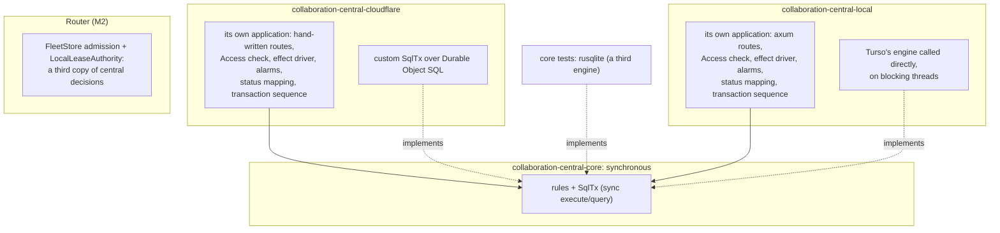

# What went wrong with central's first build

**What this is:** an account of how central was built against the owner's requirements, what that cost, and what survives. The board-design Lead wrote it, and the errors in it are the Lead's. It explains why [the central one-core spec](2026-10-16-central-one-core.md) replaces program design 3 §2a and ADR 0003. Sections superseded elsewhere link here.

**In one paragraph:** the owner asked for one central core, async, injected into every runtime through a common trait, with SQLx as the database API. The Lead wrote a design that injected only storage, made the core synchronous, and gave each runtime its own application around it. A reviewer flagged the conflict with SQLx; the Lead resolved it against the owner. The result ran to four days of work. It had two runtime applications on three SQL engines, with behavior already drifting between them, and a third copy of fleet logic in the Router. The owner found the violation; the Lead never raised it.

## 1. What the owner asked for

| When | Owner's words | What it means |
|---|---|---|
| 2026-10-05 | Use our own fork of the SQLx Turso driver | SQLx is the database API |
| 2026-10-11 | "a common interface and inject"; "very strict"; "run it locally during testing"; "not everything should be injected"; "no unsafe, same standards" | One core of logic. Runtimes are injected into it through one interface |
| assumed throughout, stated 2026-10-16 | "requires async requests" | Request handling is async |

None of these became a row in [the requirements](../2026-10-04-board-orchestration-design/requirements.md) until 2026-10-16. They are now U69–U75.

## 2. What was built instead

Measured at M3 `1b90cb35` and M2 `96ec71d2`:
- **Two runtime applications.** 1,814 lines of behavior are written twice, and 344 lines exist in only one runtime. The copies cover:
  - routing;
  - the Access check;
  - effect dispatch and its failure policy;
  - HTTP status mapping;
  - frame-to-session handling;
  - admin and import flows;
  - alarms;
  - the transaction sequence.
- **Drift had already started.** The two runtimes cache Access signing keys for different lengths of time.
- **Three SQL engines** were in use: Durable Object SQLite behind a custom synchronous interface, Turso's engine called directly on blocking threads, and rusqlite in the core's tests. SQLx, the owner's choice, was used for none of them.
- **The Worker routed requests by hand,** although U30 requires axum for every server.
- **A third copy in the Router.** M2's fleet stand-in reads snapshots, applies decisions and rebuilds replies around the same admission rules, 595 lines of it. A local lease authority grants epochs.
- **A 12,026-line conformance harness** ran shared expectations against two separate implementations. Passing showed that each met them; it couldn't show there was only one implementation. (No test compared the two runtimes' outputs.)
- **Guards enforced the wrong boundary:** a source-text check banned async from the core.

## 3. How it happened

| Date | What happened | What should have happened |
|---|---|---|
| 2026-10-05 | The owner decided to use our fork of sqlx-turso. The Lead recorded it in a working note, not in the requirements | Write it as a requirement row the same day |
| 2026-10-08 | Research recorded workers-rs's `SendFuture`, `SendWrapper` and `#[worker::send]`, and that async storage transactions work in Durable Objects | Carry that evidence into the design. It showed an async core could run in the Worker |
| 2026-10-11 | The Lead wrote PD3 §2a: "only storage is injected", "effects are returned, not injected", a core with "no async", and a second native application. ADR 0003 recorded it as "decided by the owner" | Put the owner's words next to the realization. "Only storage", "no async" and a second application were the Lead's inferences, and needed the owner's decision |
| 2026-10-12 | Review finding F6 flagged that the native shell used Turso's engine "while the commission asks for Turso through sqlx-turso", and warned against a second runtime or rules implementation. The Lead resolved it by making the contract synchronous, and a re-review called the boundary "owner-confirmed" | Take a finding that conflicts with an owner direction to the owner. Never resolve it, and never accept "owner-confirmed" without the owner's words |
| 2026-10-12 to 16 | 48 commits built the two applications. About 16 review rounds on 2026-10-15 and 16 refined details on top of them | Stop at the first sign of a second runtime application or a sync boundary |
| 2026-10-16 | The Lead brought the owner small rulings and an SQL-guard question whose options all assumed the wrong boundary. The owner found the violation | Raise the structural deviation first |

**What the research missed before central's code began on 2026-10-12:**
- workers-rs's `http` and `axum` features (`router.call(req)`);
- its experimental Emscripten Tokio path;
- an existing SQLx driver for Durable Objects, `sqlx-cloudflare-do`, first released 2026-09-26.

No open-source source was checked out for reading before 2026-10-16.

## 4. What it cost

Measured from git history and source. These are not labor hours, which were never recorded.

| Measure | Value |
|---|---|
| Central code that must be replaced or consolidated | 2,869 lines across 19 files, plus 595 lines of the Router's fleet stand-in |
| Commits touching those files | 25, over 92 hours of calendar time (2026-10-12 to 16) |
| All central commits since 2026-10-11 | 69 commits, +55,891 / −7,024 lines |
| Review reports that refined the wrong boundary | 3 directly (F6 and its two re-reviews) and 4 that built on it |
| Helper sessions involved | 13 identified: 7 implementing, verifying or reviewing central, 1 adjacent reviewer, 5 supporting |

## 5. What survives

Most of the work carries over, because the rules were right even where their home was wrong:
- **Domain rules:** piece apply, fence, leases and transfers, sessions, fleet admission, the typed call DAG and alarm plans. They need an async SQLx port, not a rewrite. Overall, 43,623 Rust lines carry over; that count includes contracts, tests and platform code as well as the rules.
- **Protocol crates:** frames, identities and SQL value contracts.
- **The exact-number transport** (decimal text in `CAST`, `typeof` on read). The 2026-10-16 probe proved it on both runtimes.
- **The conformance assertions.** What goes is the plumbing that ran two applications, not the scenarios.
- **The design's domain meaning** in specs 1–3. Only the realization sections are superseded.

## 6. What changes in how the work is done

- **Owner directions become requirement rows the same day.** Every design opens with the owner's words next to its realization, and anything the owner didn't say is labelled as an inference before anything is built on it.
- **A review finding that conflicts with an owner direction goes to the owner.** "Owner-confirmed" in a review is a claim to check against the owner's words.
- **Every research finding that bears on a direction is recorded in the design as used or rejected,** with the reason. Open-source code is checked out and read before design starts.
- **Experiments come before signatures.** The 2026-10-16 probe ran the new shape on both runtimes before the design fixed its interfaces.
- **Structural deviations reach the owner first.** A second runtime application, a sync boundary or another engine stops the work.
