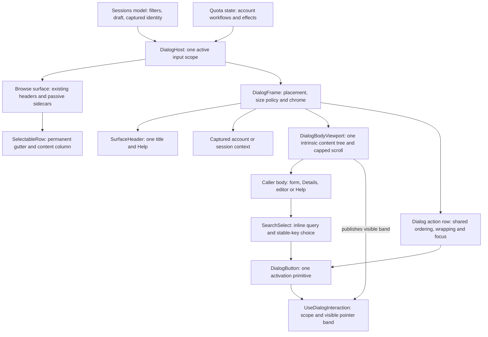
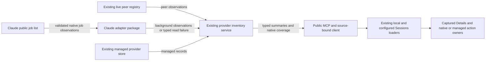

# One component system, existing domain owners

Consumes [Requirements](requirements.md) U1–U16 and the fixed [Specification](specification.md) E1–E10/R1–R16, including its later shared native catalogue authorization. The reusable system owns presentation and local interaction; Sessions and Quota retain committed values, captured identities and effects. The final R16 catalogue section supersedes earlier no-public-inventory-change clauses only for the authorized native job read projection; no new service, persistence or provider lifecycle is introduced.

## Entity bindings

This table is the binding contract. Shapes are Rust in-memory values; no new serialized or stored form is needed. Existing domain types remain authoritative.

| Entity | Semantic owner · home | Shape and boundary | Lifetime / convention |
| --- | --- | --- | --- |
| E1 Surface | Existing `SessionsPickerModel` in agent-collaboration; existing Quota status component in codex-router-cli. Modified composition consumes codex-router-tui. | Existing request/view model → caller component → shared view props. The shared crate receives only visible values, viewport and typed UI callbacks. | Derived/mounted. Existing hooks/State and native enums. |
| E2 Dialog | Modified `DialogHost`/`DialogFrame`, codex-router-tui; caller owns which domain interaction is active. | `Option<ActiveDialog>` at caller, with payload variants New, Details, Filters, Fork, AccountWorkflow or Help carrying a return context. `DialogFrame` accepts title, body children, actions, viewport, size policy and close/help events. | Mounted, not persisted. Exactly one visible variant, no vector/stack. Existing domain states remain payloads rather than copied generic state. |
| E3 Choice field | New `SearchSelect` in codex-router-tui owns query/focused option; caller owns committed value/draft. | `ChoiceOption<TKey> { key, label, secondary: Option<String>, availability: Available \| Unavailable { reason } }`, with `TKey: Clone + Eq`. Events `Selected(TKey)` or `Cancelled`; unavailable/no-match cannot produce Selected. | Ephemeral. Typed stable keys, not list indices or display strings as identity. |
| E4 Session | Existing source-qualified picker identity and `SessionActionSelection`, agent-collaboration. | Existing `SessionPickerRecord` → captured Details target → existing selection/preparation command → existing `SessionsPickerOutcome`/runner. Shared Rows receive labels/styles, not launch authority. | Existing cached/derived record. No new persistence or wire shape. |
| E5 New session draft | Modified picker-owned New form; existing machine/source controls and native arguments retained. | `NewSessionDraft { selected_source: PickerSourceContext, directory: PathBuf, arguments: Vec<OsString> }`; editing/checking/failure wraps existing source-action state/outcome. Supported client derives from existing command, not a new arbitrary launcher. | Per invocation, enum states. Defaults derive from existing request/registry. |
| E6 Session filters | Modified picker model/query, agent-collaboration. | Existing root/backend model-provider/source/runtime/sort/query types and the separate `SessionProviderFilter` client-family type; draft retains this distinction. Shared SearchSelect gets typed options/events; Apply updates committed values together and triggers the existing loader only when its query changes. Client-family projection alone does not change the backend provider query. | Committed mounted state + one draft. External Cwd/Checkout/Repo/Any command semantics remain authoritative. |
| E7 Quota account | Existing Quota account view model/AccountId and credit observation types, codex-router-cli/core. | Read-only account view model → row/Details projection. Decimal formatting accepts existing validated decimal text, returns display text; never returns a replacement observation. | Existing observations authoritative; presentation derived. |
| E8 Account workflow | Existing options/floor/reset state + command ports, codex-router-cli. | Existing captured AccountId and workflow enums → domain event handlers → existing async/supervisor result. Shared dialog body/actions receive projections/callbacks. | Existing pending/edit/result state. No generic retry or new queue. |
| E9 Size policy | New typed axis policy beside modified DialogFrame, codex-router-tui. | `DialogAxisSize::Content { maximum: Option<u16> } \| Preferred { preferred: DialogPreferredSize, bounds: DialogAxisBounds }`; preferred is Cells(u16) or Percent(DialogPercentage). Both default axes use Percent plus independent bounds. Bounds constructor rejects min>max; Percentage constructor accepts1–100. `DialogPresentation::FullScreen \| Sized { width, height }`. Existing margins reused. | Derived per viewport; not persisted. Constructors/enums carry validity. |
| E10 Row | New shared `SelectableRow` layout in codex-router-tui; Sessions/Quota own projected content. | `selected: bool`, marker and body children. Frame always allocates two columns for marker, body is one flex column containing all title/provider/metadata lines. | Derived. Real Views/gaps/Text; no manual spaces as alignment. |

## Target composition

The [HTML structural view](../../wip/2026-10-17-sessions-dialog-system/index.html#structural-design) draws these relationships beside the current proposal. The binding table above defines the nouns; the tree below answers who owns layout versus effects.



Extend the existing shared crate instead of a parallel screen framework. `DialogFrame` retains fixed header/action siblings and composes a `DialogBodyViewport` whose in-flow body contributes natural width and height. It uses iocraft layout and public draw hooks to measure natural content and actual viewport; it owns clamped scroll offset and local scroll keys/wheel. It does not discover options, interpret domain keys, load accounts or launch processes. `SurfaceHeader`, semantic typography and `DialogAction` remain shared foundations.

Dialog input policy belongs to the existing shared viewport/interaction boundary. Painting a clipped body does not by itself restrict a native button's hit rectangle. One shared DialogButton therefore uses the existing scoped, clipping-aware local-event helper while retaining the pinned native activation contract: one child supplies layout, mouse Down activates, and focused Enter/Space activates for non-Release key events. It does not add an event dispatcher, a focus model or a second renderer, and does not depend on parent/child callback order. DialogAction and SearchSelect compose it; the New Client/Machine and Fork destination fields use the same primitive. Custom local listeners use the same helper. All scoped callers cut over together, with no parallel raw-button path. The small activation adapter costs a pinned behavior contract to maintain, but removes duplicated clipping decisions and avoids modifying the library. It owns presentation/input policy only; captured action identity, eligibility and effects remain with the caller.


The new body viewport is justified by R3: current iocraft0.9.2 ScrollView positions its content absolutely at100% width and expects a fixed viewport, so it cannot contribute intrinsic width to its parent. An auto frame around that component collapses to header/action width. A separate caller-computed text geometry path or hidden second render would violate U2/U6. The chosen viewport keeps one non-shrinking in-flow content tree, clipped by a flex/min-height-zero cap; relative displacement changes its visible offset without removing intrinsic sizing. Public hooks notify only when measured dimensions change. All geometry remains iocraft/Taffy work.

`SearchSelect` is inline content, never another DialogHost or modal. `FormField` is a reusable label/value layout: one shared label column across its siblings, flexing value column, stacked only when too narrow. Caller forms provide typed values and events. `SelectableRow` removes duplicated marker/metadata padding; selected and unselected children use identical layout.

Passive wide Session/Quota Details remain. Active menus, filters, account editors and reset confirmation all use the same **single overlay DialogFrame** at every width. An editor no longer relocates its buttons into the outer Quota footer when the terminal becomes wide. This changes presentation location, while retaining every workflow, sidecar inspection and command. Help replaces the active frame content and returns to its saved context rather than adding another visible level.

## Current system

Evidence below is current at base ffced1c1. It establishes source wiring, not runtime acceptance.

- [DialogFrame](../../../crates/codex-router-tui/src/dialog.rs) maps maximum dimensions to actual size, fills a body ScrollView, and arranges actions vertically. `DialogHost` blocks participating background widgets; caller browse input must also honor modal state because iocraft broadcasts terminal events.
- [Machine view](../../../crates/agent-collaboration/src/session_picker/picker_machine_view.rs) and [fork view](../../../crates/agent-collaboration/src/session_picker/picker_fork_view.rs) hand-build full-height frames. [New Details actions](../../../crates/agent-collaboration/src/session_picker/details_dialog_actions.rs) dismiss Details and call `start_new_action`, which can open another machine stage. Those edges are replaced by one New form.
- [Session rows](../../../crates/agent-collaboration/src/session_picker/picker_list_view.rs) reserve a two-cell title gutter but omit it in the secondary line. The title source already reserves equal selected/unselected gutters; the whole reported screenshot shift still needs real coordinate observation.
- [Quota dialog routing](../../../crates/codex-router-cli/src/presentation/quota/quota_dialog_rendering.rs) uses DialogFrame below sidecar width; [Quota composition](../../../crates/codex-router-cli/src/presentation/quota/quota_status_component.rs) places wide options/floor/reset content and actions in separate sidecar/outer-footer paths. Keep the workflow owners, replace those active-menu presentation paths.
- [Quota rows](../../../crates/codex-router-cli/src/presentation/quota/quota_browse_rendering.rs) clip names to13/17cells. [Credit summary](../../../crates/codex-router-cli/src/presentation/quota/quota_account_options.rs) prints the validated balance string directly. Replace presentation only.
- Existing [command options](../../../crates/agent-collaboration/src/session_commands/session_command_options.rs) define Cwd/Checkout/Repo/Any and source modes. Checkout is explicitly list-only at the current command boundary; the current interactive root enum has only Cwd/Repo/Any. Preserve that external behavior and label availability accurately. The [capability inventory](../../wip/2026-10-17-sessions-dialog-system/capability-preservation.md) distinguishes current command/query capabilities from proposed choice vocabulary.
- Client family is the existing transient `SessionProviderFilter`, separate from the backend `SessionsProvider`. [Configured-query qualification](../../../crates/agent-collaboration/src/session_commands/configured_inventory_query.rs) requires Any root/backend provider, Updated sort and blank/full-UUID search; external-provider bindings require All source classification. Those existing guards remain authoritative. Shared controls expose caller-derived availability/reasons and never silently rewrite a draft to bypass qualification.

Platform reference: Cargo.lock pins iocraft0.9.2. Its View/Text intrinsic measurement, public Hook, relative positioning and overflow are used; no dependency fork or new layout engine. A bounded ignored layout probe exercised the actual library render loop: fixed-height short baseline18rows; measured short body9rows;40body rows capped at18 with End showing40; resize14 kept header/actions and scroll offset; shrink returned to short. A separate in-flow probe sized a wider body to59columns with the complete line visible, where current ScrollView collapsed to19columns. The combined in-flow probe needed a non-shrinking wrapper around the measured component; without it the measurement was the capped viewport. These are feasibility observations, not application proof, focus proof or screenshot evidence.

## Entry to effect

```mermaid
sequenceDiagram
  actor Person
  participant Picker as Sessions owner
  participant Frame as Shared dialog and SearchSelect
  participant Source as Existing source-action preparation
  participant Runner as Existing command runner
  Note over Person,Picker: Changed entry; predecessor was New Details then machine page
  Person->>Picker: New
  Picker->>Frame: New draft, machine and directory
  Person->>Frame: Search machine, select stable key
  Frame->>Picker: Selected(source key)
  Note over Picker,Frame: Draft updates; one visible frame; no launch
  Person->>Picker: Start
  Picker->>Source: Async existing preparation: captured source, directory, arguments
  Source-->>Picker: Prepared / rejected / unknown
  alt Prepared
    Note over Source,Runner: Preserved preparation outcome and native runner
    Picker-->>Runner: Existing picker outcome/prepared selection
    Runner-->>Person: Existing native launch path
  else Rejected or unknown
    Picker->>Frame: Same captured draft, existing reason, permitted actions
  end
```

The production entry stays `run_sessions_picker` → component/model → `SessionsPickerOutcome` → `session_command_dispatch` runner. Removed edges are New Details→close→standalone machine page. Changed edge is New→draft form→Start→existing preparation; the domain preparation/runner/error edges remain authoritative. Resume/Fork still capture SessionActionSelection and retain source affinity; Copy ID still uses the existing clipboard request port. Generic UI callbacks never bypass those paths.

Quota follows the same presentation boundary: key/click → existing account event state → shared frame projection → existing command port/supervisor → existing result state. It never executes a policy write/reset in the shared crate. Browse/filter rendering remains read-only.

## Interaction and failure

| Owner | State / transition | Guard, failure and return |
| --- | --- | --- |
| Caller dialog enum | None → specific dialog; dialog → Help(return context) → same dialog; Close → None | At most one visible variant. Restore opener by semantic identity, or nearest still-valid control if filtering removed it. |
| SearchSelect | Closed → Searching(query, focus key) → Selected(key) or Cancelled | Query does not mutate committed value. No match/disabled key cannot select. Escape consumes this transition before parent Close; Tab remains inside the form. |
| Filter owner | Applied → Draft → Apply/Cancel | Apply updates typed values together; Cancel discards. A loader result uses existing generation/source guards. No stale result retargets selected record. |
| New/source owner | Editing → existing pending source preparation → prepared/rejected/unknown/cancelled | Capture chosen source/directory/args before dispatch; disable duplicate Start. Existing uncertainty/reconciliation rules unchanged; no automatic retry/fallback. |
| Account owner | Existing edit/review/pending/result states | Keep captured AccountId and commands/eligibility. Escape does not pretend to undo an already committed effect; existing completion/refresh behavior remains. |
| Body viewport | Natural layout → cap/scroll; resize/content change → remeasure/clamp | No domain reset. Scroll offset clamps to current extent; focus reveal scrolls only if needed. Reserved scrollbar space avoids alternating wrap/measure widths. |
| Credit presentation | Validated decimal observation → display projection | Format significant digits without binary float conversion. Unknown/depleted/unlimited are enum branches. Invalid observation stays an explicit upstream error/unknown, never zero. No data mutation. |

One terminal event has one effective owner: caller chooses the active domain dialog; shared interaction gates background input. Because iocraft broadcasts events, “consumes” means a shared interaction owner returns `Handled` or `Unhandled` from the active choice transition before deciding parent Close/Activate; it does not rely on DOM-style propagation. `DialogKeyboardOwner::Caller` remains the route for domain modified shortcuts. The frame must not also run its old unconditional global Escape callback for that same event. The caller remains the single keyboard owner for Details action focus: Left/Right traverses the displayed action order, Tab/Shift+Tab remains available, and Enter/Space activates the focused eligible action. The body viewport retains vertical/page scrolling; action navigation must not also move the obscured list. Repeated key presses during pending effects are ignored by existing state guards. Resize is geometry-only and must not remount async loaders, refresh credits, issue provider calls or clear drafts. Measurement updates compare before writing State to avoid a redraw loop. Tiny viewports below usable chrome receive a bounded visible too-small state; the required48×24 and constrained48×12 target must keep actions usable.

## Sizing and visual rules

Subtract saturated margins from the terminal bounds. Both default axes use a percentage of that available space with independent min/max bounds. Validate bounds, resolve Cells/Percent (integer floor once), clamp preferred to bounds, then cap to actual available space. Content sizing remains an explicit mode, using Auto with max bounds; percent/cell axes have an explicit size. Header and action group are non-shrinking siblings; the body cap receives the remaining height. Minima are preferences when the physical viewport is smaller. FullScreen is explicit, not an automatic narrow-terminal fallback. The HTML's editable80%width/60%height and42–88columns/8–24rows illustrate parameters, not a second caller-specific sizing engine.

Actions use one shared row with gaps and flex wrapping. Label/value fields and row gutters are Views, not strings containing spaces. Quota preserves the existing three-column information grouping: Account, Status/counts and Quota. Name/provider share the first column; state, active clients, reset credits and balance/freshness share the middle; routing reason, Weekly,5h and pace share the last. One column-width decision serves headings and all account rows; names wrap rather than retaining the fixed13/17-cell allocation. Status and usage fields stay in their groups at narrow widths, accepting additional vertical wrapping rather than moving them into a full-width metadata line. The earlier full-width-name/side-by-side-window mockup is superseded. Currency/unit semantics come from existing observations. Compact decimal formatter uses bounded readable significant digits and suffixes; Details groups digits and trims only redundant trailing fractional zeros, preserving every meaningful digit. Existing numeric/domain decisions still consume exact source types.

Caller-owned captured context is a fixed sibling of the scrolling body. It renders display identity without becoming a new source of account/session truth. Short bodies do not flex-grow: a non-shrinking gap separates content and actions, while spare space in a sized frame follows the action group. Physical space determines usable padding without bypassing independent percentage/clamp sizing.

Interactive Quota browse below 48 physical columns uses compact density at the existing screen/list/row owners: remove their three horizontal padding pairs and the inner list border, recovering eight cells while retaining the outer frame, scrollbar reservation, fixed two-cell selector gutter and intergroup gaps. One paired header/row allocation accounts for those actual Views; the header reserves the same trailing scrollbar cell as the body. At 32 columns the data groups receive 10/7/8 cells; at 40 they receive 13/9/11. The density is derived from current physical width and does not select another renderer or introduce a persisted preference.48+ widths, static mode and passive sidecars retain their established geometry. Long content wraps vertically within its original group and remains scrollable; geometry alone is not a readability verdict.

### Quota counters and glyph meanings

Quota presentation owns readable header summaries and the existing account-row status vocabulary, explained in contextual Help. The later owner clarity correction supersedes opaque glyph-only census strips; row symbols and reset-credit glyphs remain optional contextual aids. R10 keeps their meanings distinct: the census projects AccountAvailability, while the row status follows existing quota_state_text precedence (preferred-next first, then stale/unknown freshness, then available/held/blocked), including existing credential-unavailable overrides. A preferred ★ is routing preference, never the browse-focus marker or a new availability class. Held remains a row word/state, not a renamed reserve count. Keep a typed projection of these existing distinctions at the Quota presentation boundary; do not infer them by parsing formatted strings. Shared text/layout primitives render it; generic dialog code never decides what account availability means. Counters derive from the existing typed report and observations at the projection boundary, not by parsing the already formatted route/freshness strings. The static text mode keeps its existing readable output.

| Count or state | Readable header or row aid | Meaning retained |
| --- | --- | --- |
| Total accounts | Accounts | Entire pool account count, distinct from the filtered shown/total count. |
| Usable census | Usable | Existing Usable account classification, not preferred-next. |
| Reserve | Reserve | Existing Reserve classification; not usable or selected. |
| Blocked | Blocked | Existing Blocked classification. |
| Excluded | Excluded | Existing Excluded classification; not quota exhaustion. |
| Unknown availability | Pool unknown | Existing Unknown classification, in the pool-count group. |
| Serving clients | Clients | Existing aggregate active-client count. |
| Fresh / stale / unknown freshness | Fresh / Stale / Data unknown | Observation freshness, in a separate operational group. Unknown freshness is not unknown availability. |
| Reset credits | ↻ (optional) | Available reset credits for the account; an explicit count and reset label is also valid. Unknown remains explicit. |
| Row preferred / available / held / blocked | ★ / ✓ / ◇ / ⊘ with row-specific Help | Preserve the existing row-status vocabulary, separate from header availability counts. Ordinary text remains when it fits. |
| Row stale / unknown | ◷ / ? with row-specific Help | Preserve freshness-derived status and its existing precedence; never replace it with an availability-only symbol. |

Wide headers show short readable labels and counts with spaced middle dots. At constrained widths, the same typed projection produces compact named summaries retaining total, usable and nonzero problem counts; it does not fall back to an unexplained symbol strip. Contextual Help renders every current count, including zeros and separately labelled availability/freshness unknowns, from that same projection. Measure the actual terminal-cell budget and wrap without truncating a retained count. A row reset-credit count may use `↻ 2` or a readable `2 resets`. Do not prepend a redundant glyph to an already labelled count when it forces the unit onto another line. Details and Help retain the full meaning. Use short stable text glyphs, not emoji or an external icon font. Keep Responses/other route band, degraded/credential-availability notices, provider names, Weekly/5h and credit units readable as text. Counter colors use ordinary/secondary roles; yellow remains focus/selection. The Help legend supplies full meanings, Details uses readable labels, and the HTML proposal supplies accessible labels as an additional browser affordance. Terminal correctness must not depend on hover. Actual terminal/font width and selected/unselected alignment remain proof obligations; no Unicode width is inferred from the HTML appearance.

## Trace to owners and proof seams

Every R has a row. All U1–U14 and E1–E10 are covered here; no authorized supersession or missing realization is hidden. Proof cells name observation seams, not results or future test filenames.

| U | R · scenario | E | Owner | Interface | Shape and home | State | Failure | Proof seam |
| --- | --- | --- | --- | --- | --- | --- | --- | --- |
| U1/U2 | R1 menus | E1/E2/E8 | Shared frame + callers | frame/body/action props | E2 in tui; E8 existing Quota | one active dialog | bypass rejected in adoption inventory | all menu journeys, shared source call graph |
| U3/U7 | R2 one level | E2/E3/E6 | caller enum + SearchSelect | Selected/Cancelled; Help return | E2/E3/E6 bindings | draft/choice/help | Escape first cancels choice | actual key/pointer sequence and visible frame count |
| U4 | R3 sizing | E2/E9 | frame/body viewport | axis policy, bounds, extent | E9 tui; layout-only measurements | resize retains state | clamps/too-small | rendered bounds, scroll/focus/resize journey |
| U5 | R4 hierarchy | E1/E2 | header/actions/typography | semantic role props | existing semantic palette | focus/disabled | no footer/duplicate title | real styled cells + PNG |
| U6 | R5 alignment | E3/E10 | field/row layouts | children and stable gutter | E3/E10 tui | select/unselect | Unicode/cap | before/after content x coordinates |
| U7 | R6 choice search | E3 | SearchSelect; caller values | typed options/events | E3 tui + existing caller keys | query/focus/selected | no-match/unavailable | real in-place choice interaction |
| U8 | R7 New | E3/E5 | picker/source action | existing preparation/outcome | E5 picker, existing source types | edit/pending/result | rejected/unknown/no duplicate | actual picker flow to existing launch boundary |
| U1/U9 | R8 filters/search | E4/E6 | picker/query loader | existing typed query | E6 existing command/model | draft/apply/cancel | old generation ignored | all scope/source/provider/sort/paste scenarios |
| U10 | R9 Details/actions | E2/E4/E5 | captured selection + runner | existing selection/outcome/clipboard | E4/E5 existing homes | captured target | unavailable/source failure | actual Details/actions to preserved ports |
| U11 | R10 quota rows | E7/E10 | Quota projection + row | account labels/observations and typed counter projections | E7 existing plus derived Quota counters; E10 tui | same AccountId, distinct availability/freshness groups | unknown/excluded/degraded remain visible | long names/providers/metrics/glyph widths at all widths; preferred versus available, held versus reserve census and stale/unknown row precedence; contextual legend |
| U12 | R11 balances | E7 | credit display projection | validated decimal → text | existing Quota presentation | derived only | explicit nonnumeric states | exact/compact output and unchanged source |
| U1/U2/U3/U11 | R12 account workflows | E2/E7/E8 | existing Quota controllers | existing command ports | E8 existing, E2 tui | edit/review/pending/result | existing failure/refresh | real workflow + frame/action placement |
| U13 | R13 delivery | E1–E10 | Lead/paired Verifier | adopted target/journeys | current source/design + verify skill | unverified until observed | failed gates retained | compiled UI, suites, independent review/CI |
| U14 | R14 feedback | E1/E2 | Lead | canonical checklist/HTML | repository docs + external trace | evidence-linked states | stale proof labeled | checklist↔R coverage and actual HTML view |

Invalid-state enforcement: E9 invalid percentages/bounds reject at constructors; unavailable choice cannot produce a selection event; one visible dialog uses a sum type; Session/Account identities remain existing validated types. Caller input guards plus integration tests enforce background isolation and no duplicate effects. Package imports keep domain/effect code out of the shared crate. Source inventory and compiled journeys detect uncaptured custom frames.

| Other accepted identity | Disposition and realization anchor |
| --- | --- |
| E1, E2, E3, E4, E5, E6, E7, E8, E9, E10 | Covered: entity bindings above and their enumerated R trace rows. |
| C1 | Covered: sizing/visual rules; iocraft Views, shared palette and fixed gutter. |
| C2, C4 | Covered: entry-to-effect and interaction/failure; existing effect ports and identities stay authoritative; shared views have no storage/network access. |
| C3, C6 | Covered: current-system preservation inventory, R8–R12 and hard cutover below; static modes/passive sidecars retained. |
| C5; V1, V2, V3, V4, V5, V6, V7, V8, V9, V10, V11, V12, V13, V14 | Covered as observation seams in corresponding R rows; application observations have not been performed. |
| Default bounded percentages on both axes; optional content/cell/full-screen sizes; no nested choices | Covered: E2/E3/E9 bindings, interaction table and sizing rules. The former content-fit default is superseded by the latest owner correction. |

Cross-cutting realization: keyboard/pointer accessibility belongs to shared focus/action/choice interaction, with textual provider and disabled reasons; clipping/focus failures are visible in the rendered-coordinate seam. Performance stays local: query filters supplied options, measurement writes only on extent change, no per-key I/O; retained component benchmarks detect cost. Input isolation belongs to DialogHost plus caller dispatch; source validation and effect permissions stay at existing domain ports. No new database, replication, authentication or external telemetry boundary is applicable to this presentation-only change.

## Choice and limits

Retaining each screen's frame was rejected because it leaves U2 unsatisfied. Patching/forking iocraft solely to add intrinsic ScrollView width was rejected: native in-flow layout plus a small shared viewport supplies the required behavior without a new dependency. The cost is maintaining/testing that bounded viewport at one owner; the Lead and shared-crate maintainers bear it. A future upstream component that supplies the same intrinsic/focus/scroll contracts could replace it in one cutover.

Hard cutover all existing DialogPresentation callers and Sessions/Quota active-menu paths together; no compatibility flag or old/new renderer switch. Preserve static modes and passive sidecars. No schema, protocol, security policy or migration changes. Library feasibility is observed only in a narrow render-loop probe; complete nested fields, glyphs, mouse scrolling, focus reveal, source-action flows and actual application screenshots remain required verification. This document is design, not acceptance.


## Owner correction: native Claude background execution

The existing `session_commands/claude_launch_target.rs` owns native Claude argument construction and routed environment; `claude_session_commands.rs` owns public CLI execution and actual exit reporting. Keep background default construction at that owner so direct CLI and future TUI adapter share it. Native New/resume/fork uses the installed `claude --bg` contract (locally verified help: returns immediately and prints the background ID). Preserve passthrough argument bytes/order without scanning or deduplicating native options. Installed Claude2.1.296 has an early native background gate that uses its own option-value grammar and rejects print mode before daemon/session dispatch; propagate its failure. A custom option-arity table is unnecessary vendor coupling and is excluded. Keep ACP managed sessions at the existing Provider conversation owner; no cross-client ID conversion. Product tests must execute the public entry through a controlled executable boundary and preserve existing preflight/environment/error behavior. Vendor observation remains independent.

## U16 client action binding

One New draft adds typed client selection to the existing machine/directory/arguments draft. Bind supported choices to actual source endpoint inventory: CodexNative, ClaudeNativeBackground, CursorManagedAcp. The shared SearchSelect owns presentation only; the Sessions domain captures typed client, source, directory and action. Existing Codex effect and source-native carrier stay at their owners. Existing ClaudeLaunchTarget owns native background arguments/environment. Existing ConversationClient/provider operations own managed create/load/resume and their operation IDs/results; no new provider runtime or protocol adapter.

Preserve provider origin in the picker identity/selection: managed ACP versus native Claude peer is explicit typed evidence from ProviderSessionSummary, not inferred from title or optional state. The background job handle returned by Claude is a separate native handle; preserve the native CLI receipt without coercing it into SessionRef.sessionId. Copy session ID/Resume consume only the native UUID or managed SessionRef the record actually supplies. Initial native background completion may show the actual receipt while normal inventory refresh obtains an attributable native record. No invented join or ID parser.

For configured machines use the existing trusted, fixed-program SSH source entrypoint. Add typed provider action request variants carrying client/action/working directory and one operation ID; do not carry arbitrary executable/shell text. On the source machine resolve the established OS-owner Human identity through existing resolve_owner_human_id, connect its own collaboration service, revalidate expected service and endpoint ProviderKind, and call existing ConversationClient. New managed sessions use the existing workspace-write request policy and normal owner approval routing; this is not bypassPermissions. Native Claude executes its existing background launcher on that source. Local actions use the same domain adapters without SSH. Remote MCP-only profiles remain usable for inventory/boards; no unsupported launch fallback or invented credential presentation.

Existing managed Load/Resume must take working directory, requested policy and Approver from the same authoritative stored Session record, not New-form defaults. The existing ProviderOperationStore owns that record; provider_session_inventory already projects its working directory and Approver into ProviderSessionSummary::HostedProvider but omits requested_policy. Complete that read projection with the existing ProviderRequestedPolicy value, as a required typed field for HostedProvider only. This is an explicit public read-schema addition, not a new policy, persisted field, storage owner or endpoint. Cut over all summary producers/consumers/schema tests together; native Claude peers do not acquire managed-policy fields. The selected-machine adapter obtains a fresh exact-target Stored summary immediately before submitting its existing ConversationClient Load/Resume request, and copies those three fields unchanged with the caller-retained operation ID and actual Human requester. Missing stored metadata, wrong origin/endpoint or a vanished target fails without dispatch; never substitute workspace-write/current Human as saved policy/Approver. As with HostSessionCommandPort's existing read-before-submit path, these are the captured stored values, not a new atomic concurrency guarantee. Load/Resume keeps the existing backend and approval behavior; it does not change the stored-record schema or introduce direct SQLite reads in the TUI.

Keep mutation transport separate from read_source. Managed ACP SourceOperation submission is one-shot, has caller Router operation identity before any effect, and returns existing typed submission/settlement. If its SSH/API output is lost after submission, show Unknown plus that operation ID; subsequent operation-show is read-only. Native Claude runs through its existing external process owner and creates no Router operation record. Its typed result carries actual observed output/status and captured source/action identity; lost output has unknown effect, with no invented Router operation ID or operation-show offer. A returned background handle is a vendor control handle, not Router reconciliation. Never automatically resubmit either kind. Existing source guard/epoch/endpoint qualification is reused; stale source/binding rejects without selecting another endpoint. Old remote executables that cannot decode an added action fail clearly with upgrade guidance, not a legacy fallback. Both-machine proof uses the new declared build and isolated registry/executable paths.

Inventory reads preserve Stored records and add live/Loaded Claude typed peers with origin-aware deduplication; preserve existing bounds/cursors/scope guards and configured query restrictions. Details queries actual provider capabilities through the existing source client, shows pending/error, and offers only supported managed Resume/Load plus Copy/Close. Fork stays provider-native-only where proven; there is no ACP fork implementation to simulate. One standard dialog/body/action system remains.

No database, new service, arbitrary command execution, cross-client ID conversion or provider lifecycle ownership change is needed. One existing client/MCP adapter mismatch must be repaired: ConversationLoadInput.requested_by currently requires SessionRef even though provider ConversationLoadRequest.requested_by is ProviderIdentity and the same API already permits Human creators/Approvers and provider Resume. Use the established Human-or-Session identity representation for this Load input and its CLI/MCP projection, validate Codex-only Session requirements before native dispatch, and forward the actual Human to the existing provider admission owner. Do not invent a SessionRef or change approval/access policy. The generated Load input schema will reflect this existing provider identity contract; all current callers/tests must use the named domain representation together, with no alternate legacy path. Alongside the required Stored-summary read field above, this supersedes the initial presentation-only no-schema-change limit only for U16's existing-client adapters. The private source request enum and captured UI identity expand for the newly requested actions; all its callers/tests cut over together. Native foreground Codex, native background Claude and managed Cursor have different effects, represented by named sum variants.

Attribution and authorization remain distinct. Existing provider admission validates endpoint/service locality, Session actor locality, binding availability and generation; it does not authenticate a Human ID against the OS owner or compare a submitted policy against saved policy. The TUI obtains its Human ID from the source resolver and preserves it, but claims no new server-side wrong-Human rejection. Policy/Approver preservation is the adapter's exact stored-projection obligation, proven through the actual operation, not an invented server gate.


### U16 inventory availability ownership

The prior inference that an ExternalProvider Claude kind guarantees a native-peer registry is withdrawn. `collaboration-service/src/provider_session_inventory.rs` owns the existing API: Stored reads the managed store; a non-Stored Claude read additionally requires `claude_code_sessions` and may return Unavailable. Keep that service/API contract unchanged.

The existing picker catalogue loaders own composition of independently observed partitions: managed Stored records and additional native-Claude Loaded observations, qualified by endpoint and typed origin. Their internal snapshot carries typed native-live coverage per endpoint, separately from `PickerRuntimeCoverage`, whose existing meaning is native Codex runtime status. Coverage distinguishes not requested, successful (including empty), and unavailable/incomplete with a reason. Only validated, source-bound pages may contribute rows. Origin-aware identity keeps equal opaque native/managed IDs distinct; duplicate identity within one origin remains invalid. No database, public schema or generic new inventory service is introduced.

Default-host runtime refresh and configured `StoredSourceContinuation` use this same rule at their existing owners. Retain completed Stored rows if an additional live read fails for availability, and carry any validated current-request live prefix with explicit incomplete coverage. Respect the existing bounded read budget: expiry of an extra live read must not erase already validated Stored rows merely because an enclosing future discarded them. Do not add retries. Existing `source_reload_worker` accumulates records and coverage only for the same captured query/service/epoch/binding and rejects stale or invalid responses as before. Add a presentation-local partial read state at `source_reload_progress`; it derives its notice/count from that coverage, rather than marking a partial view Complete or converting it to all-source rejection. Existing source/header rendering shows the missing partition; a background refresh cannot retarget captured Details or actions. This is current-view observation state, not persisted session truth.

The exceptional recovery is narrow: an availability failure of the added native-live part can retain already qualified records. Invalid page/source/epoch/cursor/identity errors continue through the existing rejection path, including invalidating affected source pages. Stored-read failure does not become an invented successful catalogue. Capability inspection for launching a client remains separate from catalogue completeness; a missing live list does not by itself prove or disprove that native executable's launch capability.


#### Preserve failure categories before composition

The existing read boundaries must classify provider-list failures before erasing their evidence: `HttpConfiguredInventoryClient::call/provider_page`, source-local `source_ssh_executor::execute_read` ProviderSessions, and the default local provider-list call. They normalize to a closed presentation/read outcome of availability failure versus invalid/unqualified response. The loader does not guess from a generic rejected error or human-readable message.

| Existing observed failure evidence | Normalized read meaning and composition |
| --- | --- |
| Timeout, transport/discovery inability, or the published provider failure with code-32050, kind unavailable and stage discovery | Availability failure. Only an added native-live partition may preserve valid prior parts with incomplete coverage. |
| Published invalid parameters/code-32602 or an invalid cursor/request | Invalid/unqualified. Reject affected source; never partial success. |
| Wrong service, endpoint, changed binding/epoch, unsupported request/capability, response-too-large or unknown rejection | Invalid/unqualified for this read. Existing rejection remains; no fallback/partial inference. |
| Malformed JSON, unrecognized error envelope, request-ID/result-kind/endpoint mismatch, bad page/cursor/duplicate identity | Invalid/unqualified. Reject; no successful empty result or availability coercion. |

Reuse existing published codes/kinds and `AdapterOperationFailure`/client error shapes. For HTTP tool failures decode the bounded structured failure and retain only the fixed code/kind/stage needed for this classification; JSON-RPC errors retain their actual code and the same bounded published category when present. Do not forward private error text or arbitrary error data. Unclassified errors fail closed. The SSH source uses the same classification at the real provider call before mapping to existing availability versus invalid-request/source rejection variants; `source_read_client_error` must preserve that distinction rather than every failed ProviderSessions call becoming SourceUnavailable. No new server field, error schema, public client method, protocol version or transport is needed. The loader's final mapping preserves that already-decided category.


#### Native Claude discovery is independent of managed ACP

The Host publishes canonical `claude-local` membership even when its managed ACP channel is unavailable; the existing service accepts native `Loaded + Interactive` inventory for that endpoint and independently attached peer registry. The picker must qualify this native-read candidate from exact endpoint ID plus current service/epoch membership, independently of managed-channel presence. This is the service's existing identity rule, not a label/runtime-kind heuristic. Absence of the canonical endpoint means no qualified native candidate; a wrong service, duplicate endpoint, malformed inventory or changed epoch remains invalid. Do not manufacture an endpoint or launch capability.

Keep managed and native read partitions separate in the current local/configured inventory owners: managed Stored/All is eligible only through a qualified ExternalProvider channel; native Claude Loaded/Interactive is eligible through canonical membership, including a channel-less Unavailable endpoint. Model the internal read plan with named partition variants so one endpoint can have both reads without conflating origins. Native-only reads must not require the managed operation store or use Loaded/All followed by origin filtering; that mixed query can hide an equal-ID/time row at a cursor boundary. The existing native target validator also uses Loaded/Interactive and still accepts only its exact captured ClaudeCodeInteractive target. No service pagination format, API, Host publication, registry, authentication or persisted state changes.

Both existing catalogue loaders retain typed native-live coverage under the preceding availability rule. A successful native page contains only the native origin and exact bound endpoint. Managed-only summaries in a native partition, or native summaries in Stored managed partitions, are invalid. Equal opaque IDs across partitions remain separate; duplicates within a partition fail. Current folder/source/provider/query guards remain authoritative; an unsupported combination is reported explicitly rather than rewritten. The user-required native background launch and native listing remain independent of whether managed Claude ACP starts.

## R16 shared native background catalogue

The Router composes supported vendor observations; Claude still owns job state and the managed provider owner still owns ACP state. A native peer record alone cannot represent a no-prompt background job. Keep the peer transport and managed store, adding a bounded source-local native job reader to the existing Claude adapter package and injecting it into the existing service identity. There is no new server, database, supervisor, polling loop, cache or lifecycle owner.



The native job reader runs the fixed supported `claude agents --json --all` read command using the selected Host's OS user, normal home and installed executable. No request may supply shell text or an executable path; no prompt, attach, resume, stop or model request occurs during discovery. The public job listing itself owns its provider-state reads; the Router never opens provider session files. The adapter parses only background records and leaves interactive discovery to the existing peer registry. Its subprocess is caller-owned: bound stdout/stderr and total duration to existing inventory read/result budgets, and settle only that child on cancellation or limit failure. Never signal Claude's shared supervisor. No retry or fallback to another machine.

### E4 binding and public shapes

| Entity | Semantic owner and home | Shape at boundary | Lifetime |
| --- | --- | --- | --- |
| E4 Session, native background observation | Claude owns truth; new native job reader beside the existing peer adapter in `claude-code-peer-messaging`; existing `collaboration-service` composes observations | Validated `NativeClaudeBackgroundJob`: separate job handle, native conversation UUID, absolute directory, optional name, actual started timestamp and closed typed state | Read-only observation; not stored by Router |
| E4 Session, public native background summary | Modified existing `ProviderSessionSummary` in `collaboration-protocol` | Add `ClaudeCodeBackground { origin: ClaudeCodeBackground, target: SessionRef, job_handle: NativeClaudeJobHandle, working_directory: ProviderWorkingDirectory, name: Option<String>, started_at: i64, state: NativeClaudeBackgroundState, peer: Option<NativeClaudePeerObservation> }` | Serialized current observation; no fabricated updated timestamp |
| E4/E6 native coverage | Existing service decides read completeness; protocol carries it; existing picker snapshot projects it | `ProviderSessionListResult.native_coverage: Option<NativeClaudeInventoryCoverage>`; coverage has peer and background fields, each `NotRequested`, `Complete`, `Incomplete { unidentified_jobs: u32 }` or `Unavailable { reason: NativeInventoryUnavailableReason }` | Request/endpoint/epoch-bound; never persisted |
| E4 captured identity | Existing source-qualified picker/action owner | Native conversation UUID remains the native `SessionRef`; typed job handle is supplemental metadata, not an action or reconciliation ID | Existing capture lifetime and revalidation |

`NativeClaudeBackgroundState` recognizes the supported vendor states `working`, `blocked`, `done`, `failed`, `stopped`, plus an explicit bounded unknown-state variant. The owned Claude2.1.296 public output established blocked/stopped; its retained vendor `printAgentsJson` source establishes the other labels. Working is active; blocked is waiting, without inventing an approval/auth reason; done/failed/stopped are terminal. Unknown is neither active nor terminal and cannot authorize an action that depends on such a classification. Native `status` when supplied stays a separate observation, not a substitute lifecycle. Started time is converted from the vendor's actual epoch milliseconds once. Missing updated time stays absent in the UI: do not display creation age under Updated. Existing name/path fallback conventions remain.

The vendor JSON boundary first distinguishes the supported row variants, then validates fields for that variant. `kind=interactive` rows and the supported peer-only `kind=background` rows (peer PID/directory/start/status shape, with neither job `id` nor lifecycle `state`) are not job-backed records. Leave their discovery with the existing registry; their presence in a valid mixed public list does not invalidate the job list or invent a handle/state. A job-backed background row has job `id` and lifecycle `state`; validate its handle, directory, timestamp and state shape. An inconsistent partial job discriminator, such as an `id` with missing `state`, remains invalid and must not be silently reclassified as a peer. Background jobs missing only the native UUID cannot become actionable SessionRefs; report incomplete unidentified-job coverage instead of fabricating an ID from the handle. Do not include raw stderr or arbitrary vendor fields in public errors. Malformed envelopes or conflicting identities reject the affected native read. A typed unavailable failure is reserved for actual discovery/executable/transport/time-budget inability, never arbitrary malformed output.

`NativeInventoryUnavailableReason` is a closed enum: `ExecutableUnavailable`, `ReadTimedOut`, `ReadUnavailable`. The vendor's supported JSON sometimes lacks a native session UUID; only such otherwise valid job records may increment `unidentified_jobs`, and the client must show incomplete coverage. Conflicting claims are invalid, not unidentified. Existing peer skipped-record semantics remain separately visible. There is no open-string failure classification or private stderr in the public shape.

### Read composition and identity

| Existing query | Target behavior |
| --- | --- |
| Stored/All | Existing managed store semantics unchanged, including Claude and Cursor policy/Approver metadata |
| Stored/Interactive on canonical Claude | New native background history from supported vendor job list, including terminal jobs; peer coverage NotRequested; no historical peer transcript promise |
| Loaded/Interactive on canonical Claude | Live peer registry plus nonterminal known background jobs; explicit independent peer/background coverage |
| Active/Interactive on canonical Claude | Existing busy peer evidence plus working background jobs; blocked/terminal/unknown do not become Active |
| Non-Stored/All | Existing managed inventory plus the corresponding native observation composition; origins remain explicit |

Native source classification keeps existing Interactive/Subagents meanings for owner-native versus Router-managed records; reject unsupported Claude Subagents as before. Canonical endpoint/current-service qualification remains independent of ACP startup. Managed-only endpoints do not acquire native reads. The public API and both default/configured clients consume the same projection; no separate TUI vendor scanner.

Within the native composition, one exact UUID corroborated by a background job and peer yields one native Session: use the background summary and retain the available peer observation in its optional peer field. Match exact UUID and directory; conflicting claims or multiple distinct job handles for the same native UUID are ambiguous, not index-based deduplication. Managed/native equality is never a join. Existing pagination gains an origin tie-breaker so equal sort time and UUID in different origins cannot hide a row; opaque cursors remain bound to the exact query/source/epoch and old incompatible cursors reject. Never claim a transactionally frozen vendor snapshot across separate calls.

The existing picker read plan adds native Stored/Interactive for native history, alongside managed Stored/All and native Loaded/Interactive. The native Stored and Loaded observations may corroborate the same UUID across requests: the current live observation supplies live status; the stored job supplies its observed history/handle. Do not reject this legitimate cross-view corroboration as an intra-page duplicate, and do not resurrect stale live status after a missing/failed live read. Same-origin duplicates within one qualified page stream still reject. No existing folder/query/capability guard is rewritten to force a native read through an unsupported scope.

### Failure, action and proof boundaries

Peer and background availability are independent. If one is unavailable, return the other qualified rows with explicit incomplete native coverage. Preserve the established managed- versus native-availability rule and invalid-source rejection. A successful empty native job list is Complete, not Unavailable. Stored-native failure never erases valid managed rows or live peer observations. Invalid response identity, ambiguity, malformed cursor/page or changed service/epoch remains rejection; no partial-invalid recovery is added. The default-source prior-view/Unknown rejection exception remains its existing behavior, without fresh Complete or new action authority.

Details Copy uses the captured native conversation UUID. Native Resume/Fork uses existing source-local background launcher and revalidates the captured UUID/directory against the appropriate native Stored/Loaded inventory immediately before dispatch; terminal native jobs can be resumed through their stored UUID. Existing interactive peers retain the same native actions. Managed sessions keep their exact saved policy/Approver, caller operation ID and existing eligibility. All native launches stay background; no native job is converted to ACP or vice versa. Lost native output remains unknown with no invented Router operation or retry.

The new adapter is read-only and injected at the same Host composition boundary as the peer registry. All Rust/schema/MCP/client/source/picker consumers cut over together; no legacy/new compatibility path or feature flag. Both debug machines must use the declared new Host and CLI for actual acceptance. Earlier .96 Host diagnostics establish the cause only.

| U · R · E | Owner and interface | State/failure | Proof seam |
| --- | --- | --- | --- |
| U15/U16 · R15/R16 · E4/E5/E6 | Native adapter → existing Host/service → typed protocol/client → existing picker/source actions | Distinct native job/peer/managed facts; independent known availability; invalid rejection; exact captured actions/no retry | Real bounded command + native JSON decoder, actual Host/MCP with peer/managed store, local/configured read→render→action; actual native vendor on both selected machines |

Shared Router composition was selected by the owner over a TUI-only scanner: it keeps MCP and TUI consistent, at the cost of one coordinated read-contract extension and its consumers. The maintainers bear that adapter/schema coverage cost. Reopen only if the supported native public read cannot establish native job identity without a prompt; never compensate with fabricated peer fields or direct session-file scanning. All original UI, Quota, preservation and proof rows remain required.

The narrow no-estimate pace row uses whole “Unknown” when compact-phone Quota width is below eleven cells. The typed state and full Details reasons remain unchanged; wider rows retain their existing presentation. The adopted phone check uses narrow-width and short-height desktop viewports, with actual hardware outside scope.
