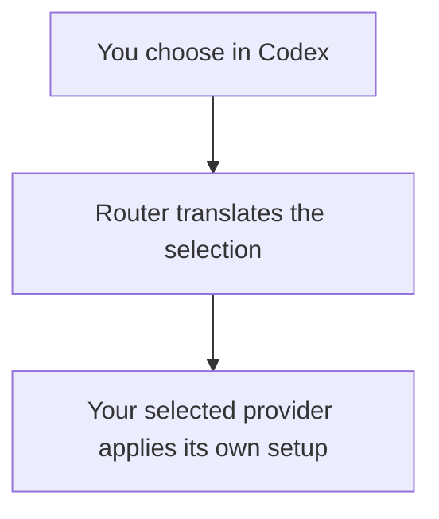

# What can Router deliver?

**This work changes Router only.** It connects existing Codex skills/plugins input to capabilities the selected provider already has. It cannot supply behavior missing from that provider or client.

- **Delivered:** the metadata presentation repair.
- **Router work to build:** catalogue responses and the selected-input bridge.
- **Unsupported in this scope:** Cursor ACP plugin execution on the inspected build; adding arbitrary provider commands to Codex's slash menu.
- **Not yet known:** complete Claude discovery, native selection validation and plugin intent. Qualify the existing route; report unsupported cases if it cannot preserve native behavior.

No provider/ACP-adapter changes, upstream ACP changes or Codex client changes. No new registry, service, cache, scheduler, public API or stored format. [Exact boundaries](delivery-choice.html).

The point of this design is to show what you asked for, where the current path stops, what we would change and how we would prove it. The detailed contracts support that explanation; they are not the starting point.

## Skills: the chooser exists, the provider bridge is missing

Codex already has a `$` chooser and sends structured skill selections. Router currently returns an empty skill list and rejects those selections.

We need to connect the chooser to the selected provider's real skills and carry the selection to native execution. A real Claude ACP experiment dispatched one native skill through ordinary text and preserved the test arguments in its command record. This does not require a new ACP selected-input type for that format. It does not yet prove the real Codex → Router resolver, general mention handling or skill-body argument substitution.

Codex's existing skill list requires real file paths. Qualified filesystem skills can be listed even when the provider also has bundled capabilities. Path-less builtin selections remain unsupported through `$`; genuinely advertised commands remain available separately. An unknown origin cannot be silently labelled builtin to make discovery pass.

## Plugins: showing a package and using it are different

Claude exposes installed plugin paths and enabled state. That gives us a real starting point for discovery. A cold check also confirmed native command enumeration before a user prompt; its records still contain no skill path or origin. Complete discovery, native selection validation and plugin intent remain unqualified. Provider changes are outside scope; failure to qualify an existing route is reported explicitly.

The inspected Cursor ACP path does not wire in Cursor's normal plugin runtime. Router can display information from files, but that alone cannot make Cursor execute the plugin.

## Commands: enumeration is already in ACP

ACP advertises the provider's current command list. Router retains that list, and its text-capable API/CLI can carry command prompts. The follow-up must prove this forwarding and make the list useful.

The inspected Codex client does not add arbitrary provider commands to its slash menu. That is a known client limit, and changing the client is outside this work. The command list and Router invocation surfaces must be shown separately from that unavailable menu experience.

## Metadata: already repaired, preserve it

The original repair keeps metadata out of assistant prose while retaining it as state. Genuine assistant text and meaningful notices remain visible. This behavior must survive the follow-up.

## The intended connection

This is the proposed experience, not a capture of a completed integration. Router owns the middle. Each provider owns its native loading and execution.

## Read only the part you need

- [Requirements](requirements.html): the four things you asked for, broken into short sections.
- [Behavior](specification.html): what success and rejection mean.
- [Design](program-design.html): the proposed connection and the exact implementation detail.
- [Proof](verification-design.html): how a real test will distinguish working behavior from a false success.
- [Boundaries](delivery-choice.html): exactly what Router changes, what each provider owns and what stays unsupported.

The evidence below records bounded native probes. It does not claim the follow-up is implemented. [Exact observations and sources](index.html#evidence--what-was-actually-tested).
