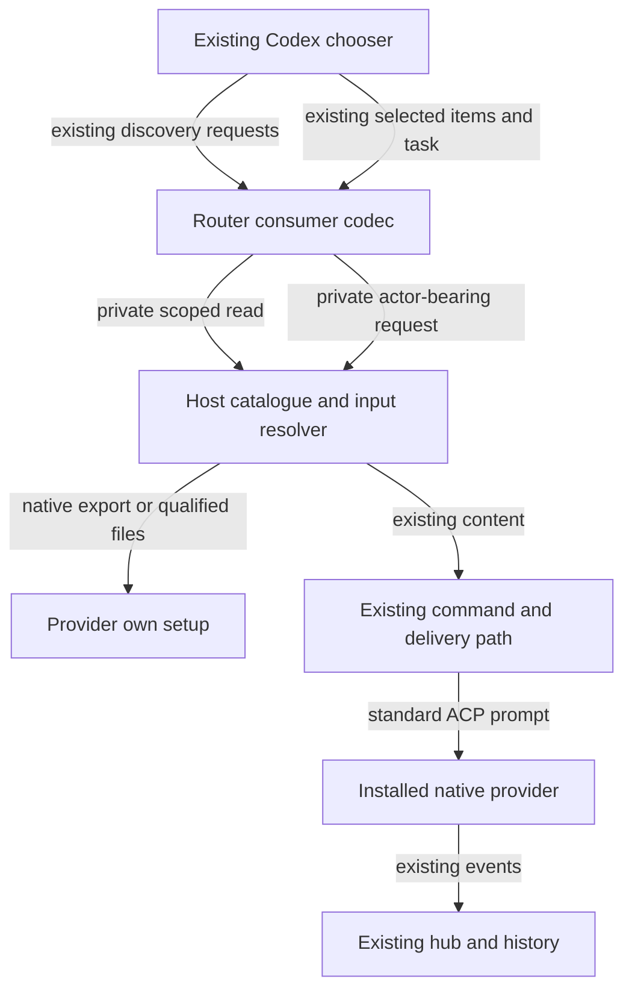
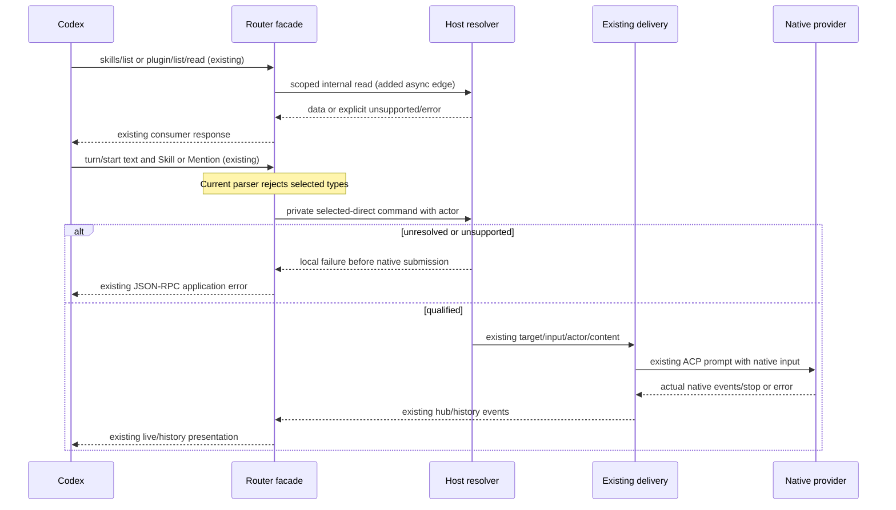
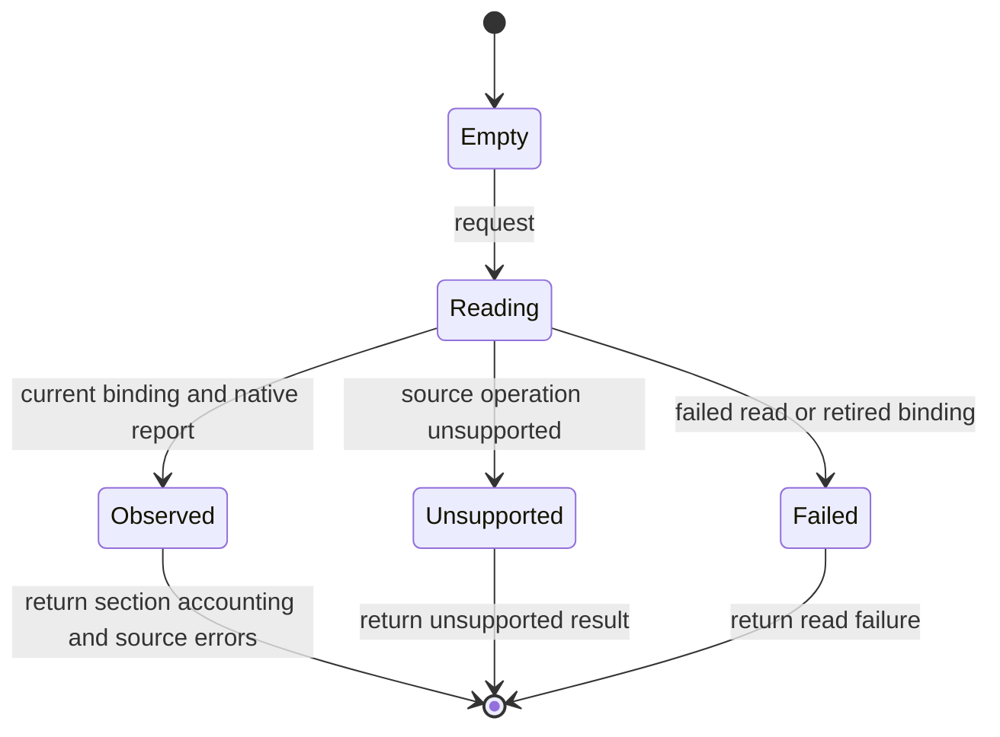

# Connect the existing chooser to native provider behavior

This realizes the [Specification](specification.html) entirely within existing Router/Host owners and existing public contracts. Router reads truthful provider metadata, resolves the submitted selection in the target context, and lowers only qualified input to existing native behavior. The unchanged provider owns loading and execution. No provider, ACP adapter, upstream ACP or Codex client changes belong to this design.

## Composition



The consumer codec owns Codex shapes. The Host owns target/binding/context checks and provider-specific resolution. A native adapter owns source parsing and native input conventions. The facade never scans installations. Catalogue state is a bounded observation, never a second installation registry.

## Entity binding

### E1 Native setup context

| Detail | Meaning |
| --- | --- |
| Owner and home | Host provider supervisor (modified), using existing ProviderBindingIdentity/ProviderBindingId/CodexGeneration in collaboration-protocol |
| Boundary shape | Internal CatalogueScope { endpoint, binding_id, generation, home/workspace or actual loaded Session } |
| Lifetime | Derived from actual launch/binding; never an account or credential fingerprint |

### E2 Capability catalogue

| Detail | Meaning |
| --- | --- |
| Owner and home | Provider-specific read logic in the existing acp-client-runtime and Host owners; no separate cache service |
| Shape home | Native data internal to runtime; read/resolve port DTOs in collaboration-service (new, nonserialized) |
| Lifetime | Request-scoped native observation, bound to actual binding/query; no new Host cache, database or public catalogue RPC |

### E3 Native skill

| Detail | Meaning |
| --- | --- |
| Owner | Provider native loader; reader only observes it |
| Shape | NativeSkillId, name, actual origin, native scope, observed availability, optional display version, optional NativePluginId; qualified native-command mapping only where established |
| Convention | Distinct validated identifier type; display name alone is not identity; version is metadata, not a new pinned-version promise |

### E4 Native plugin

| Detail | Meaning |
| --- | --- |
| Owner | Provider installation/runtime; reader only observes installed/loaded state |
| Shape | Distinct NativePluginId, name, actual origin, optional version, installed-enabled/disabled, loaded-only or unknown state, observed native components |
| Convention | Loaded-only builtins are not relabelled user installations. Actual origin/enablement stay native facts; C4 Codex policy defaults are a separately attributed consumer convention |

### E5 Available command

| Detail | Meaning |
| --- | --- |
| Owner and home | Existing ACP projection and event hub |
| Shape | Existing AvailableCommandsUpdate serialized in Notice.text JSON; decode availableCommands |
| Lifetime | Conversation current-list replacement; aliases/builtin are not supplied by current Claude ACP projection |

### E6 User selection

| Detail | Meaning |
| --- | --- |
| Owner and home | Consumer decoder then Host native-input resolver (modified/new) |
| Shape home | Private SelectedItem::Skill/SelectedItem::Plugin and SelectedPromptCommand DTOs in collaboration-service; no Serde/profile/persisted selection variant |
| Lifetime | Preparation/direct submission only; unsupported selected queue/steer rejected |

### E7 Provider conversation

| Detail | Meaning |
| --- | --- |
| Owner and home | Existing Host runtime/delivery and event hub |
| Shape | Existing SessionRef/InputId/actor-bearing commands, PromptContent and TurnOutcome |
| Lifetime | Existing active/unloaded/closed lifecycle; no new rejected outcome or history store |

### E8 Metadata record

| Detail | Meaning |
| --- | --- |
| Owner and home | Existing runtime projection/hub |
| Shape | Existing SessionItem kind/text and existing metadata recognition |
| Lifetime | Existing loaded-session bounds; pure read/replay never dispatches historical input |

## Internal read and preparation boundaries

```text
CatalogueQuery = Home | Workspace { cwd: AbsolutePath }
  | Loaded { session: SessionRef }
CatalogueView = FilesystemCatalogues | NativeLoaded
CatalogueRead { endpoint: EndpointRef, query: CatalogueQuery,
  view: CatalogueView, refresh_native: bool, actor: Identity }
CatalogueScope { binding: ProviderBindingIdentity, query: CatalogueQuery, view: CatalogueView }
CatalogueResult = Ready { report: CatalogueObservation }
  | Unsupported { reason: CatalogueUnsupported } | Failed { reason: ReadFailure }
CatalogueObservation { scope: CatalogueScope, observed_at: UtcTimestamp,
  skills: CatalogueSection<NativeSkill>, plugins: CatalogueSection<NativePlugin> }
CatalogueSection<T> = Supported { items: Vec<T>, enumeration: SourceEnumeration,
  errors: Vec<CatalogueSourceError> }
  | Unsupported { reason: CatalogueUnsupported }
SourceEnumeration = Accounted
  | Incomplete { limitations: NonEmptyVec<CatalogueLimitation> }
NativeErrorSource = SkillSource { actual_path: AbsolutePath }
  | MarketplaceManifest { actual_path: AbsolutePath }
  | OtherFilesystem { actual_path: AbsolutePath } | Unobserved
CatalogueSourceError { source: NativeErrorSource, reason: ReadFailure }
CatalogueUnsupported = NotAdvertised | NativeOperationMissing | ScopeUnavailable
  | ConsumerCannotRepresent
CatalogueLimitation = PartialNativeExport | SessionOnly | MissingOrigin | MissingScope
  | MissingEnablement | AmbiguousNativeIdentity | ConsumerCannotRepresent
Coverage = Complete | Partial
ReadFailure = Unavailable | AuthenticationRequired | InvalidNativeData | InvalidScope
  | UnsupportedConsumerFilter | NotFound | AmbiguousSelector | Cancelled | TimedOut
NativeSkillId and NativePluginId are distinct validated types.
NativeOrigin = Filesystem { actual_path: AbsolutePath }
  | Bundled { native_key: NonEmptyString } | Other { native_label: NonEmptyString }
NativeScope = User | Workspace | System | Managed | Unknown
NativeAvailability = Available | Disabled | Unavailable | Unknown
NativeSkillLowering = Qualified { canonical_command: NativeCommandName }
  | Unqualified { reason: LoweringUnsupported }
LoweringUnsupported = MissingProvenance | AmbiguousNativeName | UnsupportedInputForm
  | NativeOperationMissing | ConsumerCannotRepresent | ScopeUnqualified
NativeSkill { id: NativeSkillId, name: NonEmptyString, description: String,
  origin: NativeOrigin, native_scope: NativeScope, availability: NativeAvailability,
  display_version: Option<NonEmptyString>, plugin_id: Option<NativePluginId>,
  lowering: NativeSkillLowering }
NativeLoadingState = Loaded | NotLoaded | NotObserved
NativePluginState = InstalledEnabled { loading: NativeLoadingState }
  | InstalledDisabled | LoadedOnly | Unverified
NativeComponentAvailability = Available | Unavailable | NotObserved
NativeNamedComponent { name: NonEmptyString,
  availability: NativeComponentAvailability }
NativeHookEvent = Observed { native_name: NonEmptyString } | NotObserved
NativeHook { native_key: Option<NonEmptyString>, event: NativeHookEvent }
NativeComponentSection<T> = Observed { items: Vec<T>, coverage: Coverage }
  | NotObserved
NativePluginComponents { skills: NativeComponentSection<NativeSkill>,
  commands: NativeComponentSection<NativeNamedComponent>,
  mcp: NativeComponentSection<NativeNamedComponent>,
  hooks: NativeComponentSection<NativeHook>,
  other: NativeComponentSection<NativeNamedComponent> }
NativeMarketplaceSource = Filesystem { manifest_path: AbsolutePath } | NamedCatalog
NativeMarketplaceObservation = Qualified { native_name: NonEmptyString,
  source: NativeMarketplaceSource } | Unobserved
NativePlugin { id: NativePluginId, name: NonEmptyString,
  description: Option<String>, origin: NativeOrigin, state: NativePluginState,
  display_version: Option<NonEmptyString>, marketplace: NativeMarketplaceObservation,
  components: NativePluginComponents,
  installation_policy: NativePolicyObservation,
  authentication_policy: NativePolicyObservation }
NativePolicyObservation = Undeclared | Declared { value: NonEmptyString } | Unobserved
NativeMarketplaceSelector = Filesystem { manifest_path: AbsolutePath }
  | NamedCatalog { native_name: NonEmptyString }
NativePluginSelector { marketplace: NativeMarketplaceSelector, plugin_name: NonEmptyString }
NativePluginRead { endpoint: EndpointRef, selector: NativePluginSelector, actor: Identity }
NativePluginReadResult = Ready { scope: CatalogueScope, plugin: NativePlugin }
  | Unsupported { reason: CatalogueUnsupported } | Failed { reason: ReadFailure }
SelectedItem = Skill { submitted_name: NonEmptyString, submitted_path: AbsolutePath }
  | Plugin { submitted_name: NonEmptyString, submitted_id: NativePluginId }
SelectedPromptCommand { target: SessionRef, input_id: InputId,
  actor: Identity, content: Vec<PromptContent>, selections: Vec<SelectedItem> }
Preparation = Ready { content: Vec<existing PromptContent> }
  | Rejected { reason: SelectionFailure }
SelectionFailure = WrongContext | Disabled | Unresolved | Ambiguous | UnsupportedForm
```

These are private data shapes for the existing owners, not a new capability framework, public JSON-RPC or stored format. They do not flow through the profile codec. Extend the existing SessionCommandPort only as needed to prepare selected direct input while carrying all existing target/input/actor fields. Host preparation produces existing content and then uses the existing prompt/delivery path. Ordinary input stays on the current path.

Catalogue requests move out of the current synchronous stub into async dispatch with a read port in RouterSessionAppServerContext. Native exports are preferred; a provider-own-file reader must declare supported versions/formats and qualify precedence, aliases, scope and enablement. It must use the actual binding's executable/config environment, not an arbitrary global CLI on PATH. The default-home SDK probe does not qualify a Host's isolated binding.

## Existing consumer requests

### Skill discovery

`skills/list {cwds,forceReload}` maps each cwd to a workspace observation. Empty cwds resolves the bound context's actual cwd or fails InvalidScope; it does not mean home. forceReload requests native refresh. Return truthful existing SkillMetadata records and existing supported error behavior. A command name alone is not a filesystem skill.

Consumer discovery requests the private FilesystemCatalogues view. Its skill membership is actual native skill-file origins in that setup, not every name in SDK loaded metadata. The native reader must establish the source/coverage: known bundled origins are excluded as outside this view, while unresolved origin/membership or a failed in-view filesystem read remains a limitation/error. Never infer bundled status from a missing exported path. A mixed Claude observation with qualified files plus confirmed bundled skills yields the file-backed list. A truly empty filesystem view yields an empty list; neither result asserts a complete full native inventory. NativeLoaded observations are separate and cannot satisfy filesystem completeness by themselves. This private view argument introduces no wire tag, state store or runtime service.

### Plugin discovery and details

`plugin/list {cwds?,forceRefetch,marketplaceKinds?}` maps omitted/empty cwd to home scope and explicit cwd to workspace scope. Retain the native versus installed distinction. The facade's existing-wire codec parses the five marketplace-kind values; apply only a qualified mapping or reject UnsupportedConsumerFilter. Do not infer kinds/policies from a cache path.

The same FilesystemCatalogues view includes installed native filesystem packages, not `path:"builtin"` loaded-only plugin records. Missing or unobserved installation/origin is not classified as a confirmed builtin. Known builtin exclusions stay in the documented support limits; provider-advertised commands remain on the existing command observation surface.

`plugin/read {marketplacePath?,remoteMarketplaceName?,pluginName}` resolves the exact selector returned on this connection/provider. Return the unique record, NotFound or AmbiguousSelector. Never read an arbitrary supplied path or guess the first cwd.

The native reader owns marketplace identity and source observations. It may qualify them from that binding's existing native export, registry or actual marketplace manifest; the codec never parses an opaque NativePluginId or infers a marketplace from an installation-cache directory. A qualified filesystem source names the actual marketplace manifest file, not a synthesized directory or plugin package path. A named catalogue has no invented filesystem path and is projected only when its existing consumer meaning is qualified. An unobserved source cannot produce a positive marketplace row or selector.

Native filesystem packages do not acquire Codex backend remote identities: `remotePluginId` and `shareContext` remain null. In Codex0.163, a path-less marketplace row without those identities has no detail-navigation route. Record named-catalogue details as unavailable in that client; do not invent a remote identity or filesystem manifest path to unlock them. Direct existing `plugin/read` requests still obey the qualified selector/context rule below.

The facade decodes the existing selector into NativePluginRead. The Host matches it against freshly qualified native sources of the actual endpoint/binding before opening any requested path. It resolves the actual setup context from those native facts or an already-established session context; when the request/source cannot identify that context uniquely, return ScopeUnavailable or AmbiguousSelector. Do not add a connection selector registry, catalogue cache or guessed cwd to make the request succeed. The native reader supplies the qualified facts; the facade alone constructs the Codex response.

CatalogueUnsupported and CatalogueLimitation are translated deterministically into the existing consumer method’s supported error/partial behavior. NotAdvertised/NativeOperationMissing stay unsupported; read timeouts stay failures. Required Codex marketplace/install/auth fields that have no truthful native equivalent remain a projection qualification gap (D2). Use the existing method's supported error channel; do not silently return complete-empty data, forge paths/policies or create a new public API merely to avoid deciding the mapping.

The provider reader distinguishes undeclared native policy from unobserved policy. Only the codec applies Codex0.163's existing undeclared defaults: installation `AVAILABLE`, authentication `ON_INSTALL`. It attributes them as Codex display defaults in existing plugin description/detail text; the native reader never reports them as native facts. An explicit native value maps only after semantic qualification. An unknown or unrepresentable value fails through the existing method error. Never manufacture `INSTALLED_BY_DEFAULT`, `DISABLED_BY_ADMIN` or native install/auth restrictions. Native `installed`, `enabled`, origin and scope require actual observations.

Read the actual plugin manifest/components before returning detail arrays. In particular, an export missing hooks is unknown, not an empty hook list. Native plugins have no Codex apps unless a source establishes otherwise; no foreign Codex inventory is imported. All installation/removal/enablement/config-write requests stay unsupported with an explicit existing RPC error, even if the unchanged Codex UI offers management controls. No mutation is dispatched.

Every component kind has its own observation section. Observed with Complete coverage and an empty vector establishes a known-empty kind; NotObserved and Partial do not. Do not use the absence of a Hook item in a flat vector to assert no hooks. A summary may state a fact its observations establish, but an unobserved or partial kind cannot become a complete detail array or a false absence flag. Use the existing truthful error behavior when the required consumer field cannot express that distinction.

The skill section carries complete observed NativeSkill records, not names alone. The codec projects each SkillSummary description and enabled value from that record's native description and availability: Available maps to true, Disabled to false, and Unavailable or Unknown is unrepresentable. A missing description is not filled with invented prose. Optional path/interface fields remain absent when not established; a foreign Codex skill is never joined by name. The reader must establish that each record belongs to this native plugin and setup.

Each hook carries its native key and observed native event. Only the facade codec maps a qualified native event to the existing closed Codex0.163 HookEventName enum, after checking the events have the same meaning. Similar spelling is insufficient. An unobserved key/event or an unmappable native event makes the required PluginHookSummary unrepresentable and returns the existing plugin/read error; no synthetic key, generic event or dropped hook is used. Apply the same required-field rule to every detail item, as well as section coverage: a missing or unrepresentable required fact fails the method instead of becoming a default or an omitted item. MCP names come from the observed native declaration; this read never starts a server. No new component execution or remote identity contract is introduced.

`SkillErrorInfo.path` and `MarketplaceLoadErrorInfo.marketplacePath` require truthful paths. A path-less entry is never assigned `builtin` or a placeholder path. If a real source path and supported partial-error response cannot report the incomplete result, return a whole-method application error naming the unrepresentable category/count. Do the same for an all-unrepresentable result. Do not silently omit entries into a complete-looking success. This uses current errors and loses that response's usable subset; it adds no partial-result wire type. Loaded-only builtins remain distinct from installed filesystem packages.

The private section carries source errors rather than flattening them to enum-only limitations. SourceEnumeration describes membership accounting, not successful data: Accounted means every in-view candidate is represented by an item or an error; any errors still make the native data partial. Incomplete means membership or omitted candidates remain unresolved and requires the whole-method error, even when some located failures are known. Its nonempty limitations explain that one section's incomplete accounting; there is no observation-global limitations list and no second completeness flag. A known candidate's missing required fact belongs in that candidate's error, not a conflicting global flag. These states do not share the component-section Coverage type.

For an Accounted section with at least one usable in-view item, the facade may return those items plus the existing method's per-entry errors only when every failed item has a relevant typed source. The native reader qualifies and tags that provenance: SkillSource names the actual native skill source, MarketplaceManifest names the actual marketplace manifest, and OtherFilesystem preserves a truthfully observed path that fits neither role. The facade performs a closed match: skills/list accepts only SkillSource errors and plugin/list accepts only MarketplaceManifest errors. It does not scan installations to reclassify a path. A generic package directory, executable path, unrelated real path, wrong-role source or Unobserved source cannot fill either field. One unlocated/unrepresentable failure forces the existing whole-method error; it cannot be hidden behind another located error. An all-unrepresentable section also fails the method. A known-empty Accounted section with no errors remains empty success. This adds private source-error facts to the existing read port, with no wire tag, store or new owner.

Each consumer method considers only its own section. Incomplete plugin accounting cannot fail an Accounted skill section, and incomplete skill accounting cannot fail an Accounted plugin section. Unsupported sections remain independent too. The reader must place every issue in the section it affects; an issue affecting both is represented in both sections rather than a shared flag.

The following cases are the complete catalogue-to-consumer decision boundary. Context/binding validation precedes all cases.

| Native section case | Existing consumer result |
| --- | --- |
| Unsupported operation | Explicit method error; never empty success |
| Accounted, no items, no errors | Known-empty filesystem view |
| Accounted, usable items, no errors | Those native rows |
| Accounted, usable items, every error has the matching source role | Rows plus truthful existing per-entry errors; partial data |
| Accounted, any wrong-role, OtherFilesystem or Unobserved error | Whole-method error, even beside a valid located error |
| Accounted, no usable in-view items and any unrepresentable item/error | Whole-method error; no apparently empty success |
| Incomplete, with or without located errors/items | Whole-method error with that section's limitation category/count |
| Another section is incomplete or unsupported | No effect on this method's independently Accounted section |

Apply that error rule only after view membership is established. Confirmed bundled entries do not poison FilesystemCatalogues; unrepresentable or unresolved in-view entries do. Do not attach a native executable path merely to satisfy a skill/marketplace error field: that would misidentify its origin. Known bundled skills remain unsupported as filesystem selections, not deleted from a claimed full native view.

## Qualified native skill input

For a source-qualified filesystem skill, the Host can resolve the submitted name/path to a canonical native command and produce existing Text. It must check the actual target provider/context, not just the display name. Native invocation performs skill expansion; Router does not copy the skill body as a substitute.

The bounded experiment used one leading `$native-selection` reference and produced `/router-owned-native-plugin:native-selection` plus its arguments through standard ACP text. Native command-name/args matched literal-dollar, UTF8 and newline data, and the owned skill returned its independent marker. This proves the native text format only: the probe hard-coded the known fixture and did not exercise a real catalogue resolver, Codex or Router.

A later [native argument-dependent control](index.html#evidence--native-argument-dependent-behavior) establishes one fresh-session body-specific effect with those character classes. Its repeated case and prose control share history, and raw literal body expansion was not emitted. This advances native feasibility only; the actual Codex selection, resolver and argument-sensitive candidate journey remain required.

Before the real route is qualified, permanent tests and the installed-client journey must establish exact mention/argument extraction, path/context resolution and native effect. Do not strip arbitrary dollar tokens or concatenate several slash commands. Reject every unsupported combination/form as a whole. Plugin intent is a separate native qualification, not implied by one skill call.

Codex0.163 sends unchanged task text plus deduplicated `Skill{name,path}` or `Mention{name,path}` items. A skill may also originate from typed matching text. Neither selected item carries a token position. `text_elements` contains UI ranges/placeholders and is not evidence of which range belongs to a selection. The actual picker token and spans still need captured-client qualification.

The initial admissible skill form is deliberately narrow: exactly one Text item and one Skill, no Mention or attachment; name and path both match one currently available native skill in the actual binding/workspace. Text begins with the exact `$<name>` token followed by whitespace or end. A second occurrence of that token or another listed-skill token is rejected. Remove only that leading token, preserve the remaining task/argument characters, and prefix the qualified canonical native command. No arbitrary dollar stripping or token reordering. Non-leading/missing tokens, mismatched/foreign paths, disabled/unresolved skills, multiple/mixed selections and selected queue/steer fail explicitly. Plugin Mention is rejected until its separate existing native intent route is qualified. This rule defines the candidate to test, not a claim that client/resolver/native argument application already passed.

## Current and proposed calls



Source anchors: [consumer parser](../../../crates/collaboration-service/src/router_session_app_server_methods.rs), [actor-bearing command port](../../../crates/collaboration-service/src/session_command_port.rs), [Host prompt path](../../../crates/codex-router-host/src/provider_session_command_port.rs), [Host-internal admission](../../../crates/codex-router-host/src/provider_acp_delivery_route/provider_content_commands.rs), [runtime busy guard](../../../crates/acp-client-runtime/src/agent_session_client/provider_approval_dispatch.rs). This is a proposed call path, not runtime integration proof.

## Busy, queue, steer and native failure

Selected queue/steer is unsupported until separately qualified. The facade must reject it before calling those paths and must not use the current PromptRequired-to-new-prompt fallback. The selected direct operation uses existing per-session admission: provider_approval_dispatch checks/inserts the active approval context under its mutex and returns LocalBusy for an active prompt. The direct path does not call queue_add. Required tests must preserve that no-auto-queue behavior under competing input.

Known resolution failures use existing RPC errors and preserve actor checks. Native RPC error/refusal/transport loss after submission keeps its actual meaning. Existing Ended{Refusal} is not a before-model receipt; Lost has no confirmed end reason. Do not coerce either or add a rejected outcome without a demonstrated contract requirement. Unknown effect is not automatically retried.

## State and trust



Keep observations request-scoped and use only already-existing native caches where their semantics qualify. Cancellable reads do not hold a hub/store lock across native I/O; discard retired-binding results. No new Host catalogue cache or background refresh mechanism. Preparation checks target scope and availability without inventing native atomic snapshots or version locks. No registry, durable state, scheduler, daemon, retry system, global configuration write or installation management is introduced.

Pure loaded-history display uses the existing hub and retained native command/user items. Provider replay reconstructs `/name args` for display and may trim whitespace; it does not run it. Explicit unloaded resume keeps its existing load behavior. Metadata and genuine output remain on the merged repair's owners.

## Native routes and delivery candidates

- **Claude skills:** native single-skill slash dispatch and bounded argument-format evidence exist. Full native catalogue resolution, general mention forms, negative/stale cases and candidate CLI integration remain unqualified.
- **Claude plugins:** native CLI export supplies installation paths/enablement; one published skill path was resolved. Complete plugin intent and native component effects need their own qualification. Cold SDK returns names/descriptions/hints/aliases/builtin, not a complete registry.
- **Cursor commands/workspace skills:** standard command advertisement/native dispatch exists. Scope and filesystem mapping need version/cwd qualification; process workspace and session cwd must not be confused.
- **Cursor plugins:** the inspected ACP path omits the normal plugin runtime. Execution remains unsupported here; changing that provider/adapter is outside scope.
- **Other ACP providers:** qualify their actual native source/input conventions or report unsupported. Wire1 is not a universal plugin registry.

The owner's Router-only scope is binding. A gap requiring provider/client/protocol work is reported, not turned into an external dependency to implement. The requested skills/plugins/commands experiences retain separate supported, unsupported or unqualified status. Do not call an unsupported experience complete or add execution emulation to disguise the gap.

## Trigger and command surfaces

The reference launcher uses per-invocation `features.mentions_v2=false` to put both selectors under `$`, making `@` file-only for that invocation. The caller/client launcher owns it; Router has no current provider-socket Codex launch path and does not edit global config.

Existing authorized events observe exposes retained command-catalogue Notice.text JSON `availableCommands`; conversation prompt can carry native slash text. Prove actual Router forwarding separately from Codex's local picker limit. Adding arbitrary provider commands to Codex's menu requires a client change and is outside this Router-only work.

## Requirement realization and proof seams

### skills — R1

| Detail | Meaning |
| --- | --- |
| U / E | U1,U2,U3 / E1–E4 |
| Owner / interface | Host scoped read port/native reader |
| Shape / state | Request-scoped observation maps to existing skills/plugin responses; no new Host cache |
| Failure | Explicit unsupported/partial/error; no invented fields or complete-empty success |
| Proof seam | Native own setup/cwd/paths/enablement versus actual consumer response |

### skills — R2

| Detail | Meaning |
| --- | --- |
| U / E | U2 / E3,E6,E7 |
| Owner / interface | Private selected-direct resolver then existing prompt/delivery |
| Shape / state | Submitted name/path resolves to native identity before existing Text; no body copy |
| Failure | Unresolvable/ambiguous input rejected; ordinary prose unaffected |
| Proof seam | Installed Codex selection through candidate to actual native effect and argument-sensitive fixture |

### plugins — R3

| Detail | Meaning |
| --- | --- |
| U / E | U3 / E4,E6,E7 |
| Owner / interface | Native plugin context plus Host preparation |
| Shape / state | Actual installed/enabled identity and qualified per-input intent |
| Failure | No echoed-label success or implication from single-skill evidence |
| Proof seam | Actual native association and separately requested skill/MCP/hook effects where promised |

### commands — R4

| Detail | Meaning |
| --- | --- |
| U / E | U4 / E5,E7 |
| Owner / interface | Existing ACP projection/hub and text prompt |
| Shape / state | Current-list replacement and retained command metadata |
| Failure | Router invocation failure distinct from local Codex picker refusal |
| Proof seam | Enumerate actual replacement list, then real Router→provider name/args effect |

### plugins — R5

| Detail | Meaning |
| --- | --- |
| U / E | U2,U3 / E3,E4,E6 |
| Owner / interface | Caller/client launcher |
| Shape / state | Existing per-run mentions_v2=false; no global change |
| Failure | No claim about arbitrary launches lacking override |
| Proof seam | Actual installed chooser/submitted identity, file-only@ consequence and unchanged config |

### skills — R6

| Detail | Meaning |
| --- | --- |
| U / E | U1,U2,U3 / E1,E3,E4,E6,E7 |
| Owner / interface | Host context/availability preparation and existing runtime admission |
| Shape / state | Existing actor/input/target; selected queue/steer rejected until qualified |
| Failure | Known invalid input sends nothing; LocalBusy prevents auto-queue; later native certainty is not invented |
| Proof seam | Wrong path/context/disabled/unsupported sets produce0native calls; competing direct input remainsBusy; native failure/unknown controls |

### metadata — R7

| Detail | Meaning |
| --- | --- |
| U / E | U5 / E2,E7,E8 |
| Owner / interface | Existing metadata observation, discovery responses and pure history |
| Shape / state | Existing SessionItem/PromptContent/TurnOutcome; native canonical command display |
| Failure | Retention bounds explicit; no historical discovery/prompt/tool execution |
| Proof seam | Payload identity plus unchanged real-delegate operation counts on pure loaded-history display |

### metadata — R8

| Detail | Meaning |
| --- | --- |
| U / E | U5 / E7,E8 |
| Owner / interface | Existing translation/forwarding |
| Shape / state | Existing genuine transcript items |
| Failure | No broadNotice hiding or metadata-looking prose suppression |
| Proof seam | Genuine text/reasoning/tools/plans/notices and metadata-looking prose remain visible |

### delivery — R9

| Detail | Meaning |
| --- | --- |
| U / E | U6,U7 / E1,E7 |
| Owner / interface | Existing owned-runtime qualification and lasting project verifier |
| Shape / state | Exact installed binaries/candidate/source/signature identities |
| Failure | Fixture-only/launch-only/static-only claims fail; protected resources unchanged |
| Proof seam | Installed Codex→isolated candidate→real provider, permanent red/green regressions and owned cleanup |

### delivery — R10

| Detail | Meaning |
| --- | --- |
| U / E | U8 / E1–E8 |
| Owner / interface | Author/preparation and actual reader observation |
| Shape / state | Separate source-backed Pages and small capability views |
| Failure | Home-only/hidden navigation, rawMarkdown jumps and giant-table primary path fail |
| Proof seam | Every Pages/body link and capability section/diagram at desktop/390px plus source freshness |

Replay counters live only in permanent test seams or the existing project verification harness, never in shipped Router runtime or a new observer service. They observe actual native operation entry points (read/create/load/prompt/steer), delegate unchanged when a real provider is used, and retain only operation/input identity. Focused tests may count a test dependency, but those counts never become real-provider proof. The installed journey uses existing native/runtime observations; any unavailable real-path count remains explicitly unverified rather than inferred from a test counter. Pure loaded-history display leaves observed counts unchanged; explicit unloaded resume permits its existing load, never a replayed prompt. Native plugin-intent proof uses existing native context/controlled-fixture observations, not an outgoing metadata echo. No provider patch, runtime hook, daemon or public state format is added for proof.
