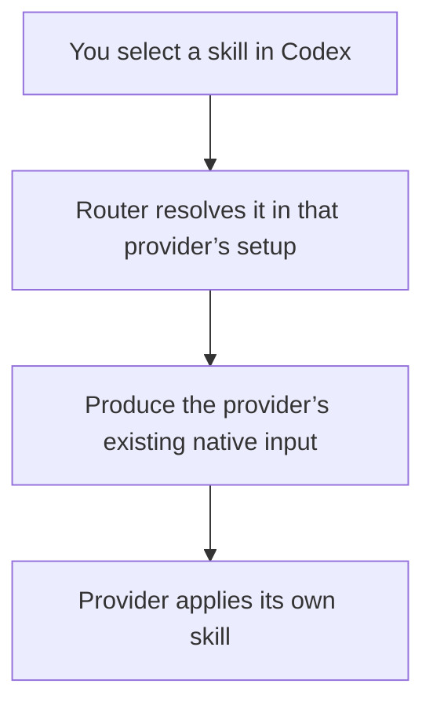

# How the connection works

Use the existing Codex chooser and existing native input conventions where qualification shows they work. The Host resolves the selected provider’s real identity before forwarding the task.

Direct installed-Claude probes show an existing native skill input format and one fresh-session skill effect that uses dollar, Unicode and newline arguments. A random marker present only in the skill file appeared with the argument value. Literal model-bound template expansion was not exposed. Codex and Router's resolver remain untested by these probes. [Exact native evidence and limits](index.html#evidence--native-argument-dependent-behavior).

The first skill candidate accepts one leading `$name` selection and preserves its remaining task text. Other selection forms fail explicitly until qualified. Plugin discovery and plugin selection are separate: listing an installed package does not establish a working plugin mention.

The existing Codex lists require real filesystem origins. Confirmed bundled skills and loaded-only builtin plugins sit outside those lists; their presence does not break discovery of installed filesystem capabilities. Path-less selections remain unsupported here, and provider-advertised commands stay on the command surface. Unknown origin cannot be silently treated as a builtin.

## What each side owns

- **Codex:** show choices and send the chosen name/path or plugin identity with your task.
- **Router:** read truthful provider metadata, validate the target/context, reject unsupported forms and translate qualified input.
- **Provider:** load its own skills/plugins and execute native behavior.

Only the existing Router/Host discovery and translation owners change. No new runtime service, registry, cache, scheduler, public RPC or stored selection type. Exact native mapping, general mention/argument parsing and failure cases still need permanent tests and the real installed-client journey. Selected queue/steer is unsupported until separately qualified.

Provider/ACP-adapter changes, upstream ACP changes and Codex client changes are outside scope. Cursor’s inspected ACP plugin execution is unsupported here. Complete Claude discovery and plugin intent remain unqualified; qualify their existing native capabilities or report the unsupported case. Router does not implement the provider's missing runtime.
