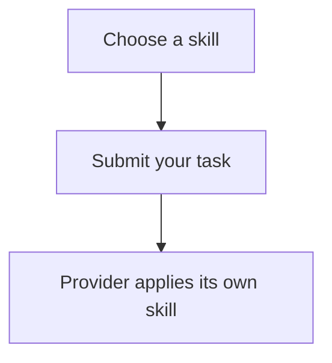
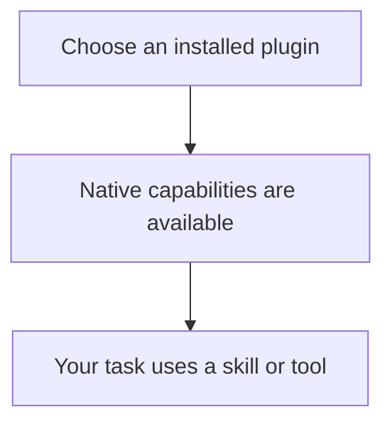
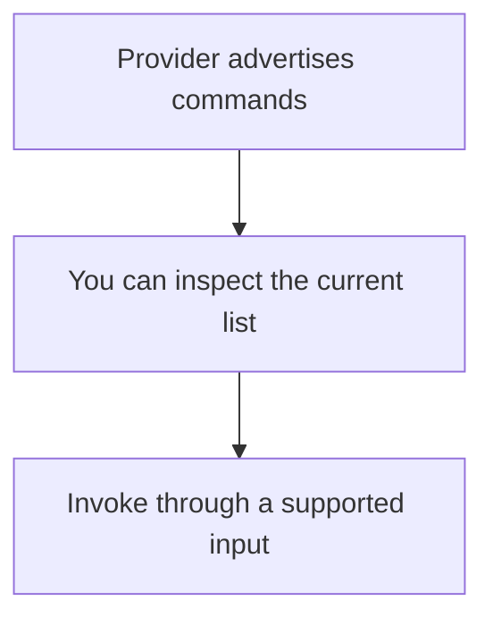
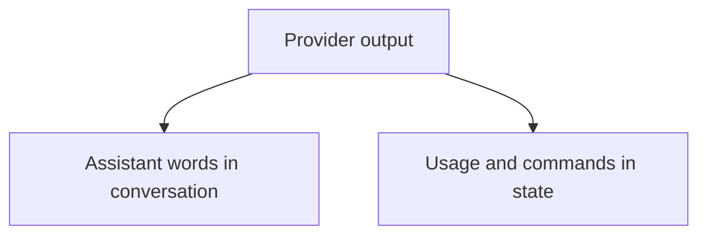
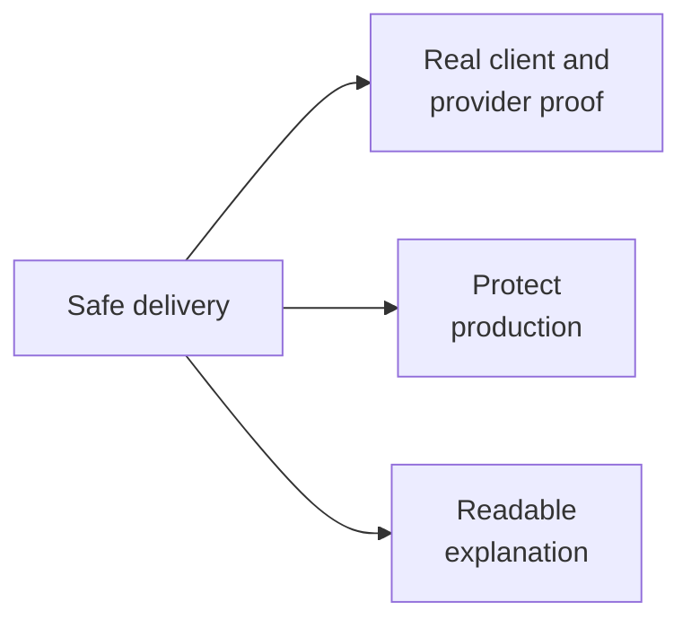

# What you asked Router to do

You want to open Codex, choose Claude, Cursor or another ACP provider, and use **that provider's own setup**. You should be able to find its skills, find its plugins and see its commands.

These are four product capabilities. A command list does not prove that plugins work. Showing a plugin's name does not prove that the provider can use it. The shared delivery requirements below cover proof, production safety and this reader; they add no product mechanism.

## Capabilities and authorized needs

### Use the selected provider's own setup — U1

Home: skills. Also serves plugins and commands.

**Why:** choosing Claude should give you Claude's capabilities; choosing Cursor should give you Cursor's capabilities. Codex's own installed inventory is not a substitute.

- Use the selected provider's installation and effective workspace/setup.
- Keep native loading and execution with that provider.
- U1 does not rule out reading the provider's own files. Whether to use that discovery approach is a Program Design choice; it still needs version and workspace qualification.

Owner: “Use each provider’s own installation”; “yes every ahrness shodul use the providers own setup”. Authority: authorized.

### Skills: choose an instruction and have the provider use it — U2

**The experience:** choose a provider skill with `$`, submit your task, and have that same native skill applied to the task.

Finding a skill, selecting it and applying it are separate steps. The requested experience needs all three.

Owner: “skills with $ not working fix that too”; “$ works in cli already tho”. Authority: authorized. [Skill behavior and proof](specification.html#specification--r2).

### Plugins: find an installed package and use its capabilities — U3

**The experience:** find the selected provider's installed plugins with `$`, select one, and use its native capabilities in your task.

The plugin can supply skills, tools or hooks. A plugin's name appearing in a list is discovery only. Its native components must remain native when a promised task uses them. Selecting it does not itself request running every component.

Owner: “lets do the other feustsr liek plugisn and skills i want to see it”; “$ is skills and plugins”. Authority: authorized. [Plugin behavior and proof](specification.html#specification--r3).

### Commands: see what the provider offers — U4

**The experience:** enumerate the provider's `/` commands and understand where they can be invoked.

Standard ACP already advertises this list. The inspected Codex slash menu does not list arbitrary provider commands. This Router-only work must show the current list and supported invocation surfaces honestly; adding commands to that client menu is outside scope.

Owner: “/ is their commmands for provider is there a way to enuermatio them?”; “if acp stand dosnt work then lets talk about it”. Authority: authorized. [Command contract](specification.html#specification--observable-contracts).

### Metadata: keep useful state out of the assistant's words — U5

**The experience:** see genuine assistant output when reading or reopening the conversation, while usage and command metadata remain available as state.

Preserve genuine text, reasoning, tools, plans and meaningful notices. The original metadata repair is already delivered; the follow-up must preserve it, including historical display.

Owner: original [assignment](../../../tmp/2026-10-22-acp-metadata-presentation/assignment.md), outcomes1–3. Authority: authorized; preservation of the merged repair.

## User journey

Choose the provider and workspace → find a native skill or plugin → select it → submit your task → observe the native effect → reopen the conversation without executing the selection again.

Today Router returns no skills, has no plugin methods and rejects those structured selections. [Current input owner](../../../crates/collaboration-service/src/router_session_app_server_methods.rs). The metadata presentation defect has already been repaired. [Current observations](index.html).

## Proof, safety and a readable explanation

These requirements have the shared **delivery** home and also serve skills, plugins, commands and metadata. Their sources are the owner's requested proof, production boundaries and readable HTML; this is a home for existing delivery conditions, not a fifth product feature.

### Prove the actual experience — U6

Home: delivery. Also serves all four product capabilities.

Use installed Codex and native providers through an isolated candidate Router/Host. Keep permanent regressions and exact observations. A direct provider probe, fixture or successful launch does not establish the complete Codex experience.

Owner: original assignment outcomes3–6; “Show you tested it”. Authority: authorized.

### Protect production and other work — U7

Home: delivery. Also serves all four product capabilities.

Keep normal Codex home, separate debug roots/profile/socket, and operate only owned resources. Do not replace production or alter parallel lanes.

Owner: original assignment Limits and repository AGENTS.md. Authority: authorized.

### Make the design understandable — U8

Home: delivery. Also serves all four product capabilities.

Give the owner a local HTML reader with obvious navigation, short explanations and separately identifiable Requirements, Specification, Program Design and Verification Design. Break the needs into skills, plugins, commands and metadata. Keep planned proof distinct from observed results.

Owner: explicit presentation-html/orchestrator-design requests; “break up teh fuckign user requriemts”; “i dotn need giant fuckign tables”. Authority: authorized.

U1–U8 retain the requested experiences. The scope boundary below governs what this work may implement. A provider/version that cannot supply an experience stays explicitly unsupported or unqualified; it is not counted as a successful implementation of that experience.

## Boundaries

**Router-only adaptation.** Change the existing Router/Host discovery, selected-input translation and metadata/history paths. Read the selected provider's existing exports or qualified own files, preserve its real identity and scope, and send only input that its unchanged native runtime supports.

**Outside this work:** provider/ACP-adapter changes, upstream ACP changes/extensions, Codex client changes, new public contracts or persisted formats, and extra runtime machinery. No registry, new cache, scheduler, daemon, plugin manager or replacement execution engine. Each provider owns installation, enablement, loading, hooks, tools and execution. Do not change installed setup or global settings. Production and parallel lanes remain protected.

The owner's later scope correction excludes machinery, provider changes and upstream ACP changes, and asks for clear boundaries. This supersedes earlier conditional proposals for external interfaces or client integration.

The inspected Cursor ACP plugin runtime gap is outside this work; plugin execution there remains unsupported. Claude discovery, exact selection resolution and plugin intent still need qualification using existing capabilities. If that fails, report the precise unsupported case instead of expanding scope. [Delivery boundaries and remaining qualification](specification.html#specification--delivery-boundaries-and-remaining-qualification).

UI gap: no capture of the proposed provider-backed chooser exists. Any illustration explains the intended experience; it is not execution proof.

## Read the design

[Observable behavior](specification.html) → [how Router connects it](program-design.html) → [how we will test it](verification-design.html). Each has its own HTML page in the reader's Pages menu.
