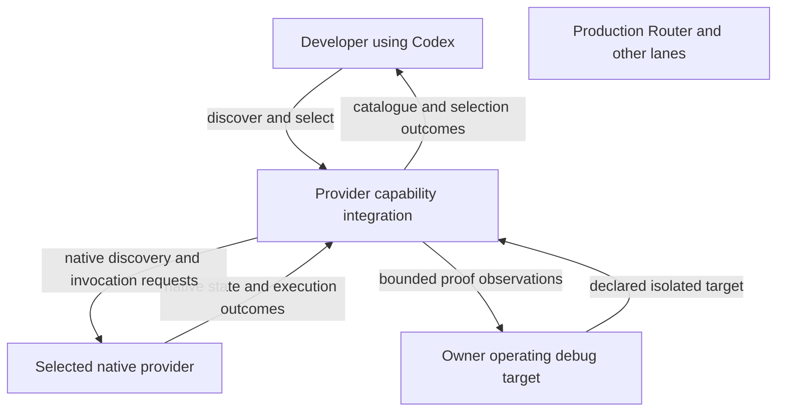

# What must be true

Discovery tells you what is available. Selection asks the native provider to use a particular capability. Conversation display must keep metadata separate from the assistant’s words.

Read the exact skill, plugin, command and metadata obligations below when checking an implementation. Unsupported selections fail explicitly; they are not silently dropped.

Only Router/Host adaptation is in scope. Codex, providers, ACP adapters and upstream ACP remain unchanged. A feature their existing contracts cannot supply is reported as unsupported; no replacement runtime or new protocol is introduced.

## Who interacts with the integration

The integration is opaque in this view. Production and unrelated lanes have no mutation edge.
