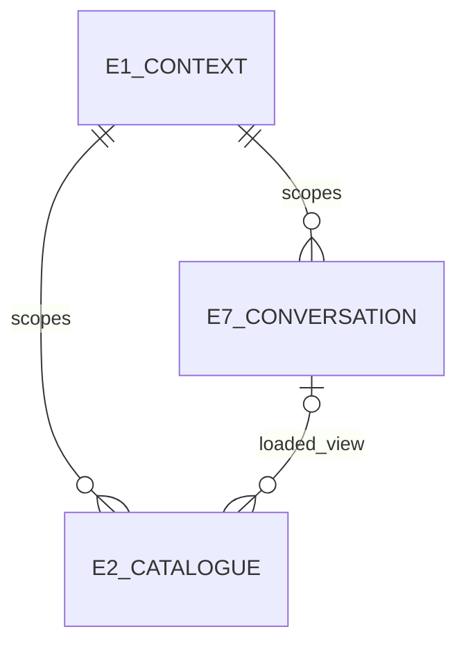
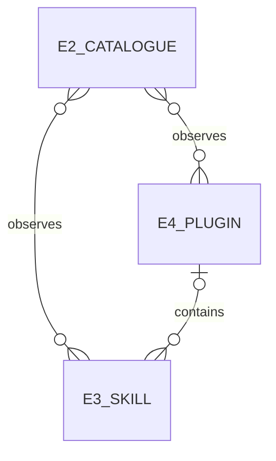
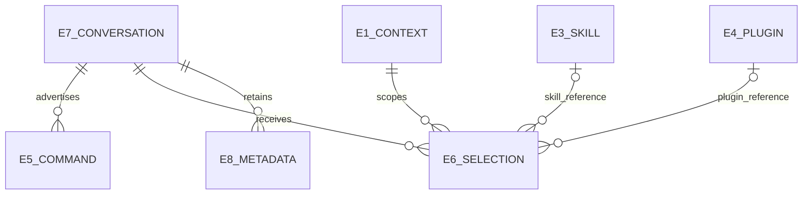

# What discovery and selection must mean

The [Requirements](requirements.html) authorize skills, plugins, commands and metadata as separate capabilities. This contract preserves those outcomes while identifying behavior today's providers or consumer cannot yet supply.

## Capability map

- **skills:** R1 native catalogue, R2 native skill selection, R6 valid scope. R1 also serves plugins and commands.
- **plugins:** R3 native plugin selection, R5 requested trigger. R5 also serves skills.
- **commands:** R4 current command enumeration and explicit consumer limits.
- **metadata:** R7 retained state and replay, R8 ordinary output. R7–R8 also serve skills, plugins and commands.
- **delivery:** R9 isolated proof and protected resources, R10 inspectable design. These shared delivery conditions also serve all four product capabilities; they introduce no product feature.

## Context

[Read the context view](specification.html).

## Entities

### E1 Native setup context

| Detail | Meaning |
| --- | --- |
| Identity rule | Same selected provider and effective home/workspace/profile scope; a different provider or workspace is a different context. |
| Relationships and invariant | Has 0..many E2; never borrows another provider's setup. |
| Observable states and basis | Available or unavailable; effective configuration may change. U1, U7. |

### E2 Capability catalogue

| Detail | Meaning |
| --- | --- |
| Identity rule | One native observation for one E1 and view; a loaded view also identifies exactly one E7. Refresh is a new observation of that same scope. |
| Relationships and invariant | Observes 0..many E3/E4; the same capability may occur in many observations. A loaded view belongs to one E7; installed views do not. E5 is a separate conversation-scoped list. Completeness and unknown state remain explicit. |
| Observable states and basis | Complete, partial, unsupported, failed. U1–U4. |

Completeness always names a view. The existing consumer skill list represents native filesystem skills in the requested setup that have actual skill-file origins; the consumer plugin list represents installed native filesystem packages. Neither is the full native loaded inventory. Known bundled/path-less native skills and loaded-only builtin plugins remain native capabilities, outside these filesystem views. Their exclusion does not make a filesystem view incomplete and does not grant support for selecting them through `$`. Missing or unknown origin is not evidence of a bundled origin: unresolved in-view membership or failed filesystem discovery makes the view incomplete. A native loaded view retains its own broader, possibly partial meaning.

### E3 Native skill

| Detail | Meaning |
| --- | --- |
| Identity rule | Provider-native identity within E1; equal display names alone do not establish equality. |
| Relationships and invariant | May belong to 0..1 E4; has an actual origin, which need not be a file. |
| Observable states and basis | Available, disabled, unavailable or unknown as reported by its native owner. U1, U2. |

### E4 Native plugin

| Detail | Meaning |
| --- | --- |
| Identity rule | Provider-native package identity within E1, including actual origin; display name alone is insufficient. Installation is observed state, not a claim inferred merely from loaded metadata. |
| Relationships and invariant | Contains 0..many E3 and native components. Installed state is distinct from loaded state. |
| Observable states and basis | Installed and enabled (loading known or unobserved), installed and disabled, loaded without installation observation, or unverified. U1, U3. |

### E5 Available command

| Detail | Meaning |
| --- | --- |
| Identity rule | Native command name in one E7's current advertised list. |
| Relationships and invariant | Belongs to one E7. A later full-list update replaces earlier command state. |
| Observable states and basis | Advertised or removed; no skill/plugin provenance is inferred. ACP wire1 and U4. |

### E6 User selection

| Detail | Meaning |
| --- | --- |
| Identity rule | One explicit chosen E3/E4 reference in one submitted input. |
| Relationships and invariant | References exactly one E1 and one capability; submission belongs to one E7. |
| Observable states and basis | Received for preparation, accepted for a qualified native route, rejected, or unsupported. The initial direct-input route rejects selection-bearing queue/steer instead of inventing a stored selection record. U2, U3. |

### E7 Provider conversation

| Detail | Meaning |
| --- | --- |
| Identity rule | Existing Router Session identity bound to a native provider conversation. |
| Relationships and invariant | Uses one E1; has many inputs and E5 observations. |
| Observable states and basis | Existing active/unloaded/closed lifecycle remains authoritative. U5–U7. |

### E8 Metadata record

| Detail | Meaning |
| --- | --- |
| Identity rule | Existing provider SessionItem identity and kind within E7's observation epoch. |
| Relationships and invariant | Belongs to one E7; retained under its existing observation contract. |
| Observable states and basis | Retained or evicted by existing lifetime/bounds; never assistant prose solely because it is metadata. U5. |

### Provider and workspace context

### Catalogue membership

### Selection and retained session state

The table owns identity and states; the maps expose cardinality. Each E6 references exactly one of E3 or E4 (exclusive), in its own E1. E2 is an observation, so a capability may appear in successive catalogues without becoming a different native capability.

## Obligations and their references

P1 is empty/wrong discovery; O1 is native-context discovery. P2 is lost or emulated selection; O2 is native dispatch. P3 is hidden command limits; O3 is explicit current commands and consumer support. P4 is metadata leakage/loss; O4 is preserved useful state and genuine conversation. P5 is unsafe or overstated delivery; O5 is qualified evidence and inspectable design.

### R1

| Detail | Meaning |
| --- | --- |
| Observable requirement | Discovery MUST use E1's native source, distinguish installed from loaded E2, and report unsupported/partial/failed discovery explicitly. No foreign inventory, fake path or fabricated enabled state may fill a required field. |
| U / E / P → O | U1,U2,U3 / E1–E4 / P1→O1 |
| Contract / proof reference | C1 / V1: compare with that native setup's catalogue and origin facts. |

### R2

| Detail | Meaning |
| --- | --- |
| Observable requirement | An accepted E3 selection MUST resolve the submitted native identity in the actual target context and reach that provider's skill semantics. The submitted name/path must be used for resolution, not silently ignored or replaced by a foreign catalogue. A qualified lowering to the provider's existing command syntax is permitted; copying the skill body alone cannot establish native dispatch. |
| U / E / P → O | U2 / E3,E6,E7 / P2→O2 |
| Contract / proof reference | C2 / V2: selected native skill effect and native invocation evidence; ordinary prose control remains visible. |

### R3

| Detail | Meaning |
| --- | --- |
| Observable requirement | An accepted E4 selection MUST deliver explicit native capability intent for that installed/enabled plugin: its identity and currently usable namespace/components are associated with that input in the native provider context. Selection alone MUST NOT install, enable or automatically run every hook/tool. A task that requests a component must retain that component's native execution semantics. |
| U / E / P → O | U3 / E4,E6,E7 / P2→O2 |
| Contract / proof reference | C2 / V3: native plugin-intent association plus native availability; separately requested component tasks follow the native reference effect. An echoed label without native association fails; no automatic hook effect is required. |

### R4

| Detail | Meaning |
| --- | --- |
| Observable requirement | The current E5 list MUST follow ACP replacement semantics and be enumerable through the declared observation surface. Native invocation through Router and Codex picker availability MUST be reported and proven separately; a Codex local refusal is not a substitute for Router invocation proof. |
| U / E / P → O | U4 / E5,E7 / P3→O3 |
| Contract / proof reference | C3 / V4: wire1 slash contract, list replacement, and actual consumer submission/refusal. |

### R5

| Detail | Meaning |
| --- | --- |
| Observable requirement | The reference provider-session Codex launch MUST place both skills and plugins under `$`, using the existing per-invocation override where required. Its `@` file-only consequence MUST be explicit, and global preferences MUST remain unchanged. Arbitrary user launches without that override retain their actual native sigil layout. |
| U / E / P → O | U2,U3 / E3,E4,E6 / P1→O1 |
| Contract / proof reference | C1,C2 / V5: installed Codex chooser/submitted identity and unchanged global configuration. |

### R6

| Detail | Meaning |
| --- | --- |
| Observable requirement | A known wrong-context, disabled, unresolvable or unsupported selection/combination MUST fail explicitly before native submission. No selection may resolve using another provider/workspace's catalogue; no selected item is silently dropped. After submission, confirmed native refusal/failure and an unknown transport outcome MUST remain distinguishable; no stronger before-effects receipt may be fabricated. |
| U / E / P → O | U1,U2,U3 / E1,E3,E4,E6 / P2→O2 |
| Contract / proof reference | C2 / V6: wrong-context/disabled/unresolvable cases make no native submission; valid qualified selection succeeds; native rejection/transport uncertainty is reported honestly. |

### R7

| Detail | Meaning |
| --- | --- |
| Observable requirement | Useful E8 MUST remain available through the existing loaded-session observation API, outside assistant prose. Catalogue E2 is presented through the existing consumer discovery methods, with explicit unsupported/partial/error reporting rather than fabricated rows or complete-empty success. Pure display/replay of retained loaded-session history MUST NOT initiate native discovery, prompt or tool operations. Explicit resume of an unloaded session retains its existing load behavior and does not authorize replaying selected input. |
| U / E / P → O | U5 / E2,E7,E8 / P4→O4 |
| Contract / proof reference | C4 / V7: original metadata identity retained, no corresponding assistant item, same genuine text in live/read/resume. |

### R8

| Detail | Meaning |
| --- | --- |
| Observable requirement | Genuine assistant text, reasoning, tools, plans and meaningful notices MUST preserve their established presentation while discovery/selection changes. |
| U / E / P → O | U5 / E7,E8 / P4→O4 |
| Contract / proof reference | C4 / V8: supported genuine item examples including metadata-looking prose and meaningful Notice. |

### R9

| Detail | Meaning |
| --- | --- |
| Observable requirement | Completion claims MUST be decided on a declared isolated candidate with installed client/native providers, permanent regressions and protected production unchanged. Each provider's limits MUST remain explicit. |
| U / E / P → O | U6,U7 / E1,E7 / P5→O5 |
| Contract / proof reference | C5 / V9: real native effects and exact target identities, wrong-build failure, required scoped gates and owned cleanup. |

### R10

| Detail | Meaning |
| --- | --- |
| Observable requirement | The design reader MUST preserve separately identifiable Requirements, Specification, Program Design and Verification Design, with proposed behavior and observations distinguishable. Every page MUST provide visible document links and a Pages menu exposing the entire declared collection (currently Home, Requirements, Behavior, Design, Proof and Delivery limits). Requirements MUST read as separate skills, plugins, commands and metadata sections with short explanations and small diagrams. The primary reading path MUST avoid giant multi-column tables; exact technical detail remains separately accessible. |
| U / E / P → O | U8 / E1–E8 / P5→O5 |
| Contract / proof reference | C5 / V10: all declared Pages entries and ordinary document links can be followed at desktop and 390 CSS px; capability sections are findable, diagrams readable, and no giant tables dominate the primary path. A Home-only menu, hidden document navigation or giant-table primary path fails. Planned proof is never labelled observed. |

## Observable contracts

**C1 Discovery.** Input selects the provider and an installed-catalogue query (home scope or explicit absolute workspace), or one loaded conversation; refresh is explicit. A loaded query resolves that conversation's actual context rather than trusting a second cwd. Output distinguishes complete native data, partial native data with the missing facts, unsupported operation, and failed read. A cold request must not require a paid model prompt or installation/settings mutation. A loaded-session subset cannot masquerade as a complete installation catalogue. Entries that cannot truthfully fit an existing consumer field are reported as unrepresentable through the supported error/partial behavior, never fabricated or presented as complete-empty success.

Path-less entries never receive an invented filesystem or marketplace error path. Use per-entry errors only when their required path is a real relevant source. If the existing method cannot express an incomplete result truthfully, fail that method explicitly with the unrepresentable category/count; do not return an apparently complete subset. An all-unrepresentable result is an explicit method error. This coarse error costs access to the representable subset in that response; it preserves the existing contract without a new partial-state format. Session commands remain available through their existing observation surface.

That error rule applies within E2's requested view. A confirmed bundled skill or loaded-only builtin plugin is outside the consumer filesystem lists, not an in-view error. Thus a Claude observation containing both qualified filesystem skills and confirmed bundled skills returns the filesystem skill list; bundled presence alone does not make every Claude query fail. If native data only provides names and the reader cannot establish a complete filesystem view, it must not silently classify unresolved entries as builtins. If in-view candidates are all unrepresentable, return the method error. A known-empty filesystem view may return empty even when bundled capabilities exist. This is never described as an empty or complete full native inventory. Path-less `$` selection stays unsupported; advertised native commands remain in their existing command surface, without inventing commands for unadvertised capabilities.

**C2 Selection.** Text/images and explicit selections belong to the same input. A skill selection requests native application of that skill. A plugin selection conveys explicit intent to use that plugin's currently available capabilities, matching the existing Codex capability-hint semantics; it does not itself run each component. The provider must associate the real plugin/namespace with the input; a display-only or echoed label is insufficient. Component execution is observed when the user task actually requests that component.

The complete selection set is all-or-reject. A route that only supports one leading skill command rejects multiple skills or a mixed skill/plugin set unless it has a qualified native combination operation. Plugin-only combinations require a route that can associate every selected plugin with that input. No concatenation of slash lines, dropped members or changed skill arguments is an implicit fallback.

The Host rejects known wrong-context, disabled, malformed, unresolvable or unsupported input before native submission. Resolution is against the actual target provider/context, and uses the submitted identity rather than a name-only guess. A private resolver may lower a qualified selection to existing native input after that check. Native failure after submission follows the existing native stop/error behavior. Unknown transport outcome remains unknown and is never automatically retried to obtain certainty. This contract does not add native version pinning or promise race-free filesystem snapshots beyond the native provider's semantics.

Selection-bearing steer and queue are rejected unless separately qualified for that route. Rejection is explicit and happens before enqueue/steer submission; no fallback to a fresh prompt, dropped member or hidden lowering to an unvalidated queued command is allowed. The direct route must not accidentally auto-queue selected input. Ordinary unselected prompt/steer/queue and cancellation retain their existing behavior. Viewing/selecting does not authorize installing or globally enabling/disabling anything.

**C3 Commands.** ACP wire protocol1's `available_commands_update` supplies the current list; `/name args` is native prompt invocation. The installed Codex arbitrary slash-picker constraint is a consumer limitation. No method the consumer never calls can claim to fix that picker. Command names are not automatically filesystem skills. The developer can enumerate the retained list using the existing public `events observe` API for an authorized owned Session: decode the command-catalogue Notice item's text JSON and read `availableCommands`. A listed command can be invoked using Router's existing `conversation prompt` text input. The intended Codex picker limitation is stated beside those two supported transport surfaces.

**C4 Conversation and state.** The merged repair's existing loaded-session observation lifetime remains authoritative; no new durable inventory store is implied. Usage/command metadata stays in the existing observation API. Discovery uses existing skills/plugin methods and their supported errors. A native entry that cannot truthfully fit a required consumer field must be reported as unrepresentable, not given an invented path, origin, enablement or policy. The exact truthful consumer projection still needs qualification (D2).

Codex0.163 defines `AVAILABLE`/`ON_INSTALL` defaults for undeclared plugin policies. The codec may apply those existing consumer defaults when the native source is established to declare no equivalent policy; it must distinguish that from an unobserved policy. Defaults are identified as Codex consumer defaults in existing supported description/detail text, not claimed as native authentication or installation facts. Explicit native policy takes precedence only where its meaning maps truthfully. Native installed/enabled state is never defaulted. Installation, removal, enable/disable and configuration writes remain explicitly rejected; a displayed policy default grants none of those operations.

History may display the provider's canonical native command form after a selection is lowered; the native replay may normalize display whitespace. For a qualified lowered skill, history must show the resolved canonical native command name and the task/argument text actually submitted. Leading/trailing argument whitespace may be trimmed by native replay; internal characters, dollar literals, UTF8 and newlines remain intact. Historical display never re-submits a command. This does not require a new stored selection variant. Genuine assistant output remains governed by R8.

**C5 Delivery and reader.** Normal Codex home, separate debug Router roots/profile/socket, unchanged production, and actual installed executables remain binding. The local HTML reader may load the public shared library; no publication is requested. It must expose evidence limits and source links without credentials, private account fields or unrelated content.

## Delivery boundaries and remaining qualification

**D1 Delivery boundary — settled by the owner.** This is Router-only adaptation using unchanged installed clients/providers and existing ACP. Provider or adapter changes, upstream ACP extensions, Codex client changes, new public/stored contracts and extra runtime machinery are outside scope. Qualify existing native discovery/input and existing consumer responses. A missing native behavior or unrepresentable consumer feature is unsupported for that provider/version; it is not an external implementation task in this work.

The inspected Cursor ACP plugin runtime gap therefore stays unsupported here. Complete Claude discovery, general selection resolution and plugin intent remain unqualified. The bounded native single-skill experiment does not establish complete Router integration. ACP command enumeration and Router text invocation remain in scope; adding arbitrary provider commands to Codex's slash menu does not.

The required reference launch uses `codex --remote unix://<provider-socket> --cd <workspace> -c features.mentions_v2=false`. The user/client launcher owns this per-invocation setting because Router has no existing provider-socket Codex launch path. It changes `@` to files only for that invocation. Router cannot claim automatic application for arbitrary external launches.

**D2 Representation — qualification inside existing contracts.** Apply the C4 consumer-policy convention only with established native policy absence and clear existing-text attribution. Qualify actual paths, scope, enablement, plugin components and the rendered response. Unknown fields, path-less origins or an unexpressible partial result use C1 errors. Do not infer no hooks/tools from missing export fields. A consumer contract extension is outside scope.

Keep every requested experience visible with its actual supported, unsupported or unqualified status. Passing a supported slice does not prove every provider supports the full experience. The [Program Design](program-design.html) confines changes to existing Router/Host owners. The [Verification Design](verification-design.html) selects future observations, not observed results.
