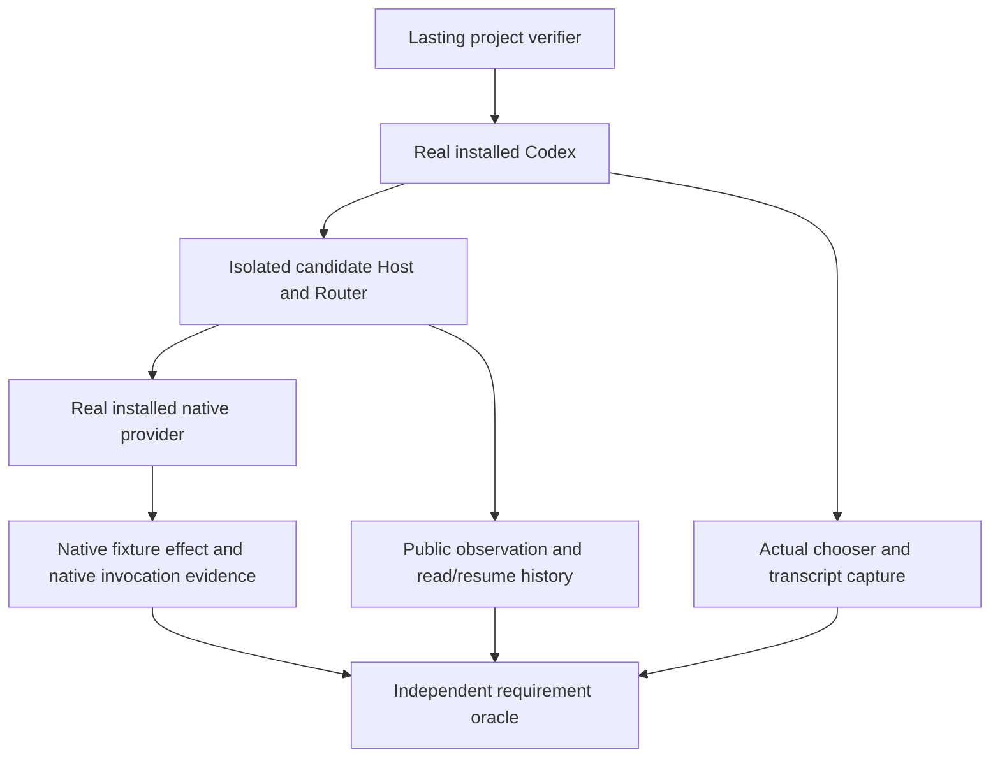

# How the requested behavior will be proven

This is planned proof for the [Requirements](requirements.html), [Specification](specification.html) and [Program Design](program-design.html). It records no completed feature observation. The earlier native probes inform feasibility only and are linked separately in the reader's evidence section.

Each native-behavior oracle applies only where the unchanged provider supports that capability. Unsupported cases require explicit errors and a recorded provider/version limit; passing those controls does not prove the unavailable experience. No provider patch, client change or ACP extension is a dependency of this verification work.

## What the owner will see

[Read the planned user-visible checks](verification-design.html).

## Coverage rows

### skills — U1 / R1,R6

| Detail | Meaning |
| --- | --- |
| Requirement / obligations | U1 / R1,R6 |
| Proven by and seam | J1 compares native cold catalogue, effective scope and facade response; guards observe wrong-context rejection using the actual target binding. |
| Reference | C1,V1,V6 and native owner's known setup facts |
| Planned target and journey / lifetime | Installed Codex + isolated signed candidate + actual native Claude/Cursor; needed `verify-codex-router` native-capabilities discovery journey; lasting |
| Passing condition and wrong build | Exact native IDs/origins/enablement agree; partial/unsupported explicit. Codex policy defaults apply only to established undeclared native policies and are visibly attributed in existing text. Unobserved policies never receive a default; native enablement is never defaulted. Path-less/unrepresentable inputs produce truthful supported partial errors or a whole-method error, including all-unrepresentable input. No fabricated error path or complete-looking omitted subset. A reader of Codex's inventory, cache for another cwd or invented native policy fails. Management writes are explicitly rejected with no dispatch or native setup mutation. |
| Reuses | None; existing API baseline is negative evidence, not a future covering test. |
| Unverified | Native complete skill export and other ACP implementations; provider adoption changes are outside scope. |

J1 checks membership as well as fields: with qualified native filesystem skills and confirmed bundled skills present together, the filesystem list returns those skills instead of failing merely because bundled entries exist. Confirmed loaded-only builtin plugins are outside the installed filesystem plugin list. A known-empty filesystem view is distinct from a full native inventory. Unknown origin, an unreadable in-view skill and an all-unrepresentable in-view result cannot be silently reclassified as out-of-view builtins or returned as complete success. Exercise truthful partial errors and the whole-method fallback; a fake executable/error path fails. Record the path-less `$` limitation explicitly and compare only genuinely advertised commands on their separate surface.

Exercise source accounting independently of successful data: Accounted plus one usable row and one relevant located source error returns the row and its existing per-entry error. Accounted does not label that data complete. Incomplete membership, an unobserved/irrelevant error source, a mixed located-plus-unlocated failure or all-unrepresentable input returns the whole-method error. No blanket located error can excuse unrelated omitted entries. The private native reader must retain the actual source-error facts through Host and the codec; a codec-only fabricated path fails.

Check provenance as a closed source role: skills/list accepts SkillSource errors, plugin/list accepts MarketplaceManifest errors, and each rejects the other role, OtherFilesystem and Unobserved without reclassifying the path. A real package directory is not a marketplace manifest. Check section independence both ways: plugin-only Incomplete/Unsupported does not erase an Accounted skill view, and skill-only Incomplete/Unsupported does not erase an Accounted plugin view. Incomplete limitations belong to that section's enumeration state; no global limitation can silently poison or be ignored by the other method. Exercise every Program Design decision-table row through the actual async facade/Host/native-reader seam.

For plugin rows/read, compare marketplace name and actual source/selector with the native export or marketplace manifest. A cache-path guess, opaque-ID parsing in the codec, arbitrary requested-path read or guessed workspace fails. An unobserved source or non-unique setup context must produce the existing explicit error. Test each component kind separately: known-empty Complete, observed nonempty, Partial and NotObserved. Missing or partial hooks must never become an empty detail array or false absence flag merely because a flat component list has no Hook entry.

J1 also checks each required detail item field: skill descriptions and enabled values come from the owning native skill records in the same plugin/setup; unknown availability or missing required facts cause the existing method error. Hook keys/events come from native observations and a qualified mapping to the consumer's closed HookEventName; unknown or unmappable events error without inventing or dropping hooks. A fabricated description, key, event or foreign same-name skill fails. Native package rows keep remotePluginId/shareContext null; record that a path-less named catalogue has no detail-navigation route in Codex0.163 rather than manufacturing a remote identity or manifest path.

### skills — U2 / R1,R2,R5,R6

| Detail | Meaning |
| --- | --- |
| Requirement / obligations | U2 / R1,R2,R5,R6 |
| Proven by and seam | J1 discovery plus J2 captures chooser selection, structured input, native dispatch and native fixture effect; unsupported multi-skill/mixed sets, selected steer/queue and competing direct input are exercised. |
| Reference | C2,V2,V5,V6; same fixture's native reference behavior |
| Planned target and journey / lifetime | Same installed client/candidate/native provider; needed native-capabilities selection journey; lasting |
| Passing condition and wrong build | Selected real identity/origin reaches the native effect; ordinary text still renders. Unsupported sets/selected steer/selected queue fail as a whole, direct input must not auto-queue, and existing actor/input/target survive preparation. Known local rejections send no native input. Later native errors/refusals/unknown effects retain their actual meaning; a before-model receipt is not inferred. A dropped selection, body-only emulator, wrong skill, argument corruption or actor-less path fails. The fixture must depend on its arguments; a fixed marker plus a command-args record alone cannot establish body argument application. |
| Reuses | None; native direct-Claude probe bypasses Router/Codex. |
| Unverified | General composition semantics and end-to-end bridge. |

### plugins — U3 / R1,R3,R5,R6

| Detail | Meaning |
| --- | --- |
| Requirement / obligations | U3 / R1,R3,R5,R6 |
| Proven by and seam | J1 discovery plus J2 uses an owned native plugin fixture: inspect the selection-specific native prepared context (not an echoed UI label), then separately request its skill/MCP work and the native hook-triggering task where applicable. Disabled, wrong-context and unsupported combinations/steer are refused; selected queue is rejected until separately qualified. |
| Reference | C2,V3,V5,V6; native component reference effects |
| Planned target and journey / lifetime | Per-provider real native fixture and installed Codex candidate path; needed native-capabilities plugin journey; lasting |
| Passing condition and wrong build | The correct native plugin identity/namespace is associated with the actual input at the native prepared-context boundary; separately requested fixture work has the native reference effect. A UI-only/echoed hint or successful reply without native association fails. No hook/tool is required to run merely because a plugin was selected. |
| Reuses | None. |
| Unverified | Existing native prepared-context observation and separately requested component effects, non-filesystem UI policy D2. Cursor plugin execution on the inspected ACP build is unsupported, not a provider repair task. |

### commands — U4 / R4

| Detail | Meaning |
| --- | --- |
| Requirement / obligations | U4 / R4 |
| Proven by and seam | J3 reads successive command-catalogue Notice items through the authorized owned-session observation API and decodes `availableCommands` from their text JSON, then sends `/name args` through Router conversation prompt to the actual native provider. It separately captures Codex local refusal for unsupported picker commands. |
| Reference | ACP wire1 slash-command contract and C3,V4 |
| Planned target and journey / lifetime | Declared installed client/provider versions; needed native-capabilities commands journey; lasting |
| Passing condition and wrong build | Replacement removes old entries; the real Router-to-provider invocation preserves command/args and produces its native marker/effect absent from literal input. Codex local refusal is only an additional consumer-limit control. A Router that mangles the command cannot pass on refusal alone. |
| Reuses | Existing retained unknown-slash rejection is baseline evidence only. |
| Unverified | Providers not run. Codex menu integration is outside scope. |

### metadata — U5 / R7,R8

| Detail | Meaning |
| --- | --- |
| Requirement / obligations | U5 / R7,R8 |
| Proven by and seam | J4 preserves metadata identity/state and genuine output through live/read/resume, and checks catalogue data/error reporting through existing skills/plugin methods. Permanent test seams count operation calls for pure replay; the existing verification harness uses available native/runtime observations when counting real catalogue/create/load/prompt/steer calls. Test counts and installed-provider observations are reported separately. No product-runtime observer is introduced. |
| Reference | C4,V7,V8; original metadata projection contract |
| Planned target and journey / lifetime | Exact candidate, installed Codex, real providers; existing ACP metadata journey plus needed selection/replay cases; lasting |
| Passing condition and wrong build | Metadata is retained outside assistant items and genuine output remains. For each qualified lowered skill, compare live/read/resume history with the canonical native command and task/argument text captured at submission: command identity and internal dollar/UTF8/newline characters match, allowing only leading/trailing argument whitespace trimming. A missing/changed command or altered task content fails. Native-operation counts do not increase during pure loaded-history display. Explicit unloaded resume may perform its existing load, never a replayed prompt. A metadata-delete, hide-all-Notice or replay-dispatch build fails. |
| Reuses | Existing `acp_metadata_observation.py` and its offered permanent oracle cases cover the metadata boundary only. |
| Unverified | Native unemitted usage and post-unload retention outside the existing contract; canonical history must pass the explicit comparison above on the candidate. An unavailable real native-operation counter remains a proof gap; focused test counters do not close it. |

### delivery — U6 / R9

| Detail | Meaning |
| --- | --- |
| Requirement / obligations | U6 / R9 |
| Proven by and seam | J1–J4 plus scoped Rust/Python required checks; permanent negative cases exercise actual affected boundaries. |
| Reference | C5,V9 and repository completion gates |
| Planned target and journey / lifetime | Clean committed candidate, normal signed binaries, exact installed tools; native-capabilities journey needed; lasting |
| Passing condition and wrong build | Current Router's empty skills/plugin error/rejected selection fails; stand-ins and launch receipts never satisfy native effects. A fixture-only build fails. |
| Reuses | Existing metadata regressions/journey only for unchanged preservation clauses. |
| Unverified | All feature observations until implementation; independent delivery acceptance remains separate. |

### delivery — U7 / R9

| Detail | Meaning |
| --- | --- |
| Requirement / obligations | U7 / R9 |
| Proven by and seam | Shared owned-runtime qualification and cleanup surrounds J1–J4. |
| Reference | C5,V9; exact production-isolation limits |
| Planned target and journey / lifetime | Separate owned Router root/profile/socket, normal Codex home; existing isolated debug launch/ownership journey; lasting |
| Passing condition and wrong build | Only recorded owned processes stopped, none survive, protected identities/settings unchanged. A production replacement or fake home fails. |
| Reuses | Existing runtime qualification/ownership driver; applicability rechecked per run. |
| Unverified | Credentials and signing must be requalified for each candidate run. |

### delivery — U8 / R10

| Detail | Meaning |
| --- | --- |
| Requirement / obligations | U8 / R10 |
| Proven by and seam | J5 compares every prepared page with equally embedded/indexed fresh output, runs the matching checker, and opens the actual collection at desktop and 390 CSS px. From Home and another page, follow every Pages entry and ordinary document link, open each capability section and inspect its explanation/diagram. |
| Reference | C5,V10 and the bound Demistify guide |
| Planned target and journey / lifetime | Local prepared reader, matching authoring tool and supported browser; temporary presentation check |
| Passing condition and wrong build | Every page’s Pages menu exposes all declared pages (currently six), and ordinary document links open the corresponding HTML reader. The four governing documents stay distinct. Skills/plugins/commands/metadata are separate findable sections with short explanations and small readable diagrams; giant multi-column tables do not dominate the human path. Markdown and every Mermaid SVG render without page overflow or covering controls at desktop and 390 CSS px. A Home-only menu, raw-Markdown document jump, hidden document navigation, giant-table primary path, stale embed or static-only claim fails. |
| Reuses | Matching Demistify embed/check operations; no product proof reuse. |
| Unverified | Offline distribution unless explicitly bundled; design meaning still needs independent review. |

## Shared observations and real/fake boundary

[Read the shorter user journey](verification-design.html).

J1–J4 are one proposed lasting project-verifier family, not a renamed metadata journey. It must be built before observations depend on it. Local stand-ins may drive codec/projection failure cases; no stand-in replaces Client, Candidate or Provider in a native-behavior claim. A materially different allowed implementation passes if it preserves the native references/effects and observable contract; the oracle does not require a particular module layout or a Skill tool call when native command markers establish valid slash dispatch.

Plugin application proof must use observation already available from the unchanged provider/runtime or allowed controlled-fixture evidence in the real operation. No new provider-side observer, provider patch or upstream protocol hook is permitted. Retain only the controlled fixture identity/context marker, never unrelated prompt/account content. An admission receipt or outgoing metadata echo alone cannot decide plugin application. The same fixture's separately requested native task effect corroborates runtime availability. If existing observations cannot establish the required association, leave plugin selection unverified; do not weaken the oracle or add machinery to manufacture a pass.

Operation counters belong to permanent tests or the existing verification harness only. A harness observer that delegates to the real provider is distinct from a test dependency; report which was used. Never count fixture calls as installed-provider observations or add shipped runtime machinery to obtain counts. Missing real-path observations stay explicit proof gaps.

The existing [ACP metadata journey](../../../.agents/skills/verify-codex-router/references/acp-metadata.md) drives installed Codex live/reopened PTYs and public events/read/resume, with exact target qualification. Its observation helper does not create sessions or send input. It is not a catalogue/selection verifier. Its [driver](../../../scripts/verification/acp_metadata_observation.py) remains the reusable metadata observer; extend the lasting journey through its owner before claiming the new behavior.

No row expands the Router-only D1 boundary or waives D2 truthfulness. Qualify native catalogue/resolution and existing-consumer projection without provider/client/protocol changes. Record unsupported provider/version cases separately from passing supported behavior. Check the diff for new public/stored formats, runtime services, registries, caches or execution emulators; any such addition fails the declared scope. A future implementation plan must preserve every required Rust and repository completion gate and record commands, counts, exits, source/build/signature identities and remaining limitations.

## Existing-contract qualification controls

J2 must capture actual installed Codex Text+Skill/Mention inputs, then exercise the candidate’s real scoped resolver. Test matching and foreign paths, same-name collisions, disabled/unavailable entries, leading/non-leading/quoted/literal-dollar text, duplicate/multiple/mixed selections and active-turn/queue races. Qualify supported forms and explicitly reject the rest. No source label or probe-generated Skill object substitutes for the real client.

The initial positive candidate is the Program Design's single leading exact-token Text+Skill form. Verify canonical command identity, preserved remaining text and argument-sensitive native effect. All non-leading/missing/duplicate tokens, unsupported attachments, name/path mismatches, multi/mixed selections, unqualified plugin Mention and selected queue/steer are explicit negative cases. Capture the actual chooser token and `text_elements`; a test that assumes selected-item byte ranges or strips every dollar token fails.

Check that the selected direct route uses the current profilev1 Text/other existing content codec and existing TurnOutcome decoding, with no database migration or new selection wire tag. This is structural proof only. The native effect still needs real-path observation. Native refusal/error/transport controls must not assert zero model/tool effects unless the observation actually establishes it.

The existing native argument-format probe is bounded evidence: f3bfbe0a-fe74-4eb4-af4e-00dbdc07c8dd returned the owned marker and matching command-name/args through standard ACP text. It did not exercise general catalogue/path resolution (its path comparison is tautological), a Codex selection, Router serialization, negative/stale cases or argument substitution into the skill body. It is not a covering test for J2.

The later [native argument-dependent observation](index.html#evidence--native-argument-dependent-behavior) supports one fresh-session body-specific effect only. Its3passing driver predicates are not3independent body observations; the repeated/control cases share history. The failed raw-body oracle remains failed, and literal model-bound expansion remains unobserved. J2 still needs the real installed-client/candidate resolver and a permanent argument-sensitive fixture; these one-off probes do not cover it.
