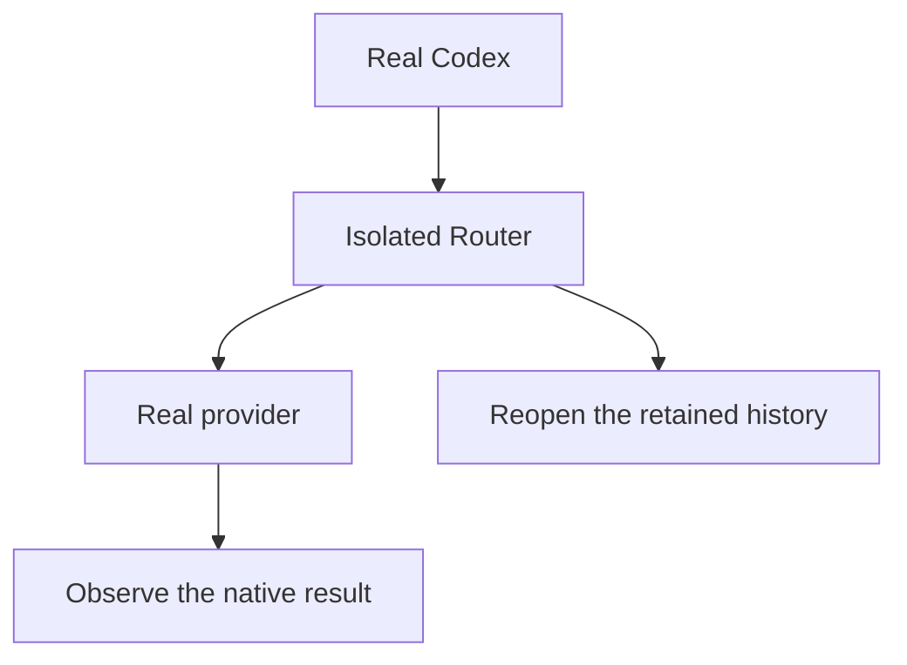

# How we will show it works

**These are planned checks. The follow-up has not passed them.** A successful launch or a native-only probe cannot prove the complete user experience.

## What each check must establish

- **U1 Own setup:** compare native catalogue and Router chooser data in the same workspace; check clear attribution of any Codex display defaults and rejection of setup-changing controls. **Unverified:** complete export, exact setup binding and actual UI/error presentation.
- **U2 Skills:** select a provider skill in installed Codex and observe its native effect, with the selected identity retained. **Unverified:** end-to-end bridge, general mention/argument parsing, native argument application and unsupported-form rejection.
- **U3 Plugins:** for a provider with existing native support, select an installed plugin and observe its applied intent and requested native component behavior. **Unsupported here:** the inspected Cursor ACP plugin runtime. **Unverified:** Claude plugin-level selection semantics. No provider patches or new observation machinery.
- **U4 Commands:** observe native command replacement and Router invocation, plus actual Codex submission/refusal. **Outside scope:** adding a dynamic provider slash picker to Codex.
- **U5 Metadata:** inspect retained metadata while live/reopened conversation shows genuine output without raw metadata prose. **Unverified:** the new discovery/resolution paths on a future candidate, including readable native command history.
- **U6 Real proof:** run permanent regressions and installed-client/provider journeys on the exact candidate. **Unverified:** no candidate follow-up exists yet.
- **U7 Isolation:** compare protected process/settings identities before and after exact owned cleanup. **Unverified:** future candidate run.
- **U8 HTML design:** open the delivered file, follow its source-backed paths, follow every Pages entry and document link, inspect each capability section/diagram, and check phone layout. **Unverified:** until the reader's own browser check is performed; it proves presentation, not the product feature.
