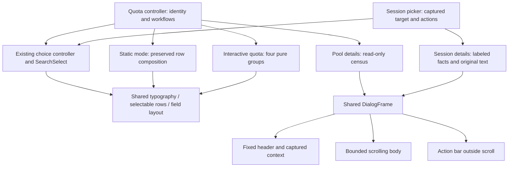

# Shared presentation composition

Inputs: [Requirements](requirements.md), [Specification](specification.md), current implementation baseline `1c722faede1dc0182e72d9a7c09d208fa6e47e6c`. The existing `codex-router-tui` remains the shared primitive owner; domain state and effects remain in their current callers.

## Entity bindings

| E | Semantic owner | Code and shape home | Boundary shape / disposition |
| --- | --- | --- | --- |
| E1 | QuotaStatusComponent / SessionsPickerComponent | existing component model and observed width/height | Existing state inputs → iocraft Element; derived view, no persisted format change. |
| E2 | Existing account/picker record owner | QuotaStatusAccountViewModel / SessionPickerRecord | Typed AccountId or source-qualified picker identity passed by reference; selection derived from controller identity. |
| E3 | Quota report projection | quota_status_projection and private quota view model | Add presentation-only typed window data (known percentage plus optional reset duration; unknown variant) projected from canonical window observations. Existing static formatted strings remain authoritative for static consumers. No render-time string parsing. |
| E4 | Existing dialog controller in caller | quota component and captured SessionDetailsState | Local closed variants for active pool/account Details; existing reset/options states untouched. DialogFrame receives presentation and actions; no effect dispatcher moves into shared UI. |
| E5 | SearchSelectState and caller controller | codex-router-tui/search_select | Existing query/focused key/ChoiceOption; add pure visual caret cue, not another editor/state owner. |

Rust enum/Option conventions preserve known percentage with unknown reset. Pure views cannot coerce unknown windows to full bars. Existing IDs remain captured; no new identity is introduced.

## Component view

The tree modifies composition and style, not data ownership. Shared `UiTextRole`/heading roles carry RGB palette values once. Extend the existing action-row/footer presentation for background/focus roles; callers provide existing actions and keyboard owner. Any key-hint child is caller-supplied from its actual input mapping, never inferred from a label or from the HTML sample. Quota browse labels its existing help/filter/details/options bindings and new F5 Pool details; Session Details labels focused activation/navigation and its existing modified shortcuts. Other `DialogFrame` users receive shared footer styling only, without new key text or controls; reset keeps one undecorated No/Yes pair. Reuse `SelectableRow` with optional presentation surface/gutter styling, and add shared section/table-header styling only if it removes duplicated layout. No separate framework or state registry.

## Current and target paths

Current quota path: report → quota_status_projection → QuotaStatusAccountViewModel → quota_browse_rendering (40% Account / 28% Status / remainder Quota) → iocraft. Interactive target uses the same report/projection/controller, with typed private display-window facts → Account/Quota/Pace/Extra pure children. Explicit geometry decides wide versus folded views. Narrow names use existing Unicode-aware wrapping. Cell gaps are separate Views/properties, never padded formatted strings.

Static mode is a distinct preserved output contract: `quota_status_entrypoint` → `QuotaStatusComponent(Static)` → existing static list/row composition and existing formatted weekly/short/pace strings. Dispatch by the existing `QuotaInteractionMode` before choosing the new interactive row composition. Keep the current 40/28/remainder static geometry and literal static text, including `83% left`, `resets 7d` and its pace meter. JSON projections are untouched. This names two intentional output formats, without adding a new flag or parsing a formatted string.

Current summary path: quota header facts → quota_help_rendering emits census lines plus Details/Help → quota component. Interactive target retains visible title/client count and credential/operational/projection-degraded error notices, then one filter toolbar; routine pool/freshness counts move to a read-only Pool-details presentation using the same facts. Static route/header composition stays unchanged. F5 or the labeled header action → quota controller → local closed `PoolDetails` variant; the account variant retains its captured AccountId. Accept this input only in unobscured interactive Browse, after existing Help/floor/options/reset/filter/details modal owners have taken their input. Pool details has its own Close/Esc and body scroll; repeated open cannot stack and account-effect keys cannot leak through it. Opening/closing never changes filters, focus identity or runtime state. Do not overload account Details with pool identity.

Current session path: details_dialog_view captures target/actions → picker_detail_view writes full title and metadata → DialogFrame. Target retains capture and action dispatch, composes the existing title as fixed identity plus labeled values/secondary metadata, and preserves `full_title` as reachable original body content. No disclosure, More menu, title rewrite or new action is added. Existing eligibility and clipboard errors return through existing action/controller paths.

Current choice path: controller owns SearchSelectState → SearchSelect renders Search/query and SelectableRow children → caller receives selected key. Target adds a visible caret/input marker and nested visual indentation only; cancellation and callbacks are unchanged.

## Layout and palette

Four groups: Account (compact three lines), Quota (two compact windows), Weekly pace (verdict/multiplier), Extra (credits/resets). Wide widths distribute remaining cells with useful minimums, never force a fixed large Account percentage. When minima do not fit, fold the same groups in order. Within folded groups zero blank rows; between account blocks two blank rows. Table headings become repeated group headings only when the table folds.

One palette: white weekly/body; soft cool white short-window facts; blue field/key role; teal surface/rule; white bold header on a distinct dark band; orange warnings; semantic success/error; stronger selected fill than alternating surface. Color roles supplement text. Existing terminal named-color behavior may be retained for compatibility where required; exact new accents use RGB supported by iocraft. Preserve NO_COLOR behavior.

## State, failure, trust and concurrency

No durable state, retry, transport, migration or new background task. Existing immutable report snapshots feed row views. Filter changes and reload preserve focused AccountId where present. Existing reset/credit effects remain bound to their captured target even when list focus changes. Pool Details is a local read-only open/closed UI variant; duplicate activation does not stack another dialog. Existing modal input scope blocks background controls. Resize reads current available cells, recomposes, and preserves existing controller state.

Unavailable values retain explicit Unknown/No data; credential-lock and projection errors are not moved behind routine pool disclosure. Session/provider errors and action eligibility remain caller-owned. Untrusted titles/path values remain Text content, not instructions or markup. No credential material is added to the display.

## Requirement/design/proof trace

| U | R | E | Owner | Interface / shape home | State | Failure | Proof seam |
| --- | --- | --- | --- | --- | --- | --- | --- |
| U1 | R1 four groups | E1/E2 | QuotaBrowse | existing quota row view model → pure child groups | derived from focus ID | long labels wrap | mounted quota row/view canvas and compiled browse |
| U2 | R2 compact windows | E3 | QuotaProjection | typed private display windows → QuotaWindow view | known/unknown/reset optional | no fabricated bar | projection and actual row render |
| U2/U3 | R3 window tones | E3 | SharedTypography | one RGB semantic role home | stateless | NO_COLOR preserved | ANSI output and compiled image |
| U3/U8 | R4 hierarchy | E1/E2 | SharedRow/Header | selected/gutter/row surface props | selected/unselected | no hover override | mounted positional and color evidence |
| U4/U8 | R5 fold/spacing | E1/E2/E4 | QuotaLayout/Frame | available cells → nested Views | controller unchanged | capped body scroll | live resize and short-grid compiled capture |
| U5 | R6 pool/credit detail | E1/E2/E3/E4 | QuotaHeader/Details | existing QuotaHeaderFacts + credit status; F5/header input → controller PoolDetails variant | local open/closed after existing modal input owners | retain visible operational errors, no account-effect leakage | F5 pool open/read/close plus row details |
| U6/U8 | R7 search | E4/E5 | SearchSelect | existing state/options/on_select | searching/draft | no-match disabled | mounted real key/paste/pointer path |
| U7/U8 | R8 session facts | E2/E4 | SessionDetailsView | captured SessionPickerRecord → fact children | existing dialog target | preserve full original text | compiled Details, body scroll and clipboard target |
| U7/U8 | R9 actions | E4 | SharedActionBar/caller | existing DialogAction callbacks/keyboard owner; optional caller hint from actual quota/session input mapping | existing pending/disabled/focus | no duplicate effects or invented bindings | original action tests and short-grid capture |
| U8 | R10 boundaries | E1–E5 | Existing controllers | unchanged domain/JSON; existing Static mode dispatch retains legacy row geometry and formatted strings | no new durable state | guards preserved | scoped diff plus static-format/compatibility and regression suite |

All entities bind to existing in-process owners; only private derived presentation data is added. Source and mounted rendering checks enforce no shifts and unknown semantics; caller guards enforce invalid/disabled actions. The compiled harness replaces external providers/data with the established fixture while keeping actual UI/controller/PTY real. Public provider behavior is not proven by that fixture and is not changed by this delivery.

## Alternatives and rationale

Extending shared primitives and pure screen composition is selected over screen-specific styling or a new renderer. It costs a bounded shared-component API/style adjustment and broader affected regression checks; maintainers gain a single palette and footer/focus contract. Existing domain controls and input scopes constrain the design. Revisit only if an actual unsupported layout or input need cannot be expressed in iocraft; no such gap was found in source/library probes.
