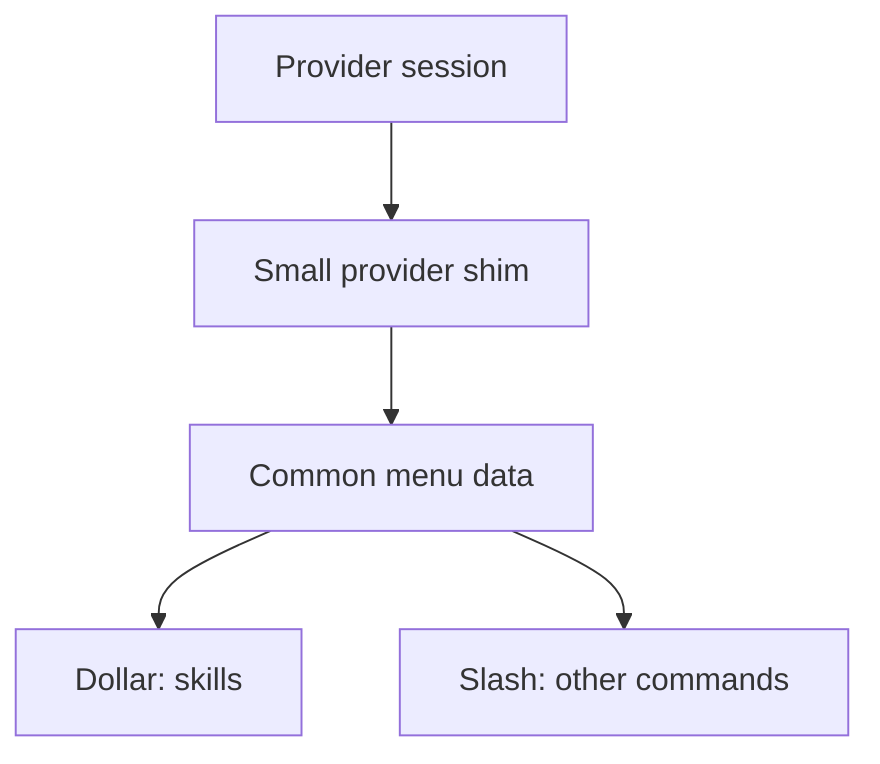

# One menu interface, small provider shims

**Research result: a common interface is feasible. Full skill and command menus are not available from every provider’s current ACP output.** The useful commonality is an advertised action list plus ordinary prompt submission. What varies is whether the provider identifies skills, which commands it exposes, and when it updates the list.

Your requested behavior stays the same: **`$` lists the active provider’s skills; `/` lists its other slash commands.** Plugin-contributed skills belong with skills. Plugin installation and marketplace management are separate features.

This is a source-backed proposal for discussion, not an implemented feature or an approved protocol exception. The earlier provider-change-only proposal is provisional; this research adds existing extension and native API options it did not cover.

## The boundary I recommend

The **provider** loads its own setup, resolves names and runs the action. The **shim** translates the metadata and invocation syntax that provider actually exposes. The **shared menu** filters and renders the translated rows. Router continues to carry prompts and output through its existing session path.

The same interface can have a standard ACP implementation and small Codex, Claude, Cursor, Pi or OpenCode implementations. A new provider supplies the same small contract; the menus do not gain another provider-specific branch.

## What belongs in that interface

Three responsibilities are enough for the candidate design:

1. **Read the session’s actions.** Each row needs its provider invocation name, display text and description, optional argument hint, and its known kind: skill, other command, or unclassified. An empty list and an unavailable list mean different things.
2. **Receive replacements when the provider supplies them.** Reuse its existing command-update notification. Report providers that only list at session creation/load; do not invent a refresh guarantee or a filesystem watcher.
3. **Prepare the selected action for submission.** Preserve the provider’s invocation name and arguments. Usually this produces ordinary ACP prompt text. Listing an action does not justify adding a new invoke RPC.

These are responsibilities, not final API signatures. The next design pass must define selection identity, argument handling and collisions against the actual provider paths. A display label is not automatically a safe invocation identity.

## What the interface must not pretend

**Unclassified is a real result.** Following your review, Cursor can show those advertised rows under `/` for now, even though some may be skills. Mark that group as unclassified. Heuristics may move likely skills to `$`, with their inferred status retained. This is your authorized interim fallback, not a claim of exact separation.

**A shim cannot create missing provider APIs.** Cursor currently erases its internal skill marker before sending ACP rows. Gemini’s inspected ACP server publishes a small fixed list instead of its full interactive catalogue. A common interface can represent those gaps; it cannot recover the missing information without an approved exception.

## Why dependency injection and a separate crate

The Host selects and supplies a shim when it creates a provider session. The generic runtime depends on the menu interface, never on a Claude/Cursor/Pi implementation. Provider-specific code lives in a separate proposed `acp-provider-shims` crate that implements the runtime's small interface.

That direction matters: a provider format change belongs in its shim. The actor keeps session lifecycle, the service keeps transport translation, and the client keeps menu presentation. None of them needs another provider-name switch. Tests can supply a controlled shim without changing production mode; real-provider proof remains required.

This is ordinary constructor injection, with a per-session shim lifetime. It needs no container, service locator, plugin discovery, runtime registry or provider setup manager. The [decoupling reference](decoupling.html) names the concrete Orca/T3 patterns and the candidate crate boundary.

**A provider shim does not change the Codex terminal UI.** The inspected stock Codex `/` menu is locally constructed. Router supplying more metadata alone will not make it list arbitrary provider commands. That client boundary still needs a separate, explicit delivery decision. The existing `$` skills path is more reusable, but its path-bearing selection contract must be handled honestly.

## Standards and exceptions

Use **standard ACP command updates and prompts** by default. Recognizing a bridge’s documented `$name` or `skill:name` convention is a provider-specific shim rule, not an ACP standard. Consuming Claude’s `_claude/sdkMessage` is an existing vendor extension, also not standard ACP.

Using native SDK/RPC/HTTP APIs, patching a provider to retain a kind marker, or changing the Codex client are separate exceptions to describe and obtain approval for before implementation. This research grants none of them.

The proposed cost is a small amount of version-qualified translation code per provider. The benefit is one shared menu behavior while the provider keeps ownership of its setup. The main remaining cost is API coverage: some providers need changes or reduced support. Filesystem discovery in Router, a plugin catalogue, copied native loaders, a second provider process and a new persistence subsystem do not earn a place in this proposal.

Continue with [the provider findings](providers.html) or [ACP and the two reference apps](references.html).
