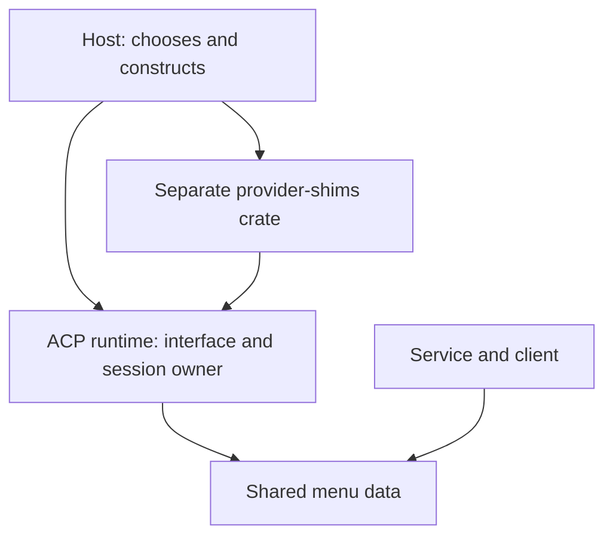

# What to reuse, and why inject the shims

**Keep provider differences out of the runtime and the menus.** The Host supplies a provider shim through one interface. A provider update should change that shim, without another Claude/Pi/Cursor branch spreading through the rest of Router.

You confirmed dependency injection and a separate crate for provider-specific code. This page makes that direction concrete. It proposes structure, not product code or a blanket exception to standard ACP.

## The dependency direction

The arrow means **depends on**. The runtime does not import the provider-shims crate. It receives the implementation through its existing creation path. The proposed crate name is `acp-provider-shims`; one module per provider is enough initially.

The runtime owns the small menu interface. `session-event-model` owns the typed menu data shared with the service. The Host is the only place that knows which concrete implementation to construct. Client menu code consumes the same data for every provider.

This is ordinary constructor injection. Every session gets a shim, including a default implementation for generic ACP. A shim instance keeps only that session's translation state. There is no global skill list, dependency-injection container, plugin loader or second provider process.

## Reuse these concrete patterns

| Reference | Pattern to adapt | Our smaller version |
| --- | --- | --- |
| Orca | Typed adapter construction with supplied dependencies | Host supplies a menu shim; it receives only menu events and submission inputs |
| Orca | One typed command/skill row passed to a shared composer | One row with native invocation name, presentation fields and classification evidence |
| T3 Code | Provider implementation packages behind a host-owned construction boundary | A separate Rust provider-shims crate implementing the runtime's interface |
| T3 Code | Provider inventory and update callbacks separate from turn orchestration | Feed existing session updates into the menu view; keep current turn execution |

Orca's actual factory/context is in [runtime registration types](https://github.com/stablyai/orca/blob/4e0f391c382f0189e70b57e8fc2848f02d39d157/src/main/runtime/structured-agent-runtime-registration-types.ts#L23-L40); its [construction code](https://github.com/stablyai/orca/blob/4e0f391c382f0189e70b57e8fc2848f02d39d157/src/main/runtime/structured-agent-runtime-registrations.ts#L48-L98) supplies the dependencies. Orca keeps implementations in application modules; it does not demonstrate a separate Rust crate.

T3's [ProviderDriver contract](https://github.com/pingdotgg/t3code/blob/a2398c2ce33c4b964b4d9814644ac6b83521da60/packages/provider-core/src/server/driver.ts#L95-L118) and [host-owned driver list](https://github.com/pingdotgg/t3code/blob/a2398c2ce33c4b964b4d9814644ac6b83521da60/apps/server/src/provider/builtInDrivers.ts#L1-L39) show the package/composition boundary. Its [ACP callback](https://github.com/pingdotgg/t3code/blob/a2398c2ce33c4b964b4d9814644ac6b83521da60/packages/provider-acp/src/server/adapter.ts#L235-L249) carries catalogue updates. We do not need its full driver configuration, registry, Effect layers or session manager merely to implement this menu seam.

## What each side gets to do

**Provider shim:** interpret that provider's advertised commands and approved metadata; classify them using provider evidence, a convention or a declared heuristic; preserve native invocation names; prepare submission text.

**Generic runtime:** deliver protocol events, hold the current session view, validate the selected native identity, send through the existing transport, and retain existing approval/cancellation/history behavior. It does not construct concrete provider implementations.

**Service and client:** expose and display `$` skills, `/` commands and the permitted unclassified group. They do not parse Claude SDK messages or Pi command sources.

The shim gets no credentials, filesystem reader, database or process launcher. An approved custom notification can enter through a bounded metadata event; a separate native API integration would need a separate explicit decision.

## Heuristics are allowed; their limits stay visible

Use source-backed provider naming rules first: Codex ACP's `$name` and Pi ACP's `skill:name`. They retain the original invocation identity. A heuristic may classify a row as a likely skill, but the row remains labelled **Inferred** and its rule gets a focused counterexample test. A description containing “skill” is not currently an adopted rule.

Cursor starts with the owner-approved `/` fallback for its advertised actions. Some may be skills because Cursor drops its internal marker. Mark those rows unclassified; do not block the whole menu or invent skills that were never advertised. Improving the classifier later should not change the client interface.

## Reuse code or reuse the pattern?

The checked roots of [Orca](https://github.com/stablyai/orca/blob/4e0f391c382f0189e70b57e8fc2848f02d39d157/LICENSE) and [T3](https://github.com/pingdotgg/t3code/blob/a2398c2ce33c4b964b4d9814644ac6b83521da60/LICENSE) carry MIT licenses. If we copy substantial code, retain the required copyright and permission notices and check the exact files/dependencies used. Their TS implementations are architectural references for our Rust boundary, not packages to paste into the runtime.

**Adapt the pattern and focused test cases first:** current-list replacement, explicit empty list, separate session isolation, kind evidence, and selection routing. Keep out filesystem discovery, curated terminal-command guesses, marketplace inventory, freshness daemons and broad orchestration state.

Latest source check: Orca `4e0f391c`, T3 `a2398c2c`, each matching origin/main when fetched for this follow-up. This is source inspection, not a live provider run. Detailed evidence: [Orca](../../../tmp/2026-10-26-menu-design-research/orca-decoupling-reuse.md), [T3](../../../tmp/2026-10-26-menu-design-research/t3-decoupling-reuse.md).
