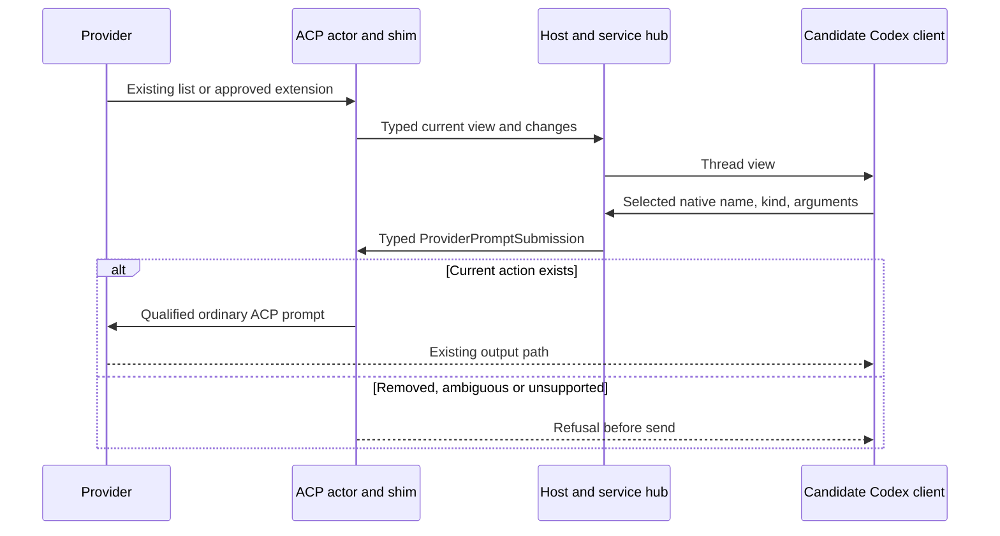

# The common menu boundary

This is a proposed realization of R1–R7. It does not approve a client change or any provider exception. The [client choice](overview.md#the-client-choice) comes before public method names or implementation planning are finalized.

## Entity bindings

| Entity | Owner and component home | Shape and type home |
| --- | --- | --- |
| E1 provider conversation | Existing ACP actor in `acp-client-runtime`, existing Host/session binding | Existing session/thread identity; no replacement identity |
| E2 provider action | Provider owns meaning; modified ACP actor consumes an injected shim; provider implementations own translation | Existing ACP rows/custom data enter a proposed internal menu view; shared Rust shape in `session-event-model`, without a persisted field or catalogue crate |
| E3 menu view | Candidate modified Codex composer/popup, conditional on client approval | Proposed app-server schema owned once by Codex protocol and generated for its consumers; two derived partitions |
| E4 action invocation | Candidate Codex input edge; modified service/Host admission and ACP actor | `ProviderPromptSubmission::Action` carries typed selection to the actor; actor prepares ACP text; existing turn lifecycle remains authoritative |

The internal view and client wire view are different boundaries with an explicit translation; do not hand-maintain duplicate versions of one schema. Internal types are Rust enums; the proposed client examples below explain the conditional wire contract, not a second implementation schema.

## Three shim responsibilities

The Host selects a shim for the configured provider route and supplies it to the existing session-creation path. Every session receives an implementation, including the default standard-ACP implementation. The small consumer-facing interface belongs in `acp-client-runtime`; concrete provider implementations live in the proposed separate `acp-provider-shims` crate. That crate depends on the runtime interface; the runtime never depends on the concrete crate. Host depends on both and performs construction. No dependency-injection container, runtime plugin loader, separate process or setup registry is added.

A shim instance belongs to one provider session, including its classification state; it never shares mutable skill names with another session. Runtime delivers decoded command-list events and approved extension envelopes through the narrow menu interface, not its whole transport, supervisor, secrets or configuration. The shim returns typed action updates and prepared invocation text. Runtime owns lifecycle, persistence policy, attachments, approvals and actual sending. The shim owns provider-specific interpretation only.

1. **Observe advertised actions.** The default implementation reads standard ACP command updates. Provider implementations can interpret qualified invocation conventions or approved custom metadata/messages. Unknown data stays opaque; a provider name alone never proves support.
2. **Produce the common view.** Normalize native invocation name, display label, description, optional argument hint and classification evidence. A category may be provider-reported, convention-based, heuristic or unclassified. Keep that basis; never fill gaps from disk. Skills and other commands are separate partitions of the same provider conversation.
3. **Prepare submission.** Given a current action and literal arguments, produce the provider's qualified ACP prompt content. Attachments retain their existing content blocks. Codex/Pi/Claude need different token conventions; no universal `slash + displayed name` rule is assumed.

The shim must use existing connection events and submission paths. A native SDK/RPC/HTTP operation is not admitted merely because it could implement this interface. If selected later, its enumeration and invocation contract needs a separate owner-approved realization; it cannot be smuggled through a prompt-text implementation.

### Consumer-owned Rust trait

The runtime owns this proposed synchronous, effect-free interface. Provider implementations depend on it; they cannot send a request through it.

```rust
pub trait ProviderMenuShim: Send {
    fn observe(
        &mut self,
        event: ProviderMenuEvent,
    ) -> Result<Option<ProviderMenuSnapshot>, MenuInterpretationError>;

    fn prepare(
        &self,
        selection: &SelectedProviderAction,
    ) -> Result<PromptText, MenuInvocationError>;
}
```

`observe` consumes a complete advertised command list or a permitted extension notification and returns a replacement snapshot only when menu state changes. `ProviderMenuEvent` is a runtime-owned neutral enum: `CommandList` carries decoded name/description/input-hint and opaque metadata; `ExtensionNotification` carries method and JSON parameters. ACP SDK values stay private to the existing runtime decoding edge. This is a translated input vocabulary, not a second wire schema. The default implementation retains unclassified command rows and ignores unrelated extensions.

The output `ProviderMenuSnapshot` has skills/commands partitions and no client thread ID; the service adds the existing thread binding in the client wire view. A snapshot is immutable after publication. The error set distinguishes invalid advertisement and ambiguous native identity; missing classification is fallback state, not an error. A malformed optional classification extension cannot turn unrelated notification data into a command or permission.

`prepare` accepts the actor-validated native identity and literal arguments, and returns validated native text. Its errors distinguish action unavailable, invalid invocation and unsupported submission. It does not read files, expand skill bodies or invoke anything. Runtime adds existing attachment blocks and sends the normal ACP prompt. The existing approval and cancellation code remains outside the shim.

Host supplies an ordinary constructor closure to the existing runtime creation input. Runtime calls it once per new/loaded provider session after the handshake, passing only the configured route and observed agent/protocol version information. The closure constructs an implementation or the generic fallback; it captures no credentials or mutable global catalogue. No factory registry or service locator is introduced. A provider-specific module is added only for a real differing rule: Cursor can initially use the default fallback without an empty wrapper implementation.

Heuristic precedence is explicit: provider-reported evidence wins, then a qualified convention, then an adopted heuristic, otherwise unclassified. A heuristic never overrides authoritative kind or invents a row. Any future Claude session-open opt-in is a separate approved capability hook, not hidden inside `observe` or `prepare`.

## Provider source choices remain separate

- **Standard ACP:** names, descriptions and input hints. With no kind evidence, advertised rows appear in the unclassified slash group; the skill partition reports that no skills could be identified. Core chat and retained command metadata continue.
- **Codex ACP convention:** `$name` rows are created from app-server skills by the inspected bridge. Identity/collision and exact submitted syntax must be qualified for the selected bridge version.
- **Pi ACP convention:** `skill:name` is preserved from Pi's typed native catalogue. The released bridge filters extension commands and has setup/load-only refresh, so full U2 coverage is not claimed.
- **Claude extension candidate:** opt in only to needed SDK message types/subtypes through the existing `_claude/sdkMessage` route. Extract menu fields before persistence/logging; never enable unrestricted raw recording. Name joins and update completeness remain unqualified. This is an exception pending approval.
- **OpenCode:** ACP command rows can populate the command partition under a qualified OpenCode shim; its skill partition remains unsupported. Native HTTP skill list/activation is a possible separate exception, not a chosen route.
- **Cursor/Gemini:** inspected ACP output does not supply the missing skill inventory/classification. Cursor uses the owner-approved unclassified slash fallback. Named, bounded heuristics may classify likely skills with an inferred label; absent evidence, keep the row unclassified. Gemini retains its limited advertised catalogue. No internal-loader recreation. A Cursor output change needs the vendor; a Gemini/Claude adapter change would need upstream adoption or an approved fork.

No new universal kind metadata key or ACP request is selected. If later evidence requires one, specify its exact capability advertisement in `InitializeResponse.agentCapabilities._meta`, per-row meaning, and version behavior as a separate exception before implementation.

## Common state and conditional client contract

The proposed view distinguishes support for the two triggers:

```ts
type MenuPartition =
  | { state: "ready"; actions: readonly ProviderAction[] }
  | { state: "unsupported"; reason: "source-unavailable" | "ambiguous-identity" }
  | { state: "unavailable"; reason: "opening" | "no-list-received" | "closed" | "provider-error" };

type ProviderMenuView = {
  threadId: string;
  skills: MenuPartition;
  commands: MenuPartition;
};

type ProviderAction = {
  name: string; // provider-native invocation identity, not a filesystem token
  label: string;
  classification: ActionClassification;
  description: string;
  inputHint: string | null;
};

type ActionClassification =
  | { kind: "skill" | "command"; basis: "provider" | "convention" | "heuristic" }
  | { kind: "unclassified" };

type ProviderActionInput = {
  type: "providerAction";
  name: string;
  kind: "skill" | "command" | "unclassified";
  arguments: string;
};
```

Ready with `[]` means the provider established an empty partition. Unsupported means the needed source is unavailable. A mixed list preserves every action exactly once: classified skills go to the dollar menu, classified commands to slash, and unclassified actions to the labelled unclassified slash group. Heuristic skill rows show Inferred. Unknown does not disable advertised commands or become a false exact classification. A provider with no identifiable skills keeps a source-unavailable skill state and a usable slash list. This is the owner-approved interim behavior, not proof of exact separation.

Before the first list, the UI says actions have not yet been supplied; it never spins indefinitely or calls that empty. No timeout mechanism is added. When a qualified provider promises a setup list, its shim qualification must prove a full, possibly empty list after new/load/resume. Providers lacking that guarantee remain visibly unavailable until one arrives.

For the candidate-client option, proposed `thread/providerActions/list` and `thread/providerActions/updated` read and replace this view. `updated` is emitted for every view change, including support changes and closure. Exact wire names remain conditional on the client decision. A patched client receiving method-not-found shows no provider rows and retains its native/local behavior without an error. It must work with the ordinary Codex app-server and older Router.

The alternative stock `$` option uses the existing `skills/list` and path-bearing input instead. It would require an explicitly accepted non-file absolute token interpretation; do not implement both protocols preemptively. `/` remains unsupported on that option.

## Named Router read and update edge

`collaboration-runtime::router_session_app_server_methods` owns the Codex-facing read and notification translation. The capability traits `SessionEventHub` and `SessionCommandPort` belong to `collaboration-contracts`: the former owns the read/attachment contract, the latter effects. The stateful `ProviderSessionEventHub` implementation belongs to `collaboration-runtime`. Add the narrow typed menu read/update contract at the existing hub boundary; keep its implementation in runtime. `codex-router-host` constructs these owners and binds them to its ACP actor. The shared menu data remains in `session-event-model`, which both runtimes already consume. `collaboration-service` does not gain a second runtime or a provider-specific dependency. These homes follow the #173 crate DAG.

The ACP actor remains the sole writer of its ephemeral translated view. Host forwards its state changes into the existing hub's ordered read/update attachment. The service maps the existing thread binding to that view; a client cannot supply another provider identifier. Atomically attaching a current view and later updates follows the existing hub contract, so a read/update race cannot silently lose a replacement.

Existing persisted command/usage items and prose filtering retain their owners and schemas. The new live menu projection is not another database. On reopen, await the provider's fresh setup/catalogue evidence; do not treat old unclassified history as authority for a current selection. Historical metadata remains readable through the existing metadata surface.

## Selected input reaches the actor as data

Add one provider-neutral in-memory envelope beside the view in `session-event-model`:

```rust
pub enum ProviderPromptSubmission {
    Content(Vec<PromptContent>),
    Action {
        selection: SelectedProviderAction,
        attachments: Vec<PromptContent>,
    },
}
```

`SelectedProviderAction` carries the selected native name, kind and literal arguments shown in the client contract. `PromptContent` itself keeps its existing meaning and variants. The selected action is not converted to text by the service.

The complete edge is: candidate app-server selected input → `PromptSessionCommand` submission → Host `ProviderPromptContentsRequest` submission → existing in-memory `ProviderQueuedPrompt` when queued → runtime `ProviderSessionCommand::Prompt` submission → actor validation and shim preparation → existing ACP `PromptRequest`. These existing owners receive the envelope in place of the raw content-only field; no parallel command bus is added.

The actor checks current native name/kind at actual dispatch, including after queue wait, and prepares text with its own session shim. Ordinary `Content` follows the existing block translation. Attachments remain separate blocks. After successful send, the actor records resolved submitted native command text through **PR162's submitted-input user-item path** (`publish_submitted_user_item`, ported from PR162 in foundation commit 6e98f4667); that history text is never reinterpreted as a pending selection. The implementation base is #173 at 0e82c135 plus that foundation. Its presence is source evidence; the port still needs its new-base checks before this history obligation can pass.

**Storage boundary:** the typed selection is held only in process memory, including the existing FIFO; it is not serialized into operation rows, queued-input storage or history. `ProviderOperationStore` is metadata-only and the current FIFO/queue registry are in memory. The persisted history keeps the existing submitted-text item shape. No persisted-format change, migration or new recovery/replay mechanism is selected. A future durable selected-input queue would be a separate owner decision. Process loss retains the existing unsent-queue limitation.

Current source on the #173 base: `collaboration-contracts/src/session_command_port.rs` defines the content-only command edge; `provider_session_command_port.rs:154` forwards it; `external_provider_supervisor/provider_prompt_contents.rs` admits and forwards without storing content; `provider_acp_message_fifo.rs:33` and `provider_queue_operation_registry.rs:19` hold queued input in memory. `provider_session_actor.rs:161` currently receives prepared blocks and sends them; the proposed change delays selected-action preparation to this owning actor. `provider_operation_store.rs:1` explicitly excludes prompt/transcript input.

## Replacement, validation and invocation

| Event at the session owner | Skill view | Slash view |
| --- | --- | --- |
| Open/reopen before any list | Waiting | Waiting |
| Valid complete list, including empty | Ready with identified skills | Ready with other commands |
| Valid list with unknown kinds | Identified skills, or source-unavailable when none can be identified | Ready; retain unknown rows in the labelled fallback |
| Ambiguous invocation identities, including first list | Unsupported: ambiguous-identity | Unsupported: ambiguous-identity |
| Valid later replacement | Recompute; can recover from unsupported | Replace; can recover from unsupported |
| Provider close/error | Unavailable; clear selectable rows | Unavailable; clear selectable rows |

The table applies to current session state, never a global cache. Malformed wire input is a validation failure at the existing boundary. An unknown kind is valid fallback data, not a malformed command. Reopen awaits fresh provider evidence; it does not restore authority from old history.

After any Host queue wait, the actor validates exact native name and kind against its current conversation view at actual dispatch, prepares the prompt, and sends it on its ordered ACP connection. Removed or changed-kind actions are refused before send. A still-present action survives an unrelated update or description change. **There is no revision counter or new fencing mechanism.** This local check cannot freeze provider name resolution after dispatch, and does not claim to.



The proposed selected form and bare-typing precedence are in the Specification. Failed, cancelled or uncertain submissions keep existing outcomes; no automatic repeat. Provider approvals remain authoritative. Descriptions are display text and metadata grants no execution permission.

## Obligation trace

Each vertical row preserves `capability · U · R · E · owner · interface · shape/home · state · failure · proof` without a wide table.

### R1 / C1 — Dollar membership

- **Capability / U / E:** skills, also observes U6 proof / U1, U3–U6 / E1–E3.
- **Owner / interface / shape-home:** Host-injected shim → actor → hub → client / common view, conditional client read / internal type in session-event-model; client schema in Codex protocol.
- **State / failure / proof:** skills ready with evidence or explicitly unavailable / no undisclosed heuristic or cross-conversation rows / real terminal screen plus qualified provider skill source.

### R2 / C2 — Slash membership

- **Capability / U / E:** commands / U2–U6 / E1–E3.
- **Owner / interface / shape-home:** provider owns names; candidate client owns labelled section / common command partition / same view homes as R1.
- **State / failure / proof:** current command partition plus unclassified group / known skills excluded; unknown fallback disclosed; no local-control interception / real screen and actual provider command effect.

### R3 / C3 — Intended invocation

- **Capability / U / E:** skills, also serves commands / U1–U4, U6, U7 / E1, E2, E4.
- **Owner / interface / shape-home:** service, Host admission and actor / typed ProviderPromptSubmission reaches actor, then shim prepares ACP content / envelope in session-event-model, conditional Codex input schema, existing PromptRequest.
- **State / failure / proof:** current name/kind membership and one enqueue / removed or ambiguous selection refused; still-present name survives resend / exact arguments, effect and dispatch count.

### R4 / C4 — Replacement and support

- **Capability / U / E:** skills, also serves commands / U3–U5, U7 / E1–E4.
- **Owner / interface / shape-home:** actor writer, Host/hub reader, service translator / typed view and changes / ephemeral internal view, no new persisted field.
- **State / failure / proof:** waiting, ready-empty, unsupported, closed / every view change published; valid replacement recovers / mixed/unclassified, empty, no-list, closure and reopen controls.

### R5 / C5 — Bridge boundary

- **Capability / U / E:** skills, also serves commands / U3–U5 / E1, E2.
- **Owner / interface / shape-home:** provider owns setup; injected shim owns exposed-protocol interpretation / qualified existing messages / no file catalogue or plugin registry.
- **State / failure / proof:** source support is explicit / native API or extension not approved is not called / structural review plus real row provenance.

### R6 / C6 — Conversation preservation

- **Capability / U / E:** skills, also serves commands / U6, U7 / E1–E4.
- **Owner / interface / shape-home:** existing item projection, metadata filter and history readers / existing live/history edges / existing session items and ordinary text.
- **State / failure / proof:** ordered live/replay / no JSON prose, no hide-all-notices, no replay send / real reply, useful metadata, same-session read and native Codex control.

### R7 / C7 — Common interface

- **Capability / U / E:** skills, also serves commands / U8 / E1–E4.
- **Owner / interface / shape-home:** runtime-owned interface, separate provider implementation crate and shared client consumer / three responsibilities above / one internal view and generated client schema.
- **State / failure / proof:** per-provider support through the same consumer / unknown is retained; heuristics labelled; runtime imports no concrete implementation and no provider-specific chooser / two different provider sources and generic unsupported control.
