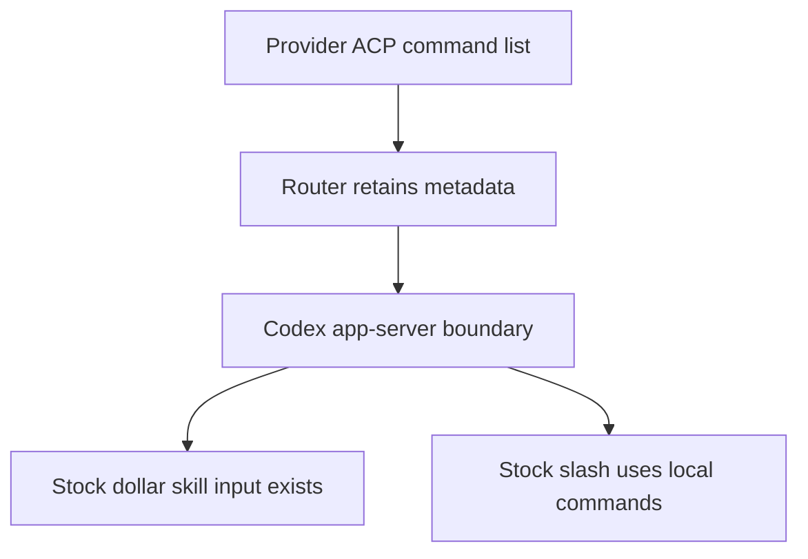
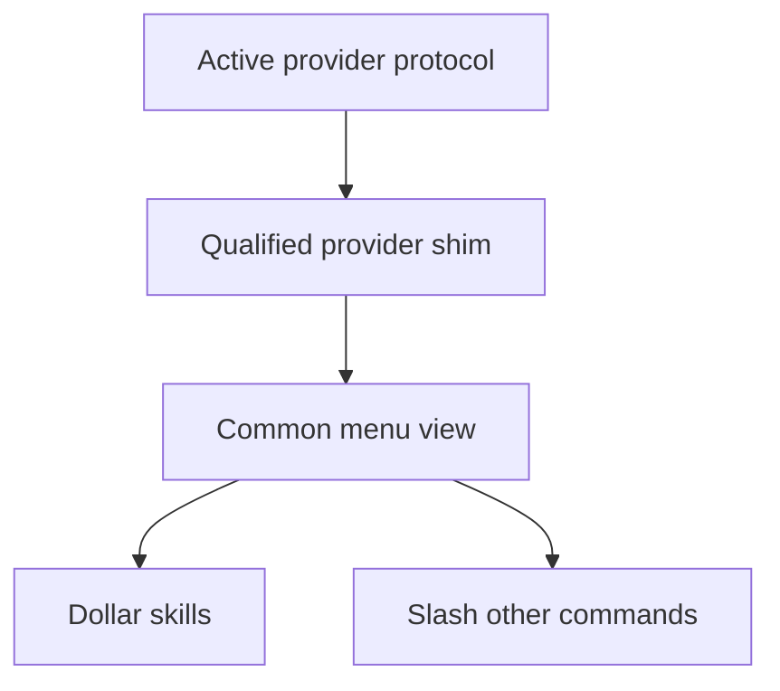
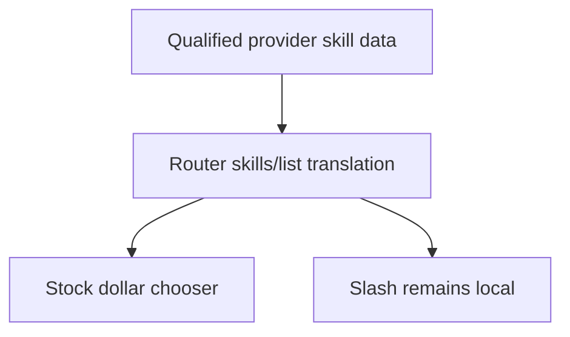
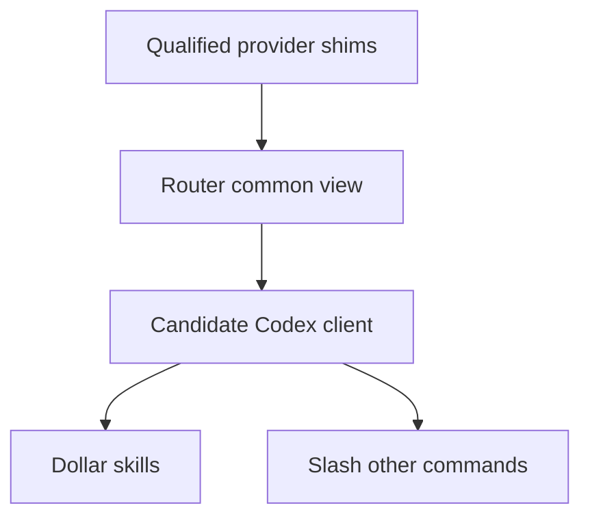
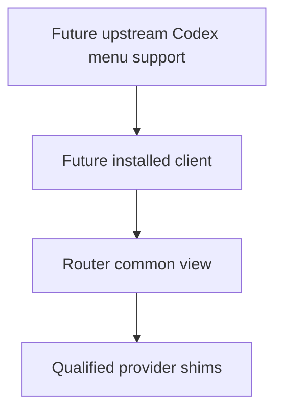

# Can Router alone deliver both menus?

**It can translate the provider's data. It cannot make stock Codex's `/` popup consume a new list.** The recommended design is one common menu interface with small provider shims, plus a narrow client integration for the two menus. Neither that client change nor a nonstandard provider integration is approved yet.

The two outcomes remain `$` for the provider's skills and `/` for its other commands. A partial route is described below as partial, never as completion of both.

## What exists today

ACP gives the provider a command list and a prompt path, without a standard skill discriminator. Codex already reads server-supplied skills for `$`, but its inspected `/` popup is built from local commands. Router's current provider `skills/list` response is empty. A generic ACP client and the stock Codex terminal are different consumers.

## One common interface with small shims

Each shim translates only an exposed provider contract: list its actions, receive its existing updates, and prepare its native submission. The provider still loads its own settings, plugins and skills, resolves names and executes. The shared menu code does not know Claude's or Pi's protocol shapes.

The Host injects a standard ACP implementation by default or a selected provider shim from a separate crate. Unclassified rows remain labelled as such and may appear in `/` under the authorized interim fallback. A named shim may use an existing, qualified provider convention or an explicitly approved extension; it cannot silently scan files or start another provider process to fill a gap. No new ACP method is selected by this design.

The [six-provider research](../../2026-10-26-acp-provider-menu-research/providers.html) changes the earlier proposal: a new universal kind annotation is not automatically needed. Codex ACP and Pi ACP retain useful naming conventions; Claude has an existing SDK-message extension; OpenCode has separate native skill APIs; Cursor and Gemini have missing ACP data. These are different support paths and costs.

## The client choice

The decision is whether this design may include a narrow change to the Codex client so its `/` popup can show provider commands. This is outside Router-only implementation authority. Nothing here authorizes installing or replacing the normal CLI.

### Keep the installed CLI unchanged — partial delivery

**Gain:** stock `$` can potentially display provider skill names and descriptions, with no client patch. Codex accepts a path-bearing selected skill input; it does not require the TUI to verify a file exists. Router could interpret an absolute non-file token as provider identity.

**Cost:** that token would use a file-shaped public input for something that is not a file. Router must own and qualify that interpretation. This is a proposed compatibility exception, not an installed provider file. `/` still does not meet U2. It also needs a qualified provider skill source; this option does not solve Cursor's missing classification.

### Permit a candidate Codex client integration — recommended

**Gain:** both menus consume the same explicit action model; a provider selection need not impersonate a filesystem skill. Provider and Codex controls can be labelled and routed separately.

**Cost:** changes in another product, the Codex client and its app-server protocol, must be built and maintained. A development build is a different executable from the installed CLI. Shipping it later would require an upstream change or a separately approved distribution/replacement route. This lifts the current no-client-change boundary for development only if the owner chooses it; it does not lift installation or production protections.

The provider costs are independent. Codex/Pi convention shims may reuse their current ACP output after identity qualification. Claude's existing extension requires an explicit exception and limited metadata extraction. Cursor's proprietary `agent acp` output can only gain a new kind field through Cursor, unless another source is separately approved. A native OpenCode API integration is another exception; Gemini's full interactive catalogue is absent from the inspected ACP server. A common interface represents unsupported cases; it does not make these integrations exist.

### Wait for upstream client support — no current delivery date

**Gain:** avoid maintaining a client fork. **Cost:** both-menu delivery waits for an upstream capability that is not in the inspected client. Provider classification gaps remain. We can prepare a narrow upstream proposal without installing a replacement, but cannot call the feature delivered.

## Recommendation and remaining limits

Recommend permitting a candidate client integration for design and isolated proof, while keeping installation and production out of scope. First settle that client boundary; then select provider exceptions individually. No blanket approval of native SDK/HTTP routes, provider forks or raw SDK recording is implied.

If the client decision is deferred, no product code starts. The source comparison and removal of unnecessary draft machinery can continue; U2 stays blocked. Selection/composition rules in the Specification remain proposals to review with the client choice.

“All slash commands” also needs an honest boundary: a provider may omit terminal-only controls from ACP. That gap remains against the broadest U2 interpretation; it is not resolved by passing unknown text to the model.

Sources: [stock Codex popup](https://github.com/openai/codex/blob/83086188ae0614bd882818ff1aa23f3194962012/codex-rs/tui/src/bottom_pane/command_popup.rs#L28), [stock skill submission](https://github.com/openai/codex/blob/83086188ae0614bd882818ff1aa23f3194962012/codex-rs/tui/src/chatwidget/input_submission.rs#L295), [provider and reference-app source comparison](../../2026-10-26-acp-provider-menu-research/references.html). These qualify source behavior, not a successful menu run.
