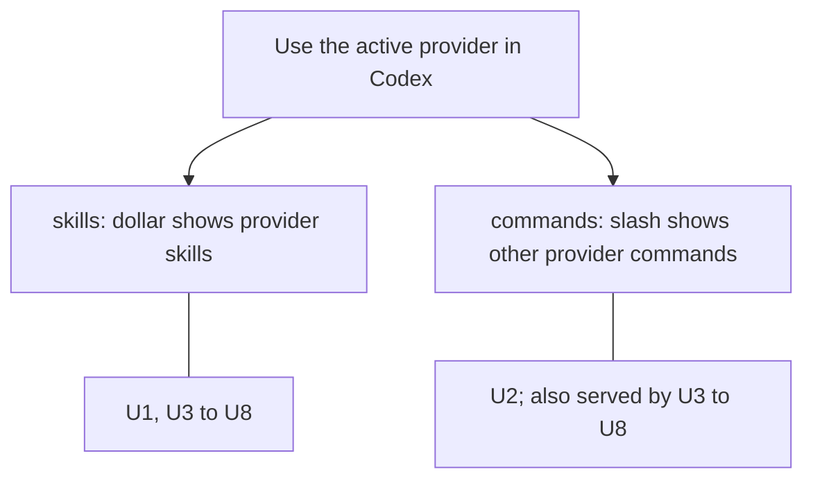
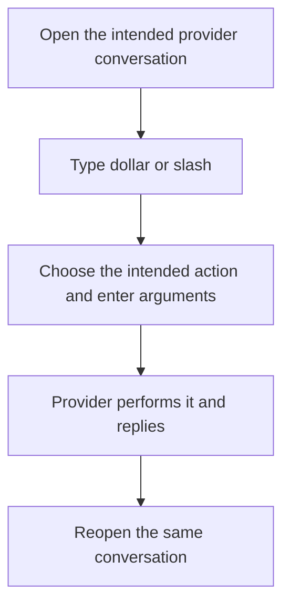

# What the two menus must do

The user should discover and invoke the active provider's actions from Codex, using that provider's own setup. Router translates the interaction; it does not become another skill or plugin manager.

## Two user outcomes

The owner named these two capabilities directly. Their meanings are separate even when their data arrives together.

The direct user is the person working in a Codex terminal. Provider maintainers and the Router maintainer bear compatibility costs; they are stakeholders, not additional user journeys.

## Skills

**U1 — `$` shows the provider's skills.** Selecting one invokes that skill in the active provider conversation, with the user's arguments. Plugin-contributed skills are skills here; this does not request a plugin installation browser. Capability: `skills`. Authority: authorized, owner statement “$ show skilsl”, reinforced by “$ is skills and plugins”. Priority: required by owner; no relative ranking supplied.

## Other commands

**U2 — `/` shows the provider's other slash commands, excluding skills.** A selected command must reach the provider; drawing a row without working invocation is insufficient. Capability: `commands`. Authority: authorized, owner's correction “with sahs / its all slash commands to show other than skills”. Priority: required by owner.

The inventory must distinguish actions available through the ACP conversation from controls belonging only to a provider's native terminal. Whether “all” additionally requires displaying native-only, non-advertised controls is an open scope interpretation; it must not be silently claimed as covered.

**Authorized interim exception:** in the owner's review of the six-provider research, Cursor may show its unclassified advertised actions under `/` for now, even though that list may contain skills. The owner also permitted pragmatic heuristics for skills. Preserve the long-term two-menu outcome; label inferred/unclassified results honestly rather than calling this exact separation complete.

## Boundaries shared by both menus

These rows have their home under `skills` and also serve `commands`.

- **U3 — Each provider uses its own setup.** Do not borrow Codex's installed skills for Claude or Cursor. Authority: authorized, “every ahrness shodul use the providers own setup” and “yeah lets jsut do each proviers one please”. Priority: required by owner.
- **U4 — Use standard ACP; make exceptions explicit and selective.** An extension may be proposed, but neither this document nor general assent approves changes to providers, the Codex client, or public contracts. Authority: authorized, “only requiremetns are use dstanda acp or ask hme epxlickty for excepiton”, followed by “acp has exteion abiltieis bet we ened to b eselective”. Priority: required by owner.
- **U5 — Remove the extra integration.** No Router filesystem skill scanner, copied native loader, plugin/marketplace inventory, second setup registry, or general verification framework. Authority: authorized, “rip out ... overengienred stuff”. Priority: required by owner.
- **U6 — Prove the actual terminal behavior.** TypeScript may drive a real OS PTY. Do not use a headless terminal emulator. Actual installed provider execution and a genuine assistant reply matter; harness self-tests do not establish the feature. Authority: authorized, “real veiricaiont of pty with ts” and “no not xterm headless”. Priority: required by owner.
- **U7 — Preserve the working foundation.** Useful metadata stays outside assistant prose; genuine text, reasoning, tools, plans and meaningful notices survive. Ordinary native Codex keeps working. Use normal Codex home and isolated debug Router resources; do not replace production. No Python additions. Authority: original assignment and later repository/owner corrections. Priority: required by owner.
- **U8 — One interface, dependency-injected provider shims.** Keep common menu behavior behind one interface; translate provider differences in small shims supplied by the Host. Put provider-specific implementations in a separate crate, with no concrete provider dependency in the generic runtime. The owner explicitly confirmed “Dependency-injected shims” after asking for decoupling like Orca/T3 and a separate crate. This authorizes the design direction, not every native API, provider patch or client replacement that could implement it. Priority: required by owner.

## The user journey

The current pain is the missing provider menu/invocation integration. Existing stock `$` and `/` surfaces are established in client source; the requested provider-specific two-menu UI does not yet exist. **No current UI** is available for those new rows. Any future mockup must be labelled proposed, not a screenshot or runtime result.

## Protected systems and excluded work

Provider configuration remains provider-owned. This design does not authorize changing authentication, installing a replacement CLI, rewriting provider files, changing ACP core upstream, adding a service/database, or restarting production. Small adapter and client changes remain proposed exceptions pending the owner's explicit boundary decision. Release, merge and deployment are outside this design request.

The owner has separately requested a verification inventory and a retrospective. They explain this work; they do not add runtime components to these menus.

The owner subsequently selected **Sunclaw for development and testing**, with helper sessions created through Router, a Claude design review, a Lead-authored plan and sequenced implementation. Those delivery instructions do not authorize production replacement, installation or an unresolved client/provider contract change. The same normal-home and isolated-debug boundaries apply on Sunclaw.

## Success and remaining choices

Success means the two menus display the correct active-provider actions, preserve their distinction, invoke the intended action, and retain useful history without JSON prose. The accepted needs are U1–U8; implementation authority still excludes client/provider changes and nonstandard integrations until explicitly granted. The exact compatibility boundary is proposed in [the design overview](program-design/overview.md). The [six-provider research](../2026-10-26-acp-provider-menu-research/index.html) is source evidence, not a working feature or a reduction of U1/U2.

Continue to [the observable behavior](specification.md).
