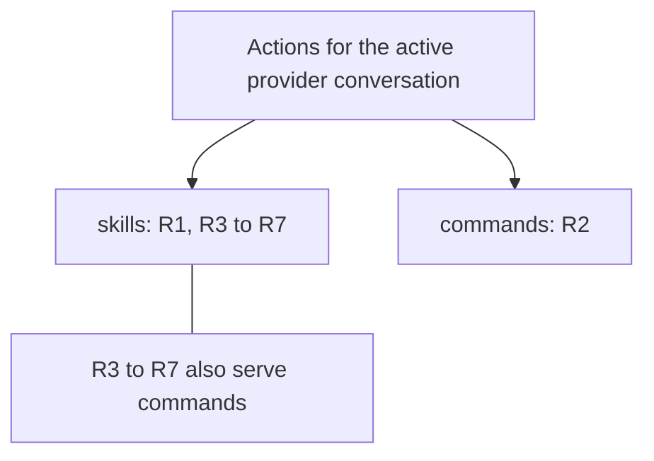
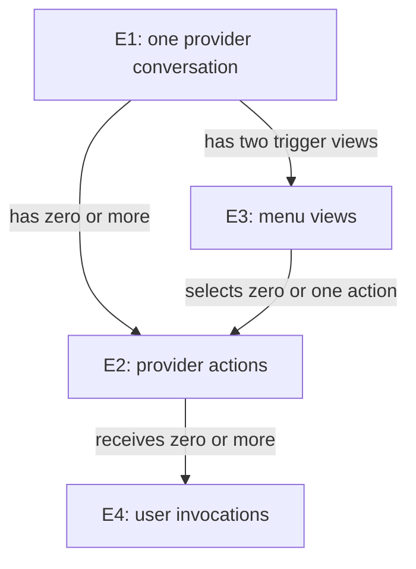

# What the user must observe

This contract derives from [the owner's requirements](requirements.md). Proposed wire fields and component homes belong to [Program Design](program-design/index.md).

## Two menus, one provider context

The problem **P1** is that provider actions do not appear and round-trip through the requested menus. The outcome **O1** is correct discovery and invocation. **P2** is the risk of guessing provider setup or exposing metadata as dialogue; **O2** is provider-owned meaning with preserved normal conversation behavior.

## The things the contract talks about

- **E1 — Provider conversation.** The same provider's resumed conversation remains the same conversation; another provider or another conversation is different. It has zero or more advertised actions and zero or more invocations. Observable states: opening, usable, closed/unavailable. It must never inherit another provider's action list. Basis: U1–U3, U7.
- **E2 — Provider action.** An action is identified by the effective invocation identity supplied by its provider within E1. A description change does not create another action. Two ambiguous same-named entries cannot be silently merged or assigned different behavior by Router. Classification is a skill or other command with provider/convention evidence, an inferred category from an explicit heuristic, or unclassified. Classification never changes the provider invocation identity. It may be available, replaced, or removed. Basis: U1–U5, U8.
- **E3 — Menu view.** One trigger for one E1 at a point in its current action list. States: loading, available, empty, unsupported, or failed. `$` and `/` are different views, not different owners of action meaning. Basis: U1, U2, U4.
- **E4 — Action invocation.** One user submission selecting an E2 and supplying argument text. A redraw or history read is not a new invocation. Observable states follow the existing submission/turn lifecycle: rejected before send, submitted, running, finished/failed/cancelled. An uncertain send is not permission to repeat it. Basis: U1, U2, U6, U7.

## Skills

**R1 / C1 — Correct `$` membership.** For a usable E1, `$` shows provider/convention-classified skills and may include likely skills from a named, tested heuristic. Inferred rows retain an **Inferred** indication; known other commands are excluded. A provider-specific naming rule is not a universal ACP guarantee, and no heuristic may invent a provider action absent from its advertisement. If none identifies skills, report that source limitation instead of claiming a complete skill list. Basis: U1, U3–U6; E1–E3; P1/P2 → O1/O2. **V1:** compare confirmed rows with the provider source and inferred rows with the declared heuristic; undisclosed guesses or cross-conversation rows fail. Heuristic accuracy is not asserted as exact provider truth.

## Other commands

**R2 / C2 — Correct `/` membership.** For that E1, the provider-command portion of `/` shows every available classified other command and excludes rows classified as skills. Under the authorized interim fallback, unclassified advertised actions appear in an **Unclassified provider actions** group; Cursor may therefore include undiscovered skills there for now. Existing client-local controls remain distinguishable; identical names must not silently route to the wrong owner. Basis: U2–U6; E1–E3; P1 → O1. **V2:** compare the displayed partitions with classification evidence and the raw advertised list: no row disappears or duplicates because its kind is unknown. The fallback is not evidence of exact final skill exclusion.

The design cannot enumerate native-terminal-only commands that the provider does not expose. That is an explicit limit against the broadest reading of U2, not a claim that every native command is delivered.

## Skills — shared invocation and preservation obligations

R3–R7 have their single capability home here and also serve `commands`. They are not independent product capabilities.

**R3 / C3 — Selection performs the intended action.** Selecting a row and submitting arguments must invoke that E2 in that E1 through the provider. Names and argument text must survive the round trip. A stale/ambiguous selection must be rejected before dispatch rather than redirected to another action. Existing rejected, failed, cancelled and uncertain submission behavior remains visible. Basis: U1–U4, U6, U7; E1/E2/E4; P1 → O1. **V3:** the chosen action's provider-owned effect and exact submitted arguments must match; a row, an acknowledgement, or ordinary echo alone fails.

**R4 / C4 — Updates and missing support are truthful.** A full provider action-list update replaces the previous list. An empty list differs from no list and from unclassified rows. Switching E1 must not retain the previous E1's rows. Missing extension support preserves standard command advertisement, the permitted unclassified slash fallback and core chat; it does not permit unsupported extension calls. Basis: U3–U5, U7; E1–E4; P2 → O2. **V4:** changed, empty, unclassified, unsupported, ambiguous and stale cases have their stated outcomes without unintended execution.

**R5 / C5 — The bridge stays a bridge.** The two menus must derive from the provider's active setup and exposed actions, without Router scanning skill files, reproducing plugin resolution, or creating another setup registry. Exceptions to core interoperability must be explicit. Basis: U3–U5; E1/E2; P2 → O2. **V5:** every row's provenance must be a provider-owned action; a recreated native loader or unnegotiated assumption fails.

**R6 / C6 — Preserve conversation behavior.** Action-list/category metadata must remain useful state, outside assistant prose, in live and reopened conversations. Genuine assistant content and native Codex behavior must survive. Reading history must not submit another E4. Normal home and production protections remain in force. Basis: U6/U7; E1–E4; P2 → O2. **V6:** metadata is available through its intended state/menu surface, genuine prose remains, and replay creates no invocation; raw metadata prose, missing real content or repeated dispatch fails.

**R7 / C7 — One injected menu contract.** Every provider supplies the same menu-facing behavior through a shim injected by the Host. Provider-specific implementations live in a separate crate; the generic runtime and menu consumer do not import them. A generic ACP provider can retain unclassified actions without a provider-specific chooser or setup loader. Basis: U8; E1–E4; P1/P2 → O1/O2. **V7:** exercise one consumer with two provider implementations and the default ACP implementation; runtime imports of concrete shims or provider-specific UI branches fail. Constructor substitution in tests is not real-provider proof.

## Proposed interaction form — pending the client decision

Provider rows appear under a section labelled **Provider: <provider name>**; Codex controls remain under **Codex**. Choosing a provider row selects that provider action even when a local control has the same name. The provider-native invocation token is shown as supporting text so `$` is a discovery trigger, not a claim that all providers natively execute `$name`.

For the first proposed client integration, one selected provider action starts the submission. The text after it is its literal argument text; accompanying attachments follow the existing prompt-content path. Text before the selected action, or multiple selected provider actions, produces an explicit pre-send refusal rather than dropping or rewriting content. This is a proposed first-version restriction, not an owner-approved reduction of composition support.

Typing a bare `/name` without selecting a provider row retains existing Codex local-command precedence. A collision does not silently choose a provider action; the user selects its labelled provider row. A bare `$name` retains existing client behavior. These are proposed compatibility rules to review with the client exception, not permission to intercept existing user prose.

At admission, a removed name or changed kind is refused. A still-present same-name/same-kind action remains selectable after a description change or unrelated list resend. No revision counter, global identity or promise to freeze the provider's future name resolution is required. Ambiguous effective identities make the relevant view unsupported.

## Scope of the contracts

Provider text and extension data are untrusted input. An action identity must be validated against its own active conversation; metadata never grants permission to execute tools. Existing provider approval/cancellation policies remain authoritative. No new latency, cross-platform, offline, automatic retry or terminal-control emulation guarantee is invented here.

These are required outcomes, not a claim that stock Codex plus generic ACP already meets them. The client compatibility and selective extension choices are open in [Program Design](program-design/overview.md).
