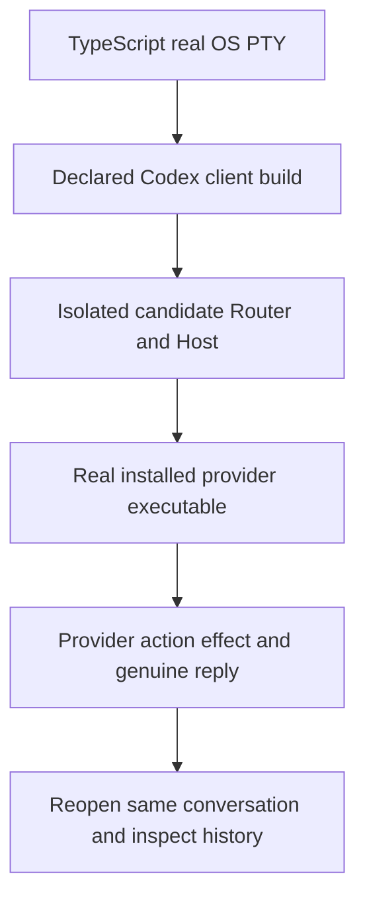

# How the two menus will be proved

This is a proof plan, not a test result. It consumes [U1–U8](requirements.md), [R1–R7 and V1–V7](specification.md), and the [proposed seams](program-design/contracts.md).

## One real journey, reused across both menus

**Needed lasting journey — provider menus.** Extend the existing `verify-codex-router` skill with one small TypeScript journey using the existing `verification/terminal/pty-process.ts`. It opens the declared client against an isolated Router, opens the actual provider conversation, types `$` and `/`, selects rows with actual keys, supplies distinctive arguments, and checks the real native effect and same-conversation reopen. Menu appearance and exclusion are decided by the separate real-screen observation below; raw cursor-control output is not a screenshot.

Do not rebuild the removed J1–J4 framework, provider-file oracles, launcher, scenario language, report server or emulator. Reuse normal debug launch/ownership and existing public event/history interfaces. Retain genuine session, action, operation and build identities with original observations, without credentials or unrelated content.

**Two observations, one lasting journey.** The TypeScript OS PTY run decides input, arguments, dispatch, effect, failure and history behavior. For visible membership, use an actual Ghostty window running the declared client with the same isolated Router/provider setup, controlled and captured through native computer-use. Search the known skill and command names in each menu and capture the visible results and section labels. Ghostty is an installed native surface in the current computer-use inventory, but no candidate menu is running there yet. This route remains to be executed; no emulator or alternative browser/server is introduced.

The native-window observation and TS driver may be separate sessions. Retain both genuine IDs and the same binary/setup identities; do not present one session's screen as the other's effect. If the native screen is inaccessible at execution time, appearance proof remains open.

**Execution target:** development/builds and real-path testing are assigned to Sunclaw. Router creates the helper sessions there; its normal Codex home and production processes remain protected. Preflight must establish its actual provider executable paths, usable credentials and isolated debug resources. A missing production Claude adapter is not permission to restart that Host. A local Sunbook observation cannot substitute for the requested Sunclaw run; if Sunclaw has no controllable real screen, visible-menu proof remains an exact target gap.

**Target choice is part of the open client decision.** A patched development Codex build is not the stock installed Codex executable. If the owner permits that client exception, the journey must name that build and run the real installed Claude/Cursor executable behind its qualified adapter. If the requirement remains the unmodified installed Codex CLI, the proposed new menus have no valid positive target. Do not silently substitute a candidate binary and claim installed-client acceptance.

## U1 — Provider skills

**Proven by:** open `$` in the real terminal, inspect the provider's skill rows, select one, and observe that skill's native effect with the supplied arguments.

- **Capability / R / seam:** skills / R1 and R3; injected provider shim update → Router action view → chooser → typed ProviderPromptSubmission → actor check → real ACP prompt.
- **Reference:** C1/C3 and the provider's qualified effective skill identities for the controlled workspace.
- **Target / journey:** declared candidate client and Router, real installed provider, normal home, isolated debug resources; needed lasting provider-menus journey above.
- **Pass:** the native screen shows the expected skill and any inferred indication, a known other command does not appear, and the PTY run establishes that the actual provider effect matches the chosen skill and exact arguments. A menu-only acknowledgement or echo fails.
- **Reuse:** current PTY helper and its permanent tests qualify I/O/ownership only; the new interactive observation remains needed.
- **Unverified:** provider-specific canonical names and collision behavior until qualified; unsupported agents; any changed-client target not yet authorized.

## U2 — Other provider commands

**Proven by:** open `/`, inspect its provider-command section, select a known non-skill command, and observe its real provider behavior.

- **Capability / R / seam:** commands / R2/R3; action view → provider popup item → typed submission → actor validation/preparation → native execution.
- **Reference:** C2/C3 and the provider's qualified effective non-skill command set; client-local controls stay distinguishable.
- **Target / journey:** same declared builds and needed lasting journey, shared with U1.
- **Pass:** the native screen shows all expected exposed non-skill commands, excludes classified skills, and labels the unclassified fallback. The PTY run proves that a same-named client-local control cannot silently intercept the selected provider row. A bare typed collision retains the proposed local precedence; selected rows route to the provider. A build with hard-coded local rows alone fails.
- **Reuse:** existing client source characterization is a baseline, not feature proof. No existing journey currently observes this provider popup.
- **Unverified:** the meaning of “all” for native-only, non-advertised terminal controls; the unchanged stock client cannot be a positive target for this proposal.

## U3 — Each provider uses its own setup

**Proven by:** run the same two-menu journey in two controlled provider contexts with deliberately different actions; switching context must switch the rows and invocation owner.

- **Capability / R / seam:** skills, also serves commands / R1–R5; provider-owned action identity and thread binding.
- **Reference:** C1–C5, not Router's interpretation of provider files.
- **Target / journey:** same needed lasting journey, with qualified real provider contexts and explicit setup owned by each provider.
- **Pass:** an action present only in one context never leaks into the other, and the selected action runs in the intended real conversation. A global merged list fails.
- **Reuse:** none found for these new menus. Provider fixtures may establish expected behavior, but Router must not implement a duplicate discovery oracle.
- **Unverified:** exact provider setup access needed for controlled positive and collision cases; no personal files or private setup are implicitly authorized for collection.

## U4 — Standard ACP and selective exceptions

**Proven by:** exercise provider evidence, convention, declared heuristic, unclassified fallback and absent/malformed extension cases; display the distinction while ordinary conversation remains usable.

- **Capability / R / seam:** skills, also serves commands / R1–R5; injected shim, evidence-bearing classification, typed submission and existing extension negotiation.
- **Reference:** ACP extensibility rules, the owner-approved Cursor slash fallback/heuristics, and each explicitly approved provider exception. No new universal kind key is assumed.
- **Target / journey:** focused schema/translation cases with real owning code, then supported and unsupported real-provider controls in the lasting journey.
- **Pass:** missing metadata remains unclassified and is retained in the slash fallback; inferred rows are marked; authoritative evidence is not overridden by a heuristic. Mixed labels retain all valid advertised rows. Ready-empty, no-list, closure and later replacement remain distinct. No unsupported custom request is sent. An undisclosed heuristic or silently dropped unknown row fails; a different implementation preserving these outcomes passes.
- **Reuse:** existing ACP metadata regressions cover retention/prose boundaries only, not this new interpretation.
- **Unverified:** provider extension authority remains selective; constructor injection and heuristics are approved design directions, not implemented results.

## U5 — No recreated provider manager

**Proven by:** inspect the delivered dependency/call paths and correlate actual menu entries with the provider's advertised action state.

- **Capability / R / seam:** skills, also serves commands / R1/R2/R4/R5; shim provenance, current view, and public client boundary.
- **Reference:** C5 and the explicit exclusions in U5.
- **Target / observation:** structural review of the eventual candidate plus the real provider journey. No standalone extra manual journey is needed for a structural claim.
- **Pass:** no filesystem discovery, plugin/marketplace registry, second setup state, extra service or native body expansion appears. A small metadata-only bridge passes; the removed catalogue design fails.
- **Reuse:** the current removed-code inventory helps scope review, not runtime acceptance.
- **Unverified:** future implementation has not been written.

## U6 — Actual terminal and provider proof

**Proven by:** the shared lasting journey drives actual keys into an OS PTY and observes both visible menu behavior and the intended real provider effect.

- **Capability / R / seam:** skills, also serves commands / R1–R3/R6; real client, Router and provider transport boundaries.
- **Reference:** V1–V3/V6 and the declared target identity.
- **Target / journey:** explicitly authorized client binary, real installed provider, isolated Router/Host; native client compatibility control remains separate.
- **Pass:** positive action effect, negative wrong-row controls, genuine ordinary reply, and complete bounded cleanup all match. Fixture-only success or a launched session alone fails.
- **Reuse:** the existing TypeScript OS PTY helper; no xterm/headless dependency. Existing metadata journey may be reused only after reading its actual entry and target constraints.
- **Unverified:** client target exception, provider capacity/auth readiness and visible-terminal observation are prerequisites for the future run, not proof supplied by this document.

## U7 — Preserve metadata, history and ordinary Codex

**Proven by:** observe useful command state outside prose, a fresh ordinary reply, and same-conversation reopen without another dispatch; run ordinary native Codex separately.

- **Capability / R / seam:** skills, also serves commands / R3/R4/R6; retained session items, translator, public read/reopen and current native route.
- **Reference:** C4/C6 and genuine input/reply/operation identities from the eventual controlled run.
- **Target / journey:** shared lasting provider-menus journey plus existing native and metadata journeys after source qualification. Run the native control using the same approved candidate client against the ordinary Codex app-server, including method-not-found fallback; retain a separate installed-client baseline.
- **Pass:** command metadata remains available through its intended view, genuine prose survives, and reopening causes no new input. A queued selection carries its typed identity until actual actor dispatch: removing it during queue wait refuses it; a still-present action submits once. Persisted history contains the existing submitted native text shape, not a serialized pending selection. A build preparing text in the service and losing the actor check, hiding notices, dropping metadata or resending on replay fails. Normal-home/profile and protected-process checks remain unchanged.
- **Reuse:** `crates/codex-router-host/tests/acp_metadata_projection.rs`, service metadata tests, and PR162's submitted-prompt tests cover their actual scripted boundaries. The submitted-input publication and generic TS PTY helper were ported from PR162 onto #173 in foundation commit 6e98f4667. Their old-head proof does not verify this new base: rerun the affected checks on Sunclaw. They are foundation dependencies, not substitutes for installed-provider/menu proof. The separate Quota/Sessions TUI apparatus does not establish provider-menu coverage.
- **Unverified:** fresh installed-provider behavior and any new live/replay mapping remain to be observed. No Python, production replacement, installation or release is authorized by this proof plan.

## U8 — Dependency-injected provider shims

**Proven by:** use the same menu consumer with two differently shaped provider shims and the default ACP shim; inspect the crate dependency direction.

- **Capability / R / seam:** skills, also serves commands / R7 / runtime-owned interface, Host construction, separate concrete shim crate.
- **Reference:** C7 and the approved dependency-injection boundary.
- **Target / observation:** focused tests at the real runtime constructor and structural dependency review; the lasting journey still uses real providers for product claims.
- **Pass:** runtime and service do not import concrete provider implementations; each session receives its own shim; changing a test shim changes only supplied metadata and native invocation preparation. Another session's classification cannot leak. A provider-name switch in the UI or a dependency from runtime to the concrete crate fails.
- **Reuse:** existing provider setup and lifecycle remain real in integration; do not create a standalone harness or a DI container.
- **Unverified:** proposed crate and interface do not exist in product source yet.

## Before a run is called sufficient

Every identity and result must name its actual client/provider/Router target. Existing helper self-tests prove the helper only. A candidate client is not stock Codex; a scripted provider is not Claude or Cursor; preserved metadata is not a working picker. Missing required observations stay open and are never converted into a pass by editing this plan.
