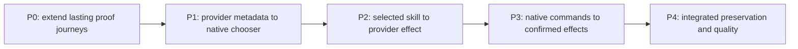

# Implement the existing Codex CLI contracts through ACP

Keep Codex CLI unchanged. Complete the shared app-server face and inject the provider-specific metadata, skill invocation and compaction behavior described in the reviewed design. Deliver one coherent change; make its real skill path work before calling the bridge complete.

This is a **plan-only** result. None of the implementation slices or runtime observations below has run. The riskiest assumptions are native Claude's final-Text skill expansion and concurrent skill reload preserving an active turn. The Verification Design assigns their real observations to S1 and S3; a failure returns to Program Design.

## Scope and authority

| Canonical field | Value |
| --- | --- |
| Plan path | `docs/specs/2026-10-27-codex-cli-acp-shim/plans/2026-10-28-codex-cli-acp-shim.md` |
| Originating planner | `plan-implementation` |
| Planning result | `ready` |
| Governing basis | `reviewed-four-document-design` |
| Requirements | [requirements.md](../requirements.md) |
| Specification | [specification.md](../specification.md) |
| Program Design | [program-design.md](../program-design.md) |
| Verification Design | [verification-design.md](../verification-design.md) |
| Review/remediation | Retained independent four-document review: Router message `01a180aa-120d-72e0-9bd8-e3a4556cf780`, service `0ff962c5-7fa3-4c18-a5ca-1bbe8db09e89`; ready, all corrected anchors verified; Lead accepted with explicit runtime limits |
| Planned-at branch / HEAD | `design/codex-cli-acp-shim` / `e9514c8ff91158a8e8bbbb5995e8f9f9743f23b0` |
| Current applicability | Includes fetched `origin/main` `e16e89e5158a5425ccb6c59c5c694478c76556f9`; reviewed `cec135a85` contracts/runtime split unchanged. Later ACP delta only cfg-gates an unused test import. |
| Requested terminal | `plan-only` |
| Delivery grouping | `single:existing-cli-acp-provider-adaptation` |
| PR topology | `not-applicable` to this plan-only request; if later commissioned for delivery, keep this one deliverable in one PR |

Tracking selection stays with the existing Agent Router work thread, root `01a1661a-4f94-78ed-a4c8-d08dd6e1e105`; no new tracker. The Lead authors/integrates. Existing transport, queue, settings and native/reverse Codex routes retain their owners. No client extension, scanner, installation manager, new persistence, second provider process, arbitrary slash-menu feature, migration, release or production replacement is authorized here.

## Repository anchors and strategy

| Current source | Current behavior / implementation surface |
| --- | --- |
| `crates/collaboration-runtime/src/router_session_app_server_methods.rs` | Empty `skills/list`; content decoder rejects structured Skill. Change only existing native encoding/decoding and operation admission. |
| `crates/collaboration-runtime/src/router_session_app_server.rs` | Native connection and hub/command composition. Add connection-local cwd binding and nonblocking skill-view subscription here. |
| `crates/collaboration-contracts/src/session_command_port.rs`, `session_event_hub.rs` | Existing provider-neutral command/read ports. Add submission envelope, typed refusal and compact/read capability as Program Design specifies. |
| `crates/codex-router-host/src/provider_session_command_port.rs`, `provider_acp_delivery_route/` | Existing Host forwarding/FIFO and turn-start waiter. Carry selections losslessly; refusal must resolve immediately before a nonexistent turn-start wait. |
| `crates/acp-client-runtime/src/provider_session_actor.rs`, `provider_item_projection.rs` | Sole ordered sender and existing tool-ID/status projection. Prepare at dispatch, publish current inventory and normalize the typed compaction hint here. |
| `crates/codex-router-host/src/provider_startup_composition.rs`, `global_claude_executable.rs` | Host constructor/launch injection and actual native-Claude binding. Preserve routing environment and supervision. |
| `crates/session-event-model/` | Shared validated domain envelope/view; preserve persisted PromptContent and SessionItem discriminants. |
| `.agents/skills/verify-codex-router/references/acp-metadata.md`, `verification/observations/acp-metadata-*` | Existing real-client/public-observation route, exact-target checks, live/history controls and owned cleanup. Extend rather than create a general verifier. |

Use five serial slices. P0 makes the required lasting proof route executable. P1 completes listing through real public provider metadata. P2 completes invocation through the same actor. P3 completes command effects. P4 closes aggregate quality and preservation proof. All changed contracts are cut over with their first vertical consumer; no unused interface-only commit or parallel implementation lane is needed. Splitting independent PRs would leave an incomplete picker or incompatible envelope, so it buys no reviewable standalone behavior.



## Execution slices

### P0 — Extend the existing proof route

Write surfaces: existing verification skill's ACP recipe; `verification/observations/` and its permanent oracle tests; small permanent provider fixture skill under `verification/fixtures/`. Keep actual client driving on the existing system PTY/computer-use route; do not replace it with a terminal emulator or fabricate input captures.

Add the bounded observer entry `verification/observations/acp-cli-capabilities-observation.ts`, accepting `--journey skills|commands|lifecycle <plan.json>`. This is a **new command to implement**, not an existing executable. Reuse existing target/process/public-session/PTY validation. Its plan extends the existing declared target with the selected journey's input capture and expected fixture-owned effect. Retain raw API/protocol observations before reduction; no provider transcript-file reads. S1/S2 are the needed lasting journeys; S3 extends the existing metadata/control journey. Build all three before P1's first real observation.

Independent oracles: native 0.164.0 request schemas and Specification C1–C3; fixture effect marker absent from the literal prompt; actual public tool/status and terminal records; original PTY bytes. Permanent negative cases reject input echo, empty inventory, ordinary response posing as skill execution, missing/failed compaction marker, changed target and a restarted/cancelled turn posing as reload preservation. Layer: observer unit/contract tests plus real target journeys; no helper-call-count oracle. Pre-change signal: current face has no first-session skills, rejects Skill, and does not admit compact; the real observer must report those failures without setup failure being counted as RED.

Commands after implementing this slice: `pnpm --dir verification run test:observations`, plus its check/lint/format gates. The observer may read an isolated target but cannot start model work itself. The driver/operator declares exact synthetic sessions and drives their real CLI; task-owned cleanup follows the existing recipe. External dependencies: installed Codex 0.164.0, Claude ACP 0.81.0/SDK0.3.280/native2.1.312, usable authorized isolated provider capacity, signed normal Host build. A stand-in may test the observer's negative cases, never replace S1/S2/S3. Stop if the real entry cannot be observed; return `verification-design-gap` instead of another framework.

### P1 — Provider metadata reaches the existing chooser

Write surfaces: new `crates/acp-provider-adapters/`; new private `providers/claude-acp/`; actor/runtime exports and shared skill-view types; existing hub/read port; native list/binding code; Host composition and manifests. Add no native-client files. All P1 interfaces have their first consumer in P1; P2 consumes the same descriptor/reference.

Implement Program Design's same-process public-library wrapper and small consumer-owned trait. The TS package's peer/dev pins qualify the installed library; deterministic generated `.mjs` contains only Router code and remains an external import of the canonical official library/SDK. Embed it in the adapter crate and launch with the existing executable/arguments/environment. Preserve 0.81.0 policy/logging/disposal behavior. Standard/unqualified custom launch remains original and skill-unavailable. Define package scripts `build`, `check`, `lint`, `format:check`, `test` and `build:check`; the last regenerates in memory or task output and fails a stale checked-in asset. Reuse existing TypeScript tooling conventions, no root workspace or runtime install.

Forward original notifications immediately, coalesce public metadata controls, guard query and lifecycle object identity, classify only unique effective advertised rows and expose unknown/empty/unavailable distinctly. Exercise differing reload results, identical echo, hidden builtin changes and late results after load/close with controlled promises. Readiness never waits on metadata; binding/view changes send existing `skills/changed`. Use the specified logical absolute reference and native presentation fields; create no file there.

Pre-change signal: a real native `skills/list` returns no rows while the provider advertises a known fixture. Focused proof: table/property cases for metadata classifications and logical reference round-trips with foreign/cwd/ambiguous rejection; actor/hub interleavings use explicit held updates, not sleeps. Oracle: C1 and the public producer declarations, consumed by the real Rust decoder. First integration gate: real TS-produced update through the actual Rust/actor/hub/native face. Run S1 listing portion before first model prompt and S3 active-turn reload/shutdown/no-list controls. If reload disturbs an active turn, return to Program Design; do not add a prompt gate.

Quality: scoped Cargo check/test across `session-event-model`, `acp-client-runtime`, `acp-provider-adapters`, `collaboration-contracts`, `collaboration-runtime`, `codex-router-host`; all private TS scripts; dependency direction/module-cycle ratchet. No new external service is required. A controlled Query can verify concurrency logic; only the real provider can earn S1/S3. No runtime API/metadata missing from the pinned package may be replaced with private patching or discovery.

### P2 — Structured selection reaches the provider skill

Write surfaces: native input codec, shared `ProviderSubmission`, command ports/Host forwarding/FIFO/actor dispatch and Claude `prepare`. Update every ordinary-input caller atomically to carry `skills=[]`; leave persisted content unchanged. Carry existing input identity and exact text/images; validate logical scope at entry and current skill membership after queue waits. Return typed pre-dispatch refusal through the existing dispatch oneshot and command result, so the Host never waits for a turn-start that will not occur.

Implement C2's single-selection full-name/byte-range transform, including colon-qualified names, leading/nonleading token, exact prefix/suffix and original images with final command Text. Reject conflicting/stale/ambiguous/unsupported multi-Text, multiple-Claude and selected-steer forms with zero provider sends. Ordinary steering stays on its current path; native Codex remains transparent.

Pre-change signal: structured Skill input is rejected by the current native face before it reaches the provider. Focused proof: table/property round-trips for references and immutable UTF-8 byte ranges; real actor held-queue interleaving removes a selected skill before dispatch and observes refusal. Oracle: C2 literal transform examples and native input schema, not production splitting helpers. First integration gate: native structured selection through actual Host/queue/actor to captured ACP content; existing oneshot observes immediate refusal. Run S1 through the real chooser, with leading/nonleading fixture skill, arguments and image, observing its provider-owned marker once. Verify no file exists at the logical reference and unsupported management changes no setup. Run native Codex control on its original route.

Quality: the same touched Rust packages, formatter and scoped clippy, plus existing native input/order/steer/history tests. External provider availability is required only for S1; test stand-ins never close the actual expansion assumption. If final-Text placement does not expand on the declared native target, return to Program Design; do not fall back to model instructions or file loading.

### P3 — Existing commands produce confirmed provider effects

Write surfaces: existing native operation admission and error codec; `SessionCommandPort::compact`; Host/actor command forwarding; Claude adapter; existing item projection/native item codec. Retain existing model catalogue/settings validation. Admit `thread/compact/start` as its existing native operation; idle-only compact sends once through the actor, typed busy refuses. Keep explicit compact context in the existing turn, and normalize upstream version1 compaction metadata through the existing tool ID/map/status. No new stored variant, parallel queue or effect log.

Pre-change signal: compact is method-not-found; a normal response cannot earn compaction success. Focused proof: table-driven success marker+successful terminal, absent/failed/in-progress marker, automatic trigger, cancellation, status-only update and uncertain dispatch. Oracle: C3, upstream contextCompaction v1 and the native turn/item schema. A tool merely titled Compact must fail the semantic oracle. Real native face/Host/actor tests assert request correlation and both item/turn outcomes. Invalid model must reject, never fall back. Existing mode/permissions/config operations retain equivalent supported semantics or explicit unsupported errors.

Run S2 through actual unchanged `/compact` and model selection, including native busy handling, confirmed compaction marker/terminal and model readback. Run affected S3 controls for automatic compaction, interrupt, approval, history and uncertain response without replay. Quality: affected Rust packages, private TS checks if producer touched, verification package gates. An ACP stand-in can prove error branches; it cannot close the actual provider compaction/model observations. Stop for any public/schema/storage/security change the design did not name.

### P4 — Close the integrated proof boundary

Write surfaces: only bounded corrections from preceding slices, lasting proof recipes and task evidence. Run S1, S2 and S3 together on one exact committed clean candidate/declared versions using the existing isolated normal-build Host and real installed client; do not infer native Codex or Cursor preservation from Claude. Reuse already-current identical-path observations where their dependencies have not changed. Retain genuine source/build/tool/endpoint/session identities, native/ACP observations, original PTYs, exits and owned cleanup. No fixture or stub still in the real path can pass the delivery claim.

Run the repository's required gates from root: Rust format, workspace clippy, module cycles, file-size check and applicable tests; verification package check/lint/format/test; dependency policy/audit and SQLx checks as current CI requires. Ordinary input/lifecycle coverage is a preservation gate, not a reason to add every unrelated UI journey. Account for existing unrelated failures with exact cause/ownership; never weaken a required proof. The work remains unimplemented until every requirement's mapped outcome and quality gate pass. A later delivery commission owns independent implementation review and PR readiness; this plan itself publishes/merges nothing.

## Obligation-to-proof map

| Obligation / VD row | Slice and deciding command / observation | Wrong result it must reject |
| --- | --- | --- |
| U1 / R1, C1 | P1; S1 listing: planned `node verification/observations/acp-cli-capabilities-observation.ts --journey skills <plan.json>` after actual CLI capture | Empty hardcoded face, blocked startup, guessed command kind, wrong conversation, no late invalidation |
| U2 / R2, C2 | P2; full S1 with actual chooser and provider-owned effect, native control; scoped actor/input tests | Input echo/body emulation, wrong final block, lost bytes/image, stale selection sent, silent first-only behavior |
| U3 / R3, C3 | P3; S2: same planned observer with `--journey commands`; native RPC/marker/settings readback | Ack/prose without compaction, automatic marker substituted, busy never cleared, invalid model fallback |
| U4 / R4, C4 | P1/P3/P4; S3: same planned observer with `--journey lifecycle`, plus existing `acp-metadata-observation.ts <metadata-plan.json>` | Reload interrupts turn, lost output/history, metadata prose leak, duplicate uncertain send, leaked process |
| U5 / R5, C5 | P1 producer/consumer integration; `pnpm --dir providers/claude-acp test`; scoped adapter/actor tests; `cargo tree -p codex-router-host -e normal,build` | Reverse dependency, private patch, second SDK/consumer/process, stale publication or reload loop |
| U6 / R6, C6 | P1/P4; `pnpm --dir providers/claude-acp run build:check`; architecture and source diff checks | Stale embedded asset, scanner/store/client extension, cycle growth or config rewrite |

Project proof-layer source: existing ACP verification recipe and `scripts/proof-matrix.sh::row_layer` distinguish unit, integration, smoke, e2e and structural observations. Keep those distinctions. The actual-client S1/S2/S3 observations are end-to-end; producer/consumer and actor interleavings are integration; pure parsing/classification is unit; dependency/asset gates are structural. Use table/property cases where the same rule governs many names/ranges/statuses; a single happy example does not establish those rules.

## Existing test disposition

| Existing coverage | Disposition / reason |
| --- | --- |
| `router_session_app_server_tests.rs` skill-list expectation | Repair only the obsolete unconditional-empty expectation; retain initialize/native-schema assertions and add provider-view cases. No broad snapshot acceptance. |
| Native blocking/cwd/order/model/reattach/TUI tests | Keep; extend the owning tests for nonblocking skill refresh, correct binding and input forwarding. They protect existing behavior. |
| `acp-client-runtime` prompt/steer/item projection tests | Keep; add typed skill/compact cases beside the owner. Preserve ordinary tool and status-only update assertions. |
| Host `acp_metadata_projection` live/replay and delivery/queue tests | Keep; extend where the envelope changes. Metadata must stay outside prose and history/control outcomes remain intact. |
| Verification observer oracle tests | Keep; extend its real source/PTY/target validation and add new false-green cases. Do not replace raw observations with a receipt-only assertion. |

No existing test is scheduled for removal. Temporary test files, fixed sleeps, timeout inflation, test-support production features and fake Codex home are not part of the proof route.

## Commands and completion gates

These existing commands were checked at the repository's manifests/CI; they are **planned runs**, not passes from this design/plan task. Execute narrow package tests after each relevant slice and the aggregate required gates once the implementation is coherent. New package/observer commands above are to be created in P0/P1.

```sh
cargo check -p session-event-model -p acp-client-runtime -p acp-provider-adapters -p collaboration-contracts -p collaboration-runtime -p codex-router-host
cargo test -p collaboration-runtime router_session_app_server
cargo test -p codex-router-host --test acp_metadata_projection
cargo test -p acp-client-runtime
cargo test -p acp-provider-adapters
cargo fmt --all -- --check
cargo clippy --workspace --all-targets -- -D warnings
cargo nextest run -p workspace-architecture-check --run-ignored only
node verification/tooling/check-rust-file-size.ts
pnpm --dir verification install --frozen-lockfile
pnpm --dir verification run check
pnpm --dir verification run lint
pnpm --dir verification run format:check
pnpm --dir verification test
cargo deny check
cargo audit
node verification/tooling/prepare-sqlx.ts --check
```

Use the repository's signing runner and normal-dependency `automation-debug-host` bin. Build manifests and exact launch allocation follow the existing ACP metadata recipe; inspect its current help before starting the isolated Host. Do not install unreleased executables, replace production, or copy credentials. Missing capacity can leave real observations unverified while focused implementation proceeds against its declared interface; it cannot earn completion.

## Stop and replan conditions

- A needed API/metadata is absent in the declared provider, or skill expansion/active-turn reload violates S1/S3: return to Program Design with source/observed failure. No client extension, scanner or fallback emulation.
- A required observation cannot distinguish the wrong implementation: return the exact `verification-design-gap` before depending on it.
- Any proposed change to native public contracts, stored formats, approval authority or ownership is outside this plan and returns to its design owner.
- All normal/runtime/code gates must preserve proof strength; no failed check is erased, weakened or called unrelated without establishing its cause.

Completion after a future delivery commission means all six mapped outcomes, required quality checks and real observations are current, no stand-in closes a real interaction, and every remaining limitation is named. This plan-only request ends with the complete plan and its HTML reader.
