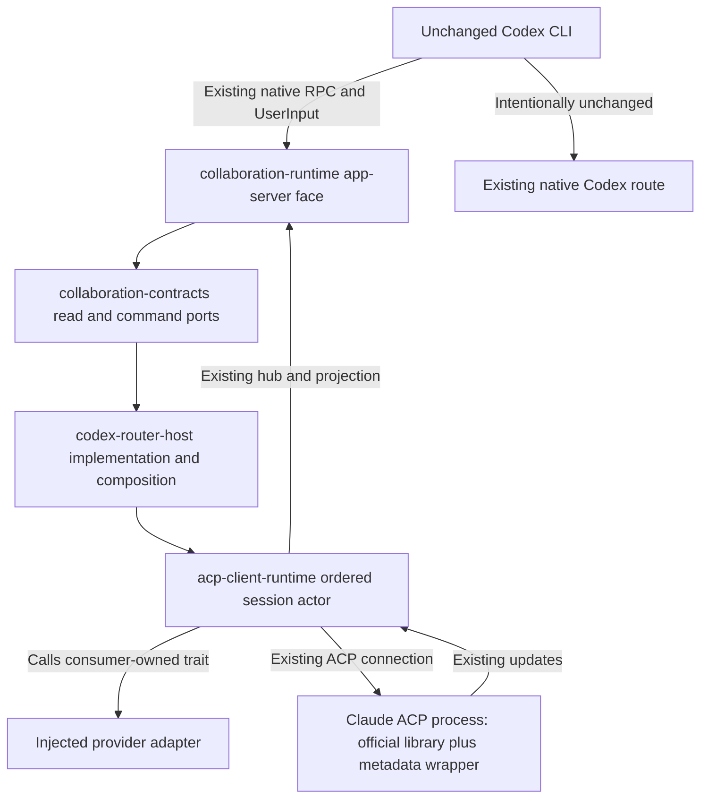
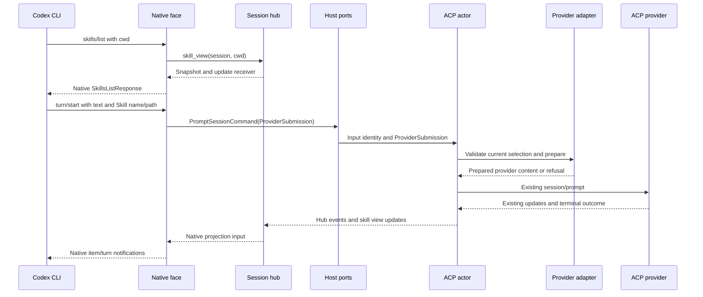

# Existing app-server face with injected ACP providers

Inputs: [Requirements](requirements.md) and [Specification](specification.md). Proof: [Verification Design](verification-design.md).

The CLI already has the relevant contracts. Complete the provider-facing app-server implementation and inject the differences at the ACP session boundary. Do not extend the CLI.

## Source facts and package baseline

Installed client: `codex-cli 0.164.0`; official source pin `6aaac694803004a63c6f393d153c96d22521a6b9`. Sources: [skill submission](https://github.com/openai/codex/blob/6aaac694803004a63c6f393d153c96d22521a6b9/codex-rs/tui/src/chatwidget/input_submission.rs#L275), [typed app-server calls](https://github.com/openai/codex/blob/6aaac694803004a63c6f393d153c96d22521a6b9/codex-rs/tui/src/app_server_session.rs#L1452), [slash dispatch](https://github.com/openai/codex/blob/6aaac694803004a63c6f393d153c96d22521a6b9/codex-rs/tui/src/chatwidget/slash_dispatch.rs#L332).

The reviewed implementation baseline is the pinned default-branch commit `cec135a85e924b4404eb4b552e8565ef5c0ea8f1`, which contains the merged #173 contracts/runtime/service dependency split. Use those committed packages; do not import the superseded provider-menu branch. On October 28 the owner requested main integration: dedicated branch `design/codex-cli-acp-shim` now contains fetched main `e16e89e5158a5425ccb6c59c5c694478c76556f9` through merge `e9514c8ff91158a8e8bbbb5995e8f9f9743f23b0`. The intervening ACP change only gates a test-only import; these design owners/contracts remain applicable. The former detached checkout's complete dirty state is preserved separately rather than imported into this design.

At that baseline, `collaboration-runtime/src/router_session_app_server_methods.rs:85` returns empty `skills/list`; `parse_turn_input` accepts text/images and rejects structured skills. `router_session_app_server.rs::handle_app_server_rpc` does not admit compaction. The Host already supplies `SessionCommandPort`, the event hub and provider model catalogue. The existing ACP actor remains the sole Router-side sender. These handlers/contracts are identical to the earlier inspected split pin; the actor's current baseline was reopened separately.

## Entity homes before components

| Entity | Semantic authority | Package / module home | Boundary shape and state |
| --- | --- | --- | --- |
| E1 | Existing provider session owner | Existing `acp-client-runtime` actor; existing Host session binding | Existing `SessionRef`, provider session ID and cwd; existing persistence unchanged |
| E2 | Provider; adapter interprets its emitted metadata | Modified `session-event-model`: provider-neutral shapes; modified ACP actor: current view; new concrete `acp-provider-adapters` crate | `ProviderSkill` and `SkillInventory` domain types; ephemeral per session/cwd, not persisted catalogue |
| E3 | Native protocol defines the request; provider defines the effect | Modified `collaboration-runtime` face and `collaboration-contracts` command boundary | Existing native request schema → typed provider-neutral operation → existing ACP request/content; correlation unchanged |
| E4 | Existing session actor at dispatch | Modified `session-event-model` submission envelope, existing contracts/Host forwarding | Ordered content plus typed selected skill; existing input identity and queue lifetime, no new store |

## Composition and crate hygiene



Arrows above are runtime calls, not dependency direction. Compile-time dependencies are:

| Crate | Owns / changes for | Allowed dependencies and exclusions |
| --- | --- | --- |
| `session-event-model` | Shared validated skill view, submission envelope and selected-skill identity | Existing lower domain types; no provider implementation or ACP SDK; leave persisted `PromptContent` variants unchanged |
| `collaboration-contracts` | Provider-neutral read/command capabilities used by faces | Domain types; no Host or runtime implementation |
| `collaboration-runtime` | Native request decoding, response encoding and hub projection | Contracts, domain and existing native integration; no concrete provider adapters |
| `acp-client-runtime` | Ordered ACP transport, session lifecycle and the small trait it consumes | Existing ACP SDK and domain types; never imports `acp-provider-adapters` |
| new `acp-provider-adapters` | Claude-specific interpretation and the default standard ACP implementation | Runtime's narrow public trait/types; no Host, database, filesystem loader, process launch or UI dependency |
| `codex-router-host` | Select configured provider implementation and inject it | Both runtime and concrete adapters; no provider parsing in composition code |
| new private `providers/claude-acp` TypeScript package | Compose the official Claude ACP library and expose its public SDK skill metadata in the existing ACP stream | Exact pinned official library/SDK types; no Rust runtime dependency, copied loader, CLI UI, second agent process or global installation |

One new Rust crate prevents the generic runtime from depending on concrete providers. One small private TypeScript package belongs at the existing Node provider boundary because the needed public SDK object lives there. It is not another service. Its peer contract and locked development dependencies qualify the official library/SDK; runtime imports the already-qualified installed library, not a second copy. No root Node workspace is required. Keep responsibility-named modules; add no contracts crate, registry, service locator, plugin loader or crate per provider. Reuse workspace versions/lints and reject module-cycle growth.

Build that private package to a self-contained `.mjs` containing only Router integration code, leaving official library imports external. Embed that generated asset in `acp-provider-adapters`; generation/checks must prove it matches its TypeScript source, and normal Cargo use needs no network install. Host uses the existing `ExternalProviderLaunch` executable/arguments/environment to run the qualified Node executable with `--input-type=module --eval <embedded asset> -- <official library URL>`. There is no shell interpolation, script cache or runtime file write. This replaces the stock Node entrypoint in the same single ACP process and preserves the existing native Claude child and Host supervision. It does not start an extra provider or transport.

Host launch qualification owns the narrow package location: resolve the configured/default executable through its real symlink, or the declared pnpm `cmd-shim-target` marker, then validate the official package name/version, declared bin target and exported library subpaths. Canonicalize the exported library file before passing its absolute file URL; resolve the SDK with `createRequire(canonicalLibraryURL).resolve("@anthropic-ai/claude-agent-sdk")`, then import that absolute URL. A bare SDK import from `--eval` could select a project's copy and is forbidden. This resolution was exercised against the installed pnpm package without importing/starting it. Never evaluate a shell shim or search provider skill directories. Use the provider's qualified Node runtime and preserve existing launch environment: both Router API routing bindings and `CLAUDE_CODE_EXECUTABLE` bound to global native Claude by `provider_startup_composition.rs:84-87` and `global_claude_executable.rs:5,27-31` at the pinned baseline. A custom executable/argument recipe that cannot be qualified keeps its original launch with the default standard-ACP adapter and an unavailable skill capability; it must not be silently rewritten. No owner config, installation manager or global package change is needed.

## Small consumer-owned interface

Proposed Rust shape; ordinary constructor injection, one adapter instance per existing ACP session:

```rust
pub trait ProviderAdapter: Send {
    fn observe(&mut self, event: ProviderMetadataEvent)
        -> Result<ProviderObservation, ProviderAdapterError>;
    fn prepare(&self, operation: ProviderOperation)
        -> Result<PreparedProviderOperation, ProviderAdapterError>;
}
```

`ProviderMetadataEvent` is `AvailableCommands { entries, meta }`, `ToolUpdate { id, status, meta }`, a bounded supported extension, or closure. Each neutral command entry has name, description, optional input hint and opaque `_meta`; preserve the update-level `_meta` too. Raw ACP SDK types stay at the ACP edge. `ProviderObservation` contains `skills: Option<SkillInventory>` and `tool_semantic: Option<(ToolId, ProviderToolSemantic)>`; the closed semantic enum initially has only ContextCompaction. `SkillInventory` is `Unknown | Available(Vec<ProviderSkill>) | Unavailable(SourceUnavailable) | Ambiguous`; Available-empty is established empty. Common view shapes live in `session-event-model`, so native and ACP runtimes need no reverse dependency. Adapter-only event/semantic types belong to `acp-client-runtime`. Errors are closed: unavailable, ambiguous selection, invalid arguments, unsupported operation, malformed metadata.

`ProviderOperation` is `InvokeSkill { selections, content } | Compact`. The actor validates the selected identities; the injected implementation then applies C2's capability and content-layout rules. Claude supports one distinct selection anywhere in the normal single native Text block, with images; it splits prefix/command and puts the command Text last. A multi-selection or selected-steer operation is explicitly unsupported by that adapter, with zero sends. The generic runtime never assumes every provider parses the first Text block. Standard model/config/mode setting remains on its existing path. Add an operation variant only for a demonstrated provider difference.

`PreparedProviderOperation` is typed `Prompt { content }` or a version-qualified existing ACP extension request. The actor executes it on its existing connection and cancellation/lifecycle path. The Rust adapter performs no I/O. Host passes its constructor during existing session creation/load. The Claude provider package below owns SDK control calls within the existing provider process; no second supervisor, query stream consumer or agent process is introduced.

### Cross-crate shapes and ports

| Shape / home | Fields and invariants |
| --- | --- |
| `ProviderSkill` / `session-event-model` | Nonempty, whitespace-free `token_name`; canonical provider `invocation_name` without its invocation sigil; human `display_name`/`description`. Only advertised, uniquely classified invocable rows enter Available. No native path, duplicate enabled state or provider filesystem discovery belongs in this descriptor. |
| `ProviderSkillReference` / `session-event-model` | Validated nonempty service, endpoint, existing session and native invocation-name components. These copy existing identities and generate no new UUID. Logical identity only; no Codex path encoding or filesystem behavior. |
| `SelectedProviderSkill` / `session-event-model` | `token_name`, decoded `reference`, and resolved content Text-block index / token byte range. The native codec validates the reference and resolves C2's entire metadata-selected token, including colon-qualified names; do not infer a shorter name from bare-mention parsing. Ranges must be UTF-8 boundaries in immutable submitted content. Description/list revision are not identity. |
| `ProviderSubmission` / `session-event-model` | `content: Vec<PromptContent>`, `skills: Vec<SelectedProviderSkill>`. A separate internal envelope; existing serializable `PromptContent` is not widened. Ordinary Router messages construct it with `skills=[]`. |
| `SkillViewAttachment` / `collaboration-contracts` | `snapshot: SkillInventory`, `receiver: tokio::sync::watch::Receiver<SkillInventory>`. Existing per-session hub owns the latest-value channel, subscribing and reading atomically; no new event log or persisted record. |
| `SessionEventHub::skill_view` / `collaboration-contracts` | `skill_view(session: SessionRef, cwd: PathBuf) -> HubFuture<SkillViewAttachment>`; checks exact existing session/cwd, no fallback session search. |
| `SessionCommandPort::compact` / `collaboration-contracts` | `compact(SessionTargetCommand) -> CommandFuture<SessionTurnHandle>`; resolves only after actual provider dispatch/start or typed refusal, not when a local queue accepts it. |

`SkillInventory`'s unavailable reason is `SourceUnavailable | Closed | ProviderFailure | UnsupportedRefresh`. The native codec alone owns presentation: token → `name`; label → optional `interface.displayName`; description → `description`; unsupported optional interface/dependencies → absent; encoded logical reference → `path`; advertised membership → `enabled=true`; unknown plugin ownership → `pluginId=null`. Bridge rows use `scope=System`, meaning supplied by this integration, not a provider installation-scope claim. Native Codex metadata passes through unchanged. Do not require filesystem provenance the user did not request.

## Native contracts mapped separately

| CLI interaction | Native boundary | Shared shim responsibility | Provider responsibility |
| --- | --- | --- | --- |
| `$` chooser and `/skills` listing | `skills/list`, including cwd and refresh parameters | Encode the native `SkillsListResponse`, grouped by requested cwd; surface source errors using native error fields | Supply actual provider skill identities and classification from provider output |
| Selected `$skill` | `turn/start` / `turn/steer` input containing `skill { name, path }` | Decode and retain a typed selection with the ordinary ordered content; resolve it for this endpoint/cwd, then pass it intact to dispatch | Prepare native skill invocation, preserving arguments and attachments |
| `/compact` | `thread/compact/start` | Admit this existing method, correlate it to the existing session, use native response and lifecycle notifications | Map to qualified provider compaction, such as its advertised `/compact` ACP prompt; unsupported is an error |
| `/model` | `model/list` and model on the existing settings/turn flow | Reuse catalogue, validation and setting command; do not silently discard invalid model choices | Existing ACP config/model operation and its confirmed effective result |
| `/plan`, permissions and skill enable/disable | Existing collaboration/config/skill management requests | Map only contracts whose provider semantic is established; retain trust/security policy; unsupported is explicit | Existing advertised mode/config capability, or unsupported |
| `/new`, `/resume`, `/fork`, history and interrupt | Existing thread and turn operations | Reuse existing identity, load/resume and cancellation paths; unsupported fork remains explicit | Existing ACP session capability; no invented clone behavior |
| `/clear`, help, appearance, exit and other client-local controls | No provider RPC where the CLI owns the effect | Leave client behavior alone | None |

This table realizes the observable [C3 list](specification.md#c3-existing-command-operations); that Specification list owns expected behavior. The native protocol/schema remains the sole wire authority. Reuse existing exported schemas and validators; do not hand-maintain a parallel Codex request model. This design introduces no `providerActions/list`, command-menu schema, arbitrary-command injection or new client field. `command/exec` means shell execution; it is not a generic substitute for all slash commands.

### Connection binding, first list and refresh

The existing native connection loop owns `listing_by_cwd: Map<PathBuf, Unbound | Bound(SessionRef) | Ambiguous>`; the endpoint is fixed by its listener. This is connection-lifetime routing state, not a global catalogue. Successful non-overlapping explicit `thread/start`/`thread/resume` updates the binding. A read does not. Overlapping same-cwd binding requests mark it ambiguous, irrespective of reply order; a later non-overlapping explicit binding operation resolves it. Closing a conversation clears its binding. The native handler receives this connection state instead of querying every endpoint session to guess a target.

`skills/list` resolves C1's binding and reads the hub's current view without waiting for provider work. Unbound/Unknown projects to the native entry `{cwd, skills:[], errors:[]}`: no actions are currently available, and opening is not an error. The internal distinction from Available(empty) remains. Unavailable/malformed/ambiguous projects to the existing entry errors with the cwd as the error location. Add no deadline, timer, pending wire field or `nextCursor`. The connection subscribes to later view changes, and a replacement invalidates this transient projection. This avoids both a stalled blocking refresh and a spurious startup warning.

Every change to the binding or inventory sends the existing `skills/changed` notification on that connection. The pinned 0.164.0 handler in `chatwidget/protocol.rs:235-237` refreshes with `forceReload=true`; this is a committed flow, not a conditional future feature. Coalesce notifications in the existing event loop; the state itself is the latest complete snapshot. Do not add a watcher or timer. `forceReload` bypasses any face-side rendered-response cache and reads the actor's latest provider-authoritative view; the fresh setup/replacement view can satisfy that read. Where the provider supports an explicit refresh, the adapter may qualify it through the existing connection. Do not claim filesystem re-enumeration when no provider API exposes it. That additional freshness remains a named provider qualification limit. An unsupported refresh request is a read error, not an inventory mutation, so it cannot recursively trigger another `skills/changed`. Views from another connection or session never satisfy a read.

### Selection identity within the existing path field

The unchanged client matches `SkillMetadata.path` and returns it in `Skill{name,path}`. Its 0.164.0 `LegacyAppPathString` conversion validates absolute syntax, not file existence; picker/submission does not load a skill body. The native codec encodes the logical reference as `/__codex_router_skill_refs__/<service>/<endpoint>/<session>/<native-name>`, with every variable component UTF-8 base64url without padding. It uses the already-adopted base64 dependency in that codec, not in the domain or ACP actor. Decode it at the same native boundary, validate name/scope against the addressed thread, then forward the lossless logical reference. The actor revalidates that scope/name against its current inventory after queue waits; it has no Codex-path parser. Reject malformed/foreign/stale references. No generated file, file-existence claim, lookup or persisted registry is introduced. Source-file navigation/file-read annotations and file-scoped management are not supplied by these references.

This follows the source-backed path grammar while retaining the existing wire shape. Actual unchanged-client round-trip, duplicate/cwd handling and native help/management behavior remain mandatory implementation proof in Verification Design, not a reason to require provider filesystem metadata before designing the shim. Unsupported `skills/config/write` returns an explicit error and writes neither normal Codex config nor provider setup. Source references: pinned `utils/path-uri/src/api_path_string.rs`, `tui/src/chatwidget/input_submission.rs:305-341` and the native skill response types.

## Provider qualification and prior art

Keep three roles distinct: unchanged Codex CLI; native Codex as the existing backend; and the existing reverse-facing `codex-acp-adapter` crate exposing that backend to ACP clients. Preserve the native and reverse routes. Do not add an external Codex ACP endpoint or send native Codex through a second bridge merely to satisfy this work. The external `codex-acp` project is relevant prior art: its text-input path reaches native `collect_explicit_skill_mentions`, which recognizes names anywhere in Text, not merely its separate slash-command parser.

### Claude provider integration, using public APIs

Qualify the installed provider library `@agentclientprotocol/claude-agent-acp@0.81.0` at official source tag commit `d571358e267ed21ed0ec9ec2622fda8935535d57`, and its SDK `0.3.280`. The later inspected 0.81.2 source preserves the relevant contracts but is not silently substituted for the installed target. Their published exports include `runAcp()`, its returned `agent`, public `agent.client` and `agent.sessions[id].query`; the SDK publicly documents `reloadSkills(): Promise<{skills: SlashCommand[]}>` and `supportedCommands()`. No private method, AIR identity, upstream fork or raw transcript feed is needed.

The small provider entrypoint calls `runAcp()` and decorates **that owned agent object's** outbound `client.sessionUpdate` before the event loop processes input. Requests, settings, permissions, prompts, cancellation and history stay delegated to the library. On its first `available_commands_update`, use the same session query's public `reloadSkills()` and `supportedCommands()` to get the skill subset and effective namespace. Annotate only a unique effective skill row; a builtin-name winner, conflicting duplicate or terminal-bound name is not advertised as an invocable skill. Do not classify aliases by guessing from their spelling.

This private entrypoint must preserve the **0.81.0** bin's process envelope as well as its library calls. That version has no exported policy initializer: use its SDK's public `resolveSettings({settingSources: []})` and copy `effective.env` into the process environment before agent/SDK query creation, as its bin does. Resolve that SDK relative to the canonical official library as above; do not copy policy readers or permission logic. Preserve stdout exclusively for ACP, console redirection to stderr, the unhandled-rejection handler and optional `CLAUDE_AGENT_LOGS` logger passed into `runAcp`. Route stdin/connection closure and SIGINT/SIGTERM through public `agent.dispose()`, and discard pending metadata publication on shutdown. These are the stock provider's envelope behaviors, not new Router logging/configuration. It is a Host-selected private runtime asset, not a replacement global CLI command. Retain the actual upstream library/runtime version in qualification, and include the wrapper asset in build integrity checks. A package lacking these public APIs is an unsupported target, never a cue to patch private members.

The standard ACP command row remains authoritative. Private metadata is `_meta.codexRouter.kind = "skill"` on a qualified row, plus `_meta.codexRouter.skillStatus = "available" | "unavailable"` on the containing command update. Available with no skill rows establishes empty; unavailable distinguishes a failed SDK lookup from empty; absence means an unannotated provider. This is one scalar classification/status contract over existing ACP rows, not a second catalogue or a new RPC. The Rust `ClaudeProviderAdapter` validates these scalars at the existing opaque `_meta` boundary and returns domain types; the default implementation ignores them. Preserve all original non-skill commands. No file loading, unrestricted `_claude/sdkMessage` or account query is performed by the wrapper.

Maintain only session-local classification and one coalesced SDK metadata read. Forward an incoming standard list immediately as unclassified and start its metadata check without awaiting it in the notification callback; other updates and requests continue. Read public `supportedCommands()` on this path, even if the flattened ACP rows appear identical: its builtin/alias descriptors can distinguish a changed effective namespace that those rows erased. Reuse the prior classification only when both the original rows and those effective descriptors match. Initial setup or a genuine change calls `reloadSkills()`, then reads the effective descriptors again. An identical reload echo may cause a coalesced descriptor check but never another reload. While work is in flight retain only the latest source list; publish only against that current list and effective namespace, otherwise recheck the coalesced change. The Rust adapter treats an unclassified changed list as Unknown until the qualified replacement, retiring removed selections immediately.

`reloadSkills()` is a real **provider-owned disk/cache reload**, not a read-only getter. The chosen timing is the SDK's ordinary concurrent control path: it may run at opening or while a prompt is active, in response to an actual initial/changed command list. Do not gate, defer, cancel or resubmit a prompt around it. The SDK 0.3.280 implementation sends a correlated `reload_skills` control request through its existing transport/response reader; it creates no prompt or second consumer. The installed native Claude 2.1.312 handler has a reload/reply branch without a named interrupt or prompt-creation call; its minified helpers remain opaque, so that slice alone does not establish active-turn safety. Newly loaded definitions can affect subsequent provider skill resolution in that session; the wrapper does not promise to freeze its catalogue for an entire model turn. It must preserve that turn's existing stream, identity, cancellation and terminal outcome. S3 must observe that property on the actual integration; static inspection is not that runtime pass. Failure of that preservation rule returns to Program Design, not a planner-invented gate or fallback. The cost of this nonblocking integration is an actual provider reload on a genuine metadata change, not Router file loading or a setup write. No periodic refresh is introduced.

The reload result can differ from the list that triggered it. Its returned skill subset becomes the authoritative membership for the replacement, never the old cached subset. Join it with the latest public effective descriptors and the latest **upstream-advertised rows**, then publish the resulting qualified view once when it changes. A removed skill retires immediately. A newly loaded name not yet advertised by the stock provider is not fabricated as an outgoing row; its later real command update supplies that row. Do not reproduce the private provider filtering function. Differing results, identical echoes and incoming updates during the lookup all use the same latest-value coalescing rule; none is a reason to repeat the disk reload until another genuine source/namespace change. If a consistent unique join cannot be established, publish unavailable rather than a stale or guessed skill.

Annotate only upstream outgoing names; do not reproduce filtering or add withheld commands. A failed lookup sends the same standard list with skillStatus=unavailable; it does not block ordinary prompts or cause timed retries. Cache that failure for the unchanged input/descriptor pair; a genuine change or new lifecycle binding permits another lookup. Decorate the owned object's public new/load/resume/close/delete methods to replace or retire its ephemeral metadata-state object while delegating their original calls. Before an async send, require both that state object and `agent.sessions[id].query` to remain current. A load that reuses a query still invalidates old work. No generation counter, extra query reader or registry is needed. The SDK owns its control requests/abort. Host owns normal process lifetime and supplies the qualified library URL through the existing launch recipe.

The older filtered `_claude/sdkMessage` approach is not selected: the inspected provider starts its stream consumer at the first prompt, so it cannot establish fresh-session skill classification before the user has selected a skill. The public library composition closes that concrete gap without copying provider discovery.

For invocation, the Rust Claude implementation preserves images, emits optional exact prefix Text, then emits `/name` plus exact suffix as the final Text. `promptToClaude()` preserves those text/image blocks and order. The selected expansion position follows T3's native-Claude integration evidence; actual native expansion for this target remains S1 qualification. The designed supported form is a single selected skill anywhere in the normal composer Text. Unlike T3's broader fallback, do not repeat the whole prompt, trim bytes, instruct the model to read unknown files, or pretend several skills expanded natively.

For `/compact`, require the existing session to be idle, then send the provider's existing `/compact` ACP prompt through the actor; busy is the existing explicit refusal, not a queued synthetic turn. Its `ContextCompactionLifecycle` emits a standard synthetic tool call tagged `_meta.contextCompaction.version=1`, with `toolCallId` and terminal status; the Rust Claude adapter interprets that marker, not a title/text substring. Map in-progress/completed/failed and the existing prompt/cancellation outcome into native context-compaction and turn events. Only this compact turn's marker can confirm its effect; an explicitly automatic trigger cannot confirm requested manual compaction. A normal model reply without that marker cannot establish successful compaction. The newer `compaction_update` capability is not needed for the pinned legacy-tool-call route.

The normalized semantic is a hint to the existing `ProviderItemProjection`: retain its existing tool ID, item map and status, but use the canonical tool_kind string `contextCompaction` for this typed hint. Define its wire spelling once in `session-event-model` for both codecs; preserve it on status-only updates. No new SessionItem discriminant, stored layout, event log or second effect stream is introduced. The native item codec emits its existing ContextCompaction item; ordinary think tools stay ordinary tools. Explicit Compact context requires both a successful marker terminal and a successful provider prompt terminal. A failed marker fails the request; cancellation interrupts the native turn without waiting for a successful marker. Automatic compaction may emit an item during ordinary chat but cannot end that chat turn. Marker absence or unknown outcome never becomes success.

| Explicit compact's provider result | Typed marker | Native outcome |
| --- | --- | --- |
| Still running | Any current phase | Existing in-progress turn/item updates |
| Successful terminal | Completed | Completed context item and successful turn |
| Successful terminal | Missing, in-progress or failed | Failed turn: compaction was not confirmed |
| Cancelled | Any | Existing interrupted turn; await no success marker |
| Failed or uncertain | Any | Reason preserved; no replay |

Inspectable primary contracts: [published provider exports](https://unpkg.com/@agentclientprotocol/claude-agent-acp@0.81.0/dist/lib.d.ts), [SDK 0.3.280 declarations](https://unpkg.com/@anthropic-ai/claude-agent-sdk@0.3.280/sdk.d.ts), [installed-version conversion and public runAcp](https://github.com/agentclientprotocol/claude-agent-acp/blob/d571358e267ed21ed0ec9ec2622fda8935535d57/src/acp-agent.ts), [compaction producer](https://github.com/agentclientprotocol/claude-agent-acp/blob/d571358e267ed21ed0ec9ec2622fda8935535d57/src/context-compaction.ts), [native path conversion](https://github.com/openai/codex/blob/6aaac694803004a63c6f393d153c96d22521a6b9/codex-rs/utils/path-uri/src/api_path_string.rs).

Cursor retains existing general ACP support. A standard-only adapter consumes advertised commands but does not claim skill identity when output erased it. Do not add Pi, OpenCode, Gemini or another provider in this delivery merely because the trait could support it.

T3 Code's public pin `7f2dcd8e` isolates provider snapshots and recognizes `$` conventions. Its `ClaudeSkillDispatch` and `ClaudeAdapter` show the final-text-block pattern; the current implementation additionally uses a file-path fallback for earlier user-only skills, which is not adopted here. Orca's public pin `beb53a7f` injects `AcpDialect` into shared translation and its Claude catalogue uses native metadata. Borrow separation and invocation layout, not their composers, scanners, model-mediated multi-skill fallback or orchestration systems. Those projects do not require a Codex UI extension.

## Calls, state and failure



| Path | Current | Delta / target |
| --- | --- | --- |
| Skill read | Face returns unconditional empty data | Change read to existing hub/actor view; keep native wire contract |
| Skill invocation | Face rejects skill input before the Host | Add typed skill decoding and forwarding; prepare at actor dispatch; existing ACP sending and output unchanged |
| Compact | Face has no matching admission/command | Add existing native method to dispatch and a provider-neutral compact command; actor uses injected translation |
| Model | Existing catalogue/setting path | Preserve it, reject invalid values explicitly; do not add a second settings engine |
| Metadata update | Existing ACP notification/projection path | Adapter observes same ordered updates and replaces its per-session view; no watcher, polling or new task |

The actor is the only writer of its ephemeral skill view and validates selection after queue waits. One whole list replaces the previous list. Missing initial list is Unknown, a qualified empty list is Available(empty), and close/error invalidates selectable entries. No global cache, persistent selection table or cross-run authority is introduced. The hub exposes the actor's view through its atomic latest-view attachment and the native loop translates changes into the existing invalidation notification.

### Changed forwarding edges and terminal behavior

| Edge | Change and result/error propagation |
| --- | --- |
| Native decoder → `PromptSessionCommand` | Change content-only field to `ProviderSubmission`; preserve native name/path and content. Dispatch through the selected provider capability; Claude selected-steer refuses before send, while native Codex remains transparent. |
| `HostSessionCommandPort::prompt` → `ProviderAcpDeliveryRoute` | Forward the entire envelope, not just `Vec<PromptContent>`; update all existing callers atomically. Plain messages supply no selections. |
| Delivery route → existing FIFO → actor `Prompt` | Keep the envelope through the existing queue. No serialization into stored history or new queue. Move skill preparation and ACP content conversion to actor dispatch. |
| Actor → existing dispatch report → Host waiter | Extend the existing oneshot dispatch report with a closed refusal reason. On refusal, finish the pending Host request immediately with that typed error; do not wait for a turn-start event that will never arrive. |
| Face → `SessionCommandPort::compact` → Host → existing actor | Add the typed compact operation to the existing session command/dispatch path; do not use a parallel transport. Record its kind in the current turn's ephemeral context. |
| Compact actor updates → existing hub → native projection | Reuse existing actual provider start/terminal events for `turn/started` and `turn/completed`. On provider-confirmed compaction, emit the existing native ContextCompaction item. Never emit successful compaction based only on queue acceptance; failure/uncertainty completes the native turn as failed with its reason. |

The provider-specific transform is performed once at actor dispatch using C2. Claude supports leading/nonleading single selection with images, rejects unsupported multi-selection and selected-steer combinations, and leaves ordinary steering intact. Native Codex retains native behavior. Do not add automatic prompt fallback, synthetic turns, a second queue or a model-mediated emulation to make capability limits appear successful. Universal parity was an agent-added assumption; it is not a prerequisite for reusing the unchanged CLI with different providers.

### Closed native outcome mapping

The existing JSON-RPC error object remains the wire shape. `data.kind` is diagnostic data in that object, not a new method or client schema. Preserve the request ID. Before native turn acceptance use the following table; after turn acceptance use the existing `turn/completed` failed status with `error.message` set to the same reason and existing nullable error-detail fields, never a second success response.

| Adapter/command outcome | Native result before turn acceptance |
| --- | --- |
| Invalid input, stale or ambiguous selected name/path | `-32602`, explanatory message; `data.kind=invalidSelection` or `invalidArguments` |
| Unsupported operation/composition/selected steer | `-32000`, `Provider does not support this operation`; `data.kind=unsupportedOperation` |
| Busy | `-32600`, `Provider session is busy`; `data.kind=busy` |
| Source/metadata unavailable or malformed | Skill reads: native per-cwd errors as above; effects: `-32000`, source message, `data.kind=sourceUnavailable` |
| Invalid model | `-32602`, `Model is not advertised by this provider`; `data.kind=invalidModel`; do not use provider default |
| Provider rejection | `-32000`, sanitized provider reason; `data.kind=providerRejected` |
| Transport failure before send | `-32000`, `Operation was not submitted`; `data.kind=notSubmitted` |
| Connection loss after possible send | `-32000`, `Provider outcome is unknown; operation was not repeated`; `data.kind=outcomeUnknown` |
| Unknown native method | Existing `-32601` Method not found |

Carry these closed reasons through `CommandFailure` rather than collapsing them into ProviderFailure at each `.map_err`. ProviderAdapterError maps to the corresponding reason once at the ACP boundary. Existing request/turn correlation identifies the uncertain operation; add no replay ledger or idempotency mechanism.

Malformed input fails before provider dispatch. Unsupported operation becomes a native error, not an empty success. Provider rejection remains rejection; transport loss after effect remains uncertain and is not retried. Cancellation and approvals remain with the existing actor/broker. Display metadata is untrusted data, never execution authority. Credentials, SDK init envelopes and prompt bodies are not copied into a catalogue or diagnostic report.

## Requirement trace

| U | R / contract | E | Owner | Interface | Shape and home | State | Failure | Proof seam |
| --- | --- | --- | --- | --- | --- | --- | --- | --- |
| U1 | R1 / C1 | E1,E2 | Actor view + native connection binding | `SessionEventHub::skill_view` | SkillInventory: domain; SkillViewAttachment: contracts; SkillsListResponse: native schema | unknown/available/unavailable/ambiguous | native per-cwd errors | Real CLI chooser, startup race and captured native response |
| U2 | R2 / C2 | E1,E2,E4 | Existing actor and selected provider implementation | prepare + existing prompt/steer | typed selected input: domain; provider plan: ACP runtime | validate at dispatch | stale/ambiguous/unsupported refuses before send | Leading/nonleading Claude invocation, capability refusals and unchanged native Codex control |
| U3 | R3 / C3 | E1,E3 | Native face and existing command owner | compact/settings/thread operations | existing native requests; typed contracts | existing session activity | unsupported/rejected/uncertain | Actual native RPC and corresponding provider effect |
| U4 | R4 / C4 | E1–E4 | Existing transport/actor/broker/hub | existing lifecycle | existing session events and receipts | existing lifecycle | no automatic replay | Native and ACP regression controls |
| U5 | R5 / C5 | E1–E3 | Host composition and trait consumer | injected ProviderAdapter | trait: ACP runtime; implementations: adapter crate | per session | generic unsupported | Same contract with two implementations; dependency graph |
| U6 | R6 / C6 | E1–E4 | Crate boundaries | one-way dependencies | existing domain/contracts and one adapter crate | no new persisted state | forbidden dependency rejected | Manifest/module-cycle and source inspection |

Illegal cross-session selection is rejected at the trusted entry and again against actor-owned state. Unsupported operations and source states are closed enums. The alternative of provider-name branches in the native face is rejected because it makes protocol code own provider changes. A full catalogue/DI framework adds no required behavior. Revisit the single adapter crate only if a real new independently maintained provider implementation requires another dependency boundary.
