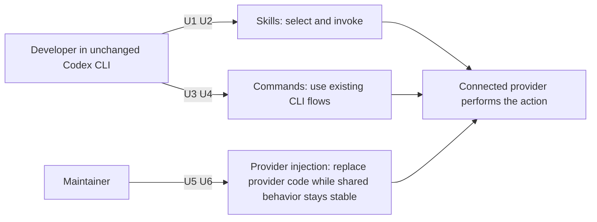

# Codex CLI through the ACP shim

The user uses the existing Codex CLI, including `$` skills and its `/` commands, while the connected agent is an ACP provider. The existing connection is the foundation. Provider differences belong in injected code behind the shim.

Read [Specification](specification.md), [Program Design](program-design.md), then [Verification Design](verification-design.md).

## Authorized outcome and boundary

The governing source is the owner's October 27, 2026 conversation in session `01a18013-0174-7390-beaa-4a5024c322e2`: “codex cli $ for skills and slash for other commands”, “cli -> appserver shim -> acp”, “no ... menu extension”, “only need provider DI injected code”, and “proper crate and package hygiene”. Those corrections supersede this session's earlier recommendation to extend the client and the earlier design's client-extension proposal. The owner reports three days lost; this document does not independently measure that cost.

One direct user class: developers operating the Codex CLI. Maintainers need provider changes to stay confined to provider code. Existing native Codex behavior and ordinary ACP conversations must survive.

| Capability | Purpose | Needs |
| --- | --- | --- |
| skills | Choose and invoke the connected provider's skills through `$` | U1, U2 |
| commands | Use the CLI's existing command flows against that provider | U3, U4 |
| provider injection | Keep provider differences replaceable and correctly packaged | U5, U6 |

| Need | Authorized need and reason | Capability | Priority and authority |
| --- | --- | --- | --- |
| U1 | `$` shows the connected provider's skills, using the CLI's existing skill interface. A connected chat alone is insufficient. | skills | Required; owner |
| U2 | Selecting a skill invokes that provider's skill with the user's text and attachments preserved. | skills | Required; owner |
| U3 | Existing `/` commands reach their existing app-server operations and produce the corresponding provider behavior where supported. | commands | Required; owner correction naming the client/shim/provider path |
| U4 | Preserve working transport, ordinary chat, cancellation, history and native Codex behavior. | commands | Required; owner says the connection already works |
| U5 | Inject provider-specific interpretation and invocation; the shared bridge does not accumulate provider-name branches. Claude and Codex are the named targets; retain existing Cursor chat support. | provider injection | Required; owner |
| U6 | Give each crate a defensible responsibility and one-way dependencies; avoid rebuilding provider setup and avoid a general catalogue or verification framework. | provider injection | Required; owner package-hygiene instruction and rejection of prior overbuilding |

The client is protected: no fork, menu extension, new client RPC, or altered keyboard behavior. Provider-owned skill loading and resolution remain provider-owned. No Router filesystem scanner, copied skill body, provider installation manager, database migration, new process, or generic plugin system is part of this design. Implementation and production changes are not authorized by this design request.

The scope is the existing Codex CLI interaction against supported providers, with explicit provider capabilities. It does not require every provider to acquire every native Codex feature. In particular, universal simultaneous multi-skill expansion and skill-command injection into an already-running turn were assumptions added by this agent, not separate owner requirements. They must not silently succeed or discard a selection; the Specification names supported forms and explicit refusals. Native Codex retains its existing complete route. Claude gains actual skill selection and command translation through the provider adapter.

A provider-specific wrapper may compose an official provider library inside the **same existing ACP process** when its stock executable omits metadata needed by the shim. This is injected provider integration, not permission to fork the library, impersonate another client, scan its setup, start a second agent, or change the Codex CLI. The wrapper must use the provider's public APIs and preserve its lifecycle and setup ownership.

“Slash commands” here follows the owner's correction: adapt the commands the existing CLI already issues. It does not turn ACP's advertised command list into a request to add arbitrary new entries to the client. Native local commands remain native local commands. The Specification makes the distinction observable rather than treating every slash as prompt text.

## Evidence that must remain explicit

The CLI's skill path includes a path-bearing selection. Providers differ in how much skill identity their ACP output retains. That is a provider-adaptation question, not justification for changing the CLI. Exact provider versions, classification, selection identity and real invocation must be qualified; an unsupported provider operation must not be reported as success.

The required outcome evidence is the real unchanged CLI listing/selecting/invoking a provider skill and exercising its existing command paths through the real shim. A transport handshake, mock, scanner output, document, or green unrelated CI job does not establish these outcomes.
