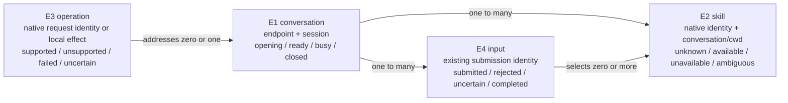

# Observable bridge behavior

Governing needs: [Requirements](requirements.md). Structural realization: [Program Design](program-design.md). Planned observations: [Verification Design](verification-design.md).

| Capability | Home obligations | Also serves |
| --- | --- | --- |
| skills | R1 listing; R2 invocation | R4 preserves this behavior |
| commands | R3 native operation mapping; R4 preservation | R4 also serves skills |
| provider injection | R5 injection; R6 bounded responsibility | Both skill and command implementations |

## Meaning

| Entity | Identity and relationships | Invariants and observable states | Basis |
| --- | --- | --- | --- |
| E1 provider conversation | One existing provider endpoint and provider session. One conversation has many skills and operations. Resuming it preserves its existing identity. | Skill invocation belongs to its addressed conversation. Listing uses C1's connection/cwd binding rather than combining different conversations. Opening, ready, busy, closed remain the existing session states. | U1–U5 |
| E2 provider skill | A provider's invocation identity in E1 and its working-directory scope. A changed description does not create a different skill; two ambiguous native targets must not be merged. | Provider determines what runs. Availability is unknown, available, unavailable or ambiguous; a listing is not execution. | U1, U2 |
| E3 CLI operation | One command's existing app-server request, or its local CLI effect. A request's correlation identity remains the native request identity. | Skill listing, skill invocation, model selection and compaction are distinct operations. Supported, unsupported, failed and uncertain are distinct outcomes. | U3, U4 |
| E4 submitted input | One existing submission identity, its ordered typed content, and its optional E2 selections. It belongs to one E1. | Text, attachments and selections retain their meanings; unavailable selection is refused before send. Submitted, rejected, uncertain and completed are existing lifecycle outcomes. | U2, U4 |

## Contracts and obligations

| Obligation | Required observable result and failure | Need / entities | Reference and proof obligation |
| --- | --- | --- | --- |
| R1 / C1 skill listing | Answer the existing `skills/list` contract using C1's connection/cwd binding. Populate the existing `$` chooser without client changes, including late metadata without user-triggered refresh. Return valid native presentation fields and preserve actual source errors. An opening view may have no available rows yet; its later replacement must invalidate the native list. | U1; E1, E2 | V1: unchanged CLI shows the bound provider's skill, excludes another cwd/provider/unbound conversation, and recovers after a late list without manual refresh or a startup error. Native `SkillsListResponse` and `skills/changed` are references. |
| R2 / C2 skill submission | Decode the existing structured skill input without changing the client, validate at dispatch and invoke the intended provider skill using C2's provider capability rules. Preserve accompanying content. Do not silently drop selections, read a skill body in Router, or pretend that a provider supports a form it does not implement. | U2; E1, E2, E4 | V2: leading and nonleading single-skill Claude selection produce the provider-owned effect with exact surrounding text/images; native Codex behavior stays native. Stale/ambiguous or unsupported provider combinations return the stated error with zero sends. |
| R3 / C3 commands | Translate the app-server operations the CLI actually sends according to the native operation list below. A local UI command remains local. Do not forward all slash text as one generic operation. | U3; E1, E3 | V3: native requests and provider effects match C3 below and the pinned native schema. Unsupported operations return a native error; acknowledgement without the effect fails. |
| R4 / C4 preservation | Retain transport, lifecycle, approvals, cancellation, text/image handling, ordered live output, history and native Codex operation. Never auto-repeat uncertain provider effects. Unsupported skill management cannot overwrite provider setup. | U4; E1–E4 | V4: native control and ACP control keep their established outcomes; deliberate cancellation/uncertain-response cases do not duplicate a send. |
| R5 / C5 injection | Adding/changing a qualified provider changes its injected implementation and Host construction, with no provider-name condition in the shared native protocol handler. Default standard ACP remains usable for ordinary chat without pretending it has a complete skill inventory. | U5; E1–E3 | V5: two differing provider implementations pass the same bridge contracts; dependency inspection rejects a reverse provider dependency. |
| R6 / C6 bounded responsibility | Provider setup and action meaning stay with the provider; no scanner, plugin registry, new persistence, client extension or second execution path is introduced. | U6; E1–E4 | V6: the source/dependency diff shows the declared boundaries and no prohibited owner. A framework that passes its own tests still fails this obligation. |

## Concrete cases

### C1: which conversation answers a cwd-only skill request

The native request supplies `cwds` and `forceReload`, not a thread ID. Its provider is fixed by the socket endpoint. For each requested cwd, this connection's most recent successful, explicitly requested `thread/start` or `thread/resume` establishes its listing conversation. `thread/read`, another connection's activity and an unrelated background thread do not change it. Empty `cwds` uses this connection's established primary conversation cwd; without that binding it returns source-unavailable, never the process cwd.

Before a matching binding/list exists, return a valid current view with no selectable rows immediately; opening is not a provider error. Do not wait for thread setup, metadata, a model or a provider refresh. Internally retain Unknown separately from an established Available(empty) view; the native wire has no loading-state field and does not gain one. A later binding/list replacement emits `skills/changed`. Actual unavailable/malformed/ambiguous sources use the native entry's errors. This keeps the blocking refresh and ordinary chat responsive, without a spurious startup warning. Two overlapping binding requests for the same cwd are ambiguous until a subsequent non-overlapping explicit start/resume establishes one target. There is no union, newest-global-session rule or cross-connection borrowing. Invocation revalidates against the thread actually addressed by `turn/start`.

### C2: exact selected-input semantics

The CLI keeps `$name` in a Text block and adds a separate `Skill { name, path }`. These represent one selection, not two invocations. Deduplicate identical structured identities as the native client does; reject conflicting identities rather than selecting the first. A bare Text block with no structured selection follows the existing ordinary-input path.

| Provider path | Selected-input rule |
| --- | --- |
| Existing native Codex | Transparent native forwarding, including native placement, multiple selections and steering. Do not convert it into an ACP round trip. |
| Claude ACP, one selected skill and one Text block | Support `$name` at the beginning or after whitespace in that Text. Match the **entire metadata-selected name**, including plugin qualification, followed by whitespace or end-of-text; do not re-parse its internal characters with a shorter bare-mention grammar. At the last such occurrence split Text into byte-exact prefix P and suffix Q. Send existing images in their original order, optional Text(P), then final Text(`/name` + Q). That final Text is Claude's expansion position. No trimming, duplicated suffix, body expansion or discarded prose. A token lacking those unambiguous delimiters is an explicit unsupported form. |
| Claude ACP, multiple distinct selected skills or multiple Text blocks with a selection | Explicit unsupported before send. Claude expands only one native skill per message; importing another app's model-mediated fallback would not establish equivalent behavior. |
| Claude ACP, selected skill on `turn/steer` | Explicit unsupported before `_session/steering`; never turn it into a new turn or auto-queue it. Ordinary steering is unchanged. A new idle-turn submission is a separate user request. |

The argument suffix Q is every byte after the selected token, including whitespace, UTF-8 and newlines. Prefix P is retained as preceding provider text; images are not moved after the final command text. Do not apply a universal first-block/last-block rule to every provider. The bridge validates the name/path as a selection reference; it is not a demand that Router load a provider skill file.

### C3: existing command operations

| Existing CLI action | Native operation / local effect | Required provider-facing outcome |
| --- | --- | --- |
| `$` and `/skills` listing | `skills/list` | Current qualified skills in the existing chooser |
| Selected skill submit | `turn/start` with structured Skill input | C2's provider-specific invocation and explicit capability outcomes |
| `/compact` | `thread/compact/start` | Qualified provider compaction and native terminal lifecycle; no empty-success substitute |
| `/model` | `model/list`, selected model in existing setting/turn requests | Advertised model applied and effective value confirmed; invalid selection rejected |
| `/plan`, permissions, skill enable/disable | Existing mode/config/skill management operations | Equivalent advertised provider capability, otherwise explicit unsupported; never broaden grants |
| New/resume/fork/history/interrupt | Existing thread and turn operations | Existing supported provider lifecycle; unsupported fork remains an error |
| Clear/help/appearance/exit and other client-local controls | Local CLI effect when its dispatcher owns it | No provider operation invented |

1. User selects `$fixture-skill`, adds text and an image, and submits. The existing client sends text/image plus structured skill identity. The bridge reaches that provider's skill once, not an ordinary model explanation of its name.
2. User runs `/compact`. The client sends the compaction operation, not a text message containing `/compact`. Provider-specific code supplies the corresponding ACP action; the client receives its normal result and completion notifications.
3. User chooses a model with `/model`. Only a provider-advertised value may be applied. Report rejection or unresolved settings rather than silently using a different model.
4. A skill disappears while an input waits. Dispatch rejects that selection; it does not reinterpret it as free text. Changes to an unrelated skill or description do not invalidate a still-identical selection. Two sessions sharing one cwd never cause implicit catalogue merging.
5. A provider cannot supply enough metadata to identify a skill. Report that source gap; do not invent classification from an arbitrary matching command name or enumerate user files in Router.

Known endpoint/version limits remain explicit until qualified. These obligations do not authorize changing an unsupported provider, weakening native validation or modifying the client to make a demonstration pass.
