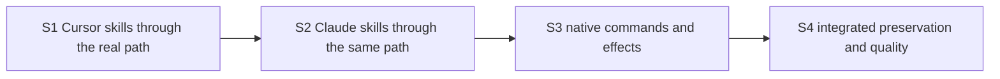

# Implementation Plan: Codex CLI with Claude and Cursor ACP

Complete the existing bridge in four ordered slices: Cursor skills, Claude skills, existing commands, then integrated preservation proof. Keep one deliverable together. No feature code or runtime proof has been executed by writing this plan.

The two delivery risks are explicit: the actual client must round-trip the server-owned skill reference, and native Claude must both expand the final Text skill form and preserve an active turn during metadata reload. The real J1/J3 observations decide them. A failure returns to Program Design; it does not authorize a new client, scanner or fallback execution path.

## Canonical planning result

| Field | Value |
| --- | --- |
| Plan path | `docs/specs/2026-10-28-codex-acp-providers/plans/2026-10-28-implementation.md` |
| Originating planner | `plan-implementation` |
| Planning result | `ready` |
| Governing basis | `reviewed-four-document-design` |
| Requirements | `docs/specs/2026-10-28-codex-acp-providers/requirements.md` |
| Specification | `docs/specs/2026-10-28-codex-acp-providers/specification.md` |
| Program Design | `docs/specs/2026-10-28-codex-acp-providers/program-design.md` |
| Verification Design | `docs/specs/2026-10-28-codex-acp-providers/verification-design.md` |
| Current review/remediation | Replacement-cycle baseline `01a182c4-7c49-7363-83ec-f5d94a8014bc`; retained independent correction verification `01a182ca-e73d-7092-9689-088e02e2fc51`, service `0ff962c5-7fa3-4c18-a5ca-1bbe8db09e89`; all three findings verified closed, Lead accepted current design meaning |
| Current applicability | Actual handlers/contracts/actor/Host at `ae66b4222`; current native0.165 and provider pins in Specification; old October27 design/plan withdrawn and deleted |
| Planned-at branch / HEAD | `design/codex-cli-acp-shim` / `ae66b4222` (contains fetched main `e16e89e51`) |
| Requested terminal | `plan-only` |
| Delivery grouping | `single:codex-cli-acp-providers` |
| PR topology | `not-applicable` to plan-only. A future delivery commission should keep this one deliverable in one PR unless review size justifies splitting. |

Existing tracking stays on Agent Router work root `01a1661a-4f94-78ed-a4c8-d08dd6e1e105`. No new tracker. Governing human readers: [Requirements](../requirements.html), [Specification](../specification.html), [Program Design](../program-design.html), [Verification Design](../verification-design.html).

Scope: existing native list/input/command adaptation; injected standard/Claude/Cursor behavior; the small same-process Claude metadata entrypoint; necessary tests and lasting proof extensions. Preserve existing native/reverse ACP routes and conversation owners. No CLI/menu extension, provider filesystem discovery, new stored format, catalogue framework, second supervisor/process, global installation or production replacement.

## Order and integration gates



These are required dependencies, not a proposed agent swarm. Shared contracts change atomically with S1's first vertical consumer. S2 consumes those contracts. S3 uses the same dispatch/outcome path. S4 integrates them. No contract-only or discretionary prefactoring slice is needed; no second branch/PR waits on a partial picker.

The first wiring gate is **inside S1**, as soon as native input/list, Host queue, actor and Cursor behavior meet. Do not postpone that interaction to S4. Each later slice runs its affected earlier regressions. Preserve the actual failing signal before implementing each behavior; a missing fixture/tool is setup failure, not the intended RED.

## S1 — Cursor skills, from listing to provider execution

**Obligations:** R1/R2 for Cursor; first R5 implementation. **Write surfaces:** new `crates/acp-provider-adapters`; existing domain/contracts, native face, Host command/delivery/FIFO and actor/hub; workspace manifest. No new node package in this slice.

1. Extend the existing `verify-codex-router` ACP recipe and `verification/observations/acp-metadata-*` models/observer/oracle tests for needed lasting **J1**. Keep public target/session checks, original real-client PTYs and guarded cleanup. Add native `skills/list` and fixture-effect observations. Actual CLI driving stays on the existing system PTY/computer-use path; no terminal emulator or general verification framework.
2. Add the three-method consumer-owned ProviderBehavior trait, shared skill-view/selection envelope and one adapter crate. Implement standard behavior plus Cursor's exact terminal-indicator classifier. No filesystem/YAML/native-root or native-ID reimplementation. Test all four skill indicators, normal command indicators, mimicking titles, nested advertised IDs, duplicate/unknown/uninvocable rows and valid rows alongside errors.
3. Wire Host constructor injection, actor-owned view, hub attachment and native connection/cwd binding. Make `skills/list` immediate and invalidation semantic. Create server-owned native references; do not create files there. Native `forceReload` reads the current view, no provider-rescan promise.
4. Carry ProviderSubmission through every existing prompt/steer/queue caller atomically; ordinary inputs use no selections. Add native Skill decoding and actor dispatch revalidation. Cursor rewrites only bound full tokens, supports multiple distinct selections in one Text with images, and refuses unsupported forms. Typed refusal resolves the existing dispatch report immediately; no turn-start wait after rejection.
5. Run J1 against the actual installed Cursor route, with leading/nonleading and multiple selection, images, duplicate/foreign/stale/unknown errors and two-cwd isolation. Observe its own skill effect once; input echo cannot satisfy the oracle.

**Pre-change signal:** native list returns empty and structured Skill fails before provider dispatch. **Focused proof/oracle:** literal native0.165 schemas and C1/C2 tables, property/table tests of reference round-trip and byte-preserving token conversion, held-queue removal that observes zero sends. **Wiring proof:** real native face/Host/FIFO/actor with a controlled ACP peer, then actual J1; peer fixtures cannot earn the actual-provider observation. **Quality:** scoped Cargo check/test/format/clippy and verification package gates below. **External inputs:** qualified installed Cursor, unchanged client, isolated signed normal Host and authorized usable provider capacity. No stand-in may close J1. **Stop:** contradictory native indicator/ID behavior or client-reference behavior returns to Program Design, not a scanner or menu patch.

## S2 — Claude skills using public provider metadata

**Obligations:** remaining R1/R2; R5's second concrete implementation. **Write surfaces:** Claude behavior in the same adapter crate, private `providers/claude-acp`, existing Host launch composition; affected shared tests only.

1. Create a small private package with pinned peer/dev qualification for official Claude ACP0.81.0 / SDK0.3.280. Reuse the repository's TypeScript/Node, formatter, lint and node-test conventions; no root Node workspace or runtime dependency installation. Provide scripts `build`, `build:check`, `check`, `lint`, `format:check`, `test`; these are **new scripts to implement**, not existing passes.
2. Compose public `runAcp()` and the owned public agent instance in its existing process. Preserve the official0.81.0 envelope and original routing/native-Claude environment. Resolve library and SDK from canonical installed paths. Decorate outgoing metadata with the bounded classification/status contract; one coalesced SDK lookup, exact descriptor/list comparison, no reload echo loop, lifecycle/query guards and failure without chat cancellation.
3. Produce a deterministic Router-only module asset, external-importing the qualified installed library; embed it in the Rust adapter crate. `build:check` regenerates and rejects stale emitted source. No copied SDK, script cache, wrapper installation, extra process or private provider patch. Exercise the actual Host launch recipe, not only a package import.
4. Implement Claude's one-selection final-Text preparation and typed compaction metadata interpretation for S3. Test exact prefix/suffix, whitespace/Unicode/images, repeated same identity and unsupported distinct multi-selection/selected-steer. Real TS-produced metadata must enter the actual Rust decoder in the cross-language contract check.
5. Run J1 for actual Claude selection/effect and repeat its Cursor control. Extend existing **J3** with a real command-list change/reload during a running Claude turn and wrapper EOF/signals/disposal. Keep turn output, ID, interrupt and terminal outcome intact.

**Pre-change signal:** no Claude skill classification reaches the chooser and native selected input has no provider transform. **Focused oracle:** C2, public SDK descriptors/skill subset and literal producer metadata contract; controlled promises force echo, changed-result and late-publication cases. **Wiring proof:** existing Host launch + real public library + actual J1/J3; mocks establish only control logic. **Quality:** private package scripts, scoped Cargo and verification gates. **External inputs:** installed qualified library/native executable, normal Codex home and isolated provider capacity. **Stop:** missing public API, wrong native expansion or active-turn disturbance returns to Program Design. Do not copy Claude filesystem/plugin discovery or add a model-mediated fallback.

## S3 — Existing native commands reach their correct effects

**Obligations:** R3 and affected R4. **Write surfaces:** existing native dispatch/error codec, compact port, Host/actor command path, provider behavior and existing tool/native item projection; existing settings validation.

1. Extend the same lasting ACP recipe/observer with needed **J2**. Read actual native request, provider effect/setting and native terminal outcome. Keep the observer narrow; no replay ledger or generic action dispatcher.
2. Admit existing `thread/compact/start`, use idle-only typed compact dispatch, and normalize Claude's version1 compaction hint through existing tool ID/status. Success needs its current compact marker plus successful prompt terminal. Cover missing/failed/automatic marker, status-only updates, busy, cancel and outcome-unknown. A tool title or normal reply is a failing oracle. Cursor compact refuses with zero sends.
3. Keep existing model/mode catalogue and setting paths. Reject invalid values/mappings before dispatch; read back effective values. Preserve unsupported fork/config/skill-management refusal and approval authority; do not turn arbitrary ACP names into new CLI commands.
4. Run J2 for both providers and affected J3 controls. Confirm the native UI returns idle after actual terminal completion and errors render without hanging.

**Pre-change signal:** compact is not admitted and invalid model currently defaults. **Focused oracle:** C3 and native/upstream compaction/settings schema, not production formatting helpers. Use real codec/Host/actor interactions to decide native result correlation; controlled peers cover failures. **External inputs:** same actual providers and isolated candidate; real effects earn J2. **Quality:** touched Rust packages, package checks if its producer changed and verification gates. **Stop:** any required public/storage/approval-contract change outside Program Design returns to its owner; do not weaken the compaction passing condition.

## S4 — Integrated preservation and final proof

**Obligations:** remaining R4 and R5; aggregate U1–U5 coverage. **Write surfaces:** only bounded fixes, lasting recipe/observer updates and task evidence.

Run J1/J2/J3 on one exact committed clean candidate and the declared client/provider versions. Keep real installed CLI input, public session observations, actual provider outcomes, original PTYs and guarded owned cleanup. Drive ordinary live/reopened chat, interrupt and approval for both providers; separately retain native Codex and reverse ACP controls. A Claude pass is not a Cursor pass. Reuse an observation only when its exercised source/configuration/path still matches.

Run required current repository quality gates, dependency policy and module-cycle ratchet. Inspect the one-way dependency graph and normal production feature graph; no test-support feature can be shipped as proof of normal behavior. Verify the embedded Claude module matches source and the actual launched module/library/runtime identity. Resolve causes of failures before bounded repairs; never remove assertions, inflate timeouts or bless cycle growth.

A later delivery commission owns independent implementation review and PR readiness. Before any eventual user-facing code merge, choose the next unused workspace version/update Cargo.lock as repository rules require. Tags/releases/Homebrew publication and production replacement are outside this plan-only commission.

## Obligation-to-proof map

The observer commands below already exist; S1/S3 extend their accepted plan models and lasting recipe for the new journeys before using them. J1/J2/J3 include the actual CLI drive; running the observer by itself never sends or proves an invocation.

| VD row | Earned at | Deciding command/observation | False green to reject |
| --- | --- | --- | --- |
| U1/R1 | S1 Cursor, S2 Claude | J1 original picker capture + `node verification/observations/acp-metadata-observation.ts "$JOURNEY_PLAN"` extended readback | Empty face, command-title spoof, wrong cwd/session, stalled startup, unavailability counted complete |
| U2/R2 | S1/S2 | J1 real provider-owned effect, native input/reference and preserved attachments; scoped input/actor tests decide exact bytes/refusals | Input echo, explanation, first-only drop, wrong ID, missing image, synthetic turn |
| U3/R3 | S3 | J2 actual compact marker/terminal and settings readback through extended observer | Ack/title/text treated as compact; wrong model default; unsupported Cursor compact sent as prompt |
| U4/R4 | S2/S3/S4 | J3 extended existing live/replay/refresh/cleanup journey + native/reverse controls; `pnpm --dir verification run test:observations` checks apparatus | Lost stream/history, reload gates turn, repeated uncertain send, leaked child, mocked route called real |
| U5/R5 | S1/S2/S4 | Real producer/decoder contracts; `cargo tree -p codex-router-host -e normal,build`; cycle ratchet; private package `build:check` | Reverse dependency, private patch/scanner, stale asset, second sender/process/store/framework |

Project proof-layer source: the existing ACP verification recipe and `scripts/proof-matrix.sh::row_layer`. Use unit for pure rules, integration for real producer/consumer/actor ordering, structural for dependencies/generated assets, and e2e for actual CLI/Host/provider journeys. Most name/token/status cases belong in table/property tests; actual journeys cover the interaction the focused rules cannot prove. No temporary test files or sleeps.

## Existing test disposition

| Existing tests | Disposition |
| --- | --- |
| `router_session_app_server_tests.rs` | Repair only obsolete unconditional-empty skills expectation; keep native startup/schema assertions and add bound-view cases. |
| Native blocking/cwd/order/model/reattach tests | Keep; extend at those owners for listing, selection and invalid model behavior. |
| ACP actor/prompt/steer/item-projection tests | Keep ordinary lifecycle/status/order checks; add typed selection and compact cases without snapshot-only acceptance. |
| Host `acp_metadata_projection` live/replay and delivery/queue tests | Keep; preserve metadata outside prose and existing input/cancellation/history outcomes through envelope change. |
| `verification/observations/tests/acp-metadata*.test.ts` | Keep exact-target/raw-PTY/negative oracle cases; add actual source shapes and new false-green cases. |

No test is scheduled for removal. New assertions take expected values from native schemas, C1–C3 or checked provider output fixtures, never the implementation under test.

## Quality commands and dependencies

Run narrow checks after each slice and aggregate gates when coherent. These are **planned commands, not results**. New adapter/package commands become available in S1/S2. Applicable extra current CI gates remain required.

```sh
cargo check -p session-event-model -p acp-client-runtime -p acp-provider-adapters -p collaboration-contracts -p collaboration-runtime -p codex-router-host
cargo test -p collaboration-runtime router_session_app_server
cargo test -p acp-client-runtime
cargo test -p acp-provider-adapters
cargo test -p codex-router-host --test acp_metadata_projection
cargo fmt --all -- --check
cargo clippy --workspace --all-targets -- -D warnings
cargo nextest run -p workspace-architecture-check --run-ignored only
node verification/tooling/check-rust-file-size.ts
pnpm --dir verification install --frozen-lockfile
pnpm --dir verification run check
pnpm --dir verification run lint
pnpm --dir verification run format:check
pnpm --dir verification test
cargo deny check
cargo audit
node verification/tooling/prepare-sqlx.ts --check
node verification/tooling/prepare-sqlx-turso.ts --check
```

Every runtime slice requires a fresh exact-target preflight: normal signed `automation-debug-host` bin, isolated root/socket/unused port, unchanged Codex home/trust, advertised provider settings and authorized usable capacity. Follow the existing ACP metadata runbook; inspect current Host help. Do not copy credentials, install unreleased production binaries or start/replace production. Controlled peers/Query objects are permitted test boundaries; record their assumptions and leave the real journey unverified until it runs.

## Stop conditions and completion

Return to the named design owner for contradictory native behavior, missing public provider API, a proof that cannot distinguish the wrong build, a changed public/stored/security/ownership contract, or a needed mechanism the design did not name. Do not drop a provider or claim unsupported/unavailable output meets its required skill outcome.

Feature completion after a future delivery commission requires every mapped outcome, required quality gate and real J1/J2/J3 interaction, with no stand-in counted as integration proof. This plan-only commission ends with the complete design and plan documents; it does not claim the feature is built.
