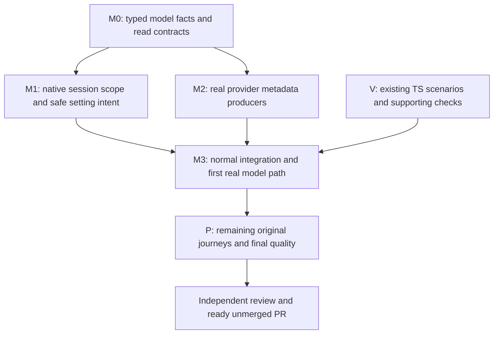

# Implementation Plan: provider model data and complete bridge delivery

Keep every provider model, expose its actual controls, and use the labelled Provider settings action when effort metadata is unavailable. Complete the remaining bridge proof and one unmerged PR. The shared actor, existing native face, trait DI and TypeScript/Rust/wterm verifier remain the foundation.

## Canonical planning result

| Field | Value |
| --- | --- |
| Plan path | /Users/shravansunder/code/projects/codex-router.acp-ide-fix/tmp/plan-workflows/2026-10-30-app-server-acp-model-metadata.md |
| Originating planner | plan-update |
| Supersedes | /Users/shravansunder/code/projects/codex-router.acp-ide-fix/tmp/plan-workflows/2026-10-30-app-server-acp-shared-verifier.md |
| Planning result | ready |
| Governing planning basis | reviewed-four-document-design |
| Requirements | docs/specs/2026-10-28-codex-acp-providers/requirements.md |
| Specification | docs/specs/2026-10-28-codex-acp-providers/specification.md |
| Program Design | docs/specs/2026-10-28-codex-acp-providers/program-design.source.html, including its program-design.md source and model-metadata chapter |
| Verification Design | docs/specs/2026-10-28-codex-acp-providers/verification-design.md |
| Review/remediation | Original four-document review and corrected DI/backend coverage through01a18ca8-253d-72b2-a93c-329d1344cc12; bounded model correction findings01a18f2e-8396-7412-acf9-78d403d5e47d; M1–M5 closure01a18f4e-aee6-72e2-9303-cf6ae58e2cfc; N1–N3 ready01a18f53-1a3b-77c1-b17a-0bf0e16c3352. Root verified the decisive sources and corrected W1 wording without changing meaning. |
| Current applicability | Source1d116128445d6dd690b73098925a4ff44b2c72b9; exact provider/runtime/native setter and catalogue paths reopened. Owner explicitly chose keep all models and requested provider-extension research; primary Cursor/Paseo/Claude sources checked. No public native schema, persisted format, approval authority or PR topology changes. |
| Planned at | design/codex-cli-acp-shim / 1d116128445d6dd690b73098925a4ff44b2c72b9 |
| Requested terminal | pr-ready-unmerged |
| Delivery grouping | single:codex-cli-acp-providers |
| PR topology | one-pr |
| Repository | /Users/shravansunder/code/projects/codex-router.acp-ide-fix |

This file is the sole canonical plan. The exact source companion embedded in the HTML reader is a carrier, not a second plan. Work thread remains01a1661a-4f94-78ed-a4c8-d08dd6e1e105. The owner already authorized implementation and testing. No milestone needs another approval.

## Scope and current evidence

Complete the original U1–U5/R1–R5 bridge, including the reviewed model correction. Do not add a CLI fork/menu extension, provider skill scanner, catalogue service, second sender, SDK process, persistence, DI container, production replacement or unrelated provider.

Current source has trait DI, selected-skill preparation and real scoped skill/image observations for both providers, Claude reopen/model observations and Cursor recoverable compact refusal. Defaults remain hardcoded, model reads are endpoint-global, and implicit turn settings can repeat writes. An actual zero-model rename baseline on1d exits the native CLI; it remains a defect, not a passing refusal. Other command/info surfaces and preservation cases remain mapped in the HTML inventory.

The previous plan's unchanged skill, compaction, native/reverse, approval, interrupt, metadata-refresh, normal-build and final quality/review/PR obligations all carry forward. Prior observations are reused only when their actual source/configuration/path dependencies remain unchanged; a past pass never qualifies new model metadata or actor-intent behavior.

## Order and integration gates



One persistent Implementer owns product code, tests and associated proof. The paired Verifier owns existing TS/native capture/observer apparatus. Lead owns governing sources, integration and acceptance. M1 and M2 may be serialized by that one Implementer; there is no invented parallel-provider dependency. V may prepare disjoint schemas/oracles while product work proceeds. No temporary production defaults or compatibility APIs are introduced.

## M0 — Typed contracts and real consumer seam

Reads: Program Design model chapter Owners, Scope, Providers, Native and Writes; existing runtime settings catalogue/behavior, native model projection, supervisor per-session lookup and constructor callers.

Writes: session-event-model setting intent; acp-client-runtime descriptor/source/decoder types and consumer-owned behavior trait; concrete adapters; collaboration-runtime consumer-owned SessionModelCatalog read contract and model-entry shape. Implement actual pure parsers for the declared sources, explicit Standard behavior and all affected implementations together. Do not change persisted SessionEvent or PromptContent shapes.

First consumers: M1 and M2. Focused tests use literal provider/native fixtures and two injected implementations with different emitted values. Unknown/malformed model data cannot erase skills; unknown effort retains model identity; defaults must be actual offered values. No I/O in trait methods. Compile the affected domain/runtime/adapter packages and their direct consumers; constructor cutover is atomic with the Host implementation at M1.

## M1 — Addressed model reads and actor setting intent

Reads: complete reviewed model chapter; native request/connection binding, model/setting tests; Host command port/supervisor settings control; actor setting application/unresolved guards and current field projection.

Writes: existing collaboration contracts/runtime, Host catalogue projection/composition/setting path, ACP actor/executor and permanent tests. Replace the endpoint-global facade watch with injected exact-session reads. Reuse existing connection request-order ownership for Unbound/Bound/Ambiguous. History/read never binds; failures never bind. Bootstrap returns truthful provider-settings delegation without a discovery session.

Keep all actual model IDs. Render Provider settings as an explicit bridge action, qualified provider values/defaults exactly, current effective values separately. Remove hardcoded medium. Native provider-default remains no override. Syntax is checked before create; actual model validity is checked against the requested new session's own catalogue. Report typed InvalidSetting/CreatedWithoutSettings and real RemainsCreated identity without a default fallback, requested setting or prompt. Resume validates after loading the exact target.

Carry ExplicitChange/TurnContext through every internal setter caller without external DTO or storage changes. Actor guards any unresolved state before implicit writes; unchanged confirmed context is a zero-wire no-op; explicit settings still perform their real action. Guard dependent effort with expected model. Context conflict is -32602/settings_context_changed; unresolved is -32000/settings_unresolved. Provider settings clears no uncertainty.

Pre-change REDs must catch medium fabrication, foreign-session catalogue use, stale/out-of-order binding, missing-model omission, repeated context writes and unknown replay. Use permanent native WS/controlled ACP integration with literal expected values, held operations and wire counts. Preserve explicit turn overrides on healthy state, per-setting explicit recovery, partial confirmed model effects, ordinary/selected input and zero-send refusals. Repair obsolete endpoint-wide and unconditional complete-null expectations to these reviewed contracts; retain their negative/error coverage. No test removal or cycle blessing.

## M2 — Provider producers through existing connections

Reads: Providers and metadata-carrier contract in the Program Design chapter; actual installed Cursor7096 and Claude0.81/SDK0.3.280; current metadata wrapper and producer-decoder tests.

Writes: concrete adapter modules, existing runtime connection/admission/settings decoding, private providers/claude-acp source/tests and generated embedded asset. Cursor keeps parameterizedModelPicker and reads cursor/list_available_models once via the existing connection owner, bounded by initialization budget/cancellation. No model-switch discovery or extra process. Join descriptors only to actual session IDs/models. Missing one-choice descriptors stay unknown; all model choices remain.

Claude result-only decorators delegate new/load/resume/set_config_option exactly once, annotate the declared initial responses and config_option_update with versioned modelReasoning, and retain session/query retirement guards. Read public modelInfos; retain legacy negotiation. No SDK reset calls or effort bookkeeping writes. Keep model and skill failure domains separate, other metadata and stock EOF/signals/environment intact.

Focused proof feeds actual TS output through the real Rust decoder, forces retired/malformed/colliding facts and validates Cursor literal response rows. Run all private package scripts including build:check, actual consumer tests and affected Cargo tests/check/clippy/fmt. Initial response metadata must reach the first catalogue; a later command notification cannot stand in for it.

## M3 — Join and prove the first complete interaction

Integrate M1/M2 without old constructors, global fallback or stale assets. Run normal feature-graph compilation and the existing native-host controlled chain. Declare a clean committed candidate, exact normal signed artifacts, installed provider/client/tool versions, private debug root/socket/port, normal home/trust and bounded owned cleanup. Native driver build/sign happens before normal shipping artifact qualification.

Use the existing TS capture command for real model selection and a subsequent prompt for Claude (including Haiku) and Cursor. Qualify actual IDs/current values, no hardcoded effort, provider-settings fallback and all-model membership. Preserve source-bound original wterm frames from one Rust PTY. Supporting API reads correlate to the same raw/native session. No model self-identification or screenshot alone proves a setting.

This is the first real integration gate for the correction, not a final-only check. Requalify the skill/metadata paths whose producer or decoding dependencies changed. Earlier unaffected compaction/preparation results retain only their scoped evidence.

## P — Complete the original delivery

Carry all previous P obligations: full J1 forms/isolation/error cases; J2 actual supported commands and honest usable unsupported outcomes; J3 reopen/interrupt/approval/active-turn refresh/history/EOF/signals; native Codex/reverse ACP controls; one-sender/DI/asset/normal-graph checks. Resolve actual rename and other inventoried command failures at their existing owners without fake effects. If a native response cannot express a truthful recovery, return that concrete contract break before inventing a result.

The scoped CLI inventory is not proof of all field correctness. Finish partial paths and provenance, including current settings, policy/status, context/usage, feature gates and error behavior. Never claim a compatibility value is provider-derived or hide unsupported outcomes. Preserve all required proof; no blanket compatibility/fallback mechanism.

After fitting quality and real-path proof, Lead assesses the integrated candidate, commissions independent implementation review, accepts corrections with evidence, then creates/updates one unmerged bridge PR and inspects checks/comments/threads/mergeability. Keep the agreed #196/main-first packaging boundary and bridge-only diff. No merge/tag/release/production restart.

## Obligation-to-proof map

| VD row | Owning slices | Deciding proof and false green |
| --- | --- | --- |
| U1/R1 | M0/M2/M3/P, existing skills | Real TS picker plus native/API skill view; rejects model-error damage to skills, wrong session and unavailable counted as success |
| U2/R2 | M1/M3/P, existing preparation | Actual selected fixture effect/text/image and controlled zero-wire refusals; rejects echo, dropped selection or synthetic prompt |
| U3/R3 | M0–M3/P | Native WS model-list/setter/intent tests; actual TS model/compact/command journeys and effective setting readback; rejects fabricated defaults, hidden models, false reset/no-op or CLI exit accepted as recovery |
| U4/R4 | M1–M3/P | Held actor/order tests plus actual J3/native/reverse controls; rejects unknown replay, foreign context, lost stream/history and leaked processes |
| U5/R5 | M0–M3/P | Literal differing injected consumer results, dependency/asset/normal feature graph and module-cycle ratchet; rejects unused DI, reverse edges, new catalogue/store/sender or stale module |

VD targets, required real/fake boundaries and passing conditions stay unchanged. New focused cases strengthen the existing native setting/model seams; no new journey boundary or weakened oracle is substituted.

## Quality commands

Run narrow fitting gates after a change, then original integrated completion gates. From repository root:

```sh
cargo check -p session-event-model -p acp-client-runtime -p acp-provider-adapters -p collaboration-contracts -p collaboration-runtime -p codex-router-host
cargo test -p collaboration-runtime router_session_app_server
cargo test -p acp-client-runtime
cargo test -p acp-provider-adapters
cargo test -p codex-router-host
cargo fmt --all -- --check
cargo clippy --workspace --all-targets -- -D warnings
cargo nextest run -p workspace-architecture-check --run-ignored only
node verification/tooling/check-rust-file-size.ts
pnpm --dir providers/claude-acp run build
pnpm --dir providers/claude-acp run build:check
pnpm --dir providers/claude-acp run check
pnpm --dir providers/claude-acp run lint
pnpm --dir providers/claude-acp run format:check
pnpm --dir providers/claude-acp test
pnpm --dir scripts/verification/tui typecheck
pnpm --dir scripts/verification/tui lint
pnpm --dir scripts/verification/tui format:check
pnpm --dir scripts/verification/tui test
pnpm --dir verification run check
pnpm --dir verification run lint
pnpm --dir verification run format:check
pnpm --dir verification test
cargo deny check
cargo audit
node verification/tooling/prepare-sqlx.ts --check
node verification/tooling/prepare-sqlx-turso.ts --check
```

Retain original native-harness completion tests and normal builds. Install dependencies with the package's frozen lockfile and use exact qualified Node26.12.1 for the TUI. All verification drivers/helpers are TypeScript or existing Rust support. No temporary tests or new terminal stack.

## Changed from

Supersedes the shared-verifier plan. C0/B/C/L/I gain qualified model descriptors, exact-session read injection, explicit provider-settings delegation and actor setting intent. Their initial model/data proof is requalified at M3. The former endpoint catalogue, guessed medium, automatic implicit re-writes and pre-session foreign-catalogue validation are replaced; none is retained as a compatibility path.

Skills, compact, FIFO/approval authority, unchanged client/provider versions, TS/Rust/wterm proof architecture and one-PR terminal remain. Existing completed observations are not re-labelled as current model proof. All original incomplete outcomes, quality gates, independent review and PR boundary carry forward. The owner rejected row hiding; no accepted model or observation is removed.

