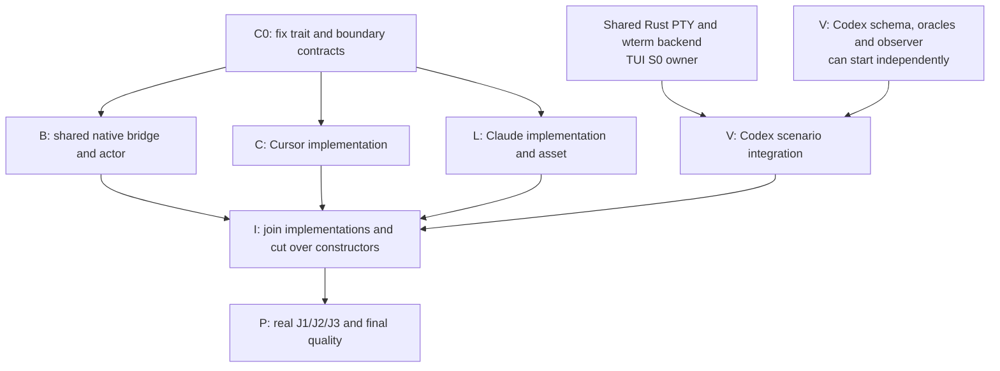

# Implementation Plan: trait DI, parallel provider work, real TUI proof

Fix the small shared contract first. Then develop the shared bridge, Cursor behavior and Claude behavior independently, while the existing TypeScript TUI verifier gains the needed Codex scenario. Join those changes in one atomic constructor/caller cutover, prove the first real interaction there, then complete the real journeys and quality gates.

These are work dependencies, not separate releases or mandatory agent counts. Keep one deliverable together. The owner explicitly instructed implementation on October30. Carry this work through implementation, fitting proof, independent review and PR readiness, unmerged. No implementation proof has yet been earned.

## Canonical planning result

| Field | Value |
| --- | --- |
| Plan path | `/Users/shravansunder/code/projects/codex-router.acp-ide-fix/tmp/plan-workflows/2026-10-30-app-server-acp-shared-verifier.md` |
| Originating planner | `plan-update` |
| Supersedes | `/Users/shravansunder/code/projects/codex-router.acp-ide-fix/tmp/plan-workflows/2026-10-30-app-server-acp-implementation.md` |
| Planning result | `ready` |
| Governing basis | `reviewed-four-document-design` |
| Requirements | `docs/specs/2026-10-28-codex-acp-providers/requirements.md` |
| Specification | `docs/specs/2026-10-28-codex-acp-providers/specification.md` |
| Program Design | `docs/specs/2026-10-28-codex-acp-providers/program-design.md` |
| Verification Design | `docs/specs/2026-10-28-codex-acp-providers/verification-design.md` |
| Current review/remediation | Replacement baseline `01a182c4-7c49-7363-83ec-f5d94a8014bc` and A/B/C closure `01a182ca-e73d-7092-9689-088e02e2fc51`; DI/TS correction findings `01a1858f-5b67-7c01-9e3c-601426473b76` and D/E closure / ready-for-planning `01a18593-c559-7f61-bcea-575940caf591`, service `0ff962c5-7fa3-4c18-a5ca-1bbe8db09e89`. Lead checked decisive source and fixed F's wording-only residue. |
| Current applicability | Bounded identity/backend correction independently ready in `01a18ca8-253d-72b2-a93c-329d1344cc12`; parent reopened the native target/FIFO/actor and shared-driver source, and fixed H/I codec wording/canonical session encoding.  Handlers/constructors/admissions/TUI package inspected at `b591d5f34`, then relevant main deltas reopened at merged `b6c30d62d`. Independent applicability result `01a1859c-6696-73b2-b4de-57185e583a0a` retains ready; its minor history-choice note is settled as original incoming Text before preparation. Native face, trait insertion, both admissions and verifier ownership remain unchanged. Main `f6d68f174` included; pins in Specification. |
| Planned-at branch / HEAD | `design/codex-cli-acp-shim` / `b6c30d62d` |
| Requested terminal | `pr-ready-unmerged` |
| Delivery grouping | `single:codex-cli-acp-providers` |
| PR topology | `one-pr`; keep this single bridge deliverable together with dependent slices integrated before review. |

Existing tracking remains Agent Router work root `01a1661a-4f94-78ed-a4c8-d08dd6e1e105`. This execution plan supersedes the historical plan-only delivery context by the owner's direct October30 implementation instruction. Historical design/plan sources remain unchanged; this path alone governs execution. Governing readers: [Requirements](/Users/shravansunder/code/projects/codex-router.acp-ide-fix/docs/specs/2026-10-28-codex-acp-providers/requirements.html), [Specification](/Users/shravansunder/code/projects/codex-router.acp-ide-fix/docs/specs/2026-10-28-codex-acp-providers/specification.html), [Program Design](/Users/shravansunder/code/projects/codex-router.acp-ide-fix/docs/specs/2026-10-28-codex-acp-providers/program-design.html), [Verification Design](/Users/shravansunder/code/projects/codex-router.acp-ide-fix/docs/specs/2026-10-28-codex-acp-providers/verification-design.html).

Scope: existing native skills/command adaptation; ordinary constructor DI through the consumer-owned Rust trait; Claude/Cursor implementations; small same-process Claude metadata asset; meaningful regression tests and existing TS/native-PTY proof extensions. Preserve native/reverse ACP and existing ownership. No menu extension, provider skill-file scanner, new store, catalogue/framework, DI container, extra supervisor/process, global installation or production replacement.

## Order and integration gates



**B, C and L may run in parallel after C0. V schema/oracles/observer may start immediately; V driver integration waits on the shared TUI backend. There is no Cursor → Claude edge.** C0 is the necessary contract-only slice: B consumes the shared envelope and trait; C/L implement it. I is necessary because the production Host must construct real implementations and every changed initializer/caller must cut over together. V must exist before I's first actual TUI journey. P adds breadth, not the first wiring check.

Parallel lanes produce bounded patches in independent worktrees; they are not independently released intermediate candidates. Do not add temporary defaults, compatibility overloads or placeholder provider implementations to make a partial lane appear production-ready. The integration owner applies constructor changes and every caller atomically with the concrete implementations, then compiles the complete candidate. Focused lane tests earn only their declared boundary.

| Owner during future execution | Exclusive writes | Coordination rule |
| --- | --- | --- |
| Lead / shared-bridge implementer | C0 domain/trait, contracts, native face, Host queue, runtime/actor and shared tests; root Cargo manifests/lock and adapter `lib.rs` exports | Freeze C0 before C/L. Integrate their module exports and final Host construction; one writer for shared files. |
| Cursor implementer | Cursor module and provider-specific fixture/tests inside the single adapter crate | No Claude, Host, trait or shared-envelope edits. Return a contract gap to Lead. |
| Claude implementer | Claude module, launch preparation, embedded asset and private `providers/claude-acp` package/tests | Same shared-file rule; preserve original environment. Root manifest/export integration stays with Lead. |
| Paired verifier | Existing TS TUI package, its native adapter support, supporting observation and verification recipe | Own proof apparatus, not product behavior/tests. Native support lives at its existing crate boundary; no new terminal framework. |

The executor may serialize advisory parallel work. A shared contract change rejoins at C0 before either provider builds on it; do not let overlapping edits silently redefine the trait.

## C0 — Fix the contract the independent work consumes

**Type:** contract. **Obligations:** R5 structure and the C1–C3 boundary shapes. **First consumers:** B, C and L. **Writes:** existing `session-event-model`, consumer-owned `ProviderBehavior` in `acp-client-runtime`, single adapter crate baseline/Standard behavior and necessary manifests.

Specify the exact immutable object-safe trait, ProviderUpdate/ProviderFacts/PreparedCompact/errors, SkillView with per-row errors, ProviderSubmission and SelectedSkill containing invocation identity only; existing command target/actor carries the addressed conversation. No native path or duplicated SessionRef belongs in provider data or classification updates. Preserve existing InputId and persisted PromptContent. Include SessionAdmitted so constructor-known unavailability is published without waiting for metadata. Standard behavior is an explicit test/direct-runtime control, not a third Host provider. No factory or registry.

**Signal/oracle:** current native Skill rejection/empty list and existing constructor paths are the baseline; this contract slice claims no feature success. Literal C1–C3 fixtures and two scripted implementations with different outputs establish a usable trait boundary. **Proof:** focused domain/runtime/adapter compile and tests; no I/O hidden in trait methods. **Dependencies:** reviewed contracts and native schemas only; no provider credentials needed. **Stop:** needed semantics or public/stored format changes return to the design owner.

## B — Shared native bridge, ordered actor and distinct commands

**Type:** behavior patch, integrated at I. **Obligations:** common R1/R2/R3 and preservation R4. **Writes:** existing collaboration contracts/runtime, Host command/delivery/FIFO, runtime handles/admission/actor/hub and their tests. Concrete provider files stay C/L-owned.

1. Native list reads the actor-owned view through atomic snapshot/subscription and connection-local cwd binding. Keep immediate Unknown behavior, per-cwd errors and semantic `skills/changed`; no metadata wait or global-newest rule.
2. Add the native absolute reference codec and structured Skill decoder. Encode session ID and invocation name as canonical UTF-8 base64url without padding; validate exact components and decoded endpoint/session/name against addressed target and structured name, then pass only invocation identity into the existing targeted command. Include legal session IDs containing slashes/dot segments and foreign same-name references in codec tests. Carry ProviderSubmission through **all** existing prompt/steer/queue callers; plain input has no selections. After queue wait, revalidate against the latest actor view. A closed refusal resolves the existing dispatch report immediately and sends zero prompts. Compute any existing admitted single-Text user-history item from original incoming content before preparation, retaining `$name` and the current image/multi-block rule; verify it through the existing history tests and J3 readback.
3. Propagate the required immutable Arc through existing initialization/runtime handles and both admission paths. Actors apply facts; only the actor sends. Submit the constructor/caller cutover to I together with real C/L implementations, rather than keeping an old fallback API.
4. Admit dedicated compact command, idle/busy/refusal and marker+terminal projection using existing tool ID/status/kind. Keep model/mode dedicated settings paths and reject invalid/unmapped models; preserve approval/fork/config refusals. Provider interpretation/preparation comes only through the trait.

**Pre-change signal:** native list empty, Skill rejected, compact not admitted and invalid model defaulted. **Focused oracle:** literal native0.165 schemas, C1–C3 and independently expected content. Test reference round-trip and full-token/property tables; real decoder/queue/actor with scripted trait and controlled ACP peer tests held-queue removal, exact wire content, immediate refusal and compaction truth table. Assert differing consumer results, not callback counts. **Quality:** narrow touched Cargo packages, format/clippy; normal Host compilation at I. **Dependencies:** C0; controlled peer may stand in only for deterministic protocol tests, not J1/J2/J3. **Stop:** changed public/stored/approval ownership or a new sender returns to Program Design.

## C — Cursor implementation, independently of Claude

**Type:** provider behavior patch, integrated at I. **Obligations:** Cursor R1/R2/R3 and R5. **Writes:** Cursor module/tests in the adapter crate.

Classify exact native terminal skill indicators, preserve exact advertised invocation IDs and scope, distinguish ordinary command indicators, and retain valid skills beside ambiguous/unknown/uninvocable row errors. No filesystem/YAML/native-root or ID reconstruction. Prepare leading/nonleading and multiple distinct selected skills in one Text with images, changing only bound full tokens. Refuse selected multi-Text/steer, collisions and unsupported compact before send.

**Pre-change signal/oracle:** checked Cursor producer rows versus the empty native face. Literal actual-output fixtures cover all four skill indicators, command-title mimicry, nested/duplicate IDs, unknown markers and valid rows alongside errors. Property/table checks preserve Unicode, whitespace, suffixes and image payloads. **Quality:** adapter Cargo check/test/format/clippy. **Dependencies:** C0 and checked installed Cursor producer; no Claude dependency. Fixtures stand in only for parsing/preparation. Actual Cursor J1/J2 remains at I/P. **Stop:** contradictory indicator/ID/recognition behavior returns to Program Design, never a scanner or client patch.

## L — Claude implementation, launch preparation and private asset

**Type:** provider behavior patch, integrated at I. **Obligations:** Claude R1/R2/R3, affected R4 and R5. **Writes:** Claude adapter module/preparation/tests and small private `providers/claude-acp`; embedding/export integration at I.

1. Build the private Router-only module using repository Node/TypeScript conventions. Pin qualification to official ACP0.81.0 and SDK0.3.280. Provide needed `build`, `build:check`, `check`, `lint`, `format:check`, `test` scripts; these are **new scripts to implement**, not existing passes. No root Node workspace, copied SDK or runtime installation.
2. Compose public `runAcp()` and its owned public agent in the same process. Decorate outgoing metadata using public Query skill/command APIs. Coalesce lookups, compare descriptor and result changes, suppress reload echoes, cache unchanged failure and reject retired-query publication. Preserve the stock0.81.0 envelope and owned disposal/EOF/signals. No discovery/model prompt.
3. Implement the concrete launch preparation/result from Program Design. Qualify canonical official entry, declared bin/public exports and Node; rewrite only qualified exec/args to the embedded module/absolute installed imports. Unqualified launch remains original and constructor-configured Unavailable from SessionAdmitted, with skills refused/compactUnsupported and ordinary chat/settings retained. Test direct-bin/pnpm-target success and custom/mismatched failure.
4. Implement exact single-selected-skill final-Text preparation with prefix/arguments/images and closed unsupported forms. Decode the official version1 contextCompaction metadata; manual-or-unlabelled completed marker plus successful prompt terminal is required. Feed **real TS-produced metadata into the real Rust decoder**. `build:check` must reject stale embedded source.

**Pre-change signal/oracle:** native list lacks Claude classification and selected input lacks its transform. Literal public SDK/producer contract and C2/C3 expected bytes decide tests. Controlled Query promises force echo, result changes, failure and retirement. **Quality:** all private-package scripts and narrow adapter Cargo checks/tests. **Dependencies:** C0 plus installed qualified library/SDK/native executable; no Cursor dependency. Controlled Query tests do not prove active-turn preservation or native expansion. **Stop:** missing public API, incompatible stock envelope or required extra process/private patch returns to Program Design. Actual final-Text expansion and reload during a live turn stay unverified until I/P.

## V — Extend the existing TypeScript TUI verifier

**Type:** proof apparatus. **Obligations:** make VD's J1/J2/J3 runnable. **Writes:** `scripts/verification/tui`, existing native TerminalDriver support in `crates/codex-router-quota-reset-test-harness/tests/quota_reset_pty_test/`, supporting ACP observation and `verify-codex-router` recipe.

Reuse surviving source/tool binding, lifecycle, original-artifact/readback and scene machinery after the common backend cutover. Add the installed-Codex remote ACP target and keyboard/checkpoint scenarios INSIDE the existing native harness crate, using its one TerminalDriver and shared TS wterm grid/DOM renderer. Keep a single child across keys/checkpoints/resize, preserve exact program/args/environment/viewport identity, answer DSR/DA/keyboard queries from emulator state, and bind original PNGs to the same exact PTY bytes. Do not extend or restore VHS/ttyd/xterm.js/Swift/shell machinery or create a duplicate PTY/renderer. The TUI S0 owner supplies common engine/qualification; this Verifier writes Codex-specific launch/scenes/oracles/observer only. TypeScript must drive actual `$` selection and existing command flows through that one child. Extend the current CLI's surface selection to accept `--codex-acp-only --codex-acp-plan <path>`; this is a **needed option to implement and document**, not a current capability. Bind exact Node26.12.1, client/candidate/native adapter, provider/session/cwd/socket and viewport. Supporting API history/effect readback must correlate to that same session.

**Signal/oracle:** current capture CLI has only Quota/Sessions; that is a missing-target/setup signal, not product RED. Keep their scenarios. Extend rejection tests for wrong source/binary/provider/session/PTY, missing/reordered checkpoints, echo-only success and blank/wrong scenes; exercise actual rejection. Controlled adapter fixtures prove apparatus only. **Quality:** package typecheck/lint/format/test plus affected native harness tests. **Dependencies:** renderer-independent schema/oracles/observer can start before C0. Driver integration waits for the pushed shared TUI S0 backend/qualification, then merges/adopts its actual sources through the owning Lead. TUI Lead controls that owner; no crossed commission or private copy of unpushed code. Current declared source is local Sunclaw1f90839e, lane/tui-verification, not yet available remotely; no pass or immutable public contract is inferred from this pointer. Real runs additionally wait for I's candidate and qualified tools/provider capacity. No standalone terminal emulator, second PTY, replacement verifier, temporary test or hand-authored success receipt.

## I — Atomic join and first real wiring proof

**Type:** integration/cutover, no persisted-data migration. **Obligations:** first complete R1/R2/R3 path for each provider; R5 actual construction. **Writes:** shared-file integration only, bounded defect corrections.

Join B/C/L and V. Host chooses Cursor or prepares Claude launch and explicitly constructs its behavior; update every initializer/test caller together and remove the replaced signatures. Integrate root manifest/module exports and deterministic Claude asset. Run normal feature-graph compilation and real producer/consumer/actor integration before declaring a candidate. No compatibility overload/default selector is retained for partial work.

At this first complete interaction, run J1 through the new TS/native-PTY command for both actual providers; do not postpone wiring to P. Record real picker selection, structured identity and provider-owned effect once with text/images. Run J2's first supported settings/compact effect and unsupported Cursor control. An initial empty picker, unqualified Claude launch or model echo is failure, not completion. If V or a real dependency is absent, focused tests may continue; the real journey remains unverified.

**Dependencies:** B/C/L and needed V target/scenes; normal signed isolated Host, unchanged Codex home/trust, private unused socket/root/port and authorized usable provider capacity. Follow the existing ACP metadata runbook/current Host help; no production/config mutation or unreleased binary installation. **Quality:** integrated narrow Cargo/package gates below. **Stop:** native reference round-trip, Claude expansion, actual classification or proof oracle contradicting design returns to its named owner; no provider may be dropped.

## P — Complete preservation, breadth and final quality

**Obligations:** complete U1–U5 / R1–R5 coverage. Run needed lasting J1/J2/J3 on one clean committed candidate with the pinned versions. Include two-cwd/session isolation, empty/late/failed metadata, ambiguous/stale/foreign selections, multiple Cursor skills, Claude qualified/unqualified launch, distinct settings/compact failures and usable input afterward. Reopen/live history, interrupt/approval, active-turn metadata refresh and wrapper EOF/signals must preserve identity, stream and terminal result. Retain native Codex and reverse ACP controls separately. A Claude pass is not a Cursor pass.

Inspect normal dependencies, one sender, both admissions, actor state isolation and source/embedded/launched asset identity. Reuse earlier observations only if their source/configuration/path still matches. Resolve failures before bounded repairs; never remove assertions, increase timeouts, bless cycle growth or count a stand-in as real integration. After P, return completed source/proof to Lead for assessment, then independent implementation review and accepted corrections, then one unmerged PR with required checks/comments/threads/mergeability inspected. No merge, tag, release or production replacement is authorized.

## Obligation-to-proof map

| VD row | Owning changes / first real observation | Deciding command and independent oracle | False green rejected |
| --- | --- | --- | --- |
| U1/R1 | B+C/L; V prepares; I first J1, P breadth | Needed TS `capture-run.ts --codex-acp-only --codex-acp-plan "$JOURNEY_PLAN"`; original picker capture/native list and qualified actual provider identities; supporting ACP observer | Empty face, command spoof, wrong cwd/session, indefinite pending unqualified launch, unavailable counted as success |
| U2/R2 | B+C/L; I J1, P remaining forms | Same TS command/J1: actual keyboard selection, native structured input and provider-owned effect; C2/literal content tests decide exact bytes/refusals | Echo/explanation, first-only drop, wrong ID, lost image, synthetic turn |
| U3/R3 | B+C/L; I first J2, P failure matrix | Same TS command/J2, effective settings or official marker+terminal; extended `node verification/observations/acp-metadata-observation.ts "$JOURNEY_PLAN"` is supporting readback | Ack/title/automatic marker counted compact, invalid model default, Cursor compact prompt |
| U4/R4 | B/L; P J3 plus native/reverse controls | Same TS command/J3; existing live/replay observer and actual UI/stream/history/cleanup; `pnpm --dir verification run test:observations` checks apparatus | Refresh gates turn, lost history, uncertain replay, wrong child/PTY, controlled peer called real |
| U5/R5 | C0/B/C/L; I construction, P graph/assets | Actual consumer DI/producer-decoder integration; launch qualification cases; `cargo tree -p codex-router-host -e normal,build`; architecture ratchet; private `build:check` | Hidden selector, reverse dependency, shared mutable view, never-used injection, stale/unlaunched asset, second sender/framework |

Project layers come from the existing ACP verification recipe and `scripts/proof-matrix.sh::row_layer`: unit for pure rules, integration for real DI/producer/consumer/actor ordering, structural for dependencies/assets, e2e for actual TS-driven CLI/Host/provider journeys. Use property/table tests for one rule's many content/status cases; do not repeat every parsing edge through TUI. No mocked pass closes a real-provider row.

## Existing test disposition

| Existing owner/tests | Disposition |
| --- | --- |
| `router_session_app_server_tests.rs` | Repair obsolete unconditional-empty expectation; keep native startup/schema checks and add bound-view cases. |
| Native blocking/cwd/order/model/reattach tests | Keep; extend existing owners for list/selection/invalid model. |
| ACP actor/prompt/steer/item-projection and Host delivery/queue tests | Keep lifecycle, ordering, cancellation and outcomes; retain main's `submitted_prompt_tests.rs` user-history publication, separate provider IDs and sink-failure checks. Add envelope/refusal/marker cases without snapshot-only acceptance. |
| Host `acp_metadata_projection` live/replay tests | Keep genuine prose/metadata separation and history identity. |
| ACP metadata observation/oracle tests | Keep target/raw-PTY/negative oracles; extend changed producer/effect cases. |
| Existing TS TUI binding/lifecycle/native-adapter/scene tests | Keep Quota/Sessions behavior and rejection strength; extend Codex target and false-evidence cases. |

No test is scheduled for removal. Expected values come from C1–C3, native schemas or checked producer fixtures, never production helpers. Preserve a meaningful RED before each behavior change; missing tools/fixtures are setup failure.

## Quality commands and dependencies

Planned commands, **not results**. Use the narrow affected package after each lane; integrated normal-graph and required repository gates at I/P. New adapter/private-package and capture options become available only after their slices. Applicable additional current CI gates remain required.

```sh
cargo check -p session-event-model -p acp-client-runtime -p acp-provider-adapters -p collaboration-contracts -p collaboration-runtime -p codex-router-host
cargo test -p collaboration-runtime router_session_app_server
cargo test -p acp-client-runtime
cargo test -p acp-provider-adapters
cargo test -p codex-router-host --test acp_metadata_projection
cargo test -p codex-router-quota-reset-test-harness
cargo fmt --all -- --check
cargo clippy --workspace --all-targets -- -D warnings
cargo nextest run -p workspace-architecture-check --run-ignored only
node verification/tooling/check-rust-file-size.ts
pnpm --dir scripts/verification/tui install --frozen-lockfile
pnpm --dir scripts/verification/tui typecheck
pnpm --dir scripts/verification/tui lint
pnpm --dir scripts/verification/tui format:check
pnpm --dir scripts/verification/tui test
pnpm --dir verification install --frozen-lockfile
pnpm --dir verification run check
pnpm --dir verification run lint
pnpm --dir verification run format:check
pnpm --dir verification test
cargo deny check
cargo audit
node verification/tooling/prepare-sqlx.ts --check
node verification/tooling/prepare-sqlx-turso.ts --check
```

Also run all six needed private Claude package scripts listed in L and the new TS capture command for each J1/J2/J3 plan against the qualified shared wterm backend. Native harness tests use the exact Node26.12.1 path/digest prerequisites documented in its existing README; the present authoring environment is not a runtime qualification pass. Sign candidates per the existing runner; no unsigned direct launch or production restart. Controlled peers/Query objects are recorded test boundaries only.

## Stop conditions and completion

Return contradictory native behavior, missing public provider APIs, new public/stored/security/ownership contracts or a proof unable to reject a wrong build to its design owner. Do not add client changes, scanners, default selectors, a new sender or another proof framework to push through.

Future feature completion requires all mapped outcomes, required quality gates and real J1/J2/J3 interactions at the declared target, with unverified cases named. The terminal is PR-ready and unmerged after current implementation, real proof, independent review/corrections and required PR gates. Stop only for an actual blocker or completed terminal; no phase boundary or historical plan-only field suspends execution.

## Current execution responsibility

One persistent Implementer owns C0/B/C/L/I/P and product tests; one paired Verifier independently owns V and the lasting skill/driver updates. They work concurrently only on the plan's disjoint write surfaces. Provider modules may be serialized by the same Implementer; the graph permits but does not require extra agents. Lead owns governing design, this plan, integration decisions and acceptance. Advisor is inspect-only. No separate release or compatibility path is introduced.

Current source is3f83233175c6db7d48f5999f7ecf40a1a0a92f76; the reviewed four-document design and decisive sources remain identical to its accepted checkpoint. Existing tracking unchanged. Merge state readiness-only; no owner merge instruction exists. Required runtime credentials/qualification must be checked through authorized existing routes with no secret output; missing real dependencies never convert controlled proof to a pass. C0 needs none.

## Changed from

Supersedes /Users/shravansunder/code/projects/codex-router.acp-ide-fix/tmp/plan-workflows/2026-10-30-app-server-acp-implementation.md. C0/B domain identity is corrected to keep native paths exclusively in the face codec; the wire reference also encodes the session component. Existing command targets/FIFO/actor retain E1. No native public schema, persisted format or requested outcome changes. C0 direct contract proof remains applicable after the corrected types; B must earn new codec target-binding cases.

V and its edge into I now depend on the shared TS/Rust TerminalDriver+wterm backend replacing VHS/ttyd/Swift. VD U1–U4 observation dependency is updated/reviewed, U5 shape rejection is clarified; all actual CLI/provider observations and wrong-build conditions remain required. Current C0 source tests do not depend on that renderer and retain their evidence. No real journey or backend proof existed to invalidate. One-PR shape, C/L implementation, actor ownership, native/reverse preservation and I/P real-provider gates remain unchanged.

Common backend owner: TUI Lead claude-local/9f6bdec4-853f-4d3a-8ed0-0d7b4b128af3 coordinates Sunclaw S0; request shared-driver changes through that Lead. Codex scenarios stay within quota-reset harness and TS package, so no new shared support crate or duplicated engine is needed. Reconcile exact surviving TS module interfaces against the pushed source before V integration; renderer-independent work uses no guessed backend API. This is a dependency, never a stand-in counted as proof.
