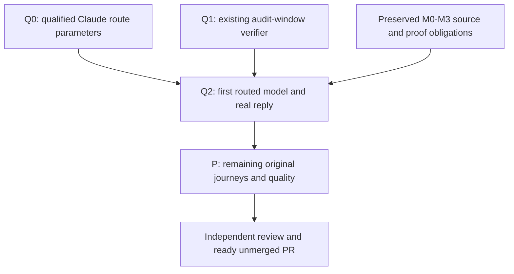

# Implementation Plan: private Claude settings files and isolated routed-reply proof

Preserve the Host-selected Claude Router route through the qualified SDK creation boundary, prove real routed replies, and finish the unchanged bridge obligations in one unmerged PR. Keep every provider model, its actual controls and the labelled Provider settings action for unknown effort. The shared actor, existing native face, trait DI and TypeScript/Rust/wterm verifier remain the foundation.

## Canonical planning result

| Field | Value |
| --- | --- |
| Plan path | /Users/shravansunder/code/projects/codex-router.acp-ide-fix/tmp/plan-workflows/2026-10-31-app-server-acp-debug-route-control.md |
| Originating planner | plan-update |
| Supersedes | /Users/shravansunder/code/projects/codex-router.acp-ide-fix/tmp/plan-workflows/2026-10-31-app-server-acp-claude-routing.md |
| Planning result | ready |
| Governing planning basis | reviewed-four-document-design |
| Requirements | docs/specs/2026-10-28-codex-acp-providers/requirements.md |
| Specification | docs/specs/2026-10-28-codex-acp-providers/specification.md |
| Program Design | docs/specs/2026-10-28-codex-acp-providers/program-design.source.html, including program-design.md, model-metadata and claude-route-binding |
| Verification Design | docs/specs/2026-10-28-codex-acp-providers/verification-design.md |
| Review/remediation | Prior route/model reviews retained. Private-file source and lifecycle challenge: 01a191b4-3faa-7771-8551-8bccea8a28f2; F2/F3 closure 01a191b9-c115-7d92-a31f-7ed52e883ed5; conditional drain-proof clarification 01a191bb-f131-7d11-8a22-e43f0a9f3b17; bounded independent debug frontier locally ready 01a19224-3e29-7261-9a5f-b6a536b3e241. |
| Current applicability | Source05e223f8392248d21637789f4b4b50b45070d607 plus corrected PD/VD debug-control boundary. Private-file storage approved. Q1 isolation/preflight controlled proof remains dependency-scoped. Ordinary Host retirement still kills the provider group. The owner removed possible debug-file residue as a ticket blocker; Host lifecycle remains follow-up, with no production cleanup claim. |
| Planned at | design/codex-cli-acp-shim / 05e223f8392248d21637789f4b4b50b45070d607 plus reviewed private-file/debug-control PD/VD |
| Requested terminal | pr-ready-unmerged |
| Delivery grouping | single:codex-cli-acp-providers |
| PR topology | one-pr |
| Repository | /Users/shravansunder/code/projects/codex-router.acp-ide-fix |

This file is the sole canonical plan. The exact source companion embedded in the HTML reader is a carrier, not a second plan. Work thread remains01a1661a-4f94-78ed-a4c8-d08dd6e1e105. The owner already authorized implementation and testing. No milestone needs another approval.

## Scope and current evidence

Complete the original U1–U5/R1–R5 bridge, including the reviewed model correction. Do not add a CLI fork/menu extension, provider skill scanner, catalogue service, second sender, SDK process, persistence, DI container, production replacement or unrelated provider.

Current source has trait DI, exact-session model reads, qualified model controls, scope-qualified TurnContext guards and selected-skill preparation. Historical skill/image observations exist for both providers; current model-plus-prompt inference remains unqualified after three failed Claude probes, including plain text. Claude hooks/mcp refusal recovery and Haiku selection passed on c006; Cursor compact recovery has earlier scoped proof. The Host injects its route, but later SDK settings can displace it. No actual failed-prompt endpoint or cause was established. The HTML inventory covers the scanned direct request consumers with explicit partial edges. Unsupported rename remains a known client-exit limitation, not a capability or required recovery accepted as done.

The previous plan's unchanged skill, compaction, native/reverse, approval, interrupt, metadata-refresh, normal-build and final quality/review/PR obligations all carry forward. Prior observations are reused only when their actual source/configuration/path dependencies remain unchanged; a past pass never qualifies new model metadata or actor-intent behavior.

## Order and integration gates



One persistent Implementer owns product code, tests and associated proof. The paired Verifier owns existing TS/native capture/observer apparatus. Lead owns governing sources, integration and acceptance. M1 and M2 may be serialized by that one Implementer; there is no invented parallel-provider dependency. V may prepare disjoint schemas/oracles while product work proceeds. No temporary production defaults or compatibility APIs are introduced.

## Q0 — Minimal private settings paths for the isolated debug control

Owner correction: the possibility of a private auth file remaining in the isolated debug Router does not block this ticket. Do not implement or wait on the proposed Host shutdown change. The immediate frontier is route preservation plus a genuine reply on a declared debug target. Existing U1–U5 and one-unmerged-PR delivery scope remain; no production replacement is authorized.

Reads: current route preparation/entry/model-lifecycle adapter, permanent shipped-entry fixtures, qualified ACP0.81 and SDK0.3.280 public settings-path contract, PD/VD Independent debug control. The bounded debug control was independently reviewed in01a19224-3e29-7261-9a5f-b6a536b3e241; later owner correction removes the normal-shutdown sequencing gate and unnecessary lifecycle machinery from this frontier.

Writes: providers/claude-acp/src/route-preparation.ts, router-claude-entry.ts, one focused process-lifetime settings-file owner and permanent private package tests/fixtures; generated crates/acp-provider-adapters/src/claude_metadata.mjs. Keep model-metadata's existing lifecycle adaptation and result-only annotation unchanged unless its injected preparation signature requires atomic caller updates. No Rust policy, trait change, new child observer/barrier/controller, SDK reader/process/private field, public DTO, dependency/lock, user configuration edit or cleanup daemon.

Capture Host URL/token before policy env as today. Preserve the closed route/reset keys, original bearer, unrelated metadata/env/settings and model-config validation/nullish fallback. The focused file writer is injected into route preparation as an explicit callback. Validate the complete request, including rejection of caller settings paths and the qualified SDK's separate sandbox option, and serialize settings before allocating a file. Then pass public options.env plus options.settings as the absolute path of an exclusive immutable0600JSON file under a lazy0700OS temporary directory. No inline token-bearing settings reach native argv/debug; no caller-file flattening/input mutation. Each original new/load/resume delegate executes once with its receiver, dedicated setter parameters unchanged.

Files remain available for the whole provider process lifetime, including vendor query recreation and rejected creation. Do not invent a query/child-exit observer or promise wrapper cleanup from vendor.dispose. The isolated allocation sets a fresh short private TMPDIR; after its existing final audit confirms all owned Host/provider consumers stopped, its owner removes only its exact settings files/directories without reading or retaining real contents. Uncertain consumers prevent deletion and are reported. The owner's debug-residue tolerance is explicit; cleanup is best-effort task teardown, not a product shutdown claim. Graceful normal Host retirement belongs to its separate follow-up and does not gate this ticket's debug route test.

Pre-change RED: the real embedded entry/public delegate must receive a settings path with literal complete file content; the current inline object fails. Keep/repair existing39cases so all prior route, caller/model fallback, immutable input, receiver/call-count, setting and EOF/signal assertions survive. Add permanent real-file0700/0600, distinct immutable paths, caller/model-config content and pinned SDK path-versus-object argv/debug checks. Invalid input/sandbox rejects before allocation/delegate. Real filesystem creation failure gives bounded error and zero delegate; partial-write failure keeps exact owned cleanup safe and categorical, no raw values. Files must remain available across multiple lifecycle calls and a delegate rejection. No new timer/lifecycle mechanisms to test.

Run Node26.12.1 private package build, build:check, check, lint, format:check and all tests with existing frozen deps; fitting adapter/Host launch preparation and actual embedded producer-consumer checks; affected cargo check/Clippy/fmt. All callers cut over, asset matches source. Root assesses and commits the exact source batch before normal signed build and debug allocation. A source/fixture pass does not prove real inference.

## Q1 — Observe the existing Claude audit window through the existing verifier

Type: proof-only under the reviewed U4/VD routing row; paired Verifier owns it. Reads: that complete row and fixed-hook timing, existing Codex run/step/original-capture path, current observer schemas/ownership, Host launch_options.rs audit path and AuditEvent/Claude append semantics.

Writes: existing scripts/verification/tui Codex run/schema and permanent tests; a focused TypeScript reader in verification/observations plus its permanent tests, existing observer wiring and project verification recipe. No product audit/logger/field, public schema, dependency, arbitrary callback or new driver/transport. The plan's optional declared Claude route proof binds the existing Host run directory/audit file to the same exact target. The runner's fixed hook records file identity/byte length/prefix digest after the composed prompt or selected-skill checkpoint AND its original capture, immediately before that step's Enter. Read only the bounded appended segment after the completed same-session reply readback; verify file identity/prefix intact. Keep the source record and safe counts/accountHashPresent; never raw account hash/request ID/headers/body/arbitrary text.

Retain the committed Q1 managed-inventory and single-new-turn checks, including route-bound normal CLI artifact and epoch, pre-Enter inventory, frozen audit segment before final inventory, no other stored Session and unchanged prior history. The exact pass is the reviewed VD: at least one claude_messages/valid/allowed/forwarded/committed row with an account hash present, zero rejected Claude rows, genuine provider/native completion and normal CLI quit. Models/responses rows never qualify. No exact Session join is claimed; one private unshared Host/listener and one fresh Claude Session with no other Claude generation input define the causal window. Other traffic invalidates attribution. Allowed/Committed is not HTTP or SSE success. Absence/no reply is not a cause diagnosis and never permits replay.

Permanent parser cases use literal audit rows and real temporary files at the file boundary: missing/malformed/models-only/rejected/no allowed/rotation/truncation/prefix change/over-bound all fail. Existing shared-driver controlled case forces the before-Enter placement; moving it before composition or after Enter must fail. Expected values come from AuditEvent and append source, not the reader's own constants. These tests prove the observation apparatus, not real routing. Run fitting TUI package typecheck/lint/format:check/test and verification check/lint/format:check/test with exact Node26.12.1 and existing frozen dependencies. No new temporary test files.

Q0 and Q1 may proceed independently after this corrected design/plan admission because their write sets are disjoint; Root serializes index/commits and joins them before Q2. No provider-specific parallel lane is invented.

## Q2 — First real routed model-plus-reply integration

Type: integration; requires Q0 and Q1. Reuse M3's normal native-first/sign-before-normal build, exact clean source/artifact/tool bindings, one owned private debug allocation and unchanged normal home/trust/profile. Requalify producer/asset/entrypoint dependencies changed by Q0; reuse unchanged engine checks only after their complete source/Node/WASM inputs match. No production process replacement/install or account/config repair is implied.

Use a fresh short owner-private TMPDIR on the isolated debug Host so every wrapper settings directory stays inside this test allocation. The existing test owner records exact paths without reading/retaining contents. After the required owned-process final audit shows no live or uncertain Host/provider consumers, remove only the exact test-created settings files/directories and verify none remain. This earns debug teardown only, never normal Host cleanup. Do not add a product cleanup mechanism or weaken the final audit.

First actual control: existing model journey chooses Haiku/low from the fresh real catalogue; the following ONE ordinary prompt must complete through shared Rust PTY/wterm, exact latest native/provider reply and the required bounded Claude route window. No second prompt or model on failure. This earns basic routed inference only. Then requalify the required selected-skill/image J1 interaction whose producer changed, using another specifically commissioned input. Preserve all original M3 Cursor, model-default/Unknown-row and P obligations; an ordinary reply cannot substitute for selected-skill proof. Retain failures and supported-close uncertainty; identity-guarded resource cessation alone is not a clean-close pass.

The Q2 preparation must use the current normal build agent-collaboration path/SHA in claude_route and the actual retained pre-input thread/read in before_thread_read; the old112 private composer is stale and must not be reused unchanged.

Commands use existing capture-run.ts --codex-acp-only --codex-acp-plan PLAN.json [--check] and acp-journey-observation.ts PLAN.json, extended only by Q1's declared audit binding. No ad hoc alternate renderer/caller. The earliest deciding real gate is Q2 before broad P work; request preflight/source/route/account-availability gaps explicitly rather than repeating paid timeouts. Scope-complete real path plus quality is needed before independent implementation review and one ready unmerged PR.

## Preserved M0–M3 and P obligations

The following original slices remain the authoritative descriptions of their unchanged contracts. Source checkpoints do not mean they meet the new route-dependent real gates. Q0 requalifies the private producer/constructor source and asset; Q2 requalifies Claude M3/J1 and every reused observation whose route/wrapper dependencies changed. Q1 strengthens the existing VD observation and introduces no capability. Unchanged domain, model parser, actor, native read/setting and unrelated proof evidence retain only their actual dependency-bounded value.

## M0 — Typed contracts and real consumer seam

Reads: Program Design model chapter Owners, Scope, Providers, Native and Writes; existing runtime settings catalogue/behavior, native model projection, supervisor per-session lookup and constructor callers.

Writes: session-event-model setting intent; acp-client-runtime descriptor/source/decoder types and consumer-owned behavior trait; concrete adapters; collaboration-runtime consumer-owned SessionModelCatalog read contract and model-entry shape. Implement actual pure parsers for the declared sources, explicit Standard behavior and all affected implementations together. Do not change persisted SessionEvent or PromptContent shapes.

First consumers: M1 and M2. Focused tests use literal provider/native fixtures and two injected implementations with different emitted values. Unknown/malformed model data cannot erase skills; unknown effort retains model identity; defaults must be actual offered values. No I/O in trait methods. Compile the affected domain/runtime/adapter packages and their direct consumers; constructor cutover is atomic with the Host implementation at M1.

## M1 — Addressed model reads and actor setting intent

Reads: complete reviewed model chapter; native request/connection binding, model/setting tests; Host command port/supervisor settings control; actor setting application/unresolved guards and current field projection.

Writes: existing collaboration contracts/runtime, Host catalogue projection/composition/setting path, ACP actor/executor and permanent tests. Replace the endpoint-global facade watch with injected exact-session reads. Reuse existing connection request-order ownership for Unbound/Bound/Ambiguous. History/read never binds; failures never bind. Bootstrap returns truthful provider-settings delegation without a discovery session.

Keep all actual model IDs. Render Provider settings as an explicit bridge action, qualified provider values/defaults exactly, current effective values separately. Remove hardcoded medium. Native provider-default remains no override. Syntax is checked before create; actual model validity is checked against the requested new session's own catalogue. Report typed InvalidSetting/CreatedWithoutSettings and real RemainsCreated identity without a default fallback, requested setting or prompt. Resume validates after loading the exact target.

Carry ExplicitChange/TurnContext through every internal setter caller without external DTO or storage changes. Actor guards any unresolved state before implicit writes; unchanged confirmed context is a zero-wire no-op; explicit settings still perform their real action. Guard dependent effort with expected model. Context conflict is -32602/settings_context_changed; unresolved is -32000/settings_unresolved. Provider settings clears no uncertainty.

Pre-change REDs must catch medium fabrication, foreign-session catalogue use, stale/out-of-order binding, missing-model omission, repeated context writes and unknown replay. Use permanent native WS/controlled ACP integration with literal expected values, held operations and wire counts. Preserve explicit turn overrides on healthy state, per-setting explicit recovery, partial confirmed model effects, ordinary/selected input and zero-send refusals. Repair obsolete endpoint-wide and unconditional complete-null expectations to these reviewed contracts; retain their negative/error coverage. No test removal or cycle blessing.

## M2 — Provider producers through existing connections

Reads: Providers and metadata-carrier contract in the Program Design chapter; actual installed Cursor7096 and Claude0.81/SDK0.3.280; current metadata wrapper and producer-decoder tests.

Writes: concrete adapter modules, existing runtime connection/admission/settings decoding, private providers/claude-acp source/tests and generated embedded asset. Cursor keeps parameterizedModelPicker and reads cursor/list_available_models once via the existing connection owner, bounded by initialization budget/cancellation. No model-switch discovery or extra process. Join descriptors only to actual session IDs/models. Missing one-choice descriptors stay unknown; all model choices remain.

Claude result-only decorators delegate new/load/resume/set_config_option exactly once, annotate the declared initial responses and config_option_update with versioned modelReasoning, and retain session/query retirement guards. Read public modelInfos; retain legacy negotiation. No SDK reset calls or effort bookkeeping writes. Keep model and skill failure domains separate, other metadata and stock EOF/signals/environment intact.

Focused proof feeds actual TS output through the real Rust decoder, forces retired/malformed/colliding facts and validates Cursor literal response rows. Run all private package scripts including build:check, actual consumer tests and affected Cargo tests/check/clippy/fmt. Initial response metadata must reach the first catalogue; a later command notification cannot stand in for it.

## M3 — Join and prove the first complete interaction

Integrate M1/M2 without old constructors, global fallback or stale assets. Run normal feature-graph compilation and the existing native-host controlled chain. Declare a clean committed candidate, exact normal signed artifacts, installed provider/client/tool versions, private debug root/socket/port, normal home/trust and bounded owned cleanup. Native driver build/sign happens before normal shipping artifact qualification.

Use the existing TS capture command for real model selection and a subsequent prompt for Claude (including Haiku) and Cursor. Qualify actual IDs/current values, no hardcoded effort, provider-settings fallback and all-model membership. Preserve source-bound original wterm frames from one Rust PTY. Supporting API reads correlate to the same raw/native session. No model self-identification or screenshot alone proves a setting.

This is the first real integration gate for the correction, not a final-only check. Requalify the skill/metadata paths whose producer or decoding dependencies changed. Earlier unaffected compaction/preparation results retain only their scoped evidence.

## P — Complete the original delivery

Normal Host retirement and the broader independent service lifecycle are separate follow-up work. The owner explicitly removed debug temporary-auth-file residue as a blocker for this ticket. Do not add the proposed grace policy, drain refactor or child-observation machinery to this bridge. Record residue and task teardown accurately; no production cleanup guarantee is claimed.

Carry all previous P obligations: full J1 forms/isolation/error cases; J2 actual supported commands and honest usable unsupported outcomes; J3 reopen/interrupt/approval/active-turn refresh/history/EOF/signals; native Codex/reverse ACP controls; one-sender/DI/asset/normal-graph checks. Resolve actual rename and other inventoried command failures at their existing owners without fake effects. If a native response cannot express a truthful recovery, return that concrete contract break before inventing a result.

The scoped CLI inventory is not proof of all field correctness. Finish partial paths and provenance, including current settings, policy/status, context/usage, feature gates and error behavior. Never claim a compatibility value is provider-derived or hide unsupported outcomes. Preserve all required proof; no blanket compatibility/fallback mechanism.

After fitting quality and real-path proof, Lead assesses the integrated candidate, commissions independent implementation review, accepts corrections with evidence, then creates/updates one unmerged bridge PR and inspects checks/comments/threads/mergeability. Keep the agreed #196/main-first packaging boundary and bridge-only diff. No merge/tag/release/production restart.

## Obligation-to-proof map

| VD row | Owning slices | Deciding proof and false green |
| --- | --- | --- |
| U1/R1 | M0/M2/M3/P, existing skills | Real TS picker plus native/API skill view; rejects model-error damage to skills, wrong session and unavailable counted as success |
| U2/R2 | M1/M3/P, existing preparation | Actual selected fixture effect/text/image and controlled zero-wire refusals; rejects echo, dropped selection or synthetic prompt |
| U3/R3 | M0–M3/P | Native WS model-list/setter/intent tests; actual TS model/compact/command journeys and effective setting readback; rejects fabricated defaults, hidden models, false reset/no-op or CLI exit accepted as recovery |
| U4/R4 | Q0/Q1/Q2 plus M1–M3/P | Held actor/order tests plus actual J3/native/reverse controls; rejects unknown replay, foreign context, lost stream/history and leaked processes |
| U5/R5 | Q0/Q1/Q2 plus M0–M3/P | Literal differing injected consumer results, dependency/asset/normal feature graph and module-cycle ratchet; rejects unused DI, reverse edges, new catalogue/store/sender or stale module |

The reviewed qualified-routing U4/U5 rows are earned by Q0 shipped-entry boundary tests, Q1 audit reader/runner-order tests and package gates, then Q2 actual model/prompt and J1 capture-run plus same-session observer with the required audit window. Existing VD targets and all other passing conditions remain. No mocked vendor boundary is counted as actual file precedence, and no route audit is counted as stream completion.

## Quality commands

Run narrow fitting gates after a change, then original integrated completion gates. From repository root:

```sh
cargo check -p session-event-model -p acp-client-runtime -p acp-provider-adapters -p collaboration-contracts -p collaboration-runtime -p codex-router-host
cargo test -p collaboration-runtime router_session_app_server
cargo test -p acp-client-runtime
cargo test -p acp-provider-adapters
cargo test -p codex-router-host
cargo fmt --all -- --check
cargo clippy --workspace --all-targets -- -D warnings
cargo nextest run -p workspace-architecture-check --run-ignored only
node verification/tooling/check-rust-file-size.ts
pnpm --dir providers/claude-acp run build
pnpm --dir providers/claude-acp run build:check
pnpm --dir providers/claude-acp run check
pnpm --dir providers/claude-acp run lint
pnpm --dir providers/claude-acp run format:check
pnpm --dir providers/claude-acp test
pnpm --dir scripts/verification/tui typecheck
pnpm --dir scripts/verification/tui lint
pnpm --dir scripts/verification/tui format:check
pnpm --dir scripts/verification/tui test
pnpm --dir verification run check
pnpm --dir verification run lint
pnpm --dir verification run format:check
pnpm --dir verification test
cargo deny check
cargo audit
node verification/tooling/prepare-sqlx.ts --check
node verification/tooling/prepare-sqlx-turso.ts --check
```

Retain original native-harness completion tests and normal builds. Install dependencies with the package's frozen lockfile and use exact qualified Node26.12.1 for the TUI. All verification drivers/helpers are TypeScript or existing Rust support. No temporary tests or new terminal stack.

## Changed from

Supersedes tmp/plan-workflows/2026-10-31-app-server-acp-claude-routing.md, unchanged. The owner's direct debug-scope correction removes the agent-added normal-Host-cleanup gate and the wrapper shutdown/child-observer machinery from this ticket's current frontier. Keep only the approved private settings-file projection, process-lifetime availability, explicit task-owned debug teardown and real route-plus-reply proof. This is a narrower implementation with the same bridge outcome, not authorization for routine public token exposure or production replacement. Prior inline-object and embedded-asset proof must be requalified; all unchanged model/actor/DI/native semantics and Q1 controlled checks retain scoped evidence. All original remaining J1/J2/J3, quality/review and one ready-unmerged-PR obligations carry forward. No full Host/service separation is required here.
