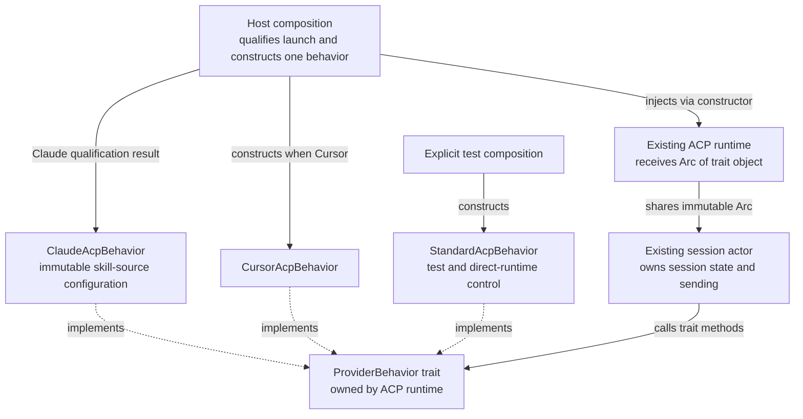
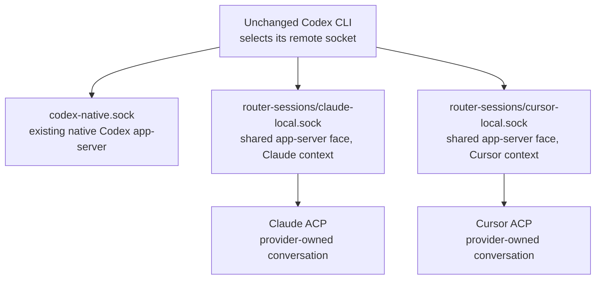
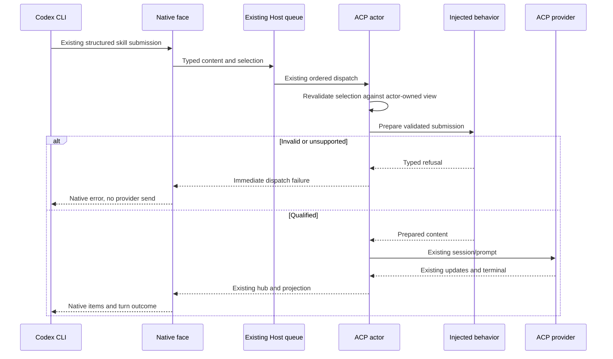
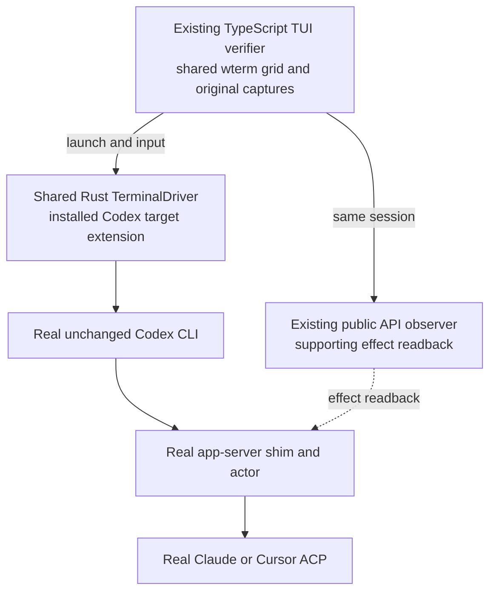
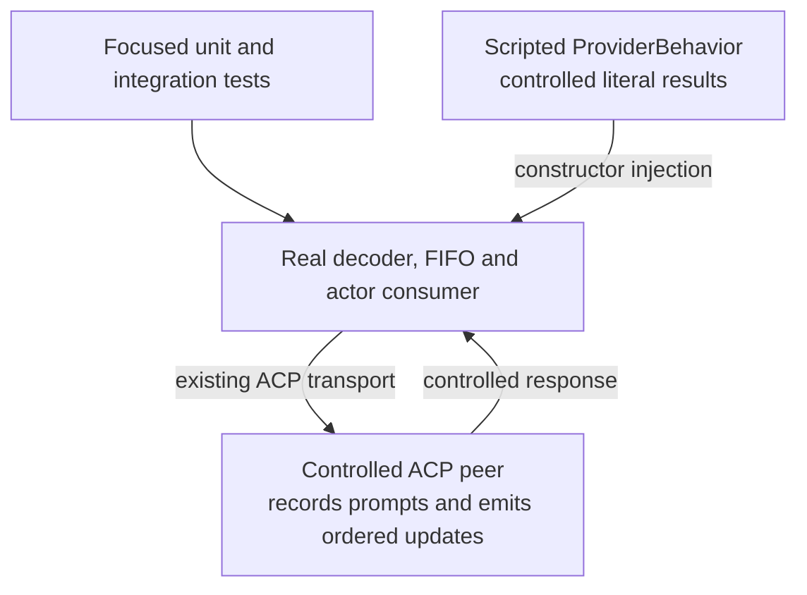

# Program Design: one bridge, injected provider behavior

The existing face speaks Codex app-server. The existing actor speaks ACP and owns sending. **Dependency injection means a constructor receives a Rust trait object.** Host composition constructs the selected concrete provider behavior; the shared runtime and actor consume that dependency without choosing providers.

The complete Program Design includes the [model information and setting-intent chapter](program-design.html#model-metadata), retained in `program-design.source.html` and embedded in the same reader. That chapter owns model bootstrap, exact-session catalogue reads, provider-controlled effort, metadata carriers and implicit-setting replay rules. The core bridge chapters below retain skills, lifecycle, command and DI ownership.



The Host construction arrows show its two configured provider alternatives: each endpoint gets **one** selected implementation. Standard behavior is an explicit test/direct-runtime control, not a third configured Host provider. Dotted arrows mean “implements”, not a runtime call from the trait to a provider selector. The trait has no registry or factory hidden behind it.

## Current path and change

At merged source `b6c30d62d` (includes main `f6d68f174`), `collaboration-runtime/src/router_session_app_server_methods.rs` answers `skills/list` with empty data, rejects structured Skill in `parse_turn_input`, and silently substitutes a default for an invalid model. `router_session_app_server.rs` has no compact admission. The existing Host command port forwards text/images through delivery/FIFO to `acp-client-runtime::provider_session_actor`; its dispatch report and hub events drive turn acceptance and output. Preserve main's admitted single-text user-history item, separate provider user-group IDs and fail-closed sink publication while adapting this path.

These are missing adaptations, not a missing transport. Current native Codex traffic and the reverse `codex-acp-adapter` stay on their existing paths. The proposed changes are native list/input/compact admission, a typed selection envelope through the existing queue, provider-specific preparation, and typed effect/error projection. The native handler must contain no Claude/Cursor branches.

### Provider routing and separate sockets

**Design requirement: one app-server connection is bound to exactly one configured provider endpoint for its lifetime.** Keep the existing segregated sockets to make that selection when the unchanged Codex CLI connects. The bridge implementation is shared; the Host supplies the endpoint context and injected behavior for each instance. Session routing then happens in code within that endpoint. Never infer the provider from a working directory, model name or most recently used session.



These provider sockets speak **Codex app-server protocol**. ACP is the backend protocol. `acp-local.sock` is therefore neither a required name nor a generic selector in this design. A single shared socket is technically possible, but it would need an explicit provider selection before startup operations: `model/list`, `skills/list` and a new `thread/start` cannot choose an existing provider session by thread ID. Per-session requests alone cannot supply that initial context.

Chosen tradeoff: reuse one socket per configured ACP endpoint and the existing Host listener/cleanup ownership. This avoids a new provider-selection handshake or client convention; maintainers carry one additional local socket per endpoint, and the eventual picker hides its path behind the selected provider/client. Revisit only when a supported unchanged-client contract can select a provider before those unscoped operations. A unified socket must not quietly introduce global-current-provider state. Separate sockets are a deliberate routing choice, not a protocol necessity or a claim of separate security sandboxes.

Source: `codex-router-host/src/collaboration_runtime/startup_composition.rs` constructs one endpoint-bound RouterSessionAppServerContext and listener per provider. Specification C1 already fixes the provider at the connection endpoint; this section makes its structural realization explicit. Native Codex remains on its existing endpoint.

| Path | Current | Proposed / result back to caller |
| --- | --- | --- |
| Read skills | Native face returns empty | Face reads current session skill view; existing `skills/changed` invalidates it |
| Invoke selected skill | Native decoder rejects Skill | Decode → Host/FIFO carries selection → actor revalidates → injected adapter prepares content → same ACP prompt; normal hub outcome returns |
| Compact | Native method absent | Dedicated command → same idle actor → qualified provider operation; marker and terminal drive native item/turn, otherwise typed refusal/failure |
| Model/mode | Existing catalogue and settings path | Validate actual model IDs against the addressed session's fresh catalogue before requested setting/prompt effects; report any already-created requested session explicitly. Never substitute a default for an invalid model. |

## Entity homes and boundary shapes

Use the repository's existing Rust enum/newtype/validated-constructor conventions. Native schemas remain upstream's; no parallel native schema or stored-format change.

| E | Semantic owner | Home / schema | Boundary shape | Lifetime |
| --- | --- | --- | --- | --- |
| E1 conversation | Existing provider session actor and Host binding | Existing `SessionRef`, Host records; no new type/store | Existing endpoint/session/cwd on commands | Existing persisted session identity |
| E2 skill | Provider defines identity/execution; actor owns the bridge's current derived view | Modified `session-event-model`, new skill-view shapes | `ProviderSkill { invocation_name, description, scope }`; name nonempty and NUL-free; scope reuses native-compatible User/Repo/System meaning. E1 is the view's existing session context, not a native path field. | Ephemeral complete snapshot per existing session/cwd |
| E3 submission | Existing actor at actual dispatch | Modified domain envelope and existing command port/FIFO | `ProviderSubmission { content: Vec<PromptContent>, selected: Vec<SelectedSkill> }`; `SelectedSkill { invocation_name }`. Existing command/FIFO target SessionRef supplies E1; preserve InputId separately. | Existing queue/turn lifetime; not a new persisted content variant |
| E4 operation | Native face owns wire meaning; actor owns provider effect | Modified existing contracts/runtime | Existing native request → `Prompt` or `Compact` actor command; existing settings remain dedicated commands | Existing request/turn correlation |

`SkillView = Unknown | Available { skills: Vec<ProviderSkill>, errors: Vec<SkillRowError> } | Unavailable(SkillSourceError)`. `SkillRowError` carries the advertised name and a closed reason (AmbiguousName, UninvocableName, UnrecognizedMetadata or MalformedMetadata). Valid rows remain usable; ambiguous or invalid rows are excluded and appear in native per-cwd errors. Whole-source failure uses Unavailable. The native decoder requires the structured name and decoded path name to agree, and the decoded endpoint/session to equal the command's addressed SessionRef. Only then does it construct SelectedSkill. The existing target remains attached through command/FIFO/admission; the addressed actor requires exactly one matching invocation in its latest own view after queue waits. No native path travels into an adapter. No revision number, minted identity, duplicated session identity, selection table or replay log is needed.

Both selected providers supply invocation IDs without physical skill paths. Use a server-owned absolute reference `/__codex_router_skill__/<endpoint>/<encoded-session>/<encoded-name>`. Encode both session ID and invocation name as UTF-8 base64url without padding using the already-adopted base64 dependency; the existing endpoint ID contract is path-component-safe. Accept only the exact component count, valid canonical encodings and decoded identities matching the addressed target and structured name. This also handles legal session IDs containing slashes or dot segments without filesystem interpretation. The native codec alone encodes/decodes the reference; it passes only the validated invocation name alongside the existing command target. It is not a claimed filesystem file and is never opened. Native0.165 `LegacyAppPathString` validates absolute syntax without checking file existence; its picker returns the path in structured input. Scope follows a provider's qualified metadata where available, otherwise System for integration-supplied metadata; pluginId=null when unknown. Unsupported skill-management returns an error without writes.

## Crates and injection

| Package | Responsibility and reason to change | Dependencies / consumer |
| --- | --- | --- |
| Existing `session-event-model` | Provider-neutral skill view and submission envelope | No SDK/provider implementation. Consumed by contracts, face, Host and actor. |
| Existing `collaboration-contracts` | Read skill view and submit/compact capabilities | Domain types, no Host/runtime implementation. |
| Existing `collaboration-runtime` | Native codecs, connection/cwd binding and hub projection | Contracts/domain; no concrete provider knowledge. |
| Existing `acp-client-runtime` | ACP transport, ordered actor and consumer-owned ProviderBehavior trait | Domain + ACP SDK; never imports concrete adapters. Runtime constructors require the dependency. |
| **One new `acp-provider-adapters` crate** | Concrete trait implementations; Claude launch qualification/preparation and embedded metadata asset | Depends downwards on runtime trait/domain. Host calls concrete startup preparation and constructs/injects one implementation. Startup resolution may do I/O; trait methods never do. No database/UI dependency. |
| Existing `codex-router-host` | Choose provider, construct/inject behavior, preserve launch environment | Depends on runtime + adapters; composition only. |
| **Small private `providers/claude-acp` package** | Use official Claude library's public session metadata APIs in its existing ACP process | Existing qualified library/SDK imports; no second installed SDK, agent or service. |

### Trait contract and lifetime

The proposed trait is object-safe, synchronous and immutable. Its methods classify or prepare provider-specific values; none sends ACP traffic, starts a task, launches a process or reads a file. Keeping these methods immutable makes one dependency safe to share across an endpoint's existing session actors. All mutable conversation state stays in those actors and the existing hub.

```rust
pub trait ProviderBehavior: Send + Sync {
    fn observe(&self, update: ProviderUpdate) -> Result<ProviderFacts, ProviderError>;
    fn prepare(&self, submission: ProviderSubmission) -> Result<Vec<PromptContent>, ProviderError>;
    fn compact(&self) -> Result<PreparedCompact, ProviderError>;
}
```

| Method | Input owned by its caller | Result / guarantee |
| --- | --- | --- |
| `observe` | Provider-neutral session-admitted, command-list, tool-status or closure update from existing lifecycle/stream | Derived skill view and/or typed semantic hint; caller applies it to its own state. No lifecycle or transport effect. |
| `prepare` | Validated ProviderSubmission with exact content and selected identities | Prepared ACP content, or closed refusal before any send. Actor still revalidates the selection against its current view. |
| `compact` | Invocation on the injected, already-qualified behavior | Existing provider compact content/operation, or Unsupported. Actor owns idle/busy admission, dispatch and terminal correlation. |

### Where the dependency is constructed and passed

1. `codex-router-host::provider_startup_composition` matches the **configured endpoint provider once**. For Claude it prepares the launch as described below and constructs `ClaudeAcpBehavior` with that explicit immutable qualification result; for Cursor it constructs `CursorAcpBehavior`. It injects the resulting `Arc<dyn ProviderBehavior>` with the prepared launch. Preserve routing/environment and native-Claude binding; the qualified Claude executable/arguments are deliberately changed to run the metadata asset. That asset is launch integration, not the DI mechanism.
2. `ExternalProviderRuntime::initialize_*` and `AgentSessionClient::initialize_*` receive that explicit dependency. Every existing initializer/caller is updated in the same cutover; tests explicitly supply StandardAcpBehavior or a scripted trait implementation. Do not add a hidden global/default lookup or an optional builder that silently chooses a provider.
3. The existing connection task stores the immutable Arc in its runtime handles. Both existing session-admission paths pass it into `run_provider_session`. Cloning an Arc shares the same stateless implementation; it does not share a skill catalogue or active-turn state.
4. Each actor calls the trait and applies the returned facts to its own inventory/projection. The actor remains the only ACP sender. Add no provider-name branches for these skills/commands in the actor, face or native codec. Host selection and concrete implementation code know the provider. Existing unrelated Cursor todo projection remains at its current owner; this project does not refactor it.

This follows the existing constructor pattern: `RouterSessionAppServerContext::new` already receives `Arc<dyn SessionCommandPort>` and `Arc<dyn SessionEventHub>`. Compile-time direction is **Host → adapters and runtime; adapters → runtime's trait; runtime → domain types**. Runtime cannot depend on the adapter crate. No DI container, service locator, plugin registration system or additional factory trait is introduced.

The dependency lives until the existing endpoint runtime retires. A session close removes that session's mutable view and turn state, not the shared immutable behavior. A different provider configuration gets a newly constructed runtime/dependency through existing startup ownership. The public-library Claude wrapper's per-query metadata state remains in that provider process; it does not migrate into this Rust trait object.

`ProviderFacts` contains an optional replacement skill view and optional typed compaction hint for an existing tool ID. `ProviderUpdate` is the neutral session-admitted/command-list/tool-status/closure shape at the existing ACP edge; classification needs no endpoint/session parameter because its caller already owns that context. Each actor calls `observe(SessionAdmitted)` before processing its ordered stream so constructor-known source failure reaches the hub even if no command list ever arrives. Command rows retain invocation name, description, optional input hint and optional opaque `_meta` at that edge. Concrete behaviors synchronously classify their actual outgoing metadata; standard ACP reports source-unavailable where skill classification is unestablished. `ProviderError` is a closed enum: InvalidSelection, Unsupported, SourceUnavailable, MalformedMetadata. Runtime/Host failure additionally retains Busy, ProviderRejected, NotSubmitted and OutcomeUnknown. The standard implementation preserves ordinary ACP behavior and refuses unestablished skill/compact capabilities.

Only the existing actor replaces its ephemeral skill view at admission and from the same ordered provider update stream it already owns. There is no Rust metadata read worker, skill-filesystem reader, refresh task or new in-flight state. Session close retires the view through the existing lifecycle. No watcher, timer, background service or global catalogue.

The existing hub exposes an atomic latest view plus update subscription through the read contract, reusing its existing session snapshot/event ownership. The native connection binds cwd to a session as C1 specifies and emits `skills/changed` only when binding/view meaning changes. `skills/list` always answers the current view immediately; `forceReload` rereads that view rather than manufacturing a native provider rescan. A stable read emits no further invalidation. Source failure returns per-cwd errors; Unknown returns no current rows/errors. Chat never waits on a metadata read.

The added read contract is `SessionEventHub::skill_view(session: SessionRef, cwd: PathBuf) -> HubFuture<SkillViewAttachment>`, where `SkillViewAttachment { snapshot: SkillView, receiver: watch::Receiver<SkillView> }` is declared once in collaboration-contracts and captured atomically. The added command is `SessionCommandPort::compact(SessionTargetCommand) -> CommandFuture<SessionTurnHandle>`, resolving only on actual dispatch/start or typed refusal. Existing prompt/steer/queue command payloads carry ProviderSubmission atomically through all callers; plain calls use no selections. The current actor dispatch oneshot carries a closed refusal reason back through Host immediately. No caller waits for a turn-start event after a refusal.

## The metadata gap, handled at the provider boundary

ACP's standard available-command row has no typed skill kind/path. **Interpret each provider's actual output before adding another source.** Cursor retains an exact native indicator in its descriptions; Claude needs its public SDK skill subset. Both join their classification to the already-advertised invocation ID. Provider execution remains authoritative.

### Claude

Use the installed `@agentclientprotocol/claude-agent-acp@0.81.0` public `runAcp()` return, public `agent.client`, and `agent.sessions[id].query`. The SDK0.3.280 public `reloadSkills()` returns the skill subset; `supportedCommands()` gives the effective namespace and builtin-name precedence. This avoids duplicating Claude's settings, plugin registry and skill-loading rules.

The private entrypoint decorates only its owned instance's outgoing `sessionUpdate`. Forward the original list immediately, then asynchronously annotate uniquely joined existing rows with `_meta.codexRouter.kind="skill"`; containing `_meta.codexRouter.skillStatus="available"|"unavailable"` distinguishes an established empty list from failure. Do not add withheld rows. The Rust adapter validates those scalars at the existing `_meta` boundary and produces `ProviderSkill` values. No transcript feed or model prompt is used to discover skills.

Keep only the latest original list, effective descriptors and one in-flight metadata read. Compare descriptors as well as flattened rows: builtin/alias changes can be hidden by identical rows. Initial or genuine namespace change permits one reload; identical reload echoes reuse the result and cannot cause another reload. A differing returned skill subset replaces old membership over the latest real advertised rows. Failure is cached for the unchanged input; no timed retries. Guard asynchronous publication with the current session/query and metadata-state object, so load reusing a query still retires old work.

`reloadSkills()` re-reads the provider's disk/cache and can run as a normal SDK control request during an active prompt; it neither gates nor resubmits that prompt. The installed native implementation has opaque minified helpers, so active-turn preservation remains a required real observation. A failed observation invalidates this timing choice and returns to this design; do not invent a gate or fallback in implementation.

Preserve the **0.81.0 bin envelope**: its SDK `resolveSettings({settingSources:[]})` and effective.env application, stdout only for ACP, stderr diagnostics, unhandled-rejection handler, optional existing logger, EOF/SIGINT/SIGTERM → public `agent.dispose()`. Resolve SDK from `createRequire(canonicalOfficialLibraryURL)` and import absolute URLs, never from the project cwd. The package builds Router-only `.mjs` embedded in the adapter crate; existing Host launch arguments run that asset in the **same Node ACP process**, importing the installed qualified official library. Preserve Router routing variables and global native-Claude binding. No runtime script cache, global install, fork, private-method patch or extra supervisor. A nonqualified custom launch remains original, with the skill-source failure reported instead of guessed.

**Launch preparation has an owner and an explicit result.** In the existing Host startup branch, after existing native-Claude/environment binding and before `ExternalProviderRuntime::initialize_*`, call the concrete Claude adapter's `prepare_claude_launch(ExternalProviderLaunch)`. This is one provider-specific startup function, not another trait/factory. It returns the launch plus `ClaudeSkillSource = Annotated | Unavailable(reason)`, which is passed to `ClaudeAcpBehavior::new`. The adapter crate already depends on the runtime that owns ExternalProviderLaunch, so this creates no reverse Host dependency.

The preparation function resolves the configured executable on the Host launch PATH, then canonicalizes the official package entry and Node executable. Qualify only the inspected official0.81.0 package/bin and its SDK0.3.280 public exports, with a compatible recorded Node runtime and the original launch arguments supported by that bin envelope. Recognize a direct official bin/symlink or the installed pnpm shim's explicit `cmd-shim-target` metadata; validate the resolved target against the package's declared bin. Do not evaluate arbitrary shell, scan skill directories or assume an unrelated custom executable is the official library. An unknown shim, changed package/API, unsupported argument or unresolved runtime fails qualification.

On qualification, replace only executable/arguments with the canonical Node running the embedded module via module-eval, importing the qualified absolute library/SDK URLs; keep environment, persistence target, routing and native-Claude binding. No emitted disk script, second process or runtime installation is needed. Record nonsecret canonical path/version identities for target qualification. If qualification fails, keep the original executable/arguments and construct Claude behavior with Unavailable(reason): SessionAdmitted and every later command update yield a source error, never indefinite Unknown or guessed skill rows. Ordinary chat/settings/lifecycle retain the original launch; skills refuse SourceUnavailable and compact refuses Unsupported because the official library/version has not been qualified for that launch. A qualified wrapper's initial unannotated list is Unknown only until its available/unavailable annotation arrives; its existing per-query failure publication supplies the latter. Missing/failed transport follows existing closure, never successful skill discovery. This failure route preserves working chat but does not satisfy required Claude U1/U2; qualification is required for delivery completion.

### Cursor

Installed Cursor2026.10.22-27dcf5f drops internal `metadata.skill`, but `convertSkillToSlashCommand` appends a native description indicator that ACP forwards verbatim. Classify only the exact final suffixes `(project skill)`, `(user skill)`, `(builtin skill)` or `(skill)`, with the preceding separator inserted by the producer. Map them to Repo, User, System and System; strip only that final producer indicator for display. Normal command rows end with their own `(team)`, `(global)`, `(project)` or `(user)` indicator, and the fixed `copy-request-id` is a command. A command title mimicking a skill still ends with its command indicator and must not classify as a skill. Do not search arbitrary description substrings.

Use the exact advertised ID, including native nested/duplicate disambiguation. Duplicate IDs across a skill/command or skill targets produce an AmbiguousName row error. IDs outside Cursor's native `[a-zA-Z0-9_-]+` mention grammar produce UninvocableName. Unknown suffixes produce UnrecognizedMetadata for this qualified source, not guesses. Keep valid classified rows alongside errors. Use the server-owned absolute selection reference; no physical skill path is needed.

Cursor publishes the list at new/load and caches its native loader; this design follows that existing session catalogue. There is no skill-file enumeration, YAML dependency, native ID/root-rule reimplementation, private module import or SDK replacement. A changed provider description convention requires adapter requalification. The native provider still owns visibility, settings, plugins, precedence, file contents and execution.

## Invocation and commands

Claude C2 splits exact input around its single selected token, preserving optional prefix as preceding Text and placing command Text last after images. Cursor C2 supports one or multiple distinct selected identities in one Text: rewrite their matching full tokens to the advertised slash IDs, deduplicate repeated structured identity, keep other bytes/images untouched and let Cursor collect every native reference. Both refuse selected multi-Text/selected-steer forms before send. Revalidate after the existing FIFO wait; a missing selection fails the dispatch report immediately. Ordinary inputs use `selected=[]`. Do not widen persisted `PromptContent`.

Compute the existing admitted user-history item from the **original incoming content before provider preparation**: when it is a single Text, retain exactly the user's `$name` text, even if Claude preparation splits it into multiple Text blocks. Inputs with images or other multi-block content retain main's existing no-synthesized-user-item rule. This keeps UI history faithful to the submitted text without storing a second representation or changing item schemas; provider user-group items retain their separate IDs.

For compact, Claude prepares its existing `/compact` ACP prompt only at idle. Normalize its version1 `_meta.contextCompaction` marker into the existing tool projection using canonical tool-kind `contextCompaction`, retaining tool ID/status and preserving it on status-only updates. No stored SessionItem variant change. Native ContextCompaction item and turn success require the current explicit compact's completed manual-or-unlabelled marker **and** successful prompt terminal; automatic trigger cannot confirm manual compact. Missing/failed marker fails, cancel interrupts, lost outcome stays unknown. Cursor compact refuses before send for this inspected build. Model/mode use existing settings; no second settings engine.



## State, failure and trust

| Owner / state | Transition | Guard and failure |
| --- | --- | --- |
| Actor skill view Unknown | Provider list plus classified metadata → Available | Lookup error → Unavailable; session/cwd close retires old view |
| Provider command update | Actor replaces derived view | Known provider classification only; valid rows retained, erroneous rows excluded/reported; close retires view |
| Existing queued input | Dispatch → running or refused | Current selected identity required; typed refusal wakes Host immediately rather than waiting for turn-start |
| Compact idle | Dispatch → existing running turn | Busy/unsupported before send; marker+terminal decides completed/failed, cancellation stays interrupted |
| Sent effect | Terminal or transport loss | Existing request/turn IDs; unknown is never auto-repeated |

Before turn acceptance, native errors preserve the request ID: invalid/stale/ambiguous selection or model → `-32602`; unsupported/source unavailable/provider rejection → `-32000`; busy → existing busy error `-32600`; unknown method → `-32601`. Carry closed domain reasons through Host conversion. After acceptance, use the existing failed/interrupted `turn/completed`, never a second successful response. An uncertain effect states its uncertainty and no replay.

Trust stays at existing owners: native face validates input and addressed session; actor validates current selection; existing approval broker controls effects; provider controls skill execution. Metadata paths are data, not execution authority. Readers never write setup or log complete settings, instructions or secrets. No migration or storage ownership changes. Metadata task failures cannot cancel ordinary conversation work.

## Requirement realization

| U | R / contract | E | Owner | Interface | Shape and home | State | Failure | Proof seam |
| --- | --- | --- | --- | --- | --- | --- | --- | --- |
| U1 | R1/C1 skills | E1,E2 | Actor view + native connection binding | Skill-view read/subscription | Domain SkillView; native SkillsListResponse | Unknown/available/unavailable | Per-cwd errors; no guessed kinds | Native list and actual chooser for both providers |
| U2 | R2/C2 invocation | E1,E2,E3 | Existing actor + concrete behavior | prepare + existing prompt dispatch | ProviderSubmission in domain/contracts | queued→revalidated→sent/refused | Immediate typed refusal, zero sends | Native input through Host/FIFO to provider effect |
| U3 | R3/C3 commands | E1,E4 | Native operation handler + actor | compact and existing setting ports | Existing native RPCs; typed command | idle/running/terminal | Unsupported/busy/failure/uncertainty | Native requests, marker/setting readback and turn |
| U4 | R4/C4 preservation | E1,E3,E4 | Existing actor/hub/broker | Existing lifecycle | Existing events, records and approvals | Existing lifecycle | No new sender or replay | Native/reverse controls, chat/history/interrupt |
| U5 | R5/C5 injection | E1–E4 | Host composition + trait consumer | ProviderBehavior constructor injection | Runtime trait; one adapter crate | Immutable dependency; mutable state per actor | Explicit standard behavior refuses unqualified effects | Dependency graph, two implementations, one sender |

## Verification entry and real/fake boundary

The existing **TypeScript TUI verification package** `scripts/verification/tui` owns journey orchestration, declared source/build/tool identity, captures, readback, scene checks and original artifacts. Its shared Rust TerminalDriver owns the PTY. The common backend cutover uses wterm/libghostty for the TS cell grid and same-byte original DOM captures; reuse that implementation rather than extending retired VHS/ttyd/Swift or creating another terminal/capture system. The Codex scenario stays inside the existing quota-reset harness crate so it consumes the same driver without moving it to another crate. The metadata observer remains supporting readback.



For the end-to-end requirement the CLI, native PTY, shim, injected implementation and provider stay real. A controlled ACP peer or scripted trait is useful only for deterministic unit/integration failure cases and cannot earn a real-provider journey. The TypeScript harness currently exposes Quota/Sessions surfaces; the Codex ACP entry is **needed**, not an existing option being claimed to work. [Verification Design](verification-design.html) owns the precise observations and limits.



This second path deliberately replaces behavior/provider dependencies to force refusal and ordering cases. It proves only its declared test boundary and **never qualifies J1/J2/J3 real-provider journeys**.

## Why this much, and no more

Chosen: existing shared lifecycle plus one concrete-adapter crate. Claude's public library supplies its complicated setup semantics; Cursor's native description suffix supplies classification with its exact advertised IDs. Gain: provider-specific behavior behind one boundary. Cost: a small Claude integration asset and a qualified Cursor-output classifier. The maintainers of those adapters bear that cost.

Rejected: putting provider branches in the native face, a copied desktop composer, filesystem discovery/native root or ID reimplementation, rebuilding Claude plugin discovery, a generic catalogue service/store, private Cursor patches, or an extra metadata agent/process. Each adds ownership or machinery without an additional requested outcome. Reopen the choice if a provider offers a typed native skill API or if real classification/refresh/invocation proof contradicts these contracts. A missing required skill source remains a delivery blocker; explicit unavailability does not satisfy U1 by itself.

Source anchors: current Router files named above; Codex0.165 `tui/src/chatwidget/input_submission.rs:305–341` and `app_server_session.rs`; T3 `packages/provider-acp/src/server/adapter.ts:219–244`, `provider-cursor/src/server/skills.ts:211–290`; Orca `acp-dialects/acp-dialect.ts:47` and `acp-structured-options.ts:107`; installed Cursor chunks5622/7096/8096 and index.js root declarations. [Verification Design](verification-design.html) specifies the real observations these source facts do not establish.
