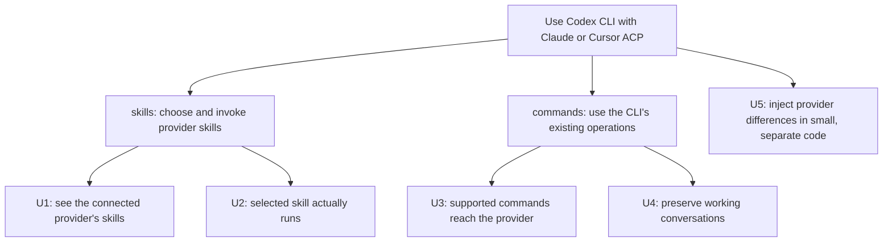

# Requirements: Codex CLI with Claude and Cursor ACP

Use the existing Codex CLI as the client for **Claude ACP and Cursor ACP**. The connection already works. This project completes its skills and existing commands; it does not build another client or another transport.

## What you need

| Need | Outcome and reason | Home | Authority / priority |
| --- | --- | --- | --- |
| U1 | `$` lists the connected Claude or Cursor session's invocable skills. A working chat connection with an empty picker is insufficient. | skills | Owner's explicit `$` request and October 28 provider correction; required |
| U2 | Selecting a skill invokes that provider's own skill, preserving accompanying text and images. A model talking about a skill is insufficient. | skills | Owner's existing CLI → shim → ACP goal; required |
| U3 | Existing `/` commands retain their existing client behavior and app-server operations. The connected provider performs equivalent supported actions; unavailable actions are reported honestly. | commands | Owner explicitly distinguishes slash operations from skill input; required |
| U4 | Keep the existing connection, ordinary input, output, approvals, interrupt, history and native Codex/reverse ACP behavior working. | commands; also serves skills | Owner says the connection already works; required |
| U5 | Keep Claude and Cursor differences injectable and give packages defensible responsibilities. Keep the change small enough to understand and maintain. | shared constraint over skills and commands | Owner's injected-trait, crate/package-hygiene and no-overengineering instructions; required |

The direct user is **you using Codex CLI**. Claude ACP and Cursor ACP are the agent backends, not alternate names for that user. Native Codex remains an existing backend/control, not a reason to omit Cursor from this project.

## Boundary

- Reuse the existing Codex CLI, app-server face, ACP connection, session owner and provider executables.
- No CLI fork, menu extension, new keyboard convention or invented generic slash-menu RPC.
- Provider setup remains provider-owned. Provider-specific metadata adaptation may identify skills, but Router must not expand skill instructions into a prompt or become their execution engine.
- No database, installation manager, general plugin/catalogue framework, new supervisor, unrelated provider support or production replacement.
- This commission produces four separate design documents, independent review, and an implementation plan, presented as clearly named HTML pages. It does not authorize feature implementation.

The governing sources are the owner's direct corrections in this conversation, including the October 28 request to delete and replace the old set. Prior drafts and their review verdicts are not authority for this replacement. [Specification](specification.html) defines the observable behavior; [Program Design](program-design.html) owns the proposed structure.
