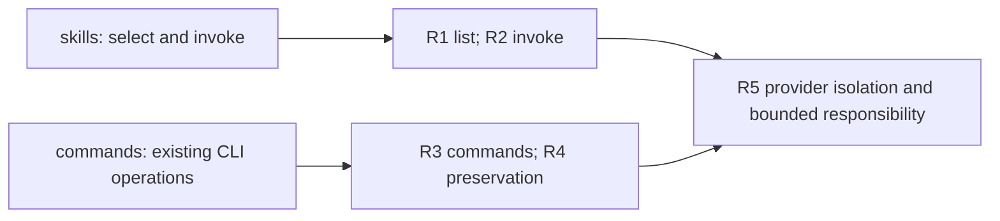
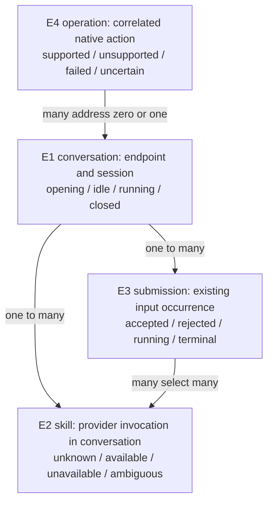

# Specification: existing CLI behavior through ACP

Governing needs: [Requirements](requirements.html). Skills belong to the connected provider; native CLI operations and provider operations remain distinct.

## Meaning and identity

| Entity | Same-instance rule and relationships | Invariants and states | Basis |
| --- | --- | --- | --- |
| E1 provider conversation | Existing endpoint plus session identity. One conversation has one provider and working-directory context, many skills and many submissions. Resume retains its identity. | No cross-provider/session borrowing. Opening, idle, running, closed are existing conversation states. | U1–U4 |
| E2 provider skill | One provider invocation identity within E1's effective setup. Two distinct targets with the same display name remain distinct or ambiguous. A description edit does not create a new skill. | The provider decides what runs. Unknown, available, unavailable, ambiguous. A plain command is not automatically a skill. | U1,U2 |
| E3 submission | One existing input occurrence in E1, with ordered content and zero or more explicit E2 selections. | Accepted, rejected, running, completed, interrupted or uncertain; a rejected selection has no provider effect. | U2,U4 |
| E4 CLI operation | One existing local CLI action or correlated server request. A request addresses at most one E1. | Supported, unsupported, failed and uncertain remain different outcomes. | U3,U4 |

The table defines exact identity and states; the picture keeps their cardinalities visible. “ACP client” in the original request describes the integration direction colloquially: Codex CLI connects to the app-server face, which talks to ACP agent providers. Cursor here means its ACP agent backend.

## skills

### R1 — List the right provider's skills (C1, V1)

For U1, the existing `skills/list` response must populate the existing `$` chooser from E1's current qualified skills. Native name/path selection fields must round-trip. A true empty set differs internally from missing or failed metadata; actual source errors use existing native per-cwd errors. No command is relabelled as a skill solely because ACP advertised its name.

The request names cwd(s), not a thread. Its endpoint fixes the provider. On each native connection, a successful explicit start/resume binds that cwd to the addressed conversation; read/history does not rebind it. Before a binding or initial metadata is available, return an immediate empty current view without a startup warning. Later binding or semantic inventory changes send existing `skills/changed`; do not hold the client waiting for provider metadata. Overlapping same-cwd bindings are ambiguous until a later non-overlapping explicit start/resume. No cross-connection/global-newest/union rule.

`forceReload` requests a fresh bridge view of the current provider session. It cannot promise a provider disk reload where the provider exposes none. A new on-disk skill is selectable only after the provider advertises its invocation identity. Refresh must not gate or restart an active turn.

### R2 — Run the selected skill (C2, V2)

For U2, structured native `Skill {name,path}` input must resolve to E2 in the addressed E1 at dispatch. The Text still containing `$name` is the same selection, not a second invocation. Validate the full selected identity; reject stale, foreign or ambiguous targets before sending. Preserve text bytes, Unicode, whitespace, arguments and images. Router loads no instruction body into the prompt.

Deduplicate identical structured identities, reject conflicting ones, and match the full metadata-selected token after start/whitespace and before whitespace/end. Claude splits at its last matching occurrence; Cursor rewrites all matching occurrences of the selected identities and native recognition deduplicates each distinct skill. Unselected dollar text remains unchanged. Unaddressable token placement refuses explicitly rather than guessing.

| Provider | Required supported form | Explicit boundary |
| --- | --- | --- |
| Claude ACP | One selected skill in the normal single Text input, leading or nonleading, with images. Retain exact prefix Text and send `/invocation-name` plus exact suffix as the final Text block. | Native expansion position requires real qualification. Several distinct selections, selected multi-Text input and selected-skill steering refuse before send; no first-only success or model/file fallback. |
| Cursor ACP | One or multiple distinct selections in the normal single Text input, leading or nonleading, with images. Convert only their matching `$name` tokens to the provider's `/invocation-id`, with other bytes and images unchanged. Native recognition collects every distinct slash ID. | Refuse a skill/command name collision, an ID outside the native mention grammar, selected multi-Text input or selected-skill steering before send. Do not infer T3's simple folder-name rule applies to nested duplicate IDs. Ordinary steering stays unchanged. |
| Native Codex | Existing transparent native route, including its native skill forms. | No new ACP round trip. |

Ordinary input without structured selection follows the existing path. Unsupported forms return a native error and make zero provider submissions. Skill source navigation and enable/disable are not invented from an invocation reference; unsupported management writes no provider or Codex setup.

## commands

### R3 — Map existing operations separately (C3, V3)

For U3, the command's native operation determines the effect. ACP's advertised command list does not authorize adding entries to Codex CLI.

| CLI action | Existing native contract | Claude ACP | Cursor ACP |
| --- | --- | --- | --- |
| `$`, `/skills` | `skills/list`; selection in `turn/start` | R1/R2 | R1/R2 |
| `/compact` | `thread/compact/start` | Existing `/compact` provider action; successful terminal **and** native typed compaction marker required | Unsupported for the inspected ACP build: no qualified compact method/effect. Sending text `/compress` is not proof of compaction. |
| `/model` | `model/list`; selected model on existing settings/turn flow | Existing provider settings operation and confirmed effective value | Existing ACP model/config option operation and confirmed effective value |
| Plan/mode | Existing collaboration/mode/turn contract | Equivalent advertised mode or explicit unsupported | Advertised agent/plan/ask mapping where native request is equivalent; otherwise unsupported |
| New/resume/history/interrupt | Existing thread/turn contracts | Existing supported lifecycle | Existing supported lifecycle |
| Fork, permissions, config/skill writes | Existing dedicated contracts | Equivalent advertised capability or explicit unsupported; no broader grant | Same rule |
| Help/clear/appearance/exit | Local effect where CLI owns it | No provider operation | No provider operation |

Compact is idle-only; busy refuses before dispatch. A tool called “Compact”, queue acknowledgement, or ordinary model reply cannot count as confirmed compaction. Automatic compaction cannot end ordinary chat. Cancelled, failed or uncertain effects cannot become successful completion, and uncertain effects are never auto-replayed.

### R4 — Preserve conversations (C4, V4)

For U4, the same session owner retains ordered sending, cancellation, approval authority, settings and live/history projection. Metadata remains useful outside assistant prose. Native Codex and the existing reverse ACP frontend retain their established entry paths. No second sender, synthetic prompt, implicit new turn or setup mutation is permitted to repair a missing capability.

## Shared constraint

### R5 — Inject the differences, keep one bridge (C5, V5)

For U5, provider-specific discovery/interpretation and invocation rules must stay behind injected code. Changing Claude's rules must not change the shared native protocol handler. Shared code keeps native wire adaptation, session routing and lifecycle. No general catalogue, plugin runtime, separate execution path or persistent skill store is required.

## Need-to-proof coverage

| Home | U | E | Problem → outcome | R / contract | Proof obligation and reference |
| --- | --- | --- | --- | --- | --- |
| skills | U1 | E1,E2 | P1 empty/misclassified chooser → O1 correct connected-provider choices | R1/C1 | V1: actual unchanged CLI lists real skills for **both** Claude and Cursor, before skill input, including late metadata and source failure. Native0.165 response schema and provider identities decide correctness. |
| skills | U2 | E1,E2,E3 | P2 unsupported structured input → O2 provider-owned effect | R2/C2 | V2: real chooser selection executes each provider's fixture skill once with preserved content; identity/refusal countercases send nothing. C2 and actual provider recognition decide correctness. |
| commands | U3 | E1,E4 | P3 unrelated slash forwarding → O3 correct supported operation or honest refusal | R3/C3 | V3: native RPC, actual effect and native terminal state agree with C3; invalid model and unsupported Cursor compact never succeed. |
| commands | U4 | E1,E3,E4 | P4 regression → O4 existing working behavior preserved | R4/C4 | V4: live/history/interrupt/approval/native controls keep their outcomes; source refresh cannot disturb a running turn. |
| shared | U5 | E1–E4 | P5 duplicated lifecycle → O5 replaceable provider rules | R5/C5 | V5: two concrete implementations use the same actor and face; manifests/call paths show one sender and no prohibited framework/store. |

Targets are installed Codex CLI0.165.0 (official source `360319d8dee62d87e2d59fc0c21805d79519cfed`), Claude ACP0.81.0 and installed Cursor Agent2026.10.22-27dcf5f, unless a later version is explicitly requalified. These contracts require implementation proof; source inspection alone is not a feature pass.
