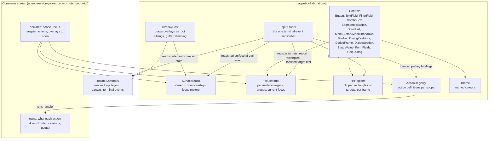
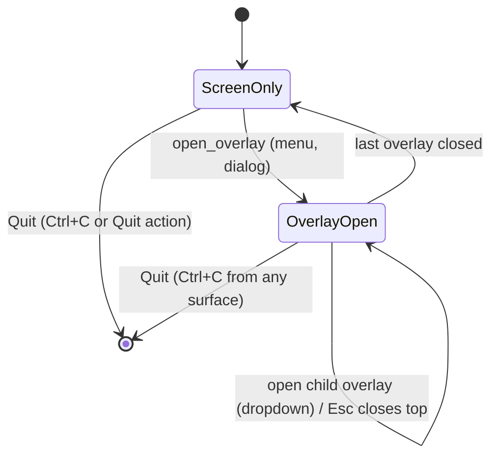

# Program Design: TUI component system

How the obligations in the [Specification](specification.md) become owned code. Baseline: `origin/main` at `881f778c7`, iocraft pinned to `agent-collaboration/iocraft` `829ebd86`. The design's feasibility rests on probes run on Sunclaw on 2026-10-29 (branch `design/tui-component-probes`); each is cited where it decides something.

## Structure decision

**Selected: rename and extend.** `codex-router-tui` becomes `agent-collaboration-tui` in a hard cutover. Its two codex-router-specific typography roles move out to the quota crate, so the renamed crate meets constraint C1. The new parts are added inside it: one input owner, a surface stack, an overlay host, an action registry, and the controls. The picker and the quota screen move onto it, and their own key-handling code is deleted.

| Alternative | Why not |
| --- | --- |
| A new crate beside `codex-router-tui` | Two homes for dialogs, forms and typography during and after migration; the repository's rule is hard cutover with no dual paths. |
| Adopt or fork CometixTUI | Depends on a fork (C2). Its pure pieces are borrowed instead (see Reuse). |
| Keep each widget listening for itself, gated by focus flags captured at render time | Refuted by Probe 3: bursts leak into covered surfaces and clipped-off buttons can be clicked. |
| Wrap iocraft's `TextInput` | Not possible at the pin: it always subscribes to terminal events itself and exposes no way to feed it keys (Probe 6 source finding). The crate owns its single-line field. |

**What would reopen this:** a probe showing the root handler can't apply state synchronously between two events of one burst; a consumer needing an iocraft widget that must subscribe itself; or the owner choosing an iocraft change, which would let native propagation replace the central owner.

## Components



| Component | Job (one reason to change) | Owns | Obligations |
| --- | --- | --- | --- |
| InputOwner | Decide where each input event goes. | The only `use_terminal_events` subscription in an application; event-time routing order; the two deliberate exceptions. | R1, R2 (input half), R4, R9 (key half), R11 (click half) |
| SurfaceStack | Know what is open and on top. | Ordered stack of the screen and open overlays; each overlay's parent and the focus target to restore when it closes. | R1, R2, R11 |
| FocusModel | Know what has focus on each surface. | Ordered focus targets per surface, their groups for arrow movement, enabled state with reason, current focus keyed by target identity. | R3, R9, R11 |
| HitRegions | Map a mouse position to a target. | Each target's clipped on-screen rectangle, recorded while the frame is drawn. A crate hook on each target reads its position and size from iocraft's public draw-time geometry (`ComponentDrawer::canvas_position` and `size` in `pre_component_draw`), not from `use_component_rect`, whose value is one frame old. iocraft's clip rectangle is private at the pin, so the hook keeps only the cells for which `drawer.canvas().cell(x, y)` returns a cell. That is iocraft's own inherited clip from every ancestor, including consumers' plain `overflow: Hidden` views, with no ancestor list to maintain. The map is staged during the draw and published when the root finishes drawing, so it always describes the frame on screen. A resize invalidates it until the next frame is drawn. | R1, R3, R11 |
| ActionRegistry | Define each action once. | Action definitions per scope (name, keys, availability with reason, checked state, handler); key lookup per scope; projections to menu, toolbar, Help and dialog key hints. | R5, R6, R7, R8 |
| OverlayHost | Draw overlays correctly. | Rendering open overlays as root-level siblings in stack order; the one-cell gutter to each overlay's left; the covered state that tells surfaces to draw dimmed. | R2 (drawing half), R10 |
| Controls | Each building block's look and local behaviour. | Per-control state such as text buffer and cursor, highlight, segment and scroll offset, and its visual states. `DialogSection` owns the dialog section rhythm (one blank row between sections, none inside, one before the actions row) and an optional tinted group panel; `StatusValue` draws a status as text in its status colour. | R12, R13, R14, R15 |
| Theme | Named colours, taken from the current shipped `codex-router-tui` roles (owner: "I like our current colors better"), and the crate's own glyphs, each one cell wide under both the pinned renderer's width table and current Unicode. | Colour roles: base, raised, group panel, text, muted, accent, focused, primary, disabled, dimmed, and the status roles (good, warning, error). Each background role has a dimmed form for covered surfaces. | R2, R12, R15 |

**Dependency direction.** Consumers depend on the crate; the crate depends on iocraft and unicode-width only (C1). Inside the crate: Controls depend on FocusModel, HitRegions, ActionRegistry and Theme. InputOwner depends on SurfaceStack, FocusModel, HitRegions and ActionRegistry. OverlayHost depends on SurfaceStack and Theme. Nothing in the crate depends on a consumer. Forbidden: any control or consumer subscribing to terminal events (R5), detected by a structural check of the crate's own consumers.

## Entity binding

| E | Semantic owner | Home | Shape |
| --- | --- | --- | --- |
| E1 Screen | Consumer, through the crate's root | `agent-collaboration-tui` (existing crate, renamed) | `ScreenScope { id: ScopeId }` passed to the root component; the root mounts InputOwner and OverlayHost. |
| E2 Overlay | SurfaceStack | `surface_stack` module (new) | `Overlay { id: OverlayId, kind: OverlayKind, parent: SurfaceId, restore_focus: Option<TargetId>, scope: ScopeId }`, with `enum OverlayKind { Menu, Dropdown { field: TargetId }, Dialog }`. Help opened from a main screen is a `Dialog`. Help opened from a dialog is not a new overlay: the dialog swaps its body for Help and keeps its query, focus and draft state for the return (R7; 2026-10-17 one-level rule). |
| E3 Surface | SurfaceStack | `surface_stack` (new) | `enum SurfaceId { Screen, Overlay(OverlayId) }`; the stack is an ordered list with the screen first; `top() -> SurfaceId`. |
| E4 Focus target | FocusModel | `focus_model` (new) | `TargetId`: a stable key the consumer derives from its existing full identity for the item. That is the source-qualified session reference (endpoint plus native or managed id) or the AccountId, never a bare id that two sources could share. Plus `TargetSpec { group: GroupId, order: u16, enabled: Availability }`; the current focus is stored as a `TargetId`, never as an index. |
| E5 Action | ActionRegistry | `actions` (new) | `ActionDef { id: ActionId, title, keys: Vec<KeyChord>, availability: AvailabilityFn, choice: Option<Checked>, placement: Placement, run: Handler }`, where `AvailabilityFn` is evaluated per routed event against the consumer's current state and returns `enum Availability { Available, Unavailable { reason } }` and `enum Placement { Toolbar, Menu { section }, Hidden }`. |
| E6 Key binding | ActionRegistry | `actions` (new) | `KeyChord { code, modifiers }`, unique per `ScopeId`; a duplicate is rejected when the scope's actions are declared. |
| E7 Input event | InputOwner | `input_owner` (new) | iocraft `TerminalEvent` (key with kind, paste, mouse, resize) received by the single subscription; routing result `enum Routed { Target(TargetId), Action(ActionId), Closed(OverlayId), Quit, Ignored }`. |
| E8 Option | The control that lists it | `controls::combo_box`, `controls::scroll_list` (new) | `OptionKey` (stable key from the value it stands for) plus display text; highlight and current value are stored as `OptionKey`. |

Persisted, derived, cached: nothing is persisted. FocusModel's current focus and SurfaceStack are in-memory state for the life of the application. HitRegions is a derived cache rebuilt every frame.

## How an event reaches its effect

The representative path is a burst, because that is where today's design fails: F10 opens the menu, a typed `a` and a paste arrive in the same batch, then Esc and Enter.

```mermaid
sequenceDiagram
  participant T as Terminal
  participant IO as iocraft render loop
  participant O as InputOwner
  participant S as SurfaceStack
  participant F as FocusModel
  participant R as ActionRegistry
  participant C as Consumer handler
  T->>IO: F10, 'a', paste, Esc, Enter (one batch)
  IO->>O: F10
  O->>S: top() = Screen
  O->>F: focused target uses F10? no
  O->>R: Screen scope binds F10 → OpenMenu
  R->>S: push Menu (restore focus = list row)
  IO->>O: 'a'
  O->>S: top() = Menu (already updated, no re-render needed)
  O->>F: Menu's focused item uses 'a'? no; Menu binds 'a'? no
  O-->>O: Ignored (never reaches the list or filter)
  IO->>O: paste
  O-->>O: Menu has no text field → Ignored
  IO->>O: Esc
  O->>S: pop Menu; restore focus to the list row
  IO->>O: Enter
  O->>S: top() = Screen
  O->>F: focused = list row → Details of the selected session
  F->>R: Screen scope action Details
  R->>C: run handler (the consumer opens its Details dialog)
  IO->>IO: one render after the batch: the Details dialog on top, the list dimmed beneath it, nothing launched
```

The key property, proven in Probe 3's central arm: SurfaceStack and FocusModel are updated inside the event handler, before the next event of the same batch is routed. Routing never reads state from the last render.

Mouse path: a click goes to InputOwner. If the click is inside the top surface, HitRegions finds the target under it, clipped by its ancestors, and focuses and activates it. If the top surface is a menu or dropdown and the click is outside it, the overlay closes and the click is consumed. If the top surface is a dialog and the click is outside it, the click is ignored (R11). Either way, nothing beneath is reached.

## Interfaces

Consumer-facing (what a screen author writes):

```rust
// Declared once per scope; the crate builds menu, toolbar, Help, dialog key hints and key lookup from it.
pub struct ActionDef {
    pub id: ActionId,
    pub title: &'static str,
    pub keys: Vec<KeyChord>,
    pub availability: AvailabilityFn,    // evaluated at event time against the consumer's current state;
                                         // Unavailable { reason } greys it out everywhere (R6)
    pub choice: Option<Checked>,         // checked items for sort / runtime view (R8)
    pub placement: Placement,
    pub run: Handler,                    // consumer-owned effect
}

pub enum Availability { Available, Unavailable { reason: String } }

// Opening an overlay is the only way to put something above a surface.
pub fn open_overlay(stack: &SurfaceStackHandle, overlay: OverlaySpec) -> OverlayId;

// Controls take a TargetId that the surface's model already declares (open_overlay or the screen model);
// rendering never creates targets, and controls never subscribe to terminal events.
// Button(id, label, action), TextField(id, value, on_change), ComboBox(id, options, value, on_pick),
// SegmentedSwitch(id, segments, value, on_change), ScrollList(id, rows, selected, on_select)
```

Guarantees to consumers: a handler runs only when its action is available at the moment the event is routed, re-checked per event so that a second Press in the same burst sees the first one's effect (R6); a control's `on_change` runs only for input routed to it (R1); `open_overlay` makes the new overlay the top surface before the next event is routed.

Consumer obligations: call `.ignore_ctrl_c()` on the render loop (C3); declare a `TargetId` that stays the same for the same item across re-renders (E4); never call `use_terminal_events`, `use_local_terminal_events` or `use_terminal_size` (R5). The consumer passes the terminal's initial size from its launch boundary (`crossterm::terminal::size()`, already a dependency of both consumers) to the crate root, and InputOwner routes every later Resize; tests pass explicit dimensions. iocraft's `Hooks::terminal_size()` is crate-private at the pin, and `use_terminal_size` installs its own subscription, so neither is used.

## State



- Opening an overlay records the focus target on the parent surface.
- Closing restores that target if it still exists and is enabled; otherwise focus goes to the first enabled target of the now-top surface (R11).
- A dropdown always closes before its dialog.
- Help from inside a dialog opens no overlay: it swaps that dialog's body and swaps it back with query, focus and draft unchanged (R7). Help from the main screen opens as a dialog.
- Ctrl+Enter on a dialog with an open dropdown closes the dropdown without applying its highlight, then runs the dialog's primary action, all in one routing step (R9).

**Lifecycle: what exists before the next event.**
- `open_overlay` builds the overlay's model as data, synchronously, before returning: its focus targets, actions, initial focus and, for a dropdown, its options. Routing reads that model, so in a burst like F10, ↓, Enter the menu's items exist before any frame has been drawn. Rendering only reads the model; it never creates targets.
- Mouse regions are the exception. They are recorded while a frame is drawn and describe the frame on screen, so a click that arrives before an overlay's first frame finds no region and is ignored. A resize or scroll invalidates the map until the next frame is drawn.
- InputOwner computes the routing decision, updates SurfaceStack and FocusModel, and releases every crate state borrow before calling a consumer handler. A handler that opens or closes overlays re-enters through the public API. No crate state is held borrowed across consumer code, because iocraft's `State::set` uses `try_write` and can silently fail while borrowed.

## Failure and edge behaviour

| Case | Owner | Behaviour |
| --- | --- | --- |
| Duplicate key in one scope | ActionRegistry | Rejected when the scope's actions are declared; the screen fails its own tests rather than shipping an ambiguous key (E6). |
| Event with no target on the top surface | InputOwner | Ignored; never falls through (R1). |
| Action unavailable | ActionRegistry | Its key and click do nothing; the menu shows the reason (R6). |
| Focus-restore target gone | SurfaceStack + FocusModel | First enabled target of the now-top surface (R11). |
| Terminal doesn't report Ctrl+Enter | InputOwner | Nothing to detect; the primary button stays reachable by Tab then Enter and by click (R9). |
| Consumer handler fails | Consumer | The crate reports nothing on the handler's behalf; the consumer shows its own result (out of the crate's scope). |
| Wide character at an overlay's left edge | OverlayHost | The gutter cell is painted with the overlay's background, so the corner survives (R10; Probe 1 failure mode). |
| Overlay at the terminal's left edge | OverlayHost | No gutter cell exists or is needed. |
| Resize | InputOwner + iocraft | Layout recomputes; HitRegions is rebuilt on the next frame; focus is kept by `TargetId`. |

Concurrency: a single event loop. Events are routed one at a time, against state updated by the previous event (R1). Consumer data that arrives asynchronously (session lists, quota) triggers re-render only; it never routes input. A covered surface may redraw new data while staying dimmed and inert.

## Cross-cutting

- Accessibility: keyboard-only and mouse-only reach, plus visible focus, are owned by FocusModel and the controls (R3).
- Terminals (C4): key decoding comes from iocraft and crossterm 0.29, which handle both kitty-protocol and legacy encodings.
- Release events are never routed. Repeat events reach only navigation and text editing: arrows, Page keys, Home, End, Backspace, Delete and characters. Actions with an effect (Open, Start, New, Fork, Quit, menu items) trigger on Press only, so holding Enter starts once (Probe 4: Press-only activation).
- Security, privacy and data: not applicable. The crate stores and sends nothing.

## Reuse and borrowing

- **From `codex-router-tui`, moved with their layout and measurement but not their input handling:** `DialogFrame`, `DialogMargins`, `DialogBodyViewport`, `DialogFooter`, `FormFields`/`FormField`, `FocusReveal`, `SelectableRow`, and the typography roles. `DialogFrame` and `DialogBodyViewport` today install their own subscriptions through `UseDialogInteraction` (`use_dialog_events`, local wheel listeners). Those are removed; their scrolling and close keys are routed by InputOwner, and the structural check (R5) covers them. `DialogFrame` gains a marked primary action and, for forms only, content-height sizing; other dialogs keep the 10-17 percentage sizing (R12). `DialogHost`/`DialogInputScope`/`UseDialogInteraction` are replaced by InputOwner and SurfaceStack. `SearchSelect` is replaced by `ComboBox`. `ShortcutHelp` is replaced by the generated Help dialog.
- **Moved out to `codex-router-quota-tui`:** the `WeeklyWindow`/`ShortWindow` colour roles (C1).
- **Borrowed from CometixTUI** (MIT/Apache, with attribution, no dependency): the pure key-binding parser (`use_keybinding.rs:1-153`), adapted to our repeat policy; the `scroll_content_top_for_absolute_rect` helper (`scroll_view.rs:440-459`); and the pure focus traversal and restore routines (`focus.rs:121-435`). Their defaults are not taken: sibling scopes sharing Tab, and Esc clearing focus.
- **Borrowed as design from hunk:** command registry → menus/Help projection, menu controller behaviour, and checked items.

## Migration

| Phase | Change | Done when |
| --- | --- | --- |
| 1 | Rename `codex-router-tui` → `agent-collaboration-tui` in all four consumers; move the quota colour roles out. | Workspace builds; no reference to the old name remains; the crate has no codex-router dependency. |
| 2 | Add SurfaceStack, FocusModel, HitRegions, InputOwner, ActionRegistry, OverlayHost, and the new controls; extend DialogFrame. | The crate's own tests cover R1-R15 at component level. |
| 3 | Move the session picker onto the crate; delete `picker_input.rs`'s key chain, the per-dialog key maps and the hand-written Help; build the toolbar and ≡ menu. | Picker meets R1-R14 on a real terminal; no picker code subscribes to terminal events. |
| 4 | Move the quota screen onto the crate's controls and InputOwner; keep its 2026-10-23 look and layout, except that its bottom row of actions becomes the ≡ menu and toolbar (owner, option A). | Quota meets R1–R11, R15 and R16 (its full preserved feature list, including the reset workflow's quit behaviour (Ctrl+C ignored while committing, exit without commit before it) and the AccountId and effect guards); Esc no longer exits it, while Q and Ctrl+C do. Deleting its old key maps deletes no domain guard. |

No phase leaves a second input path behind: each consumer cuts over completely in its phase. Planning decides how phases group into pull requests.

## Trace table

| U | R | E | Owner | Interface | Shape and home | State | Failure | Proof seam |
| --- | --- | --- | --- | --- | --- | --- | --- | --- |
| U1 | R1 | E3 E4 E5 E7 | InputOwner | routing order: focused target → scope bindings; two exceptions | `Routed` enum; `input_owner` | SurfaceStack + FocusModel updated per event | no target → Ignored | inject a key/paste/mouse burst into the real render loop; read every surface's input state after; plus a real PTY run with kitty and legacy keys |
| U2 | R2 | E2 E3 E7 | InputOwner (input) + OverlayHost (dim) | covered flag from SurfaceStack | `surface_stack`, `overlay_host` | covered while any overlay above | — | events aimed beneath leave state unchanged; canvas cells of the covered surface carry the dimmed colour and the original text |
| U3 | R3 | E1 E3 E4 | FocusModel + HitRegions | Tab/arrows/click on registered targets | `TargetSpec`, `GroupId`; `focus_model` | current focus by `TargetId` | disabled target skipped | walk every target by Tab, arrows and click on each screen; canvas shows exactly one focus style |
| U4 | R4 | E1 E5 E6 | InputOwner + ActionRegistry | main-screen rules; Ctrl+C global | `ActionDef` on the screen scope | search/filter state in consumer | Esc at defaults → no-op | key sequences on the real picker; Ctrl+C from screen and from an overlay with ignore_ctrl_c |
| U15 | R5 | E1 E4 E5 | ActionRegistry + InputOwner | consumers declare only | crate API | — | a consumer subscribing itself | structural check that consumers don't call `use_terminal_events`, plus R6/R7 projections matching |
| U6 | R6 | E5 E6 | ActionRegistry | projections: toolbar, menu, Help, dialog key hints, key lookup | `ActionDef`, `AvailabilityFn`; `actions` | availability evaluated per routed event | unavailable → not triggered | flip availability; compare all projections in one frame; send the key and click |
| U7 | R7 | E2 E5 E6 | ActionRegistry + HelpDialog | Help generated from the scope's defs | `HelpDialog` in `controls` | — | — | compare Help entries with the scope's bound actions |
| U8 | R8 | E4 E5 | ActionRegistry (checked) + SegmentedSwitch | `choice: Option<Checked>` | `actions`, `controls::segmented_switch` | consumer setting | — | change setting by click, menu, key; read marks |
| U5 | R9 | E2 E4 E5 E6 | InputOwner + TextField + ComboBox | dialog key rules; Ctrl+Enter compound step | `controls::text_field`, `controls::combo_box` | dropdown open/closed; text buffer + cursor | no Ctrl+Enter → Tab+Enter | key sequences per dialog incl. dropdown + Ctrl+Enter; text editing keys; gap: physical Ctrl+Enter delivery (H2) |
| U9 | R10 | E2 E3 | OverlayHost | gutter painted left of each overlay | `overlay_host` | — | overlay at x=0 → no gutter | canvas cells and the serialized terminal output with a two-column character at overlay-left−1, every covered row |
| U10 | R11 | E2 E3 E4 E7 | SurfaceStack + InputOwner | close top; restore focus; click policy | `Overlay.restore_focus`; `surface_stack` | stack pop | target gone → first enabled | Esc and outside clicks on menu, dropdown, dialog; check focus after close incl. a removed target |
| U11 | R12 | E2 E4 E5 | DialogFrame + DialogSection | title, Help, context id, section rhythm and group panels, label column, scrollbar, primary action, status colour with label, form content height | `controls::dialog_frame` (moved) | — | content taller than space → scrollbar | canvas layout of each dialog against R12's list |
| U12 | R13 | E1 E4 E5 | Toolbar + MenuButton/MenuDropdown + FilterField | picker declares toolbar and menu actions | `controls::toolbar`, `controls::menu` | filter text in consumer | — | picker canvas + key/click sequences against R13 |
| U13 | R14 | E2 E4 E8 | ComboBox | dropdown with filter, keyed highlight | `OptionKey`; `controls::combo_box` | highlight by `OptionKey`; matching and pickability kept apart | own typing hides it → first match; outside update removes it → no highlight until ↑/↓; none → "no match"; unavailable → highlightable, not pickable | filter/reorder/update while open; still-matching typing; outside removal; unavailable option |
| U14 | R15 | E4 | Controls + Theme | same control kinds on both screens | `controls`, `theme` | — | — | same control kinds compared on picker and quota canvases |
| 10-17 baseline | R16 | E1 E4 E5 | the consumer screens (picker, quota) keep their domain owners; the crate supplies input and controls | each preserved capability reached through crate controls and actions | consumer modules (unchanged domain owners); `TargetId` from the full existing identity | consumer state | domain guards stay with their owners: pending/unknown never auto-retried, one Start, no fabricated IDs | the existing compiled Sessions/Quota capture journeys at all six grid sizes plus same-child resize, with expectations from 2026-10-23 C1–C10 first, then 10-17, then this set; and the existing public-entry journeys (`agent-sessions` from its real argument entry through inventory and dispatcher to selected-machine client actions: `client-actions.md`, `claude-background.md`, CLIENT-REAL-ENTRY) for 10-17/U15–U16 |

Deviations and unresolved decisions: the physical Ctrl+Enter delivery (Requirements H2) is an open proof gap. Probe 7 showed the existing `SearchSelect` keeps its highlight by identity through reorders but resets it to the first match when the query grows, so `ComboBox` owns the R14 highlight rules itself rather than inheriting `SearchSelect`'s. Probe 6 showed iocraft's native `TextInput` subscribes to terminal events itself and can't be held back while an overlay opens in the same burst, which is why `TextField` is crate-owned. Two 10-17 rules change, both by owner decision: dropdown choices, and Esc no longer exiting the quota screen. Everything else from 10-17 is kept, including the no-footer rule, Enter opening Details and Ctrl+Enter opening the session directly. The unreproduced keyboard outage (H1) stays outside this design's claims.
