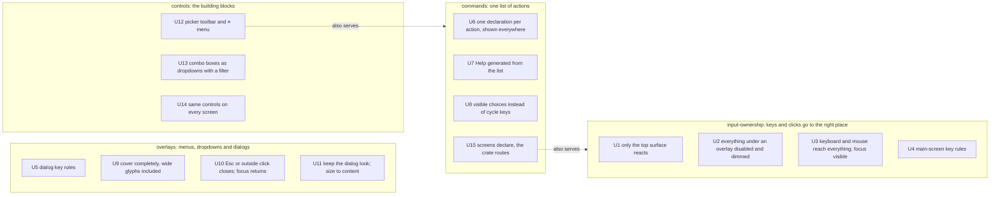

# Requirements: TUI component system

This is the Requirements document of the design set in this folder. It records who needs what, why, and within which limits. The [Specification](specification.md) turns these rows into observable obligations; [Program Design](program-design.md) and [Verification Design](verification-design.md) follow it.

Owner: Shravan Sunder. Every row below comes from the owner's own statements on 2026-10-29, quoted in the trace (`tmp/plan-workflows/2026-10-29-tui-component-system-trace.md` in this worktree), or from evidence gathered that day. The owner confirmed the four-part split and this scope on the pick-up page on 2026-10-29.

## The problem in one paragraph

The session picker and the quota screen are terminal UIs built on iocraft. Each screen wires keys, mouse and dialogs by hand, and it shows. On the owner's terminal the picker's keyboard stopped working entirely. In the New session dialog the arrows do nothing and list glyphs bleed through the dialog's border. Help lists keys that don't match the code. Typing or pasting right after opening a menu lands in the box behind it. Each of these has its own cause. The bleed: a two-column character at an overlay's left edge removes the overlay's corner in iocraft's output (experiment, 2026-10-29). Typing behind a menu: iocraft sends every key and click to every widget, and nothing decides which open surface owns an event (experiment, 2026-10-29). The dead arrows: the New session form handles only Esc, Tab, Shift+Tab and Enter (source). The wrong Help: it is typed by hand, apart from the key handling (source). The total keyboard outage has not been reproduced yet and none of these explains it (hypothesis H1). The owner wants one reusable component system that does this once, for every screen, learning from OpenTUI and hunk.

## Who this is for

| Class | Who | What they are trying to do | Today's pain, with evidence |
| --- | --- | --- | --- |
| End user | The owner, running the session picker (`agent-sessions`) and the quota screen in Ghostty, including inside Agent Studio panes, by keyboard and by mouse | Find a session, open or start one, inspect details, check quota, without fighting the UI | Owner screenshots and words, 2026-10-29: "keyboard navigation doesn't work at all", "more slop", "help can't be navigable by keyboard", list rows bleeding through the New dialog. Captures of agent-sessions 0.1.116: ↓ does nothing in the New dialog, Tab shows no focus, Help lists the old keys. |
| Developer user | Engineers and agents building TUI screens in this repository: today the picker and the quota screen, later more | Build a screen by declaring its targets and actions, and get correct keyboard, mouse, focus, menus and Help behaviour for free | `picker_input.rs:148-411` routes every key through one chain of about ten independent flags; each dialog has its own key map; Help is typed by hand in `picker_help_view.rs:31-49` and disagrees with the code. |
| Future external user | Anyone using the crate once it moves to its own repository | Reuse the components outside codex-router | Stakeholder only. Owner: "a rust component crate that later it's easy to export out". No direct journey yet. |

## Goal boundary

Confirmed by the owner on 2026-10-29 (pick-up page, Decision 3: "yeah", with the addition shown in the row "Under an open overlay").

| Field | Boundary |
| --- | --- |
| Goal | A reusable Rust component crate built on iocraft that does the four jobs below. The session picker and the quota screen are rebuilt on it. It learns from OpenTUI and hunk. |
| Keep | The current dialog look the owner likes (title with Help and context id, grouped sections, shared label column, body scrollbar, one clear primary action at the bottom, opaque frame). The existing shared pieces in `codex-router-tui` as the starting point. The agreed key rules (main screen and dialogs, rows U4 and U5). |
| Add | One owner of keys and clicks; one list of actions; overlays drawn on top with a blank column at their left edge; the picker toolbar and ≡ menu; the building blocks working by keyboard and mouse. |
| Core components | Owner, 2026-10-29: "I think we really only need menu, combobox/select box component as core, not much else right? and good design?"; "components for standardised dialog, make sure html design is good". The new components are the **menu**, the **combo box (select)** with its dropdown, and the **standard dialog** (frame, sections and groups, actions row, optional key hints). The other building blocks (button, text and filter field, segmented switch, scrolling list, form fields) are the existing `codex-router-tui` pieces and small compositions of them, moved and restyled rather than redesigned. Visual quality is part of done. |
| Under an open overlay | Everything underneath an open dialog or menu is disabled: it ignores keys and clicks and is drawn dimmed. (Owner addition.) |
| What may change | A new generic crate named `agent-collaboration-tui` (owner, 2026-10-29), with no codex-router code and only iocraft-level dependencies; the two consumers renamed `agent-session-tui` (today `agent-session-picker`) and `agent-router-quota-tui` (today `codex-router-quota-tui`) (owner, 2026-10-30); the picker and quota crates as they move onto it; `codex-router-tui` as its pieces move in. Nothing else. |
| Learn from | OpenTUI and hunk (owner: "state of the art and what we can learn the most from"), and CometixTUI, an MIT/Apache-licensed iocraft fork that adds focus, event propagation, scrolling and grid. Ideas and, with attribution, code may be borrowed; depending on CometixTUI, or any new fork, pin or engine change, is out of scope. The existing pinned iocraft fork (`agent-collaboration/iocraft` at `829ebd86`) stays as it is. |
| Out | No change to iocraft itself; no custom terminal backend or renderer; no publishing the crate yet (exportable, not exported); no change to what the picker or quota screen show or do beyond the UI work; no Windows; no theme system beyond a small set of named colours. |
| Done means | Each screen works keyboard-only and mouse-only in a real terminal, with before/after captures in the gallery; nothing underneath an open menu or dialog reacts; menus, keys and Help always agree. |
| Still open | Whether the owner's Ghostty delivers Ctrl+Enter as a distinct key (hypothesis H2). |

## Relationship to the 2026-10-17 design

This set builds on the accepted Sessions and Quota component design in [`docs/specs/2026-10-17-tui-component-system/`](../2026-10-17-tui-component-system/requirements.md), shipped in #155, and its refinement [`2026-10-23-quota-dialog-visuals`](../2026-10-23-quota-dialog-visuals/). Its rows U1–U16 are the accepted baseline. Every one stays in force unless listed below as superseded. To keep identifiers unambiguous, its rows are cited here as 10-17/U<n>.

| Earlier row | Disposition |
| --- | --- |
| 10-17/U1 (isolated work, no silent feature deletion), U2 (one shared dialog system for every menu and filter), U6 (aligned field columns, reserved selector gutter), U7 (reusable searchable selection), U8 (New session: one form, then Start), U9 (folder scopes, provider/source/runtime filters, sorting, text and full-ID search, paste all stay reachable), U11 and U12 (Quota layout and readable balances, as modified by the 2026-10-23 quota dialog visuals: Account / Quota / Weekly pace / Extra groups, F5 Pool details, visible operational errors), U13 and U14 (Lead-owned design, independent verification, real compiled screenshots, a complete feedback list), U15 and U16 (Claude background launch, real Claude and Cursor actions through agent-sessions), and their identity and effect guards (source-qualified session identity, AccountId, drafts versus committed filters, one Start, no automatic retry of a pending or unknown outcome, no fabricated IDs) | Carried forward. The new design must not lose any of them; where 2026-10-23 changed a 10-17 rule, 2026-10-23 governs. |
| 10-17/U4 (dialog sizing: independently clamped percentages by default; content sizing and full screen as options) | Carried forward. U11 below narrows only which dialogs use content sizing; it does not replace the percentage default. |
| 10-17/U3 ("one visible dialog level; a choice expands inside its current form") | Superseded for choice fields by U13 (a dropdown under the field, as in hunk's menus). Owner, 2026-10-29: "we should learn from them about filters and dropdowns like their menu … for combo boxes". |
| 10-17/U5 ("remove footer/shortcuts … no persistent app footer") | Kept. Owner, 2026-10-29: "no footers full of shortcuts please", "I only want footer in dialogs where it makes sense". No main-screen shortcut footer. A short key-hint line appears only in a dialog where it helps the user complete it (U5). The quota screen's bottom row of actions (F4 Details · F3 Filters · F5 Pool · F1 Help · Ctrl+R Options · Ctrl+E Floor) moves to the top as a ≡ menu and toolbar buttons, the same as the picker. Owner, 2026-10-29, on the quota bar: "it could just be menu with buttons too … same contract idea"; choosing option A from the mocks: "looks good". |
| 10-17/U10 ("Enter opens Details"; Ctrl+Enter and Ctrl+Shift+Enter shortcuts) | Kept. Owner, 2026-10-29: "enter open detail view and is what I wanted … that opens dialog is pretty good view, and ctrl enter opens the session directly from main view". Enter opens Details, where Resume, Fork and Copy ID stay; Ctrl+Enter opens the selected session directly; Ctrl+Shift+Enter keeps its fork shortcut (U4). |
| 2026-10-23 Quota exit (Esc and Q exit the quota screen) | Superseded for Esc. Owner, 2026-10-29: "esc doesn't quit, ctrl c does". Esc never quits any main screen, the quota screen included (U4). Ctrl+C quits everywhere, and Q still quits the quota screen. The reset workflow's quit behaviour stays as today on every quit path: Ctrl+C does nothing while a reset is being committed, and before the commit it exits without committing. |

## Capabilities

The owner confirmed these four on 2026-10-29. Each requirement row has exactly one home capability.

| Key | Name | What users get |
| --- | --- | --- |
| `input-ownership` | Keys and clicks go to the right place | A key or click reaches exactly one place: the top-most open menu, dropdown or dialog, and within it the focused control. Nothing underneath reacts. Keyboard and mouse reach the same targets, and focus is always visible. |
| `commands` | One list of actions | Each action is declared once and appears the same everywhere: toolbar button, menu item with its key, keyboard shortcut, Help, and a dialog's key hints. They can't disagree. |
| `overlays` | Menus, dropdowns and dialogs | They open on top, cover what's under them completely (wide characters included), close with Esc or a click outside, and return focus to where you were. |
| `controls` | The building blocks | The menu, the combo box and the standard dialog are the new core; buttons, the filter field, the segmented switch, scrolling lists and form fields are the existing pieces moved and restyled. All look and behave the same on every screen, by keyboard and by mouse. |

Two limits apply to all four rather than being capabilities: the crate stays generic and exportable, and the session picker and the quota screen are its first consumers.

### Capability map



## Requirement rows

Authority for every row is `authorized`: each cites the owner's own statement. Priority is the owner's, inferred only where the row restates a bug the owner reported as broken (P0) or a design the owner approved for the rebuilt screens (P1).

### input-ownership

| ID | Need or outcome | Why it matters | Evidence and authority | Priority |
| --- | --- | --- | --- | --- |
| U1 | A key press or click reaches only the top-most open surface (menu, dropdown, dialog or screen), and within it only the focused or clicked control. | Keys and clicks leaking to the wrong place is the single biggest source of today's broken behaviour. | Owner: "everything underneath dialog should be disabled"; "keyboard navigation doesn't work at all". Probe 3 (2026-10-29, Sunclaw): with today's wrappers, typing or pasting in the same burst as opening a menu changes the field behind it, Esc then Enter fires a just-closed dropdown, and a clipped-off button can be clicked; native iocraft widgets also fire the background and dialog on a click inside a dropdown. | P0 |
| U2 | While a dialog or menu is open, everything underneath it ignores keys and clicks and is drawn dimmed. | The owner should see at a glance what is active and never trigger something hidden. | Owner, 2026-10-29: "yeah everything underneath dialog should be disabled if possible can try it out". Probe 2: dimming by drawing background text lighter keeps it legible; an opaque full-screen box erases it instead. | P0 |
| U3 | Every screen and dialog is fully usable by keyboard alone and by mouse alone. Focus is always visible. Tab and Shift+Tab, and the arrow keys, move focus between targets; a click focuses and activates the same targets the keyboard reaches. | The owner switches between keyboard and mouse; either must always work. | Owner: "the entire flow should be mouse and keyboard drivable… both should work, keyboard should work". Captures: Tab on the picker shows no visible change; header actions are reachable only by hidden shortcuts. | P0 |
| U4 | On a main screen (not a dialog): Enter opens the selected item's Details; Ctrl+Enter opens the selected session directly and Ctrl+Shift+Enter forks it, as today (10-17/U10); Esc clears the search, then the filters, and never quits; Ctrl+C quits. | Predictable keys on the screen the owner lives in. | Owner decisions, 2026-10-29: "I think let's make ctrl c to quit"; "no man, main view is not a dialog"; "enter open detail view and is what I wanted … ctrl enter opens the session directly from main view". Today Esc quits the picker when the search is empty (`picker_input.rs:392-409`). | P0 |

### commands

| ID | Need or outcome | Why it matters | Evidence and authority | Priority |
| --- | --- | --- | --- | --- |
| U6 | Each action is declared once, with its name, key and when it is available. The toolbar, the ≡ menu (with the key shown), the keyboard shortcut, Help and any dialog key hints are all built from that one declaration, and an unavailable action is unavailable everywhere at once, with a reason. | Menus, keys and Help that disagree are confusing and erode trust in the UI. | Owner approved the toolbar + ≡ menu design driven by one list ("go", 2026-10-29) after: "we should learn from them about filters and dropdowns like their menu". hunk builds menus and Help from one command registry (`packages/hunk/src/ui/lib/appMenus.ts`). | P0 |
| U7 | Help lists the real current keys and actions, generated from the same list, and scrolls by keyboard. From the main screen it opens as a dialog (≡ menu or F1); from inside a dialog it replaces that dialog's body and returns to it with the query, focus and draft unchanged, as the 2026-10-17 design requires. | Help must never lie. | Captures: Help says Esc will "clear search or go back" when Esc quits. Owner: "help can't be navigable by keyboard". | P1 |
| U8 | Settings that today change invisibly by cycling a key (scope, runtime view, sort) are shown as visible choices: checked items in the ≡ menu, or the This folder &#124; All switch. | The owner can see and pick the current setting directly. | Owner-approved design ("go"): checked menu items and the segmented switch, modelled on hunk's checked View items. Today Ctrl+S, Ctrl+T and Ctrl+O cycle these with no visible state. | P1 |
| U15 | A developer builds a screen by declaring its focus targets and actions; keyboard routing, mouse routing, focus, menus, Help and dialog key hints come from the crate, with no per-screen key-handling chain. | One correct implementation instead of a hand-wired one per screen. | Owner: "any libraries you want to make or component system, make them generic based off iocraft". Evidence: the picker's ~260-line key chain and per-dialog key maps. Also serves `input-ownership`. | P1 |

### overlays

| ID | Need or outcome | Why it matters | Evidence and authority | Priority |
| --- | --- | --- | --- | --- |
| U5 | In every dialog: Ctrl+Enter runs the dialog's main action; Esc closes the dialog, or an open dropdown first; the arrow keys move between fields and options; Enter keeps its meaning inside a field; Tab and Shift+Tab also move. Where the terminal cannot report Ctrl+Enter, the main action stays reachable by Tab then Enter and by mouse. A dialog shows a short key-hint line only where it helps (for example a form: "Ctrl+Enter start · Esc close"); there is no shortcut footer anywhere else. | Every dialog behaves the same. | Owner, 2026-10-29: "ctrl enter should be accept main action of dialog, this should be standards; esc is escape in dialog component; arrows should work"; "I said dialog". Capture: ↓ leaves the New dialog unchanged (`new_session_form.rs` handles only Esc, Tab, Shift+Tab, Enter). | P0 |
| U9 | A menu, dropdown or dialog covers what is under it completely, including when a two-column character (emoji, CJK) in the content underneath sits at its left edge. | The new menus and dropdowns open over lists full of 📂 icons; a broken border looks like a broken UI. | Owner screenshot: list glyphs drawn through the New dialog's left border. Probe 1 (2026-10-29, independently checked by the Advisor): a two-column character one cell left of an overlay removes the overlay's top-left corner in iocraft's terminal output. Owner decision 2: "just put the extra white before it". | P0 |
| U10 | Esc closes the top-most overlay only (an open dropdown before its dialog), and focus returns to where it was before that overlay opened. A click outside closes an open menu or dropdown; a click outside a dialog leaves it open, so a stray click never throws away what was typed. No outside click activates what is underneath. | Closing must be predictable and must never trigger something by accident. | Owner TUI standard: "esc is escape in dialog component". Probe 3: today an outside click falls through to the control underneath with native widgets. | P0 |
| U11 | Dialogs keep the current look: title on the left with Help and the context id on the right, grouped sections, a shared label column, a body scrollbar for long content, an opaque frame, and actions at the bottom with one clear primary action (Close alone on a details dialog; Cancel and Start on New session, with Start primary). Forms such as New session size to their content within the existing sizing limits (10-17/U4), so no form shows empty space; other dialogs keep the percentage sizing. Sections are spaced the same way everywhere, and background and colour are used where they carry meaning: a section's group, the focused row, the primary action, a status. | The owner likes this look and wants it kept, with tidier groups. | Owner, 2026-10-29: "I like our dialog overall"; on the quota Account details dialog: "this solution rn is not bad"; on the same dialog: "we could also do consistent spacing and groups in dialog and actually use background and colors where it makes sense". In that capture Quota windows has no gap above it while Reset pace and Activity do, and Close sits flush under the last row. Capture: the New session dialog is mostly empty space. | P1 |

### controls

| ID | Need or outcome | Why it matters | Evidence and authority | Priority |
| --- | --- | --- | --- | --- |
| U12 | The session picker's top row is a toolbar: a ≡ Menu, a [+ New] button, an always-visible [/ Filter…] field that `/` focuses and that filters as you type, and a This folder &#124; All switch, with the session count and machine on the right. Everything else, Help and Quit included, is in the ≡ menu, which F10 or a click opens and which shows each item's key. The quota screen gets the same top row: ≡ Menu and its main actions as buttons, with its bottom row of actions removed (owner, option A: "looks good"). The menu button shows its key (≡ Menu F10), and Tab reaches it, so the menu can be found by keyboard without knowing the shortcut (owner, trying the demo: "menu is not accessible by keyboard unless I don't know the shortcut … if there's a shortcut to go to menu it's good too"). Colours stay the current shipped ones (owner: "I like our current colors better"). For Claude Code, a new session can run in the foreground (you are inside it) or in the background (it keeps running and you stay in the picker): the New session dialog offers both, and the ≡ menu has "New session…" and "New background session…"; a stopped Claude session's Details offers Open and Resume in background. Owner, 2026-10-30: "for claude code … options to launch new session with background or foreground … in the menu … both should just work". The launch behaviour itself ships first, in the Claude-fix PR. | Frequent actions one click or key away; everything else discoverable in one place. | Owner, 2026-10-29: "either menu or actual buttons on top? so that it makes sense to have new with sigil and filter with sigil. help is always in menu?", then "go" on the toolbar + ≡ menu design. | P0 |
| U13 | A field that picks one value from a list (client, machine, provider) opens a dropdown under the field, modelled on hunk's menus: it has its own filter line, ↑/↓ and the mouse move the highlight, Enter or a click picks, Esc closes it, and the current value is marked. | Picking from a list should feel the same everywhere and work by keyboard and mouse. | Owner: "we should learn from them about filters and dropdowns like their menu", "for combo boxes". Mock 3 on the gallery page. | P1 |
| U14 | Buttons, text and filter fields, the segmented switch, scrolling lists and form fields look and behave the same on every screen that uses them, including the quota screen. | One set of building blocks instead of one per screen. | Owner: "make a component system in rust", "OpenTUI and hunk are state of art and what we can learn the most from". | P1 |

## Journey: the owner using the session picker

| Step | What the owner does | Pain today (evidence) | Desired difference | Rows |
| --- | --- | --- | --- | --- |
| 1 | Opens the picker in Ghostty | Sometimes the keyboard does nothing at all (owner screenshot); cause not yet reproduced | Keys always reach the picker; focus visible on the first session | U1, U3 |
| 2 | Finds a session | Search is invisible; scope, sort and runtime view change by hidden cycle keys | A visible filter field and visible choices | U8, U12 |
| 3 | Opens it | Enter opens Details; Ctrl+Enter opens the session directly | Unchanged; Help now says so correctly | U4, U7 |
| 4 | Starts a new one (New dialog) | Arrows do nothing; focus starts on Start; list glyphs bleed through the border; dialog mostly empty | Arrows move fields, dropdowns with a filter, a clean frame sized to content, Ctrl+Enter starts | U5, U9, U11, U13 |
| 5 | Opens a menu and types quickly | Typed or pasted text lands in the box behind the menu | Nothing behind an open menu reacts; it is dimmed | U1, U2 |
| 6 | Checks Help | Help shows the wrong keys | Help shows the real keys, from the one list | U6, U7 |
| 7 | Closes things | Esc on the main screen quits the picker; an outside click can hit the list | Esc closes the top overlay only and never quits the main screen; Ctrl+C quits | U4, U10 |

## Screens this changes

Both screens below are drawn from real captures of agent-sessions 0.1.116 (2026-10-29), with session titles replaced by placeholders. The full captures and image mocks of the proposed design are on the gallery page in `codex-router.collab-improvements/tmp/presentations/2026-10-29-agent-sessions-rework/` (not committed: the captures show private titles).

Today, main list (U3, U4, U8, U12):

```text
╭──────────────────────────────────────────────────────────────────────────╮
│ Sessions · 2/2                                       New  Details  Help │
│ Machine: This machine ▾            Filters · All providers ▾            │
│ [📂 cwd]                                                                │
│ This machine: Unavailable (session inventory does not match its source) │
│   Session                                         Status   Upd   New    │
│ ❯ <session title A>                               ?         7d   22d    │
│   Codex This machine ⎇ - 📂 ~/code                                       │
│   <session title B>                               ?        23d   23d    │
│   Codex This machine ⎇ - 📂 ~/code                                       │
╰──────────────────────────────────────────────────────────────────────────╯
```

Proposed, main list with the ≡ menu (U6, U8, U12):

```text
 ≡ Menu  [+ New]  [/ Filter sessions…    ]  [This folder | All]   Sessions · 4/4
┌──────────────────────────┐
│ Details            Enter │   <session title A>               Working   2m
│ Open          Ctrl+Enter │   <session title B>               Idle      1h
│ Fork    Ctrl+Shift+Enter │   (everything under the menu is dimmed and ignores input)
│ Refresh           Ctrl+R │
│ ──────────────────────── │
│ [x] Sort: Updated        │
│ [ ] Sort: Name           │
│ ──────────────────────── │
│ Help                  F1 │
│ Quit              Ctrl+C │
└──────────────────────────┘
```

Today, New session dialog (U5, U9, U11, U13): focus starts on Start, ↓ changes nothing, most of the frame is empty.

```text
        ╭────────────────────────────────────────────╮
        │ New session                           Help │
        │ Client       Codex ▾                       │
        │ Machine      This machine ▾                │
        │ Directory    ~/code                        │
        │                                            │
        │                 (empty)                    │
        │                                            │
        │ Cancel  Start                              │
        ╰────────────────────────────────────────────╯
```

Proposed, New session with the Machine dropdown open (U5, U11, U13):

```text
        ┌──────────────── New session ────────────────┐
        │ Client     [ Codex ▾ ]                      │
        │ Machine    [ This machine ▾ ]               │
        │            ┌──────────────────────────┐     │
        │ Directory  │ / filter machines…       │     │
        │            │ (•) This machine         │     │
        │            │ ( ) Sunclaw              │     │
        │            └──────────────────────────┘     │
        │           [ Cancel ]   [ Start ]            │
        │ Ctrl+Enter start · Esc close · ↑↓ move      │
        └─────────────────────────────────────────────┘
```

The quota screen keeps its current dialog look (U11) and moves onto the same building blocks (U14); its screens change only where the shared controls replace hand-wired ones. The quota screen has no separate UI moment in this set beyond U11 and U14.

## Hypotheses and gaps

| ID | Statement | Status |
| --- | --- | --- |
| H1 | The owner's "keyboard doesn't work at all" is caused by events reaching the wrong owner or being dropped, and the single input owner fixes it. | Unproven. Not reproduced yet: the kitty keyboard protocol alone, zmx, and a Claude action launched from the picker are each ruled out (2026-10-29 probes). The sessions-UX worker keeps investigating; this design must not claim to fix it until it is reproduced. |
| H2 | The owner's Ghostty delivers Ctrl+Enter as a key distinct from Enter. | Unverified. iocraft decodes it when it arrives (Probe 4, injected input), but no physical key press in a real Ghostty has been observed. U5 keeps Tab then Enter and the mouse as the fallback. |

## Non-goals

- No new fork, pin or engine change to iocraft in this work; the existing pinned fork stays. The wide-glyph defect is handled in the crate (U9); fixing iocraft itself stays an owner-gated follow-up.
- No custom terminal backend, renderer or compositor.
- No publishing of the crate; it is built to be exportable, not exported.
- No change to what the picker or the quota screen show or do, beyond the UI rows above.
- No Windows support.
- No theme system beyond a small set of named colours.
- No rich text editor, Markdown, diff or chart components unless a first consumer needs one.
