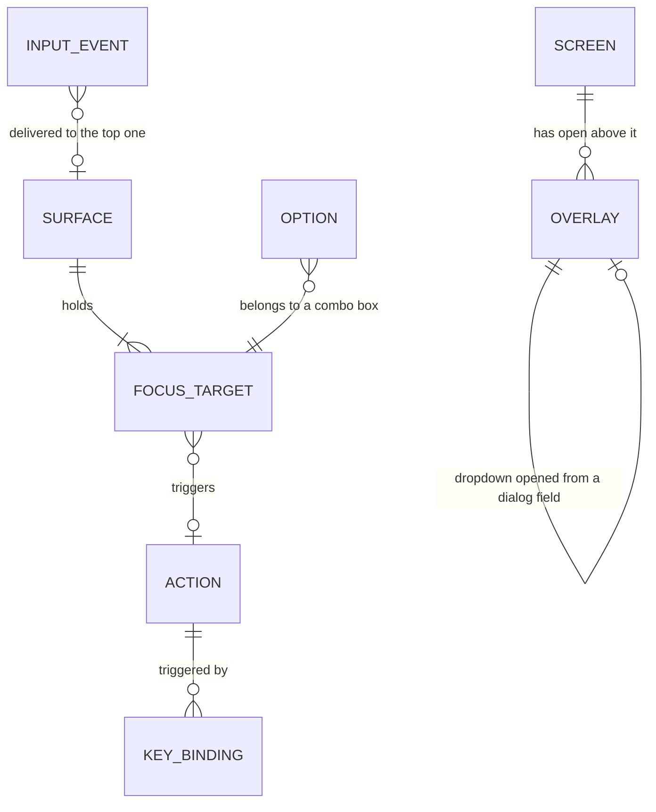
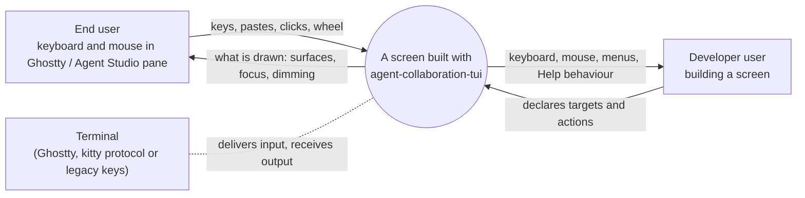

# Specification: TUI component system

This document states what must be observably true. It traces every obligation to a row in the [Requirements](requirements.md) and leaves the internal structure to [Program Design](program-design.md). "The crate" below means `agent-collaboration-tui`; "a screen" means any terminal UI built with it, first the session picker and the quota screen.

## Capability map

The capabilities and their purposes are listed once, in the [Requirements](requirements.md#capabilities). This map shows which obligations each one holds.

| Capability | Obligations | Also serves |
| --- | --- | --- |
| `input-ownership` — keys and clicks go to the right place | R1, R2, R3, R4, R5 | R5 also serves `commands` |
| `commands` — one list of actions | R6, R7, R8 | |
| `overlays` — menus, dropdowns and dialogs | R9, R10, R11, R12 | |
| `controls` — the building blocks | R13, R14, R15, R16 | R13 also serves `commands`; R16 carries the 10-17 baseline |

## Problems and outcomes

| ID | Problem today (observable) | Outcome | Rows |
| --- | --- | --- | --- |
| P1 | Keys and clicks reach surfaces the user can't see: typing after opening a menu lands behind it, an outside click activates what's under it, a clipped-off button can be clicked. | O1: every key and click reaches exactly the surface the user sees on top. | U1, U2, U3 |
| P2 | Keys mean different things on different screens and dialogs; Esc quits the main screen; arrows do nothing in dialogs. | O2: one set of key rules for main screens and one for dialogs. | U4, U5 |
| P3 | Menus, keys and Help disagree, and settings change invisibly. | O3: every action and setting is defined once and shown the same everywhere. | U6, U7, U8, U15 |
| P4 | Overlays let content bleed through their left edge and are larger than their content. | O4: overlays are clean, sized to content, and close predictably. | U9, U10, U11 |
| P5 | Every screen builds its own controls, and they behave differently. | O5: one set of controls that behave the same on every screen. | U12, U13, U14 |

## Entities

These are the nouns the obligations are written over. They name no type, module or file.

| ID | Term | Identity rule | Relationships | Invariants | Observable states | Canonicalizes | Basis |
| --- | --- | --- | --- | --- | --- | --- | --- |
| E1 | Screen | One per running application view (the picker's main list, the quota main view). Re-rendering the same view is the same screen. | Has 0..n open overlays above it; holds 1..n focus targets. | Exactly one screen is shown at a time per application. | active (nothing above it), covered (an overlay is open above it) | "main view", "main screen", "page" | U1, U4, U12 |
| E2 | Overlay | One opening of a menu, dropdown or dialog. Closing and reopening the same menu makes a new overlay. | Opened from exactly one parent surface (a screen or another overlay); holds 1..n focus targets; a dropdown belongs to the field that opened it. | An overlay is always above its parent. | open-top, open-covered, closed | "dialog", "popup", "menu", "dropdown", "modal"; Help is a dialog | U1, U2, U5, U9, U10 |
| E3 | Surface | A screen or an open overlay. The top surface is the one opened most recently that is still open, or the screen when none is. | The open surfaces form one ordered stack per application, the screen at the bottom. | Exactly one top surface at any moment. | top, covered | "layer", "what's on top" | U1, U2 |
| E4 | Focus target | One thing on a surface the user can focus and activate: a button, field, list row, menu item, option, or switch segment. Identified within its surface by what it represents; the same row for the same session is the same target after a re-render. | Belongs to exactly one surface; may trigger one action (E5). | At most one focused target per surface; only targets on the top surface can be focused. | normal, focused, hovered, disabled (with a reason), and where it applies selected or checked | "control", "item", "row", "field", "button" | U3, U13, U14 |
| E5 | Action | One named thing the user can do in a given scope: New, Open, Details, Fork, Refresh, Help, Quit, Start, Cancel, Sort: Updated, and so on. The same action shown as a button, a menu item and a key is one action. | Belongs to one scope (a screen or one kind of dialog); has 0..n key bindings (E6); presented in 0..n places (toolbar, menu, Help, dialog key hints). | Its name, keys and availability are the same in every place it is presented. | available, unavailable (with a reason), and for choice actions checked or unchecked | "command", "shortcut target", "menu item action" | U6, U7, U8, U15 |
| E6 | Key binding | One key or key combination bound to one action in one scope. | Belongs to exactly one action and one scope. | Within one scope, one key triggers at most one action. | — | "shortcut", "hotkey" | U4, U5, U6 |
| E7 | Input event | One key press, paste, mouse click or wheel movement as the terminal delivers it. Each arrival is a distinct event, including several arriving together. | Delivered to at most one surface, except the two deliberate exceptions in R1. | The surface it reaches is the top surface at the moment it is handled, after every earlier event's effect has applied (R1's exceptions aside). | delivered, ignored (no target) | "keystroke", "click", "input" | U1, U2 |
| E8 | Option | One choosable value in a combo box or list (a client, a machine, a provider). Identified by the value it stands for, not its position. | Belongs to one combo box or list; at most one option is the current value of a single-choice field. | Reordering or filtering doesn't change which option is which. | current, highlighted, hidden by filter | "choice", "item in the dropdown" | U13 |

## Who interacts with the system

Out of the picture: the Router, sessions and quota data. The screens show them, and this design changes none of them.

## Obligations

### input-ownership

**R1 — one owner per event** (U1). When an input event is handled, it reaches only the top surface. Within that surface a key reaches the focused target first. Only if the focused target doesn't use the key does it trigger the surface's action bound to that key. A click or wheel reaches the target under the pointer. No input event changes a surface beneath the top surface. There are exactly two exceptions, both deliberate:

- Ctrl+C quits the application from any surface (R4).
- Ctrl+Enter acts on the dialog beneath its own open dropdown (R9).

If the top surface has nothing for the event, the event is ignored: it never falls through to a surface beneath. Events that arrive together are handled one at a time, each against the top surface as it stands after the previous one. R1 constrains input only. A covered surface may still redraw its own data as it changes, and may change between covered and uncovered drawing (R2). *Entities: E3, E4, E5, E7.*

- Printable keys typed into a focused text field are text, not shortcuts. For example, `/` typed in the filter field is a `/`. Keys with Ctrl or a function key, and Esc, Enter, Tab and the arrows, keep their meaning as stated in R3, R4 and R9.

- Boundary: a key that opens an overlay, followed in the same burst by typed characters or a paste, sends those characters to the new overlay (or ignores them if it has no text field), never to the surface beneath.
- Boundary: Esc then Enter in one burst. Esc closes the top overlay; Enter then acts on the surface that is top after the close.
- Boundary: a click at a position where a target is hidden by clipping or covered by an overlay doesn't reach that target.

**R2 — covered surfaces are inert and dimmed** (U2). While any overlay is open, every surface beneath it accepts no input event, apart from R1's two deliberate exceptions, and is drawn dimmed: its text stays legible but visibly lighter than the top surface. When the overlay closes, the surface beneath returns to normal in the same redraw. *Entities: E2, E3, E7.*

**R3 — full keyboard and mouse reach, visible focus** (U3). On the top surface:

- Tab and Shift+Tab move focus through every enabled focus target in a fixed order and wrap around.
- The arrow keys move focus within a group of targets (rows of a list, items of a menu, segments of a switch, fields of a dialog), except inside a text field (R9).
- A click on an enabled target focuses it and activates it, the same as pressing Enter on it. Exception, kept from the shipped picker (`picker_list_view.rs:89`, `activates_on_click: false`): a click on a row of a scrolling list selects that row and focuses the list; Enter activates it. Rows of a choice list inside a dialog or dropdown still activate on click.
- The wheel scrolls the scrollable area under the pointer.
- Whenever the top surface has an enabled target, exactly one target is focused, and it is drawn visibly distinct from the rest.
- On a screen's first draw, the first item of its main list is focused and selected when the list isn't empty.

*Entities: E1, E3, E4.*

**R4 — main-screen keys** (U4). On a screen that is the top surface:

- Enter acts on whatever has focus. With focus on the list, or in the filter field, Enter opens the selected item's Details, so typing a filter then pressing Enter shows the match's Details. With focus on a toolbar button or switch, Enter activates that button or switch, so Tab to [+ New] then Enter opens New session.
- With focus on the list or in the filter field, Ctrl+Enter opens the selected session directly and Ctrl+Shift+Enter forks it, as the 2026-10-17 design already requires (10-17 R9). Where the terminal can't report these keys, Details offers the same actions.
- Esc clears the search when it isn't empty, otherwise resets the filters when they aren't at their defaults, otherwise does nothing. Esc never quits.
- Ctrl+C quits the application from any surface, including while an overlay is open, provided the application has opted in to receiving Ctrl+C. Opting in is a requirement on every application built with the crate (constraint C3).
- Every quit path keeps the screen's existing quit behaviour. On the quota screen, Ctrl+C does nothing while a reset is being committed, and before the commit it exits without committing, as `reset_key_action` does today.
- This applies to the quota screen too: Esc there no longer exits (owner, 2026-10-29: "esc doesn't quit, ctrl c does"). Q still quits the quota screen.

*Entities: E1, E5, E6.*

**R5 — screens declare, the crate routes** (U15, also serves `commands`). A screen built with the crate declares its focus targets and its actions. Its keyboard routing, mouse routing, focus movement, covered-surface behaviour, menus, Help and dialog key hints come from the crate. The screen itself contains no key-handling chain and does not listen for terminal input on its own. *Entities: E1, E4, E5.*

### commands

**R6 — one definition per action** (U6). Each action is defined once, with its name, its keys and when it is available. Every place it is presented — toolbar button, ≡ menu item with the key on the right, keyboard shortcut, Help line, dialog key hint — shows that same name and key. The one definition may carry a short label that only a toolbar button shows, such as "+ New" for "New session…" (owner-approved toolbar, 2026-10-29); the key, availability and action are identical. When an action becomes unavailable, it becomes unavailable everywhere at once:

- it is drawn disabled in the menu and toolbar, with its reason shown;
- its key and click do nothing;
- it is never triggered.

What the action does once triggered, including any effect outside the UI, belongs to the screen that defines it, not to the crate.

When it becomes available again, all of those places change back together. *Entities: E5, E6.*

**R7 — Help from the definitions** (U7). Help opens on F1 or from the ≡ menu. Opened from a main screen, it is a dialog. Opened from inside a dialog, it replaces that dialog's body, and closing it returns the dialog with its query, focus and draft values unchanged: one visible dialog level, as the 2026-10-17 design requires. It lists every action of the scope it was opened from, with its keys, built from the action definitions. It scrolls with the arrow keys, Page Up, Page Down and the wheel, and Esc closes it. Its entries pair an action with its keys. No entry names a key the scope doesn't bind, and no bound action is missing an entry. Headings and explanatory lines may appear around the entries. *Entities: E5, E6, E2.*

**R8 — visible settings** (U8). Scope is always visible as the This folder &#124; All switch, marking the current value. Runtime view and sort show their current value as checked items whenever the ≡ menu is open. Choosing a value applies it immediately and updates the mark. If a key also changes one of these settings, the mark changes with it. *Entities: E5, E4.*

### overlays

**R9 — dialog keys** (U5). On a dialog that is the top surface:

- Ctrl+Enter runs the dialog's primary action. If a dropdown is open in the dialog, Ctrl+Enter first closes it without changing the field's value, then runs the primary action.
- Esc closes the top overlay: an open dropdown first, otherwise the dialog. Closing never runs the primary action.
- ↑ and ↓ move focus to the previous or next field or option.
- Inside a text field, ← and → move the cursor, Home and End jump to its start and end, and characters, Backspace, Delete and paste edit it. ↑ and ↓ leave the field.
- Enter acts within the focused target: it opens a closed dropdown, picks the highlighted option in an open one, or activates a focused button.
- Tab and Shift+Tab move focus as in R3.
- Where the terminal can't report Ctrl+Enter as distinct from Enter, the primary action stays reachable by Tab to its button then Enter, and by clicking it.
- A dialog may show one short key-hint line, built from its actions, only where it helps the user complete it; a form like New session shows "Ctrl+Enter start · Esc close". No main screen shows a shortcut footer (10-17/U5, kept).

*Entities: E2, E4, E5, E6.*

**R10 — overlays cover cleanly** (U9). An overlay paints every cell of its own rectangle and, on every row it covers, the one cell immediately to the left of its left edge, in the overlay's background. Nothing from the surface beneath is visible inside the overlay or on its border. This includes a two-column character that starts one cell left of the overlay's edge. The terminal shows the overlay's full border, corners included. An overlay that starts at the terminal's left edge has no cell to its left and needs none. *Entities: E2, E3.*

**R11 — closing and focus return** (U10). Esc closes only the top overlay. A click outside an open menu or dropdown closes it. A click outside a dialog is ignored, and the dialog stays open, so a stray click never discards what was typed; a dialog closes by Esc or its own buttons. Any click that lands outside the top overlay activates nothing beneath it. After the close, focus returns to the target that was focused when that overlay opened. If that target no longer exists or is disabled, focus goes to the first enabled target of the now-top surface. *Entities: E2, E3, E4, E7.*

**R12 — dialog presentation** (U11). A dialog has:

- a frame that is opaque;
- its title on the left, with Help and, when the dialog shows a specific item, that item's context id on the right;
- content in sections with headings, spaced the same way in every dialog: exactly one blank row between sections, none inside a section, and one blank row between the last section and the actions row;
- background and colour only where they carry meaning: a section may sit on a tinted panel that groups it; the focused row, the primary action and a status value (available, warning, error) have their own colour or background; a status always also has a text label, so colour is never the only signal (10-17 R4);
- a shared label column for label and value pairs;
- a visible scrollbar on the body when the content is taller than the space available;
- an actions row at the bottom with exactly one visibly marked primary action.

A form, such as New session, is as tall as its content, capped by the space available, and shows no empty filler below it. Every other dialog keeps the percentage sizing of 10-17/U4. *Entities: E2, E4, E5.*

### controls

**R13 — toolbars and menus** (U12, also serves `commands`). The session picker's top row shows, left to right:

- ≡ Menu, with its key shown beside it in muted text (F10);
- a [+ New] button;
- a [/ Filter…] text field;
- a This folder &#124; All switch;
- right-aligned, the session count and the machine.

Every glyph the crate itself draws (menu icon, ▾, markers, checkmarks) is one cell wide both in the pinned renderer's width table and under current Unicode, so rows line up in the terminal exactly as the crate measured them. The menu icon is ≡, not ☰: U+2630 is wide under Unicode 16, while the pinned renderer counts it as one cell (probe worker, 2026-10-30).

`/` focuses the filter field from anywhere on the screen. Typing in it filters the list as each character is entered. Esc in it clears it, per R4. The ≡ menu opens on F10 or a click. It contains every other screen action, Help and Quit included, each with its key on the right. Its settings show as checked items (R8): folder scope (This folder, All; Ctrl+S), runtime view (Ctrl+T) and sort (Ctrl+O), each value a checked item with the setting's key. The menu lists the screen's actions (R6), not input conventions: moving in the list (arrows, PgUp/PgDn, Home/End), typing and Backspace in the filter, the search syntax (id:, b:, repo:) and the Esc ladder (R4) belong to the controls and show in Help under their own heading, not as menu items. The menu does not list itself; Help shows "Menu F10". It offers "New session…" (Ctrl+N) and, for clients that can run in the background, "New background session…", which opens the same dialog with Run set to Background. The New session dialog shows a Run choice, Foreground or Background, only when the chosen client supports both. A stopped Claude session's Details offers Open: the same session, resumed with its saved settings, and you land inside it. There is no separate "Resume in background" action. Owner, 2026-10-30: "yes just open or resume then" (Resume in background removed; Open on a stopped session resumes it and attaches).

The quota screen's top row shows, left to right: ≡ Menu with its key (F10); [Details]; [Filters: <current> ▾]; [Pool]; [Options]; [Floor] when the weekly floor is available; and, right-aligned, the account count and active clients. Its ≡ menu lists every quota action with its key (Details F4, Filters… F3, Pool details F5, Options… Ctrl+R, Weekly floor… Ctrl+E), then Help F1 and Quit Ctrl+C. The quota screen has no bottom row of actions.

On either screen, Tab from the list reaches the toolbar, and the menu button is one of its targets. When the row is too narrow for every button, buttons drop off the row from the right; every action stays in the menu. *Entities: E1, E4, E5.*

**R14 — combo boxes** (U13). A field that picks one option shows its current value followed by ▾.

- **Opening:** Enter or a click opens a dropdown directly under the field.
- **Filtering:** the dropdown's first line is a filter; typing narrows the options to those matching.
- **Highlight:** ↑ and ↓, or moving the mouse over an option, moves the highlight.
- **Picking:** Enter or a click picks the highlighted option, sets the field, and closes the dropdown.
- **Cancelling:** Esc closes it without changing the field.
- **Current value:** the current value carries a single-choice marker.
- **Changes while open:**
  - The highlight follows the option it was on, not the position, when the options are filtered, reordered or updated.
  - When the user's own typing in the filter hides the highlighted option, the highlight moves to the first match.
  - When an update from outside the dropdown removes the highlighted option, nothing is highlighted and Enter picks nothing until ↑ or ↓ moves the highlight, so a list that changes under the user never makes Enter pick an option they did not see highlighted.
  - If nothing matches, the dropdown says so.
- **Unavailable options** can be highlighted and show their reason, but can't be picked.

*Entities: E2, E4, E8.*

**R15 — shared controls** (U14). On every screen built with the crate, the quota screen included, each kind of control behaves the same by keyboard and by mouse. Those kinds are: button, text field, filter field, combo box, segmented switch, scrolling list, form field, and dialog key-hint line. No screen shows a bottom row of keys or actions; a screen's actions live in its toolbar and its ≡ menu. Each shows the same visual states: normal, focused, hovered, disabled with a reason, and selected or checked where it applies. *Entities: E4.*

### Carried forward from the 2026-10-17 design

**R16 — nothing from the accepted Sessions and Quota design is lost** (10-17/U1, U2, U4, U6–U9, U11–U16, carried forward in the Requirements). After the move onto the crate, every capability that design guarantees stays reachable by keyboard and by mouse, with the same identity and effect behaviour.

Sessions keeps:
- the Cwd, Checkout, Repo and Any scopes;
- provider and client filters;
- the Interactive, Subagents and All request views;
- the runtime views;
- updated and created sorting;
- text, full-UUID search and paste;
- source refresh;
- machine loading, error and cancel states;
- session Details;
- native New, Resume, Fork and Copy ID with their eligibility rules and original arguments;
- Claude background launch;
- real Claude and Cursor actions.

Quota keeps the 2026-10-23 contract, which governs where it changed 10-17:
- the Account / Quota / Weekly pace / Extra groups;
- F5 Pool details;
- visible operational errors;
- static geometry and JSON output;
- the selected and hover hierarchy;
- the provider and disabled-account filters;
- every account field;
- focused and sidecar Details and contextual Help;
- the Resets and Credits options;
- credit-policy and weekly-floor editing;
- reset inspection, review, confirmation and result;
- inventory paging;
- readable balances;
- its reset workflow's quit behaviour (Ctrl+C ignored while committing; exit without commit before it).

Field columns stay aligned with a reserved selector gutter, and dialogs keep the existing sizing contract. The identity and effect guards hold: source-qualified session identity and AccountId are captured exactly; drafts stay separate from committed filters; Start runs once; a pending or unknown outcome is never retried automatically; no ID is fabricated. Only these superseded rules change, each by owner decision: inline choices become dropdowns (R14), and Esc no longer exits the quota screen (R4). Enter still opens Details and Ctrl+Enter still opens the session directly. The no-footer rule is kept: dialogs show a key-hint line only where it helps (R9). *Entities: E1, E4, E5.*

**R17 — log in again from account Details** (U16).

- The quota screen's Account details offers "Log in again". It shows the exact command it will run: `codex-router account login --provider <provider> --label <label>`, with that account's own provider and label.
- It is the dialog's primary action when the account's status says re-login is required. Otherwise it is an ordinary action. It is also in the ≡ menu for the selected account.
- Activating it ends the quota screen's terminal session cleanly (terminal modes restored), runs exactly that command in the same terminal with the same Router root, then restarts the quota screen with fresh data, the same account selected.
- If the command fails or is cancelled, the quota screen returns to that account and shows the result in a plain sentence. Nothing is retried automatically.
- It never runs for a different account than the one shown, and never with a label or provider typed or guessed by the screen.
- Account details has an **Actions ▾** menu button (the same menu control as the screen's ≡ menu) listing, each with its key: Log in again, Options… (Ctrl+R), Weekly floor… (Ctrl+E), Disable or Enable account, Copy account ID, and Remove account…. Remove is available only for a disabled account, and asks to confirm. In that confirmation, Cancel is the primary action and has the initial focus, so Ctrl+Enter cancels; Remove runs only when explicitly activated. After a successful removal the account is gone, so the screen selects the account now in its place. Each item runs the existing action or CLI command for **this** account only.
- The dialog's actions row shows the primary action, Actions ▾ and Close. The primary action is Log in again when re-login is required, otherwise Close.

*Entities: E2, E5.*

**R18 — refresh quota from the menu** (U17).

- The quota ≡ menu lists Refresh with its key, R. The same action is bound to R on the main quota screen.
- Refresh fetches fresh quota for the same accounts and with the same rules as `codex-router quota refresh`, while the screen stays open and keeps its current selection.
- While it runs, the top row says "Refreshing…", and Refresh is unavailable with that reason (R6), so a second press does nothing.
- When it finishes, the table and any open Details show the new data. Failures appear as one plain sentence, naming the account where the failure is per-account. Nothing is retried automatically.

*Entities: E5.*

## Constraints

| ID | Constraint | Basis |
| --- | --- | --- |
| C1 | The crate contains no codex-router code and depends only on iocraft and libraries at its level, so it can move to its own repository. A test-support feature may add serde and serde_json for test receipts; normal and release builds keep the same dependency closure (2026-10-30). | Requirements goal boundary ("What may change") |
| C2 | No new fork, pin or engine change to iocraft; the existing pinned fork stays as it is. | Requirements goal boundary ("Out", "Learn from") |
| C3 | Every application built with the crate opts in to receiving Ctrl+C, so that R4's quit works. The crate states this as a requirement on its users; it does not own the application's render loop. | R4; the pinned iocraft quits on Ctrl+C before the application sees it unless the application opts in |
| C4 | Target terminals: Ghostty, including inside Agent Studio panes; the keys must also work where the terminal only sends legacy key codes, except Ctrl+Enter (R9 fallback). macOS and Linux. | Requirements, who this is for; owner platform rule |
| C5 | The current dialog look is kept, not redesigned (R12). | U11 |

Cross-cutting qualities: keyboard and mouse access with visible focus is covered by R3. Security, privacy, data lifecycle and compliance are not applicable: the crate draws UI and routes input, and stores and sends nothing. Performance: no obligation beyond R1's rule that events are handled one at a time against the current top surface. This design sets no performance threshold.

## What this deliberately does not promise

- No promise that iocraft widgets used outside the crate's own controls respect R1 and R2. Only surfaces and targets declared through the crate do.
- No grid layout.
- No rich text editing beyond a single-line field (R9).
- No theme system beyond named colours.
- No change to which sessions or accounts the screens show.
- No fix promised for the unreproduced total keyboard outage (Requirements H1) until it is reproduced.

## Proof obligations

Each states what decides pass or fail and what it is judged against. How each is shown is the Verification Design's job.

| ID | Obligation | Passes when | Fails when | Reference |
| --- | --- | --- | --- | --- |
| V1 | R1 | For each R1 boundary case, in a terminal with the kitty keyboard protocol and in one with legacy keys: input changes only the top surface, apart from the two stated exceptions. The surface beneath keeps its exact prior input state (field text, selection, focus, counters). Enter acts on the focused target before any screen shortcut. A printable key in a text field is inserted as text. | Any input-caused change to a surface other than the top one beyond the two exceptions, a closing click or key that also activates something beneath, or a printable key in a text field triggering a shortcut. | R1 text; the failure cases recorded in Probe 3 (2026-10-29) |
| V2 | R2 | With an overlay open, every key and click aimed at the surface beneath leaves its input state unchanged (R1's two exceptions aside), and its text is drawn lighter yet still present; closing restores it in the same redraw. | Any reaction beneath, or background text erased rather than dimmed. | R2 text |
| V3 | R3 | Each focus target on each screen and dialog is reachable by Tab, by the arrows within its group, and by click; exactly one is visibly focused; first draw focuses the first list item. | A target reachable by only one input method, more or fewer than one focused target, or focus invisible. | R3 text; the mocks |
| V4 | R4, C3 | Enter opens Details; Ctrl+Enter opens the session and Ctrl+Shift+Enter forks it; Esc clears, then resets, then does nothing; Ctrl+C quits from the screen and from an open overlay. | Enter launching a session, Esc quitting, or Ctrl+C not reaching the application. | R4 text |
| V5 | R5 | A screen built with the crate has no input handling of its own outside its declarations, and its keys, menu, Help and dialog key hints still match R6 and R7. | A screen listening for terminal input directly or routing keys itself. | R5 text |
| V6 | R6 | For each action, the name and key match across toolbar, menu, Help and any dialog key hint; toggling availability changes all of them in one redraw; an unavailable action's key and click never trigger it. | Any mismatch, a stale presentation after a change, or an unavailable action being triggered. | R6 text |
| V7 | R7 | Help's action-and-key entries equal the scope's bound actions and keys exactly; it scrolls and closes as stated. | A missing or extra entry, or a wrong key. | R7 text and the scope's action definitions |
| V8 | R8 | The scope switch always marks the current scope; the menu's checked items match the current runtime view and sort whenever the menu is open; both update after a change by click, menu or key. | A shown mark that doesn't match the current setting. | R8 text |
| V9 | R9 | Each dialog key does what R9 says, including Ctrl+Enter with a dropdown open and the text-field keys; the Ctrl+Enter fallback works where the key isn't reported. | Any dialog key doing something else, or the primary action unreachable without Ctrl+Enter. | R9 text; Requirements H2 |
| V10 | R10 | What the terminal shows has the overlay's complete border, corners included, and no content from beneath inside or on it. This holds when a two-column character (emoji, CJK) starts one cell left of the overlay, on every row it covers. | A missing corner or border cell, or a character from beneath inside the overlay. | R10 text; the failing cases recorded in Probe 1 (2026-10-29) |
| V11 | R11 | Esc closes only the top overlay; an outside click closes an open menu or dropdown and leaves a dialog open; no outside click activates anything beneath; focus returns as R11 says, including when the earlier target is gone. | Closing more than one overlay, an outside click closing a dialog or activating something beneath, or focus landing elsewhere. | R11 text |
| V12 | R12 | Each dialog shows every R12 element and exactly one marked primary action; sections are separated by exactly one blank row, with one blank row before the actions row; status values carry a text label as well as colour; a form is as tall as its content when there is room. | A missing element; a missing or doubled gap between sections (as above Quota windows today); actions flush against the last row; colour as the only status signal; empty filler in a form; more or fewer than one primary action. | R12 text; the owner's quota "Account details" screenshot (2026-10-29) |
| V13 | R13 | Each screen's top row and menu contain exactly what R13 lists, with buttons dropping from the right when narrow; `/`, F10, typing and Esc behave as stated; neither screen shows a bottom row of keys or actions. | Anything missing, an action reachable only from a dropped button, Help or Quit on a toolbar, or a bottom row of keys or actions. | R13 text; mocks 1, 2, q2 and q3 |
| V14 | R14 | Each R14 behaviour holds: the highlight follows its option through filtering, reordering and updates; own typing that hides it moves it to the first match; an outside removal leaves nothing highlighted and Enter picks nothing until ↑/↓; an unavailable option is highlightable but not pickable; nothing matching is said. | A highlight jumping to a different option by position; Enter picking an option after an outside removal; an unavailable option being picked; a cancelled dropdown changing the field. | R14 text; mock 3 |
| V15 | R15 | Each control kind behaves and looks the same on the picker and the quota screen. | Any difference in behaviour or state for the same control kind. | R15 text |
| V16 | R16 | Every capability in R16's list is reachable on the rebuilt screens by keyboard and by mouse, and behaves as the 10-17 design and its verification design specify. | Any listed capability missing, unreachable by one input method, or behaving differently. | 2026-10-17 Requirements, Specification and Verification Design; 2026-10-23 quota dialog visuals |
| V17 | R17 | Activating "Log in again" in a given account's Details runs exactly `codex-router account login --provider <its provider> --label <its label>` once, after the quota screen has restored the terminal, then returns to quota with the same account selected; it is primary exactly when re-login is required; a failed or cancelled login returns with a plain message and no retry. The Actions ▾ menu lists exactly R17's items with their keys; each acts on the dialog's own account; Remove appears only for a disabled account and runs only after confirmation. | Another account's label, a guessed provider, the command running while the quota screen still owns the terminal, a duplicate run, or no return to quota. | U16; R17; `account_login_identity.rs` |
| V18 | R18 | R and the menu item both start one refresh that uses the existing refresh rules; the screen stays up with the selection kept; "Refreshing…" shows and Refresh is unavailable until it ends; new values replace old ones; a failure shows a plain sentence and no retry. | A second refresh while one runs, the old values still shown after success, the app leaving the screen to refresh, or a silent failure. | U17; R18 |

## Coverage

| U | E | P / O | R | V | Gaps |
| --- | --- | --- | --- | --- | --- |
| U1 | E3, E4, E5, E7 | P1 / O1 | R1 | V1 | H1: the total keyboard outage is not reproduced |
| U2 | E2, E3, E7 | P1 / O1 | R2 | V2 | |
| U3 | E1, E3, E4 | P1 / O1 | R3 | V3 | |
| U4 | E1, E5, E6 | P2 / O2 | R4 | V4 | |
| U5 | E2, E4, E5, E6 | P2 / O2 | R9 | V9 | H2: Ctrl+Enter delivery unverified in the owner's terminal |
| U6 | E5, E6 | P3 / O3 | R6 | V6 | |
| U7 | E2, E5, E6 | P3 / O3 | R7 | V7 | |
| U8 | E4, E5 | P3 / O3 | R8 | V8 | |
| U9 | E2, E3 | P4 / O4 | R10 | V10 | |
| U10 | E2, E3, E4, E7 | P4 / O4 | R11 | V11 | |
| U11 | E2, E4, E5 | P4 / O4 | R12 | V12 | |
| U12 | E1, E4, E5 | P5 / O5 | R13 | V13 | |
| U13 | E2, E4, E8 | P5 / O5 | R14 | V14 | |
| U14 | E4 | P5 / O5 | R15 | V15 | |
| U16 | E2, E5 | P5 / O5 | R17 | V17 | Real OAuth login is interactive; automated proof uses a recording stand-in for the command, and the real login is the owner's check |
| U17 | E5 | P5 / O5 | R18 | V18 | |
| U15 | E1, E4, E5 | P3 / O3 | R5 | V5 | |
| 10-17 baseline | E1, E4, E5 | P5 / O5 | R16 | V16 | Three 10-17 rules superseded pending owner confirmation |
