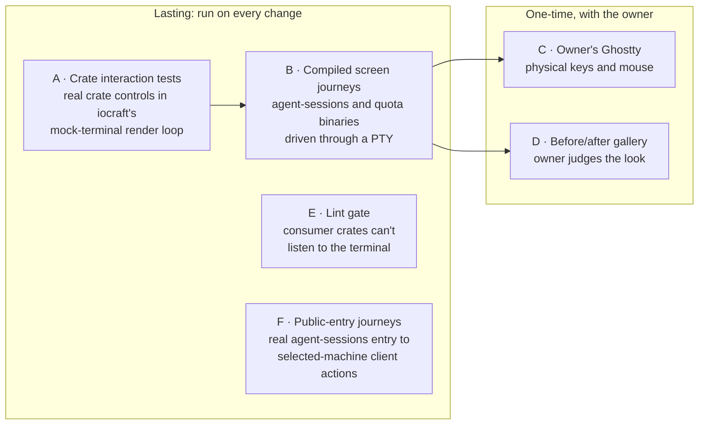

# TUI component system — Verification Design

This is the plan for showing that each requirement in [Requirements](requirements.md) holds, judged against [Specification](specification.md) R1–R16 and V1–V16, at the seams named in [Program Design](program-design.md)'s trace table. It is a plan. Nothing in it has been observed.

The owner asked for this to be a lasting system rather than a one-off check: "making a verification system to test all changes robust and making sure we can is very important". So every requirement below is decided by an observation that stays in the repository and runs again on every later change, except the two things only a physical terminal can show, which get a one-time check with the owner.

## The verification system

Six observations decide every row. Each is described once here; the rows name them.

**A — crate interaction tests.** *Lasting; product tests in `agent-collaboration-tui/tests/`.* Real crate controls run inside iocraft's own mock-terminal render loop at the pinned fork `829ebd86`. They are the same render loop, event delivery and canvas the binaries use; only the terminal is replaced. Probes 1, 3, 6 and 7 already used this method and caught real defects with it.

Each test sends terminal events in two ways:
- as **one ready burst**, so several events arrive before any redraw. This is how a fast typist or a paste arrives, and it is where today's leaks happen.
- **separated by observed frames**, so each event sees the previous redraw.

The initial frame is drained first. An unchanged canvas produces no new frame, so an ignored key is confirmed by an event-processed counter rather than by waiting for a redraw. The mock loop has no terminal size and no Ctrl+C opt-in, so A uses fixed layout dimensions with the root's real resize handling. B owns real size changes and quitting.

Each test reads two things back:
- **the serialized frame**: iocraft's mock render loop yields each frame as a `Canvas`. The test serializes it with iocraft's own `Canvas::write_ansi` and feeds those bytes through a terminal-screen parser into a cell grid of characters, colours and attributes. That runs the serializer that dropped the overlay corner in Probe 1, which reading canvas cells alone would miss. It does not run the terminal backend's full, diff and resize writes; B covers those. The parser ignores the trailing CRLF that `write_ansi` appends.
- **each surface's input state**: field text and cursor, selection, focus, a counter per surface, and a log of every action handler that ran with its target.

Targets: Linux CI, and macOS arm64 on Sunclaw (owner: tests run on Sunclaw). Debug profile, signed through `scripts/cargo_debug_signing_runner.sh`.

**B — compiled screen journeys.** *Lasting; extends the existing `verify-codex-router` [compiled TUI journeys](../../../.agents/skills/verify-codex-router/references/tui-journeys.md).* The real `agent-sessions` picker and the quota screen run as compiled binaries through the existing non-publishable `codex-router-quota-reset-test-harness` fixture entry, with no Host and no provider session. The existing Rust PTY driver writes keys into a PTY. The bytes the program writes back are fed into a headless terminal emulator, written in TypeScript or Rust, which yields the exact screen as a cell grid: each cell's character, colours and attributes, plus the cursor. Each checkpoint waits until the grid matches its expected screen, then asserts on cells. It keeps the raw byte stream and the grid. There is no screenshot OCR, so a character can't be misread or missed. The grid decides the mechanical assertions; it is not an image of the terminal.

B also keeps **original terminal-rendered images**, which the 2026-10-17 design requires (10-17/U13: real compiled screenshots, not reconstructed pictures). At each checkpoint the same exact PTY bytes are rendered by a real terminal renderer, xterm.js, the renderer behind today's ttyd and VHS captures. It runs in headless Chrome driven from TypeScript over the Chrome DevTools protocol, with no Playwright, and the result is saved as an original PNG bound to its source, build, viewport and checkpoint. These originals are the appearance evidence for U11, R16 and the gallery (D), at every required scene, grid and resize pose. Any picture drawn from a grid is labelled a derived diagnostic and never counts as an original. Using xterm.js for both the grid (`@xterm/headless`) and the images keeps the two views on one terminal core; that is one reason it is the default candidate.

The emulator is qualified before any journey relies on it. Fixtures with known grids cover:
- SGR colours, both named and 24-bit;
- two-column glyphs (📂, ✉️, 界), including one starting at an overlay's left edge;
- the kitty keyboard-protocol query and its reply;
- a resize.

An emulator that mis-measures a width or drops a colour fails qualification. The default candidate is `@xterm/headless` (the terminal core VS Code uses), with the Rust `vt100` crate as the fallback; the plan's first step picks one by this qualification and records why.

This layer adds what A can't see: real key encodings arriving over a PTY. The driver runs every journey twice:
- **legacy keys**: the driver doesn't answer the keyboard-protocol query;
- **kitty keyboard protocol**: the driver answers `CSI ? u` and sends kitty-encoded keys.

Bursts are sent as single PTY writes. A single write is a transport burst; it doesn't guarantee the decoded events reach one render batch, so A stays the decisive same-batch test. B is the proof of actual terminal output, including open, close, reopen and resize. Grids are the adopted six: 120×36, 76×30, 48×24, 48×12, 40×24 and 32×24, plus a same-child resize. No tmux anywhere (owner rule); the driver owns the PTY directly. A journey runs only against a declared build, on Sunclaw.

**C — owner's Ghostty check.** *One-time, temporary.* The owner runs the signed debug build in Ghostty on Sunbook, directly and inside an Agent Studio pane. They press the keys only a physical keyboard can prove:
- Ctrl+Enter, and Ctrl+Shift+Enter;
- Ctrl+C;
- a mouse click and the wheel.

The owner's eyes and one capture per step are the evidence. It runs once per delivery and is not kept as a test.

**D — before/after gallery.** *One-time per delivery.* B's original terminal-rendered images, before and after, go into a presentation-html gallery. The owner judges the look against the mocks and the dialog rules ("make sure html design is good"). Captures that show real session titles are never committed.

**E — lint gate.** *Lasting.* The consumer crates (`agent-session-tui` and `agent-router-quota-tui`, today `agent-session-picker` and `codex-router-quota-tui`) and `agent-collaboration-tui` itself get a crate-local `clippy.toml` with `disallowed-methods` naming iocraft's `use_terminal_events`, `use_local_terminal_events` (today used by `codex-router-tui`'s `dialog_interaction.rs` and `DialogButton`) and `use_terminal_size`, which subscribes internally. The existing `clippy -D warnings` gate then fails any consumer that listens to the terminal directly. InputOwner's single subscription is the one sanctioned call site, marked with `#[expect(clippy::disallowed_methods, reason = "InputOwner is the only terminal subscriber (R5)")]`. It is a targeted boundary assertion, and `expect` fails if that call ever disappears. InputOwner also owns the root's terminal-size observation. Negative controls run under the actual workspace CI command, so each per-crate configuration is shown to be picked up. There are three, and each must fail: a consumer calling `use_terminal_events`; a consumer calling `use_local_terminal_events`; and a moved shared control (such as `DialogButton`) keeping its old local listener. A render-only control must pass. It leaves unevaluated: a consumer re-deriving routing from data it already receives; A's Help/menu agreement tests catch the visible symptoms of that.

**F — public-entry journeys.** *Lasting; the existing `verify-codex-router` routes.* These run the real `agent-sessions` executable from its argument entry, through inventory and dispatcher, to the selected-machine client actions: CLIENT-REAL-ENTRY in `tui-journeys.md`, plus the cases in `client-actions.md` and `claude-background.md`. They run on a signed debug Router and Host with an isolated debug root on Sunclaw, using Haiku. B's fixture calls the picker directly and can't see this path, so F carries the 10-17 obligations about real launches and actions. The Claude foreground and background launch modes from the Claude-fix PR join F there.

**Languages.** Every piece of the verification system is TypeScript or Rust (owner, 2026-10-30: "only use ts or rust, not other languages"). Today's TUI journeys check screenshots with a Swift Vision OCR checker (13 `verify_screen_*.swift` files), render them with VHS tapes and ttyd, and start them from shell scripts. B replaces all of that: the grid oracle for checks, and TypeScript-driven xterm.js rendering for original images. Existing tools written in other languages are run, not authored: Chrome, and the terminals themselves. The plan ports the existing scene checks onto grids and removes the Swift files, tapes and shell runners from the TUI journeys.

### Why this mix

- A test that reads iocraft's canvas cells but never serializes and parses the frame would pass the Probe 1 wide-glyph defect. A therefore reads the serialized frame.
- A test that sends events one per frame would pass today's leak, where text typed while a menu opens lands in the box behind. A therefore always also sends bursts.
- A journey that only runs legacy keys never exercises the kitty path, where Ctrl+Enter is distinct. B therefore runs both.
- No harness proves a physical Ghostty delivers Ctrl+Enter (Requirements H2). Only C can.
- Screenshot OCR can misread, merge or miss characters, and a check built on it can pass or fail for reasons unrelated to the screen. B therefore asserts on the exact cell grid from the PTY bytes.

## "Proven by", for the owner

| Requirement | Proven by | Still unverified |
| --- | --- | --- |
| U1 Keys and clicks reach only the top surface and its focused control | Every key and click is sent while a menu, dropdown or dialog is open, in fast bursts and one at a time. The thing underneath must not change at all. | Physical keyboards other than the owner's Ghostty. |
| U2 Everything underneath is disabled and dimmed | With each overlay open, keys and clicks aimed underneath change nothing. The parsed screen shows the underneath text present but lighter, and back to normal in the redraw that closes the overlay. | — |
| U3 Fully usable by keyboard alone and by mouse alone | On both screens and every dialog, each control is reached by Tab, by arrows and by click. Exactly one is visibly focused. | — |
| U4 Main-screen keys | On the picker: Enter shows Details, Ctrl+Enter opens the session, Ctrl+Shift+Enter forks. Esc clears search, then filters, and never quits. Ctrl+C quits from anywhere, on the picker and the quota screen. | Ctrl+Enter from the owner's physical keyboard until check C runs. |
| U5 Dialog keys | In New session, every dialog key is pressed, including Ctrl+Enter with a dropdown open, which starts with the fields unchanged. With a legacy-key terminal, Start is still reached by Tab and Enter and by click. | Same as U4. |
| U6 One definition per action | For every action, the name and key are compared across toolbar, menu, Help and dialog hints on one screen. One action is switched off; it greys out everywhere in the same redraw, and its key and click do nothing. | — |
| U7 Help never lies | Help's list is compared with the screen's actual actions and keys, entry by entry. Help is opened from a dialog and closed again; query, focus and draft come back unchanged. | — |
| U8 Visible settings | Scope, runtime view and sort are changed by click, by menu and by key. The switch and the menu checkmarks always show the current setting. | — |
| U9 Overlays cover cleanly | A dialog, menu and dropdown are opened over rows that start with 📂, ✉️ or 界 one cell left of the overlay. The terminal screen shows the full border and corners, with nothing from beneath. | Glyphs outside the tested set. |
| U10 Closing and focus return | Esc closes one layer at a time. An outside click closes a menu or dropdown but not a dialog, and never clicks what's beneath. Focus returns to where it was, or to the first control if that item is gone. | — |
| U11 Dialog look | Each dialog's text grid is checked: one blank row between sections, one before the buttons, exactly one primary button, status words present beside their colour, and forms sized to content. The owner judges the look in the gallery. | Visual taste beyond those rules: the owner's call in D. |
| U12 Toolbars and menus | Both screens' top rows and ≡ menus are read and compared with the agreed lists, at every size. `/`, F10, typing and Esc behave as agreed, and no shortcut footer appears. | — |
| U13 Combo boxes | Each dropdown rule is driven: filter, pick, cancel, highlight through reorders and removals, unavailable options. | — |
| U14 Same building blocks everywhere | The same control kinds on the picker and the quota screen go through the same behaviour tests and are compared in the gallery. | — |
| U15 Screens built by declaration | The lint gate fails any screen that listens to the terminal itself. A's agreement tests catch a screen whose keys, menu and Help disagree. | A screen routing input by some other private means is caught only by its symptoms. |
| 10-17 baseline kept | The existing Sessions and Quota journeys from 17 Oct and 23 Oct run again on the rebuilt screens and must pass unchanged, apart from the owner-decided changes. The real `agent-sessions` entry is driven through to Claude and Cursor actions on local and remote machines, and they still work. | Any case those routes haven't observed yet stays open, named, not waived. |

## Coverage rows

Each row: requirement and obligations, the seam it observes (Program Design trace), the observation, target and journey, lifetime, what passes and the wrong build that fails, reused tests, and what stays open.

**U1 · R1** (input-ownership)
- *Seam:* InputOwner routing decision; SurfaceStack top surface; FocusModel focused target.
- *Observation:* A, every R1 boundary case, each as a burst and frame-separated; then B for the encoding paths.
- *Target and journey:* A on CI and Sunclaw. B, `needed:` "overlay isolation" journey on both binaries, legacy and kitty modes. Lifetime: lasting.
- *Reference:* R1 text; the Probe 3 failure cases.
- *Passes when:* after each case, every non-top surface's input state is byte-equal to its snapshot from before the input, and the handler log holds only top-surface handlers. The two stated exceptions are Ctrl+C quitting and Ctrl+Enter acting on the dialog under its own dropdown. A printable key in a focused text field appears in that field and runs no shortcut. Enter acts on the focused target.
- *Wrong build that fails:* the native iocraft `TextInput` used behind an overlay. Probe 6 showed an F2+Left+x+paste burst changing its value and cursor; the snapshot comparison catches that. A build that passes: one where the crate's own `TextField` ignores events whenever its surface isn't on top.
- *Reuses:* none; the existing picker tests drive one surface at a time.
- *Unverified:* keyboards other than the owner's Ghostty (C).

**U2 · R2** (input-ownership)
- *Seam:* OverlayHost covered state; Theme dimmed roles.
- *Observation:* A for inertness and the parsed-screen styles; B for the visible result at all grids.
- *Target and journey:* as U1. B scenes "menu open", "dropdown open" and "dialog open" on both screens. Lasting.
- *Reference:* R2 text.
- *Passes when:*
  - With any overlay open, every key and click aimed beneath leaves the beneath surface's state unchanged, apart from R1's two named exceptions: Ctrl+C quits, and Ctrl+Enter with a dropdown open runs the dialog's primary action once.
  - In the parsed screen, every beneath cell outside the overlay's painted footprint (the overlay and its one-cell gutter) keeps its character, and its foreground and any background use the dimmed role.
  - In the redraw that closes the overlay, the beneath cells return to their normal roles.
- *Wrong build that fails:* one that hides the beneath text (characters gone), or one that dims without blocking input (state changes).
- *Reuses:* none.
- *Unverified:* —

**U3 · R3** (input-ownership)
- *Seam:* FocusModel traversal; HitRegions map recorded during the draw.
- *Observation:* A per surface; B for click coordinates at all grids and after a resize.
- *Target and journey:* B, `needed:` "focus traversal" journey on both screens. Lasting.
- *Reference:* R3 text; mocks 1–3.
- *Passes when:*
  - Every declared target is reached by Tab/Shift+Tab, by the arrows within its group, and by a click at its drawn cells.
  - The parsed screen shows exactly one focused-role target after each step.
  - The first draw focuses the first list row.
  - At every completed frame, the published click map equals the target geometry independently observed in that frame's draw, clipped cells excluded.
  - After a resize or scroll, clicks on a target's new visible cells activate it, and clicks on its old cells don't.
  - Clipping cases: a fully hidden target; a partly visible one clicked on its visible and its hidden half, including a button inside a plain consumer `overflow: Hidden` view that no crate viewport owns; nested and bordered viewports; horizontal and vertical clipping separately; each again after a resize. Hidden cells never activate and visible cells always do, so a build that ignores every click fails too.
- *Wrong build that fails:* one that builds the click map from `use_component_rect`'s one-frame-old value, so the map disagrees with the frame's draw. Or one that clips only against the crate's own viewports and misses a consumer's `overflow: Hidden` view.
- *Reuses:* none.
- *Unverified:* —

**U4 · R4, C3** (input-ownership)
- *Seam:* InputOwner main-screen key rules; ActionRegistry.
- *Observation:* A; reused picker tests; B for Ctrl+C and the quota screen.
- *Target and journey:* B, `needed:` "main-screen keys" on both binaries, legacy and kitty. C for physical Ctrl+Enter and Ctrl+Shift+Enter. B is lasting; C is temporary.
- *Reference:* R4 text; 10-17 R9.
- *Passes when:*
  - On the picker, Enter in the list or the filter field opens Details and records no launch. Ctrl+Enter yields the open outcome for the exact source-qualified session without opening Details. Ctrl+Shift+Enter opens the fork confirmation.
  - Esc clears a non-empty search, then resets non-default filters, then changes nothing, and the process is still running.
  - Ctrl+C reaches the app: the app's own quit or cancel outcome is read back at its effect boundary (the picker's existing `SESSION_PICKER_OUTCOME` readback; quota's quit result), then the process ends. This holds from the main screen and with an overlay open, on both screens. Observed in B only, because A's mock loop has no Ctrl+C opt-in. A separate B case sends Ctrl+C during a quota reset commit: the process stays running, and no quit outcome appears until the guard allows it.
  - On quota, Q still quits, and each reset-workflow phase keeps its current quit behaviour: Ctrl+C does nothing while a reset is being committed, and before the commit it exits without committing (`reset_key_action`, protected by `quota_account_options_test.rs`).
- *Wrong build that fails:* Enter launching (the change I wrongly wrote and reverted), or Esc quitting. Or a render loop without `.ignore_ctrl_c()`: iocraft then ends the loop itself before the app sees the key, so the process exits but no Quit action is logged, and the Committing guard is bypassed.
- *Reuses:* `crates/agent-session-picker/src/session_picker/picker_details_navigation_tests.rs`. Read: it drives the real picker component with Enter, Ctrl+Enter and Ctrl+Shift+Enter and asserts the outcomes, including "ordinary Enter inspects; it cannot resume or create". It keeps the interaction real, with no mocked routing. Kept, migrated onto the crate's InputOwner.
- *Unverified:* physical Ctrl+Enter delivery in Ghostty (H2) until C.

**U5 · R9** (overlays, dialog keys)
- *Seam:* InputOwner dialog rules; the Ctrl+Enter compound step; TextField; ComboBox.
- *Observation:* A for every R9 key, including the Ctrl+Enter-with-dropdown step and the text-field keys; B for the legacy fallback; C for the physical key.
- *Target and journey:* B, `needed:` "New session dialog" journey (drives to Start through the existing preparation stand-in; no live launch). Lasting. C is temporary.
- *Reference:* R9 text; Requirements H2.
- *Passes when:*
  - Each R9 key does what R9 says.
  - With a dropdown open, Ctrl+Enter closes it with the field unchanged and Start runs once, with the committed field values.
  - In legacy-key mode, where Ctrl+Enter arrives as plain Enter, Start is reached by Tab then Enter and by a click.
  - The key-hint line appears in New session and in no dialog where the spec doesn't call for it.
- *Wrong build that fails:* Ctrl+Enter applying the dropdown's highlight, Start running twice, or Start unreachable without Ctrl+Enter.
- *Reuses:* none.
- *Unverified:* physical Ctrl+Enter (H2) until C.

**U6 · R6** (commands)
- *Seam:* ActionRegistry projections; AvailabilityFn evaluated per routed event.
- *Observation:* A.
- *Target and journey:* A only; a pure projection rule plus routing. No app launch.
- *Reference:* R6 text.
- *Passes when:*
  - For each action, the name and key text are equal in toolbar, menu, Help and dialog hint wherever the action is placed.
  - After availability flips, all of them show the disabled role and reason in the same redraw.
  - A burst of the action's key twice, where the first press makes it unavailable, runs the handler exactly once.
- *Wrong build that fails:* availability cached per render, so the second press in the burst runs the handler again. Or a menu label hand-typed separately from the action.
- *Reuses:* none.
- *Unverified:* —

**U7 · R7** (commands)
- *Seam:* the Help projection; DialogFrame body swap.
- *Observation:* A; B for the Help scene at all grids.
- *Target and journey:* B, existing compact tapes' Help scenes, updated. Lasting.
- *Reference:* R7 text and the scope's action definitions.
- *Passes when:*
  - Help's entries, read from the parsed screen, equal the scope's bound action and key pairs, with no extra and none missing.
  - It scrolls by keyboard.
  - Opened from a dialog, it replaces the body, and closing restores the query, focus and draft byte-for-byte.
- *Wrong build that fails:* today's Help, which says Esc will "clear search or go back" while Esc quits.
- *Reuses:* the compact tapes' Help checkpoints, after their expectations are updated to the action list.
- *Unverified:* —

**U8 · R8** (commands)
- *Seam:* ActionRegistry checked state; SegmentedSwitch.
- *Observation:* A.
- *Target and journey:* A; B scene "menu open" shows the checkmarks at every grid. Lasting.
- *Reference:* R8 text.
- *Passes when:* after each change by click, by menu and by key, the switch's selected segment and the menu's checked items equal the model's current scope, runtime view and sort.
- *Wrong build that fails:* a checkmark kept in the menu's own state.
- *Reuses:* none.
- *Unverified:* —

**U9 · R10** (overlays)
- *Seam:* OverlayHost one-cell left gutter.
- *Observation:* A with the serialized frame; B for the real terminal at all grids.
- *Target and journey:* B scene "wide glyph under overlay", using fixture rows that start with 📂, ✉️ and 界 at overlay-left−1. Lasting.
- *Reference:* R10 text; the Probe 1 failing cases.
- *Passes when:* for every row the overlay covers, the parsed screen shows the overlay's border character at its left edge, its corners, and its background in every interior cell and in the gutter cell. No beneath character appears inside.
- *Wrong build that fails:* no gutter. Probe 1's corner loss reappears in the serialized frame even though the canvas cells look right.
- *Reuses:* the Probe 1 case, promoted from example to test.
- *Unverified:* glyphs outside the tested set; other terminals' wide-glyph handling.

**U10 · R11** (overlays)
- *Seam:* SurfaceStack close; FocusModel restore.
- *Observation:* A.
- *Target and journey:* A; B scene "outside click" on both screens. Lasting.
- *Reference:* R11 text.
- *Passes when:*
  - Esc pops exactly one overlay.
  - An outside click closes a menu or dropdown, leaves a dialog open, and adds nothing to the handler log beneath.
  - Focus returns to the recorded target, or to the first enabled target when that item was removed while the overlay was open.
- *Wrong build that fails:* the outside click falling through to the row beneath. Or focus restored by position onto a different session.
- *Reuses:* none.
- *Unverified:* —

**U11 · R12** (overlays, dialog look)
- *Seam:* DialogFrame; DialogSection; StatusValue; Theme.
- *Observation:* A on the text grid; B originals at all grids; D owner review.
- *Target and journey:* B scenes: Details, Account details, New session and Pool details. D once per delivery. B is lasting; D is temporary.
- *Reference:* R12 text; the owner's Account details screenshot.
- *Passes when:*
  - The text grid shows every R12 element and exactly one primary-role button.
  - Between consecutive section headings there is exactly one blank row, with no blank row inside a section, and one blank row before the actions row.
  - Every status value has its word as well as its colour.
  - A form's height equals its content height when there is room.
  - Other dialogs keep their percentage size.
- *Wrong build that fails:* today's Account details: no gap above Quota windows, and Close flush under the last row.
- *Reuses:* the 10-23 Account and Pool details scene contracts, re-baselined to the new rhythm.
- *Unverified:* visual taste beyond these rules, which is the owner's call in D.

**U12 · R13** (commands)
- *Seam:* Toolbar; MenuButton/MenuDropdown.
- *Observation:* A; B scenes "main screen" and "menu open".
- *Target and journey:* B on both screens at all six grids. Lasting.
- *Reference:* R13 text; mocks 1, 2, q2 and q3.
- *Passes when:*
  - The picker's top row reads ≡ Menu F10, [+ New], [/ Filter…], [This folder | All], plus count and machine.
  - The quota screen's top row reads ≡ Menu F10, [Details], [Filters: … ▾], [Pool], [Options], [Floor] when available, plus account count and clients.
  - Each menu lists exactly R13's items with their keys.
  - At narrow grids, buttons drop from the right, and every dropped action is still in the menu.
  - `/` focuses the picker's filter, and typing filters live.
  - F10 opens the menu on both screens, and Tab from the list reaches the menu button, where Enter opens it.
  - Neither screen shows a bottom row of keys or actions.
  - A test measures every crate-drawn glyph with the pinned renderer's width table and with current Unicode, and requires both to be one cell.
- *Wrong build that fails:* Help or Quit on a toolbar; quota keeping its bottom row of actions; a dropped button whose action isn't in the menu. Or ☰ as the menu icon, which the second width table counts as two cells.
- *Reuses:* none.
- *Unverified:* —

**U13 · R14** (controls)
- *Seam:* ComboBox keyed by `OptionKey`.
- *Observation:* A.
- *Target and journey:* A; B scene "dropdown open" in New session. Lasting.
- *Reference:* R14 text; mock 3; Probe 7.
- *Passes when:* each R14 bullet holds:
  - the highlight follows its option through reorder and update;
  - own typing that still matches it keeps it there, and typing that hides it moves it to the first match;
  - an outside removal leaves nothing highlighted, and Enter picks nothing until ↑/↓;
  - an unavailable option is highlightable but Enter or a click doesn't pick it;
  - Esc leaves the field unchanged;
  - "no match" is shown when nothing matches.
- *Wrong build that fails:* the existing `SearchSelect` behaviour, which Probe 7 showed resets the highlight to the first match when the query grows. Or highlight by position.
- *Reuses:* none.
- *Unverified:* —

**U14 · R15** (controls)
- *Seam:* Controls and Theme, shared by both consumers.
- *Observation:* A, with each control kind's behaviour tests parameterised over both screens' instances; D comparison.
- *Target and journey:* A; D. Lasting for A.
- *Reference:* R15 text.
- *Passes when:* each control kind's key, click and visual-state tests pass identically on the picker's and the quota screen's instances. The kinds are button, text field, filter field, combo box, switch, list, form field and key-hint line. The visual states are normal, focused, hovered, disabled with reason, and selected or checked.
- *Wrong build that fails:* the quota screen keeping its own bottom row of label-only actions (today only F4 Details there is clickable).
- *Reuses:* none.
- *Unverified:* —

**U15 · R5** (input-ownership)
- *Seam:* the consumer obligations; dependency direction.
- *Observation:* E; plus A's U6/U7 agreement tests on the real screens.
- *Target and journey:* E in the existing clippy gate. Lasting.
- *Reference:* R5 text.
- *Passes when:* `clippy -D warnings` passes with `use_terminal_events`, `use_local_terminal_events` and `use_terminal_size` disallowed in both consumer crates and in the component crate, which has one `expect`-marked call in InputOwner. Each of E's three negative controls fails under the actual workspace CI command.
- *Wrong build that fails:* a screen keeping its own `use_terminal_events` key chain, as `picker_input.rs` does today. Or a shared control keeping a `use_local_terminal_events` listener, as `DialogButton` does today.
- *Reuses:* the existing clippy gate.
- *Unverified:* private routing by other means. It is caught only by its symptoms in U6/U7.

**10-17 baseline · R16**
- *Seam:* every migrated screen.
- *Observation:* B, the existing journeys, for everything the screens show and do. F, the existing public-entry journeys, for what B's fixture can't reach: the real `agent-sessions` argument entry, inventory, dispatcher and selected-machine client actions.
- *Target and journey:* B: the existing compact Sessions and Quota journeys, Normal43 and the hard-case Quota journey, with their scene checks ported from screenshot OCR to the grid oracle, re-run on the rebuilt screens. F: the `verify-codex-router` public-entry routes, CLIENT-REAL-ENTRY (`tui-journeys.md`) and the cases in `client-actions.md` and `claude-background.md`, on a signed debug Router and Host with an isolated debug root on Sunclaw, using Haiku. Both lasting.
- *Reference:* 10-17 Requirements, Specification and Verification Design; 2026-10-23 C1–C10.
- *Passes when:* every existing checkpoint passes unchanged, except those whose expectation the owner changed:
  - dropdown choices;
  - Esc on quota;
  - the dialog rhythm.
  Those are re-baselined and listed. Identity and effect guards hold: source-qualified session refs, AccountId, one Start, and no automatic retry.
  F passes when each 10-17/U15–U16 case still passes through the rebuilt picker. The cases are native Claude launch and receipt, managed Cursor and Claude actions on local and remote selected machines, exact captured identity, and the original arguments kept. Where an exact-source earlier result still applies, the delivery evidence says what it covers and why; where a case is unobserved, it stays open with this route, not waived.
- *Wrong build that fails:* a capability that silently disappears in the move, such as a Sessions filter or a quota reset step. Or a picker whose components and fixture outcomes work while the public executable dispatches the wrong client, retargets the source, or no longer launches native Claude.
- *Reuses:* the existing journeys and the PTY tests `compiled_quota_filters_real_stored_providers_and_disabled_intersections` and `compiled_sessions_atomic_paste_searches_literal_id_and_restores_terminal_modes`. Both are named in the journey reference as real PTY tests on the compiled fixture.
- *Unverified:* whatever those journeys already list.

## Journeys still needed

| Journey | Layer | Lifetime | Entry and what it reads |
| --- | --- | --- | --- |
| Grid oracle and emulator qualification | B | lasting | Feed fixtures with known screens (colours, wide glyphs, kitty query, resize) through the chosen TypeScript or Rust headless emulator; the grid must match exactly |
| Ported existing journeys | B | lasting | The 10-17 and 10-23 Sessions and Quota journeys, their scene checks moved from Swift OCR to grid assertions; the Swift checker, VHS tapes and shell runners removed |
| Overlay isolation | B | lasting | Both binaries; open each overlay, send bursts of text, arrows and clicks aimed beneath; read the grid beneath unchanged |
| Focus traversal | B | lasting | Both binaries; Tab, arrows and clicks over every target; same-child resize then an immediate click |
| Main-screen keys | B | lasting | Both binaries; legacy and kitty modes; Enter, Ctrl+Enter, Ctrl+Shift+Enter, Esc ladder, Ctrl+C, Q |
| New session dialog | B | lasting | Picker; fields, dropdown, Ctrl+Enter with dropdown open, legacy fallback; Start reaches the existing preparation stand-in once |
| Wide glyph under overlay | B | lasting | Both binaries; fixture rows starting with 📂, ✉️ and 界 at overlay-left−1 |
| Owner Ghostty check | C | temporary | Owner's Ghostty on Sunbook, direct and in an Agent Studio pane; physical keys and mouse |

The 10-17 and 10-23 journeys are reused, with re-baselined checkpoints listed in the delivery evidence. Captures and run history live in `tmp/tui-verification/`, never in the recipe.

## Build order

The Verifier builds A's harness pieces and B's new journeys first. Two kinds of "before" evidence are kept apart:

- **Baseline failures** on today's screens, through B's journeys and the retained Probe 1, 3 and 6 fixtures: the leak behind a menu, Esc quitting, Help lying, the dialog rhythm, and Probe 1's corner.
- **Seeded wrong-build sensitivity**: each new A test is shown failing against its named wrong build before the right build passes.

Neither is a real-terminal acceptance result. The UI PR then lands only when every row passes on its declared head. That turns the owner's ask into a gate: a change that breaks any of these rows can't merge.

## Limits

- **H1:** the total keyboard outage the owner saw once stays unreproduced. No row claims it is fixed.
- **H2:** Ctrl+Enter from a physical Ghostty is proven only by C.
- **Grid layout:** Probe 8 showed it works behind a dev feature, but it is not adopted, so nothing here depends on it.
- **Phones:** narrow and short desktop grids stand in for them, as already adopted; actual iPhone hardware stays waived.
