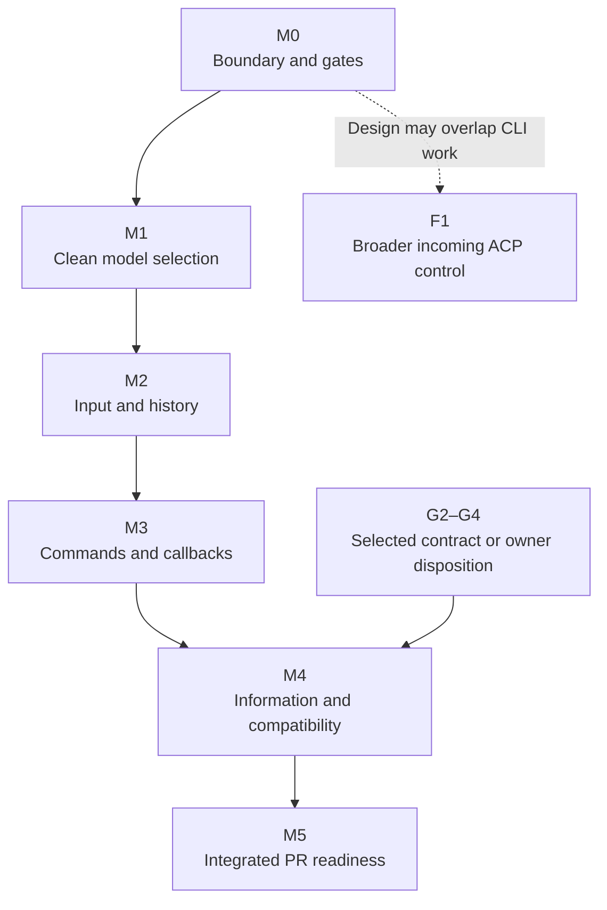

# Milestones and workstreams

The current first follow-up is the [MCP facade lifecycle deliverable](plans/2026-11-05-mcp-facade-lifecycle.html): ordinary controls through the real Host, truthful operator identity, actual Claude/Cursor and original CLI full-turn proof. Its [delivery overview](plans/overview.html) is the human entry. The earlier CLI and bound-ACP roadmap below retains its requirements and open gates; it is not a claim that those later deliverables are implemented or that a tunnel phase exists.

This is the owner's requested **proposed roadmap**, not an execution-ready whole-surface instruction. Its full planning result remains **revision-requested** while later gates remain open. The independently reviewed M1 scope has a [bounded continuation plan](plans/2026-11-02-m1-provider-settings-proof.html), preserving model/default/auth work and earning the remaining actual changed-family proof; its pr-ready-unmerged context applies only to A's repair commission and grants no broader capability or merge authority.

## Milestones at a glance

| Milestone | User-visible result | Done when | Initial forecast |
| --- | --- | --- | --- |
| M0 Agree the boundary and release gates | One understandable design, command map and delivery sequence | Architecture assessment is reconciled, each open contract has a disposition/owner, and affected design/proof rows are reviewed | Next design checkpoint; external decisions have no promised date |
| M1 Clean model selection | `/model` changes the provider model without inherited unavailable-effort or extra save-default errors | Both providers pass actual model-change/default-apply selection, controlled model-only countercases, exact no-op and negative-write checks | About 0.5–1 active working day after the implementation start gate |
| M2 One input, coherent history | Skills/messages render once; steering, interruption and reopen preserve the conversation | Correlation, original item/turn placement and both-provider visible journeys pass | About 1–2 active working days after M1 |
| M3 Provider commands and callbacks | Actual approvals/review and qualified Claude title control | Real producer/effect tests and provider journeys pass, including stronger targeting and package-preservation checks | About 2–3 active working days after M2 and relevant G1/G5 decisions |
| M4 Correct information and remaining compatibility | Startup, context/settings and unavailable controls have deliberate, proven behavior | G2–G4 have selected realizations or explicit owner scope decisions; every retained obligation has proof | Not responsibly dateable until those contracts are selected |
| M5 Integrated PR readiness | One coherent follow-up ready for review, with honest capability coverage | Final tuple, preservation matrix, quality checks, independent review and CI pass | About 1–2 active working days after M4 |
| F1 Broader ACP-control exposure | Reusable control beyond the current incoming subset | I0–I5 extend the selected interface contracts and earn their shared-owner qualification; earlier CLI proof is retained only where applicable | Design may start after M0, alongside CLI work; implementation is not included in the CLI estimate |

Forecasts are planning estimates, not measured durations or calendar commitments. They assume one primary implementation writer, a paired verifier and available provider access. They exclude owner/dependency waits and infrastructure outages. Re-estimate after M1's first integrated proof. There is no honest total finish date while M4 is undated.

## Dependency picture



The M0→M5 chain shows the proposed single-writer delivery order, not a claim that every earlier feature is an inherent prerequisite. The workstream tables name actual contract/data dependencies; the G2–G4 arrow is a real gate on M4 closure. For example, approval-kind preparation does not inherently depend on input-history changes. F1 design can start after M0 and need not wait for M4. Preparation can overlap only as described below; it is not permission to edit the same owner in parallel. Milestones are not automatically separate PRs.

**Affected-scope planning versus shipping:** M0 permits admission for a complete affected scope. M1 can therefore have its own bounded implementation plan while G2–G4 and F1 remain open; that plan does not declare the whole command surface ready. M1 and M2 produce testable/reviewable checkpoints. The one-PR grouping in this proposed roadmap was a Lead planning choice, not an explicit owner prohibition on earlier repairs. This plan-only work selects no split, merge or implementation. The eventual execution/PR boundary must be declared in its delivery context; authoring the M1 plan does not need to wait for undated M4.

## M0 — Agree the boundary and gates

| Order / workstream | Work and owner | Starts after | Completion evidence |
| --- | --- | --- | --- |
| 0.1 Surface and ownership map — Lead | Compare native/MCP/incoming ACP with actual shared owners, standard methods, extensions and gaps | Current source read | Program Design map, capability suppliers and lost-target/authority differences match decisive source |
| 0.2 Architecture assessment — Lead with Daemon Lead input | Keep frontend/provider variation independent; preserve richer operation/authority contracts; name only shared prerequisites that a real caller needs | 0.1 | Agreed boundary assessment with no second server, universal engine or weaker MCP path |
| 0.3 Gate dispositions — Lead / owner for reserved choices | Resolve or explicitly bound G1–G5; distinguish technical design work from owner scope choices | 0.2 | Each affected workstream names a selected contract and proof, or remains visibly blocked; no implicit waiver |
| 0.4 Design and plan review — Lead / retained Reviewer and Verifier | Integrate corrections, check proof feasibility, finalize the executable delivery basis | 0.3 for the affected scope | Current four-document review and a valid plan admission result; this proposed page alone is insufficient |

**What can overlap:** source collection for 0.1 and existing-journey feasibility can overlap. Governing design and plan authorship stay with the Lead. The architecture handoff is input to 0.2, not a transfer of authorship.

## M1 — Clean model selection

| Order / workstream | Deliverable | Requires | Closing check |
| --- | --- | --- | --- |
| 1.0 Cursor startup prerequisite — Implementer | Existing provider DI selects the advertised Agent authentication method; existing runtime authenticates before model discovery/readiness/session admission | Affected provider-startup contract and A0 proof admission; independent of later frontend alignment | Actual runtime wire order, failure/no-session controls, unchanged Claude/Standard startup and combined-tuple qualification; existing CLI login alone is insufficient |
| 1.1 Native model/default handling — Implementer | Catalogue-qualified model-only translation in the existing decoder; retained exact two-edit default-save no-op | Reviewed affected model/default contract and A1 proof | Actual native/Host controlled model effect, no unavailable inherited-effort write, preserved offered Select control; mixed/file/version/invalid cases and no extra save effect |
| 1.2 Visible model proof — Verifier | Retain the regular PersistModelSelection success-only witness and whole-run frame ledger; add early settings-error sensitivity | Expected contract from 1.1; apparatus authoring may overlap implementation | Both early settings and save errors fail even before a later clean frame; advanced/skipped-save suffix cannot pass; package checks pass |
| 1.3 Integrate and qualify — Implementer + Verifier, Lead accepts | Regular primary-Enter model changes on both providers, including one actual changed-family target when reachable | 1.0 + 1.1 + 1.2, declared live target; valid unchanged proof reused | Success-only witness, branch-qualified input/result, actual state/readback, whole-run no-error and clean config/lifecycle. Controlled wire alone decides call counts; state is not a wire-write observation. |

Native config handling and shared native dispatch edits have one writer. Do not hold this milestone for the later full ACP-control API. A genuine missing provider/model prerequisite is reported for this run, not converted into picker-only success.

**Requirement/proof:** affected U3/U4 / R3/R4/R5 and relevant R9/R10/R11; Verification A/A1/B, plus A0 for the R1 startup prerequisite. Reads: Program Design “First CLI changes” and “Model selection without an inherited effort write”; the corresponding Verification routes. Broader U3/R5 remain open.

## M2 — One input and coherent history

| Order / workstream | Deliverable | Requires | Closing check |
| --- | --- | --- | --- |
| 2.0 Steering target contract — Lead | Preserve the existing expected-turn condition to the effect owner; settle exact/current and native retry/fallback outcomes | R7 source countercheck; may be designed independently of M1 | Typed realization and real held Host-port/actor proof are defined; no snapshot-only or returned-ID-only guarantee |
| 2.1 Correlated input — Implementer | Input ID before dispatch, actor-owned receipt and connection-local original-content/client correlation | M1 native handler integration; current input contract | Events-before-response and reverse ordering; wrong/equal-text/cross-session/media cases |
| 2.2 Retained history — Implementer | First item position plus latest/completion, observed turn outcomes and accepted-steer association | 2.1 receipt identity fixed | Late update across turns, failed/interrupted outcomes and terminal steer association through actual hub/rendering |
| 2.3 Visible/history oracles — Verifier | Repair image/one-user-item assumptions; add styled row count and original-content checks | 2.1 contract; can overlap 2.2 in separate TS files | Old duplicate/missing-receipt behavior fails; no genuine equal-text input is silently merged |
| 2.4 Integrate and qualify — paired run | Both-provider skill/text/media, accepted steer then interrupt, read/resume/reopen | 2.0 + 2.1 + 2.2 + 2.3, with the steering realization admitted | One visible input representation, exact identities and original turn/outcome; stale A cannot affect B; lifecycle settled |
| 2.5 Checkpoint review — Reviewer / Lead | Independently review the M1/M2 source and proof on the same follow-up branch; update its draft PR when applicable | 2.4 and relevant quality checks | Corrections settled and a reproducible declared debug test entry; checkpoint is reviewable, not yet merge-ready |

2.1 and 2.2 are serial because receipt and history semantics interact. Prompt correlation can be prepared independently of 2.0; steering receipt/effect integration needs its target contract. TypeScript observer work may overlap once the receipt contract is fixed, with no shared oracle or fixture writer. The new R7 source gap does not invalidate the independent M1 plan.

**Requirement/proof:** U5 and U6 / R6/R8/R10, plus U1 preservation; Verification A/B. Reads: entity/input/turn identities, selected receipt/history design, media and steering countercases.

## M3 — Provider commands and callbacks

| Order / workstream | Deliverable | Requires | Closing check |
| --- | --- | --- | --- |
| 3.1 Approval producer — Implementer | Shared canonical tool-kind mapping with exact offered-choice/scopes preserved | Reviewed callback contract | Real ACP producer → broker/native callback → exact provider option; denied/cancelled/unauthorized controls |
| 3.2 Review task — Implementer | Four native review targets mapped to one ordinary provider task and actual turn handle | M2 input/receipt semantics; 3.1 if the task requests approval | Known-defect review, unchanged files and fast completion; observe current busy/refusal CLI exit as a G2 gap, not recoverable success; no synthetic review mode |
| 3.3 Provider qualification — Implementer | Qualify the selected Claude ACP/SDK/native tuple and existing wrapper with normal traffic | G5 source/build/access preflight | Public import/startup contract, skills/models/tools/subagents/Bash/permission/compaction preservation on new tuple |
| 3.4 Provider title — Implementer | Narrow helper capability, addressed title control, canonical SessionInfo/read/list projection | 3.3 + title contract | One real mutation, canonical normalization/concurrency/reset/readback/reopen; failed or missing readback remains the G2 caller-fatal gap, never a fake success |
| 3.5 Exact control target — Implementer after plan admission | Change the command target/result and paired actor inspection; actor owns effects; preserve the higher Supervisor fence; native worker admits in order and existing connection tasks own deferred replies | Selected G1 prompt/cancellation contract; no broader F1 exposure is required | Supervisor refuses B while old cancel is Unknown; separate direct-runtime/real-broker proof checks actor-local isolation. Cleanup/callbacks, quit barrier, Enter/steer/settings, empty-ID/missing and deadline/disconnect outcomes pass without false cessation |
| 3.6 Integrate and qualify — paired run | Existing prompt through native, MCP and incoming ACP on one provider session, plus CLI callback/command preservation | Current split prompt and cancellation contracts are selected; final M3 integration still requires 3.1–3.5 implementation and qualification for retained scope | VD-D/R12–R14: distinct inputs/actual owner, native-start versus MCP-operation versus ACP-terminal responses, preserved rich content and MCP authority, applicable stale/unauthorized/unavailable and detach/settlement cases; no false completion |

Default implementation order is serial. Verifier scene/oracle work can overlap after each contract is fixed. Do not change the Claude package while another live allocation is using it; 3.3 has one launch/qualification owner. The package upgrade requires rerunning affected M1/M2 provider checks on the new tuple.

**Requirement/proof:** U1/U4/U8 / R7/R8/R11–R14; Verification C/D and applicable B. G1/G5 are real prerequisites for their rows, not reasons to invent a universal interface.

## M4 — Information and remaining compatibility

| Order / workstream | Deliverable | Requires | Closing check |
| --- | --- | --- | --- |
| 4.1 Information contracts — Lead | Keep known broker/facade stance separate from unknown provider enforcement; settle complete native settings and context unknown/reset across all three displays | G3's checked mandatory-policy and display contracts; owner scope decision where actually needed | Current source-backed realization and proof; a profile label or null capacity alone cannot close the gap, and no guessed permissions/usage/capacity is admitted |
| 4.2 Information projection — Implementer + Verifier | Implement only the selected scoped fact mappings | 4.1; M3's final provider tuple | Display/readback/current/stale/reset cases against actual provider facts |
| 4.3a Startup contract — Lead | Select a complete allowed activation/result-application contract; provider rules do not own the client event queue | G4's identical request parameters, cwd-only application guard and existing client boundary | Early global notification and late same-cwd result are both covered; no request-ID/reload/timer readiness heuristic or silent refresh suppression |
| 4.3b Startup proof control — Verifier | Extend existing TS/wterm capture with fresh target, whole-run frame ledger and a declared single-response hold on the real native bridge transport | PD proof seam and held/released target/lifecycle contract; may prepare independently of the selected repair, after plan admission | Old result is computed before holding, newer fixture catalogue is visibly witnessed before release; real endpoint/epoch remain qualified; lifecycle and false-oracle controls pass |
| 4.3c Startup realization — Implementer, paired qualification | Implement only the selected allowed repair and exercise it through the real original-client path | 4.3a + 4.3b; the new proof seam alone is not a repair | Whole-run fresh no-error and actual Session identity; stale-result sensitivity, watcher/never-bound/Unknown/ambiguous/cwd-mismatch cases and clean settlement |
| 4.4 Unavailable-control dispositions — Lead then Implementer | Resolve provider-operation versus existing hide/recovery for Cursor rename, `!`, `/stop` and other identified native gaps | G2, without unauthorized Router/client substitutes | Actual selected client result/error path, effect/no-effect and recovery behavior |
| 4.5 Complete dispatch map — Implementer + Verifier | Closed native method/intent classification, all source rows linked to handling/proof | Selected 4.1/4.3a/4.4 contracts | Canonical census, distinct config intents and actual consumer cases; no unknown-as-unused or blanket success |
| 4.6 Integrate and qualify — paired run | Complete retained information/control obligations | 4.2, 4.3c, 4.4 and 4.5 | Both-provider displays/effects and whole-run original terminal proof |

4.1, 4.3a and the evidence for 4.4 may be investigated independently. Proof authoring 4.3b has a concrete separate TS boundary, but shared capture/target/schema edits still have one writer. These are not parallel edits to native dispatch. Production implementation is serialized when files/state overlap. This milestone has no reliable total duration until its allowed repairs are selected; a proof control is not authority to change the client.

**Requirement/proof:** U2/U4/U6 / R2/R3/R5/R9/R10/R14; Verification A/B/C. A scope exception needs the owner's explicit decision and corresponding spec/plan update; an open table cell is not acceptance.

## M5 — Integrated PR readiness

| Order / workstream | Deliverable | Requires | Closing check |
| --- | --- | --- | --- |
| 5.1 Freeze candidate — Lead | One source/build/client/provider tuple and reconciled command matrix | M1–M4 retained obligations | No mixed-version proof; each row states observed, unsupported or unverified honestly |
| 5.2 Quality and regression — Implementer | Relevant full package suites, static checks and cycle ratchet | 5.1 | Required commands pass; every failure classified and repaired without weakening gates |
| 5.3 Actual integration — Verifier | Final both-provider CLI matrix, native/reverse controls and owned lifecycle | 5.1; stable allocation | Original terminal, exact targets, actual effects/readback and clean settlement |
| 5.4 Independent review and PR — Reviewer / Lead | Source/proof review, corrections and current PR description/checks | 5.2 + 5.3 | No unresolved merge-critical finding; required CI/comments/threads/mergeability checked; PR unmerged |

5.2 and 5.3 may overlap only with separate artifacts/allocations and no writes to the frozen source or binaries. A product change during either invalidates affected evidence and returns to the earliest impacted gate.

One CLI follow-up PR remains the default above the existing bridge dependency. This document does not choose one PR per milestone or authorize a new stack split. No merge, release or production replacement is part of the terminal.

## F1 — Broader ACP-control expansion alongside CLI work

The integrated interface chunk now selects the bounded local ACP v1 profile and R16–R22. It is separate from A's CLI repair and does not depend on completing undated native G2–G4 work. Its [scoped implementation plan](plans/2026-11-04-acp-interfaces-session-tools.html) now carries I0–I5 and their proof gates with a plan-only terminal. Implementation adopts current main and D1 shared-owner changes through I0, and still needs an explicit act-mode commission; none of the dates below authorize code or runtime actions.

| Order / workstream | Starts after | Deliverable and closing check |
| --- | --- | --- |
| I0 Base and contract freeze — Lead | Scoped review/plan plus reconciled main/bridge/repair dependencies | Admit current merged bridge/main and the separately adopted Fleet design/source. Record shared-file writer and landing order; preserve canonical identity, mail/interaction owners and existing command contracts. A's old337-conflict integration is complete; do not recreate it inside B. |
| I1 Bound ingress, identity and tools — Implementer | I0 | Standard v1 client without Router metadata selects the intended backend/caller; equal raw IDs and client tool lists remain isolated. Client MCP setup reaches exact new/load/resume; active empty-list attachment and negative cases pass through real Host wiring. |
| I2 Offers and session controls — Implementer | I1 | Initialize/setup/update offers reflect actual support; set_config/set_mode/close cross the real owner with truthful result/unknown handling. Schema-only support cannot pass. |
| I3 Backend and feature boundary — Implementer | I2; same Host composition writer | Standards-only registration/rules and named backends use unchanged frontend code. Existing queue demonstrates application-owned supply; no new task API, provider engine or registry framework. |
| I4 Interoperability and preservation — paired Verifier observes, Lead accepts | I1–I3 local gates and lasting TS incoming-profile recipe | Actual Claude/Cursor incoming v1 control and client-tool connection/call, exact callbacks and shared-owner result timing pass with original CLI/M1/native/reverse preservation on the integrated tuple. Controlled order/negative cases remain separate. |
| I5 Reviewable follow-up — Lead/Reviewer | I4 and required current-head checks | Scoped independent implementation/proof review, CI/comments/threads/mergeability and honest command/capability matrix. Include the applicable F1–F4 Fleet-boundary checks; no merge/release or full legacy G2–G4 claim. |

I1→I2→I3 is serial because connection/profile/capability/Host files overlap. The paired Verifier may build the independent TypeScript standard-client driver after I1's profile contract is frozen, while I2 is implemented; shared schemas/fixtures and live allocations have one owner and are serialized. I4 never overlaps product edits. Fleet's D1 changes the same Host startup owner, so two product writers cannot edit it concurrently. D1 is the active writer: B adopts its landed composition before shared-file implementation, or receives an explicit bounded handoff from the Fleet Lead while D1 is in flight. D2/D3/D4 are preserved external contracts; all future Fleet work is not a blanket prerequisite for I1. The separate Fleet access lane's held F4a follows B and re-cuts onto its published session-setup shapes; it is not another reason to wait before B. These are actual dependencies, not a claim that every protocol feature must wait for every CLI fix.

| Checkpoint | Initial active-work forecast after I0 | What prevents a calendar date |
| --- | --- | --- |
| I1 bound client and session tools work in the controlled Host | 1–2 working days | Base reconciliation, typed session setup and real create/restore/equality proof must be available. |
| I2 truthful offers/settings/close | Another 1–1.5 working days | Qualified backend option/control behavior and fixture order cases. |
| I3 registration/feature boundary | Another 0.5–1 working day | Existing shared-Host custody/authority proof is added; no unrelated feature or DI framework. |
| I4 actual interoperability | Another 1–2 working days | Account/access/tool preflight, client MCP fixture and actual callbacks must be available. |
| I5 follow-up review/readiness | Another 0.5–1 working day | Current-head CI and required review, not a fixed number of reruns. |

These are estimates, not measured durations or promises. One product writer plus an independently writing Verifier is assumed; design/owner/dependency waits are excluded. The first interface plan uses one coherent follow-up PR. Do not infer one PR per checkpoint or a stack rewrite. Remote ACP identity, v2, task orchestration and storage distribution remain separately governed future work.

## Quality commands and live target gates

Run from the Router repository root. Narrow these to changed packages during a workstream; run the retained scope's full set at integration. The existing signed Cargo runner and debug-boundary rules still apply.

```sh
pnpm --dir verification install --frozen-lockfile
pnpm --dir verification run check
pnpm --dir verification run lint
pnpm --dir verification run format:check
pnpm --dir verification test
cargo fmt --all -- --check
cargo nextest run --locked -p collaboration-runtime -p collaboration-contracts -p acp-client-runtime -p acp-provider-adapters -p session-event-model -p codex-router-host
cargo clippy --locked -p collaboration-runtime -p collaboration-contracts -p acp-client-runtime -p acp-provider-adapters -p session-event-model -p codex-router-host --all-targets -- -D warnings
cargo nextest run -p workspace-architecture-check --run-ignored only
```

The actual client route is the existing TypeScript capture runner:

```sh
node scripts/verification/tui/capture/capture-run.ts --codex-acp-only --codex-acp-plan PLAN.json --check
node scripts/verification/tui/capture/capture-run.ts --codex-acp-only --codex-acp-plan PLAN.json
```

`PLAN.json` must be a validated, declared allocation with exact signed artifacts, owned debug root, live endpoints, provider settings, allowed effects and lifetime. This is not a command to launch an undeclared run. Passing apparatus checks is not a provider pass. No new verification framework is planned.

## Planning basis and replan rules

Basis: this set's Requirements, Specification, Program Design and Verification Design; interface source checkpoints bridge `4134b3cec` and main `fb3cf6b5`, with the existing native/provider and architecture source maps. The current scoped R16–R22 review is at `4bf598132`; this roadmap is not its canonical implementation plan. Terminal: plan-only. Repository: Codex Router. Existing tracking board retained. This is one proposed sequence, not a canonical ready record.

Replan when architecture moves an owner/public contract, a provider/client pin changes materially, a required proof is unreachable, a new store/transport appears, authority would be weakened, a PR split is needed, or an estimate depends on an unresolved gate. Lead authors the correction; helpers supply evidence and review. Never label a milestone complete from a helper receipt, acknowledgement, source census or final frame alone.
