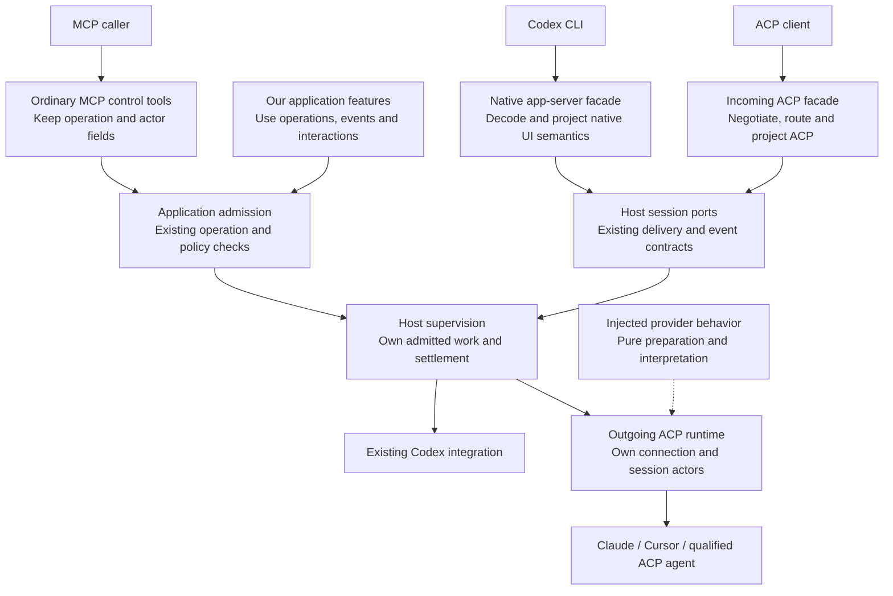
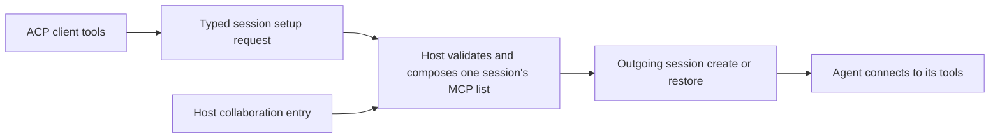
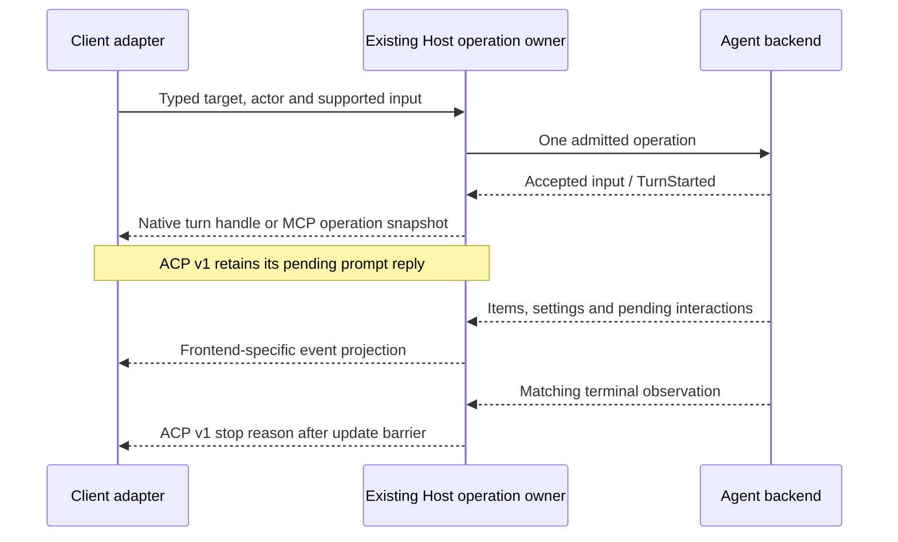
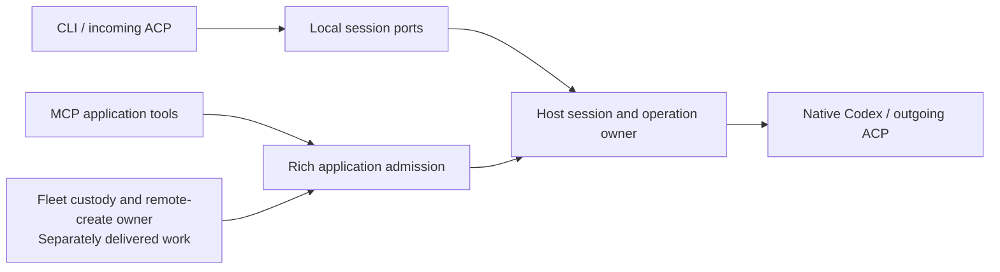

# How the incoming and outgoing interfaces fit

The Host owns session work. Codex CLI, incoming ACP and MCP are independent frontends over that work; Codex native and ACP agents are independent backends. Provider rules are injected into the outgoing runtime. Our application features use the session, operation, observation and interaction contracts above it.

This chunk realizes Specification R16–R22 and refines the existing shared-control sections. It does not replace the detailed native command, normalization, cancellation or information contracts in [Program Design](program-design.md). In particular, the existing CLI G2–G4 gaps stay visible; a better interface does not make those menu behaviors implemented.

Read next: [delivery overview by deliverable](plans/overview.html), [implementation sequence and proof gates](plans/2026-11-05-mcp-facade-lifecycle.html), [milestones and forecasts](delivery-plan.html), and the [CLI command inventory](../2026-10-31-codex-cli-acp-actions/command-inventory.html).

## The whole system

There are three frontends and two internal admission routes. Codex CLI and incoming ACP use the existing session command ports; MCP keeps its richer application admission contract. Both routes reach the existing Host execution owner. Keep their operation, identity and result fields intact; the parent Program Design's **First shared operation** section shows the actual call paths.

The owner-selected [MCP facade](mcp-facade.html) completes typed control mappings over those existing owners; it is not an ACP-message tunnel. The split admission routes preserve current guarantees, not separate agent execution systems. Existing collaboration tools retain behavior, and hierarchical tasks remain outside this delivery.

## What DI means here

| Constructor choice | Supplied dependency | Reason it changes |
| --- | --- | --- |
| Frontend | Its command, read/event and interaction ports | A client protocol, representation or reply boundary changes. |
| Backend registration | Endpoint identity, launch binding, qualified runtime and `Arc<dyn ProviderBehavior>` for ACP | A supported agent, launch prerequisite or provider dialect changes. |
| Application feature | Existing typed operation admission, observations and interaction operations | Product behavior changes independently of transport. |
| Storage implementation | The existing owning service's store handle | A separately governed storage decision changes. Frontends do not select it. |

There is no DI container, global `Services` lookup, plugin loader or string-to-JSON command engine. Concrete dependencies are built at Host startup and passed directly to their consumers. `ProviderBehavior` stays pure and synchronous; lifecycle/authentication I/O stays in `acp-client-runtime`. Standard ACP interpretation can be reused; named provider extensions get a concrete qualified behavior implementation.

## Selected incoming ACP profiles

Use the existing connection shell with an explicit profile. One process may serve several owner-private listener sockets; this does not introduce another execution service.

| Profile | Selection and caller | Wire identity and exposure |
| --- | --- | --- |
| Provider-bound standard v1 | Exactly one endpoint and the existing Host-resolved local owner identity, as already used by the private native provider face | Ordinary ACP session IDs are scoped by this bound endpoint. No Router metadata is required. Negotiated standard methods plus only explicitly offered extensions. |
| Existing Router-aware multiplexed v1 | Explicit Router endpoint/session reference and declared actor under its existing private-local contract | Endpoint-qualified references are authoritative. A bare unknown or colliding raw ID is rejected; it never falls back to the wrong endpoint. Existing default Codex behavior is confined to its documented create/list case. |

The standard profile is the initial complete generic-client path. It reuses `resolve_face_owner_human_id`, private directory/socket protection and the existing owner identity supplied to `RouterSessionAppServerContext`. Failure to resolve that identity leaves the bound endpoint unavailable; the facade does not invent an actor or accept a metadata override. This is the same local-owner authority boundary as the native face, not remote client authentication. Remote ACP and additional principals are outside this profile.

Connection binding selects the caller; the stored session roles still govern effects. Attaching to a session does not change its creator or Approver. For example, the existing settings owner permits the stored creator or Approver to change settings, while interactive callbacks go to the exact pending Approver. The convenience create command sets creator and Approver to its caller; richer application requests keep those roles independently. Neither an advertised capability nor a visible model-selection message grants authority.

| Connection | Selector | Wire protocol |
| --- | --- | --- |
| Existing Codex CLI provider face | `<communication-dir>/router-sessions/<endpoint-id>.sock` | Native app-server JSON-RPC over Unix WebSocket; unchanged. |
| New bound ACP client face | `<communication-dir>/acp-sessions/<endpoint-id>.sock` | ACP v1 JSON lines over a private Unix socket. |
| Existing Router-aware ACP face | `<communication-dir>/codex-acp.sock` | Existing multiplexed ACP profile. |
| MCP caller | Existing service manifest API/MCP selectors | Existing streamable HTTP API; not either ACP socket. |

Keep the bound face out of `EndpointDescription.channels`. That list already selects the execution transport: `conversation_client::advertised_conversation_transport` treats `Acp` as the existing Codex carrier and `ExternalProvider` as the provider application backend; publishing both would make conversations ambiguous. Keep provider endpoints' `ExternalProvider { transport: StdioAcp, binding_id, ... }` channel and existing Codex `Acp` channel unchanged. The provider-bound socket is an explicit derived facade under the selected service directory, like the separate native provider face, not another conversation execution channel. `ServiceManifest` retains its current API/MCP role and version.

In `collaboration-client`, add a narrow provider-bound carrier opener alongside `AcpTransportConnection::connect`; retain that existing advertised Codex opener and its root-parent guard. The bound opener qualifies the selected service/endpoint as an available external provider, derives only `acp-sessions/<endpoint-id>.sock`, verifies the canonical private child directory belongs directly to the selected service root and the canonical socket belongs directly to that child, then opens it with the existing connection timeout. Validate the endpoint ID as one safe filename segment and refuse symlink escapes or missing/private-path failures. This entry point returns the opened Unix stream; it does not manufacture the Codex carrier's schema digest or initialize ACP. Successful endpoint discovery alone does not prove the optional facade is bound; missing socket means unavailable, with no fallback to Codex.

`agent-collaboration acp --endpoint <id>` is the standard client's stdio entry. Select the existing advertised Codex carrier for a Codex endpoint and the explicit provider-bound opener for an external provider. Its existing line-forwarder remains byte-preserving: no initialization, metadata injection, ID rewriting, permission decision or automatic replay. Negotiation belongs to the actual client and bound server. Ordinary conversation create/prompt continue using `ExternalProvider`; no caller is moved to ACP as a side effect of adding this facade. Host binds the derived socket only when its owner/backend prerequisites hold; otherwise it is unavailable. Absolute/private-directory checks and the OS Unix-socket path limit must pass. No socket accepts both framing protocols.

The connection profile becomes one consumer-owned closed value in `codex-acp-adapter`: `Bound { endpoint: SessionEndpointRef, actor: Identity }` or `RouterAware`. `AcpChannelListener` receives it from Host composition. A bound connection installs only its selected route; `session/new`/`list` select that route, and every later method checks that session against it. Do not keep an always-installed Codex default route inside a bound provider connection.

Separate the listener's transport/profile inputs from the existing Codex route's generation/schema/recorder/holder dependencies. The bound provider constructor receives its provider command/event/inspection/broker handles, not mandatory unused Codex-route handles. Router-aware composition still supplies the existing lazy Codex route and its original dependencies. Reuse `AcpSessionRoute` and the connection task owner; no new generic route factory framework or process supervisor is required. A provider route cannot acquire Codex admission merely to negotiate or dispatch its own session. Bound listeners own no Codex generation, holder or recorder; their accept failure retires only their own bound channel. This is a facade-construction boundary, not the future Host/app-server process split.

For Router-aware connections, change the raw-ID index to an ambiguity-aware association: `Unique(endpoint)` or `Ambiguous`. Never select the most recently inserted endpoint. An explicit matching `SessionRef` resolves the target; it grants no actor permission. This index is connection-local derived state, not another durable session ID or database. Provider-bound listeners need no ID rewriting or global collision registry.

### The client's MCP tools belong to the requested session

An ACP client's `mcpServers` list is the tool configuration it asks the selected agent to use. It is different from our incoming MCP control tools and from the Host's own collaboration entry. Honor it on `session/new`, `session/load` and `session/resume`; an empty list requests no client-supplied servers. It neither removes Host-required collaboration access nor changes another session's tools. The agent owns connecting to and running those servers. The facade does not run an MCP server, proxy its tools or execute its commands.

Use the existing session command boundary. Add `SessionMcpRequest = HostDefaults | ClientServers(SessionMcpServerList)` in `collaboration-contracts`. `CreateSessionCommand` carries it; load/resume use a narrow `SessionAttachCommand { target: SessionRef, actor: Identity, mcp: SessionMcpRequest }` instead of giving close and other target-only commands an unused configuration field. Native/MCP application callers select `HostDefaults`, preserving their existing behavior. The bound ACP decoder selects `ClientServers`, including the empty list. The existing Router-aware Codex route retains its current `McpConfiguration` behavior; this change does not rewrite that backend.

`SessionMcpServerList` is validated session input, not an identity or persisted setting. Its closed transport variants retain the standard fields: `Stdio { name, command, args, env }`, `Http { name, url, headers }` and `Sse { name, url, headers }`. Names and each environment/header entry are strings; argument and entry order and values reach the outgoing standard DTO without shell expansion. Reject malformed shapes, NUL-bearing process arguments/environment, duplicate server names and duplicate environment names at ingress. Standard stdio commands may resolve through the agent's normal process environment; do not impose the native Codex route's separate absolute-command restriction on the bound ACP profile. Use the locked ACP schema for wire validation, then the validated protocol-neutral input above; keep ACP SDK DTOs out of `collaboration-contracts`. No unqualified vendor MCP extensions are offered.

The Host's existing create/restore composition owns the resulting list. It selects its collaboration entry through the current enrollment/binding owner, appends the requested client servers, and rejects a client name colliding with that reserved entry before provider work. Clients cannot replace that entry or supply another session's bearer binding. Unsupported HTTP/SSE transport is refused before create/restore; advertise those capabilities only when the selected backend and path support them. Stdio is required for a qualified standard profile. The existing connection-wide HTTP check must not silently drop a valid client's stdio list. `ProviderBehavior` remains pure; actual per-session MCP delivery belongs to `acp-client-runtime`.

The session actor owns only the setup it admitted for its lifetime, alongside its existing session state. On new or cold restore, pass the composed list on that exact provider request. Retain the successful client setup for equality checks while that actor is active; no database, credential cache or global default writer is added. A later cold restore takes its client list from that request again. For `ClientServers` against an already active session, an unchanged known client setup may attach without reconfiguration. A changed list, unknown setup or changed required Host binding returns typed `McpReconfigurationRequiresReload` before attach/replay; it cannot silently acknowledge a configuration it did not apply. `HostDefaults` preserves existing active-session attachment behavior and leaves that session's current setup alone. No automatic close, recreation or interruption is introduced. Existing authorization remains authoritative before setup or effect, and an unrelated session's setup never changes.

Extend the existing `CommandFailure` with closed invalid-MCP, unsupported-transport, reserved-name-conflict and reconfiguration-required failures, projected as ACP errors without secret values. Preflight failures cause no provider create/load/resume or MCP effect. After a provider request is submitted, retain its actual known/unknown outcome and any returned session identity under existing lifecycle recovery; no rollback claim or automatic resend. A successful session response means the provider accepted that setup, not that every external tool server is healthy. Qualification separately observes an actual tool connection. Keep URLs, headers and environment values out of Debug, trace, events and storage; configuration remains in the owning in-memory request/session lifetime.

`HostDefaults` on new or cold restore records a known empty client-server list. That is equal to `ClientServers([])` for a later active attachment: CLI/MCP-created sessions can be loaded/resumed by a standard client sending `[]`, with no provider reconfiguration. A session already active before this setup tracking existed has unknown client setup; only that missing observation, not the use of another frontend, justifies the reconfiguration-required result. A non-empty list different from the active setup still requires an explicit cold restore.

Client tools are not persisted across actor retirement. On a later cold restore, `HostDefaults` supplies only the Host defaults, and `ClientServers` supplies that request's list; earlier client tools may be absent even when the conversation history mentions them. The client must supply the tools it wants again. The Host's collaboration entry has a different owner/lifetime: use the exact existing session binding returned by that owner on restore, never re-mint it, echo it to the ACP client or copy it into a client tool's URL, arguments, headers or environment. This design implements no persistence for client tools or binding mechanism for Fleet.

Client stdio setup can cause the agent to start a client-chosen process before any model tool-use approval. It relies on the bound face's existing same-user, owner-private trust boundary; it is not confinement by the interaction broker. A future remote or additional-principal profile cannot inherit this authority without its own design. B makes no claim to prevent an authorized same-user process from proxying another service.

This extends the existing command and runtime owners because the standard client supplies data they currently cannot carry. It adds no generic configuration engine. Silently discarding the list violates truthful results; refusing every non-empty list would narrow the ordinary-client outcome. The existing native path's MCP setup is preservation evidence, not proof of this outgoing ACP path.

### Capability construction

Replace the fixed initialize response with a projection of the selected profile and implemented route support. Inputs are the real backend binding/capability report, route implementation set and client representation. These are not three copies of capability truth: backend facts and route implementation remain their owners; the projection derives the offer.

The connection initializes once at protocol v1. Connection-wide offers are valid for every target reachable through that profile; model/session-specific facts are returned by session setup and later updates. In multiplexed mode use only support guaranteed across reachable routes for connection-wide standard booleans, then retain richer endpoint/session reports. A Host-supplied queue feature is evaluated as a Host feature, not removed merely because an agent lacks native queueing.

The outgoing runtime advertises the Host's actual callback capabilities; it is not re-created or downgraded for whichever frontend happens to attach. Incoming callback presentation is separately constrained by that client's representation and approver identity. This keeps an existing MCP/CLI answer path available when an attached ACP client cannot render a form.

Use a closed `AcpRouteSupport` at the connection-shell boundary for `load`, `list`, `resume`, `close`, `set_mode`, `set_config`, supported input kinds and offered profile elements. It describes implemented/qualified support, never a permission grant. The existing capability/profile schema owns the wire projection; no separate handwritten native/MCP copy of backend facts is introduced. Unknown prerequisites produce no positive offer. Schema presence and parser branches cannot set support true.

## Inputs, outputs and completion

This sequence shows result timing, not a new common executor. Native replies still come through its command port; MCP still reaches `ConversationOperations`; incoming ACP still uses `stream_prompt`. ACP v2's acceptance-and-state contract is not enabled by changing one constant.

| Operation family | Incoming ACP v1 | Codex CLI native | MCP/application contract |
| --- | --- | --- | --- |
| Initialize/discover | Profile-specific version/capabilities and backend selection | Existing initialize/config/model reads | Existing endpoint and tool discovery |
| Create | `session/new`; bound caller/endpoint, real creation result | `thread/start` and existing owner binding | Explicit operation ID, generation, creator/approver/policy retained |
| List/attach | Implemented `session/list`, `load` replay and `resume` no-replay semantics | Existing thread list/read/resume | Existing list/inspect/load/resume operations and recovery |
| Prompt | Supported content; terminal stop reason after updates | Actual correlated turn start then events | Actual operation admission/snapshot; separate wait/reconcile |
| Models/config/mode | `session/set_config_option` or `set_mode` only when qualified; return actual updated setup/config shapes | Existing native model/effort normalization and actual facts | Existing typed settings operations and actual readback |
| Cancel | Session-level notification; no durable-operation identity invented | Exact/current distinction and terminal reply as separately specified | Exact operation and durable settlement contract |
| Close | Existing session close; release/close semantics and result after actual operation | Existing native lifecycle handling | Existing close operation; not delete |
| Delete/fork/other optional operations | Withheld unless a real owner and qualified standard/extension contract exist | Existing applicability/refusal rules | Existing offers only; no inferred parity |
| Approvals/questions | Exact callback/reply if representable and authorized | Existing native dialogs/forms and broker | Existing typed interaction operations/elicitation |
| Queue/steer | Negotiated Router profile methods with target semantics | Existing inputs and scope; exact-steer gap remains explicit | Existing Host operations; no provider-native fiction |
| Operation show/wait/reconcile | Router extension only after its schema/identity/custody is separately specified | Existing native result/event behavior | Existing rich operation contract |
| Our extra feature | Standard mapping where exact; otherwise a negotiated extension | Only existing meaningful native actions; no new menu | Its own typed tool over application admission |

The table is a routing contract, not a claim every current method is implemented. The [source inventory](../2026-10-31-codex-cli-acp-actions/command-inventory.html) remains the complete native/UI census, and its per-action status must be updated as changes land. Full G2–G4 native compatibility remains separately gated.

### New settings and close handlers

Extend `ProviderAcpSessionRoute`, not the outgoing agent client, for incoming `set_config_option`, `set_mode` and `close`. Resolve the exact bound session, validate against actual advertised options, use the existing `set_setting`/`close` command and read the owning catalogue after success. Render the response with the locked ACP v1 schema. Unknown IDs, unsupported modes, stale model context and uncertain writes retain typed failure; never echo the request as confirmation. Close does not delete stored history or promise that unrelated processes ended.

The route currently has no catalogue read dependency: `SessionEventHub` supplies events/summaries, and the native `SessionModelCatalog` deliberately omits original config-option IDs and value kinds. Inject one narrow `ProviderSessionInspectionPort` in `collaboration-contracts`, consumed first by the incoming provider route and implemented by the Host. Its sole async method uses the existing `ProviderSessionInspectRequest`, `ProviderSessionInspectResult`, `ProviderInspectFailure` and `ProviderSessionInspectFuture`; no second settings schema is introduced. It reads the active runtime's last provider-observed catalogue/capabilities through the existing supervisor inspection owner. The live ingress read must not silently use the general inspector's Host-memory, last-recorded catalogue fallback; missing active observation returns Unavailable. Existing native/MCP inspection retains that fallback for the Host lifetime; it is not an at-rest store. Each frontend follows its declared observation rule, so this fallback need not equal an unavailable active read.

`ProviderAcpSessionRoute` receives this read handle beside commands/events/broker. Setup and post-setting responses use the original catalogue IDs, names, kinds, current values and choices from `ProviderSettingsCatalogView`; preserve its source as last provider-observed session information, not a new global-current guarantee. Map only supported categories/value kinds to mutable ACP controls. The setter still performs its fresh qualification before effects; a prior read never authorizes a write. If application succeeded but its required response observation becomes unavailable, return a truthful failure and retain the known effect/history—no empty catalogue, guessed value, rollback or automatic resend.

The port shape is `inspect_active(request: ProviderSessionInspectRequest) -> ProviderSessionInspectFuture<'_>` on a `Send + Sync` trait. Result fields remain the existing target/state/capabilities/history/optional-settings-catalogue shape; errors remain NotFound, Unavailable or Overloaded. The Host performs existing board/protocol identity conversion at its boundary and excludes the Host-memory last-recorded fallback for this method. This is an in-process read contract with no provider mutation, new storage or retry policy. Its first caller is session setup/config projection; the general MCP inspector is not downcast into this active-only contract.

The first settings profile exposes only the qualified model/mode/effort controls that the existing command contract can actually apply. Preserve each backend's real config ID/value mapping in its catalogue. Other categories or value kinds are not advertised as mutable controls until their owning operation is specified; do not forward arbitrary `configId` strings into the three-kind setter or invent another generic command. A provider's extra facts may remain observational data without a claimed write capability.

Locked schema response homes are `NewSessionResponse`/`LoadSessionResponse` for optional initial modes/config options, `SetSessionConfigOptionResponse` for the full actual current option set, and `SetSessionModeResponse`/`CloseSessionResponse` for their qualified empty results. Emit the corresponding actual change notifications where required. Feature-gated optional methods require both the locked negotiated profile and backend support; their mere SDK definition cannot turn on an initialize capability.

Do not expose delete or fork solely because the schema names them. Missing current handlers are implementation work; missing qualified backend effects remain unavailable. Prompts preserve content capabilities and selected-skill meaning; an MCP text input does not downcast another frontend's richer content.

## Crates, services and data ownership

| Home / status | Semantic responsibility | Consumers and allowed dependencies |
| --- | --- | --- |
| `collaboration-protocol`, `session-event-model` / existing | Canonical IDs, domain requests/results, facts/events, capability and interaction shapes | Imported by ports/adapters; no Host or frontend implementation dependency. |
| `collaboration-contracts` / modified | Existing command/event/operation interfaces plus the narrow active inspection port | Host implements them; frontends consume only needed interfaces and reuse existing result DTOs. |
| `codex-acp-adapter` / modified | Incoming ACP transport shell, profile/negotiation/routing and existing Codex route | Receives profile/route support; does not own provider dialects or operations. |
| `collaboration-runtime` / modified | Native facade, provider ACP route, projections and existing broker integration | Uses contracts/model; no provider-specific frontend switch. |
| `collaboration-service` / existing | Rich application admission, recovery and feature operations | Uses existing backend/store contracts. No frontend owns this policy. |
| `collaboration-mcp` / existing | MCP tool schemas and representation | Calls the application; does not replace its admission with the convenience port. |
| `collaboration-client`, `agent-collaboration` / modified | Explicit provider-bound carrier selection and the existing stdio relay | Preserve conversation execution selection and advertised Codex opener; qualify the derived provider facade without broadening the existing selector guard. |
| `codex-router-host` / modified | Constructors, local owner/profile binding, delivery, supervision and lifecycle | Selects backends and supplies handles; owns tasks through shutdown. |
| `acp-client-runtime` / existing | Outgoing ACP connection, session actors and standard I/O | Receives pure provider behavior and interaction/event ports. |
| `acp-provider-adapters` / bridge candidate | Qualified Claude/Cursor behavior and reusable Standard behavior | Depends on provider contract/model; no native or MCP DTOs. |
| Existing application feature modules | Own feature meaning and call the operation/event/interaction contracts | Future tasks can use these; no task subsystem is added here. |

| Data / current home | Owner and access | Effect of this design |
| --- | --- | --- |
| `provider-operations.sqlite` | Existing provider operation/session store and Host/hub projections | Reuse; no new session or operation database. |
| `interaction.sqlite` | Existing interaction storage/service owns pending/settled approvals/questions and related records | Adapters use the owning broker/service. Replication, fleet-central and inbox/outbox strategy remain another scope. |
| `automation.sqlite` | Existing automation/schedule owner | No scheduling or storage change. |
| `session-registry.sqlite` | Existing local session registry owner | No alternate registry or frontend-owned session truth. |
| Normal Codex home/state/session files | Existing Codex integration | Preserve existing read/control boundaries; do not replace with a fake home. |
| Connection profile/routing index | Incoming connection owner, in memory | Derived ephemeral association; no persistence or crash-recovery promise. |

The composed source baseline is `cbf56bad640ae981900c646ff2ae0b64aaaebd3b` (workspace 0.1.125). Host startup opens the existing `InteractionStore` at `interaction.sqlite` and injects that handle into `ServiceInteractionBroker`; no parallel JSON approval owner is selected. The named frontend/provider contracts retain their existing owners. This design selects no engine, driver or migration change. Existing store APIs/schema migrations remain authoritative; recheck the actual implementation base against this snapshot before execution. Path names are not replication contracts.

## Compatibility with Fleet work

B owns the local client-to-agent bridge. Fleet owns cross-machine custody and remote-create admission. Both may reach the same Host session owner through their existing contracts. Sharing that owner does not make an ACP request a Fleet message or make local-owner socket access remote authorization.

| Shared concern | Owner that stays authoritative | B's integration rule |
| --- | --- | --- |
| Machine and session identity | Existing identity/discovery owner; Fleet's separately governed machine-id cutover | Preserve the full current SessionRef (machine/service, endpoint, opaque provider session ID). Read current identity from discovery; never mint another machine ID, normalize provider IDs to UUIDs or add an old-ID routing alias. Bind a new connection to the current published identity. |
| Local versus remote creation | Local command owner for the convenience profile; Fleet command owner and rich admission for remote requests | A local create may generate its own operation and use its caller as creator/Approver. Preserve whatever request, operation, role, policy and first-input fields Fleet's adopted command owner records through its trusted path; B does not select their remote binding. Do not run it through a convenience create that discards those fields. No new remote-create ACP method is added here. |
| Message custody and replay | Fleet/mail runtime and its inbox/outbox owners | ACP request IDs and provider operation IDs keep their existing meanings. A mail item's durable receipt, session hand-off and provider turn completion are separate facts. No frontend outbox, second hand-off retry or fabricated delivered/terminal state. |
| Callback authority | Existing interaction broker and session's stored roles | Local socket binding does not overwrite creator or Approver, including sessions created by another application path. Preserve future additional identity variants at existing converters; an unrepresentable actor fails explicitly rather than becoming the local owner. |
| Physical storage and retention | Current store owners and Fleet's separate D3/D4 work | The database table above is an observed baseline, not a promise that automation stays local or tables keep their names. Adapters receive ports, never store paths or SQL. B implements no migration, id rewrite, retention rule or approval/question replication. |
| Lifetime and availability | Host owns its child tasks; Fleet owns its connection, enrollment and custody work | A bound listener failure withdraws that face only. It cannot retire Fleet transport, release a lease, drain another owner's outbox or cancel unrelated work. Conversely Fleet/project unavailability is not an invented local-provider capability failure. Existing admission prerequisites remain real. |
| Capability exposure | Supplier plus frontend projection | A local ACP endpoint offers its qualified local methods. Fleet remote-create/status/mail features stay in their owning CLI/MCP application surfaces until their own negotiated ACP contract exists. No implied protocol parity. |
| Shared composition files | One agreed writer per shared owner | Startup supplies the current mail, interaction and session handles alongside the new bound face. Consume landed Fleet constructor changes; do not restore an older constructor or old schema to make the facade compile. Reconcile by responsibility, not by taking an entire branch's side. |

The comparison uses released bridge source `cbf56bad6`, current main `0f9af21f6`, Fleet design `1702e4288` and D1 implementation `ef87b73d3`. Fleet's D1 contribution is compared from its merge base `f04d083ca`; files absent only because its branch predates the bridge are not treated as an intentional deletion. D1 changes mail composition and Host startup; the named B ingress/provider ports remain separate. D1 is actively integrating and is not merged to main. Its Router source is `18f1fd517`, pending the Central merge; the library branch is `agent-fleet-sync` `15714a5`. D2's four-document proposal at `1702e4288` is revision-requested and is not an adopted interface: its typed Fleet sender, delivery address, first-input replay and creator/Approver bindings remain unsettled. In particular, do not introduce or depend on the proposed `RemoteRequester` type or blanket local-owner Approver rule. Fleet's remote-sessions Specification R16–R20 requires one session per request ID, replay from the recorded result, no redispatch after an unknown outcome, at-most-once first input, the temporary enrolled-machine policy and immediate offline refusal. Its operation-ID and creator/Approver bindings remain owned by D2's adopted Program Design; B assumes no particular unadopted binding. D3's identity cutover is designed but not implemented; D4 is design only. These source snapshots and statuses establish compatibility constraints, not completed Fleet capabilities.

Fleet's central-storage-reset set owns the detailed contracts: `specification/mail.md`, `specification/remote-sessions.md`, `program-design/d1-central-layout-and-mail.md`, `d2-fleet-sends-and-remote-create.md` and `d3-local-cleanup.md` under `docs/specs/2026-11-02-central-storage-reset/` at the Fleet design revision. Its later D2/D3/D4 work is a dependency to preserve, not implementation assigned to B. Identity migration, mail retention, first-input replay and remote enrollment policy are not redefined here. If their adopted meaning changes a B boundary, update this affected design before building on it.

**Shared-file order: D1 first, B integration second.** The Fleet Lead has active D1 writers in Host startup, mail runtime, message/application operations, MessageFailureKind/client error projection, MCP message tools, central/message-board code, cutover tooling and every agent-fleet-sync Cargo pin. B does not write those owners while D1 integrates. On implementation admission, consume the landed D1 version, or obtain an explicit bounded shared-file handoff from that Lead if D1 is still in flight. Then earn the affected shared-Host observations. B's design and disjoint preparation can proceed now; D2/D3/D4 completion is not a blanket prerequisite. Their unsettled contracts remain outside B's offered surface. A clean Git merge alone cannot establish semantic compatibility.

Fleet access is a separate lane. Its current source is `agent-vm`'s `docs/specs/2026-11-02-fleet-access/` at `adf66f8d1`; the older item-two/agent-identity roots are retired history. Its held Router F4a branch `item2/f4a-router-registrar-binding` at `514ad6268` proposes per-session MCP selection, create/load/resume setup arguments, MCP attribution and Host launch admission. It is not on main, and overall access-design approval is still pending. Its Lead's shared-file order is **B's local interfaces first; F4a re-cut onto those shapes later**, distinct from active D1's startup order. B's client-tool request reaches the existing Host setup owner; the access lane continues to own how its collaboration entry is obtained. Exchange the actual published setup signatures before that re-cut. B selects no token/registrar mechanism and does not change production AccessEnrollment. Local-owner socket calls, incoming MCP tools and an agent's session-bound collaboration address retain their separate caller meanings.

## Entity binding and boundary shapes

| Entity | Owner / home / schema | Boundary shape and retention |
| --- | --- | --- |
| E1 session | Existing Host/session owner; `collaboration-protocol` and board `SessionRef` codecs | Service + endpoint + provider session ID; stored by existing session/operation owner. ACP bare ID only inside a bound/qualified endpoint. |
| E2 action | Frontend decoder; existing native/ACP/MCP method DTOs | One invocation, derived disposition; no durable action store. |
| E3 request | Frontend connection; existing envelope codecs | Connection + opaque request ID, request/response correlation only, ephemeral. |
| E4 input | Existing submission/actor owner; `InputId`/`ProviderSubmission` | Admitted input identity + supported content; event/operation lifetime, not text deduplication. |
| E5 fact | Existing settings/capability/catalogue/event owner; new narrow inspection port in `collaboration-contracts`, existing `provider_session_inspect.rs` DTOs | Active last-observed `ProviderSessionInspectResult`/`ProviderSettingsCatalogView`, no silent historical fallback; adapters derive views without a second cache. |
| E6 disposition | Frontend policy; existing native disposition/settings intent | Closed supported operation/read/no-op/unavailable outcomes; derived, not a runtime registry. |
| E7 turn | Existing session actor/hub; observed turn ID and event envelope | Original session/turn association retained in existing history; updates never reassign to a later turn. |
| E8 operation | Existing application/supervisor/store; typed operation requests/snapshots | Operation ID, generation, requester/approver/policy and known/unknown effect; existing durable owner. |
| E9 frontend | Existing native/MCP/ACP adapters | Its negotiated protocol and port dependencies; adapter lifetime. |
| E10 offer | Backend/Host supplier plus frontend projection; existing `CapabilityReport` and profile codecs, modified route-support input | Supplier/scope/prerequisites + representable offer; derived from current facts, no capability database. |
| E11 backend | Host registration/supervisor; existing launch/binding identity and injected behavior | Endpoint, generation/runtime/availability and qualified launch; reuse existing registration/config and operation store. |
| E12 connection profile | Host selects; ACP shell owns; new closed `AcpConnectionProfile` in `codex-acp-adapter` | `Bound { endpoint, actor }` or `RouterAware`; v1 negotiation and route support, ephemeral. |
| E13 application feature | Existing application module; its own typed operation schema | Feature-specific input/result with existing actor/target/admission; no new aggregate-agent/task data model here. |

No entity gains a second persistent owner. B leaves persisted row schemas and their migration mechanisms to the owning lanes; the incoming facade receives none of those database handles. Fleet may change its own storage under its separate design.

## Extending the system

**Add an ACP backend:** register its endpoint/launch and inject a concrete behavior. Reuse Standard behavior when no provider-specific interpretation/authentication is required; otherwise implement that behavior's pure policy. Add its qualified prerequisites/capability facts and actual conformance evidence. Existing product registration still uses a closed provider kind list, so update that list and its exhaustive composition cases atomically where the first new backend needs it. Do not add a dynamic plugin/factory framework in advance. No frontend needs another execution implementation.

**Add a frontend:** implement its decoder, result/event projection and callbacks over existing ports. If it needs stronger identity/admission, use the existing rich application contract rather than dropping fields to fit the convenience port. An additional public extension is designed at its first real consumer, not preemptively exported.

**Add our feature:** put its policy in its owning application module, consume admitted operations/observations/interactions, and expose a representable tool or negotiated extension. The feature cannot reach into a provider transcript, database or raw ACP connection to bypass the owner. Existing queue is the concrete integration example; tasks are future consumers, not delivered functionality.

## Ordering, failure and lifecycle

The shell owns one writer, connection tasks and bounded routing queues. It correlates replies before forwarding, refuses duplicate request IDs and tears down its subscriptions/index on close. Session/operation work remains owned according to its existing admission contract; a dropped connection is not permission to replay or cancel everything. Missing/unavailable targets never become an idle success. Preserve the already specified actor-owned exact-control design; do not introduce another cancellation coordinator for the new ingress.

All bound listeners share the existing Host connection-budget semaphore and shutdown owner. A new endpoint is not another unbounded accept/task pool. Startup exposes bound sockets only after their bind/readiness prerequisites; partial startup and shutdown drain the owned tasks and withdraw only their own socket resources. Existing advertised-channel publication stays with its current owner. Reuse the existing inode-scoped cleanup and retirement handling; no stale-path unlink loop or production restart is added.

Callbacks cross the existing broker. Only the exact approver gets an interactive presentation. Preserve offered IDs/scopes and persistent consent; absent consent fails validation. Unsupported form elicitation leaves the question explicitly pending/unavailable to that client, with the existing authorized CLI/MCP answer path retained. No timer, empty answer or automatic grant closes it. Future distribution choices stay with the interaction owner. The current Fleet work preserves approval/question behavior and does not commission their replication; B adds no alternative interaction store or delivery route.

On configuration outcome uncertainty, keep the owning setting state unresolved and the existing prompt guard; no synthetic success or automatic retry. On backend retirement, reject new calls and preserve admitted work/settlement facts under existing supervision. Unknown terminal outcomes remain unknown at the domain boundary; do not infer success from a projection or stream closure. ACP v1 reply ordering and native quit/cancel barriers keep their distinct owners.

## Alternatives and the cost we accept

| Choice | Gain | Cost and payer | Revisit when |
| --- | --- | --- | --- |
| Selected: provider-bound standard endpoints, existing Router-aware profile separate | Standard clients need no vendor metadata; capabilities and raw IDs have a clear scope | More listener declarations and an explicit client opener, paid by Host/client maintainers; no new process | A real client requires one multiplexed endpoint and understands a qualified selection/identity profile. |
| One universal multiplexed endpoint for every client | One address | Generic ACP clients lack backend selection/actor metadata; collision/capability ambiguity needs extra protocol | A standard mechanism actually supplies those missing contracts. |
| Selected: existing split ports over one execution owner | Preserve native/MCP/ACP result and authority differences | Explicit projections and cross-entrypoint proof, paid by adapter maintainers | A first caller cannot preserve a named field through the existing contract. |
| New universal execution API or task engine | A broad common vocabulary | Replaces working ownership and invites weakest-common semantics; unsupported scope | A demonstrated consumer needs an operation the existing owners cannot provide. |

T3 Code's per-instance driver/session contract and Orca's narrow dialect/shared lifecycle support the selected separation. Their Effect DI framework, journal/store topology and task semantics are not prerequisites. See the source research links in the parent source map; this design follows the local owners rather than copying their package tree.

## R16–R22 realization and proof seams

| U | R / observable contract | E | Owner | Interface | Shape and home | State | Failure | Proof seam |
| --- | --- | --- | --- | --- | --- | --- | --- | --- |
| U8/U10 | R16 / C16 standard bound client | E1/E3/E9/E11/E12 | Incoming ACP connection and Host session setup | Explicit carrier opener, profile, route selection, session command/attach ports | Bound/RouterAware profile in ACP shell; SessionMcpRequest and validated server list in collaboration-contracts; existing SessionRef | Connection uninitialized→negotiated→closed; per-session setup admitted/unknown/retired | Missing owner/backend unavailable; foreign/ambiguous target, invalid/conflicting tools or unapplied active reconfiguration refused | Metadata-free real listener/Host, client-tool create/load/resume and active/no-effect cases, then actual provider/tool connection |
| U7/U11 | R17 / C17 add backend once | E9/E10/E11 | Host composition and provider runtime | Registration + ProviderBehavior | Existing launch/binding and pure behavior contract | Qualified ready/unavailable/retired | Missing protocol/auth/extension evidence never ready | Standard behavior registration through the same frontend code; actual backend qualification |
| U4/U8/U10/U11 | R18 / C18 truthful offers | E1/E5/E10/E11/E12 | Backend facts owner and incoming projector | Active inspection port + route support + profile projection | Existing inspection/catalogue/profile DTOs; narrow read contract in `collaboration-contracts` | Active last-observed/empty/unavailable/invalid scoped by target | No historical fallback, parser-only offer or guessed empty/default; truthful post-effect read failure | Setup/update output compared with active backend and implemented route, including unavailable/negative profile |
| U8/U10 | R19 / C19 result/custody | E3/E4/E7/E8/E12 | Existing admission/supervisor; frontend result owner | Command port, rich backend, stream_prompt | Existing typed requests/turn handle/operation snapshot | Admitted/started/terminal/unknown remain distinct | Caller drop/gap cannot fake terminal or trigger replay | Held matching terminal through native, MCP and ACP v1; same real Host owner |
| U4/U8/U10 | R20 / C20 exact interaction | E1/E7/E8/E10/E12 | Existing interaction broker and callback adapter | Typed decision/question operation | Existing offered IDs, actor, acknowledgement and form schema | Pending→settled or explicit unrepresentable view | Wrong actor/choice/late answer/missing consent refused | Actual callback producer→broker→frontend→reply with guarded provider effect |
| U7/U8/U12 | R21 / C21 our feature | E8/E9/E10/E11/E13 | Owning application feature | Existing operation/event/interaction ports | Existing queue schema and feature-specific DTO at its owner | Offered/admitted/settled per actual operation | No bypass, fake provider feature or ACK-as-effect | Existing queue through its real owner and two representations, no task-engine stand-in |
| U1/U6/U7/U9/U11 | R22 structural preservation | E1–E13 | Host composition and package owners | Explicit constructors/contracts | Binding/owner tables; existing stores unchanged | Existing lifecycle retained | Forbidden dependency/source path detected; no global locator | Dependency graph, existing conversation create/prompt plus both stdio carrier paths, current native/reverse/M1, Fleet boundary/composition preservation and source-bound integration observations |

R1–R15 keep their individual parent trace rows and named gaps. U10 maps to R16/R18–R20; U11 to R17/R18/R22; U12 to R21. E11–E13 have binding rows above; all other entities retain their original meaning. The new interface contract does not supersede an accepted CLI requirement or claim that older G2–G4 gaps are closed.
